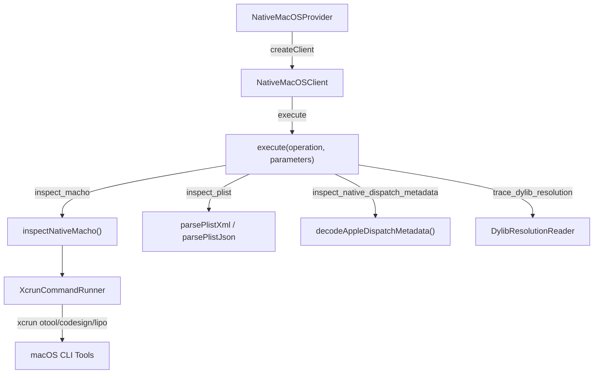
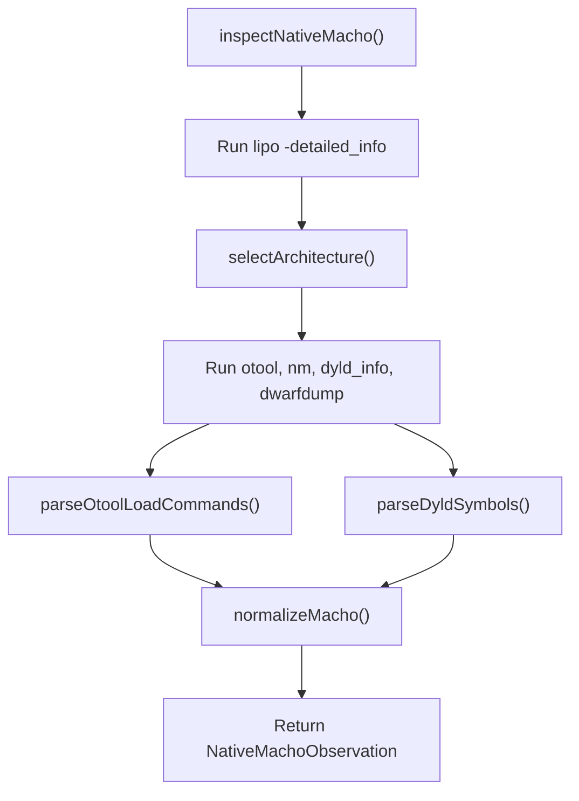

<!-- source: DeepWiki mcp.deepwiki.com · repo morluto/rea · page 4.3 Apple / Native macOS Provider · fetched 2026-10-16 -->

# Apple / Native macOS Provider

Relevant source files

The following files were used as context for generating this wiki page:

- [docs/apple-application-analysis.md](docs/apple-application-analysis.md)
- [docs/verification/javascript-analysis-effects-2026-10-15.json](docs/verification/javascript-analysis-effects-2026-10-15.json)
- [docs/verification/javascript-analysis-effects-2026-10-15.md](docs/verification/javascript-analysis-effects-2026-10-15.md)
- [scripts/verify/apple/dyld-environment.mjs](scripts/verify/apple/dyld-environment.mjs)
- [src/artifacts/ArtifactHash.ts](src/artifacts/ArtifactHash.ts)
- [src/artifacts/OrderedReads.test.ts](src/artifacts/OrderedReads.test.ts)
- [src/artifacts/OrderedReads.ts](src/artifacts/OrderedReads.ts)
- [src/artifacts/apple/DylibResolutionReader.ts](src/artifacts/apple/DylibResolutionReader.ts)
- [src/artifacts/apple/InterfaceBuilderAnalysis.ts](src/artifacts/apple/InterfaceBuilderAnalysis.ts)
- [src/artifacts/apple/InterfaceBuilderDecodeBudget.test.ts](src/artifacts/apple/InterfaceBuilderDecodeBudget.test.ts)
- [src/artifacts/apple/InterfaceBuilderDecodeBudget.ts](src/artifacts/apple/InterfaceBuilderDecodeBudget.ts)
- [src/artifacts/apple/KeyedArchiveReader.test.ts](src/artifacts/apple/KeyedArchiveReader.test.ts)
- [src/artifacts/apple/MachoImage.fixture.ts](src/artifacts/apple/MachoImage.fixture.ts)
- [src/artifacts/apple/MachoLoadCommandReader.test.ts](src/artifacts/apple/MachoLoadCommandReader.test.ts)
- [src/artifacts/apple/MachoLoadCommandReader.ts](src/artifacts/apple/MachoLoadCommandReader.ts)
- [src/artifacts/apple/NibArchive.test.ts](src/artifacts/apple/NibArchive.test.ts)
- [src/artifacts/apple/NibArchive.ts](src/artifacts/apple/NibArchive.ts)
- [src/artifacts/apple/NibViewHierarchy.ts](src/artifacts/apple/NibViewHierarchy.ts)
- [src/domain/apple/dyldEnvironment.ts](src/domain/apple/dyldEnvironment.ts)
- [src/domain/apple/dyldPaths.ts](src/domain/apple/dyldPaths.ts)
- [src/domain/apple/dylibResolution.test.ts](src/domain/apple/dylibResolution.test.ts)
- [src/domain/apple/dylibResolution.ts](src/domain/apple/dylibResolution.ts)
- [src/domain/apple/dylibResolutionFindings.ts](src/domain/apple/dylibResolutionFindings.ts)
- [src/domain/apple/interfaceBuilderGraph.test.ts](src/domain/apple/interfaceBuilderGraph.test.ts)
- [src/domain/apple/interfaceBuilderGraph.ts](src/domain/apple/interfaceBuilderGraph.ts)
- [src/domain/apple/interfaceBuilderKeyedArchive.ts](src/domain/apple/interfaceBuilderKeyedArchive.ts)
- [src/domain/apple/jvmClassFile.ts](src/domain/apple/jvmClassFile.ts)
- [src/domain/apple/machoCpuIdentity.ts](src/domain/apple/machoCpuIdentity.ts)
- [src/domain/apple/plistValue.test.ts](src/domain/apple/plistValue.test.ts)
- [src/domain/apple/plistValue.ts](src/domain/apple/plistValue.ts)
- [src/domain/javascript/electronStaticAnalysisBrowser.ts](src/domain/javascript/electronStaticAnalysisBrowser.ts)
- [src/domain/javascript/electronStaticAnalysisComputedPreferences.test.ts](src/domain/javascript/electronStaticAnalysisComputedPreferences.test.ts)
- [src/domain/javascript/electronStaticAnalysisIpc.ts](src/domain/javascript/electronStaticAnalysisIpc.ts)
- [src/domain/javascript/javascriptContextBridgeExposure.ts](src/domain/javascript/javascriptContextBridgeExposure.ts)
- [src/domain/javascript/javascriptFeatureSeed.array_members.test.ts](src/domain/javascript/javascriptFeatureSeed.array_members.test.ts)
- [src/domain/propertyListKeys.test.ts](src/domain/propertyListKeys.test.ts)
- [src/domain/propertyListKeys.ts](src/domain/propertyListKeys.ts)
- [src/evm/EvmoleInterfaceAdapter.test.ts](src/evm/EvmoleInterfaceAdapter.test.ts)
- [src/evm/EvmoleInterfaceAdapter.ts](src/evm/EvmoleInterfaceAdapter.ts)
- [src/native/AppleDispatchCoverage.ts](src/native/AppleDispatchCoverage.ts)
- [src/native/AppleDispatchDecodeFacts.ts](src/native/AppleDispatchDecodeFacts.ts)
- [src/native/AppleDispatchMetadata.test.ts](src/native/AppleDispatchMetadata.test.ts)
- [src/native/AppleDispatchMetadata.ts](src/native/AppleDispatchMetadata.ts)
- [src/native/AppleMachoFixups.test.ts](src/native/AppleMachoFixups.test.ts)
- [src/native/AppleMachoFixups.ts](src/native/AppleMachoFixups.ts)
- [src/native/AppleMachoSelection.test.ts](src/native/AppleMachoSelection.test.ts)
- [src/native/AppleMachoSelection.ts](src/native/AppleMachoSelection.ts)
- [src/native/AppleObjcCategories.ts](src/native/AppleObjcCategories.ts)
- [src/native/AppleObjcDispatchFacets.ts](src/native/AppleObjcDispatchFacets.ts)
- [src/native/AppleObjcProperties.ts](src/native/AppleObjcProperties.ts)
- [src/native/AppleObjcProtocols.ts](src/native/AppleObjcProtocols.ts)
- [src/native/AppleSwiftDispatchFacets.ts](src/native/AppleSwiftDispatchFacets.ts)
- [src/native/AppleSwiftVtables.test.ts](src/native/AppleSwiftVtables.test.ts)
- [src/native/AppleSwiftVtables.ts](src/native/AppleSwiftVtables.ts)
- [src/native/CommandRunner.ts](src/native/CommandRunner.ts)
- [src/native/MachoArchitectureSelection.ts](src/native/MachoArchitectureSelection.ts)
- [src/native/NativeMacOSProvider.ts](src/native/NativeMacOSProvider.ts)
- [src/native/NativeMachoInspection.test.ts](src/native/NativeMachoInspection.test.ts)
- [src/native/NativeMachoInspection.ts](src/native/NativeMachoInspection.ts)
- [src/native/parsers/codesign.ts](src/native/parsers/codesign.ts)
- [src/native/parsers/otool.ts](src/native/parsers/otool.ts)
- [src/native/parsers/plist.test.ts](src/native/parsers/plist.test.ts)
- [src/native/parsers/plist.ts](src/native/parsers/plist.ts)
- [src/native/pe/PeResourceParser.ts](src/native/pe/PeResourceParser.ts)
- [tests/acceptance/applications/electronPreloadOverridesCli.test.ts](tests/acceptance/applications/electronPreloadOverridesCli.test.ts)
- [tests/acceptance/applications/interfaceBuilderPlistNumbers.test.ts](tests/acceptance/applications/interfaceBuilderPlistNumbers.test.ts)
- [tests/acceptance/applications/nibFieldIdentity.test.ts](tests/acceptance/applications/nibFieldIdentity.test.ts)
- [tests/boundary/cli/dylibResolutionCli.test.ts](tests/boundary/cli/dylibResolutionCli.test.ts)
- [tests/boundary/cli/keyedArchivePrototypeKeyCli.test.ts](tests/boundary/cli/keyedArchivePrototypeKeyCli.test.ts)
- [tests/boundary/cli/keyedArchiveXmlNestingCli.test.ts](tests/boundary/cli/keyedArchiveXmlNestingCli.test.ts)
- [tests/boundary/cli/nativeDispatchPropertyAttributes.test.ts](tests/boundary/cli/nativeDispatchPropertyAttributes.test.ts)
- [tests/boundary/cli/nativeMachoDylibIdentityCli.test.ts](tests/boundary/cli/nativeMachoDylibIdentityCli.test.ts)
- [tests/boundary/cli/nativeMachoLinkerOptionsCli.test.ts](tests/boundary/cli/nativeMachoLinkerOptionsCli.test.ts)
- [tests/boundary/cli/nativeMachoObjectSegmentCli.test.ts](tests/boundary/cli/nativeMachoObjectSegmentCli.test.ts)
- [tests/boundary/cli/nativePlistCli.test.ts](tests/boundary/cli/nativePlistCli.test.ts)
- [tests/boundary/cli/nativePlistSelectionFailureCli.test.ts](tests/boundary/cli/nativePlistSelectionFailureCli.test.ts)
- [tests/boundary/cli/nativeSignatureCli.test.ts](tests/boundary/cli/nativeSignatureCli.test.ts)
- [tests/boundary/cli/scenarioCliInputDiagnostics.test.ts](tests/boundary/cli/scenarioCliInputDiagnostics.test.ts)
- [tests/boundary/filesystem/interfaceBuilderBundle.test.ts](tests/boundary/filesystem/interfaceBuilderBundle.test.ts)
- [tests/boundary/filesystem/keyedArchiveDateRange.test.ts](tests/boundary/filesystem/keyedArchiveDateRange.test.ts)
- [tests/boundary/filesystem/keyedArchiveXmlNesting.test.ts](tests/boundary/filesystem/keyedArchiveXmlNesting.test.ts)
- [tests/boundary/mcp/dylibResolutionMcp.test.ts](tests/boundary/mcp/dylibResolutionMcp.test.ts)
- [tests/boundary/mcp/electronMcp.test.ts](tests/boundary/mcp/electronMcp.test.ts)
- [tests/boundary/mcp/keyedArchivePrototypeKeyMcp.test.ts](tests/boundary/mcp/keyedArchivePrototypeKeyMcp.test.ts)
- [tests/boundary/mcp/toolErrorSchemaDelivery.test.ts](tests/boundary/mcp/toolErrorSchemaDelivery.test.ts)
- [tests/boundary/providers/native/nativeCommandTermination.test.ts](tests/boundary/providers/native/nativeCommandTermination.test.ts)
- [tests/boundary/providers/native/nativeInventory.golden.test.ts](tests/boundary/providers/native/nativeInventory.golden.test.ts)
- [tests/boundary/providers/native/nativeLoadKinds.golden.test.ts](tests/boundary/providers/native/nativeLoadKinds.golden.test.ts)
- [tests/boundary/providers/native/nativeLoadText.golden.test.ts](tests/boundary/providers/native/nativeLoadText.golden.test.ts)
- [tests/boundary/providers/native/nativeMachoHeader.golden.test.ts](tests/boundary/providers/native/nativeMachoHeader.golden.test.ts)
- [tests/boundary/providers/native/nativeProvider.test.ts](tests/boundary/providers/native/nativeProvider.test.ts)
- [tests/boundary/providers/native/nativeReexport.golden.test.ts](tests/boundary/providers/native/nativeReexport.golden.test.ts)
- [tests/boundary/providers/native/nativeSelectedArchitecture.test.ts](tests/boundary/providers/native/nativeSelectedArchitecture.test.ts)
- [tests/conformance/native/dispatch.m](tests/conformance/native/dispatch.m)
- [tests/conformance/native/keyed-archive-hierarchy.swift](tests/conformance/native/keyed-archive-hierarchy.swift)
- [tests/fixtures/interface-builder/MacFixture.storyboard](tests/fixtures/interface-builder/MacFixture.storyboard)
- [tests/fixtures/keyedArchivePrototypeKeys.ts](tests/fixtures/keyedArchivePrototypeKeys.ts)
- [tests/fixtures/keyedArchiveXmlNesting.ts](tests/fixtures/keyedArchiveXmlNesting.ts)
- [tests/fixtures/native-macos/lipo-same-cpu/README.md](tests/fixtures/native-macos/lipo-same-cpu/README.md)
- [tests/fixtures/native-macos/lipo-same-cpu/calculator.txt](tests/fixtures/native-macos/lipo-same-cpu/calculator.txt)
- [tests/fixtures/native-macos/lipo-same-cpu/shortcut-droplet.txt](tests/fixtures/native-macos/lipo-same-cpu/shortcut-droplet.txt)
- [tests/fixtures/native-macos/otool-load.md](tests/fixtures/native-macos/otool-load.md)
- [tests/fixtures/native-macos/otool-load.txt](tests/fixtures/native-macos/otool-load.txt)
- [tests/fixtures/nativeCommands.ts](tests/fixtures/nativeCommands.ts)
- [tests/fixtures/objcPropertyMacho.ts](tests/fixtures/objcPropertyMacho.ts)

The Native macOS Provider (`NativeMacOSProvider`) is responsible for interacting with macOS-specific tools and APIs to extract detailed information from Apple binaries and applications. This includes parsing Mach-O executables, decoding Apple-specific metadata (Objective-C and Swift dispatch information), analyzing Interface Builder archives, resolving dynamic libraries, and observing native UI elements. It leverages command-line utilities like `xcrun`, `otool`, `codesign`, and `plutil`, alongside custom high-performance parsers for their output formats.

Sources:
- [src/native/NativeMacOSProvider.ts:101-140]()
- [src/artifacts/apple/InterfaceBuilderAnalysis.ts:54-75]()
- [src/artifacts/apple/MachoLoadCommandReader.ts:131-141]()

## NativeMacOSProvider and XcrunCommandRunner

The `NativeMacOSProvider` class [src/native/NativeMacOSProvider.ts:101-140]() serves as the entry point for macOS-specific analysis. It initializes an `XcrunCommandRunner` [src/native/NativeMacOSProvider.ts:109-111]() to execute command-line tools under a snapshotted environment [src/native/NativeMacOSProvider.ts:116-116]. The provider exposes capabilities defined in metadata [src/native/NativeMacOSProviderMetadata.ts:3-5]() and creates `NativeMacOSClient` instances for specific binary targets [src/native/NativeMacOSProvider.ts:131-139]().

The `XcrunCommandRunner` handles tool resolution via `xcrun`, process execution, and capturing standard output and error streams while enforcing output budget limits (`NATIVE_COMMAND_OUTPUT_BUDGET_BYTES`) and timeouts (`NATIVE_COMMAND_TIMEOUT_MS`) [src/native/CommandRunner.ts:16-69]().

Diagram: Native macOS Provider Execution Flow

**Key Functions/Classes:**
- `NativeMacOSProvider` [src/native/NativeMacOSProvider.ts:101-140](): Main provider class implementing `AnalysisProvider`.
- `NativeMacOSClient` [src/native/NativeMacOSProvider.ts:142-157](): Client bound to a `BinaryTarget`, managing operational requests.
- `XcrunCommandRunner` [src/native/CommandRunner.ts:51-120](): Executes Xcode toolchain commands with safety boundaries.

Sources:
- [src/native/NativeMacOSProvider.ts:101-140]()
- [src/native/NativeMacOSProviderMetadata.ts:3-5]()
- [src/native/CommandRunner.ts:16-120]()

## Mach-O Inspection (`inspect_macho`)

The `inspect_macho` operation provides comprehensive analysis of Mach-O binaries, orchestrating tool invocations and normalizing output structures.

**Data Flow:**
1. `NativeMacOSClient` delegates `inspect_macho` to `inspectNativeMacho` [src/native/NativeMachoInspection.ts:62-64]().
2. Discovery commands (`lipo -detailed_info`) identify architecture slices [src/native/NativeMachoInspection.ts:42-42, 66-74]().
3. Slice-specific commands (`otool -h -l`, `nm`, `dyld_info`, `dwarfdump`) execute concurrently against the target slice [src/native/NativeMachoInspection.ts:50-58, 108-114]().
4. Parsers like `parseOtoolLoadCommands` [src/native/parsers/otool.ts:127-148]() process raw output into structured load commands, segments, and dependencies.

Diagram: Mach-O Inspection Pipeline

**Key Functions/Classes:**
- `inspectNativeMacho` [src/native/NativeMachoInspection.ts:62-64](): Orchestrates multi-tool slice inspection.
- `parseOtoolLoadCommands` [src/native/parsers/otool.ts:127-148](): Parses `otool -l` output for segments and load commands.
- `parseCodeSignature` [tests/boundary/providers/native/nativeProvider.test.ts:74-81](): Extracts code signature details from `codesign` output.

Sources:
- [src/native/NativeMachoInspection.ts:42-64]()
- [src/native/parsers/otool.ts:127-148]()
- [tests/boundary/providers/native/nativeProvider.test.ts:74-81]()

## Plist Parsing (`inspect_plist`)

The `inspect_plist` operation decodes property list files (such as `Info.plist`), handling XML and binary formats while preventing JavaScript integer precision loss.

**Data Flow:**
1. `plutil` converts the plist file into JSON and XML formats [src/native/parsers/plist.ts:66-136]().
2. `plistJsonNeedsNumberTypes` evaluates whether numeric values exceed safe integer bounds [src/native/parsers/plist.ts:66-77]().
3. If necessary, `parsePlistXml` decodes the XML representation using `parseXmlPropertyList` and `projectPlistValue` [src/domain/propertyListKeys.ts:13-51]() to maintain exact numerical fidelity.

Sources:
- [src/native/parsers/plist.ts:66-136]()
- [src/domain/propertyListKeys.ts:13-51]()

## Apple Dispatch Metadata (Objective-C/Swift)

The `inspect_native_dispatch_metadata` operation extracts Objective-C and Swift metadata directly from binary headers, sections, and pointer fixups without launching the application.

**Data Flow:**
1. `inspectAppleDispatchMetadata` reads binary streams and invokes `decodeAppleDispatchMetadata` [src/native/AppleDispatchMetadata.ts:24-29]().
2. The decoder parses Mach-O layouts, pointer fixups (`parsePointerFixups`), and dispatches facets for Objective-C (`decodeObjcDispatchFacets`) and Swift (`decodeSwiftDispatchFacets`, `decodeSwiftClassVtables`) [src/native/AppleDispatchMetadata.ts:165-170]().
3. A `DispatchRecordBudget` controls record counts to prevent resource exhaustion on large binaries [src/native/AppleDispatchMetadata.ts:77-89]().

Sources:
- [src/native/AppleDispatchMetadata.ts:24-170]()

## Interface Builder and Keyed-Archive Decoding

The `analyzeInterfaceBuilderBundle` function scans local application bundles for compiled Interface Builder artifacts (`.nib` and `.storyboardc`) [src/artifacts/apple/InterfaceBuilderAnalysis.ts:54-75]().

**Data Flow:**
1. Files are read via `DirectoryArtifactReader` [src/artifacts/apple/InterfaceBuilderAnalysis.ts:61-61]().
2. Archives with NIB signatures or binary property lists are preflight-decoded with budget constraints (`InterfaceBuilderDecodeBudget`) [src/artifacts/apple/InterfaceBuilderAnalysis.ts:73-146]().
3. Parsed records are transformed into normalized graph structures via `buildInterfaceBuilderAnalysis` [src/domain/apple/interfaceBuilderGraph.ts:52-57]().

Sources:
- [src/artifacts/apple/InterfaceBuilderAnalysis.ts:54-146]()
- [src/domain/apple/interfaceBuilderGraph.ts:52-57]()

## Dylib Resolution and Mach-O Load Commands

The provider includes low-level loaders like `readMachoImage` [src/artifacts/apple/MachoLoadCommandReader.ts:131-141]() that decode dependent libraries, `LC_RPATH` search paths, and build versions directly from binary headers without requiring external toolchain processes. CLI commands such as `trace-dylib-resolution` utilize these readers to trace dependency closures across application bundles [tests/boundary/cli/dylibResolutionCli.test.ts:161-175]().

Sources:
- [src/artifacts/apple/MachoLoadCommandReader.ts:131-141]()
- [tests/boundary/cli/dylibResolutionCli.test.ts:161-175]()

## Native UI Observation via Swift Helper

The `observe_native_ui` and `capture_native_ui_scenario` operations interact with macOS Accessibility APIs via a compiled Swift helper binary (`ReaNativeUI`) to capture window screenshots, inspect UI element hierarchies, and execute declarative assertions.

Sources:
- [src/native/NativeUiObservation.ts:10-15]()
- [bridge/native/ReaNativeUI.swift:1-10]()

---

