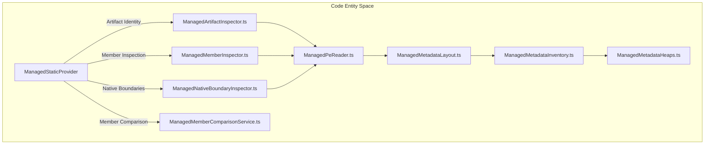
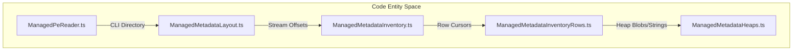

<!-- source: DeepWiki mcp.deepwiki.com · repo morluto/rea · page 4.4 Managed (.NET) Provider · fetched 2026-10-16 -->

# Managed (.NET) Provider

Relevant source files

The following files were used as context for generating this wiki page:

- [docs/managed-code-analysis.md](docs/managed-code-analysis.md)
- [src/application/InventoryProjectionEvidence.ts](src/application/InventoryProjectionEvidence.ts)
- [src/application/ReconstructionCoverageService.ts](src/application/ReconstructionCoverageService.ts)
- [src/application/ReconstructionObligationLedgerService.ts](src/application/ReconstructionObligationLedgerService.ts)
- [src/application/managed/ManagedApplicationGraphService.ts](src/application/managed/ManagedApplicationGraphService.ts)
- [src/application/managed/ManagedMemberComparisonService.ts](src/application/managed/ManagedMemberComparisonService.ts)
- [src/application/managed/ManagedNativeVerificationService.ts](src/application/managed/ManagedNativeVerificationService.ts)
- [src/application/managed/ManagedReconstructionService.ts](src/application/managed/ManagedReconstructionService.ts)
- [src/cli/managedCommands.ts](src/cli/managedCommands.ts)
- [src/contracts/managed/managedWorkflowExamples.ts](src/contracts/managed/managedWorkflowExamples.ts)
- [src/domain/analysisView/managedMemberView.ts](src/domain/analysisView/managedMemberView.ts)
- [src/domain/managed/managedArtifact.ts](src/domain/managed/managedArtifact.ts)
- [src/domain/managed/managedMemberComparisonCoverage.ts](src/domain/managed/managedMemberComparisonCoverage.ts)
- [src/domain/managed/managedMemberComparisonItems.ts](src/domain/managed/managedMemberComparisonItems.ts)
- [src/domain/managed/managedMemberComparisonMatch.ts](src/domain/managed/managedMemberComparisonMatch.ts)
- [src/domain/managed/managedNativeVerificationMatch.ts](src/domain/managed/managedNativeVerificationMatch.ts)
- [src/dotnet/ManagedArtifactFailures.test.ts](src/dotnet/ManagedArtifactFailures.test.ts)
- [src/dotnet/ManagedArtifactInspector.test.ts](src/dotnet/ManagedArtifactInspector.test.ts)
- [src/dotnet/ManagedArtifactInspector.ts](src/dotnet/ManagedArtifactInspector.ts)
- [src/dotnet/ManagedCilDecoding.test.ts](src/dotnet/ManagedCilDecoding.test.ts)
- [src/dotnet/ManagedDecodeBudget.test.ts](src/dotnet/ManagedDecodeBudget.test.ts)
- [src/dotnet/ManagedDecodeBudget.ts](src/dotnet/ManagedDecodeBudget.ts)
- [src/dotnet/ManagedMemberInspector.test.ts](src/dotnet/ManagedMemberInspector.test.ts)
- [src/dotnet/ManagedMemberInspector.ts](src/dotnet/ManagedMemberInspector.ts)
- [src/dotnet/ManagedMemberInspectorCore.ts](src/dotnet/ManagedMemberInspectorCore.ts)
- [src/dotnet/ManagedMemberInstructionDecoder.ts](src/dotnet/ManagedMemberInstructionDecoder.ts)
- [src/dotnet/ManagedMemberPointers.ts](src/dotnet/ManagedMemberPointers.ts)
- [src/dotnet/ManagedMemberRows.ts](src/dotnet/ManagedMemberRows.ts)
- [src/dotnet/ManagedMetadataExtraData.test.ts](src/dotnet/ManagedMetadataExtraData.test.ts)
- [src/dotnet/ManagedMetadataHeaps.ts](src/dotnet/ManagedMetadataHeaps.ts)
- [src/dotnet/ManagedMetadataInventory.ts](src/dotnet/ManagedMetadataInventory.ts)
- [src/dotnet/ManagedMetadataInventoryRows.ts](src/dotnet/ManagedMetadataInventoryRows.ts)
- [src/dotnet/ManagedMetadataLayout.ts](src/dotnet/ManagedMetadataLayout.ts)
- [src/dotnet/ManagedMethodBodyReader.ts](src/dotnet/ManagedMethodBodyReader.ts)
- [src/dotnet/ManagedNativeBoundaryHelpers.ts](src/dotnet/ManagedNativeBoundaryHelpers.ts)
- [src/dotnet/ManagedNativeBoundaryInspector.test.ts](src/dotnet/ManagedNativeBoundaryInspector.test.ts)
- [src/dotnet/ManagedNativeBoundaryInspector.ts](src/dotnet/ManagedNativeBoundaryInspector.ts)
- [src/dotnet/ManagedPe.fixture.ts](src/dotnet/ManagedPe.fixture.ts)
- [src/dotnet/ManagedPeReader.ts](src/dotnet/ManagedPeReader.ts)
- [src/dotnet/ManagedReaderFailure.ts](src/dotnet/ManagedReaderFailure.ts)
- [src/dotnet/ManagedStaticProvider.ts](src/dotnet/ManagedStaticProvider.ts)
- [tests/acceptance/managedCliOutput.test.ts](tests/acceptance/managedCliOutput.test.ts)
- [tests/acceptance/managedMetadataExtraData.test.ts](tests/acceptance/managedMetadataExtraData.test.ts)
- [tests/boundary/cli/reconstructionObligationLedgerCli.test.ts](tests/boundary/cli/reconstructionObligationLedgerCli.test.ts)
- [tests/boundary/mcp/reconstructionObligationLedgerMcp.test.ts](tests/boundary/mcp/reconstructionObligationLedgerMcp.test.ts)
- [tests/boundary/providers/managed/managedMemberComparison.test.ts](tests/boundary/providers/managed/managedMemberComparison.test.ts)
- [tests/boundary/providers/managed/managedMemberComparisonFromMetadata.test.ts](tests/boundary/providers/managed/managedMemberComparisonFromMetadata.test.ts)
- [tests/boundary/providers/managed/managedStaticProvider.test.ts](tests/boundary/providers/managed/managedStaticProvider.test.ts)
- [tests/conformance/providers/managed/managedNativeVerification.test.ts](tests/conformance/providers/managed/managedNativeVerification.test.ts)

REA provides inspection capabilities for .NET PE/CLI artifacts without loading or executing their target code [docs/managed-code-analysis.md:3-5](). The managed provider identifies assemblies, inspects metadata and Common Intermediate Language (CIL), compares members across builds, and correlates declared native calls with exported native evidence [docs/managed-code-analysis.md:3-5]().

## Purpose and Scope

The managed provider exposes static inspection capabilities through seven core tools, available via both MCP and CLI interfaces [docs/managed-code-analysis.md:9-22]():
- `inspect_managed_artifact` (`src/dotnet/ManagedArtifactInspector.ts`)
- `inspect_managed_members` (`src/dotnet/ManagedMemberInspector.ts`)
- `inspect_managed_native_boundaries` (`src/dotnet/ManagedNativeBoundaryInspector.ts`)
- `compare_managed_members` (`src/application/managed/ManagedMemberComparisonService.ts`)
- `verify_managed_native_boundaries` (`src/application/managed/ManagedNativeVerificationService.ts`)
- `import_managed_reconstruction` (`src/application/managed/ManagedReconstructionService.ts`)
- `project_managed_application_graph` (`src/application/managed/ManagedApplicationGraphService.ts`)

These components operate strictly on admitted PE/CLI bytes and metadata heaps. They do not unpack single-file .NET hosts, decode IL2CPP metadata, or infer NativeAOT identity from ordinary native PEs [docs/managed-code-analysis.md:120-125]().

Sources:
- [docs/managed-code-analysis.md:1-25]()
- [src/dotnet/ManagedArtifactInspector.ts:1-30]()
- [src/dotnet/ManagedMemberInspector.ts:1-45]()
- [src/dotnet/ManagedNativeBoundaryInspector.ts:1-33]()

## ManagedStaticProvider Architecture

The `ManagedStaticProvider` coordinates static parsing routines by delegating specific analysis tasks to dedicated domain and infrastructure modules. 

Title: ManagedStaticProvider and Core Parsers
Sources:
- [src/dotnet/ManagedArtifactInspector.ts:1-30]()
- [src/dotnet/ManagedMemberInspector.ts:103-130]()
- [src/dotnet/ManagedNativeBoundaryInspector.ts:94-121]()
- [src/dotnet/ManagedPeReader.ts:55-67]()

## ManagedPeReader and PE Layout

The `ManagedPeReader` module parses Portable Executable container structures to locate CLI metadata headers and data directories [src/dotnet/ManagedPeReader.ts:20-32]().

Key responsibilities include:
- Validating DOS headers, PE signatures, and COFF/Optional headers [src/dotnet/ManagedPeReader.ts:220-300]().
- Mapping Relative Virtual Addresses (RVAs) to file offsets via `rvaToOffset` [src/dotnet/ManagedPeReader.ts:65-65]().
- Extracting the `ManagedCliHeader`, runtime version flags, and directory bounds [src/dotnet/ManagedPeReader.ts:20-32]().
- Raising structured `ManagedReaderFailure` exceptions when boundaries are violated [src/dotnet/ManagedReaderFailure.ts:1-6]().

Sources:
- [src/dotnet/ManagedPeReader.ts:20-67]()
- [src/dotnet/ManagedReaderFailure.ts:1-25]()

## Metadata Heaps and Inventory Rows

Metadata decoding relies on layout and inventory extractors that map raw heap structures into structured records.

Title: Metadata Inventory and Heap Resolution Flow
Sources:
- [src/dotnet/ManagedMetadataLayout.ts:1-20]()
- [src/dotnet/ManagedMetadataInventory.ts:1-25]()
- [src/dotnet/ManagedMetadataInventoryRows.ts:1-30]()
- [src/dotnet/ManagedMetadataHeaps.ts:1-30]()

`ManagedMetadataInventoryRows` parses specialized metadata records such as modules (`readModule`), assemblies (`readAssembly`), assembly references (`readAssemblyReference`), and custom attributes [src/dotnet/ManagedMetadataInventoryRows.ts:62-151]().

Sources:
- [src/dotnet/ManagedMetadataLayout.ts:1-30]()
- [src/dotnet/ManagedMetadataInventory.ts:1-30]()
- [src/dotnet/ManagedMetadataInventoryRows.ts:62-209]()

## Member Inspector and CIL Decoding

The member inspection subsystem extracts types, fields, methods, and method bodies without execution.

- **Types and Fields**: `parseTypes` and `parseFields` extract definitions and ranges using `ManagedMemberRows.ts` [src/dotnet/ManagedMemberRows.ts:48-68]().
- **Method Bodies**: `ManagedMethodBodyReader.ts` parses tiny and fat method header formats, local variable signatures, and exception handling clauses [src/dotnet/ManagedMethodBodyReader.ts:11-30]().
- **Instruction Decoding**: `ManagedMemberInstructionDecoder.ts` decodes CIL byte streams into instruction anchors, identifying opcodes, operands, call edges, and field accesses [src/dotnet/ManagedMemberInstructionDecoder.ts:18-100]().

Sources:
- [src/dotnet/ManagedMemberInspector.ts:165-180]()
- [src/dotnet/ManagedMemberRows.ts:48-114]()
- [src/dotnet/ManagedMethodBodyReader.ts:1-40]()
- [src/dotnet/ManagedMemberInstructionDecoder.ts:18-100]()

## Native Boundary Inspection

`ManagedNativeBoundaryInspector` inspects P/Invoke imports, module references, and native implementation markers [src/dotnet/ManagedNativeBoundaryInspector.ts:124-127]().

- `parseImplMaps` extracts `ImplMap` metadata table rows corresponding to unmanaged target exports [src/dotnet/ManagedNativeBoundaryHelpers.ts:134-208]().
- `nativeImplementations` identifies methods backed by native implementations via implementation flags [src/dotnet/ManagedNativeBoundaryHelpers.ts:30-45]().
- Verification services check these declarations against external export evidence [docs/managed-code-analysis.md:15-17]().

Sources:
- [src/dotnet/ManagedNativeBoundaryInspector.ts:124-192]()
- [src/dotnet/ManagedNativeBoundaryHelpers.ts:1-58]()

## Member Comparison Across Builds

`compareManagedMembers` matches members across distinct builds to detect additions, removals, and modifications without relying solely on names [tests/boundary/providers/managed/managedMemberComparisonFromMetadata.test.ts:86-102]().

Comparison strategy tiers:
1. **Exact CIL and Signature**: Strongest match indicating identical execution semantics and type signatures [tests/boundary/providers/managed/managedMemberComparisonFromMetadata.test.ts:102-118]().
2. **Exact Signature**: Matches methods with modified CIL but identical signatures [tests/boundary/providers/managed/managedMemberComparisonFromMetadata.test.ts:145-152]().
3. **Structural Shape**: Fallback heuristics matching method shapes when signatures or tokens shift across compiler passes [tests/boundary/providers/managed/managedMemberComparisonFromMetadata.test.ts:72-82]().

Sources:
- [tests/boundary/providers/managed/managedMemberComparisonFromMetadata.test.ts:6-121]()
- [src/application/managed/ManagedMemberComparisonService.ts:1-25]()

## Managed Workflow Services

Higher-level application services integrate managed inspection findings into REA workflows:
- `ManagedReconstructionService`: Imports and correlates decompiled code with static member definitions [docs/managed-code-analysis.md:18-18]().
- `ManagedNativeVerificationService`: Verifies native boundary declarations against symbol ledgers [docs/managed-code-analysis.md:17-17]().
- `ManagedApplicationGraphService`: Projects managed nodes and call edges into the overarching application analysis graph [docs/managed-code-analysis.md:19-19]().

Sources:
- [docs/managed-code-analysis.md:16-20]()
- [src/application/managed/ManagedReconstructionService.ts:1-20]()
- [src/application/managed/ManagedNativeVerificationService.ts:1-20]()
- [src/application/managed/ManagedApplicationGraphService.ts:1-20]()

---

