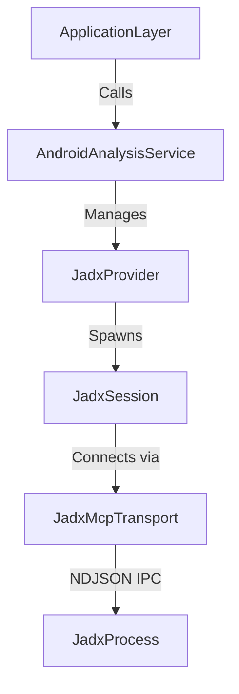
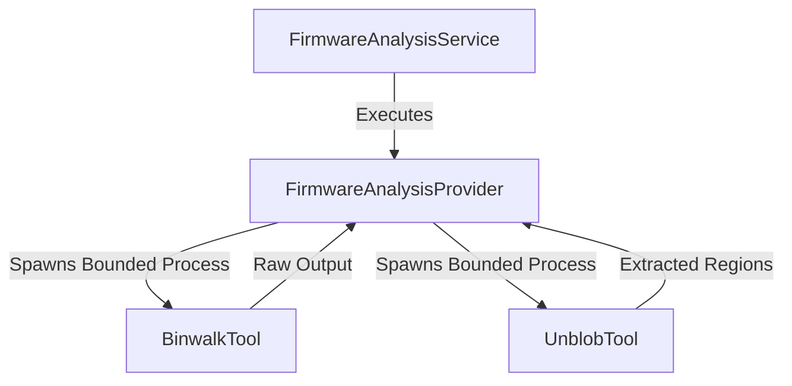
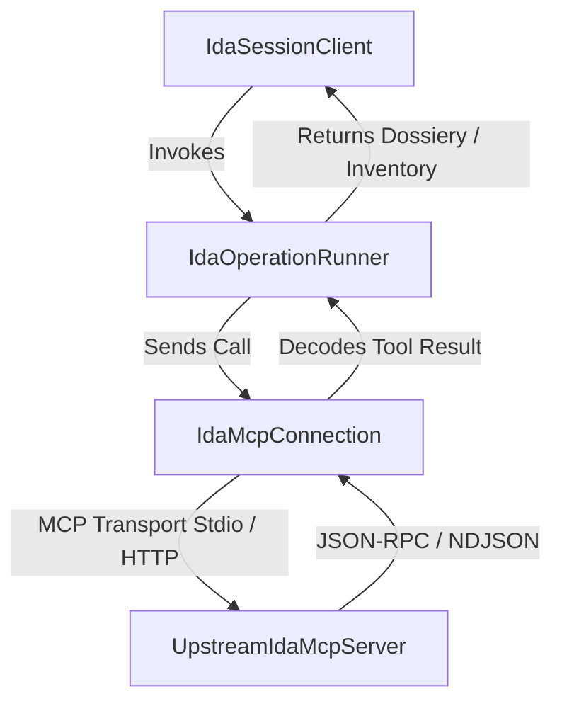

<!-- source: DeepWiki mcp.deepwiki.com · repo morluto/rea · page 4.5 Android, Firmware and IDA Providers · fetched 2026-10-16 -->

# Android, Firmware and IDA Providers

Relevant source files

The following files were used as context for generating this wiki page:

- [bridge/android/ReaJadxBridge.java](bridge/android/ReaJadxBridge.java)
- [docs/adb-device-analysis.md](docs/adb-device-analysis.md)
- [docs/android-analysis.md](docs/android-analysis.md)
- [docs/apktool-resource-analysis.md](docs/apktool-resource-analysis.md)
- [docs/ida-provider.md](docs/ida-provider.md)
- [experiments/analysis-efficiency/ida-native-windows.md](experiments/analysis-efficiency/ida-native-windows.md)
- [scripts/rea-android-workspace-guardian.mjs](scripts/rea-android-workspace-guardian.mjs)
- [scripts/verify-apktool.mjs](scripts/verify-apktool.mjs)
- [scripts/verify-real-ida.mjs](scripts/verify-real-ida.mjs)
- [scripts/verify/android/analysis.mjs](scripts/verify/android/analysis.mjs)
- [scripts/verify/android/cli-cancellation.mjs](scripts/verify/android/cli-cancellation.mjs)
- [scripts/verify/android/failure-recovery.mjs](scripts/verify/android/failure-recovery.mjs)
- [scripts/verify/android/metadata.mjs](scripts/verify/android/metadata.mjs)
- [scripts/verify/android/windows-guardian-isolation.mjs](scripts/verify/android/windows-guardian-isolation.mjs)
- [scripts/verify/android/windows-lifecycle.mjs](scripts/verify/android/windows-lifecycle.mjs)
- [src/adb/AdbConfiguration.test.ts](src/adb/AdbConfiguration.test.ts)
- [src/adb/AdbConfiguration.ts](src/adb/AdbConfiguration.ts)
- [src/adb/AdbDeviceOutput.test.ts](src/adb/AdbDeviceOutput.test.ts)
- [src/adb/AdbDeviceOutput.ts](src/adb/AdbDeviceOutput.ts)
- [src/adb/AdbHostFileName.test.ts](src/adb/AdbHostFileName.test.ts)
- [src/adb/AdbHostFileName.ts](src/adb/AdbHostFileName.ts)
- [src/adb/AdbProvider.test.ts](src/adb/AdbProvider.test.ts)
- [src/adb/AdbProvider.ts](src/adb/AdbProvider.ts)
- [src/adb/AdbShellOutput.test.ts](src/adb/AdbShellOutput.test.ts)
- [src/adb/AdbShellOutput.ts](src/adb/AdbShellOutput.ts)
- [src/android/AndroidTargetSnapshot.ts](src/android/AndroidTargetSnapshot.ts)
- [src/android/JadxAnalysis.ts](src/android/JadxAnalysis.ts)
- [src/android/JadxConfiguration.ts](src/android/JadxConfiguration.ts)
- [src/android/JadxProtocol.ts](src/android/JadxProtocol.ts)
- [src/android/JadxProvider.ts](src/android/JadxProvider.ts)
- [src/android/JadxRelease.ts](src/android/JadxRelease.ts)
- [src/android/JadxSession.ts](src/android/JadxSession.ts)
- [src/apktool/ApktoolConfiguration.test.ts](src/apktool/ApktoolConfiguration.test.ts)
- [src/apktool/ApktoolConfiguration.ts](src/apktool/ApktoolConfiguration.ts)
- [src/apktool/ApktoolDecodeOutput.test.ts](src/apktool/ApktoolDecodeOutput.test.ts)
- [src/apktool/ApktoolDecodeOutput.ts](src/apktool/ApktoolDecodeOutput.ts)
- [src/apktool/ApktoolProvider.test.ts](src/apktool/ApktoolProvider.test.ts)
- [src/apktool/ApktoolProvider.ts](src/apktool/ApktoolProvider.ts)
- [src/apktool/ApktoolVersionProbe.lifecycle.test.ts](src/apktool/ApktoolVersionProbe.lifecycle.test.ts)
- [src/apktool/ApktoolVersionProbe.test.ts](src/apktool/ApktoolVersionProbe.test.ts)
- [src/contracts/adb/adbToolContracts.ts](src/contracts/adb/adbToolContracts.ts)
- [src/contracts/android/androidToolContracts.ts](src/contracts/android/androidToolContracts.ts)
- [src/contracts/functionComparisonExample.ts](src/contracts/functionComparisonExample.ts)
- [src/domain/adb/adbDeviceAnalysis.ts](src/domain/adb/adbDeviceAnalysis.ts)
- [src/domain/android/androidAnalysis.ts](src/domain/android/androidAnalysis.ts)
- [src/ida/IdaBusyHealth.test.ts](src/ida/IdaBusyHealth.test.ts)
- [src/ida/IdaBusyHealth.ts](src/ida/IdaBusyHealth.ts)
- [src/ida/IdaDoctor.ts](src/ida/IdaDoctor.ts)
- [src/ida/IdaMcpConnection.test.ts](src/ida/IdaMcpConnection.test.ts)
- [src/ida/IdaMcpConnection.ts](src/ida/IdaMcpConnection.ts)
- [src/ida/IdaNativeProtocol.test.ts](src/ida/IdaNativeProtocol.test.ts)
- [src/ida/IdaNativeProtocol.ts](src/ida/IdaNativeProtocol.ts)
- [src/ida/IdaOperationRunner.ts](src/ida/IdaOperationRunner.ts)
- [src/ida/IdaProtocolValues.ts](src/ida/IdaProtocolValues.ts)
- [src/ida/IdaSessionClient.test.ts](src/ida/IdaSessionClient.test.ts)
- [src/ida/IdaSessionClient.ts](src/ida/IdaSessionClient.ts)
- [tests/boundary/android/androidTargetSnapshot.test.ts](tests/boundary/android/androidTargetSnapshot.test.ts)
- [tests/boundary/android/jadxConfiguration.test.ts](tests/boundary/android/jadxConfiguration.test.ts)
- [tests/boundary/cli/idaRetainedCleanupCli.test.ts](tests/boundary/cli/idaRetainedCleanupCli.test.ts)
- [tests/boundary/idaStartupDiagnostics.test.ts](tests/boundary/idaStartupDiagnostics.test.ts)
- [tests/boundary/mcp/adbMcp.test.ts](tests/boundary/mcp/adbMcp.test.ts)
- [tests/boundary/mcp/adbStartMcp.test.ts](tests/boundary/mcp/adbStartMcp.test.ts)
- [tests/boundary/process/jadxIntegration.test.ts](tests/boundary/process/jadxIntegration.test.ts)
- [tests/boundary/providers/adb/adbInputSnapshotOwnership.test.ts](tests/boundary/providers/adb/adbInputSnapshotOwnership.test.ts)
- [tests/boundary/providers/adb/adbScreenPublicationCancellation.test.ts](tests/boundary/providers/adb/adbScreenPublicationCancellation.test.ts)
- [tests/boundary/providers/ida/retainedConnectionRetry.test.ts](tests/boundary/providers/ida/retainedConnectionRetry.test.ts)
- [tests/boundary/providers/ida/verifierObservations.test.ts](tests/boundary/providers/ida/verifierObservations.test.ts)
- [tests/conformance/android/ReaJadxMetadataRegression.java](tests/conformance/android/ReaJadxMetadataRegression.java)
- [tests/fixtures/android/jadx-mcp.mjs](tests/fixtures/android/jadx-mcp.mjs)
- [tests/fixtures/android/jadx.ts](tests/fixtures/android/jadx.ts)
- [tests/fixtures/idaMcp.ts](tests/fixtures/idaMcp.ts)
- [tests/process-global/apktoolEnvironment.test.ts](tests/process-global/apktoolEnvironment.test.ts)
- [tests/process-global/regularFileNoFollowFallback.test.ts](tests/process-global/regularFileNoFollowFallback.test.ts)

This page details the implementation of providers for Android application analysis (covering JADX static analysis, Apktool resource decoding, and ADB device inspection), firmware region inspection and extraction via `binwalk` and `unblob`, and the IDA Pro provider capability surface.

---

## 1. Android Analysis Ecosystem

The Android analysis ecosystem in REA encompasses static analysis of APKs and JAR files via JADX, resource decoding via Apktool, and device inspection/acquisition via the Android Debug Bridge (ADB).

### JADX Static Analysis Provider

The `JadxProvider` acts as the interface between REA's application layer and the JADX headless MCP tool. It manages the lifecycle of JADX processes and IPC communication.

1.  **Initialization**: When an Android analysis operation is requested, `AndroidAnalysisService` creates a `JadxProvider` instance [tests/fixtures/android/jadx.ts:12-14]().
2.  **Session Management**: The `JadxProvider` maintains `JadxSession` instances. Each session corresponds to a specific APK/JAR and JADX engine configuration. Sessions are retired if APK bytes, JADX engine bytes, or JVM options change [tests/fixtures/android/jadx.ts:60-126]().
3.  **Process Launch & Transport**: The session launches JADX via `JadxMcpTransport` using an owned subprocess with NDJSON over a Unix socket or named pipe [tests/fixtures/android/jadx.ts:63-77]().
4.  **Execution & Result Mapping**: Analysis requests (e.g., `inspect_android_package`, `inspect_android_class`) are processed and mapped to REA's canonical schemas.

Sources:
- [src/android/JadxProvider.ts]()
- [tests/fixtures/android/jadx.ts:12-14]()
- [tests/fixtures/android/jadx.ts:60-126]()

### Apktool Resource Decoding

The `ApktoolProvider` handles APK resource decoding, manifest extraction, and string analysis [src/apktool/ApktoolProvider.ts:74-78](). It coordinates bounded command execution via `runOwnedCommand` [src/apktool/ApktoolProvider.ts:192-202]() and parses output via `parseApktoolYml`, `parseDecodedStrings`, and `parseManifestPackage` [src/apktool/ApktoolProvider.ts:67-72]().

### ADB Device Analysis (`AdbProvider`)

The `AdbProvider` [src/adb/AdbProvider.ts:34-36]() inspects connected devices, reads device states, and transfers files/packages through the host's `adb` binary. It parses device lists [src/adb/AdbProvider.ts:63-68]() and executes shell operations with strict timeouts and buffer limits [src/adb/AdbProvider.ts:98-121]().

Sources:
- [src/apktool/ApktoolProvider.ts:74-78]()
- [src/apktool/ApktoolProvider.ts:67-72]()
- [src/adb/AdbProvider.ts:34-36]()
- [src/adb/AdbProvider.ts:98-121]()

---

## 2. Firmware Inspection Provider

The firmware provider integrates `binwalk` and `unblob` for inspecting and extracting regions from firmware binary images.

### Architecture and Data Flow

1.  **Initialization**: `FirmwareAnalysisService` receives a firmware provider instance [docs/android-analysis.md]() configured to invoke external tools.
2.  **Tool Invocation**: The provider executes `binwalk` for signature identification and `unblob` for archive/filesystem extraction as bounded child processes.
3.  **Result Normalization**: Output streams are parsed into `FirmwareAnalysisResult` structures, preserving provenance and block offsets.

Sources:
- [docs/android-analysis.md]()

---

## 3. IDA Pro Provider

The IDA Pro provider (`IdaSessionClient` [src/ida/IdaSessionClient.ts:154](), `IdaMcpConnection` [src/ida/IdaMcpConnection.ts:33](), and `IdaOperationRunner` [src/ida/IdaOperationRunner.ts:89]()) adapts external IDA Pro MCP servers (such as `mrexodia/ida-pro-mcp` or native plugins) into REA's native analysis tool contracts [docs/ida-provider.md:3-6]().

### Protocol Modes and Lifecycle

The IDA provider supports three operational profiles checked against capabilities before analysis execution:
1.  **Attached (Legacy GUI Tools)**: Connects to an already-open IDA GUI instance using legacy tools (`get_metadata`, `list_functions`, `decompile_function`) [docs/ida-provider.md:13-20]().
2.  **Headless (Database Supervisor)**: Uses database supervisor APIs (`idb_open`, `idb_list`, `idb_close`) for batch or headless inspection [docs/ida-provider.md:11-16]().
3.  **Native Plugin Protocol**: Interfaces via Streamable HTTP/WebSocket endpoints supporting custom resource reads (`ida://idb/metadata`) [docs/ida-provider.md:52-58]().

### Key Components

*   **`IdaSessionClient`** [src/ida/IdaSessionClient.ts:154](): Manages the session lifecycle, serializing operation queues and verifying database identity and image base around requests [docs/ida-provider.md:42-44]().
*   **`IdaMcpConnection`** [src/ida/IdaMcpConnection.ts:33](): Abstracts the MCP transport layer (Stdio or Streamable HTTP), decoding tool results and handling redacting diagnostic output [src/ida/IdaMcpConnection.ts:88-145]().
*   **`IdaOperationRunner`** [src/ida/IdaOperationRunner.ts:89](): Translates higher-level analysis queries (such as pagination, procedure resolution, string searches, and decompilation) into upstream protocol calls [src/ida/IdaOperationRunner.ts:88-125]().

Sources:
- [src/ida/IdaSessionClient.ts:154]()
- [src/ida/IdaMcpConnection.ts:33]()
- [src/ida/IdaOperationRunner.ts:89]()
- [docs/ida-provider.md:3-6]()
- [docs/ida-provider.md:42-44]()

---

