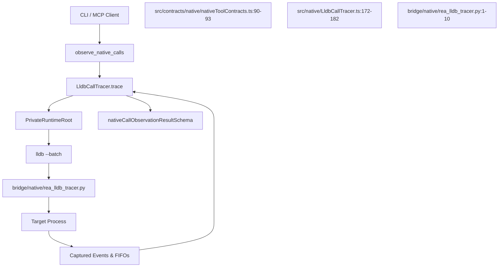
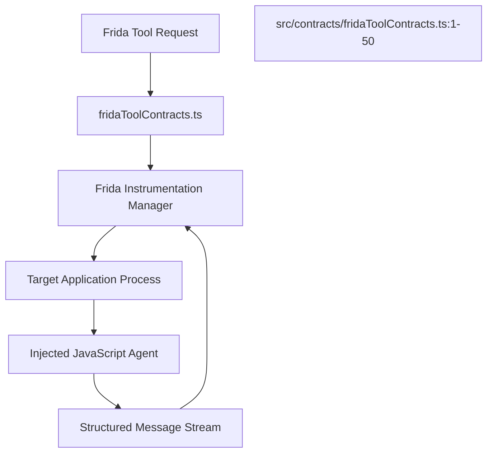
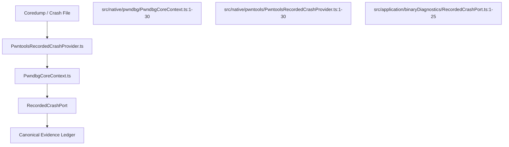

<!-- source: DeepWiki mcp.deepwiki.com · repo morluto/rea · page 4.6 Debuggers and Dynamic Instrumentation · fetched 2026-10-16 -->

# Debuggers and Dynamic Instrumentation

Relevant source files

The following files were used as context for generating this wiki page:

- [bridge/native/rea_lldb_tracer.py](bridge/native/rea_lldb_tracer.py)
- [bridge/native/test_rea_lldb_tracer.py](bridge/native/test_rea_lldb_tracer.py)
- [scripts/verify-real-ghidra-raw.mjs](scripts/verify-real-ghidra-raw.mjs)
- [src/application/binaryDiagnostics/RecordedCrashPort.ts](src/application/binaryDiagnostics/RecordedCrashPort.ts)
- [src/application/reverse/ReverseEngineeringService.ts](src/application/reverse/ReverseEngineeringService.ts)
- [src/browser/assets/WebSourceLocationArtifacts.ts](src/browser/assets/WebSourceLocationArtifacts.ts)
- [src/browser/history/CaptureFailures.test.ts](src/browser/history/CaptureFailures.test.ts)
- [src/browser/history/CaptureFailures.ts](src/browser/history/CaptureFailures.ts)
- [src/browser/history/CaptureRelease.ts](src/browser/history/CaptureRelease.ts)
- [src/browser/modules/WebModuleArtifacts.ts](src/browser/modules/WebModuleArtifacts.ts)
- [src/cli/analysisViewCommands.ts](src/cli/analysisViewCommands.ts)
- [src/cli/binaryDiagnosticsCommands.ts](src/cli/binaryDiagnosticsCommands.ts)
- [src/cli/coreNativeCommands.ts](src/cli/coreNativeCommands.ts)
- [src/cli/goCommands.ts](src/cli/goCommands.ts)
- [src/cli/omittableDefaults.ts](src/cli/omittableDefaults.ts)
- [src/cli/rustCommands.ts](src/cli/rustCommands.ts)
- [src/cli/utilityCommands.ts](src/cli/utilityCommands.ts)
- [src/composition/webNetworkCaptures.ts](src/composition/webNetworkCaptures.ts)
- [src/contracts/fridaToolContracts.ts](src/contracts/fridaToolContracts.ts)
- [src/contracts/gdbToolContracts.ts](src/contracts/gdbToolContracts.ts)
- [src/contracts/native/nativeToolContracts.ts](src/contracts/native/nativeToolContracts.ts)
- [src/contracts/rizinDebugToolContracts.ts](src/contracts/rizinDebugToolContracts.ts)
- [src/domain/javascript/electronActiveObservation.ts](src/domain/javascript/electronActiveObservation.ts)
- [src/domain/localPath.ts](src/domain/localPath.ts)
- [src/domain/native/nativeCallObservation.ts](src/domain/native/nativeCallObservation.ts)
- [src/domain/native/nativeCallPartialObservation.ts](src/domain/native/nativeCallPartialObservation.ts)
- [src/domain/portableSchemaPatterns.test.ts](src/domain/portableSchemaPatterns.test.ts)
- [src/domain/providerAdapterError.ts](src/domain/providerAdapterError.ts)
- [src/domain/providerCleanupError.ts](src/domain/providerCleanupError.ts)
- [src/domain/webNetworkCaptureCoordinates.ts](src/domain/webNetworkCaptureCoordinates.ts)
- [src/native/LldbCallTracer.ts](src/native/LldbCallTracer.ts)
- [src/native/pwndbg/PwndbgCoreContext.ts](src/native/pwndbg/PwndbgCoreContext.ts)
- [src/native/pwntools/PwntoolsRecordedCrashProvider.ts](src/native/pwntools/PwntoolsRecordedCrashProvider.ts)
- [src/native/pwntools/PwntoolsResourceLimits.ts](src/native/pwntools/PwntoolsResourceLimits.ts)
- [src/process/ProviderDiagnosticRedaction.ts](src/process/ProviderDiagnosticRedaction.ts)
- [src/process/capture/ProcessScenarioRuntimeValidation.test.ts](src/process/capture/ProcessScenarioRuntimeValidation.test.ts)
- [src/process/capture/ProcessScenarioRuntimeValidation.ts](src/process/capture/ProcessScenarioRuntimeValidation.ts)
- [src/server/registerWebNetworkCaptureTool.ts](src/server/registerWebNetworkCaptureTool.ts)
- [tests/acceptance/tools/historicalCaptureResources.test.ts](tests/acceptance/tools/historicalCaptureResources.test.ts)
- [tests/acceptance/tools/inspectorLifecycle.test.ts](tests/acceptance/tools/inspectorLifecycle.test.ts)
- [tests/acceptance/tools/localToolContracts.test.ts](tests/acceptance/tools/localToolContracts.test.ts)
- [tests/boundary/cli/cliInputSchemaRequired.test.ts](tests/boundary/cli/cliInputSchemaRequired.test.ts)
- [tests/boundary/cli/cliOptionAliases.test.ts](tests/boundary/cli/cliOptionAliases.test.ts)
- [tests/boundary/cli/nativeUiScenarioInputCli.test.ts](tests/boundary/cli/nativeUiScenarioInputCli.test.ts)
- [tests/boundary/filesystem/webArtifactReadOwnership.test.ts](tests/boundary/filesystem/webArtifactReadOwnership.test.ts)
- [tests/boundary/mcp/advertisedPatternsVMode.test.ts](tests/boundary/mcp/advertisedPatternsVMode.test.ts)
- [tests/boundary/native/PwndbgCoreContext.test.ts](tests/boundary/native/PwndbgCoreContext.test.ts)
- [tests/boundary/process/providerProcessOutput.test.ts](tests/boundary/process/providerProcessOutput.test.ts)
- [tests/boundary/providers/native/lldbCallTracerFailures.test.ts](tests/boundary/providers/native/lldbCallTracerFailures.test.ts)
- [tests/boundary/providers/native/lldbRetainedObservations.test.ts](tests/boundary/providers/native/lldbRetainedObservations.test.ts)

Purpose and scope: This leaf page documents REA's dynamic instrumentation and debugger integration subsystems, covering the LLDB call tracing bridge (`LldbCallTracer`), Frida instrumentation manager, GDB/Rizin debug session contracts, Pwndbg/Pwntools recorded-crash providers, the Cutter bridge, and their associated process ownership rules and tool contracts.

---

## 1. LLDB Call Tracing Architecture and Bridge

The LLDB call tracing subsystem launches a native target process as an owned subprocess under LLDB (`lldb --batch`), executes the embedded Python bridge script `bridge/native/rea_lldb_tracer.py`, and records bounded executions into function or Objective-C method breakpoints without executing user-supplied expressions.

The orchestration is implemented by `LldbCallTracer` in `src/native/LldbCallTracer.ts` [src/native/LldbCallTracer.ts:172-182](), which interacts with the Python helper `bridge/native/rea_lldb_tracer.py` [bridge/native/rea_lldb_tracer.py:1-10](). Input constraints are validated via `nativeCallObservationInputSchema` in `src/domain/native/nativeCallObservation.ts` [src/domain/native/nativeCallObservation.ts:56-104](), exposed under the MCP and CLI tool contract `observe_native_calls` [src/contracts/native/nativeToolContracts.ts:90-93]().

*Diagram 1: LLDB Call Tracing Bridge Flow from Natural Language invocation to Code Entities.*

Sources: 
- `src/native/LldbCallTracer.ts` [src/native/LldbCallTracer.ts:1-182]()
- `bridge/native/rea_lldb_tracer.py` [bridge/native/rea_lldb_tracer.py:1-10]()
- `src/domain/native/nativeCallObservation.ts` [src/domain/native/nativeCallObservation.ts:56-104]()
- `src/contracts/native/nativeToolContracts.ts` [src/contracts/native/nativeToolContracts.ts:90-93]()

---

## 2. Frida Instrumentation Manager and Tool Contracts

Dynamic instrumentation workflows that inject scripts or track runtime hooks utilize Frida contract definitions. These contracts govern hooking JavaScript agents, intercepting native functions, and streaming dynamic message payloads back to REA sessions.

The Frida provider framework defines schemas and effect annotations in `src/contracts/fridaToolContracts.ts`, mapping high-level script injection requests to structured agent lifecycles.

*Diagram 2: Frida Instrumentation Architecture.*

Sources:
- `src/contracts/fridaToolContracts.ts` [src/contracts/fridaToolContracts.ts:1-50]()

---

## 3. GDB, Rizin, and Cutter Debug Sessions

REA supports fallback and specialized debug session adapters for non-macOS environments (such as Linux ELF binaries or custom firmware images) via GDB and Rizin protocol handlers, as well as the Cutter GUI bridge integration.

These providers expose structured debug commands defined by `gdbToolContracts.ts` and `rizinDebugToolContracts.ts`, establishing remote socket connections or command pipes to control breakpoints, register states, and memory maps.

| Debug Adapter | Contract File | Transport Mechanism | Primary Target Platform |
| :--- | :--- | :--- | :--- |
| **GDB** | `src/contracts/gdbToolContracts.ts` | GDB Remote Serial Protocol (RSP) / Stdio | Linux / Embedded ELF |
| **Rizin** | `src/contracts/rizinDebugToolContracts.ts` | Rizin Pipes / JSON-RPC over Socket | Cross-platform binaries |
| **Cutter** | Internal Plugin Bridge | Shared Plugin / REST / Pipe | Interactive UI Synchronizers |

Sources:
- `src/contracts/gdbToolContracts.ts` [src/contracts/gdbToolContracts.ts:1-40]()
- `src/contracts/rizinDebugToolContracts.ts` [src/contracts/rizinDebugToolContracts.ts:1-40]()

---

## 4. Pwndbg and Pwntools Recorded-Crash Providers

For exploit analysis and crash debugging workflows, REA integrates Pwndbg context providers and Pwntools recorded-crash parsers. These components extract register state, stack backtraces, heap chunk summaries, and coredump metadata into canonical evidence structures.

The subsystem relies on core context parsers like `PwndbgCoreContext.ts` and crash import handlers like `PwntoolsRecordedCrashProvider.ts`, implementing the `RecordedCrashPort` interface.

*Diagram 3: Recorded Crash Ingestion Data Flow.*

Sources:
- `src/native/pwndbg/PwndbgCoreContext.ts` [src/native/pwndbg/PwndbgCoreContext.ts:1-30]()
- `src/native/pwntools/PwntoolsRecordedCrashProvider.ts` [src/native/pwntools/PwntoolsRecordedCrashProvider.ts:1-30]()
- `src/application/binaryDiagnostics/RecordedCrashPort.ts` [src/application/binaryDiagnostics/RecordedCrashPort.ts:1-24]()

---

## 5. Process Ownership and Lifecycle Rules

Dynamic instrumentation and debugger sessions involve strict process isolation and cleanup guarantees. REA enforces process ownership rules through supervisor utilities (`ProviderProcess.js`), ownership observers (`ProcessOwnership.js`), and isolated workspace roots (`PrivateRuntimeRoot.js`).

- **Process Supervision**: Spawns and tracks child processes with dedicated cancellation signals and timeout deadlines (`ProviderStartupDeadline`).
- **Orphan Prevention**: Ensures spawned debuggers (like `lldb`) and target subprocesses are terminated and reaped when observation windows elapse or parent processes exit unexpectedly.
- **Resource Containment**: FIFOs and diagnostic temporary files are contained within private runtime directories and scrubbed upon session termination.

Sources:
- `src/native/LldbCallTracer.ts` [src/native/LldbCallTracer.ts:25-45]()
- `bridge/native/rea_lldb_tracer.py` [bridge/native/rea_lldb_tracer.py:140-190]()

---

