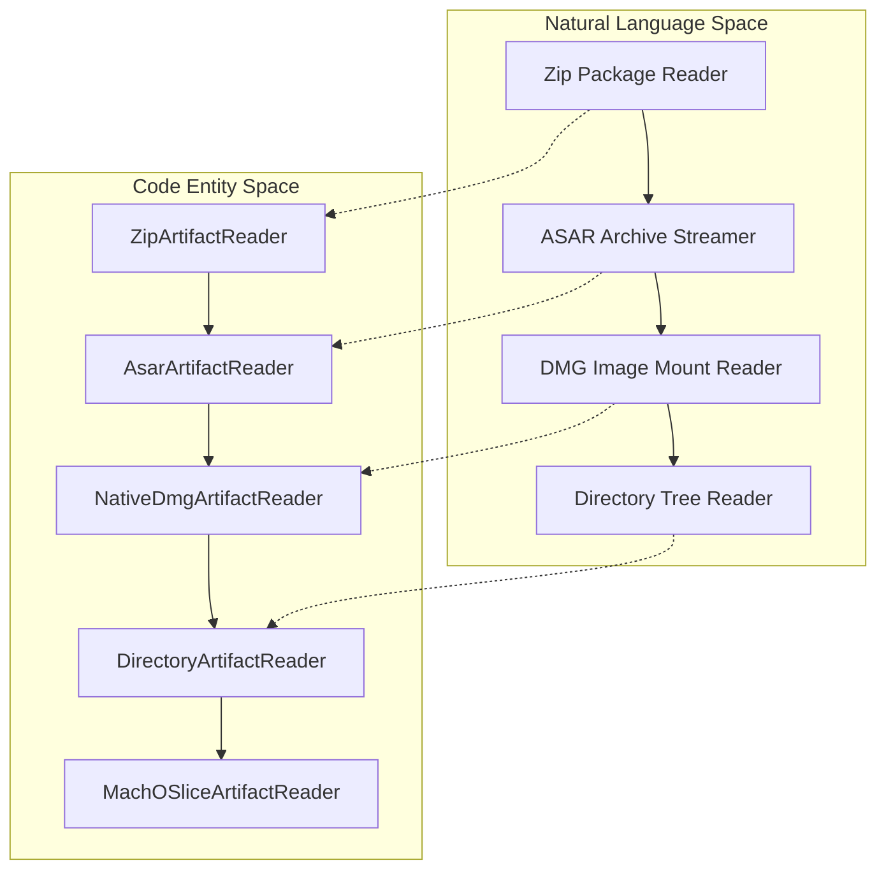
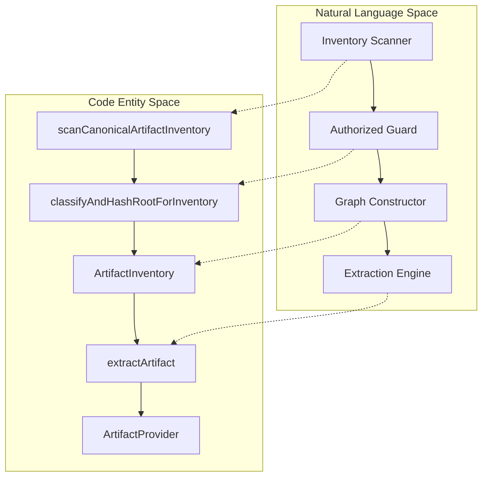

<!-- source: DeepWiki mcp.deepwiki.com · repo morluto/rea · page 5 Artifacts and Packages · fetched 2026-10-16 -->

# Artifacts and Packages

Relevant source files

The following files were used as context for generating this wiki page:

- [scripts/verify-package-artifact.mjs](scripts/verify-package-artifact.mjs)
- [src/artifacts/ArtifactProvider.ts](src/artifacts/ArtifactProvider.ts)
- [src/artifacts/apple/KeyedArchiveReader.ts](src/artifacts/apple/KeyedArchiveReader.ts)
- [src/artifacts/inventory/ArtifactInventory.ts](src/artifacts/inventory/ArtifactInventory.ts)
- [src/artifacts/inventory/classify.ts](src/artifacts/inventory/classify.ts)
- [src/artifacts/inventory/reader.ts](src/artifacts/inventory/reader.ts)
- [src/artifacts/inventory/scanCanonical.ts](src/artifacts/inventory/scanCanonical.ts)
- [src/cli/artifactCommands.ts](src/cli/artifactCommands.ts)
- [src/contracts/artifactToolContracts.ts](src/contracts/artifactToolContracts.ts)
- [src/domain/android/androidApplication.ts](src/domain/android/androidApplication.ts)
- [src/domain/apple/appleApplication.test.ts](src/domain/apple/appleApplication.test.ts)
- [src/domain/apple/appleApplication.ts](src/domain/apple/appleApplication.ts)
- [src/domain/apple/appleBundleAnatomy.ts](src/domain/apple/appleBundleAnatomy.ts)
- [src/domain/apple/keyedArchive.test.ts](src/domain/apple/keyedArchive.test.ts)
- [src/domain/apple/keyedArchive.ts](src/domain/apple/keyedArchive.ts)
- [src/domain/artifactComparison.ts](src/domain/artifactComparison.ts)
- [src/domain/artifactInspection.ts](src/domain/artifactInspection.ts)
- [src/domain/artifactInventoryEvidence.test.ts](src/domain/artifactInventoryEvidence.test.ts)
- [src/domain/artifactInventoryEvidence.ts](src/domain/artifactInventoryEvidence.ts)
- [src/domain/artifactInventorySnapshot.ts](src/domain/artifactInventorySnapshot.ts)
- [src/domain/harmony/harmonyApplication.ts](src/domain/harmony/harmonyApplication.ts)
- [src/domain/mobileApplicationGraphProjection.ts](src/domain/mobileApplicationGraphProjection.ts)
- [src/domain/zipPackageFormat.ts](src/domain/zipPackageFormat.ts)
- [tests/acceptance/artifactComparisonPlist.test.ts](tests/acceptance/artifactComparisonPlist.test.ts)
- [tests/acceptance/emptyTargetPathCli.test.ts](tests/acceptance/emptyTargetPathCli.test.ts)
- [tests/boundary/filesystem/android/application.test.ts](tests/boundary/filesystem/android/application.test.ts)
- [tests/boundary/filesystem/appleApplication.test.ts](tests/boundary/filesystem/appleApplication.test.ts)
- [tests/boundary/filesystem/artifactComparison.test.ts](tests/boundary/filesystem/artifactComparison.test.ts)
- [tests/boundary/filesystem/artifactComparisonSummary.test.ts](tests/boundary/filesystem/artifactComparisonSummary.test.ts)
- [tests/boundary/filesystem/artifactMzInventory.test.ts](tests/boundary/filesystem/artifactMzInventory.test.ts)
- [tests/boundary/filesystem/asarInventoryContainment.test.ts](tests/boundary/filesystem/asarInventoryContainment.test.ts)
- [tests/boundary/filesystem/clientConfigurationBom.test.ts](tests/boundary/filesystem/clientConfigurationBom.test.ts)
- [tests/boundary/filesystem/harmony/application.test.ts](tests/boundary/filesystem/harmony/application.test.ts)
- [tests/boundary/filesystem/keyedArchiveSelection.test.ts](tests/boundary/filesystem/keyedArchiveSelection.test.ts)
- [tests/boundary/filesystem/zipDetection.test.ts](tests/boundary/filesystem/zipDetection.test.ts)
- [tests/boundary/providers/native/artifactProvider.archiveInventory.test.ts](tests/boundary/providers/native/artifactProvider.archiveInventory.test.ts)
- [tests/boundary/providers/native/artifactProvider.extraction.test.ts](tests/boundary/providers/native/artifactProvider.extraction.test.ts)

REA provides a robust capability set for inspecting, inventorying, and extracting contents from various package formats, archives, and directories. This infrastructure includes specialized readers for zip, asar, dmg, and directory targets, content-addressed artifact graphs, deterministically ordered inventories, comparison utilities, and secure extraction pipelines.

This page offers a high-level overview of REA's artifact handling architecture. For in-depth technical specifications, please consult the child pages linked below.

## Artifact Readers

REA implements a collection of format-specific readers via the `ArtifactReader` abstraction layer [src/artifacts/inventory/scanCanonical.ts:12-14](). These readers handle format-specific extraction mechanics while exposing a unified asynchronous iterator interface for traversing entries:

*   **Zip archives**: Handled by `ZipArtifactReader`.
*   **ASAR archives**: Handled by `AsarArtifactReader` [src/artifacts/inventory/scanCanonical.ts:4](), supporting direct entry streaming and pickle header parsing.
*   **DMG disk images**: Handled by `NativeDmgArtifactReader` with read-only mounting capabilities on supported macOS hosts.
*   **Directories**: Handled by `DirectoryArtifactReader` [src/artifacts/apple/KeyedArchiveReader.ts:28]() treating ordinary file system trees as canonical containers.
*   **Mach-O slices**: Handled by `MachOSliceArtifactReader` for universal binary slices.

These readers incorporate cancellation signals (`AbortSignal`), backpressure management, and robust lifecycle hooks to handle resource ownership safely through `ArtifactResourceScope` [src/artifacts/ArtifactProvider.ts:76]().

**Diagram: Artifact Readers Bridge from Concepts to Code Classes**

Sources:
- [src/artifacts/ArtifactProvider.ts:76]()
- [src/artifacts/AsarArtifactReader.ts]()
- [src/artifacts/DirectoryArtifactReader.ts]()
- [src/artifacts/inventory/scanCanonical.ts:1-53]()
- [src/artifacts/apple/KeyedArchiveReader.ts:28]()

For details, see [Artifact Readers](#5.1).

---

## Artifact Inventory and Extraction

The `ArtifactProvider` class [src/artifacts/ArtifactProvider.ts:48-73]() orchestrates read-only inventory scanning and exclusive extraction workflows. The inventory workflow (`scanCanonicalArtifactInventory` [src/artifacts/inventory/scanCanonical.ts:53-60]()) scans target paths, classifies roots via `classifyAndHashRootForInventory` [src/artifacts/inventory/classify.ts:82-149](), and builds a content-addressed graph of `ArtifactNode` and `ArtifactOccurrence` records [src/domain/artifactInventoryEvidence.ts:25-36](). 

Key aspects of this subsystem include:
*   **Authorized Inventory**: Validates input boundaries and prevents path traversal [src/domain/artifactInventoryEvidence.ts:131-153]().
*   **Deterministic Ordering**: Enforces stable sorting of entries by code point order [src/domain/artifactInventoryEvidence.ts:9]() to guarantee reproducible manifests.
*   **Artifact Comparison**: The `compareArtifacts` utility [src/domain/artifactComparison.ts:99-102]() evaluates two inventory evidence payloads across dimensions such as content, format, and size.
*   **Extraction**: `extractArtifact` [src/artifacts/ArtifactProvider.ts:15]() materializes regular files into isolated temporary directories under strict integrity verification and policies defined in `artifactExtractionInputSchema` [src/contracts/artifactToolContracts.ts:31-33](). Exposed via tool contracts (`ARTIFACT_TOOL_CONTRACTS`) [src/contracts/artifactToolContracts.ts:80-121]() and CLI commands [src/cli/artifactCommands.ts:10-16]().

**Diagram: Inventory and Extraction Architecture Bridge**

Sources:
- [src/artifacts/ArtifactProvider.ts:14-16]()
- [src/artifacts/inventory/classify.ts:82-149]()
- [src/artifacts/inventory/scanCanonical.ts:53-60]()
- [src/contracts/artifactToolContracts.ts:31-33]()
- [src/domain/artifactComparison.ts:99-102]()
- [src/domain/artifactInventoryEvidence.ts:25-36]()

For details, see [Artifact Inventory and Extraction](#5.2).

---

## Binary Target Resolution

When artifacts contain executable binaries, REA performs target resolution to identify entry points, parse format headers, and compute digests. This involves:

*   **Target Parsing**: Identifying executable targets (`parseBinaryTarget`) across container boundaries.
*   **App Bundle Resolution**: Locating application bundles (such as macOS `.app` directories or iOS `.ipa` containers) and extracting layout metadata [src/domain/apple/appleApplication.ts:109-111]().
*   **Slice Selection**: Extracting specific architecture slices from universal (FAT) Mach-O files.
*   **Header Parsing**: Inspecting ELF, PE, and Mach-O headers for load commands, symbols, and dependencies.
*   **Digest Calculation**: Applying SHA-256 hashing to reliably fingerprint individual target components.

Sources:
- [src/domain/apple/appleApplication.ts:109-111]()

For details, see [Binary Target Resolution](#5.3).

---

