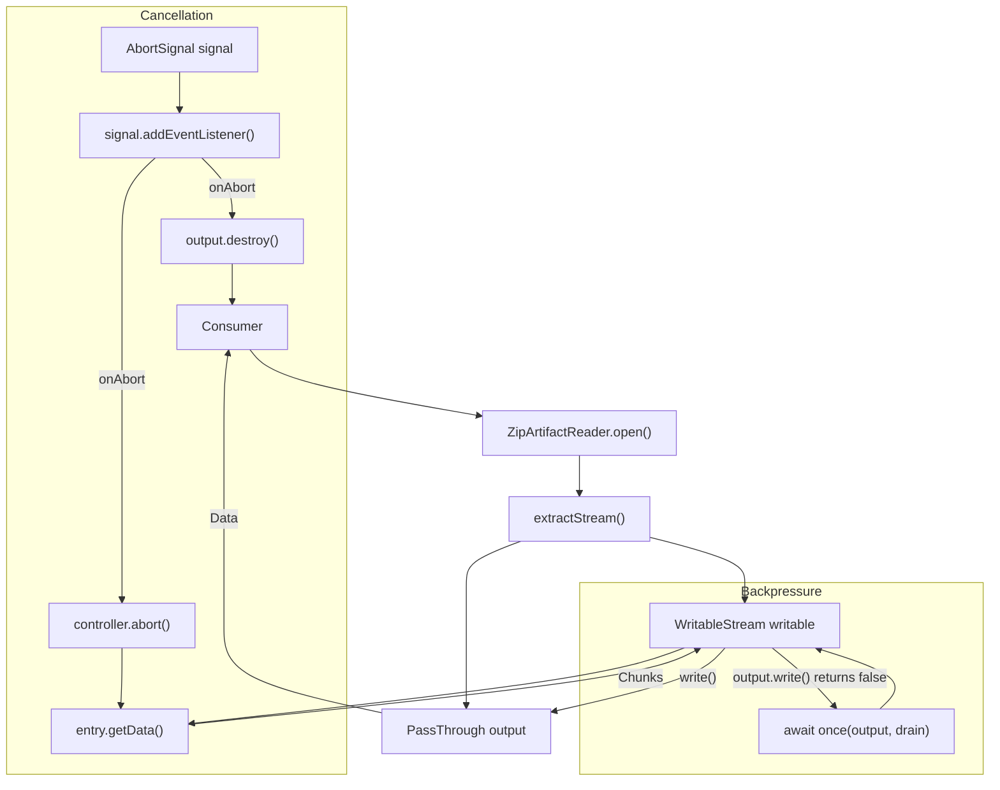
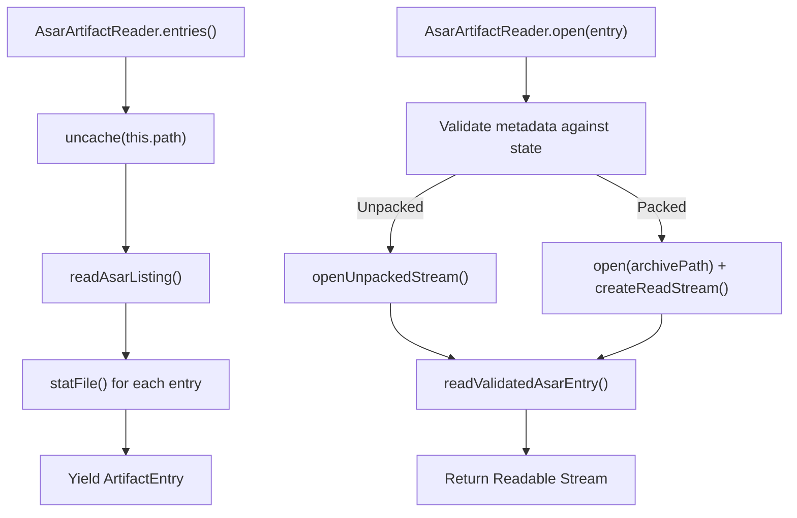
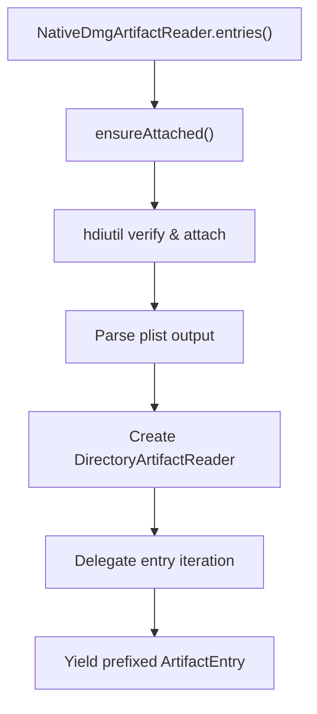
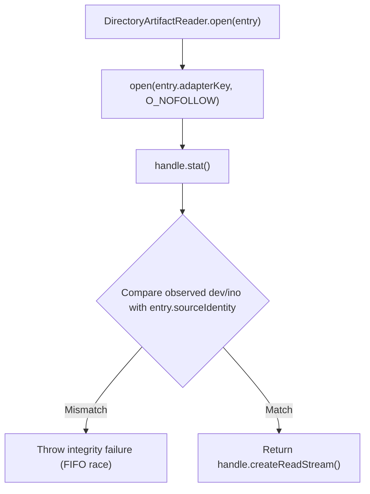
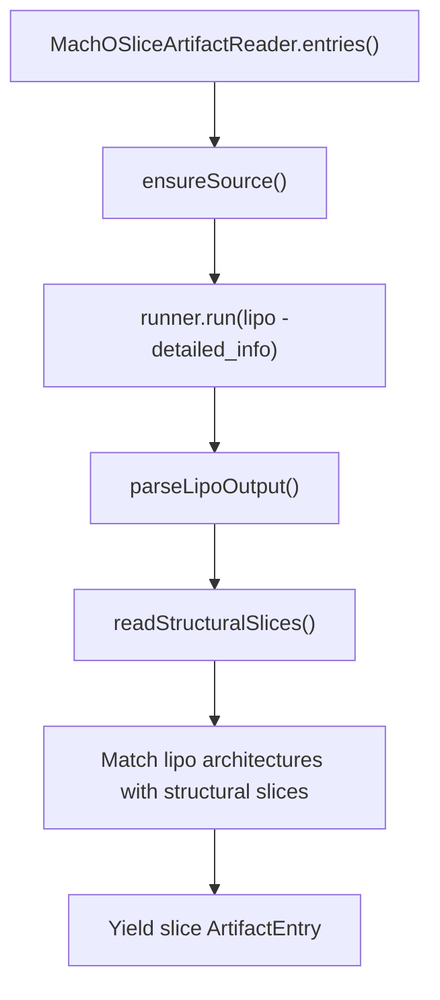

<!-- source: DeepWiki mcp.deepwiki.com · repo morluto/rea · page 5.1 Artifact Readers · fetched 2026-10-16 -->

# Artifact Readers

<details>
<summary>Relevant source files</summary>

The following files were used as context for generating this wiki page:

- [src/adb/AdbDirectoryListing.ts](src/adb/AdbDirectoryListing.ts)
- [src/application/javascript/JavaScriptArtifactAnalysis.sourceMaps.test.ts](src/application/javascript/JavaScriptArtifactAnalysis.sourceMaps.test.ts)
- [src/artifacts/ArtifactReader.ts](src/artifacts/ArtifactReader.ts)
- [src/artifacts/ArtifactResourceScope.ts](src/artifacts/ArtifactResourceScope.ts)
- [src/artifacts/AsarArtifactReader.ts](src/artifacts/AsarArtifactReader.ts)
- [src/artifacts/AsarEntryStream.ts](src/artifacts/AsarEntryStream.ts)
- [src/artifacts/AsarHeader.ts](src/artifacts/AsarHeader.ts)
- [src/artifacts/DirectoryArtifactReader.ts](src/artifacts/DirectoryArtifactReader.ts)
- [src/artifacts/MachOSliceArtifactReader.test.ts](src/artifacts/MachOSliceArtifactReader.test.ts)
- [src/artifacts/MachOSliceArtifactReader.ts](src/artifacts/MachOSliceArtifactReader.ts)
- [src/artifacts/NativeDmgArtifactReader.ts](src/artifacts/NativeDmgArtifactReader.ts)
- [src/artifacts/NativeDmgOwnership.ts](src/artifacts/NativeDmgOwnership.ts)
- [src/artifacts/OwnedFileHandle.test.ts](src/artifacts/OwnedFileHandle.test.ts)
- [src/artifacts/RegularFileAdmission.test.ts](src/artifacts/RegularFileAdmission.test.ts)
- [src/artifacts/SafeOutputTree.ts](src/artifacts/SafeOutputTree.ts)
- [src/artifacts/SafeOutputTreeCleanup.ts](src/artifacts/SafeOutputTreeCleanup.ts)
- [src/artifacts/SafeOutputTreeCreationFailure.ts](src/artifacts/SafeOutputTreeCreationFailure.ts)
- [src/artifacts/SafeOutputTreeIdentity.ts](src/artifacts/SafeOutputTreeIdentity.ts)
- [src/artifacts/SafeOutputTreeReadback.ts](src/artifacts/SafeOutputTreeReadback.ts)
- [src/artifacts/ZipArtifactReader.ts](src/artifacts/ZipArtifactReader.ts)
- [src/artifacts/extraction/ArtifactExtraction.ts](src/artifacts/extraction/ArtifactExtraction.ts)
- [src/artifacts/hostExecutableMarking.test.ts](src/artifacts/hostExecutableMarking.test.ts)
- [src/artifacts/hostExecutableMarking.ts](src/artifacts/hostExecutableMarking.ts)
- [src/artifacts/inventory/hashStableRootArtifact.ts](src/artifacts/inventory/hashStableRootArtifact.ts)
- [src/artifacts/javascript/JavaScriptArtifactFiles.ts](src/artifacts/javascript/JavaScriptArtifactFiles.ts)
- [src/cli/flutterCommands.ts](src/cli/flutterCommands.ts)
- [src/domain/artifactPartialObservation.ts](src/domain/artifactPartialObservation.ts)
- [src/domain/javascript/javascriptArtifactFiles.ts](src/domain/javascript/javascriptArtifactFiles.ts)
- [src/domain/javascript/javascriptModuleResolutionMode.ts](src/domain/javascript/javascriptModuleResolutionMode.ts)
- [src/domain/javascript/javascriptRecovery.ts](src/domain/javascript/javascriptRecovery.ts)
- [src/filesystem/OwnedDirectoryHandle.ts](src/filesystem/OwnedDirectoryHandle.ts)
- [src/filesystem/OwnedFileHandle.ts](src/filesystem/OwnedFileHandle.ts)
- [src/filesystem/RegularFile.ts](src/filesystem/RegularFile.ts)
- [src/filesystem/readFileHandleChunks.ts](src/filesystem/readFileHandleChunks.ts)
- [src/flutter/FlutterBuildProvider.ts](src/flutter/FlutterBuildProvider.ts)
- [src/native/SignatureTargetBinding.test.ts](src/native/SignatureTargetBinding.test.ts)
- [src/native/SignatureTargetBinding.ts](src/native/SignatureTargetBinding.ts)
- [src/native/parsers/echoedPath.test.ts](src/native/parsers/echoedPath.test.ts)
- [src/native/parsers/echoedPath.ts](src/native/parsers/echoedPath.ts)
- [src/native/parsers/lipo.test.ts](src/native/parsers/lipo.test.ts)
- [src/native/parsers/lipo.ts](src/native/parsers/lipo.ts)
- [src/process/ExecFileOutput.test.ts](src/process/ExecFileOutput.test.ts)
- [src/process/ExecFileOutput.ts](src/process/ExecFileOutput.ts)
- [tests/acceptance/artifactZipCurrentDirectory.test.ts](tests/acceptance/artifactZipCurrentDirectory.test.ts)
- [tests/boundary/cli/nativeMachoEchoedPathCli.test.ts](tests/boundary/cli/nativeMachoEchoedPathCli.test.ts)
- [tests/boundary/filesystem/artifactInventoryDescriptorCleanup.test.ts](tests/boundary/filesystem/artifactInventoryDescriptorCleanup.test.ts)
- [tests/boundary/filesystem/artifactInventorySnapshot.test.ts](tests/boundary/filesystem/artifactInventorySnapshot.test.ts)
- [tests/boundary/filesystem/artifactZipIntegrity.test.ts](tests/boundary/filesystem/artifactZipIntegrity.test.ts)
- [tests/boundary/filesystem/artifactZipRelativePaths.test.ts](tests/boundary/filesystem/artifactZipRelativePaths.test.ts)
- [tests/boundary/filesystem/asarInventoryFreshness.test.ts](tests/boundary/filesystem/asarInventoryFreshness.test.ts)
- [tests/boundary/filesystem/asarReaderCleanup.test.ts](tests/boundary/filesystem/asarReaderCleanup.test.ts)
- [tests/boundary/filesystem/asarStreamingAllocation.test.ts](tests/boundary/filesystem/asarStreamingAllocation.test.ts)
- [tests/boundary/filesystem/directoryArtifactReaderOpen.test.ts](tests/boundary/filesystem/directoryArtifactReaderOpen.test.ts)
- [tests/boundary/filesystem/flutterBuildProvider.test.ts](tests/boundary/filesystem/flutterBuildProvider.test.ts)
- [tests/boundary/filesystem/javascriptArtifactContentIdentity.test.ts](tests/boundary/filesystem/javascriptArtifactContentIdentity.test.ts)
- [tests/boundary/filesystem/javascriptIntegrityPolicy.test.ts](tests/boundary/filesystem/javascriptIntegrityPolicy.test.ts)
- [tests/boundary/filesystem/javascriptNestedReaderCleanup.test.ts](tests/boundary/filesystem/javascriptNestedReaderCleanup.test.ts)
- [tests/boundary/filesystem/safeOutputTree.test.ts](tests/boundary/filesystem/safeOutputTree.test.ts)
- [tests/boundary/filesystem/safeOutputTreeCloseFailures.test.ts](tests/boundary/filesystem/safeOutputTreeCloseFailures.test.ts)
- [tests/boundary/filesystem/stableArtifact.test.ts](tests/boundary/filesystem/stableArtifact.test.ts)
- [tests/boundary/mcp/javascriptSourceSelection.test.ts](tests/boundary/mcp/javascriptSourceSelection.test.ts)
- [tests/boundary/mcp/nativeSignatureTargetBindingMcp.test.ts](tests/boundary/mcp/nativeSignatureTargetBindingMcp.test.ts)
- [tests/boundary/process/adbDirectoryListing.test.ts](tests/boundary/process/adbDirectoryListing.test.ts)
- [tests/boundary/providers/native/artifactProvider.extractionCompleteness.test.ts](tests/boundary/providers/native/artifactProvider.extractionCompleteness.test.ts)
- [tests/boundary/providers/native/artifactProvider.extractionFormat.test.ts](tests/boundary/providers/native/artifactProvider.extractionFormat.test.ts)
- [tests/boundary/providers/native/artifactProvider.machOSlices.test.ts](tests/boundary/providers/native/artifactProvider.machOSlices.test.ts)
- [tests/boundary/providers/native/machoSliceReader.test.ts](tests/boundary/providers/native/machoSliceReader.test.ts)
- [tests/boundary/providers/native/nativeDmgArtifactReader.test.ts](tests/boundary/providers/native/nativeDmgArtifactReader.test.ts)
- [tests/boundary/providers/native/nativeSignatureTargetBinding.test.ts](tests/boundary/providers/native/nativeSignatureTargetBinding.test.ts)
- [tests/fixtures/javascriptPrimitiveExpansion.ts](tests/fixtures/javascriptPrimitiveExpansion.ts)
- [tests/process-global/asarSnapshotOperation.test.ts](tests/process-global/asarSnapshotOperation.test.ts)
- [tests/support/javascriptApplicationScope.ts](tests/support/javascriptApplicationScope.ts)

</details>


This page details the implementation of various artifact readers within REA, which are responsible for abstracting the complexities of different archive and filesystem formats. These readers provide a unified interface (`ArtifactReader`) for iterating over entries and streaming their contents, enabling REA to analyze diverse binary targets. The focus is on `ZipArtifactReader`, `AsarArtifactReader`, `NativeDmgArtifactReader`, `DirectoryArtifactReader`, and `MachOSliceArtifactReader`, including their mechanisms for handling entry streaming, backpressure, cancellation, and FIFO race conditions.

## ArtifactReader Interface

The core abstraction for reading artifacts is the `ArtifactReader` interface [src/artifacts/ArtifactReader.ts](). This interface defines methods for iterating over artifact entries and opening individual entries as readable streams.

```typescript
interface ArtifactReader {
  readonly format: ArtifactFormat;
  entries(signal?: AbortSignal): AsyncIterable<ArtifactEntry>;
  open(entry: ArtifactEntry, signal?: AbortSignal): Promise<Readable>;
  close(): Promise<void>;
  provenance(): readonly ArtifactCommand[];
}
```

The `ArtifactEntry` type describes a single item within an artifact, providing metadata such as its path, kind (`file`, `directory`, `symlink`), declared size, and other format-specific attributes.

Sources:
* [src/artifacts/ArtifactReader.ts]()

## ZipArtifactReader

The `ZipArtifactReader` [src/artifacts/ZipArtifactReader.ts:161-188]() is responsible for reading entries from ZIP archives, including Zip64 formats. It leverages the `@zip.js/zip.js` library for underlying ZIP file parsing.

### Implementation Details

The `ZipArtifactReader` uses a `NodeFileReader` [src/artifacts/ZipArtifactReader.ts:56-158]() to interact with the underlying file system. This custom reader extends `@zip.js/zip.js`'s `Reader` class to provide Node.js `FileHandle` based file access.

Key aspects of its implementation include:
*   **Lazy Initialization**: The `NodeFileReader` opens the file handle only when `init()` [src/artifacts/ZipArtifactReader.ts:71-74]() is called, typically by the `ZipReader` when it needs to access the archive.
*   **Entry Iteration**: The `entries()` method [src/artifacts/ZipArtifactReader.ts:190-250]() asynchronously iterates over all entries in the ZIP archive. It maps each `Entry` object from `@zip.js/zip.js` to an `ArtifactEntry`, handling different entry kinds and extracting metadata like `declaredSize`, `compressedSize`, and `executable` flags.
*   **Entry Streaming**: The `open()` method [src/artifacts/ZipArtifactReader.ts:251-290]() retrieves the corresponding `Entry` object and creates a `Readable` stream for the entry's content using internal buffering and decompression handlers.
*   **Integrity Checks**: The `ZipReader` is configured with `checkSignature: true` and `checkOverlappingEntry: true` [src/artifacts/ZipArtifactReader.ts:178-187]() to ensure the integrity of the ZIP archive and prevent issues with overlapping entries.
*   **Cancellation and Backpressure**: Stream extraction handles cancellation via `AbortSignal` and backpressure during streaming using a `PassThrough` stream and a `WritableStream` to consume data from `entry.getData()`.

### Backpressure and Cancellation


**Diagram: ZipArtifactReader Stream Flow with Backpressure and Cancellation**

Sources:
* [src/artifacts/ZipArtifactReader.ts:56-158]()
* [src/artifacts/ZipArtifactReader.ts:161-188]()
* [src/artifacts/ZipArtifactReader.ts:190-250]()
* [src/artifacts/ZipArtifactReader.ts:251-290]()

## AsarArtifactReader and Entry Streaming

The `AsarArtifactReader` [src/artifacts/AsarArtifactReader.ts:42-122]() provides read access to Electron ASAR archives. It uses the `@electron/asar` library for parsing ASAR headers and listing entries.

### Implementation Details

*   **ASAR Header and Entry Metadata**: The `entries()` method [src/artifacts/AsarArtifactReader.ts:57-122]() invokes `uncache(this.path)` indirectly via archive preparation to ensure it reads the freshest archive data, as `@electron/asar` caches headers by path. It uses `readAsarListing()` [src/artifacts/AsarAsarListing.ts]() to get a list of paths and parses the raw header.
*   **Unpacked Entries**: ASAR archives can contain "unpacked" entries stored as separate files alongside the `.asar` archive in a `<archive>.unpacked` directory. The `AsarArtifactReader` handles these by opening them directly from the filesystem [src/artifacts/AsarArtifactReader.ts:182-183]().
*   **Packed Entries**: For packed entries, the `open()` method calculates the byte offset and size within the ASAR archive using metadata and creates a `Readable` stream for the specific byte range [src/artifacts/AsarArtifactReader.ts:187-210]().
*   **`readValidatedAsarEntry`**: Packed and unpacked entry streams are piped through `readValidatedAsarEntry()` [src/artifacts/AsarEntryStream.ts](). This function wraps the raw stream, validating that observed bytes match expected sizes, handling cancellation, and projecting filesystem errors into `ArtifactReaderFailure` objects.

### FIFO Race Handling

The `AsarArtifactReader` handles FIFO race conditions by ensuring that the inventory process is fresh and subsequent `open` calls validate against inventoried metadata.


**Diagram: AsarArtifactReader Flow**

Sources:
* [src/artifacts/AsarArtifactReader.ts:42-122]()
* [src/artifacts/AsarArtifactReader.ts:182-210]()
* [src/artifacts/AsarEntryStream.ts]()

## NativeDmgArtifactReader

The `NativeDmgArtifactReader` [src/artifacts/NativeDmgArtifactReader.ts:137-167]() is a macOS-specific reader for Disk Image (DMG) files using the `hdiutil` command-line utility.

### Implementation Details

*   **macOS-only**: Checks `process.platform !== "darwin"` [src/artifacts/NativeDmgArtifactReader.ts:161-165]() and throws an `ArtifactReaderFailure` if instantiated on other platforms.
*   **`NativeDmgHost`**: Abstracts execution of `hdiutil` commands through the `NativeDmgHost` interface [src/artifacts/NativeDmgArtifactReader.ts:38-51](). The default implementation executes `/usr/bin/hdiutil` [src/artifacts/NativeDmgArtifactReader.ts:98]().
*   **Attachment Lifecycle**: The reader verifies the DMG, creates a temporary mount root using `mkdtemp` [src/artifacts/NativeDmgArtifactReader.ts:1-3](), attaches the image via `hdiutil attach`, and delegates subsequent file operations to an internal `DirectoryArtifactReader` [src/artifacts/NativeDmgArtifactReader.ts:142]().
*   **Detachment**: The `close()` method detaches mounted devices in reverse order and cleans up temporary mount directories.


**Diagram: NativeDmgArtifactReader Attachment & Traversal**

Sources:
* [src/artifacts/NativeDmgArtifactReader.ts:38-51]()
* [src/artifacts/NativeDmgArtifactReader.ts:98]()
* [src/artifacts/NativeDmgArtifactReader.ts:137-167]()
* [src/artifacts/NativeDmgArtifactReader.ts:161-165]()

## DirectoryArtifactReader

The `DirectoryArtifactReader` [src/artifacts/DirectoryArtifactReader.ts:30-40]() provides a deterministic, non-symlink-following way to read entries from a local directory.

### Implementation Details

*   **Root Path Resolution**: Resolves the canonical root path using `realpath()` upon initialization [src/artifacts/DirectoryArtifactReader.ts:71-85]().
*   **Deterministic Traversal**: Performs a depth-first traversal, sorting children alphabetically to ensure deterministic ordering [src/artifacts/DirectoryArtifactReader.ts:50-68]().
*   **FIFO Race Handling**: Records file device and inode numbers (`sourceIdentity`) during `entries()` [src/artifacts/DirectoryArtifactReader.ts:83-85](). During `open()`, it re-stats the file and compares device/inode numbers to detect modifications or replacements since the inventory was taken, throwing an `integrity` failure on mismatch [src/artifacts/DirectoryArtifactReader.ts:115-123]().


**Diagram: DirectoryArtifactReader FIFO Race Detection**

Sources:
* [src/artifacts/DirectoryArtifactReader.ts:30-40]()
* [src/artifacts/DirectoryArtifactReader.ts:50-68]()
* [src/artifacts/DirectoryArtifactReader.ts:71-85]()
* [src/artifacts/DirectoryArtifactReader.ts:115-123]()

## MachOSliceArtifactReader

The `MachOSliceArtifactReader` [src/artifacts/MachOSliceArtifactReader.ts:36-58]() is a read-only universal Mach-O slice reader backed by native `lipo` metadata and structural Mach-O load command parsing.

### Implementation Details

*   **Slice Enumeration**: Runs `lipo -detailed_info` via the configured `NativeCommandRunner` (defaulting to `XcrunCommandRunner`) to discover architecture slices within universal binaries [src/artifacts/MachOSliceArtifactReader.ts:69-80]().
*   **Structural Verification**: Reads structural slices using `readStructuralSlices()` [src/artifacts/MachOSliceArtifactReader.ts:118]() and cross-references them against `lipo` reported architectures [src/artifacts/MachOSliceArtifactReader.ts:145-157]() to validate offsets and sizes.
*   **Entry Generation**: Yields an `ArtifactEntry` for each valid Mach-O slice (`kind: "file"` or slice-specific representation), exposing attributes such as offset, size, and architecture identity.


**Diagram: MachOSliceArtifactReader Slice Discovery**

Sources:
* [src/artifacts/MachOSliceArtifactReader.ts:36-58]()
* [src/artifacts/MachOSliceArtifactReader.ts:69-80]()
* [src/artifacts/MachOSliceArtifactReader.ts:118]()
* [src/artifacts/MachOSliceArtifactReader.ts:145-157]()

## Backpressure and Cancellation

All `ArtifactReader` implementations coordinate backpressure and cancellation through `AbortSignal`:
*   **Cancellation**: `abortIfNeeded(signal)` is called during asynchronous iteration loops. If aborted, an `ArtifactReaderFailure` with reason `cancelled` is thrown.
*   **Backpressure**: Handled natively by Node.js stream pipelines and custom transformers (e.g., `PassThrough` stream drain events and chunk buffering limits).

Sources:
* [src/artifacts/ArtifactReader.ts]()
* [src/artifacts/ZipArtifactReader.ts:161-188]()
* [src/artifacts/DirectoryArtifactReader.ts:30-40]()

---

