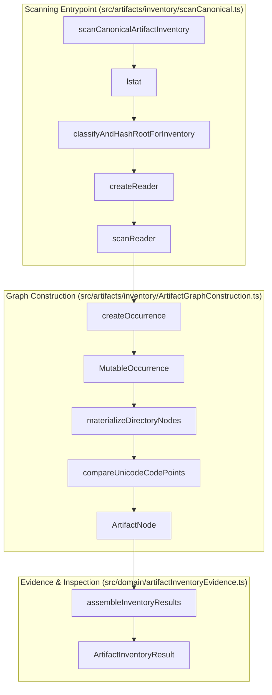
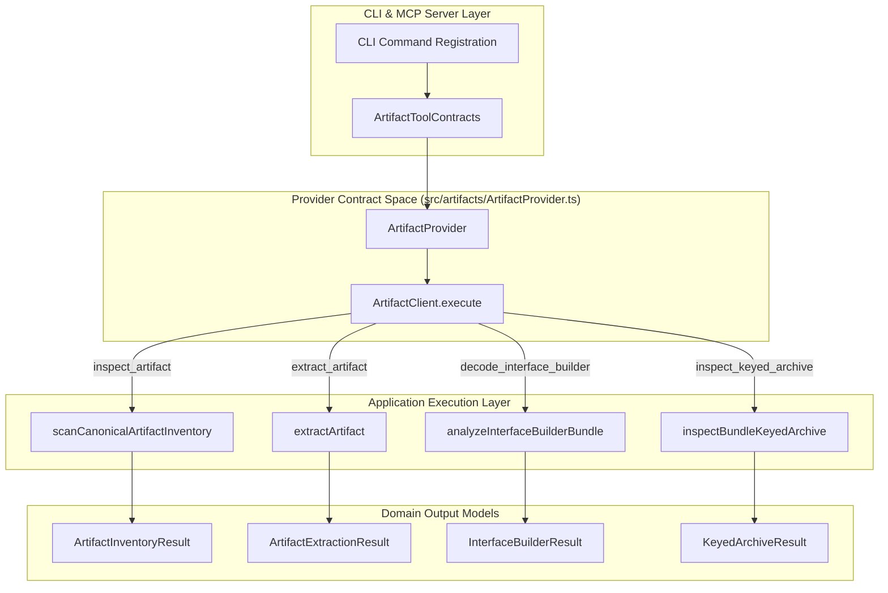

<!-- source: DeepWiki mcp.deepwiki.com · repo morluto/rea · page 5.2 Artifact Inventory and Extraction · fetched 2026-10-16 -->

# Artifact Inventory and Extraction

Relevant source files

The following files were used as context for generating this wiki page:

- [scripts/verify-package-artifact.mjs](scripts/verify-package-artifact.mjs)
- [src/artifacts/ArtifactPaths.test.ts](src/artifacts/ArtifactPaths.test.ts)
- [src/artifacts/ArtifactPaths.ts](src/artifacts/ArtifactPaths.ts)
- [src/artifacts/ArtifactProvider.ts](src/artifacts/ArtifactProvider.ts)
- [src/artifacts/apple/KeyedArchiveReader.ts](src/artifacts/apple/KeyedArchiveReader.ts)
- [src/artifacts/inventory/ArtifactGraphConstruction.test.ts](src/artifacts/inventory/ArtifactGraphConstruction.test.ts)
- [src/artifacts/inventory/ArtifactGraphConstruction.ts](src/artifacts/inventory/ArtifactGraphConstruction.ts)
- [src/artifacts/inventory/ArtifactInventory.ts](src/artifacts/inventory/ArtifactInventory.ts)
- [src/artifacts/inventory/classify.ts](src/artifacts/inventory/classify.ts)
- [src/artifacts/inventory/reader.ts](src/artifacts/inventory/reader.ts)
- [src/artifacts/inventory/scanCanonical.ts](src/artifacts/inventory/scanCanonical.ts)
- [src/artifacts/inventory/scanReader.ts](src/artifacts/inventory/scanReader.ts)
- [src/cli/artifactCommands.ts](src/cli/artifactCommands.ts)
- [src/contracts/artifactToolContracts.ts](src/contracts/artifactToolContracts.ts)
- [src/domain/android/androidApplication.ts](src/domain/android/androidApplication.ts)
- [src/domain/apple/appleApplication.test.ts](src/domain/apple/appleApplication.test.ts)
- [src/domain/apple/appleApplication.ts](src/domain/apple/appleApplication.ts)
- [src/domain/apple/appleBundleAnatomy.ts](src/domain/apple/appleBundleAnatomy.ts)
- [src/domain/apple/keyedArchive.test.ts](src/domain/apple/keyedArchive.test.ts)
- [src/domain/apple/keyedArchive.ts](src/domain/apple/keyedArchive.ts)
- [src/domain/apple/machoContainer.ts](src/domain/apple/machoContainer.ts)
- [src/domain/artifactComparison.ts](src/domain/artifactComparison.ts)
- [src/domain/artifactIdentity.ts](src/domain/artifactIdentity.ts)
- [src/domain/artifactInspection.ts](src/domain/artifactInspection.ts)
- [src/domain/artifactInventoryEvidence.test.ts](src/domain/artifactInventoryEvidence.test.ts)
- [src/domain/artifactInventoryEvidence.ts](src/domain/artifactInventoryEvidence.ts)
- [src/domain/artifactInventorySnapshot.ts](src/domain/artifactInventorySnapshot.ts)
- [src/domain/harmony/harmonyApplication.ts](src/domain/harmony/harmonyApplication.ts)
- [src/domain/mobileApplicationGraphProjection.ts](src/domain/mobileApplicationGraphProjection.ts)
- [src/domain/zipPackageFormat.ts](src/domain/zipPackageFormat.ts)
- [tests/acceptance/artifactClassification.test.ts](tests/acceptance/artifactClassification.test.ts)
- [tests/acceptance/artifactComparisonPlist.test.ts](tests/acceptance/artifactComparisonPlist.test.ts)
- [tests/acceptance/emptyTargetPathCli.test.ts](tests/acceptance/emptyTargetPathCli.test.ts)
- [tests/boundary/filesystem/android/application.test.ts](tests/boundary/filesystem/android/application.test.ts)
- [tests/boundary/filesystem/appleApplication.test.ts](tests/boundary/filesystem/appleApplication.test.ts)
- [tests/boundary/filesystem/artifactComparison.test.ts](tests/boundary/filesystem/artifactComparison.test.ts)
- [tests/boundary/filesystem/artifactComparisonSummary.test.ts](tests/boundary/filesystem/artifactComparisonSummary.test.ts)
- [tests/boundary/filesystem/artifactInventoryEntryOrder.test.ts](tests/boundary/filesystem/artifactInventoryEntryOrder.test.ts)
- [tests/boundary/filesystem/artifactMzInventory.test.ts](tests/boundary/filesystem/artifactMzInventory.test.ts)
- [tests/boundary/filesystem/asarInventoryContainment.test.ts](tests/boundary/filesystem/asarInventoryContainment.test.ts)
- [tests/boundary/filesystem/clientConfigurationBom.test.ts](tests/boundary/filesystem/clientConfigurationBom.test.ts)
- [tests/boundary/filesystem/harmony/application.test.ts](tests/boundary/filesystem/harmony/application.test.ts)
- [tests/boundary/filesystem/keyedArchiveSelection.test.ts](tests/boundary/filesystem/keyedArchiveSelection.test.ts)
- [tests/boundary/filesystem/zipDetection.test.ts](tests/boundary/filesystem/zipDetection.test.ts)
- [tests/boundary/process/binarySessionCleanupRetry.test.ts](tests/boundary/process/binarySessionCleanupRetry.test.ts)
- [tests/boundary/providers/native/artifactProvider.archiveInventory.test.ts](tests/boundary/providers/native/artifactProvider.archiveInventory.test.ts)
- [tests/boundary/providers/native/artifactProvider.archiveSafety.test.ts](tests/boundary/providers/native/artifactProvider.archiveSafety.test.ts)
- [tests/boundary/providers/native/artifactProvider.extraction.test.ts](tests/boundary/providers/native/artifactProvider.extraction.test.ts)
- [tests/boundary/providers/native/artifactProvider.failureDetail.test.ts](tests/boundary/providers/native/artifactProvider.failureDetail.test.ts)
- [tests/fixtures/artifactEntryOrder.ts](tests/fixtures/artifactEntryOrder.ts)
- [tests/support/applicationSessionFixture.ts](tests/support/applicationSessionFixture.ts)
- [tests/support/artifactClientScope.ts](tests/support/artifactClientScope.ts)

## Purpose and Scope
This page details REA's mechanisms for scanning, classifying, and extracting artifacts. It covers the `ArtifactInventory` scanning and classification pipelines [src/artifacts/inventory/scanCanonical.ts:53-60](), authorized inventory and integrity policies [src/artifacts/inventory/types.ts:18](), entry ordering determinism via Unicode code-point sorting [src/artifacts/inventory/ArtifactGraphConstruction.ts:1-1], artifact comparison semantics [src/domain/artifactComparison.ts:99-102](), safe `ArtifactExtraction` [src/artifacts/extraction/ArtifactExtraction.ts](), and the underlying tool contracts and CLI command bindings [src/contracts/artifactToolContracts.ts:80-121]().

---

## Artifact Inventory and Scanning
The core of artifact inventory is orchestrated by `scanCanonicalArtifactInventory` [src/artifacts/inventory/scanCanonical.ts:53-60](), which resolves file or directory metadata via `lstat` [src/artifacts/inventory/scanCanonical.ts:68-68](), classifies root formats through `classifyAndHashRootForInventory` [src/artifacts/inventory/scanCanonical.ts:73-78](), instantiates the appropriate container or archive reader, and drives `scanReader` [src/artifacts/inventory/scanReader.ts:45-47]() to build a content-addressed graph.

During traversal, each file or directory entry generates a `MutableOccurrence` via `createOccurrence` [src/artifacts/inventory/ArtifactGraphConstruction.ts:72-89](). Container suffixes (such as `.asar` or ZIP package variants) are validated, and directory structures are materialized deterministically using `materializeDirectoryNodes` [src/artifacts/inventory/ArtifactGraphConstruction.ts:135-146](). Resource ownership and cleanup are governed by `cleanupInventoryOwners` [src/artifacts/inventory/scanCanonical.ts:146-158]() running inside an `ArtifactResourceScope`.

### Inventory and Graph Construction Architecture

Sources:
- [src/artifacts/inventory/scanCanonical.ts:53-60]()
- [src/artifacts/inventory/scanCanonical.ts:68-68]()
- [src/artifacts/inventory/scanCanonical.ts:73-78]()
- [src/artifacts/inventory/scanCanonical.ts:146-158]()
- [src/artifacts/inventory/ArtifactGraphConstruction.ts:72-89]()
- [src/artifacts/inventory/ArtifactGraphConstruction.ts:135-146]()
- [src/domain/artifactInventoryEvidence.ts]()

---

## Authorized Inventory and Integrity Policy
The `inspect_artifact` tool contract [src/contracts/artifactToolContracts.ts:80-85]() accepts an `integrity_policy` defined by `artifactIntegrityPolicySchema` [src/contracts/artifactToolContracts.ts:15-17](). By default, REA enforces strict integrity (`STRICT_INTEGRITY_POLICY` [src/artifacts/inventory/types.ts:18]()), causing inventory operations to reject hash mismatches or corrupt internal entries. 

Alternatively, a `"record-and-continue"` policy captures integrity contradictions as `IntegrityContradiction` entities [src/domain/artifactGraph.ts]() without aborting the scan. The resulting inventory is verified against expected schemas using `parseArtifactInventoryResult` or `parseArtifactInventoryEvidence` [src/domain/artifactInventoryEvidence.ts:59-79](), ensuring that downstream comparison and analysis tools only consume cryptographically authenticated evidence payloads.

Sources:
- [src/contracts/artifactToolContracts.ts:80-85]()
- [src/contracts/artifactToolContracts.ts:15-17]()
- [src/artifacts/inventory/types.ts:18]()
- [src/domain/artifactGraph.ts]()
- [src/domain/artifactInventoryEvidence.ts:59-79]()

---

## Entry Ordering Determinism
To guarantee reproducible `artifact_id` and `manifest_id` hashes across different host operating systems and traversal interleavings, REA enforces strict entry ordering determinism. 

Directory child entries are sorted via `compareUnicodeCodePoints` [src/artifacts/inventory/ArtifactGraphConstruction.ts:1]() rather than host-dependent locales. `materializeDirectoryNodes` processes directories in reverse order of depth (`depth(right.logical_path) - depth(left.logical_path)`) [src/artifacts/inventory/ArtifactGraphConstruction.ts:139-146]() so that child content hashes are fully computed and bubbled up before parent directory nodes are hashed. Case-distinct prefixes and paths are preserved separately without implicitly generating malformed parent descriptors, as verified in boundary test suites (`tests/boundary/filesystem/artifactInventoryEntryOrder.test.ts`) [tests/boundary/filesystem/artifactInventoryEntryOrder.test.ts:1-125]().

Sources:
- [src/artifacts/inventory/ArtifactGraphConstruction.ts:1-1]()
- [src/artifacts/inventory/ArtifactGraphConstruction.ts:139-146]()
- [tests/boundary/filesystem/artifactInventoryEntryOrder.test.ts:1-125]()

---

## Artifact Comparison
Artifact comparison is implemented by `compareArtifacts` [src/domain/artifactComparison.ts:99-102](), which accepts two independent `evidence` payloads [src/domain/artifactComparison.ts:47-50](). It parses and validates both inventories via `parseArtifactInventoryEvidence` [src/domain/artifactInventoryEvidence.ts:59-79](), verifies coverage completeness (`hasCompleteInventoryCoverage`) [src/domain/artifactInventoryEvidence.ts:39-45](), and performs path-based diffing across multiple dimensions (content, kind, format, size, executable status, relations, metadata, availability, and integrity).

The comparison engine generates an `ArtifactComparisonResult` containing summary statistics (`unchanged`, `added`, `removed`, `changed`, `unknown`, `contradiction`) [src/domain/artifactComparison.ts:77-91]() and detailed change entries with cross-citations to both observation evidence IDs.

Sources:
- [src/domain/artifactComparison.ts:47-50]()
- [src/domain/artifactComparison.ts:77-91]()
- [src/domain/artifactComparison.ts:99-102]()
- [src/domain/artifactInventoryEvidence.ts:39-45]()
- [src/domain/artifactInventoryEvidence.ts:59-79]()

---

## Artifact Extraction and Tool Contracts
The `ArtifactProvider` class [src/artifacts/ArtifactProvider.ts:48-73]() implements the `AnalysisProvider` interface, providing read-only inventory and exclusively owned extraction capabilities. Through its inner `ArtifactClient` [src/artifacts/ArtifactProvider.ts:75](), it dispatches operations such as `inspect_artifact`, `extract_artifact`, `decode_interface_builder`, `inspect_keyed_archive`, `inspect_asset_catalog`, and `trace_dylib_resolution` [src/artifacts/ArtifactProvider.ts:84-174](), [src/contracts/artifactToolContracts.ts:80-121]().

Extraction is handled safely by writing regular files through a protected output tree manager that prevents directory traversal and symlink escapes, rolling back partial writes on failure.

### Tool Dispatch and CLI Execution Architecture

Sources:
- [src/artifacts/ArtifactProvider.ts:48-73]()
- [src/artifacts/ArtifactProvider.ts:75]()
- [src/artifacts/ArtifactProvider.ts:84-174]()
- [src/contracts/artifactToolContracts.ts:80-121]()

---

