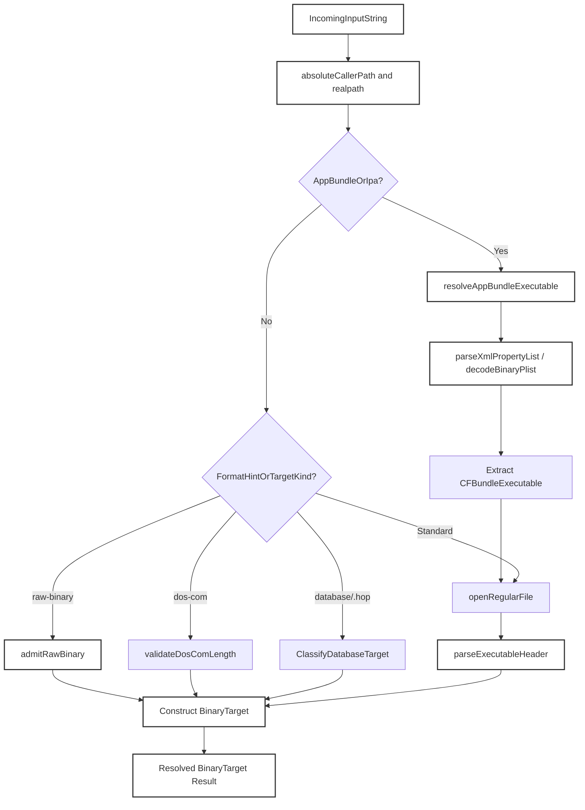
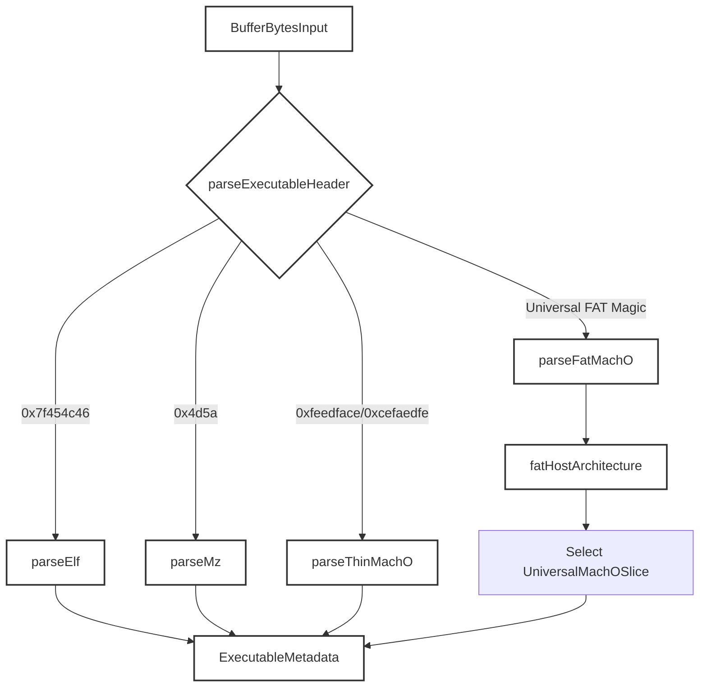

<!-- source: DeepWiki mcp.deepwiki.com · repo morluto/rea · page 5.3 Binary Target Resolution · fetched 2026-10-16 -->

# Binary Target Resolution

Relevant source files

The following files were used as context for generating this wiki page:

- [docs/user-visible-errors.csv](docs/user-visible-errors.csv)
- [install.sh](install.sh)
- [src/application/AppBundleExecutable.test.ts](src/application/AppBundleExecutable.test.ts)
- [src/application/AppBundleExecutable.ts](src/application/AppBundleExecutable.ts)
- [src/application/BinaryTargetResolver.ts](src/application/BinaryTargetResolver.ts)
- [src/domain/analysisErrorBase.ts](src/domain/analysisErrorBase.ts)
- [src/domain/analysisErrorPresentation.ts](src/domain/analysisErrorPresentation.ts)
- [src/domain/analysisErrorProjection.test.ts](src/domain/analysisErrorProjection.test.ts)
- [src/domain/analysisErrorProjection.ts](src/domain/analysisErrorProjection.ts)
- [src/domain/binaryTarget.fixture.ts](src/domain/binaryTarget.fixture.ts)
- [src/domain/binaryTarget.mips.test.ts](src/domain/binaryTarget.mips.test.ts)
- [src/domain/binaryTarget.riscv.test.ts](src/domain/binaryTarget.riscv.test.ts)
- [src/domain/binaryTarget.test.ts](src/domain/binaryTarget.test.ts)
- [src/domain/binaryTarget.ts](src/domain/binaryTarget.ts)
- [src/domain/binaryTargetTypes.ts](src/domain/binaryTargetTypes.ts)
- [src/domain/configurationErrors.ts](src/domain/configurationErrors.ts)
- [src/domain/elfFixedHeader.test.ts](src/domain/elfFixedHeader.test.ts)
- [src/domain/elfFixedHeader.ts](src/domain/elfFixedHeader.ts)
- [src/domain/rawBinary.test.ts](src/domain/rawBinary.test.ts)
- [src/domain/rawBinary.ts](src/domain/rawBinary.ts)
- [src/go/GoElfImage.ts](src/go/GoElfImage.ts)
- [tests/boundary/cli/rawBinaryCli.test.ts](tests/boundary/cli/rawBinaryCli.test.ts)
- [tests/boundary/filesystem/artifactInventoryRegularRoot.test.ts](tests/boundary/filesystem/artifactInventoryRegularRoot.test.ts)
- [tests/boundary/filesystem/binaryTarget.test.ts](tests/boundary/filesystem/binaryTarget.test.ts)
- [tests/boundary/filesystem/installScript.test.ts](tests/boundary/filesystem/installScript.test.ts)
- [tests/boundary/filesystem/targetDiagnostics.test.ts](tests/boundary/filesystem/targetDiagnostics.test.ts)
- [tests/boundary/mcp/openBinaryFifo.test.ts](tests/boundary/mcp/openBinaryFifo.test.ts)

Binary target resolution is the process of identifying, validating, and classifying a local file or application bundle before it is passed to the analysis providers. This stage ensures that providers receive deterministic arguments, preventing interactive UI dialogs (such as architecture selection for FAT binaries) that would block the MCP agent.

## Purpose and Scope

The target resolution subsystem operates in the application and domain layers (`src/application/BinaryTargetResolver.ts` [src/application/BinaryTargetResolver.ts:1-693](), `src/application/AppBundleExecutable.ts` [src/application/AppBundleExecutable.ts:1-291](), and `src/domain/binaryTarget.ts` [src/domain/binaryTarget.ts:1-566]()). Its scope encompasses path canonicalization, app bundle discovery, file format identification across ELF, PE, Mach-O (thin and universal FAT), DOS MZ/COM, raw binaries, and packages, alongside SHA-256 hashing and safety constraint validations.

Sources: [src/application/BinaryTargetResolver.ts:1-693](), [src/application/AppBundleExecutable.ts:1-291](), [src/domain/binaryTarget.ts:1-566]()

## The BinaryTarget and ExecutableMetadata Interfaces

The resolution process produces a `BinaryTarget` object [src/domain/binaryTargetTypes.ts:139-230](). This structure acts as a canonical contract between the resolution logic and the analysis providers. Structured executable properties are derived from `ExecutableMetadata` [src/domain/binaryTarget.ts:21-64]().

| Property | Type | Description |
| :--- | :--- | :--- |
| `path` | `string` | Canonical absolute path to the file. |
| `sourcePath` | `string` | The original path provided by the user, if different from `path`. |
| `bundleInfoPlist` | `string` | Path to the `Info.plist` if the target was resolved from an app bundle. |
| `sha256` | `string` | Deterministic SHA-256 hash of the file contents. |
| `kind` | `"executable" \| "database" \| "archive" \| "artifact"` | High-level classification of the target. |
| `format` | `"mach-o" \| "elf" \| "pe" \| "dos-mz" \| "dos-com" \| "analysis-database" \| "zip" \| "ipa" \| "apk" \| "msix" \| "appx" \| "asar" \| "dmg" | "pkg" \| "plist" | "javascript" \| "source-map" \| "raw-binary"` | The detected binary container or artifact format. |
| `architecture` | `BinaryArchitecture` | The specific CPU slice selected (e.g., `arm64`, `x86_64`) for executables. |
| `availableArchitectures` | `readonly BinaryArchitecture[]` | All architectures found in a multi-architecture executable. |
| `executableRole` | `"application" \| "shared-library" \| "non-executable"` | For PE files, indicates its role. |
| `managed` | `boolean` | For PE files, indicates if it's a managed (.NET) assembly. |

Sources: [src/domain/binaryTargetTypes.ts:139-230](), [src/domain/binaryTarget.ts:21-64]()

## Resolution Workflow and Data Flow

The entry point for this logic is `parseBinaryTarget` [src/application/BinaryTargetResolver.ts:75-190](). It performs a sequence of checks to transform a user-supplied string into a validated `BinaryTarget`.

Title: Binary Target Resolution Code Architecture Data Flow

Sources: [src/application/BinaryTargetResolver.ts:75-190](), [src/application/AppBundleExecutable.ts:60-91](), [src/domain/binaryTarget.ts:70-91]()

## App Bundle Resolution (macOS/iOS)

If the input path is identified as an application bundle (e.g., ending in `.app`), `resolveAppBundleExecutable` [src/application/AppBundleExecutable.ts:60-91]() is invoked to locate the primary executable within it.

1. **Layout Detection**: It checks for common bundle layouts, specifically `Contents/Info.plist` (macOS) or `Info.plist` at the root (iOS-style, often found in extracted IPAs) [src/application/AppBundleExecutable.ts:28-37](). It also handles iOS apps installed on macOS, which are wrapped in a `Wrapper` directory [src/application/AppBundleExecutable.ts:156-172]().
2. **Info.plist Parsing**: The `Info.plist` file is read via `fileSystem.readFile` [src/application/AppBundleExecutable.ts:180-195](). It supports XML and binary Plist formats.
3. **Executable Extraction**: The `CFBundleExecutable` key is extracted from the plist to determine the executable's filename.
4. **Security Checks**:
   - **Path Confinement**: It verifies that the resolved executable's canonical path remains strictly within the bundle's designated programs directory using `isPathWithinRoot` [src/domain/localPath.js](). This prevents symlink-based escapes [tests/boundary/filesystem/binaryTarget.test.ts:163-189]().

Sources: [src/application/AppBundleExecutable.ts:28-91](), [src/application/AppBundleExecutable.ts:156-195](), [tests/boundary/filesystem/binaryTarget.test.ts:163-189]()

## Header Parsing and Architecture Selection

To classify the binary and select the correct architecture, `parseExecutableHeader` [src/domain/binaryTarget.ts:70-91]() is used. This function reads a prefix of the file to identify its format and architecture.

### Supported Executable Formats
* **ELF**: Identified by the magic bytes `0x7f, 0x45, 0x4c, 0x46` [src/domain/binaryTarget.ts:76-80](). `parseElf` extracts the machine type and endianness.
* **PE (Windows)**: Identified by the `MZ` magic bytes (`0x4d, 0x5a`) [src/domain/binaryTarget.ts:81-82](). `parseMz` checks for the Windows PE header offset and invokes `parsePeRecord` to extract architecture, executable role, and managed status.
* **Mach-O (macOS)**:
  - **Thin Mach-O**: Identified by magic numbers `0xfeedface`, `0xfeedfacf`, `0xcefaedfe`, or `0xcffaedfe` [src/domain/binaryTarget.ts:84-86](). `parseThinMachO` [src/domain/binaryTarget.ts:93-119]() extracts the architecture.
  - **FAT Mach-O (Universal)**: Identified via `readFatContainerHeader` [src/domain/binaryTarget.ts:87-89](). `parseFatMachO` [src/domain/binaryTarget.ts:121-163]() lists all contained architectures.

### FAT Mach-O Slice Selection
For FAT Mach-O binaries, `parseFatMachO` automatically selects the slice that matches the host system's architecture (`process.arch`) mapped through `fatHostArchitecture` [src/domain/binaryTarget.ts:165-180](). This ensures that analysis tools receive a specific architecture without interactive prompts. If no compatible slice is found, an error is returned.

Title: Executable Header Parsing and Architecture Code Entities

Sources: [src/domain/binaryTarget.ts:70-180](), [src/domain/binaryTarget.ts:93-119](), [src/domain/binaryTarget.ts:121-163]()

## Artifact, Package Detection, and SHA-256 Hashing

Beyond executables, `parseBinaryTarget` identifies various artifact and package formats using `detectArtifactFormat` [src/application/BinaryTargetResolver.ts:181](). This involves checking file extensions and magic bytes:
* **ZIP-based packages**: `hasZipSignature` and `zipPackageFormatForPath` classify `.apk`, `.msix`, `.appx`, and `.ipa` [src/domain/zipPackageFormat.js]().
* **ASAR, DMG, PKG, Plist, and JavaScript/Source Maps**: Classified via extension inspection and format-specific trailers.

Every `BinaryTarget` includes a SHA-256 hash calculated via a streaming read of the file handle using `sha256Handle` [src/application/BinaryTargetResolver.ts:130](). This hash is used by the `BinarySession` to track target transitions and verify file integrity.

Sources: [src/application/BinaryTargetResolver.ts:130](), [src/application/BinaryTargetResolver.ts:181](), [src/domain/zipPackageFormat.js]()

## Safety Checks, File Admission, and Error Handling

The resolution process includes robust error handling and safety checks:
* **File System Access**: It checks for read access (`constants.R_OK`) and resolves symlinks using `realpath` [src/application/BinaryTargetResolver.ts:87-89]().
* **Error Classification**: Unreadable targets, directory mismatches, or unsupported formats return typed `BinaryTargetError` instances [src/domain/configurationErrors.js:12](). These errors are projected safely by `projectAnalysisError` [src/domain/analysisErrorProjection.ts:46-96]() into sanitized structures suitable for CLI and MCP consumption.

Sources: [src/application/BinaryTargetResolver.ts:87-89](), [src/domain/configurationErrors.js:12](), [src/domain/analysisErrorProjection.ts:46-96]()

---

