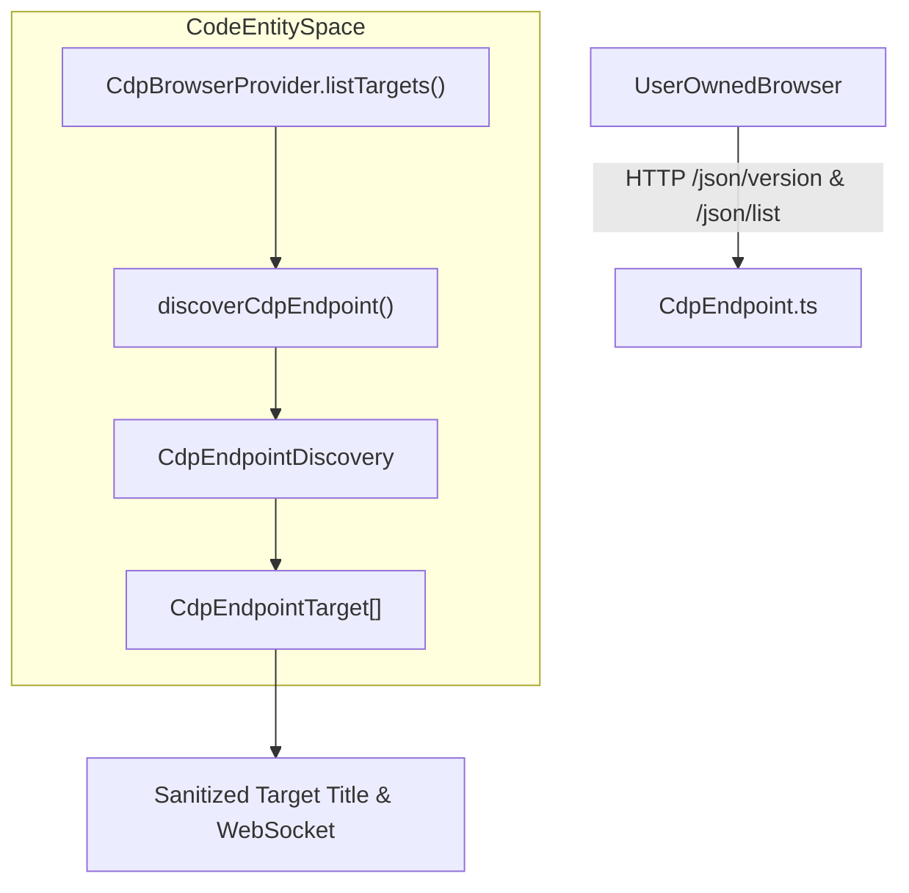
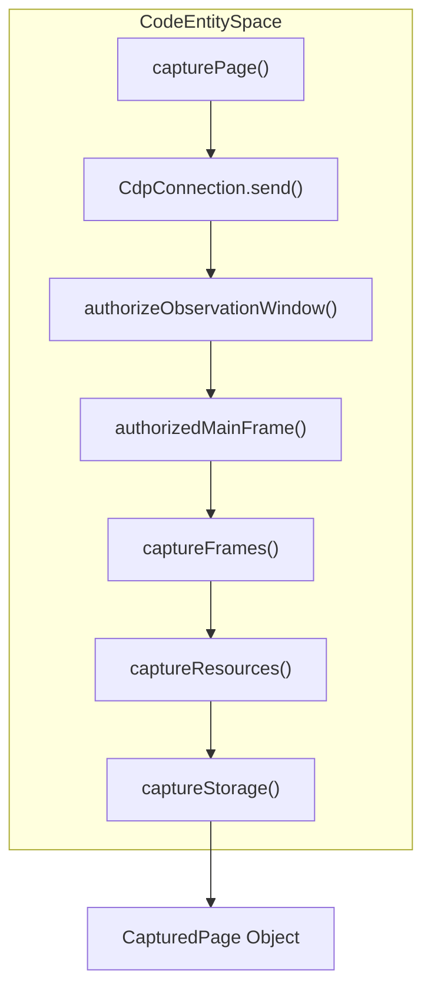

<!-- source: DeepWiki mcp.deepwiki.com · repo morluto/rea · page 6.1 CDP Browser Observation · fetched 2026-10-16 -->

# CDP Browser Observation

Relevant source files

The following files were used as context for generating this wiki page:

- [docs/browser-observation.md](docs/browser-observation.md)
- [src/application/BrowserEvidence.ts](src/application/BrowserEvidence.ts)
- [src/browser/CdpBrowserProvider.ts](src/browser/CdpBrowserProvider.ts)
- [src/browser/CdpCaptureDocuments.baseUrl.test.ts](src/browser/CdpCaptureDocuments.baseUrl.test.ts)
- [src/browser/CdpCaptureDocuments.test.ts](src/browser/CdpCaptureDocuments.test.ts)
- [src/browser/CdpCaptureDocuments.ts](src/browser/CdpCaptureDocuments.ts)
- [src/browser/CdpCaptureDomSvg.ts](src/browser/CdpCaptureDomSvg.ts)
- [src/browser/CdpCaptureEventHandlers.ts](src/browser/CdpCaptureEventHandlers.ts)
- [src/browser/CdpCaptureEventState.ts](src/browser/CdpCaptureEventState.ts)
- [src/browser/CdpCaptureEvents.ts](src/browser/CdpCaptureEvents.ts)
- [src/browser/CdpCaptureStorage.test.ts](src/browser/CdpCaptureStorage.test.ts)
- [src/browser/CdpCaptureStorage.ts](src/browser/CdpCaptureStorage.ts)
- [src/browser/CdpCaptureStorageFingerprints.ts](src/browser/CdpCaptureStorageFingerprints.ts)
- [src/browser/CdpCaptureValues.ts](src/browser/CdpCaptureValues.ts)
- [src/browser/CdpConnection.ts](src/browser/CdpConnection.ts)
- [src/browser/CdpElectronInspection.test.ts](src/browser/CdpElectronInspection.test.ts)
- [src/browser/CdpElectronInspection.ts](src/browser/CdpElectronInspection.ts)
- [src/browser/CdpElectronProvider.ts](src/browser/CdpElectronProvider.ts)
- [src/browser/CdpElectronScriptEvents.ts](src/browser/CdpElectronScriptEvents.ts)
- [src/browser/CdpElectronScripts.ts](src/browser/CdpElectronScripts.ts)
- [src/browser/CdpElectronWorkers.ts](src/browser/CdpElectronWorkers.ts)
- [src/browser/CdpEndpoint.ts](src/browser/CdpEndpoint.ts)
- [src/browser/CdpObservationSession.ts](src/browser/CdpObservationSession.ts)
- [src/browser/CdpPageCapture.ts](src/browser/CdpPageCapture.ts)
- [src/browser/CdpPageCaptureScripts.ts](src/browser/CdpPageCaptureScripts.ts)
- [src/browser/CdpPageCaptureWorkers.test.ts](src/browser/CdpPageCaptureWorkers.test.ts)
- [src/browser/CdpPageCaptureWorkers.ts](src/browser/CdpPageCaptureWorkers.ts)
- [src/browser/CdpSnapshotStrings.ts](src/browser/CdpSnapshotStrings.ts)
- [src/browser/CdpTargetSession.ts](src/browser/CdpTargetSession.ts)
- [src/browser/CdpWebMcpDiscovery.ts](src/browser/CdpWebMcpDiscovery.ts)
- [src/cliObservationOptions.ts](src/cliObservationOptions.ts)
- [src/contracts/browserToolContracts.ts](src/contracts/browserToolContracts.ts)
- [src/domain/browserObservation.ts](src/domain/browserObservation.ts)
- [src/domain/browserObservationSchemas.ts](src/domain/browserObservationSchemas.ts)
- [src/domain/webCaptureDiff.ts](src/domain/webCaptureDiff.ts)
- [src/evm/EvmoleFailures.ts](src/evm/EvmoleFailures.ts)
- [src/evm/EvmoleInterfaceProvider.ts](src/evm/EvmoleInterfaceProvider.ts)
- [tests/boundary/browser/cdpBrowserProvider.document_script.test.ts](tests/boundary/browser/cdpBrowserProvider.document_script.test.ts)
- [tests/boundary/browser/cdpBrowserProvider.indexed_db.test.ts](tests/boundary/browser/cdpBrowserProvider.indexed_db.test.ts)
- [tests/boundary/browser/cdpBrowserProvider.sensitive_data.test.ts](tests/boundary/browser/cdpBrowserProvider.sensitive_data.test.ts)
- [tests/boundary/browser/cdpBrowserProvider.targetInventory.test.ts](tests/boundary/browser/cdpBrowserProvider.targetInventory.test.ts)
- [tests/boundary/browser/cdpCleanupCancellation.test.ts](tests/boundary/browser/cdpCleanupCancellation.test.ts)
- [tests/boundary/browser/cdpConnection.test.ts](tests/boundary/browser/cdpConnection.test.ts)
- [tests/boundary/browser/cdpDomSvgIdentity.test.ts](tests/boundary/browser/cdpDomSvgIdentity.test.ts)
- [tests/boundary/browser/cdpElectronProvider.test.ts](tests/boundary/browser/cdpElectronProvider.test.ts)
- [tests/boundary/browser/cdpEndpointResponseBounds.test.ts](tests/boundary/browser/cdpEndpointResponseBounds.test.ts)
- [tests/boundary/browser/cdpHttpComparison.test.ts](tests/boundary/browser/cdpHttpComparison.test.ts)
- [tests/boundary/browser/cdpObservationResourceTypes.test.ts](tests/boundary/browser/cdpObservationResourceTypes.test.ts)
- [tests/boundary/browser/cdpSvgXlinkHref.test.ts](tests/boundary/browser/cdpSvgXlinkHref.test.ts)
- [tests/boundary/browser/webCaptureDiff.test.ts](tests/boundary/browser/webCaptureDiff.test.ts)
- [tests/boundary/cli/accessibilityCaptureComparison.test.ts](tests/boundary/cli/accessibilityCaptureComparison.test.ts)
- [tests/boundary/cli/httpCaptureComparison.test.ts](tests/boundary/cli/httpCaptureComparison.test.ts)
- [tests/boundary/evm/evmoleInterfaceProvider.test.ts](tests/boundary/evm/evmoleInterfaceProvider.test.ts)
- [tests/boundary/filesystem/qwenClientConfiguration.test.ts](tests/boundary/filesystem/qwenClientConfiguration.test.ts)
- [tests/fixtures/fakeCdpBrowser.ts](tests/fixtures/fakeCdpBrowser.ts)
- [tests/fixtures/fakeCdpBrowserEvents.ts](tests/fixtures/fakeCdpBrowserEvents.ts)
- [tests/fixtures/fakeCdpBrowserResults.ts](tests/fixtures/fakeCdpBrowserResults.ts)
- [tests/fixtures/fakeCdpBrowserTypes.ts](tests/fixtures/fakeCdpBrowserTypes.ts)
- [tests/fixtures/httpComparisonBrowser.ts](tests/fixtures/httpComparisonBrowser.ts)
- [tests/fixtures/native-macos/otool-dylib-use.md](tests/fixtures/native-macos/otool-dylib-use.md)
- [tests/fixtures/native-macos/otool-dylib-use.txt](tests/fixtures/native-macos/otool-dylib-use.txt)

## Purpose and Scope

This page details REA's capabilities for observing and analyzing web content via the Chrome DevTools Protocol (CDP). This includes discovering CDP endpoints and targets, capturing page state and events, fingerprinting storage, taking screenshots, discovering WebMCP tools, redacting sensitive metadata, and diffing captured data. CDP page capture and V8 Inspector observation attach to an already-running target without launching it, driving actions, or evaluating target code [docs/browser-observation.md:67-70]().

Sources:
* [docs/browser-observation.md:67-70]()

## CDP Endpoint and Target Discovery

REA connects to a running browser instance through its CDP endpoint. This endpoint is expected to be a local-only HTTP URL, typically on `127.0.0.1` or `::1` with an explicit port [src/domain/browserObservation.ts:52-84](). The endpoint discovery routine queries the `/json/version` and `/json/list` endpoints to retrieve browser version information and a list of available targets (pages, workers, etc.) [src/browser/CdpEndpoint.ts:66-70]().

Each target includes an `id`, `type`, `title`, `url`, and an `attached` status, along with an optional `webSocketDebuggerUrl` for direct communication with that specific target [src/browser/CdpEndpoint.ts:21-28](). REA validates these URLs to ensure they conform to strict loopback addressing requirements.

**Figure 1: Code Entity Mapping for CDP Endpoint Discovery**

Sources:
* [src/browser/CdpEndpoint.ts:21-28]()
* [src/browser/CdpEndpoint.ts:66-70]()
* [src/domain/browserObservation.ts:52-84]()

## Target Sessions and Page Capture

Once a target is identified, REA establishes a CDP session via the `CdpConnection` class [src/browser/CdpConnection.ts:30-49](). `CdpConnection` manages the WebSocket connection to the CDP endpoint, handling command serialization, timeout enforcement via `WEB_RUNTIME_LIMITS.commandTimeoutMs`, and asynchronous event dispatch [src/browser/CdpConnection.ts:121-181]().

The `capturePage` function [src/browser/CdpPageCapture.ts:70-73]() coordinates the inspection process:
1. Initializes a `CdpCaptureEvents` accumulator [src/browser/CdpPageCapture.ts:74-75]().
2. Attaches an event listener to `CdpConnection` to stream wire events [src/browser/CdpPageCapture.ts:76-79]().
3. Authorizes the observation window and captures JSON response bodies [src/browser/CdpPageCapture.ts:109-110]().
4. Resolves the main frame via `authorizedMainFrame` [src/browser/CdpPageCapture.ts:111-117]().
5. Invokes structural capture helpers such as `captureFrames` [src/browser/CdpCaptureDocuments.ts:34-41](), `captureResources` [src/browser/CdpCaptureDocuments.ts:90-96](), `captureDom`, and `captureStorage` [src/browser/CdpPageCapture.ts:130-155]().
6. Asserts capture stability against navigation or origin violations before returning a `CapturedPage` object [src/browser/CdpPageCapture.ts:165-175]().

**Figure 2: Page Capture Execution Flow**

Sources:
* [src/browser/CdpConnection.ts:30-49]()
* [src/browser/CdpConnection.ts:121-181]()
* [src/browser/CdpPageCapture.ts:70-73]()
* [src/browser/CdpPageCapture.ts:74-79]()
* [src/browser/CdpPageCapture.ts:109-117]()
* [src/browser/CdpPageCapture.ts:130-155]()
* [src/browser/CdpPageCapture.ts:165-175]()
* [src/browser/CdpCaptureDocuments.ts:34-41]()
* [src/browser/CdpCaptureDocuments.ts:90-96]()

## Capture Events

The `CdpCaptureEvents` class serves as the central event accumulator during page capture. It ingests raw CDP events and normalizes payloads into structured domains: scripts, execution context frame mappings, network requests/responses, console API calls, WebSocket frames, response metadata, and agent hints [docs/browser-observation.md:18]() [src/browser/CdpCaptureEvents.ts:17-31]().

The `ingest` method maps incoming wire method names (such as `Runtime.executionContextCreated`, `Debugger.scriptParsed`, and `Network.requestWillBeSent`) to specialized internal handlers, updating completeness metrics dynamically [src/browser/CdpCaptureEvents.ts:80-120]().

Sources:
* [docs/browser-observation.md:18]()
* [src/browser/CdpCaptureEvents.ts:17-31]()
* [src/browser/CdpCaptureEvents.ts:80-120]()

## Storage Fingerprints

Storage observation is governed by `include_storage_keys` and `include_storage_fingerprints` parameters [src/domain/browserObservation.ts:109-110](). The `captureStorage` function queries browser storage APIs across local storage, session storage, IndexedDB, and cache storage [src/browser/CdpPageCapture.ts:151-155]().

When storage keys are omitted or unavailable, the completeness ledger logs an explicit exclusion reason (such as `not_approved` or `provider_unavailable`), preventing downstream tooling from inferring membership changes from truncated data [tests/boundary/browser/webCaptureDiff.test.ts:80-94]().

Sources:
* [src/domain/browserObservation.ts:109-110]()
* [src/browser/CdpPageCapture.ts:151-155]()
* [tests/boundary/browser/webCaptureDiff.test.ts:80-94]()

## Screenshots

REA supports capturing visible-viewport PNG screenshots and comparing them locally without external services [docs/browser-observation.md:34-36](). 

The `compare_web_screenshots` command processes input PNGs under a strict **256 MiB estimated working-memory budget** before inflating either image [docs/browser-observation.md:42-45](). This conservative buffer budget accounts for decoder-owned decoded input buffers, IDAT payload chunks, zlib decompression memory, unfiltered scanlines, and RGB-to-RGBA expansions [docs/browser-observation.md:53-59](). Exceeding this budget halts processing and returns a `resource_constraint` error with `details.resource: "memory"` [docs/browser-observation.md:47-49]().

Sources:
* [docs/browser-observation.md:34-36]()
* [docs/browser-observation.md:42-45]()
* [docs/browser-observation.md:47-49]()
* [docs/browser-observation.md:53-59]()

## WebMCP Discovery

WebMCP tool discovery leverages the experimental CDP WebMCP domain to inspect in-scope tool registrations [docs/browser-observation.md:21](). By listening for `WebMCP.toolsAdded` and `WebMCP.toolsRemoved` events following a `WebMCP.enable` command, REA builds a complete inventory of declarations, including `input_schema` payloads and canonical `input_schema_sha256` digests [docs/browser-observation.md:21]() [tests/fixtures/fakeCdpBrowserEvents.ts:26-43]().

Registrations maintain frame-local identities via `tool_key`, tracking annotation hints such as `readOnly`, `untrustedContent`, `consequential`, and `autosubmit` [docs/browser-observation.md:21](). REA explicitly prohibits tool invocation, never exposing `WebMCP.invokeTool` [docs/browser-observation.md:21]().

Sources:
* [docs/browser-observation.md:21]()
* [tests/fixtures/fakeCdpBrowserEvents.ts:26-43]()

## Safe Metadata Redaction

REA enforces strict data minimization by sanitizing browser URLs to remove user credentials [src/domain/browserObservation.ts:163-164]() and discarding raw response headers [src/browser/CdpSafeMetadata.ts:14-19](). Only an allowlisted set of response metadata—such as parsed `Link` headers, Content-Security-Policy (CSP) directives, and agent hints—is normalized, with sensitive nonces, hashes, and external origins systematically scrubbed [src/browser/CdpSafeMetadata.ts:23-62]().

Sources:
* [src/domain/browserObservation.ts:163-164]()
* [src/browser/CdpSafeMetadata.ts:14-19]()
* [src/browser/CdpSafeMetadata.ts:23-62]()

## Capture Diffing

The `compareWebCaptures` function compares normalized observations across dimensions such as DOM structure, scripts, resources, accessibility trees, and storage fingerprints [src/domain/webCaptureDiff.ts:21-50]().

Capture diffing uses strict completeness semantics: missing or truncated evidence is marked as `unknown` rather than falsely interpreted as equivalence or removal [src/domain/webCaptureDiff.ts:43-48](). Changes in node inventories or storage keys yield a `changed` status only when both observation windows report complete inventory coverage [src/domain/webCaptureDiff.ts:79-106]().

Sources:
* [src/domain/webCaptureDiff.ts:21-50]()
* [src/domain/webCaptureDiff.ts:43-48]()
* [src/domain/webCaptureDiff.ts:79-106]()

---

