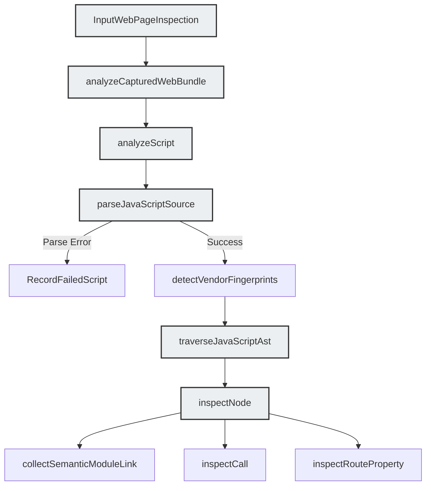
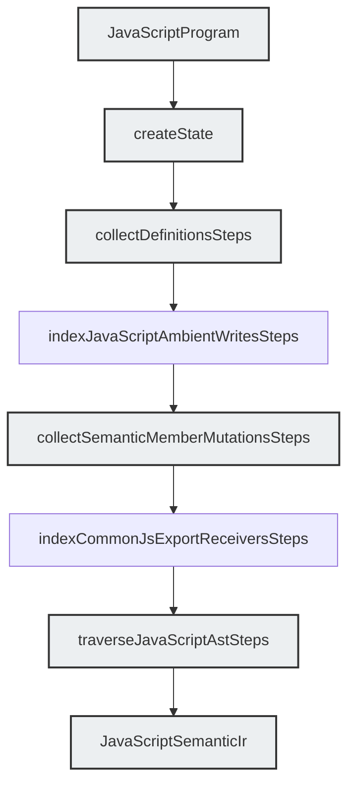

<!-- source: DeepWiki mcp.deepwiki.com · repo morluto/rea · page 6.3 JavaScript Static and Semantic Analysis · fetched 2026-10-16 -->

# JavaScript Static and Structural Analysis

Relevant source files

The following files were used as context for generating this wiki page:

- [docs/javascript-application-workflows.md](docs/javascript-application-workflows.md)
- [docs/verification/javascript-literal-byte-budget-2026-10-15.json](docs/verification/javascript-literal-byte-budget-2026-10-15.json)
- [docs/verification/javascript-literal-byte-budget-2026-10-15.md](docs/verification/javascript-literal-byte-budget-2026-10-15.md)
- [docs/web-source-location.md](docs/web-source-location.md)
- [scripts/fixtures/browser-source-map-site.mjs](scripts/fixtures/browser-source-map-site.mjs)
- [scripts/verify-browser-source-maps.mjs](scripts/verify-browser-source-maps.mjs)
- [src/application/javascript/JavaScriptSemanticGraphDataProjection.ts](src/application/javascript/JavaScriptSemanticGraphDataProjection.ts)
- [src/application/javascript/JavaScriptSemanticGraphEvidence.ts](src/application/javascript/JavaScriptSemanticGraphEvidence.ts)
- [src/application/javascript/JavaScriptSemanticGraphFingerprintProjection.ts](src/application/javascript/JavaScriptSemanticGraphFingerprintProjection.ts)
- [src/application/javascript/JavaScriptSemanticGraphValueProjection.ts](src/application/javascript/JavaScriptSemanticGraphValueProjection.ts)
- [src/browser/WebSourceMapFetcher.ts](src/browser/WebSourceMapFetcher.ts)
- [src/domain/javascript/childProcessOptionsRegression.test.ts](src/domain/javascript/childProcessOptionsRegression.test.ts)
- [src/domain/javascript/javascriptApplicationAnalysisSteps.test.ts](src/domain/javascript/javascriptApplicationAnalysisSteps.test.ts)
- [src/domain/javascript/javascriptApplicationGraph.test.ts](src/domain/javascript/javascriptApplicationGraph.test.ts)
- [src/domain/javascript/javascriptApplicationGraph.ts](src/domain/javascript/javascriptApplicationGraph.ts)
- [src/domain/javascript/javascriptAstValues.ts](src/domain/javascript/javascriptAstValues.ts)
- [src/domain/javascript/javascriptGraphqlOperations.ts](src/domain/javascript/javascriptGraphqlOperations.ts)
- [src/domain/javascript/javascriptModuleDeclaration.ts](src/domain/javascript/javascriptModuleDeclaration.ts)
- [src/domain/javascript/javascriptRpcEndpoints.test.ts](src/domain/javascript/javascriptRpcEndpoints.test.ts)
- [src/domain/javascript/javascriptRpcEndpoints.ts](src/domain/javascript/javascriptRpcEndpoints.ts)
- [src/domain/javascript/javascriptSemanticAnalysis.calls.test.ts](src/domain/javascript/javascriptSemanticAnalysis.calls.test.ts)
- [src/domain/javascript/javascriptSemanticAnalysis.dataflow.test.ts](src/domain/javascript/javascriptSemanticAnalysis.dataflow.test.ts)
- [src/domain/javascript/javascriptSemanticAnalysis.fingerprints.test.ts](src/domain/javascript/javascriptSemanticAnalysis.fingerprints.test.ts)
- [src/domain/javascript/javascriptSemanticAnalysis.getter_expansion.test.ts](src/domain/javascript/javascriptSemanticAnalysis.getter_expansion.test.ts)
- [src/domain/javascript/javascriptSemanticAnalysis.invalid_templates.test.ts](src/domain/javascript/javascriptSemanticAnalysis.invalid_templates.test.ts)
- [src/domain/javascript/javascriptSemanticAnalysis.member_mutations.test.ts](src/domain/javascript/javascriptSemanticAnalysis.member_mutations.test.ts)
- [src/domain/javascript/javascriptSemanticAnalysis.promise_ownership.test.ts](src/domain/javascript/javascriptSemanticAnalysis.promise_ownership.test.ts)
- [src/domain/javascript/javascriptSemanticAnalysis.recoveredArguments.test.ts](src/domain/javascript/javascriptSemanticAnalysis.recoveredArguments.test.ts)
- [src/domain/javascript/javascriptSemanticAnalysis.reference_lifetimes.test.ts](src/domain/javascript/javascriptSemanticAnalysis.reference_lifetimes.test.ts)
- [src/domain/javascript/javascriptSemanticAnalysis.rejection.test.ts](src/domain/javascript/javascriptSemanticAnalysis.rejection.test.ts)
- [src/domain/javascript/javascriptSemanticAnalysis.require_links.test.ts](src/domain/javascript/javascriptSemanticAnalysis.require_links.test.ts)
- [src/domain/javascript/javascriptSemanticAnalysis.response_endpoints.test.ts](src/domain/javascript/javascriptSemanticAnalysis.response_endpoints.test.ts)
- [src/domain/javascript/javascriptSemanticAnalysis.runtime_boundaries.test.ts](src/domain/javascript/javascriptSemanticAnalysis.runtime_boundaries.test.ts)
- [src/domain/javascript/javascriptSemanticAnalysis.scope_depth.test.ts](src/domain/javascript/javascriptSemanticAnalysis.scope_depth.test.ts)
- [src/domain/javascript/javascriptSemanticAnalysis.structure.test.ts](src/domain/javascript/javascriptSemanticAnalysis.structure.test.ts)
- [src/domain/javascript/javascriptSemanticAnalysis.timers.test.ts](src/domain/javascript/javascriptSemanticAnalysis.timers.test.ts)
- [src/domain/javascript/javascriptSemanticAnalysis.ts](src/domain/javascript/javascriptSemanticAnalysis.ts)
- [src/domain/javascript/javascriptSemanticAnalysis.unions.test.ts](src/domain/javascript/javascriptSemanticAnalysis.unions.test.ts)
- [src/domain/javascript/javascriptSemanticAnalysisSteps.test.ts](src/domain/javascript/javascriptSemanticAnalysisSteps.test.ts)
- [src/domain/javascript/javascriptSemanticAsyncEffects.ts](src/domain/javascript/javascriptSemanticAsyncEffects.ts)
- [src/domain/javascript/javascriptSemanticCallResolution.ts](src/domain/javascript/javascriptSemanticCallResolution.ts)
- [src/domain/javascript/javascriptSemanticCallableResults.ts](src/domain/javascript/javascriptSemanticCallableResults.ts)
- [src/domain/javascript/javascriptSemanticCallableStack.ts](src/domain/javascript/javascriptSemanticCallableStack.ts)
- [src/domain/javascript/javascriptSemanticCalls.ts](src/domain/javascript/javascriptSemanticCalls.ts)
- [src/domain/javascript/javascriptSemanticChildProcesses.ts](src/domain/javascript/javascriptSemanticChildProcesses.ts)
- [src/domain/javascript/javascriptSemanticCoverage.ts](src/domain/javascript/javascriptSemanticCoverage.ts)
- [src/domain/javascript/javascriptSemanticDataEffectHelpers.ts](src/domain/javascript/javascriptSemanticDataEffectHelpers.ts)
- [src/domain/javascript/javascriptSemanticDataEffects.ts](src/domain/javascript/javascriptSemanticDataEffects.ts)
- [src/domain/javascript/javascriptSemanticEvaluationOrder.ts](src/domain/javascript/javascriptSemanticEvaluationOrder.ts)
- [src/domain/javascript/javascriptSemanticFingerprints.ts](src/domain/javascript/javascriptSemanticFingerprints.ts)
- [src/domain/javascript/javascriptSemanticGetterQueries.ts](src/domain/javascript/javascriptSemanticGetterQueries.ts)
- [src/domain/javascript/javascriptSemanticGetterResults.ts](src/domain/javascript/javascriptSemanticGetterResults.ts)
- [src/domain/javascript/javascriptSemanticGraph.ts](src/domain/javascript/javascriptSemanticGraph.ts)
- [src/domain/javascript/javascriptSemanticGraphQuery.test.ts](src/domain/javascript/javascriptSemanticGraphQuery.test.ts)
- [src/domain/javascript/javascriptSemanticGraphSchemas.ts](src/domain/javascript/javascriptSemanticGraphSchemas.ts)
- [src/domain/javascript/javascriptSemanticGraphTraversal.test.ts](src/domain/javascript/javascriptSemanticGraphTraversal.test.ts)
- [src/domain/javascript/javascriptSemanticIr.ts](src/domain/javascript/javascriptSemanticIr.ts)
- [src/domain/javascript/javascriptSemanticIterationSources.ts](src/domain/javascript/javascriptSemanticIterationSources.ts)
- [src/domain/javascript/javascriptSemanticMemberMutations.ts](src/domain/javascript/javascriptSemanticMemberMutations.ts)
- [src/domain/javascript/javascriptSemanticMutationInitializers.ts](src/domain/javascript/javascriptSemanticMutationInitializers.ts)
- [src/domain/javascript/javascriptSemanticMutationValues.ts](src/domain/javascript/javascriptSemanticMutationValues.ts)
- [src/domain/javascript/javascriptSemanticObjectReferences.test.ts](src/domain/javascript/javascriptSemanticObjectReferences.test.ts)
- [src/domain/javascript/javascriptSemanticObjectReferences.ts](src/domain/javascript/javascriptSemanticObjectReferences.ts)
- [src/domain/javascript/javascriptSemanticObjects.ts](src/domain/javascript/javascriptSemanticObjects.ts)
- [src/domain/javascript/javascriptSemanticPrimitives.ts](src/domain/javascript/javascriptSemanticPrimitives.ts)
- [src/domain/javascript/javascriptSemanticProjection.ts](src/domain/javascript/javascriptSemanticProjection.ts)
- [src/domain/javascript/javascriptSemanticPromises.ts](src/domain/javascript/javascriptSemanticPromises.ts)
- [src/domain/javascript/javascriptSemanticPropertyPaths.ts](src/domain/javascript/javascriptSemanticPropertyPaths.ts)
- [src/domain/javascript/javascriptSemanticQuery.ts](src/domain/javascript/javascriptSemanticQuery.ts)
- [src/domain/javascript/javascriptSemanticQueryIdentity.ts](src/domain/javascript/javascriptSemanticQueryIdentity.ts)
- [src/domain/javascript/javascriptSemanticRequireOrigin.ts](src/domain/javascript/javascriptSemanticRequireOrigin.ts)
- [src/domain/javascript/javascriptSemanticResourceLimits.ts](src/domain/javascript/javascriptSemanticResourceLimits.ts)
- [src/domain/javascript/javascriptSemanticReturnedReferences.ts](src/domain/javascript/javascriptSemanticReturnedReferences.ts)
- [src/domain/javascript/javascriptSemanticReturns.ts](src/domain/javascript/javascriptSemanticReturns.ts)
- [src/domain/javascript/javascriptSemanticState.ts](src/domain/javascript/javascriptSemanticState.ts)
- [src/domain/javascript/javascriptSemanticTraversal.ts](src/domain/javascript/javascriptSemanticTraversal.ts)
- [src/domain/javascript/javascriptSemanticValueTypes.ts](src/domain/javascript/javascriptSemanticValueTypes.ts)
- [src/domain/javascript/javascriptSemanticValues.memo.test.ts](src/domain/javascript/javascriptSemanticValues.memo.test.ts)
- [src/domain/javascript/javascriptSemanticValues.ts](src/domain/javascript/javascriptSemanticValues.ts)
- [src/domain/javascript/javascriptSourceParser.test.ts](src/domain/javascript/javascriptSourceParser.test.ts)
- [src/domain/javascript/javascriptSourceParser.ts](src/domain/javascript/javascriptSourceParser.ts)
- [src/domain/javascript/javascriptStaticAnalysis.routeProperties.test.ts](src/domain/javascript/javascriptStaticAnalysis.routeProperties.test.ts)
- [src/domain/javascript/javascriptStaticAnalysis.ts](src/domain/javascript/javascriptStaticAnalysis.ts)
- [src/domain/javascript/javascriptStaticAnalysisCalls.ts](src/domain/javascript/javascriptStaticAnalysisCalls.ts)
- [src/domain/javascript/javascriptStaticAnalysisSourceMaps.test.ts](src/domain/javascript/javascriptStaticAnalysisSourceMaps.test.ts)
- [src/domain/referenceSourceClassification.ts](src/domain/referenceSourceClassification.ts)
- [src/domain/webBundleAnalysis.ts](src/domain/webBundleAnalysis.ts)
- [src/domain/webBundleAnalyzer.test.ts](src/domain/webBundleAnalyzer.test.ts)
- [src/domain/webBundleAnalyzerAst.test.ts](src/domain/webBundleAnalyzerAst.test.ts)
- [src/domain/webBundleAnalyzerAst.ts](src/domain/webBundleAnalyzerAst.ts)
- [src/domain/webBundleAnalyzerInspection.ts](src/domain/webBundleAnalyzerInspection.ts)
- [src/domain/webModuleTrace.ts](src/domain/webModuleTrace.ts)
- [src/domain/webNetworkCapture.ts](src/domain/webNetworkCapture.ts)
- [src/domain/webScriptArtifacts.ts](src/domain/webScriptArtifacts.ts)
- [src/domain/webSourceLocation.ts](src/domain/webSourceLocation.ts)
- [src/domain/zodCollectionSteps.ts](src/domain/zodCollectionSteps.ts)
- [src/javascript/sourceMaps/DecodedSourceMap.ts](src/javascript/sourceMaps/DecodedSourceMap.ts)
- [src/javascript/sourceMaps/SourceMapFormat.ts](src/javascript/sourceMaps/SourceMapFormat.ts)
- [src/javascript/sourceMaps/TraceSourceMap.test.ts](src/javascript/sourceMaps/TraceSourceMap.test.ts)
- [src/javascript/sourceMaps/TraceSourceMap.ts](src/javascript/sourceMaps/TraceSourceMap.ts)
- [tests/acceptance/applications/blockSourceMapCli.test.ts](tests/acceptance/applications/blockSourceMapCli.test.ts)
- [tests/acceptance/applications/emptyImportNameCli.test.ts](tests/acceptance/applications/emptyImportNameCli.test.ts)
- [tests/acceptance/applications/exportedFunctionBindingsCli.test.ts](tests/acceptance/applications/exportedFunctionBindingsCli.test.ts)
- [tests/acceptance/applications/javascriptChildProcessArgumentsCli.test.ts](tests/acceptance/applications/javascriptChildProcessArgumentsCli.test.ts)
- [tests/acceptance/applications/javascriptEndpointPayload.test.ts](tests/acceptance/applications/javascriptEndpointPayload.test.ts)
- [tests/acceptance/applications/javascriptFunctionFingerprintsCli.test.ts](tests/acceptance/applications/javascriptFunctionFingerprintsCli.test.ts)
- [tests/acceptance/applications/javascriptIterationAliases.test.ts](tests/acceptance/applications/javascriptIterationAliases.test.ts)
- [tests/acceptance/applications/javascriptReturnedReferences.test.ts](tests/acceptance/applications/javascriptReturnedReferences.test.ts)
- [tests/acceptance/applications/javascriptRpcPropertyOwnershipCli.test.ts](tests/acceptance/applications/javascriptRpcPropertyOwnershipCli.test.ts)
- [tests/acceptance/applications/javascriptSlotStores.test.ts](tests/acceptance/applications/javascriptSlotStores.test.ts)
- [tests/acceptance/applications/javascriptTimerWritesCli.test.ts](tests/acceptance/applications/javascriptTimerWritesCli.test.ts)
- [tests/acceptance/applications/unboundRequires.test.ts](tests/acceptance/applications/unboundRequires.test.ts)
- [tests/boundary/browser/webSourceMapFetcher.test.ts](tests/boundary/browser/webSourceMapFetcher.test.ts)
- [tests/boundary/browser/webSourceMapHttpStatus.test.ts](tests/boundary/browser/webSourceMapHttpStatus.test.ts)
- [tests/boundary/cli/javascriptArtifactTypeScriptDialect.test.ts](tests/boundary/cli/javascriptArtifactTypeScriptDialect.test.ts)
- [tests/boundary/filesystem/javascript-applications/javascriptArtifactGraphEndpoints.test.ts](tests/boundary/filesystem/javascript-applications/javascriptArtifactGraphEndpoints.test.ts)
- [tests/boundary/filesystem/javascriptArtifactTypeScriptDialect.test.ts](tests/boundary/filesystem/javascriptArtifactTypeScriptDialect.test.ts)
- [tests/boundary/filesystem/referenceSourceComputedRequire.test.ts](tests/boundary/filesystem/referenceSourceComputedRequire.test.ts)
- [tests/boundary/filesystem/referenceSourceDockerfileLanguage.test.ts](tests/boundary/filesystem/referenceSourceDockerfileLanguage.test.ts)
- [tests/boundary/filesystem/referenceSourceDynamicImports.test.ts](tests/boundary/filesystem/referenceSourceDynamicImports.test.ts)
- [tests/boundary/filesystem/referenceSourceReader.test.ts](tests/boundary/filesystem/referenceSourceReader.test.ts)
- [tests/boundary/filesystem/referenceSourceRecovery.test.ts](tests/boundary/filesystem/referenceSourceRecovery.test.ts)
- [tests/boundary/filesystem/referenceSourceTestFilenames.test.ts](tests/boundary/filesystem/referenceSourceTestFilenames.test.ts)
- [tests/boundary/filesystem/referenceSourceTypeScriptExtensions.test.ts](tests/boundary/filesystem/referenceSourceTypeScriptExtensions.test.ts)
- [tests/boundary/mcp/applicationExportShapeMcp.test.ts](tests/boundary/mcp/applicationExportShapeMcp.test.ts)
- [tests/boundary/mcp/applicationMutationPresenceMcp.test.ts](tests/boundary/mcp/applicationMutationPresenceMcp.test.ts)
- [tests/boundary/process/javascriptSourceModes.test.ts](tests/boundary/process/javascriptSourceModes.test.ts)
- [tests/fixtures/javascriptArtifactTypeScriptDialect.ts](tests/fixtures/javascriptArtifactTypeScriptDialect.ts)
- [tests/fixtures/javascriptReturnShapes.ts](tests/fixtures/javascriptReturnShapes.ts)
- [tests/support/javascriptSemanticGraphFixture.ts](tests/support/javascriptSemanticGraphFixture.ts)

This page details REA's capabilities for static and semantic analysis of JavaScript code, focusing on web bundles. It covers Abstract Syntax Tree (AST) inspection, module import analysis, construction of a JavaScript semantic Intermediate Representation (IR) with advanced dataflow and mutation tracking, AST fingerprinting, bundler-specific adaptations, and source map tracing and recovery.

## Web Bundle Analyzer AST Inspection

The web bundle analyzer processes JavaScript code extracted from web pages to identify key characteristics such as module dependencies, API endpoints, routing information, and WebMCP (Web Model Context Protocol) declarations. This analysis is performed by traversing the AST of each JavaScript script.

The core logic resides in `analyzeCapturedWebBundle` [src/domain/webBundleAnalyzer.js:5-5](), which orchestrates the analysis of a `WebPageInspection` object. For each included script, `analyzeScript` [src/domain/webBundleAnalyzerInspection.ts:55-104]() is called. This function first attempts to parse the script's source code into an AST using `@babel/parser` [src/domain/webBundleAnalyzerInspection.ts:59](). If parsing fails, it records the failure and skips further analysis for that specific script without failing the entire bundle analysis [src/domain/webBundleAnalyzerInspection.ts:60-63]().

After successful parsing, `detectVendorFingerprints` is called to identify common JavaScript frameworks or bundlers [src/domain/webBundleAnalyzerInspection.ts:67](). Then, AST traversal utilities walk the tree, inspecting nodes for static imports, dynamic imports, route object properties, and API endpoint calls [src/domain/webBundleAnalyzerInspection.ts:78-149]().

**Diagram: Web Bundle AST Inspection Pipeline**

Sources:
* [src/domain/webBundleAnalyzer.js:5-5]()
* [src/domain/webBundleAnalyzerInspection.ts:55-104]()
* [src/domain/webBundleAnalyzerInspection.ts:106-149]()

## Module Imports

The analysis of module imports establishes dependencies between individual scripts and external modules. The analyzer identifies several link types:
* **Static Imports**: `import ... from "specifier"` and `export ... from "specifier"` statements captured as static import edges [src/domain/webBundleAnalyzerInspection.ts:112-130]().
* **Dynamic Imports**: `import("specifier")` expressions captured as dynamic imports [src/domain/webBundleAnalyzerInspection.ts:131-141]().
* **CommonJS `require`**: Calls to `require("specifier")` resolved via binding and module link steps [src/domain/javascript/javascriptSemanticProjection.ts:82-124]().
* **Worker Imports**: Calls to `importScripts("specifier")` inside workers [src/domain/webBundleAnalyzerInspection.ts:167-172]().

Specifiers are normalized and resolved against artifact base paths using helper routines [src/domain/webBundleAnalyzerAst.ts:35-55]().

Sources:
* [src/domain/webBundleAnalyzerInspection.ts:112-141]()
* [src/domain/webBundleAnalyzerInspection.ts:167-172]()
* [src/domain/javascript/javascriptSemanticProjection.ts:82-124]()
* [src/domain/webBundleAnalyzerAst.ts:35-55]()

## JavaScript Semantic IR (Scopes, Bindings, Calls, Dataflow, and Mutations)

REA constructs a detailed JavaScript Semantic Intermediate Representation (IR) to capture scopes, variable bindings, call graphs, dataflow, and property mutations [src/domain/javascript/javascriptSemanticAnalysis.ts:120-173]().

### Scopes and State Structures

Lexical scopes and bindings are maintained using mutable state containers during traversal (`JavaScriptSemanticBindingState`, `JavaScriptSemanticScopeState`, `JavaScriptSemanticAnalysisState`) before being frozen into immutable structures [src/domain/javascript/javascriptSemanticState.ts:49-120](). 

Step-based generators allow granular control and demand-driven boundary processing:
* `analyzeParsedJavaScriptSemantics` / `analyzeParsedJavaScriptSemanticsSteps` [src/domain/javascript/javascriptSemanticAnalysis.ts:149-173]()
* `indexJavaScriptBindingsSteps` [src/domain/javascript/javascriptSemanticAnalysis.ts:141-147]()
* `collectSemanticReferences` [src/domain/javascript/javascriptSemanticAnalysis.ts:130-137]()

### Mutation and Dataflow Tracking

REA tracks property modifications and assignments through `collectSemanticMemberMutationsSteps` [src/domain/javascript/javascriptSemanticMemberMutations.ts:132-180](). This subsystem handles explicit property assignments, compound updates (`+=`, `++`), deletions, loop assignment targets, object spreading, and destructuring aliases to ensure that mutated object references correctly invalidate cached literal values [src/domain/javascript/javascriptSemanticValues.ts:156-163]().

**Diagram: Semantic IR Construction and Mutation Indexing**

Sources:
* [src/domain/javascript/javascriptSemanticAnalysis.ts:120-173]()
* [src/domain/javascript/javascriptSemanticState.ts:49-120]()
* [src/domain/javascript/javascriptSemanticMemberMutations.ts:132-180]()
* [src/domain/javascript/javascriptSemanticValues.ts:156-163]()

## AST Fingerprints

AST fingerprinting generates rename-resistant hashes of code structures. The `fingerprintJavaScriptAst` function inspects nodes, extracts semantic tokens (node types, literals, operators, and property keys), and hashes them with SHA-256 [src/domain/javascript/javascriptAstFingerprint.ts:17-65](). Exported symbols are similarly collected via `collectJavaScriptExports` [src/domain/javascript/javascriptAstFingerprint.ts:29-41]().

Sources:
* [src/domain/javascript/javascriptAstFingerprint.ts:17-65]()

## Bundler Adapters

REA incorporates specialized static analysis helpers to detect and parse structures generated by bundlers such as Webpack and Rspack. Helper routines such as `chunkRuntime` [src/domain/javascript/javascriptStaticAnalysisHelpers.ts:61-73]() and `moduleFactory` [src/domain/javascript/javascriptStaticAnalysisHelpers.ts:111-127]() identify module tables, chunk push mechanisms, and require wrappers, decomposing monolithic bundles into discrete module nodes.

Sources:
* [src/domain/javascript/javascriptStaticAnalysisHelpers.ts:61-73]()
* [src/domain/javascript/javascriptStaticAnalysisHelpers.ts:111-127]()

## Source Map Tracing and Recovery (Wakaru)

Source map fetching and decoding are handled by `fetchWebSourceMaps` [src/browser/WebSourceMapFetcher.ts:79-180](). The subsystem enforces strict network budgets, timeout limits (defaulting to 30 seconds), and response size thresholds (64 MiB cap) while validating source map JSON envelopes and ECMA-426 transport prefixes.

Decoded mappings are parsed using `@jridgewell/trace-mapping` to recover original sources, line/column mappings, and original module edges [tests/boundary/browser/webSourceMapFetcher.test.ts:32-111](). Artifact reconstruction utilities then tie these recovered sources back into the application analysis view [src/application/javascript/JavaScriptArtifactReconstruction.js:7-7]().

Sources:
* [src/browser/WebSourceMapFetcher.ts:79-180]()
* [tests/boundary/browser/webSourceMapFetcher.test.ts:32-111]()

---

