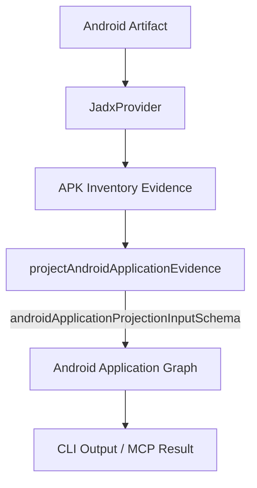
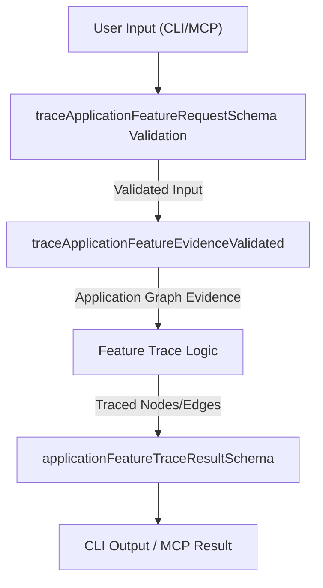
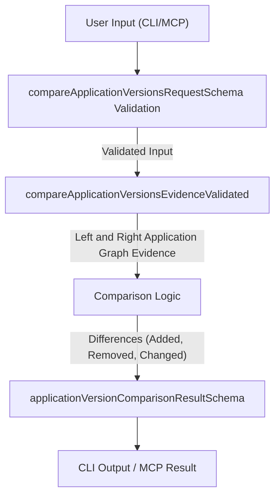
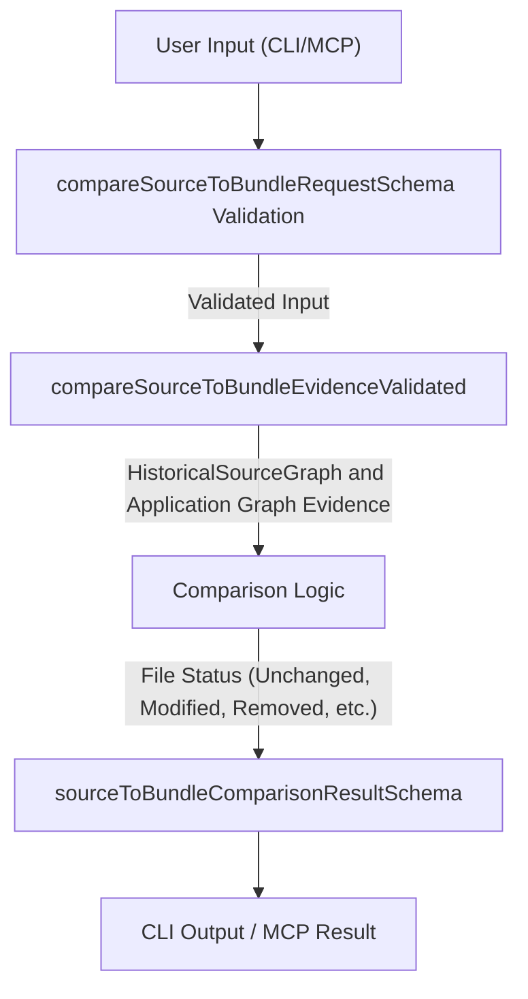
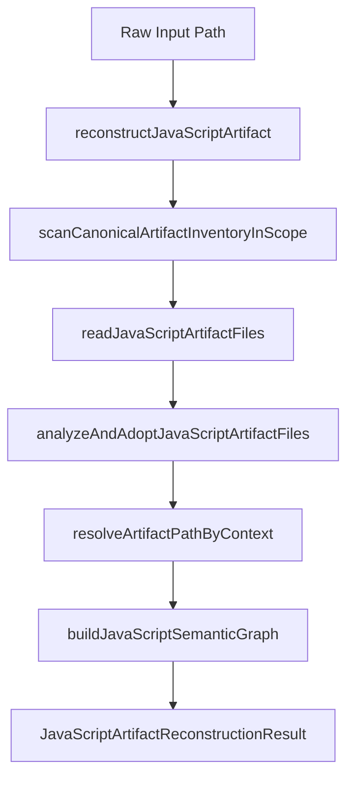

<!-- source: DeepWiki mcp.deepwiki.com · repo morluto/rea · page 6.4 Application Workflows and Version Comparison · fetched 2026-10-16 -->

# Application Workflows and Version Comparison

Relevant source files

The following files were used as context for generating this wiki page:

- [.jscpd.json](.jscpd.json)
- [docs/javascript-application-graph.md](docs/javascript-application-graph.md)
- [docs/javascript-artifact-reconstruction.md](docs/javascript-artifact-reconstruction.md)
- [docs/verification/javascript-interruption-applicability-2026-10-15.json](docs/verification/javascript-interruption-applicability-2026-10-15.json)
- [docs/verification/javascript-interruption-applicability-2026-10-15.md](docs/verification/javascript-interruption-applicability-2026-10-15.md)
- [experiments/analysis-efficiency/windows-posix-reconciliation.md](experiments/analysis-efficiency/windows-posix-reconciliation.md)
- [scripts/lib/javascript-file-scope-oracle.d.mts](scripts/lib/javascript-file-scope-oracle.d.mts)
- [scripts/lib/javascript-file-scope-oracle.mjs](scripts/lib/javascript-file-scope-oracle.mjs)
- [scripts/verify/javascript/native-handoffs.mjs](scripts/verify/javascript/native-handoffs.mjs)
- [src/application/ReferenceSourceImportEntries.test.ts](src/application/ReferenceSourceImportEntries.test.ts)
- [src/application/ReferenceSourceImportEntries.ts](src/application/ReferenceSourceImportEntries.ts)
- [src/application/javascript/ElectronBoundaryAnalysis.ts](src/application/javascript/ElectronBoundaryAnalysis.ts)
- [src/application/javascript/ElectronBoundaryGraphCallPaths.ts](src/application/javascript/ElectronBoundaryGraphCallPaths.ts)
- [src/application/javascript/ElectronBoundaryGraphContext.ts](src/application/javascript/ElectronBoundaryGraphContext.ts)
- [src/application/javascript/ElectronBoundaryGraphIpc.ts](src/application/javascript/ElectronBoundaryGraphIpc.ts)
- [src/application/javascript/ElectronBoundaryGraphNative.ts](src/application/javascript/ElectronBoundaryGraphNative.ts)
- [src/application/javascript/ElectronBoundaryGraphWindows.ts](src/application/javascript/ElectronBoundaryGraphWindows.ts)
- [src/application/javascript/JavaScriptArtifactAnalysis.ts](src/application/javascript/JavaScriptArtifactAnalysis.ts)
- [src/application/javascript/JavaScriptArtifactAnalysisTypes.ts](src/application/javascript/JavaScriptArtifactAnalysisTypes.ts)
- [src/application/javascript/JavaScriptArtifactGraphBuilder.ts](src/application/javascript/JavaScriptArtifactGraphBuilder.ts)
- [src/application/javascript/JavaScriptArtifactGraphBundlers.ts](src/application/javascript/JavaScriptArtifactGraphBundlers.ts)
- [src/application/javascript/JavaScriptArtifactGraphContext.ts](src/application/javascript/JavaScriptArtifactGraphContext.ts)
- [src/application/javascript/JavaScriptArtifactGraphEvidence.ts](src/application/javascript/JavaScriptArtifactGraphEvidence.ts)
- [src/application/javascript/JavaScriptArtifactGraphFindings.ts](src/application/javascript/JavaScriptArtifactGraphFindings.ts)
- [src/application/javascript/JavaScriptArtifactGraphStructure.ts](src/application/javascript/JavaScriptArtifactGraphStructure.ts)
- [src/application/javascript/JavaScriptArtifactPathResolution.test.ts](src/application/javascript/JavaScriptArtifactPathResolution.test.ts)
- [src/application/javascript/JavaScriptArtifactPathResolution.ts](src/application/javascript/JavaScriptArtifactPathResolution.ts)
- [src/application/javascript/JavaScriptArtifactReconstruction.ts](src/application/javascript/JavaScriptArtifactReconstruction.ts)
- [src/application/javascript/JavaScriptArtifactReconstructionInput.ts](src/application/javascript/JavaScriptArtifactReconstructionInput.ts)
- [src/application/javascript/JavaScriptHtmlBaseResolution.test.ts](src/application/javascript/JavaScriptHtmlBaseResolution.test.ts)
- [src/application/javascript/JavaScriptModuleRelationships.ts](src/application/javascript/JavaScriptModuleRelationships.ts)
- [src/application/javascript/JavaScriptSemanticGraphBuilder.test.ts](src/application/javascript/JavaScriptSemanticGraphBuilder.test.ts)
- [src/application/javascript/JavaScriptSemanticGraphBuilder.ts](src/application/javascript/JavaScriptSemanticGraphBuilder.ts)
- [src/application/javascript/JavaScriptSemanticGraphElectronProjection.ts](src/application/javascript/JavaScriptSemanticGraphElectronProjection.ts)
- [src/browser/ElectronFileScope.ts](src/browser/ElectronFileScope.ts)
- [src/cli/webRuntimeCommands.ts](src/cli/webRuntimeCommands.ts)
- [src/composition/javascriptAnalysisWorkerProcess.ts](src/composition/javascriptAnalysisWorkerProcess.ts)
- [src/domain/artifactPathSyntax.test.ts](src/domain/artifactPathSyntax.test.ts)
- [src/domain/artifactPathSyntax.ts](src/domain/artifactPathSyntax.ts)
- [src/domain/javascript/electronStaticAnalysisOptions.test.ts](src/domain/javascript/electronStaticAnalysisOptions.test.ts)
- [src/domain/javascript/electronStaticAnalysisTypes.ts](src/domain/javascript/electronStaticAnalysisTypes.ts)
- [src/domain/javascript/electronStaticAnalysisValues.ts](src/domain/javascript/electronStaticAnalysisValues.ts)
- [src/domain/javascript/electronWrappedCallPaths.test.ts](src/domain/javascript/electronWrappedCallPaths.test.ts)
- [src/domain/javascript/electronWrappedCallPaths.ts](src/domain/javascript/electronWrappedCallPaths.ts)
- [src/domain/javascript/javascriptApplicationAnalysis.ts](src/domain/javascript/javascriptApplicationAnalysis.ts)
- [src/domain/javascript/javascriptApplicationVersionKeys.ts](src/domain/javascript/javascriptApplicationVersionKeys.ts)
- [src/domain/javascript/javascriptApplicationVersionMatching.test.ts](src/domain/javascript/javascriptApplicationVersionMatching.test.ts)
- [src/domain/javascript/javascriptAstFingerprint.test.ts](src/domain/javascript/javascriptAstFingerprint.test.ts)
- [src/domain/javascript/javascriptAstFingerprint.ts](src/domain/javascript/javascriptAstFingerprint.ts)
- [src/domain/javascript/javascriptExportShapeComparison.ts](src/domain/javascript/javascriptExportShapeComparison.ts)
- [src/domain/javascript/javascriptExportShapeComparisonSchemas.test.ts](src/domain/javascript/javascriptExportShapeComparisonSchemas.test.ts)
- [src/domain/javascript/javascriptExportShapeVariants.ts](src/domain/javascript/javascriptExportShapeVariants.ts)
- [src/domain/javascript/javascriptFeatureSeed.ts](src/domain/javascript/javascriptFeatureSeed.ts)
- [src/domain/javascript/javascriptFeatureTrace.ts](src/domain/javascript/javascriptFeatureTrace.ts)
- [src/domain/javascript/javascriptPackageImportAliases.test.ts](src/domain/javascript/javascriptPackageImportAliases.test.ts)
- [src/domain/javascript/javascriptPackageImportAliases.ts](src/domain/javascript/javascriptPackageImportAliases.ts)
- [src/domain/javascript/javascriptRuntimeStaticCandidates.ts](src/domain/javascript/javascriptRuntimeStaticCandidates.ts)
- [src/domain/javascript/javascriptSemanticAnalysis.builtin_defaults.test.ts](src/domain/javascript/javascriptSemanticAnalysis.builtin_defaults.test.ts)
- [src/domain/javascript/javascriptSemanticAnalysis.member_depth.test.ts](src/domain/javascript/javascriptSemanticAnalysis.member_depth.test.ts)
- [src/domain/javascript/javascriptSourceMapPaths.ts](src/domain/javascript/javascriptSourceMapPaths.ts)
- [src/domain/javascript/javascriptStaticAnalysis.member_path_depth.test.ts](src/domain/javascript/javascriptStaticAnalysis.member_path_depth.test.ts)
- [src/domain/javascript/javascriptStaticAnalysisBundler.ts](src/domain/javascript/javascriptStaticAnalysisBundler.ts)
- [src/domain/javascript/javascriptStaticAnalysisCalleeBoundary.test.ts](src/domain/javascript/javascriptStaticAnalysisCalleeBoundary.test.ts)
- [src/domain/javascript/javascriptStaticAnalysisFindings.ts](src/domain/javascript/javascriptStaticAnalysisFindings.ts)
- [src/domain/javascript/javascriptStaticAnalysisHelpers.ts](src/domain/javascript/javascriptStaticAnalysisHelpers.ts)
- [src/domain/javascript/javascriptStaticAnalysisModuleIndex.test.ts](src/domain/javascript/javascriptStaticAnalysisModuleIndex.test.ts)
- [src/domain/javascript/javascriptStaticAnalysisState.ts](src/domain/javascript/javascriptStaticAnalysisState.ts)
- [src/domain/javascript/javascriptStaticAnalysisTypes.ts](src/domain/javascript/javascriptStaticAnalysisTypes.ts)
- [src/domain/javascript/javascriptStaticPathResolution.test.ts](src/domain/javascript/javascriptStaticPathResolution.test.ts)
- [src/domain/javascript/javascriptSymbolicBindings.test.ts](src/domain/javascript/javascriptSymbolicBindings.test.ts)
- [src/domain/javascript/javascriptSymbolicBindings.ts](src/domain/javascript/javascriptSymbolicBindings.ts)
- [src/domain/javascript/sourceToBundleComparison.test.ts](src/domain/javascript/sourceToBundleComparison.test.ts)
- [src/domain/javascript/sourceToBundleComparison.ts](src/domain/javascript/sourceToBundleComparison.ts)
- [src/domain/javascript/sourceToBundleSignals.ts](src/domain/javascript/sourceToBundleSignals.ts)
- [src/domain/referenceSourceImportParsing.ts](src/domain/referenceSourceImportParsing.ts)
- [src/domain/referenceSourcePathIdentity.test.ts](src/domain/referenceSourcePathIdentity.test.ts)
- [src/domain/referenceSourcePathIdentity.ts](src/domain/referenceSourcePathIdentity.ts)
- [src/javascript/analysis/JavaScriptAnalysisWorkerSchemas.test.ts](src/javascript/analysis/JavaScriptAnalysisWorkerSchemas.test.ts)
- [src/javascript/analysis/JavaScriptAnalysisWorkerSchemas.ts](src/javascript/analysis/JavaScriptAnalysisWorkerSchemas.ts)
- [src/reference/ReferenceSourceReader.test.ts](src/reference/ReferenceSourceReader.test.ts)
- [src/reference/ReferenceSourceReader.ts](src/reference/ReferenceSourceReader.ts)
- [src/reference/ReferenceSourceReaderEntries.ts](src/reference/ReferenceSourceReaderEntries.ts)
- [src/reference/ReferenceSourceReaderTypes.ts](src/reference/ReferenceSourceReaderTypes.ts)
- [tests/acceptance/applications/JavaScriptModuleLookupCli.test.ts](tests/acceptance/applications/JavaScriptModuleLookupCli.test.ts)
- [tests/acceptance/applications/applicationVersionMatchingCli.test.ts](tests/acceptance/applications/applicationVersionMatchingCli.test.ts)
- [tests/acceptance/applications/applicationWorkflowCli.test.ts](tests/acceptance/applications/applicationWorkflowCli.test.ts)
- [tests/acceptance/applications/javascriptAnalysisLimits.test.ts](tests/acceptance/applications/javascriptAnalysisLimits.test.ts)
- [tests/acceptance/applications/javascriptEndpointCandidateCli.test.ts](tests/acceptance/applications/javascriptEndpointCandidateCli.test.ts)
- [tests/acceptance/applications/javascriptFeatureTraceSeedSelectionCli.test.ts](tests/acceptance/applications/javascriptFeatureTraceSeedSelectionCli.test.ts)
- [tests/acceptance/applications/javascriptWorkerUrlCli.test.ts](tests/acceptance/applications/javascriptWorkerUrlCli.test.ts)
- [tests/acceptance/applications/packageImportAliasesCli.test.ts](tests/acceptance/applications/packageImportAliasesCli.test.ts)
- [tests/acceptance/applications/packageRootSuffixCli.test.ts](tests/acceptance/applications/packageRootSuffixCli.test.ts)
- [tests/acceptance/applications/packageSelfNameBoundaryCli.test.ts](tests/acceptance/applications/packageSelfNameBoundaryCli.test.ts)
- [tests/acceptance/applications/packageSpecifierSuffixCli.test.ts](tests/acceptance/applications/packageSpecifierSuffixCli.test.ts)
- [tests/acceptance/applications/packageSubpathsCli.test.ts](tests/acceptance/applications/packageSubpathsCli.test.ts)
- [tests/acceptance/webRuntimeCli.test.ts](tests/acceptance/webRuntimeCli.test.ts)
- [tests/boundary/cli/electronWrappedCallPaths.test.ts](tests/boundary/cli/electronWrappedCallPaths.test.ts)
- [tests/boundary/cli/javascriptBundlerSelfReferences.test.ts](tests/boundary/cli/javascriptBundlerSelfReferences.test.ts)
- [tests/boundary/cli/javascriptSelfImportRelationships.test.ts](tests/boundary/cli/javascriptSelfImportRelationships.test.ts)
- [tests/boundary/cli/referenceSourceDirectoryImports.test.ts](tests/boundary/cli/referenceSourceDirectoryImports.test.ts)
- [tests/boundary/filesystem/electronFileScope.test.ts](tests/boundary/filesystem/electronFileScope.test.ts)
- [tests/boundary/filesystem/javascript-applications/electronApplicationAnalysis.test.ts](tests/boundary/filesystem/javascript-applications/electronApplicationAnalysis.test.ts)
- [tests/boundary/filesystem/javascript-applications/electronOptionKeys.test.ts](tests/boundary/filesystem/javascript-applications/electronOptionKeys.test.ts)
- [tests/boundary/filesystem/javascript-applications/javascriptApplicationEmptyLiterals.test.ts](tests/boundary/filesystem/javascript-applications/javascriptApplicationEmptyLiterals.test.ts)
- [tests/boundary/filesystem/javascript-applications/javascriptApplicationTemplateLiterals.test.ts](tests/boundary/filesystem/javascript-applications/javascriptApplicationTemplateLiterals.test.ts)
- [tests/boundary/filesystem/javascript-applications/javascriptApplicationTypeScript.test.ts](tests/boundary/filesystem/javascript-applications/javascriptApplicationTypeScript.test.ts)
- [tests/boundary/filesystem/javascript-applications/javascriptArtifactReconstruction.test.ts](tests/boundary/filesystem/javascript-applications/javascriptArtifactReconstruction.test.ts)
- [tests/boundary/filesystem/javascript-applications/javascriptHtmlReferenceResolution.test.ts](tests/boundary/filesystem/javascript-applications/javascriptHtmlReferenceResolution.test.ts)
- [tests/boundary/filesystem/javascript-applications/javascriptModuleRelationships.test.ts](tests/boundary/filesystem/javascript-applications/javascriptModuleRelationships.test.ts)
- [tests/boundary/filesystem/javascriptApplicationWorkflows.test.ts](tests/boundary/filesystem/javascriptApplicationWorkflows.test.ts)
- [tests/boundary/filesystem/javascriptArtifactReconstruction.test.ts](tests/boundary/filesystem/javascriptArtifactReconstruction.test.ts)
- [tests/boundary/filesystem/javascriptExportContainerCoverage.test.ts](tests/boundary/filesystem/javascriptExportContainerCoverage.test.ts)
- [tests/boundary/filesystem/javascriptExportShapeComparison.test.ts](tests/boundary/filesystem/javascriptExportShapeComparison.test.ts)
- [tests/boundary/filesystem/javascriptHtmlResourcePaths.test.ts](tests/boundary/filesystem/javascriptHtmlResourcePaths.test.ts)
- [tests/boundary/filesystem/javascriptPackageExportTargets.test.ts](tests/boundary/filesystem/javascriptPackageExportTargets.test.ts)
- [tests/boundary/filesystem/javascriptPackagePrecedence.test.ts](tests/boundary/filesystem/javascriptPackagePrecedence.test.ts)
- [tests/boundary/filesystem/javascriptRequireLiteralPaths.test.ts](tests/boundary/filesystem/javascriptRequireLiteralPaths.test.ts)
- [tests/boundary/filesystem/javascriptSourceMapComments.test.ts](tests/boundary/filesystem/javascriptSourceMapComments.test.ts)
- [tests/boundary/filesystem/javascriptSourceMapLocations.test.ts](tests/boundary/filesystem/javascriptSourceMapLocations.test.ts)
- [tests/boundary/filesystem/referenceSourceQueuedDirectories.test.ts](tests/boundary/filesystem/referenceSourceQueuedDirectories.test.ts)
- [tests/boundary/filesystem/referenceSourceUnreadableDirectories.test.ts](tests/boundary/filesystem/referenceSourceUnreadableDirectories.test.ts)
- [tests/boundary/filesystem/sourceToBundlePaths.test.ts](tests/boundary/filesystem/sourceToBundlePaths.test.ts)
- [tests/boundary/inspector/javascriptRuntimeUnresolvedTarget.test.ts](tests/boundary/inspector/javascriptRuntimeUnresolvedTarget.test.ts)
- [tests/boundary/javascript/packageConditionalExports.test.ts](tests/boundary/javascript/packageConditionalExports.test.ts)
- [tests/boundary/javascript/packageImportAliases.test.ts](tests/boundary/javascript/packageImportAliases.test.ts)
- [tests/boundary/process/javascriptRuntimeReconciliationAmbiguity.test.ts](tests/boundary/process/javascriptRuntimeReconciliationAmbiguity.test.ts)
- [tests/boundary/process/sourceMapUncHosts.test.ts](tests/boundary/process/sourceMapUncHosts.test.ts)
- [tests/fixtures/javascriptRuntimeReconciliation.ts](tests/fixtures/javascriptRuntimeReconciliation.ts)
- [tests/support/cli/javascriptApplication.ts](tests/support/cli/javascriptApplication.ts)

This page details REA's application-level workflows, focusing on how it projects application graphs, traces features, compares versions, reconstructs JavaScript artifacts, and resolves module paths. It covers the implementation, data flow, and key functions involved in these processes, including reference source import and classification.

## Application Graph Projection

REA can project application graphs for various platforms, including Android and Apple applications. This involves taking authenticated inventory evidence and transforming it into a structured graph representation.

For Android applications, the `projectAndroidApplicationEvidence` function [src/cli/applicationCommands.ts:95-95]() is responsible for this projection. It takes an input conforming to `androidApplicationProjectionInputSchema` [src/contracts/applicationToolContracts.ts:20-21]() and produces an Android application graph. Similarly, `projectAppleApplicationEvidence` [src/cli/applicationCommands.ts:109-109]() handles Apple applications, using `appleApplicationProjectionInputSchema` [src/contracts/applicationToolContracts.ts:24-25]() as input.

These projection functions are exposed via the CLI as `project-android-application-graph` [src/cli/applicationCommands.ts:90-91]() and `project-apple-application-graph` [src/cli/applicationCommands.ts:104-105]().

### Android Application Manifest and Resources

The `mobileApplicationInvestigation.ts` [src/domain/mobileApplicationInvestigation.ts:1-177]() file defines the schemas and utility functions for analyzing mobile application artifacts.

The `androidManifestSchema` [src/domain/mobileApplicationInvestigation.ts:22-33]() describes the structure of an Android manifest, including package name, version information, SDK levels, permissions, activities, services, receivers, and providers.

Resources within a mobile artifact are classified by `classifyMobileResource` [src/domain/mobileApplicationInvestigation.ts:131-145]() based on their path and type, such as layouts, drawables, strings, assets, native libraries, and manifests.

#### Android Application Graph Projection Data Flow

Sources:
- [src/cli/applicationCommands.ts:90-101]()
- [src/contracts/applicationToolContracts.ts:20-21]()
- [src/domain/mobileApplicationInvestigation.ts:22-33]()
- [src/domain/mobileApplicationInvestigation.ts:131-145]()

## `trace_application_feature`

The `trace_application_feature` tool allows tracing a typed literal seed through an authenticated JavaScript Application Graph. This workflow is designed to understand the reachability and dependencies of specific features within an application.

The tool takes `traceApplicationFeatureRequestSchema` [src/contracts/applicationToolContracts.ts:10-11]() as input, which can include inline evidence or references to previously retained evidence. The output conforms to `applicationFeatureTraceResultSchema` [src/contracts/applicationToolContracts.ts:2-2]().

The core logic for this workflow is implemented in `traceApplicationFeatureEvidenceValidated` [src/cli/applicationCommands.ts:11-11](). It ensures that the input evidence is valid before proceeding with the trace.

### `trace_application_feature` Data Flow

Sources:
- [src/contracts/applicationToolContracts.ts:66-89]()
- [src/contracts/applicationToolContracts.ts:2-2]()
- [src/contracts/applicationToolContracts.ts:10-11]()
- [src/cli/applicationCommands.ts:43-47]()
- [tests/acceptance/applications/applicationEvidenceMcp.test.ts:52-67]()

## `compare_application_versions`

This tool compares two authenticated JavaScript Application Graph versions. It identifies changes such as added, removed, changed, ambiguous, and unknown entities. The comparison uses various identity tiers, including exact digest, module source digest, source-map identity, structural fingerprint, and non-module semantic keys.

The input to this tool is `compareApplicationVersionsRequestSchema` [src/contracts/applicationToolContracts.ts:8-8](), and the output is `applicationVersionComparisonResultSchema` [src/contracts/applicationToolContracts.ts:1-1](). The `compareApplicationVersionsEvidenceValidated` function [src/cli/applicationCommands.ts:8-8]() handles the validation and execution of this comparison.

### `compare_application_versions` Data Flow

Sources:
- [src/contracts/applicationToolContracts.ts:111-136]()
- [src/contracts/applicationToolContracts.ts:1-1]()
- [src/contracts/applicationToolContracts.ts:8-8]()
- [src/cli/applicationCommands.ts:61-65]()
- [tests/acceptance/applications/applicationEvidenceMcp.test.ts:69-85]()

## `compare_source_to_bundle`

The `compare_source_to_bundle` tool compares a cryptographically committed `HistoricalSourceGraph` with authenticated JavaScript Application Graph Evidence. It uses signals like exact digest, source-map path, current path, suffix, and basename to classify files as unchanged, modified, removed, split, merged, duplicated, or unknown.

The input schema is `compareSourceToBundleRequestSchema` [src/contracts/applicationToolContracts.ts:9-9](), and the output schema is `sourceToBundleComparisonResultSchema` [src/contracts/applicationToolContracts.ts:5-5](). The `compareSourceToBundleEvidenceValidated` function [src/cli/applicationCommands.ts:9-9]() orchestrates this comparison.

### `compare_source_to_bundle` Data Flow

Sources:
- [src/contracts/applicationToolContracts.ts:141-149]()
- [src/contracts/applicationToolContracts.ts:5-5]()
- [src/contracts/applicationToolContracts.ts:9-9]()
- [src/cli/applicationCommands.ts:71-75]()
- [tests/acceptance/applications/applicationEvidenceMcp.test.ts:87-102]()

## Reference Source Import and Classification

The `importReferenceSource` function [src/application/ReferenceSourceImport.ts:133-135]() is central to importing a reference source directory into a committed historical source graph. This process is deterministic, parallel-safe, and avoids executing source code, hooks, git subprocesses, or network requests. It respects caller-defined policies for excluding paths, such as secrets or ignored files.

The import process involves several steps:
1. **Preparation**: `prepareReferenceSourceImport` [src/application/ReferenceSourceImport.ts:137-137]() handles initial setup and policy application, identifying ignored files and secrets.
2. **Reading Source**: `readReferenceSource` [src/application/ReferenceSourceImport.ts:156-159]() reads the file system, respecting exclusion rules.
3. **VCS Information**: `readReferenceSourceVcs` [src/application/ReferenceSourceImport.ts:160-160]() gathers version control system information.
4. **Entry Parsing**: `parseReferenceSourceEntries` [src/application/ReferenceSourceImport.ts:181-181]() processes read entries, extracting relationships and identifying parse failures.
5. **Deduplication and Normalization**: Relationships are deduplicated using `deduplicateRelationships` [src/application/ReferenceSourceImport.ts:44-56](), and parse failures are normalized by `normalizeHistoricalSourceParseFailures` [src/application/ReferenceSourceImport.ts:59-77]().
6. **Graph Creation**: `createHistoricalSourceGraph` [src/domain/referenceSourceGraph.ts:499-501]() constructs the `HistoricalSourceGraph` [src/domain/referenceSourceGraph.ts:217-217]().

### Reference Source Classification

Files within reference sources are classified to determine their role (source code, test, config, manifest, documentation, generated, vendor, unknown) via `src/domain/referenceSourceClassification.ts` [src/domain/referenceSourceClassification.ts:1-405]().

Sources:
- [src/application/ReferenceSourceImport.ts:133-160]()
- [src/application/ReferenceSourceImport.ts:181-181]()
- [src/domain/referenceSourceGraph.ts:499-501]()
- [src/domain/referenceSourceClassification.ts:1-405]()

## JavaScript Artifact Reconstruction and Path Resolution

REA performs static and semantic analysis of JavaScript artifacts, including ASAR archives and application directories, via `reconstructJavaScriptArtifact` [src/application/javascript/JavaScriptArtifactReconstruction.ts:69-74](). 

Path resolution is handled contextually by `resolveArtifactPathByContext` [src/application/javascript/JavaScriptArtifactPathResolution.ts:190-192]() utilizing `ResolveArtifactPathInput` [src/application/javascript/JavaScriptArtifactPathResolution.ts:77-91](). It supports specifiers, filesystem expressions, package entrypoints, and HTML references.

Semantic and static graphs are constructed using `buildJavaScriptSemanticGraph` [src/application/javascript/JavaScriptSemanticGraphBuilder.ts:139-143](), bounded by `SEMANTIC_GRAPH_NODE_CEILING` [src/application/javascript/JavaScriptSemanticGraphBuilder.ts:127-128]() to protect resource limits. File analysis control is managed by `analyzeAndAdoptJavaScriptArtifactFiles` [src/application/javascript/JavaScriptArtifactAnalysis.ts:127-140]().

### JavaScript Reconstruction and Resolution Data Flow

Sources:
- [src/application/javascript/JavaScriptArtifactReconstruction.ts:69-74]()
- [src/application/javascript/JavaScriptArtifactPathResolution.ts:77-91]()
- [src/application/javascript/JavaScriptArtifactPathResolution.ts:190-192]()
- [src/application/javascript/JavaScriptSemanticGraphBuilder.ts:127-143]()
- [src/application/javascript/JavaScriptArtifactAnalysis.ts:127-140]()

---

