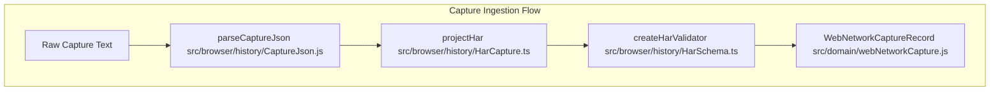
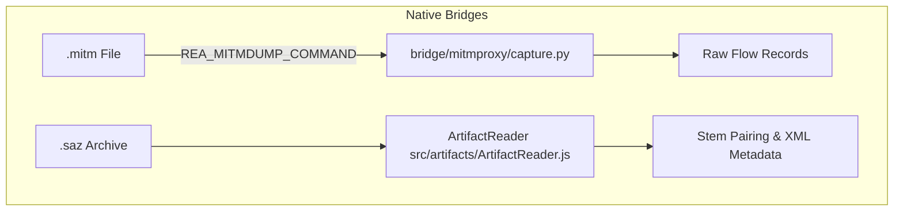
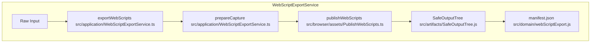
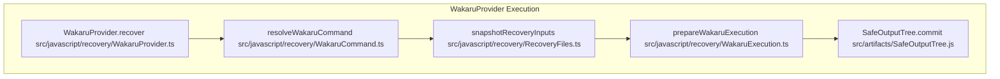

<!-- source: DeepWiki mcp.deepwiki.com · repo morluto/rea · page 6.5 Web Network Captures and Script Export · fetched 2026-10-16 -->

# Web Network Captures and Script Export

Relevant source files

The following files were used as context for generating this wiki page:

- [bridge/mitmproxy/capture.py](bridge/mitmproxy/capture.py)
- [bridge/mitmproxy/test_capture.py](bridge/mitmproxy/test_capture.py)
- [docs/web-network-captures.md](docs/web-network-captures.md)
- [docs/website-script-export.md](docs/website-script-export.md)
- [scripts/fixtures/generate-mitmproxy-capture.py](scripts/fixtures/generate-mitmproxy-capture.py)
- [scripts/fixtures/page-cdp-proxy.mjs](scripts/fixtures/page-cdp-proxy.mjs)
- [scripts/lib/browser-module-e2e.mjs](scripts/lib/browser-module-e2e.mjs)
- [scripts/lib/browser-nested-source-map-e2e.mjs](scripts/lib/browser-nested-source-map-e2e.mjs)
- [scripts/lib/browser-network-e2e.mjs](scripts/lib/browser-network-e2e.mjs)
- [scripts/lib/browser-runtime-e2e.mjs](scripts/lib/browser-runtime-e2e.mjs)
- [scripts/lib/browser-runtime-fixture-lifecycle.mjs](scripts/lib/browser-runtime-fixture-lifecycle.mjs)
- [scripts/lib/browser-runtime-termination-e2e.mjs](scripts/lib/browser-runtime-termination-e2e.mjs)
- [scripts/lib/browser-scenario-service-worker-setup-e2e.mjs](scripts/lib/browser-scenario-service-worker-setup-e2e.mjs)
- [scripts/lib/browser-script-export-e2e.mjs](scripts/lib/browser-script-export-e2e.mjs)
- [scripts/lib/browser-source-map-e2e.mjs](scripts/lib/browser-source-map-e2e.mjs)
- [scripts/lib/verifier-cleanup.d.mts](scripts/lib/verifier-cleanup.d.mts)
- [scripts/lib/verifier-cleanup.mjs](scripts/lib/verifier-cleanup.mjs)
- [scripts/verify-browser-dom-destinations.mjs](scripts/verify-browser-dom-destinations.mjs)
- [scripts/verify-browser-modules.mjs](scripts/verify-browser-modules.mjs)
- [scripts/verify-browser-network.mjs](scripts/verify-browser-network.mjs)
- [scripts/verify-browser-scripts.mjs](scripts/verify-browser-scripts.mjs)
- [scripts/verify-real-browser.mjs](scripts/verify-real-browser.mjs)
- [scripts/verify-web-network-captures.mjs](scripts/verify-web-network-captures.mjs)
- [src/application/WebScriptExportService.ts](src/application/WebScriptExportService.ts)
- [src/browser/BrowserProcessStartup.ts](src/browser/BrowserProcessStartup.ts)
- [src/browser/assets/PublishWebScripts.ts](src/browser/assets/PublishWebScripts.ts)
- [src/browser/assets/ScenarioScriptCapture.ts](src/browser/assets/ScenarioScriptCapture.ts)
- [src/browser/assets/ScriptCaptureAdapters.test.ts](src/browser/assets/ScriptCaptureAdapters.test.ts)
- [src/browser/history/HarCapture.test.ts](src/browser/history/HarCapture.test.ts)
- [src/browser/history/HarCapture.ts](src/browser/history/HarCapture.ts)
- [src/browser/history/HarSchema.ts](src/browser/history/HarSchema.ts)
- [src/browser/history/QlogCapture.test.ts](src/browser/history/QlogCapture.test.ts)
- [src/browser/history/QlogCapture.ts](src/browser/history/QlogCapture.ts)
- [src/cli/webScriptCommands.ts](src/cli/webScriptCommands.ts)
- [src/contracts/webNetworkCaptureToolContracts.ts](src/contracts/webNetworkCaptureToolContracts.ts)
- [src/domain/analysisView/pcapCaptureView.ts](src/domain/analysisView/pcapCaptureView.ts)
- [src/domain/analysisView/qlogCaptureView.ts](src/domain/analysisView/qlogCaptureView.ts)
- [src/domain/analysisView/webNetworkCaptureView.ts](src/domain/analysisView/webNetworkCaptureView.ts)
- [src/domain/webScriptExport.ts](src/domain/webScriptExport.ts)
- [src/domain/webScriptExportError.ts](src/domain/webScriptExportError.ts)
- [src/firmware/FirmwarePublication.ts](src/firmware/FirmwarePublication.ts)
- [src/javascript/recovery/WakaruProvider.ts](src/javascript/recovery/WakaruProvider.ts)
- [src/server/registerWebScriptTool.ts](src/server/registerWebScriptTool.ts)
- [tests/acceptance/applications/sourceMapPrefixCli.test.ts](tests/acceptance/applications/sourceMapPrefixCli.test.ts)
- [tests/boundary/browser/browserProcessStartup.test.ts](tests/boundary/browser/browserProcessStartup.test.ts)
- [tests/boundary/browser/cdpScriptMetadata.test.ts](tests/boundary/browser/cdpScriptMetadata.test.ts)
- [tests/boundary/browser/historicalWebCapture.test.ts](tests/boundary/browser/historicalWebCapture.test.ts)
- [tests/boundary/browser/runtimeFixtureCleanup.test.ts](tests/boundary/browser/runtimeFixtureCleanup.test.ts)
- [tests/boundary/cli/javascriptArtifactBomRanges.test.ts](tests/boundary/cli/javascriptArtifactBomRanges.test.ts)
- [tests/boundary/filesystem/javascriptArtifactBomRanges.test.ts](tests/boundary/filesystem/javascriptArtifactBomRanges.test.ts)
- [tests/boundary/filesystem/webScriptExport.test.ts](tests/boundary/filesystem/webScriptExport.test.ts)
- [tests/boundary/javascript-recovery/wakaruPublicationCancellation.test.ts](tests/boundary/javascript-recovery/wakaruPublicationCancellation.test.ts)
- [tests/boundary/mcp/webScriptSelectionMcp.test.ts](tests/boundary/mcp/webScriptSelectionMcp.test.ts)
- [tests/fixtures/javascriptArtifactBom.ts](tests/fixtures/javascriptArtifactBom.ts)

This page details the implementation of historical network capture ingestion (HAR, mitmproxy, Fiddler SAZ, qlog), network packet handling, web script publication/export workflows, and automated JavaScript bundle recovery via the Wakaru provider.

---

## 1. Historical Capture Ingestion (HAR and Qlog)

REA processes historical network traces offline without initializing a browser runtime or active proxy listener `[docs/web-network-captures.md:1-5]()`. Ingestion services validate, project, and structure records from standards-compliant files into canonical evidence structures.

The HTTP Archive (HAR) ingestion pipeline relies on `decodeHarCapture` in `src/browser/history/HarCapture.ts` [src/browser/history/HarCapture.ts:29-102](). It uses `lossless-json` to preserve large integer precision and `ajv` schemas pinned to `har-schema@2.0.0` [docs/web-network-captures.md:58-60](). 

Key steps in `decodeHarCapture`:
1. Parses raw JSON input using `parseCaptureJson` [src/browser/history/HarCapture.ts:33]().
2. Validates version constraints (requiring HAR 1.2 profile) [src/browser/history/HarCapture.ts:44-49]().
3. Evaluates structural sensitive value exclusions [src/browser/history/HarCapture.ts:51-53]().
4. Projects individual entries into `WebNetworkCaptureRecord` objects containing ordinals, JSON pointers, binary field descriptors, and redactions [src/browser/history/HarCapture.ts:59-90]().

Similarly, qlog capture ingestion decodes QUIC/HTTP/3 trace logs via `src/browser/history/QlogCapture.ts`, preserving event groupings and sequencing without network interaction.

Sources: `src/browser/history/HarCapture.ts:29-102`, `src/browser/history/HarSchema.ts`, `docs/web-network-captures.md:1-60`

---

## 2. mitmproxy and Fiddler Capture Bridges

Native mitmproxy trace inspection requires an external `mitmdump` executable (pinned to version 12.2.3 on Linux) configured via environment variables `[docs/web-network-captures.md:80-84]()`. 

The bridge logic in `bridge/mitmproxy/capture.py` reads raw flow files using the upstream `mitmproxy.io.tnetstring` decoder without performing full `FlowReader` migrations or state conversions `[docs/web-network-captures.md:86-90]().`

Fiddler Session Archive Zip (`.saz`) files are ingested directly by REA's internal ZIP readers (`docs/web-network-captures.md:99-103`). The decoder associates `raw/<id>_c.txt` (requests), `_s.txt` (responses), and `_m.xml` (metadata) entries by filename stem while verifying archive size constraints (capped at 32 MiB expanded) [docs/web-network-captures.md:109-122]().

Sources: `docs/web-network-captures.md:80-125`, `bridge/mitmproxy/capture.py`

---

## 3. Web Script Export and Publication

The web script export workflow extracts script assets from recorded sessions or browser captures and materializes them into a structured output directory. 

Entry point `exportWebScripts` in `src/application/WebScriptExportService.ts` validates absolute input paths, reads capture bytes within an `ArtifactResourceScope`, and invokes `publishWebScripts` [src/application/WebScriptExportService.ts:59-104]().

Sources: `src/application/WebScriptExportService.ts:59-129`, `src/browser/assets/PublishWebScripts.ts:39-147`, `tests/boundary/filesystem/webScriptExport.test.ts:1-177`

`publishWebScripts` executes within an atomic transaction managed by `SafeOutputTree` [src/browser/assets/PublishWebScripts.ts:39-45](). It generates a `manifest.json` cataloging every exported script, byte hashes, capture provenance, and known analysis limitations [src/browser/assets/PublishWebScripts.ts:75-115](). Case-distinct path collisions or query variants are isolated automatically to prevent filesystem overwrite errors [src/browser/assets/PublishWebScripts.ts:27]().

Sources: `src/browser/assets/PublishWebScripts.ts:25-147`, `src/domain/webScriptExport.ts`, `tests/boundary/filesystem/webScriptExport.test.ts:1-115`

---

## 4. JavaScript Source Recovery via Wakaru

When analyzing obfuscated, packed, or bundled JavaScript artifacts, REA uses the `WakaruProvider` class defined in `src/javascript/recovery/WakaruProvider.ts` to decompile and reconstruct source modules [src/javascript/recovery/WakaruProvider.ts:43-60]().

`WakaruProvider` implements `JavaScriptRecoveryPort` [src/javascript/recovery/WakaruProvider.ts:4](), serializing recovery tasks through a promise tail (`#tail`) to coordinate concurrent invocations safely [src/javascript/recovery/WakaruProvider.ts:44-95]().

Sources: `src/javascript/recovery/WakaruProvider.ts:43-146`, `src/javascript/recovery/WakaruCommand.ts`, `src/javascript/recovery/WakaruExecution.ts`

During execution, `WakaruProvider`:
1. Checks cancellation tokens and time budgets [src/javascript/recovery/WakaruProvider.ts:107-109]().
2. Resolves the Wakaru engine binary path via `resolveWakaruCommand` [src/javascript/recovery/WakaruProvider.ts:110]().
3. Creates a temporary workspace directory (`mkdtemp`) for staging inputs and output modules [src/javascript/recovery/WakaruProvider.ts:111-115]().
4. Snapshots target scripts via `snapshotRecoveryInputs` [src/javascript/recovery/WakaruProvider.ts:116-120]().
5. Invokes `prepareWakaruExecution` to run the decompiler subprocess [src/javascript/recovery/WakaruProvider.ts:131-141]().
6. Commits verified outputs to the destination via `SafeOutputTree` or performs rollback cleanup on failure [src/javascript/recovery/WakaruProvider.ts:146-174]().

Sources: `src/javascript/recovery/WakaruProvider.ts:43-193`, `src/javascript/recovery/WakaruCommand.ts`, `src/javascript/recovery/WakaruExecution.ts`

---

