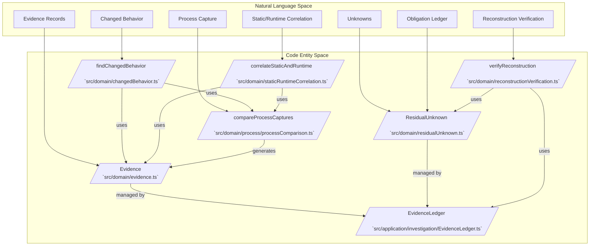
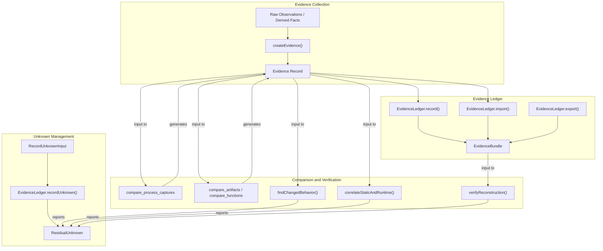

<!-- source: DeepWiki mcp.deepwiki.com · repo morluto/rea · page 7 Evidence, Investigation and Reconstruction · fetched 2026-10-16 -->

# Evidence, Investigation and Reconstruction

Relevant source files

The following files were used as context for generating this wiki page:

- [src/application/binary/AnalysisSnapshotCache.test.ts](src/application/binary/AnalysisSnapshotCache.test.ts)
- [src/application/binary/AnalysisSnapshotCache.ts](src/application/binary/AnalysisSnapshotCache.ts)
- [src/contracts/analysisViewApiSurfaceExample.ts](src/contracts/analysisViewApiSurfaceExample.ts)
- [src/domain/analysisSnapshot.test.ts](src/domain/analysisSnapshot.test.ts)
- [src/domain/analysisSnapshot.ts](src/domain/analysisSnapshot.ts)
- [src/domain/callPath.test.ts](src/domain/callPath.test.ts)
- [src/domain/callPath.ts](src/domain/callPath.ts)
- [src/domain/changedBehavior.test.ts](src/domain/changedBehavior.test.ts)
- [src/domain/changedBehavior.ts](src/domain/changedBehavior.ts)
- [src/domain/evidence.test.ts](src/domain/evidence.test.ts)
- [src/domain/evidence.ts](src/domain/evidence.ts)
- [src/domain/functionCallCoverage.test.ts](src/domain/functionCallCoverage.test.ts)
- [src/domain/functionCallCoverage.ts](src/domain/functionCallCoverage.ts)
- [src/domain/jsonValue.test.ts](src/domain/jsonValue.test.ts)
- [src/domain/jsonValue.ts](src/domain/jsonValue.ts)
- [src/domain/reconstructionVerification.functionSources.test.ts](src/domain/reconstructionVerification.functionSources.test.ts)
- [src/domain/reconstructionVerification.ts](src/domain/reconstructionVerification.ts)
- [src/domain/relationshipCoverage.ts](src/domain/relationshipCoverage.ts)
- [src/domain/staticRuntimeCorrelation.ts](src/domain/staticRuntimeCorrelation.ts)
- [src/server/mcpProgress.ts](src/server/mcpProgress.ts)
- [src/server/registerInvestigationTools.ts](src/server/registerInvestigationTools.ts)
- [src/server/runDerivedOperation.test.ts](src/server/runDerivedOperation.test.ts)
- [src/server/runDerivedOperation.ts](src/server/runDerivedOperation.ts)
- [tests/boundary/mcp/comparisonUnknownsMcp.test.ts](tests/boundary/mcp/comparisonUnknownsMcp.test.ts)
- [tests/boundary/mcp/investigationAnalysisMcp.test.ts](tests/boundary/mcp/investigationAnalysisMcp.test.ts)
- [tests/boundary/mcp/processEvidenceIdentityMcp.test.ts](tests/boundary/mcp/processEvidenceIdentityMcp.test.ts)
- [tests/boundary/mcp/progressMcp.test.ts](tests/boundary/mcp/progressMcp.test.ts)
- [tests/conformance/providers/conformancePackage.test.ts](tests/conformance/providers/conformancePackage.test.ts)
- [tests/conformance/providers/hopper/realHopperAssertions.test.ts](tests/conformance/providers/hopper/realHopperAssertions.test.ts)

This section provides a high-level overview of REA's epistemic model, which underpins how REA collects, stores, and reasons about information. It covers the core concepts of evidence records, the management of unknowns, and the mechanisms for verifying reconstructions and evaluating coverage. Detailed explanations and technical specifications for each topic are provided in the linked child pages.

## Evidence Model and Ledger
REA operates on a foundation of immutable evidence records. Each record captures a specific observation or derived fact about a binary target, including its provenance, parameters, and results. These records are stored and managed by an `EvidenceLedger` [src/application/investigation/EvidenceLedger.ts:36-36](), which ensures their integrity and provides mechanisms for deduplication and atomic import of `EvidenceBundle`s [src/application/investigation/EvidenceLedger.ts:63-154](). The ledger also tracks "unknown" evidence, representing gaps in understanding or contradictions that require further investigation. Evidence can be exported and imported as bundle files [src/application/EvidenceBundleFiles.ts:18-37](), allowing for sharing and comparison across different analysis sessions.

For details, see [Evidence Model and Ledger](#7.1).

Sources:
- [src/application/investigation/EvidenceLedger.ts:36-154]()
- [src/application/EvidenceBundleFiles.ts:18-37]()

## Reconstruction Verification and Obligations
REA provides tools to verify the accuracy and completeness of a "reconstruction," which is a model or understanding of a binary's behavior or structure. This involves comparing observed behavior (e.g., via process captures) with static analysis results, and evaluating how well they correlate. The `verifyReconstruction` [src/domain/reconstructionVerification.ts:73-120]() function assesses declared claims against collected evidence, identifying discrepancies or unresolved areas. The system also tracks changed behavior to highlight differences between versions or observed states [src/domain/changedBehavior.ts:115-157](). An obligation ledger (represented by `ResidualUnknown` records) records outstanding questions or required investigations, guiding the analysis process.

For details, see [Reconstruction Verification and Obligations](#7.2).

Sources:
- [src/domain/reconstructionVerification.ts:73-120]()
- [src/domain/changedBehavior.ts:115-157]()

## Process Capture and Ownership
The process capture subsystem is crucial for observing the dynamic behavior of binaries. This involves capturing detailed information about process execution, including filesystem interactions, network activity, and inter-process communication. REA ensures proper process ownership and command identity during these captures. Filesystem snapshots are taken to record the state before and after execution, enabling precise comparison. The system also handles cancellation and lifecycle management of captured processes, with specific considerations for Windows owned processes and native addons.

For details, see [Process Capture and Ownership](#7.3).

Sources:
- [src/server/registerProcessComparisonTool.ts:26-29]()

### Epistemic Model Overview
REA's epistemic model is centered around the concept of `Evidence` [src/domain/evidence.ts:167-169](), which forms the basis for all analysis and reasoning. This evidence is collected, stored, and then used to verify claims and identify areas requiring further investigation.

Sources:
- [src/domain/evidence.ts:167-169]()
- [src/application/investigation/EvidenceLedger.ts:36-36]()
- [src/domain/reconstructionVerification.ts:73-120]()
- [src/domain/changedBehavior.ts:115-157]()
- [src/domain/staticRuntimeCorrelation.ts:164-178]()

### Evidence Flow and Unknown Management
The lifecycle of evidence and unknowns within REA involves recording, comparing, and resolving.

Sources:
- [src/domain/evidence.ts:167-169]()
- [src/application/investigation/EvidenceLedger.ts:36-36]()
- [src/domain/changedBehavior.ts:115-157]()
- [src/domain/staticRuntimeCorrelation.ts:164-178]()
- [src/domain/reconstructionVerification.ts:73-120]()

---

