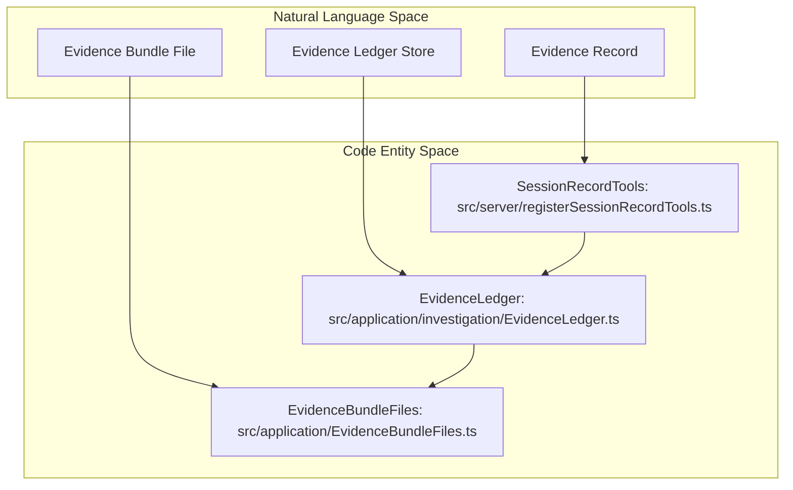
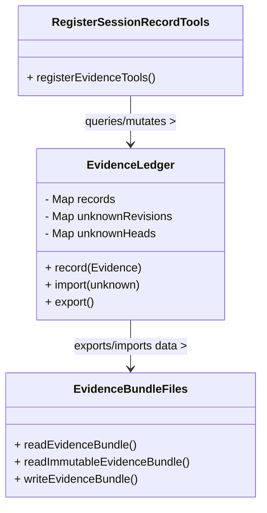

<!-- source: DeepWiki mcp.deepwiki.com · repo morluto/rea · page 7.1 Evidence Model and Ledger · fetched 2026-10-16 -->

# Evidence Model and Ledger

Relevant source files

The following files were used as context for generating this wiki page:

- [experiments/analysis-efficiency/unknown-pagination.md](experiments/analysis-efficiency/unknown-pagination.md)
- [src/application/EvidenceBundleFiles.ts](src/application/EvidenceBundleFiles.ts)
- [src/application/EvidenceInputResolver.test.ts](src/application/EvidenceInputResolver.test.ts)
- [src/application/binary/AnalysisSnapshotCache.test.ts](src/application/binary/AnalysisSnapshotCache.test.ts)
- [src/application/binary/AnalysisSnapshotCache.ts](src/application/binary/AnalysisSnapshotCache.ts)
- [src/application/investigation/EvidenceLedger.residualUnknown.test.ts](src/application/investigation/EvidenceLedger.residualUnknown.test.ts)
- [src/application/investigation/EvidenceLedger.test.ts](src/application/investigation/EvidenceLedger.test.ts)
- [src/application/investigation/EvidenceLedger.ts](src/application/investigation/EvidenceLedger.ts)
- [src/application/investigation/InvestigationRecordPort.ts](src/application/investigation/InvestigationRecordPort.ts)
- [src/application/investigation/InvestigationRecords.test.ts](src/application/investigation/InvestigationRecords.test.ts)
- [src/application/investigation/InvestigationRecords.ts](src/application/investigation/InvestigationRecords.ts)
- [src/application/investigation/UnknownEvidence.ts](src/application/investigation/UnknownEvidence.ts)
- [src/contracts/analysisViewApiSurfaceExample.ts](src/contracts/analysisViewApiSurfaceExample.ts)
- [src/contracts/sessionToolContracts.ts](src/contracts/sessionToolContracts.ts)
- [src/contracts/sessionToolSchemas.ts](src/contracts/sessionToolSchemas.ts)
- [src/contracts/toolContractExamples.ts](src/contracts/toolContractExamples.ts)
- [src/contracts/unknownContractExamples.ts](src/contracts/unknownContractExamples.ts)
- [src/domain/analysisSnapshot.test.ts](src/domain/analysisSnapshot.test.ts)
- [src/domain/analysisSnapshot.ts](src/domain/analysisSnapshot.ts)
- [src/domain/evidence.test.ts](src/domain/evidence.test.ts)
- [src/domain/evidence.ts](src/domain/evidence.ts)
- [src/domain/evidenceBundle.test.ts](src/domain/evidenceBundle.test.ts)
- [src/domain/evidenceBundle.ts](src/domain/evidenceBundle.ts)
- [src/domain/evidenceErrors.ts](src/domain/evidenceErrors.ts)
- [src/domain/jsonValue.test.ts](src/domain/jsonValue.test.ts)
- [src/domain/jsonValue.ts](src/domain/jsonValue.ts)
- [src/server/registerSessionRecordTools.ts](src/server/registerSessionRecordTools.ts)
- [tests/acceptance/derivedEvidenceReplay.test.ts](tests/acceptance/derivedEvidenceReplay.test.ts)
- [tests/boundary/filesystem/evidenceBundleFiles.test.ts](tests/boundary/filesystem/evidenceBundleFiles.test.ts)
- [tests/boundary/mcp/evidenceImportLifecycle.test.ts](tests/boundary/mcp/evidenceImportLifecycle.test.ts)
- [tests/boundary/mcp/serverUnknownsMcp.test.ts](tests/boundary/mcp/serverUnknownsMcp.test.ts)
- [tests/boundary/mcp/workflowSnapshotReplayMcp.test.ts](tests/boundary/mcp/workflowSnapshotReplayMcp.test.ts)
- [tests/conformance/providers/conformancePackage.test.ts](tests/conformance/providers/conformancePackage.test.ts)
- [tests/conformance/providers/hopper/realHopperAssertions.test.ts](tests/conformance/providers/hopper/realHopperAssertions.test.ts)

This page documents the **Evidence Model and Ledger** subsystem of REA (Reverse Engineer Anything). It covers the **evidence schema and provenance**, the **ledgers managing evidence and unknowns**, **investigation records**, **handling of unknown evidence**, **evidence bundle files**, and the **import/export/compare workflow for evidence bundles**. The intent is to explain how evidence is modeled, structured, and managed, including data flows and relevant classes and functions.

---

## 7.1.1 Evidence Model: Schema and Semantics

### Purpose and Overview

In REA, *Evidence* represents an immutable record of a public observation or assertion about an artifact or binary target, produced by an analysis provider. Such observations can cover a broad range of information—from static binary analysis results to runtime or provenance data.

Evidence records are strict, provider-neutral JSON envelopes with standardized fields and semantic identification. They include:

- **Static metadata**: provider identity, artifact subject, predicate, source environment.
- **Observation results**: raw and normalized results of an operation, parameters used.
- **Provenance and confidence**: authority, confidence level, limitations.
- **Source location(s)**: optional references to addresses, file offsets, or paths.
- **Cross-references**: links to related evidence by ID.

### Core Evidence Schema

Implemented in `src/domain/evidence.ts`, the core schema uses [zod](https://github.com/colinhacks/zod) for validation. Primary schemas include:

- `providerSchema`: identity of the analysis provider with ID, name, and version [src/domain/evidence.ts:36-40]().
- `subjectSchema`: the artifact subject, including digest (`sha256`), format, architecture, and local path [src/domain/evidence.ts:77-86]().
- `evidenceLocationSchema`: discriminated union type specifying locations of evidence within artifacts [src/domain/evidence.ts:89-106]().
- `evidenceAuthoritySchema`: enumerates levels of trust (e.g., shipped artifact, controlled replay, analyst inference) [src/domain/evidence.ts:108-114]().
- `executionEnvironmentSchema`: the environment where observation was made (platform, isolation level) [src/domain/evidence.ts:116-121]().

The `evidenceBaseSchema` (`[src/domain/evidence.ts:123-142]()`) defines fields such as:

- `evidence_id`: a deterministic prefixed `sha256` digest identifying the evidence record (`ev...`).
- `subject`: nullable artifact subject.
- `provider`: provider identity.
- `predicate_type`: string identifier describing the kind of observation.
- `operation`: name of producing operation.
- `parameters`: operation inputs.
- `raw_result` and `normalized_result`: JSON values representing the observation output.
- `confidence` and `authority`: subjective confidence and authority of the evidence.
- `limitations`: array of strings describing known limits of the evidence.
- `locations`: zero or more locations tied to the evidence.
- `evidence_links`: cross-reference evidence IDs.

### Evidence Identity and Projection

Each evidence’s semantic identity (`evidence_id`) is a cryptographic digest derived from the normalized projection of its immutable components, including provider, subject digest, operation, parameters, and results. This makes the `evidence_id` a content-addressed reference for deduplication.

The function `parseEvidence()` parses and validates an Evidence record and enforces identity consistency via semantic projection (`[src/domain/evidence.ts:171-181]()`).

Sources:
- `src/domain/evidence.ts:36-181`

---

## 7.1.2 Residual Unknowns: Handling Incomplete Knowledge

REA supports the notion of *Residual Unknowns*, which represent open questions or unknown facts in the investigation. These unknowns can evolve over time and are linked to evidence via mutation evidence records tracking their state history (`[src/domain/residualUnknown.ts]()`).

The `ResidualUnknown` domain entity includes:
- `unknown_id`: stable unique ID derived cryptographically from the unknown’s question and context.
- `revision`: a positive integer representing the version of a particular unknown.
- `status`: enumeration tracking investigation progress (e.g., open, investigating, resolved).
- Lists of supporting, contradicting, and mutation evidence IDs that provide or challenge the unknown.
- Relationships linking unknowns transitively (e.g., depends-on).

Sources:
- `src/domain/residualUnknown.ts`
- `src/application/investigation/EvidenceLedger.ts:46-47`

---

## 7.1.3 Evidence Bundles: Grouping and Canonicalization

### Structure

The *EvidenceBundle* aggregates arrays of artifacts, providers, environments, scenarios, captures, unknowns, and records. This structure is defined and validated by `evidenceBundleSchema` (`[src/domain/evidenceBundle.ts:42-50]()`).

### Creation and Projection

The function `createEvidenceBundle(records, unknowns)` produces a deterministic canonical form (`[src/domain/evidenceBundle.ts:86-141]()`):
- Records are sorted by evidence ID using unicode code point ordering (`[src/domain/evidenceBundle.ts:90-92]()`).
- Artifacts, providers, and environments are de-duplicated and sorted.
- Unknowns are sorted by their IDs and revisions (`[src/domain/evidenceBundle.ts:134-138]()`).

There is also `evidenceBundleForTarget(bundle, sha256)` to restrict a bundle to a specific artifact identified by `sha256` (`[src/domain/evidenceBundle.ts:144-194]()`).

### Validation

`parseEvidenceBundle(input)` parses and validates bundles, enforcing unique record IDs, consistent unknown graphs, and canonical JSON ordering (`[src/application/EvidenceBundleFiles.ts:79-112]()`).

Sources:
- `src/domain/evidenceBundle.ts:42-194`
- `src/application/EvidenceBundleFiles.ts:79-112`

---

## 7.1.4 EvidenceLedger: Managing Records and Unknowns

### Overview

`EvidenceLedger` (`[src/application/investigation/EvidenceLedger.ts:44-181]().`) manages a session-owned, in-memory set of immutable evidence records and unknown revisions.

Key responsibilities:
- **Idempotent recording of evidence:** Rejects conflicting records with the same evidence ID (`[src/application/investigation/EvidenceLedger.ts:49-72]()`).
- **Atomic import of evidence bundles:** Validates and merges records and unknowns, rejecting partial or conflicting merges (`[src/application/investigation/EvidenceLedger.ts:75-176]()`).
- **Unknown registry handling:** Manages residual unknowns, revisions, and dependencies.
- **Consistency and integrity enforcement:** Uses cryptographic canonicalization to detect conflicts (`[src/application/investigation/EvidenceLedger.ts:110-113]()`).

### Core Methods

- `record(input: Evidence)`: Adds a single evidence record, returning `"added"` or `"duplicate"`, or error on conflict (`[src/application/investigation/EvidenceLedger.ts:49-72]()`).
- `import(input: unknown)`: Imports a full evidence bundle atomically (`[src/application/investigation/EvidenceLedger.ts:75-176]()`).
- `export()`: Exports current ledger state as an `EvidenceBundle` object (`[src/application/investigation/EvidenceLedger.ts:178-181]()`).

Sources:
- `src/application/investigation/EvidenceLedger.ts:44-181`

---

## 7.1.5 Evidence Bundle File Handling and MCP Integration

REA supports importing, exporting, and snapshotting evidence bundles via filesystem helpers and MCP tool registrations:

- `readEvidenceBundle()` and `readImmutableEvidenceBundle()` read and validate evidence bundles from disk (`[src/application/EvidenceBundleFiles.ts:39-52]()`).
- `writeEvidenceBundle()` atomically serializes deterministic evidence JSON (`[src/application/EvidenceBundleFiles.ts:115-148]()`).
- MCP tools `export_evidence_bundle`, `import_evidence_bundle`, and `get_evidence_bundle` are registered in `[src/server/registerSessionRecordTools.ts:34-146]()`.

Sources:
- `src/application/EvidenceBundleFiles.ts:39-148`
- `src/server/registerSessionRecordTools.ts:34-146`

---

## 7.1.6 Data Flow and Architecture

Diagram: Evidence Subsystem Architecture and File I/O Flow

Sources:
- `src/application/investigation/EvidenceLedger.ts:44-181`
- `src/application/EvidenceBundleFiles.ts:39-148`
- `src/server/registerSessionRecordTools.ts:34-146`

Diagram: Ledger Class and Component Interactions

Sources:
- `src/application/investigation/EvidenceLedger.ts:44-48`
- `src/application/EvidenceBundleFiles.ts:39-148`
- `src/server/registerSessionRecordTools.ts:34-40`

---

## 7.1.7 Limitations and Provenance Considerations

- Evidence is **immutable** once recorded, enforcing content-addressed reproducibility.
- Conflicting records with the same ID are rejected to preserve consistency.
- Unknowns require tracking mutation evidence to evolve states safely.
- Bundles are validated in entirety before import to preserve ledger atomicity.
- Artifacts and providers are stored as detached manifests to minimize state bloat.
- Evidence relies on canonical JSON serialization (`canonicalize`) for identity.

Sources:
- `src/domain/evidenceBundle.ts:55-83`
- `src/application/investigation/EvidenceLedger.ts:60-72`

---

