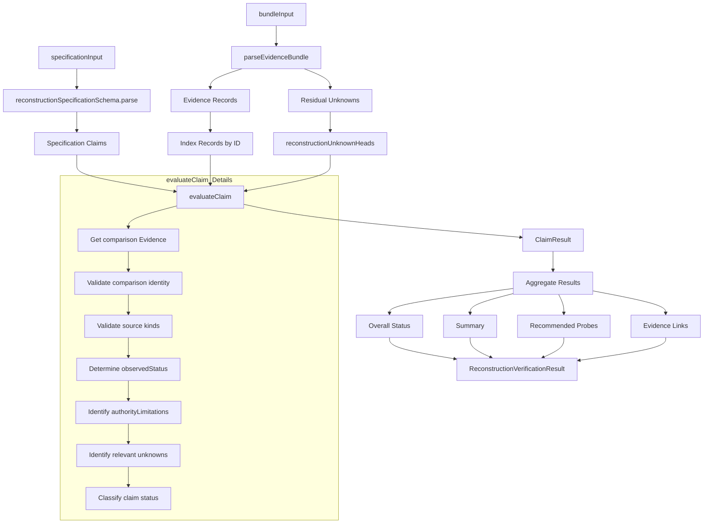
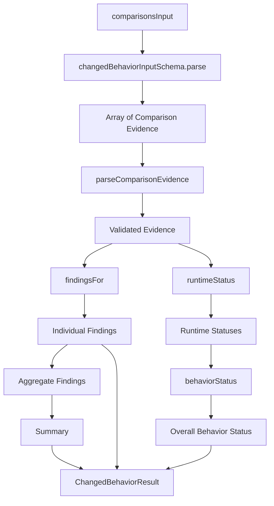
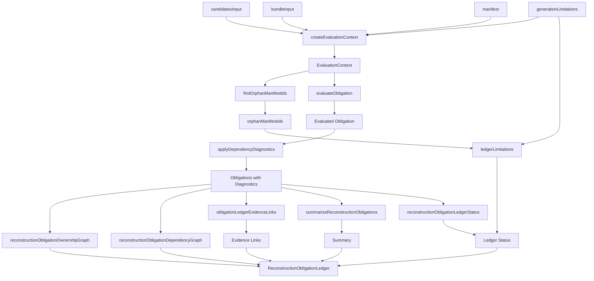

<!-- source: DeepWiki mcp.deepwiki.com · repo morluto/rea · page 7.2 Reconstruction Verification and Obligations · fetched 2026-10-16 -->

# Reconstruction Verification and Obligations

Relevant source files

The following files were used as context for generating this wiki page:

- [scripts/verify-real-ghidra-swift.mjs](scripts/verify-real-ghidra-swift.mjs)
- [src/application/ReconstructionObligationAuthority.ts](src/application/ReconstructionObligationAuthority.ts)
- [src/application/ReconstructionObligationCandidates.test.ts](src/application/ReconstructionObligationCandidates.test.ts)
- [src/application/ReconstructionObligationCandidates.ts](src/application/ReconstructionObligationCandidates.ts)
- [src/application/ReconstructionObligationLedger.closure.test.ts](src/application/ReconstructionObligationLedger.closure.test.ts)
- [src/application/ReconstructionObligationLedger.fixture.ts](src/application/ReconstructionObligationLedger.fixture.ts)
- [src/application/ReconstructionObligationLedgerDiagnostics.ts](src/application/ReconstructionObligationLedgerDiagnostics.ts)
- [src/application/ReconstructionObligationLedgerEvaluation.ts](src/application/ReconstructionObligationLedgerEvaluation.ts)
- [src/application/ReconstructionObligationLedgerProjection.ts](src/application/ReconstructionObligationLedgerProjection.ts)
- [src/application/ReconstructionObligationOriginalCases.ts](src/application/ReconstructionObligationOriginalCases.ts)
- [src/application/ReconstructionObligationPolicies.ts](src/application/ReconstructionObligationPolicies.ts)
- [src/application/managed/ManagedReconstructionService.test.ts](src/application/managed/ManagedReconstructionService.test.ts)
- [src/browser/CdpCaptureEventBodyShapes.ts](src/browser/CdpCaptureEventBodyShapes.ts)
- [src/contracts/reconstructionReadinessExample.ts](src/contracts/reconstructionReadinessExample.ts)
- [src/domain/analysisProfile.test.ts](src/domain/analysisProfile.test.ts)
- [src/domain/analysisProfile.ts](src/domain/analysisProfile.ts)
- [src/domain/callPath.test.ts](src/domain/callPath.test.ts)
- [src/domain/callPath.ts](src/domain/callPath.ts)
- [src/domain/changedBehavior.test.ts](src/domain/changedBehavior.test.ts)
- [src/domain/changedBehavior.ts](src/domain/changedBehavior.ts)
- [src/domain/functionCallCoverage.test.ts](src/domain/functionCallCoverage.test.ts)
- [src/domain/functionCallCoverage.ts](src/domain/functionCallCoverage.ts)
- [src/domain/functionComparison.test.ts](src/domain/functionComparison.test.ts)
- [src/domain/functionComparison.ts](src/domain/functionComparison.ts)
- [src/domain/functionComparisonDimensions.ts](src/domain/functionComparisonDimensions.ts)
- [src/domain/functionComparisonNormalization.ts](src/domain/functionComparisonNormalization.ts)
- [src/domain/functionComparisonResults.ts](src/domain/functionComparisonResults.ts)
- [src/domain/functionComparisonSchemas.ts](src/domain/functionComparisonSchemas.ts)
- [src/domain/functionDossierEvidence.ts](src/domain/functionDossierEvidence.ts)
- [src/domain/managed/managedReconstruction.ts](src/domain/managed/managedReconstruction.ts)
- [src/domain/reconstructionObligationLedgerIntegrity.ts](src/domain/reconstructionObligationLedgerIntegrity.ts)
- [src/domain/reconstructionObligationLedgerSchemas.test.ts](src/domain/reconstructionObligationLedgerSchemas.test.ts)
- [src/domain/reconstructionUnknowns.test.ts](src/domain/reconstructionUnknowns.test.ts)
- [src/domain/reconstructionUnknowns.ts](src/domain/reconstructionUnknowns.ts)
- [src/domain/reconstructionVerification.functionSources.test.ts](src/domain/reconstructionVerification.functionSources.test.ts)
- [src/domain/reconstructionVerification.ts](src/domain/reconstructionVerification.ts)
- [src/domain/relationshipCoverage.ts](src/domain/relationshipCoverage.ts)
- [src/domain/residualUnknown.test.ts](src/domain/residualUnknown.test.ts)
- [src/domain/residualUnknown.ts](src/domain/residualUnknown.ts)
- [src/domain/staticRuntimeCorrelation.ts](src/domain/staticRuntimeCorrelation.ts)
- [src/ghidra/extensions/nativeaot/NativeAotReport.ts](src/ghidra/extensions/nativeaot/NativeAotReport.ts)
- [src/server/mcpProgress.ts](src/server/mcpProgress.ts)
- [src/server/registerApplicationTools/obligationLedger.ts](src/server/registerApplicationTools/obligationLedger.ts)
- [src/server/registerInvestigationTools.ts](src/server/registerInvestigationTools.ts)
- [src/server/runDerivedOperation.test.ts](src/server/runDerivedOperation.test.ts)
- [src/server/runDerivedOperation.ts](src/server/runDerivedOperation.ts)
- [tests/boundary/mcp/comparisonUnknownsMcp.test.ts](tests/boundary/mcp/comparisonUnknownsMcp.test.ts)
- [tests/boundary/mcp/evidenceBundleInline.test.ts](tests/boundary/mcp/evidenceBundleInline.test.ts)
- [tests/boundary/mcp/functionComparisonMcp.test.ts](tests/boundary/mcp/functionComparisonMcp.test.ts)
- [tests/boundary/mcp/investigationAnalysisMcp.test.ts](tests/boundary/mcp/investigationAnalysisMcp.test.ts)
- [tests/boundary/mcp/processEvidenceIdentityMcp.test.ts](tests/boundary/mcp/processEvidenceIdentityMcp.test.ts)
- [tests/boundary/mcp/progressMcp.test.ts](tests/boundary/mcp/progressMcp.test.ts)
- [tests/boundary/providers/native/nativeTextRobustness.test.ts](tests/boundary/providers/native/nativeTextRobustness.test.ts)

This page details REA's mechanisms for verifying the accuracy and completeness of reconstructed artifacts and behaviors. It covers how REA evaluates `reconstructionVerification` results, identifies `changedBehavior`, correlates static and runtime observations, assesses `reconstructionCoverageEvaluation`, and manages the `obligationLedger` through authorities, policies, and projections.

## Reconstruction Verification

Reconstruction verification is the process of comparing a reconstructed artifact or behavior against a known good (original) version or a set of expectations. This is primarily handled by the `verifyReconstruction` function [src/domain/reconstructionVerification.ts:73-121]().

### Data Flow for `verifyReconstruction`

The `verifyReconstruction` function takes a specification input and a bundle input and processes them through an evidence-backed claim evaluation pipeline:
1.  **Parse Specification**: The specification input is parsed into a `reconstructionSpecificationSchema` [src/domain/reconstructionVerification.ts:77-78](). This schema defines a set of claims that need to be evaluated.
2.  **Parse Evidence Bundle**: The bundle input is parsed into an `EvidenceBundle` [src/domain/reconstructionVerification.ts:79](). This bundle contains all the `Evidence` records and residual unknown entries relevant to the reconstruction.
3.  **Index Records and Unknowns**: The `Evidence` records from the bundle are indexed by their `evidence_id` for quick lookup [src/domain/reconstructionVerification.ts:80-82](). Residual unknown entries are processed to identify heads using `reconstructionUnknownHeads` [src/domain/reconstructionVerification.ts:83]().
4.  **Evaluate Claims**: Each claim in the specification is evaluated by the `evaluateClaim` function [src/domain/reconstructionVerification.ts:84-88]().
5.  **Aggregate Results**: Results from each claim evaluation are aggregated to determine the overall status (`pass`, `fail`, `unknown`), and summaries are generated [src/domain/reconstructionVerification.ts:89-110]().
6.  **Generate Probes**: Based on evaluation results and unresolved unknowns, recommended probes are generated using `reconstructionProbes` [src/domain/reconstructionVerification.ts:91]().
7.  **Output**: A `ReconstructionVerificationResult` is returned, containing the overall status, summary, individual claim results, recommended probes, and limitations [src/domain/reconstructionVerification.ts:95-120]().

Title: "verifyReconstruction Data Flow and Claim Evaluation"
Sources:
- [src/domain/reconstructionVerification.ts:73-121]()
- [src/domain/reconstructionVerification.ts:122-188]()
- [src/domain/reconstructionVerificationSchemas.js]()
- [src/domain/evidenceBundle.js]()

## Changed Behavior

The `changedBehavior` analysis identifies and categorizes differences observed across various comparison evidence records, distinguishing between runtime observations and static analysis findings. The `findChangedBehavior` function [src/domain/changedBehavior.ts:145-201]() is the primary entry point.

### Data Flow for `findChangedBehavior`

1.  **Input Parsing**: The input is parsed using `changedBehaviorInputSchema` [src/domain/changedBehavior.ts:30-32](). This input contains an array of `Evidence` records representing comparisons (e.g., process capture comparison, artifact comparison, function comparison).
2.  **Evidence Validation**: Each comparison `Evidence` record is parsed and validated [src/domain/changedBehavior.ts:152](). This ensures the evidence matches expected operation types (`compare_process_captures`, `compare_artifacts`, `compare_functions`) [src/domain/changedBehavior.ts:114-131]().
3.  **Finding Generation**: For each validated evidence record, findings are extracted, categorized by scope (e.g., `runtime`, `static_candidate`) and classification (e.g., `observed_change`, `derived_relationship`, `contradiction`, `unresolved_branch`) [src/domain/changedBehavior.ts:34-47]().
4.  **Runtime Status Extraction**: Runtime statuses of process capture comparisons are extracted to determine overall behavior status [src/domain/changedBehavior.ts:158-162]().
5.  **Aggregation and Summary**: Findings are aggregated into a summary counting observed changes, static candidates, contradictions, and unresolved items [src/domain/changedBehavior.ts:169-180]().
6.  **Output**: A `ChangedBehaviorResult` is returned [src/domain/changedBehavior.ts:169-194]().

Title: "findChangedBehavior Analysis Pipeline"
Sources:
- [src/domain/changedBehavior.ts:30-32]()
- [src/domain/changedBehavior.ts:34-47]()
- [src/domain/changedBehavior.ts:114-131]()
- [src/domain/changedBehavior.ts:145-201]()

## Static/Runtime Correlation

The `staticRuntimeCorrelation` module allows analysts to explicitly define and evaluate hypotheses about how static code changes correlate with observed runtime behavior changes. The `correlateStaticAndRuntime` function performs this analysis [src/domain/staticRuntimeCorrelation.ts:164-207]().

### Data Flow for `correlateStaticAndRuntime`
1.  **Input Parsing**: The input is parsed using `staticRuntimeCorrelationInputSchema`, which expects arrays of static comparisons, runtime comparisons, and mapping hypotheses [src/domain/staticRuntimeCorrelation.ts:86-91]() and [src/domain/staticRuntimeCorrelation.ts:167]().
2.  **Evidence Validation**: Static and runtime comparisons are parsed, and uniqueness of evidence IDs is asserted [src/domain/staticRuntimeCorrelation.ts:168-173]().
3.  **Correlation Evaluation**: Each mapping hypothesis is evaluated by the `correlate` function [src/domain/staticRuntimeCorrelation.ts:174-176]() to determine the observed pattern and classify whether the hypothesis is supported, contradicted, or unresolved.
4.  **Aggregation**: Individual correlation results are summarized into an overall status (`correlated`, `contradicted`, `unknown`, `truncated`) [src/domain/staticRuntimeCorrelation.ts:196-207]().

Sources:
- [src/domain/staticRuntimeCorrelation.ts:61-134]()
- [src/domain/staticRuntimeCorrelation.ts:164-207]()

## Reconstruction Coverage Evaluation

Reconstruction coverage evaluation assesses how well the current set of evidence and claims fulfills a defined reconstruction boundary. This is handled by the `evaluateReconstructionObligationLedger` function [src/application/ReconstructionObligationLedgerEvaluation.ts:53-114]().

### Data Flow for `evaluateReconstructionObligationLedger`
1.  **Input Context**: Takes candidates, an `EvidenceBundle`, a manifest (explicit bindings and contradictions), and generation limitations [src/application/ReconstructionObligationLedgerEvaluation.ts:53-63]().
2.  **Evaluation Context Creation**: Indexes candidates, evidence, manifest bindings, and contradictions for fast lookup [src/application/ReconstructionObligationLedgerEvaluation.ts:116-129]().
3.  **Orphan Detection**: Identifies obligation IDs in the manifest that lack corresponding candidate definitions [src/application/ReconstructionObligationLedgerEvaluation.ts:131-150]().
4.  **Obligation Evaluation**: Evaluates each candidate obligation against manifest bindings, contradictions, proof authorities, and original authority checks [src/application/ReconstructionObligationLedgerEvaluation.ts:173-189]().
5.  **Graph Construction**: Builds ownership and dependency graphs across the obligations [src/application/ReconstructionObligationLedgerEvaluation.ts:75-76]().
6.  **Status and Digest**: Computes a closure digest and produces the final `ReconstructionObligationLedger` structure [src/application/ReconstructionObligationLedgerEvaluation.ts:94-113]().

Title: "evaluateReconstructionObligationLedger Processing Pipeline"
Sources:
- [src/application/ReconstructionObligationLedgerEvaluation.ts:53-114]()
- [src/application/ReconstructionObligationLedgerEvaluation.ts:116-150]()
- [src/application/ReconstructionObligationLedgerEvaluation.ts:173-189]()

## Obligation Ledger Authority, Policies, and Projection

The obligation ledger tracks the status of reconstruction obligations, ensuring that claims are backed by sufficient evidence and authority.

### Authority
The `ReconstructionObligationAuthority.ts` module defines how different levels of authority are established and verified:
*   **Proof Authority**: `proofAuthoritySatisfies` determines if an actual proof level meets requirements [src/application/ReconstructionObligationAuthority.ts:29-61]().
*   **Evidence Authority**: `evidenceAuthoritySupportsProof` checks if a given evidence record has the necessary confidence and authority to serve as proof [src/application/ReconstructionObligationAuthority.ts:64-90]().
*   **Original Authority**: `evidenceSupportsOriginalAuthority` verifies if evidence observes the original artifact or behavior at the required static, runtime, or process boundary [src/application/ReconstructionObligationAuthority.ts:93-109]().

### Policies and Manifests
Policies govern how obligations are bound, contradicted, and diagnosed:
*   **Manifest Bindings and Contradictions**: Explicitly declares bindings (linking an obligation to an owner) and contradictions via manifests processed by `groupManifestBindings` and `groupManifestContradictions` [src/application/ReconstructionObligationLedgerDiagnostics.ts:32-33]().
*   **Diagnostics**: Records issues during evaluation such as missing proofs or insufficient authority via `addObligationDiagnostic` [src/application/ReconstructionObligationLedgerDiagnostics.ts:30]().

### Projection
Projection modules summarize and project the state of the obligation ledger:
*   `obligationLedgerEvidenceLinks` collects all evidence IDs linked to obligations and manifest entries [src/application/ReconstructionObligationLedgerProjection.ts:24]().

Sources:
- [src/application/ReconstructionObligationAuthority.ts:29-109]()
- [src/application/ReconstructionObligationLedgerDiagnostics.ts:30-34]()
- [src/application/ReconstructionObligationLedgerProjection.ts:24]()

---

