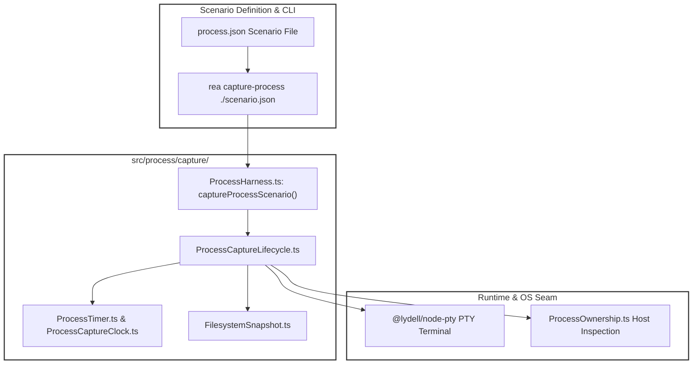
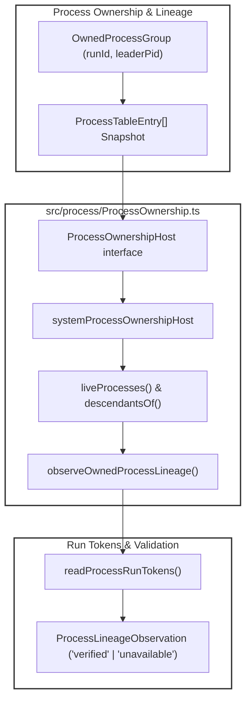
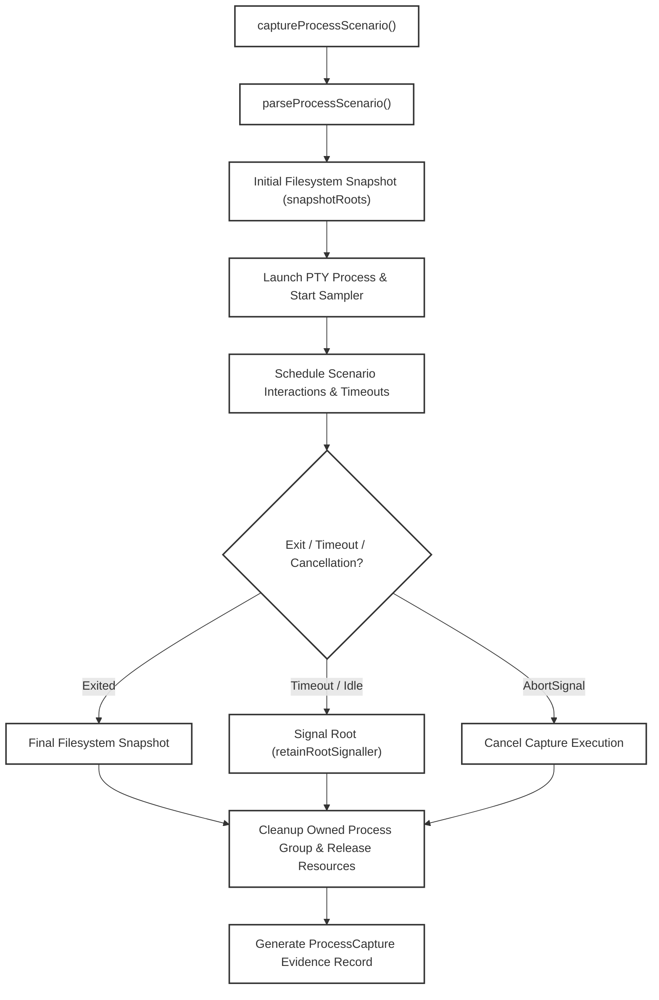

<!-- source: DeepWiki mcp.deepwiki.com · repo morluto/rea · page 7.3 Process Capture and Ownership · fetched 2026-10-16 -->

# Process Capture and Ownership

<details>
<summary>Relevant source files</summary>

The following files were used as context for generating this wiki page:

- [bridge/process/ProcessRunTokenReader.swift](bridge/process/ProcessRunTokenReader.swift)
- [docs/process-capture.md](docs/process-capture.md)
- [experiments/analysis-efficiency/process-trace-validation.md](experiments/analysis-efficiency/process-trace-validation.md)
- [native/windows/README.md](native/windows/README.md)
- [native/windows/src/addon.cc](native/windows/src/addon.cc)
- [native/windows/src/authority.hpp](native/windows/src/authority.hpp)
- [native/windows/src/filesystem.cc](native/windows/src/filesystem.cc)
- [native/windows/src/process.cc](native/windows/src/process.cc)
- [scripts/build-windows-native.mjs](scripts/build-windows-native.mjs)
- [scripts/lib/windows-volume-root-append-lease.mjs](scripts/lib/windows-volume-root-append-lease.mjs)
- [scripts/verify-packaged-wasm-artifact.mjs](scripts/verify-packaged-wasm-artifact.mjs)
- [scripts/verify-packet-capture.mjs](scripts/verify-packet-capture.mjs)
- [scripts/verify-signal-recording.mjs](scripts/verify-signal-recording.mjs)
- [scripts/verify-windows-native-inspection.mjs](scripts/verify-windows-native-inspection.mjs)
- [scripts/verify-windows-native.mjs](scripts/verify-windows-native.mjs)
- [src/android/JadxMcpTransport.ts](src/android/JadxMcpTransport.ts)
- [src/application/ProgressReporter.test.ts](src/application/ProgressReporter.test.ts)
- [src/application/WindowsCapabilities.ts](src/application/WindowsCapabilities.ts)
- [src/application/process/ProcessCli.ts](src/application/process/ProcessCli.ts)
- [src/cli/processCommands.ts](src/cli/processCommands.ts)
- [src/domain/javascript/javascriptAnalysisResourceControls.ts](src/domain/javascript/javascriptAnalysisResourceControls.ts)
- [src/domain/javascript/javascriptApplicationProjectionResources.ts](src/domain/javascript/javascriptApplicationProjectionResources.ts)
- [src/domain/process/processCapture.comparison.test.ts](src/domain/process/processCapture.comparison.test.ts)
- [src/domain/process/processCapture.fixture.ts](src/domain/process/processCapture.fixture.ts)
- [src/domain/process/processCapture.ts](src/domain/process/processCapture.ts)
- [src/domain/process/processCapture.validation.test.ts](src/domain/process/processCapture.validation.test.ts)
- [src/domain/process/processCaptureCoverage.ts](src/domain/process/processCaptureCoverage.ts)
- [src/domain/process/processCaptureExample.ts](src/domain/process/processCaptureExample.ts)
- [src/domain/process/processCaptureParsing.ts](src/domain/process/processCaptureParsing.ts)
- [src/domain/process/processCaptureValidation.ts](src/domain/process/processCaptureValidation.ts)
- [src/domain/process/processComparison.ts](src/domain/process/processComparison.ts)
- [src/domain/process/processObservation.ts](src/domain/process/processObservation.ts)
- [src/domain/process/processScenario.ts](src/domain/process/processScenario.ts)
- [src/domain/process/processTraceAdapters.test.ts](src/domain/process/processTraceAdapters.test.ts)
- [src/domain/process/processTraceComparison.test.ts](src/domain/process/processTraceComparison.test.ts)
- [src/domain/process/processTraceDimensionProjection.ts](src/domain/process/processTraceDimensionProjection.ts)
- [src/domain/process/processTraceEvaluation.ts](src/domain/process/processTraceEvaluation.ts)
- [src/domain/process/processTraceSpecification.test.ts](src/domain/process/processTraceSpecification.test.ts)
- [src/domain/process/processTraceSpecification.ts](src/domain/process/processTraceSpecification.ts)
- [src/domain/reconstructionVerification.test.ts](src/domain/reconstructionVerification.test.ts)
- [src/ghidra/GhidraSessionRoot.test.ts](src/ghidra/GhidraSessionRoot.test.ts)
- [src/ghidra/GhidraSessionRoot.ts](src/ghidra/GhidraSessionRoot.ts)
- [src/javascript/analysis/JavaScriptAnalysisWorker.ts](src/javascript/analysis/JavaScriptAnalysisWorker.ts)
- [src/javascript/analysis/JavaScriptAnalysisWorkerProtocol.ts](src/javascript/analysis/JavaScriptAnalysisWorkerProtocol.ts)
- [src/javascript/analysis/JavaScriptAnalysisWorkerServer.ts](src/javascript/analysis/JavaScriptAnalysisWorkerServer.ts)
- [src/pcap/PcapConfiguration.test.ts](src/pcap/PcapConfiguration.test.ts)
- [src/pcap/PcapOutput.test.ts](src/pcap/PcapOutput.test.ts)
- [src/pcap/PcapOutput.ts](src/pcap/PcapOutput.ts)
- [src/process/DarwinProcessRunTokenReader.ts](src/process/DarwinProcessRunTokenReader.ts)
- [src/process/PrivateRuntimeRoot.ts](src/process/PrivateRuntimeRoot.ts)
- [src/process/ProcessOwnership.identity.test.ts](src/process/ProcessOwnership.identity.test.ts)
- [src/process/ProcessOwnership.observation.test.ts](src/process/ProcessOwnership.observation.test.ts)
- [src/process/ProcessOwnership.part2.test.ts](src/process/ProcessOwnership.part2.test.ts)
- [src/process/ProcessOwnership.test.ts](src/process/ProcessOwnership.test.ts)
- [src/process/ProcessOwnership.ts](src/process/ProcessOwnership.ts)
- [src/process/ProcessOwnership.validation.test.ts](src/process/ProcessOwnership.validation.test.ts)
- [src/process/ProcessOwnershipObservation.ts](src/process/ProcessOwnershipObservation.ts)
- [src/process/ProcessOwnershipProcessTree.ts](src/process/ProcessOwnershipProcessTree.ts)
- [src/process/ProcessRunTokenObservations.ts](src/process/ProcessRunTokenObservations.ts)
- [src/process/ProviderProcess.ts](src/process/ProviderProcess.ts)
- [src/process/ProviderProcessOutput.test.ts](src/process/ProviderProcessOutput.test.ts)
- [src/process/capture/FilesystemCoverage.test.ts](src/process/capture/FilesystemCoverage.test.ts)
- [src/process/capture/FilesystemSnapshot.test.ts](src/process/capture/FilesystemSnapshot.test.ts)
- [src/process/capture/FilesystemSnapshot.ts](src/process/capture/FilesystemSnapshot.ts)
- [src/process/capture/ProcessCaptureError.ts](src/process/capture/ProcessCaptureError.ts)
- [src/process/capture/ProcessCaptureLifecycle.ts](src/process/capture/ProcessCaptureLifecycle.ts)
- [src/process/capture/ProcessCaptureObservation.test.ts](src/process/capture/ProcessCaptureObservation.test.ts)
- [src/process/capture/ProcessCaptureProgress.test.ts](src/process/capture/ProcessCaptureProgress.test.ts)
- [src/process/capture/ProcessCaptureProgress.ts](src/process/capture/ProcessCaptureProgress.ts)
- [src/process/capture/ProcessFilesystemEffects.ts](src/process/capture/ProcessFilesystemEffects.ts)
- [src/process/capture/ProcessHarness.test.ts](src/process/capture/ProcessHarness.test.ts)
- [src/process/capture/ProcessHarness.ts](src/process/capture/ProcessHarness.ts)
- [src/process/capture/ProcessNormalization.test.ts](src/process/capture/ProcessNormalization.test.ts)
- [src/process/capture/ProcessNormalization.ts](src/process/capture/ProcessNormalization.ts)
- [src/process/capture/TerminalRenderer.test.ts](src/process/capture/TerminalRenderer.test.ts)
- [src/process/capture/TerminalRenderer.ts](src/process/capture/TerminalRenderer.ts)
- [src/server/registerProcessComparisonTool.ts](src/server/registerProcessComparisonTool.ts)
- [src/windows/WindowsOwnedProcess.test.ts](src/windows/WindowsOwnedProcess.test.ts)
- [src/windows/WindowsOwnedProcess.ts](src/windows/WindowsOwnedProcess.ts)
- [src/windows/WindowsPrivateRuntime.test.ts](src/windows/WindowsPrivateRuntime.test.ts)
- [src/windows/WindowsPrivateRuntime.ts](src/windows/WindowsPrivateRuntime.ts)
- [tests/acceptance/applications/javascriptCheckpointReserveCli.test.ts](tests/acceptance/applications/javascriptCheckpointReserveCli.test.ts)
- [tests/boundary/android/jadxMcpTransport.test.ts](tests/boundary/android/jadxMcpTransport.test.ts)
- [tests/boundary/javascript/javascriptSourceAnalysisWorker.test.ts](tests/boundary/javascript/javascriptSourceAnalysisWorker.test.ts)
- [tests/boundary/mcp/processComparisonDiagnosticsMcp.test.ts](tests/boundary/mcp/processComparisonDiagnosticsMcp.test.ts)
- [tests/boundary/mcp/processTraceAdaptersParity.test.ts](tests/boundary/mcp/processTraceAdaptersParity.test.ts)
- [tests/boundary/process/darwinProcessRunTokenReader.test.ts](tests/boundary/process/darwinProcessRunTokenReader.test.ts)
- [tests/boundary/process/processCaptureLifecycle.test.ts](tests/boundary/process/processCaptureLifecycle.test.ts)
- [tests/boundary/process/processCaptureNormalization.test.ts](tests/boundary/process/processCaptureNormalization.test.ts)
- [tests/boundary/process/processCaptureProgress.test.ts](tests/boundary/process/processCaptureProgress.test.ts)
- [tests/boundary/process/processFilesystemCoverageAdapters.test.ts](tests/boundary/process/processFilesystemCoverageAdapters.test.ts)
- [tests/boundary/process/processPreparation.test.ts](tests/boundary/process/processPreparation.test.ts)
- [tests/boundary/process/processTruncationAdapters.test.ts](tests/boundary/process/processTruncationAdapters.test.ts)
- [tests/boundary/process/providerProcess.test.ts](tests/boundary/process/providerProcess.test.ts)
- [tests/boundary/providers/RizinInferiorTty.test.ts](tests/boundary/providers/RizinInferiorTty.test.ts)
- [tests/fixtures/filesystemSnapshotFifoProbe.mjs](tests/fixtures/filesystemSnapshotFifoProbe.mjs)
- [tests/fixtures/processCaptureCancellation.mjs](tests/fixtures/processCaptureCancellation.mjs)
- [tests/fixtures/processRunTokenParserProbe.swift](tests/fixtures/processRunTokenParserProbe.swift)
- [tests/fixtures/windows-native-inspection-failure.cc](tests/fixtures/windows-native-inspection-failure.cc)
- [tests/fixtures/windows/processBoundary.cc](tests/fixtures/windows/processBoundary.cc)

</details>


This page details REA's process capture subsystem (`src/process/capture/` [src/process/capture/ProcessHarness.ts:1-77]()), focusing on how it manages process ownership, command identity (`src/process/ProcessOwnership.ts:1-174]()), filesystem snapshots (`src/process/capture/FilesystemSnapshot.ts` [src/process/capture/ProcessCaptureLifecycle.ts:1-53]()), and the lifecycle of captured processes including cancellation, timeout handling, and cleanup. It also covers the specifics of Windows-owned processes and the native addon (`native/windows/` [native/windows/README.md:1-120]()) used for low-level filesystem and process isolation.

## Process Capture Subsystem Overview

The process capture subsystem runs a caller-selected command and records bounded evidence about its terminal behavior, scheduled interactions, process lifetime, and selected filesystem state [docs/process-capture.md:1-14](). It is designed for comparing two direct runs of the same scenario, such as an authority build and a reconstruction. The command runs with the current user's permissions and inherits the host environment before applying explicit scenario overrides [docs/process-capture.md:9-13](). It is not a sandbox; filesystem observation paths select what REA snapshots rather than restricting read/write capabilities [docs/process-capture.md:10-13]().

Capturing new scenarios requires Linux or macOS with a working native PTY backend (`@lydell/node-pty`) [docs/process-capture.md:16-17](). Native Windows capture is unavailable because the PTY adapter does not yet verify descendant process tree cleanup [docs/process-capture.md:18-21](). On macOS, process ownership and inspection require Apple's Swift compiler via `xcrun` to compile a packaged, narrow inspection helper into a temporary directory [docs/process-capture.md:33-39]().

Scenarios are defined through `ProcessScenario` contracts [src/domain/process/processScenario.ts:151-200](), specifying executables, arguments, working directories, environment overrides, filesystem observation paths, terminal buffers, and timed events:

```json
{
  "executable": "node",
  "arguments": ["-e", "console.log('ready')"],
  "working_directory": ".",
  "environment": { "APP_MODE": "test" },
  "filesystem_observation_paths": ["./reports"],
  "terminal": { "columns": 80, "rows": 24, "scrollback": 1000 },
  "events": [
    { "type": "input", "at_ms": 250, "data": "ready\r", "sensitive": false }
  ],
  "timeout_ms": 5000,
  "idle_timeout_ms": 5000,
  "settle_ms": 100
}
```
[docs/process-capture.md:43-52]()

During execution, live progress is emitted to `stderr` as line-delimited JSON objects (`{"rea_progress": {"phase": "running", ...}}`) [docs/process-capture.md:141-152](), while `stdout` produces the final structured evidence document [docs/process-capture.md:144]().



Sources:
- [docs/process-capture.md:1-52]()
- [docs/process-capture.md:141-152]()
- [src/domain/process/processScenario.ts:151-200]()
- [src/process/capture/ProcessHarness.ts:1-77]()

## Process Ownership and Command Identity

REA establishes strict ownership over launched processes to ensure bounded cleanup and prevent interference with unrelated tasks [src/process/ProcessOwnership.ts:15-33](). Ownership is anchored by a `runId` and injected into process environments via `REA_PROCESS_RUN_ID` [src/domain/process/processScenario.ts:17-17]() or verified through token-based inspection.

The `OwnedProcessGroup` interface defines the proof required before REA may signal or clean up a process group [src/process/ProcessOwnership.ts:16-33](). Operating system process table snapshots are normalized into `ProcessTableEntry` records (`pid`, `parentPid`, `processGroupId`, `state`, `command`) [src/process/ProcessOwnership.ts:42-50]().



The `ProcessOwnershipHost` interface abstracts operating-system seams (`listProcesses`, `environment`, `runTokens`, `processIdentities`, `captureBaseline`, `signalGroup`) [src/process/ProcessOwnership.ts:87-112](). `observeOwnedProcessGroups` and `observeOwnedProcessLineage` inspect group health and verify descendant token alignment before taking action [src/process/ProcessOwnershipObservation.ts:23-167]().

Sources:
- [src/domain/process/processScenario.ts:17-17]()
- [src/process/ProcessOwnership.ts:16-112]()
- [src/process/ProcessOwnershipObservation.ts:23-167]()

## Filesystem Snapshots

Filesystem state capture relies on `snapshotRoots()` to record file metadata and contents across specified paths before and after process execution [src/process/capture/FilesystemSnapshot.ts:1-50](). Changes are classified by `classifyFilesystemEffects()` into created, deleted, modified, or unchanged entries [src/process/capture/ProcessFilesystemEffects.ts:1-50]().

Symlinks are recorded without following targets during snapshot collection [docs/process-capture.md:1-120](). Robustness checks ensure that named pipes (FIFOs) or file replacements do not hang snapshot iterations or hashing routines [tests/boundary/process/filesystemSnapshotFifoRace.test.ts:1-50](). Independent hash budgets (`file_bytes`) allow full-file SHA-256 computation even when terminal text streams are truncated [docs/process-capture.md:100-127]().

Sources:
- [docs/process-capture.md:100-127]()
- [src/process/capture/FilesystemSnapshot.ts:1-50]()
- [src/process/capture/ProcessFilesystemEffects.ts:1-50]()
- [tests/boundary/process/filesystemSnapshotFifoRace.test.ts:1-50]()

## Cancellation and Lifecycle

The `captureProcessScenario()` runner manages the execution lifecycle, coordinating timeout monitors (`ProcessTimer`), process samplers, terminal recording, and cleanup phases [src/process/capture/ProcessHarness.ts:1-922]().



Cancellation signals via `AbortSignal` are monitored across filesystem snapshot operations and PTY event loops using `assertNotCancelled()` [src/process/capture/ProcessScenarioRuntimeValidation.ts:1-50](). If a timeout occurs, `retainRootSignaller` binds to the root start identity before sending termination signals (`SIGTERM`/`SIGKILL`) [src/process/capture/ProcessHarness.ts:101-158]().

Sources:
- [src/process/capture/ProcessHarness.ts:1-158]()
- [src/process/capture/ProcessHarness.ts:1-922]()

## Windows Owned Processes and Native Addon

On Windows x64 hosts, REA utilizes a Node-API 8 native addon (`native/windows/`) to enforce security boundaries and handle process/filesystem tasks [native/windows/README.md:1-120]().

- **Filesystem Admittance**: The native loader checks manifest versions, ABIs, and SHA-256 digests [native/windows/README.md:1-10]() before granting authority. `openFile()` validates absolute local NTFS drive paths, opening components with `FILE_FLAG_OPEN_REPARSE_POINT` and `FILE_FLAG_BACKUP_SEMANTICS` while rejecting reparse points and alternate streams [native/windows/src/filesystem.cc:1-100]().
- **Job Objects**: Child processes are assigned atomically to an unnamed, non-inherited Job Object via `PROC_THREAD_ATTRIBUTE_JOB_LIST` with kill-on-close policy enabled and breakaway disabled [native/windows/README.md:73-76](). A private I/O completion port monitors memory limits (`JOB_OBJECT_LIMIT_JOB_MEMORY`) and peak usage [native/windows/README.md:77-93]().
- **Cleanup Semantics**: Cleanup walks locked directories, removes files by handle, and unlinks reparse entries without target traversal, retrying Win32 sharing/lock codes (32/33) up to ten times with a 100 ms backoff [native/windows/README.md:111-120]().

Sources:
- [native/windows/README.md:1-120]()
- [native/windows/src/filesystem.cc:1-100]()
- [scripts/verify-windows-native.mjs:1-100]()

---

