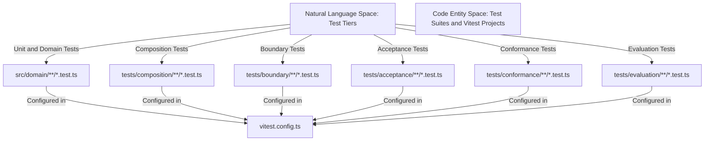
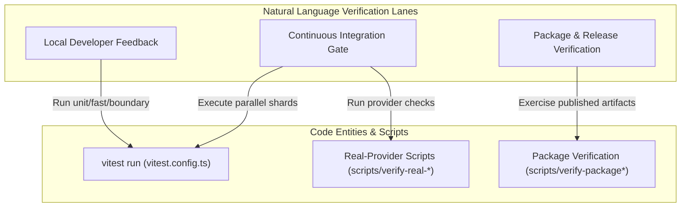

<!-- source: DeepWiki mcp.deepwiki.com · repo morluto/rea · page 8 Testing and Verification · fetched 2026-10-16 -->

# Testing and Verification

Relevant source files

The following files were used as context for generating this wiki page:

- [.github/workflows/ci.yml](.github/workflows/ci.yml)
- [.github/workflows/release.yml](.github/workflows/release.yml)
- [.gitignore](.gitignore)
- [AGENTS.md](AGENTS.md)
- [CONTRIBUTING.md](CONTRIBUTING.md)
- [docs/releasing.md](docs/releasing.md)
- [docs/testing.md](docs/testing.md)
- [docs/tool-design.md](docs/tool-design.md)
- [scripts/ci/plan.mjs](scripts/ci/plan.mjs)
- [scripts/ci/scopes.mjs](scripts/ci/scopes.mjs)
- [scripts/generate-mcp-tool-catalog.mjs](scripts/generate-mcp-tool-catalog.mjs)
- [scripts/lib/release-checkpoint.mjs](scripts/lib/release-checkpoint.mjs)
- [scripts/verify-release-checkpoint.mjs](scripts/verify-release-checkpoint.mjs)
- [tests/boundary/filesystem/ciChangeScope.test.ts](tests/boundary/filesystem/ciChangeScope.test.ts)
- [tests/boundary/filesystem/ciRequiredLanes.test.ts](tests/boundary/filesystem/ciRequiredLanes.test.ts)
- [tests/boundary/filesystem/releaseCheckpoint.test.ts](tests/boundary/filesystem/releaseCheckpoint.test.ts)
- [tests/boundary/filesystem/releaseWorkflow.test.ts](tests/boundary/filesystem/releaseWorkflow.test.ts)
- [tests/boundary/filesystem/staticTaskCache.test.ts](tests/boundary/filesystem/staticTaskCache.test.ts)
- [tests/support/workflowGit.ts](tests/support/workflowGit.ts)
- [tsconfig.build.json](tsconfig.build.json)
- [tsconfig.json](tsconfig.json)
- [turbo.json](turbo.json)
- [vitest.config.ts](vitest.config.ts)

REA employs a comprehensive testing and verification strategy to ensure correctness and robustness across its layered architecture. This strategy encompasses a variety of test tiers, simulated environments with fakes and fixtures, real-provider verification workflows, and analysis efficiency evaluations. The approach balances fast local feedback with trustworthy end-to-end validation involving production tools like Hopper and Ghidra.

---

## Test Strategy Overview

The testing approach spans these core tiers:

- **Boundary Tests:** Verify exactly one real production boundary such as filesystem, process, network, browser, CLI, or provider. This includes MCP transport-level boundaries exercised in isolated, in-memory sessions with explicit cleanup [docs/testing.md:18-21]().
- **Composition Tests:** Assemble provider-neutral sessions and registries, exercising application-layer wiring without crossing real external boundaries [docs/testing.md:18-21]().
- **Unit Tests (Module Tests):** Test a single domain, service, or adapter module’s public surface in isolation without constructing sessions or launching subprocesses [docs/testing.md:18-21]().
- **Acceptance Tests:** Exercise compiled CLI or MCP journeys, invoking integrated or injected providers to validate real usage scenarios end-to-end [docs/testing.md:20-22]().
- **Conformance Tests:** Use source-built, capability-parameterized shared corpora for diverse target formats like C, ObjC, Swift, napi, Ghidra, IDA, and native code. These check contract compliance, replay logic, and trust gates [docs/testing.md:18-21]().
- **Evaluation Tests:** Verify deterministic evaluator parsing, scoring, and analytical report generation [docs/testing.md:18-21]().

Sources: `docs/testing.md:1-100`

---

### Testing Tiers and Code Entities

Sources: `vitest.config.ts:35-99`, `docs/testing.md:1-100`

---

## Vitest Testing Configuration and Execution

Vitest drives the deterministic automated tests, with configuration in `vitest.config.ts` setting up projects like `domain`, `services`, `adapters`, `composition`, `boundary`, `cli-boundary`, `process-boundary`, `mcp-boundary`, `acceptance`, `process-global`, `conformance`, and `evaluation` [vitest.config.ts:35-99]().

| Tier | Location Pattern | Isolation Type | Max Workers | Notes |
|---|---|---|---|---|
| domain | `src/{contracts,domain}/**/*.test.ts` | threads | ≤2 | Pure, provider-neutral code, no process-global state [vitest.config.ts:37-43]() |
| services | `src/application/**/*.test.ts` | threads | ≤2 | Uses recording ports; no process-global state [vitest.config.ts:44-50]() |
| adapters | `src/*.test.ts`, `src/{artifacts,browser,...}/**/*.test.ts` | forks | ≤2 | Covers provider adapters and boundary layers [vitest.config.ts:51-51]() |
| composition | `tests/composition/**/*.test.ts` | threads | ≤2 | Provider-neutral session and registry wiring [vitest.config.ts:52-58]() |
| boundary | `tests/boundary/**/*.test.ts` | forks | ≤2 | Focuses on a single production boundary [vitest.config.ts:59-59]() |
| cli-boundary | `tests/boundary/cli/**/*.test.ts` | forks | ≤2 | CLI command and process checks [vitest.config.ts:60-69]() |
| process-boundary | `tests/boundary/process/**/*.test.ts` | forks | ≤2 | Serialized lane due to shared host sampling resources [vitest.config.ts:70-77]() |
| mcp-boundary | `tests/boundary/mcp/**/*.test.ts` | threads | ≤2 | Each file manages in-memory MCP session lifecycle [vitest.config.ts:78-84]() |
| acceptance | `tests/acceptance/**/*.test.ts` | forks | ≤2 | Exercises compiled CLI or MCP journeys [vitest.config.ts:85-85]() |
| process-global | `tests/process-global/**/*.test.ts` | forks | ≤2 | For tests with process-global state dependencies [vitest.config.ts:86-86]() |
| conformance | `tests/conformance/**/*.test.ts` | threads | ≤2 | Uses source-built conformance input corpora [vitest.config.ts:87-92]() |
| evaluation | `tests/evaluation/**/*.test.ts` | threads | ≤2 | Deterministic evaluator and scoring tests [vitest.config.ts:93-98]() |

Sources: `vitest.config.ts:33-146`, `docs/testing.md:13-28`

---

### Test Orchestration and Verification Flow

Sources: `docs/testing.md:8-27`, `vitest.config.ts:136-182`

---

## Fake and Fixture Usage

To support fast and deterministic test runs, REA uses fakes and fixtures extensively:
- **Fake Provider Seams:** Simulating provider backends (`fakeHopper`, `fakeGhidra`, `fakeCdpBrowser`) for boundary and composition tests without launching real external processes.
- **Fixtures:** Maintained static corpora (decompiled binaries, JavaScript/Electron app snapshots, managed assembly fixtures).
- **MCP Harnesses:** In-memory client-server exchange simulation at the protocol layer.

For details, see [Unit, Boundary and Composition Tests](#8.1).
Sources: `docs/testing.md:1-40`

---

## Conformance Fixtures and Trust Gates

REA validates parser and analyzer correctness against source-built conformance corpora across languages (C, ObjC, Swift, napi, ghidra, ida, native). These exercise build/verify fixture scripts, conformance replay, and trust gate logic.

For details, see [Conformance Fixtures and Trust Gates](#8.2).
Sources: `docs/testing.md:18-21`

---

## Real-Provider and Package Verification

Beyond simulated environments, REA verifies critical paths using real toolchains and package installation checks:
- **Real-Provider Verifiers:** Scripts like `scripts/verify-real-hopper`, `verify-real-ghidra`, `verify-real-browser`, `verify-native-ui`, and `verify-windows-native`.
- **Package Verification Family:** `verify-package*` scripts validating installation, environment, artifacts, managed components, prompts, and published packages.

For details, see [Real-Provider and Package Verification](#8.3).
Sources: `docs/testing.md:83-86`, `CONTRIBUTING.md:15-18`

---

## Analysis Efficiency Experiments and Evaluations

REA measures and evaluates agent analysis effectiveness using the `experiments/analysis-efficiency` corpus, measure/compare harnesses, agent trial scripts, and `tests/evaluation` model evaluations.

For details, see [Analysis Efficiency Experiments and Evaluations](#8.4).
Sources: `docs/testing.md:22`

---

## Continuous Integration and Quality Gates

REA’s CI pipeline (`.github/workflows/ci.yml`) and Turborepo task graph (`turbo.json`) coordinate static checks (oxlint, knip, jscpd, todo scanning), parallel Vitest shards, typechecking, build generation, conformance validation, and package end-to-end smoke testing [.github/workflows/ci.yml:33-116](). Task caching rules are defined in `turbo.json` [turbo.json:1-150]().

Sources: `.github/workflows/ci.yml:33-116`, `turbo.json:1-150`

---

## Further Reading

For detailed guides on each test tier and verification suite, see:

- [Unit, Boundary and Composition Tests](#8.1) — Vitest setup, boundary tests against fake seams (`fakeHopper`, `fakeGhidra`, `fakeCdpBrowser`, jadx fixtures), MCP harnesses, contract snapshot and schema validity tests.
- [Conformance Fixtures and Trust Gates](#8.2) — Source-built conformance corpora (C, ObjC, Swift, napi, ghidra, ida, native), build/verify fixture scripts, conformance replay and trust gate logic, managed conformance manifest.
- [Real-Provider and Package Verification](#8.3) — `scripts/verify-real-hopper`, `verify-real-ghidra`, `verify-real-browser`, `verify-native-ui`, `verify-windows-native`, and the `verify-package*` family.
- [Analysis Efficiency Experiments and Evaluations](#8.4) — The `experiments/analysis-efficiency` corpus, measure/compare harnesses, agent trial scripts, and `tests/evaluation` model evals.

Sources: `docs/testing.md:1-106`, `vitest.config.ts:1-182`

---

