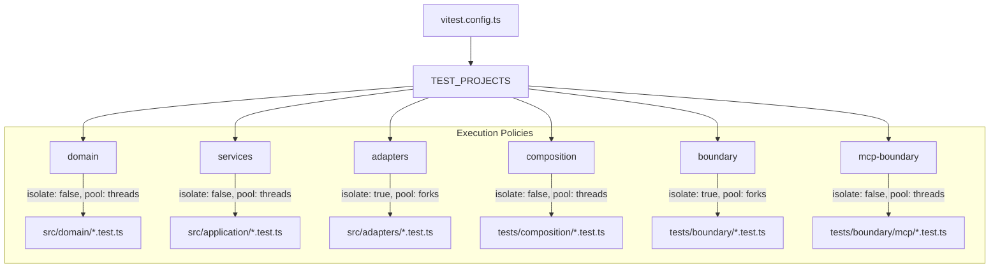
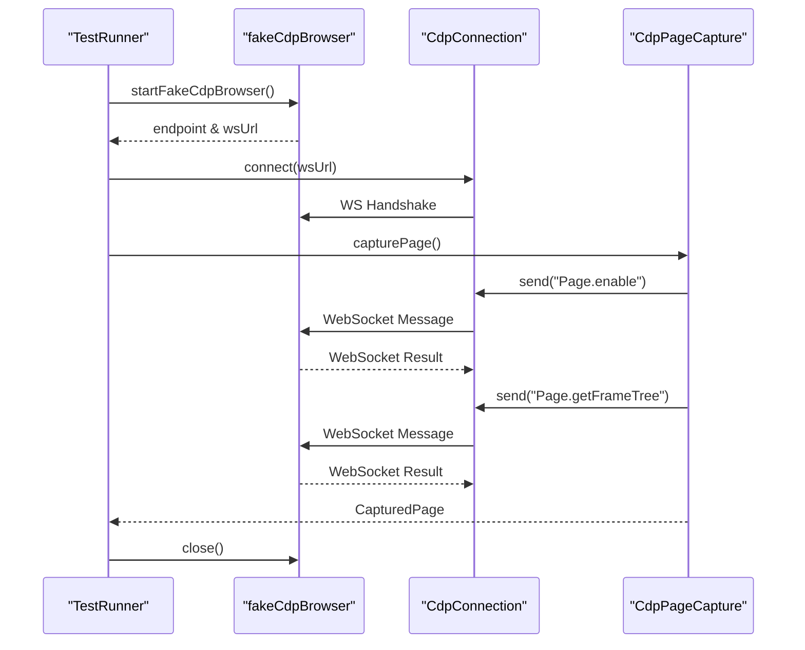
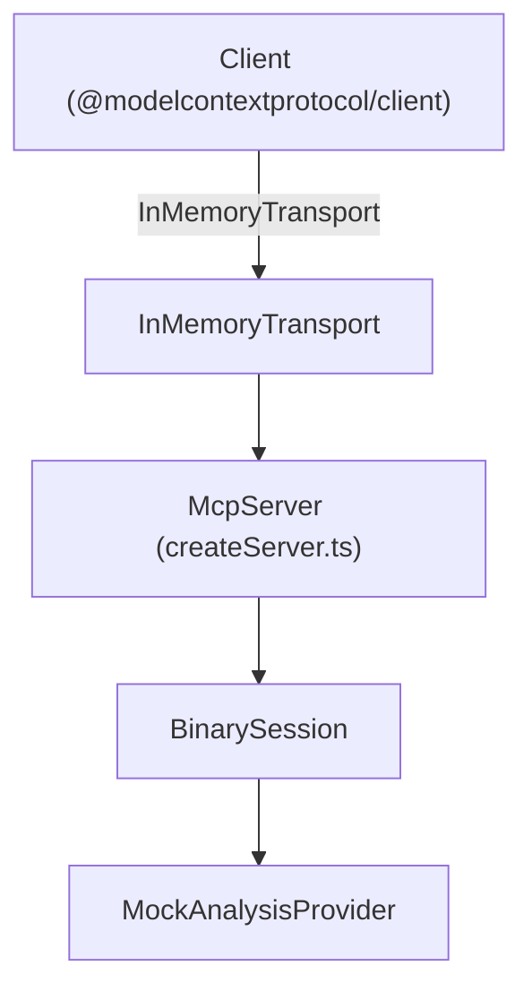

<!-- source: DeepWiki mcp.deepwiki.com · repo morluto/rea · page 8.1 Unit, Boundary and Composition Tests · fetched 2026-10-16 -->

# Unit, Boundary and Composition Tests

Relevant source files

The following files were used as context for generating this wiki page:

- [.gitignore](.gitignore)
- [.husky/pre-commit](.husky/pre-commit)
- [.husky/pre-push](.husky/pre-push)
- [.oxlintrc.json](.oxlintrc.json)
- [docs/mcp-contracts.md](docs/mcp-contracts.md)
- [knip.json](knip.json)
- [scripts/generate-mcp-tool-catalog.mjs](scripts/generate-mcp-tool-catalog.mjs)
- [scripts/lib/module-boundaries.d.mts](scripts/lib/module-boundaries.d.mts)
- [scripts/lib/module-boundaries.mjs](scripts/lib/module-boundaries.mjs)
- [scripts/scan-todos.mjs](scripts/scan-todos.mjs)
- [scripts/verify-gemini-client.mjs](scripts/verify-gemini-client.mjs)
- [scripts/verify/clients/gemini-model-fixture.mjs](scripts/verify/clients/gemini-model-fixture.mjs)
- [src/contracts/inputSchemaPresentation.ts](src/contracts/inputSchemaPresentation.ts)
- [src/contracts/toolInputReferences.test.ts](src/contracts/toolInputReferences.test.ts)
- [src/contracts/toolOutputReferences.test.ts](src/contracts/toolOutputReferences.test.ts)
- [src/contracts/toolSchemaMetadata.ts](src/contracts/toolSchemaMetadata.ts)
- [src/hopper/HopperProvider.test.ts](src/hopper/HopperProvider.test.ts)
- [src/server/toolRegistrationOptions.ts](src/server/toolRegistrationOptions.ts)
- [tests/boundary/mcp/browserComparisonInput.test.ts](tests/boundary/mcp/browserComparisonInput.test.ts)
- [tests/boundary/mcp/compactInputSchemaMcp.test.ts](tests/boundary/mcp/compactInputSchemaMcp.test.ts)
- [tests/boundary/mcp/outputSchemaSemanticConstraints.test.ts](tests/boundary/mcp/outputSchemaSemanticConstraints.test.ts)
- [tests/boundary/mcp/outputValidatorReuse.test.ts](tests/boundary/mcp/outputValidatorReuse.test.ts)
- [tests/boundary/mcp/toolSchemaValidity.test.ts](tests/boundary/mcp/toolSchemaValidity.test.ts)
- [tests/evaluation/moduleBoundaries.test.ts](tests/evaluation/moduleBoundaries.test.ts)
- [tests/fixtures/mcpClientSchemaConstraints.ts](tests/fixtures/mcpClientSchemaConstraints.ts)
- [tsconfig.build.json](tsconfig.build.json)
- [tsconfig.json](tsconfig.json)
- [vitest.config.ts](vitest.config.ts)

This page details the setup and strategy for unit, boundary, and composition tests within the REA codebase. These tests ensure the correctness of individual components, the integrity of module boundaries, and the proper orchestration of multiple components. The focus is on Vitest configuration, testing against fake seams (`fakeHopper`, `fakeGhidra`, `fakeCdpBrowser`, JADX fixtures), MCP harnesses, contract snapshots, and schema validity tests.

## Vitest Configuration and Test Tiers

The REA test suite runs on **Vitest** and is partitioned into distinct "projects" or tiers, each configured with dedicated `include` patterns, worker pools, and isolation settings to optimize performance and prevent state pollution [vitest.config.ts:1-182]().

The test runner defines the following projects in `vitest.config.ts`:
- `domain`: Pure domain and contract modules [vitest.config.ts:37-43]().
- `services`: Application layer services using recording ports [vitest.config.ts:44-50]().
- `adapters`: Tests for provider adapters [vitest.config.ts:51]() (using process forks).
- `composition`: Component assembly tests [vitest.config.ts:52-58]().
- `boundary`: External seam boundary tests [vitest.config.ts:59]().
- `process-boundary`: Serialized process-tree observation tests [vitest.config.ts:70-77]().
- `mcp-boundary`: MCP session boundary tests [vitest.config.ts:78-84]().
- `acceptance`: End-to-end user journey validation [vitest.config.ts:85]().
- `process-global`: Global state regression checks [vitest.config.ts:86]().
- `conformance`: Tests against known-good binaries [vitest.config.ts:87-92]().
- `evaluation`: Architectural constraint and code quality checks [vitest.config.ts:93-98]().

Pool types alternate between `threads` (e.g., for pure domain logic with `isolate: false`) and `forks` (e.g., for process-isolated adapters and boundaries) [vitest.config.ts:37-99]().

### Vitest Project Architecture

Sources: [vitest.config.ts:35-99]()

## Boundary Tests Against Fake Seams

Boundary tests verify interactions with external binary analysis suites and runtimes through mock fixtures and fake servers.

### Fake CDP Browser (`fakeCdpBrowser`)
The CDP test harness simulates a Chrome DevTools Protocol target by spinning up a local HTTP and WebSocket server. This allows `CdpConnection` and `CdpPageCapture` to be tested without invoking a real browser instance [tests/fixtures/fakeCdpBrowser.ts]().
- **HTTP Seam**: Exposes endpoints like `/json/version` and `/json/list` [tests/fixtures/fakeCdpBrowser.ts:44-71]().
- **WebSocket Seam**: Intercepts command messages, records interactions, and emits configured responses or asynchronous protocol events [tests/fixtures/fakeCdpBrowser.ts:88-151]().

### Hopper and Ghidra Seams
- **`fakeHopper` / `fakeGhidra`**: These providers simulate Unix-socket NDJSON communication and headless Java bridge interactions, verifying queue management, reconnection strategies, and protocol error mapping.
- **JADX Fixtures**: APK analysis tests utilize mocked APK structure outputs to exercise `JadxProvider` workflows without requiring an external JADX binary on the host.

### Fake CDP Browser Interaction

Sources: [tests/fixtures/fakeCdpBrowser.ts:16-162](), [src/browser/CdpPageCapture.ts:69-95]()

## MCP Harnesses

MCP integration tests use an in-memory transport to exercise the REA server implementation (`createServer`) and client message flow concurrently.

The `createSessionMcpHarness` function [tests/boundary/mcp/sessionMcpHarness.ts]() instantiates:
- An isolated temporary directory for target binaries [tests/boundary/mcp/sessionMcpHarness.ts:15-25]().
- A `TestBinarySession` backed by a mock analysis provider [tests/boundary/mcp/sessionMcpHarness.ts:26-32]().
- An `@modelcontextprotocol/server` instance and an `@modelcontextprotocol/client` connected via `InMemoryTransport` [tests/boundary/mcp/sessionMcpHarness.ts:33-40]().

This harness executes complete discovery and control flows, such as calling `open_binary`, querying `binary_session`, invoking analysis actions, and managing evidence records.

### MCP Harness Architecture

Sources: [tests/boundary/mcp/sessionMcpHarness.ts:15-40](), [scripts/generate-mcp-tool-catalog.mjs:65-87]()

## Contract Snapshot and Schema Validity Tests

REA enforces rigid JSON Schema compliance for its tools using `ajv` (Ajv2020) and standard Zod integrations [tests/boundary/mcp/toolSchemaValidity.test.ts:1-64]().

### Schema Validation & Metadata
- **`toolInputSchemaWithMetadata` & `toolOutputSchemaWithMetadata`**: Wrap canonical Zod schemas to inject specialized property descriptions, examples, and wire representations [src/contracts/toolSchemaMetadata.ts:56-109]().
- **Tool Authority Hints**: `toolSchemaValidity.test.ts` validates that tools like `read_bytes`, `annotate_native_function`, `open_binary`, and `start_gdb_session` carry the correct authority annotations (`readOnlyHint`, `destructiveHint`, `idempotentHint`, `openWorldHint`) [tests/boundary/mcp/toolSchemaValidity.test.ts:98-184]().
- **Draft Compliance**: Generated JSON schemas are compiled and validated against the JSON Schema Draft 2020-12 specification using `Ajv2020` [tests/boundary/mcp/toolSchemaValidity.test.ts:28-64]().

### Module Boundary Enforcement
Architectural boundaries are protected by automated inspection tests (`tests/evaluation/moduleBoundaries.test.ts`) that utilize `scripts/lib/module-boundaries.mjs` to reject prohibited cross-layer imports (e.g., domain modules importing server adapters or application runtime dependencies) [tests/evaluation/moduleBoundaries.test.ts:1-171]().

Sources: [tests/boundary/mcp/toolSchemaValidity.test.ts:1-184](), [src/contracts/toolSchemaMetadata.ts:56-159](), [tests/evaluation/moduleBoundaries.test.ts:1-171]()

---

