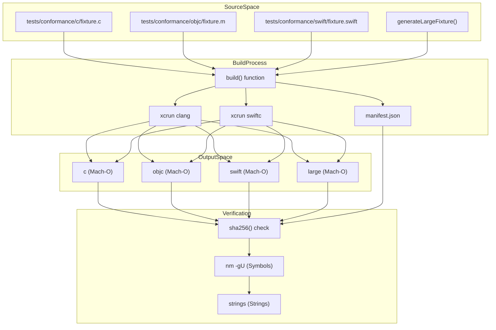
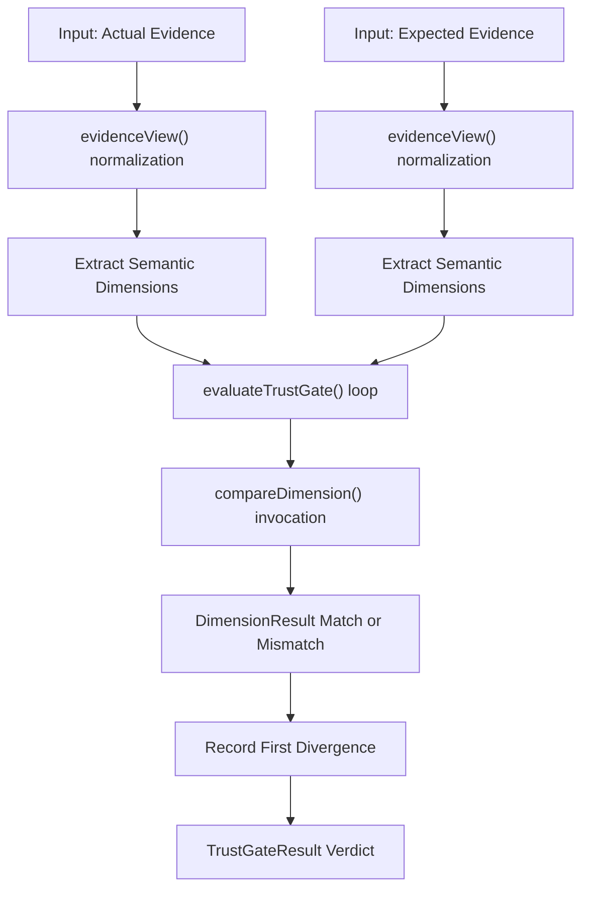
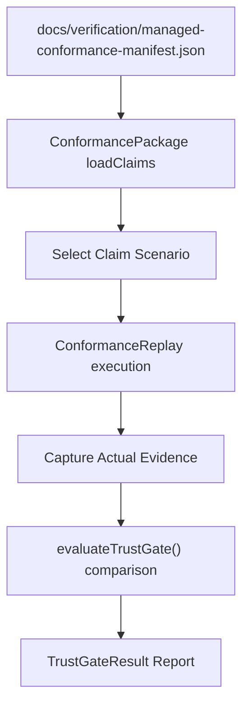

<!-- source: DeepWiki mcp.deepwiki.com · repo morluto/rea · page 8.2 Conformance Fixtures and Trust Gates · fetched 2026-10-16 -->

# Conformance Fixtures and Trust Gates

Relevant source files

The following files were used as context for generating this wiki page:

- [.github/workflows/ci-full-pr.yml](.github/workflows/ci-full-pr.yml)
- [.github/workflows/ci.yml](.github/workflows/ci.yml)
- [.github/workflows/pr-title.yml](.github/workflows/pr-title.yml)
- [.github/workflows/release.yml](.github/workflows/release.yml)
- [AGENTS.md](AGENTS.md)
- [CONTRIBUTING.md](CONTRIBUTING.md)
- [docs/ghidra-mips.md](docs/ghidra-mips.md)
- [docs/releasing.md](docs/releasing.md)
- [docs/testing.md](docs/testing.md)
- [docs/tool-design.md](docs/tool-design.md)
- [scripts/ci/plan.mjs](scripts/ci/plan.mjs)
- [scripts/ci/scopes.mjs](scripts/ci/scopes.mjs)
- [scripts/lib/clean-linux-hopper-runtime.d.mts](scripts/lib/clean-linux-hopper-runtime.d.mts)
- [scripts/lib/clean-linux-hopper-runtime.mjs](scripts/lib/clean-linux-hopper-runtime.mjs)
- [scripts/lib/real-hopper-boundaries.mjs](scripts/lib/real-hopper-boundaries.mjs)
- [scripts/lib/real-hopper-search.d.mts](scripts/lib/real-hopper-search.d.mts)
- [scripts/lib/real-hopper-search.mjs](scripts/lib/real-hopper-search.mjs)
- [scripts/lib/real-hopper-semantic.mjs](scripts/lib/real-hopper-semantic.mjs)
- [scripts/lib/real-hopper-session-isolation.mjs](scripts/lib/real-hopper-session-isolation.mjs)
- [scripts/lib/release-checkpoint.mjs](scripts/lib/release-checkpoint.mjs)
- [scripts/verify-linux-setup-e2e.mjs](scripts/verify-linux-setup-e2e.mjs)
- [scripts/verify-real-ghidra-mips.mjs](scripts/verify-real-ghidra-mips.mjs)
- [scripts/verify-real-hopper.mjs](scripts/verify-real-hopper.mjs)
- [scripts/verify-release-checkpoint.mjs](scripts/verify-release-checkpoint.mjs)
- [src/application/MipsElfMetadata.ts](src/application/MipsElfMetadata.ts)
- [src/domain/ghidraValues.fixture.ts](src/domain/ghidraValues.fixture.ts)
- [src/ghidra/GhidraMipsProfile.test.ts](src/ghidra/GhidraMipsProfile.test.ts)
- [src/ghidra/GhidraMipsProfile.ts](src/ghidra/GhidraMipsProfile.ts)
- [tests/boundary/evm/solidityMetadataWorker.test.ts](tests/boundary/evm/solidityMetadataWorker.test.ts)
- [tests/boundary/filesystem/ciChangeScope.test.ts](tests/boundary/filesystem/ciChangeScope.test.ts)
- [tests/boundary/filesystem/ciPrEvents.test.ts](tests/boundary/filesystem/ciPrEvents.test.ts)
- [tests/boundary/filesystem/ciRequiredLanes.test.ts](tests/boundary/filesystem/ciRequiredLanes.test.ts)
- [tests/boundary/filesystem/mipsAbiFlags.test.ts](tests/boundary/filesystem/mipsAbiFlags.test.ts)
- [tests/boundary/filesystem/mipsSharedLoad.test.ts](tests/boundary/filesystem/mipsSharedLoad.test.ts)
- [tests/boundary/filesystem/releaseCheckpoint.test.ts](tests/boundary/filesystem/releaseCheckpoint.test.ts)
- [tests/boundary/filesystem/releaseWorkflow.test.ts](tests/boundary/filesystem/releaseWorkflow.test.ts)
- [tests/boundary/filesystem/staticTaskCache.test.ts](tests/boundary/filesystem/staticTaskCache.test.ts)
- [tests/boundary/providers/hopper/bridgeTargetLease.integration.test.ts](tests/boundary/providers/hopper/bridgeTargetLease.integration.test.ts)
- [tests/boundary/providers/hopper/hopperBridgeFacade.test.ts](tests/boundary/providers/hopper/hopperBridgeFacade.test.ts)
- [tests/conformance/c/fixture.c](tests/conformance/c/fixture.c)
- [tests/conformance/ghidra/mips-checks.d.mts](tests/conformance/ghidra/mips-checks.d.mts)
- [tests/conformance/ghidra/mips-checks.mjs](tests/conformance/ghidra/mips-checks.mjs)
- [tests/conformance/ghidra/mips-checks.test.ts](tests/conformance/ghidra/mips-checks.test.ts)
- [tests/conformance/ghidra/mips-fixture.mjs](tests/conformance/ghidra/mips-fixture.mjs)
- [tests/conformance/ghidra/psp-checks.test.ts](tests/conformance/ghidra/psp-checks.test.ts)
- [tests/conformance/ghidra/psp-fixture.d.mts](tests/conformance/ghidra/psp-fixture.d.mts)
- [tests/conformance/ghidra/psp-fixture.mjs](tests/conformance/ghidra/psp-fixture.mjs)
- [tests/conformance/objc/fixture.m](tests/conformance/objc/fixture.m)
- [tests/conformance/providers/hopper/realHopperSearch.test.ts](tests/conformance/providers/hopper/realHopperSearch.test.ts)
- [tests/fixtures/hopperBridgeFacadeProbe.py](tests/fixtures/hopperBridgeFacadeProbe.py)
- [tests/process-global/cleanLinuxHopperRuntime.test.ts](tests/process-global/cleanLinuxHopperRuntime.test.ts)
- [tests/support/workflowGit.ts](tests/support/workflowGit.ts)
- [turbo.json](turbo.json)

This page details REA's conformance fixture system, which provides source-built corpora for various languages (C, Objective-C, Swift, NAPI) and analysis targets (Ghidra, IDA, native binaries). It covers the build and verification scripts, the logic for conformance replay, and the trust gate mechanisms that ensure the reliability and consistency of analysis results.

## Source-Built Conformance Corpora

The REA conformance fixture system provides a set of source-built binaries that serve as semantic oracles for testing REA providers (such as the Hopper Bridge) [tests/conformance/README.md:1-6](). These fixtures ensure that tool outputs for symbols, strings, and cross-references remain consistent across toolchain versions and platform updates.

Sources: [tests/conformance/README.md:1-6]()

## System Architecture

The fixture system consists of versioned source code, a generation script, and a verification script that uses native tools (`nm`, `strings`, `file`) to validate the resulting artifacts [scripts/verify-conformance-fixtures.mjs:22-30]().

### Data Flow: Source to Verified Artifact

The following diagram illustrates how source files are transformed into compiled binaries and validated against a manifest, bridging natural language concepts to code entities like `build()` and `verifyConformanceFixture()`.

**Fixture Compilation and Validation Flow**

Sources: [scripts/build-conformance-fixtures.mjs:42-177](), [scripts/verify-conformance-fixtures.mjs:17-49](), [tests/conformance/README.md:3-9]()

## Fixture Categories

REA maintains several categories of fixtures to exercise different aspects of the analysis engine:

| Fixture Name | Language | Purpose | Key Expectations |
| :--- | :--- | :--- | :--- |
| `c` | C | Basic call graph and global variable analysis | `_rea_entry`, `_rea_branch`, `_rea_leaf` [scripts/build-conformance-fixtures.mjs:48-49]() |
| `objc` | Objective-C | Class, protocol, and selector metadata | `_OBJC_CLASS_$_REAWidget`, `REAWidgetDelegate` [scripts/build-conformance-fixtures.mjs:117-118]() |
| `swift` | Swift | Mangled names, protocols, and structs | `REAService`, `REAProtocol`, `REARecord` [scripts/build-conformance-fixtures.mjs:161-167]() |
| `napi` | C | Node.js native addon symbol patterns | `_napi_register_module_v1`, `reaProbeOne` [scripts/build-conformance-fixtures.mjs:136-137]() |
| `large` | C (Generated) | Pagination boundary testing (1,205 functions) | `_rea_page_0000` to `_rea_page_1204` [scripts/lib/conformance-fixtures.mjs:3-15]() |
| `version-v1/v2` | C | Diffing and versioned analysis | Added symbol `_rea_added` in v2 [scripts/build-conformance-fixtures.mjs:80]() |

Sources: [scripts/build-conformance-fixtures.mjs:42-172](), [tests/conformance/README.md:11-16]()

## Build Implementation

The build process is managed by `scripts/build-conformance-fixtures.mjs`. It uses build tools to compile sources with flags that disable optimizations and inlining, ensuring the resulting binary structure matches the source intent [scripts/build-conformance-fixtures.mjs:27-39]().

### Key Functions

- **`build(name, sources, args, options)`**: The core compilation wrapper. It reads source contents, executes the compiler, calculates SHA-256 hashes for both source and artifact, and appends metadata to the manifest [scripts/build-conformance-fixtures.mjs:194-223]().
- **`sourceDigest(sources)`**: Generates a deterministic hash of all source files involved in a fixture by sorting them by path before hashing [scripts/lib/conformance-fixtures.mjs:24-30](). This ensures that input ordering does not affect the digest [tests/conformance/providers/conformanceFixtures.test.ts:16]().

Sources: [scripts/build-conformance-fixtures.mjs:194-223](), [scripts/lib/conformance-fixtures.mjs:24-30](), [tests/conformance/providers/conformanceFixtures.test.ts:16]()

## Pagination Boundary Testing (`large.c`)

The `large` fixture is generated programmatically to contain exactly 1,205 functions and strings [scripts/lib/conformance-fixtures.mjs:3-8](). This specific number is chosen to test pagination boundaries for providers that might default to 500 or 1,000 items per request [tests/conformance/README.md:12-14]().

- **Generation**: The `generateLargeFixture` function creates `rea_inventory_NNNN` functions, each containing a unique string and returning its index [scripts/lib/conformance-fixtures.mjs:18-23]().
- **Verification**: `scripts/verify-conformance-fixtures.mjs` uses `verifyCount` to ensure the compiled binary contains the expected occurrences of prefixes in its symbol table and string sections [scripts/verify-conformance-fixtures.mjs:59-68]().

Sources: [scripts/lib/conformance-fixtures.mjs:8-23](), [scripts/verify-conformance-fixtures.mjs:37-48](), [tests/conformance/providers/conformanceFixtures.test.ts:11-16]()

## Verification Logic

The `scripts/verify-conformance-fixtures.mjs` script performs post-build validation to ensure the environment is correctly producing valid binaries [scripts/verify-conformance-fixtures.mjs:23-24]().

Sources: [scripts/verify-conformance-fixtures.mjs:23-24]()

## Versioning and Manifests

Only source files are versioned in the repository. The build output directory, including the manifest, is ignored by version control and must be generated locally [tests/conformance/README.md:8-9]().

The manifest includes:
- **`schemaVersion`**: The schema version identifier [scripts/build-conformance-fixtures.mjs:180]().
- **`platform` & `architecture`**: Captures the environment where fixtures were built [scripts/build-conformance-fixtures.mjs:181-182]().
- **`compiler` metadata**: Stores the path, version, and exact arguments used for every fixture [scripts/build-conformance-fixtures.mjs:220]().
- **`artifactSha256`**: Used to verify that the binary on disk matches the one recorded at build time [scripts/build-conformance-fixtures.mjs:214]().

Sources: [scripts/build-conformance-fixtures.mjs:179-192](), [scripts/verify-conformance-fixtures.mjs:12-14](), [tests/conformance/README.md:4-9]()

## Conformance Replay and Trust Gates

REA employs a conformance replay and trust gate system to validate the output of its analysis providers. This system ensures that results produced by various tools are consistent with expected behavior and do not diverge unexpectedly.

### Conformance Manifests

Conformance manifests, such as `docs/verification/managed-conformance-manifest.json` [docs/verification/managed-conformance-manifest.json:1-201](), define claims and scenarios that REA providers must satisfy. Each manifest specifies:
- **`manifest_id`**: A unique identifier for the manifest [docs/verification/managed-conformance-manifest.json:2]().
- **`verifier`**: The ID and version of the verifier responsible for evaluating the claims [docs/verification/managed-conformance-manifest.json:3-6]().
- **`environment`**: The platform, architecture, and runtime for which the claims are valid [docs/verification/managed-conformance-manifest.json:7-11]().
- **`skill_digests`**: SHA-256 hashes of the skills being verified [docs/verification/managed-conformance-manifest.json:12-17]().
- **`claims`**: An array of individual claims, each with a `claim_id`, `scenario`, `artifact_sha256s`, and the `provider` responsible [docs/verification/managed-conformance-manifest.json:19-200]().

Sources: [docs/verification/managed-conformance-manifest.json:1-201]()

### Trust Gate Logic

The `src/domain/conformanceTrustGate.ts` module [src/domain/conformanceTrustGate.ts:1-399]() defines the core logic for evaluating conformance claims by comparing actual analysis results against expected outcomes across several dimensions.

**Key Concepts:**
- **`dimensionResultSchema`**: Describes the result of comparing a single dimension (e.g., `exit_code`, `stdout`, `filesystem`) [src/domain/conformanceTrustGate.ts:9-14]().
- **`trustGateResultSchema`**: Represents the overall verdict for a scenario (`pass`, `unknown`, `fail`) [src/domain/conformanceTrustGate.ts:28-38]().
- **Volatile Dimensions**: Dimensions like `timing`, `timestamp`, `pid`, and `duration_ms` are excluded from strict comparison [src/domain/conformanceTrustGate.ts:44-52]().
- **Semantic Dimensions**: Critical content dimensions that are strictly evaluated (`exit_code`, `stdout`, `stderr`, `filesystem`, `process`) [src/domain/conformanceTrustGate.ts:55-65]().
- **`EvidenceView`**: A normalized representation of evidence extracting values, evidence IDs, and status [src/domain/conformanceTrustGate.ts:69-74]().

**Trust Gate Evaluation Flow**

Sources: [src/domain/conformanceTrustGate.ts:9-74](), [src/domain/conformanceTrustGate.ts:144-166](), [src/domain/conformanceTrustGate.ts:214-399]()

### Conformance Replay

The conformance replay mechanism, implemented in `src/domain/conformanceReplay.ts` [src/domain/conformanceReplay.ts:1-100](), re-executes scenarios and compares outputs against stored oracles to prevent regressions.

**Conformance Replay Workflow**

Sources: [docs/verification/managed-conformance-manifest.json:1-201](), [src/domain/conformancePackage.ts:1-100](), [src/domain/conformanceReplay.ts:10-100](), [src/domain/conformanceTrustGate.ts:214-399]()

### Real-Provider Verification

The conformance system integrates with verification scripts like `scripts/verify-real-hopper.mjs` and related CI workflows [scripts/verify-real-hopper.mjs:1-51](), [/.github/workflows/ci.yml:1-30]() to ensure REA interacts correctly with live providers in a controlled test environment.

Sources: [scripts/verify-real-hopper.mjs:1-51](), [.github/workflows/ci.yml:1-30]()

---

