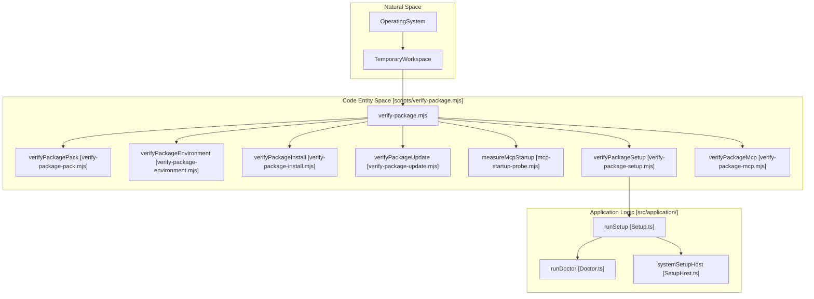
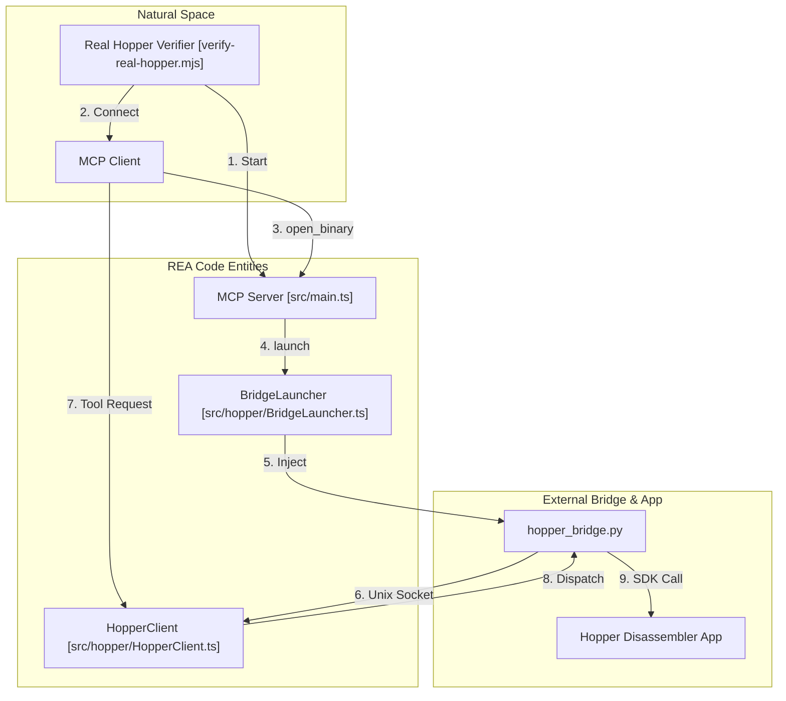

<!-- source: DeepWiki mcp.deepwiki.com · repo morluto/rea · page 8.3 Real-Provider and Package Verification · fetched 2026-10-16 -->

# Real-Provider and Package Verification

Relevant source files

The following files were used as context for generating this wiki page:

- [bridge/ghidra/ReaGhidraBundleActivator.java](bridge/ghidra/ReaGhidraBundleActivator.java)
- [native/windows/README.md](native/windows/README.md)
- [native/windows/src/addon.cc](native/windows/src/addon.cc)
- [native/windows/src/authority.hpp](native/windows/src/authority.hpp)
- [native/windows/src/filesystem.cc](native/windows/src/filesystem.cc)
- [native/windows/src/process.cc](native/windows/src/process.cc)
- [scripts/build-windows-native.mjs](scripts/build-windows-native.mjs)
- [scripts/fixtures/page-cdp-proxy.mjs](scripts/fixtures/page-cdp-proxy.mjs)
- [scripts/hopper-demo-x11.py](scripts/hopper-demo-x11.py)
- [scripts/lib/browser-module-e2e.mjs](scripts/lib/browser-module-e2e.mjs)
- [scripts/lib/browser-nested-source-map-e2e.mjs](scripts/lib/browser-nested-source-map-e2e.mjs)
- [scripts/lib/browser-network-e2e.mjs](scripts/lib/browser-network-e2e.mjs)
- [scripts/lib/browser-runtime-e2e.mjs](scripts/lib/browser-runtime-e2e.mjs)
- [scripts/lib/browser-runtime-fixture-lifecycle.mjs](scripts/lib/browser-runtime-fixture-lifecycle.mjs)
- [scripts/lib/browser-runtime-termination-e2e.mjs](scripts/lib/browser-runtime-termination-e2e.mjs)
- [scripts/lib/browser-script-export-e2e.mjs](scripts/lib/browser-script-export-e2e.mjs)
- [scripts/lib/browser-source-map-e2e.mjs](scripts/lib/browser-source-map-e2e.mjs)
- [scripts/lib/verifier-cleanup.d.mts](scripts/lib/verifier-cleanup.d.mts)
- [scripts/lib/verifier-cleanup.mjs](scripts/lib/verifier-cleanup.mjs)
- [scripts/lib/verify-package-core.mjs](scripts/lib/verify-package-core.mjs)
- [scripts/lib/windows-volume-root-append-lease.mjs](scripts/lib/windows-volume-root-append-lease.mjs)
- [scripts/verify-browser-dom-destinations.mjs](scripts/verify-browser-dom-destinations.mjs)
- [scripts/verify-browser-modules.mjs](scripts/verify-browser-modules.mjs)
- [scripts/verify-browser-network.mjs](scripts/verify-browser-network.mjs)
- [scripts/verify-browser-scripts.mjs](scripts/verify-browser-scripts.mjs)
- [scripts/verify-package-install.mjs](scripts/verify-package-install.mjs)
- [scripts/verify-package-pack.mjs](scripts/verify-package-pack.mjs)
- [scripts/verify-package.mjs](scripts/verify-package.mjs)
- [scripts/verify-packaged-wasm-artifact.mjs](scripts/verify-packaged-wasm-artifact.mjs)
- [scripts/verify-packed-bridge.mjs](scripts/verify-packed-bridge.mjs)
- [scripts/verify-packet-capture.mjs](scripts/verify-packet-capture.mjs)
- [scripts/verify-real-browser.mjs](scripts/verify-real-browser.mjs)
- [scripts/verify-repository-skill.mjs](scripts/verify-repository-skill.mjs)
- [scripts/verify-signal-recording.mjs](scripts/verify-signal-recording.mjs)
- [scripts/verify-windows-native-inspection.mjs](scripts/verify-windows-native-inspection.mjs)
- [scripts/verify-windows-native.mjs](scripts/verify-windows-native.mjs)
- [scripts/verify-windows-package.mjs](scripts/verify-windows-package.mjs)
- [src/application/Doctor.test.ts](src/application/Doctor.test.ts)
- [src/application/Doctor.ts](src/application/Doctor.ts)
- [src/application/DoctorDiagnostics.ts](src/application/DoctorDiagnostics.ts)
- [src/application/LinuxHopper.test.ts](src/application/LinuxHopper.test.ts)
- [src/application/LinuxHopper.ts](src/application/LinuxHopper.ts)
- [src/application/Setup.fixture.ts](src/application/Setup.fixture.ts)
- [src/application/Setup.planning.test.ts](src/application/Setup.planning.test.ts)
- [src/application/Setup.recovery.test.ts](src/application/Setup.recovery.test.ts)
- [src/application/Setup.ts](src/application/Setup.ts)
- [src/application/SetupHost.ts](src/application/SetupHost.ts)
- [src/application/SetupPlan.ts](src/application/SetupPlan.ts)
- [src/application/SetupSkill.ts](src/application/SetupSkill.ts)
- [src/application/SetupTypes.ts](src/application/SetupTypes.ts)
- [src/browser/BrowserProcessStartup.ts](src/browser/BrowserProcessStartup.ts)
- [src/cli.ts](src/cli.ts)
- [src/domain/runtimeVersion.test.ts](src/domain/runtimeVersion.test.ts)
- [src/domain/runtimeVersion.ts](src/domain/runtimeVersion.ts)
- [src/ghidra/GhidraSessionRoot.test.ts](src/ghidra/GhidraSessionRoot.test.ts)
- [src/ghidra/GhidraSessionRoot.ts](src/ghidra/GhidraSessionRoot.ts)
- [src/identity.ts](src/identity.ts)
- [src/pcap/PcapConfiguration.test.ts](src/pcap/PcapConfiguration.test.ts)
- [src/pcap/PcapOutput.test.ts](src/pcap/PcapOutput.test.ts)
- [src/pcap/PcapOutput.ts](src/pcap/PcapOutput.ts)
- [src/windows/WindowsPrivateRuntime.test.ts](src/windows/WindowsPrivateRuntime.test.ts)
- [src/windows/WindowsPrivateRuntime.ts](src/windows/WindowsPrivateRuntime.ts)
- [tests/acceptance/applications/sourceMapPrefixCli.test.ts](tests/acceptance/applications/sourceMapPrefixCli.test.ts)
- [tests/boundary/browser/browserProcessStartup.test.ts](tests/boundary/browser/browserProcessStartup.test.ts)
- [tests/boundary/browser/runtimeFixtureCleanup.test.ts](tests/boundary/browser/runtimeFixtureCleanup.test.ts)
- [tests/boundary/cli/javascriptArtifactBomRanges.test.ts](tests/boundary/cli/javascriptArtifactBomRanges.test.ts)
- [tests/boundary/filesystem/javascriptArtifactBomRanges.test.ts](tests/boundary/filesystem/javascriptArtifactBomRanges.test.ts)
- [tests/boundary/filesystem/setupSkill.test.ts](tests/boundary/filesystem/setupSkill.test.ts)
- [tests/boundary/process/packageNpmInvocation.test.ts](tests/boundary/process/packageNpmInvocation.test.ts)
- [tests/boundary/process/packagePackIsolation.test.ts](tests/boundary/process/packagePackIsolation.test.ts)
- [tests/boundary/process/packageTarListing.test.ts](tests/boundary/process/packageTarListing.test.ts)
- [tests/boundary/providers/RizinInferiorTty.test.ts](tests/boundary/providers/RizinInferiorTty.test.ts)
- [tests/fixtures/javascriptArtifactBom.ts](tests/fixtures/javascriptArtifactBom.ts)
- [tests/fixtures/windows-native-inspection-failure.cc](tests/fixtures/windows-native-inspection-failure.cc)
- [tests/fixtures/windows/processBoundary.cc](tests/fixtures/windows/processBoundary.cc)
- [tests/process-global/curatedWindowsLane.test.ts](tests/process-global/curatedWindowsLane.test.ts)

This section documents the end-to-end verification strategies used to ensure REA functions correctly when interacting with live provider instances (Hopper, Ghidra, Browser, Native UI, Windows Native) and when distributed as a packed NPM artifact. Unlike unit tests, these verifiers exercise the full system, including process injection, socket communication, platform-specific Node-API addons, and external configuration mutation.

## 1. Real-Provider End-to-End Verification

### 1.1. Hopper Verification (`scripts/verify-real-hopper.mjs`)

The `scripts/verify-real-hopper.mjs` script performs a full integration test by launching a real instance of Hopper Disassembler and exercising the MCP server against actual binaries.

#### 1.1.1. Requirements and Setup
The verifier requires two distinct Mach-O binaries to test session transitions and target switching. These are provided via environment variables:
*   `HOPPER_TARGET_PATH`: The primary binary for initial analysis.
*   `HOPPER_SECOND_TARGET_PATH`: A secondary binary used to verify that the session can close the first target and open another without leaking state.

The script snapshots existing Hopper processes before starting to ensure that `cleanup()` only terminates instances spawned by the verifier [scripts/verify-real-hopper.mjs:50-52]().

#### 1.1.2. Tool Exercise Sequence
The verifier connects to the MCP server via `StdioClientTransport` [scripts/verify-real-hopper.mjs:6-7]() and executes a sequence of operations to validate the bridge:

| Step | Tool / Action | Purpose |
| :--- | :--- | :--- |
| 1 | `listTools` | Validates that all tools are exposed [scripts/verify-real-hopper.mjs:219-224](). |
| 2 | `binary_session` | Confirms the server starts in a "no-target" state [scripts/verify-real-hopper.mjs:227-232](). |
| 3 | `open_binary` | Triggers `BridgeLauncher` to inject `hopper_bridge.py` into a new Hopper process [scripts/verify-real-hopper.mjs:233-237](). |
| 4 | Metadata Tools | Calls `list_documents`, `binary_overview`, and `list_segments` to verify basic document state [scripts/verify-real-hopper.mjs:238-249](). |
| 5 | Analysis Tools | Resolves a procedure address and calls `analyze_function` to verify pseudocode generation and XREFs [scripts/verify-real-hopper.mjs:191-215](). |
| 6 | Target Switch | Closes the first binary and opens `targetB` to ensure session isolation [scripts/verify-real-hopper.mjs:250-262](). |

#### 1.1.3. Safety and Cleanup
The verifier monitors `stderr` for unsafe diagnostics. Any log entry with a level $\ge$ 40 (Error/Fatal) or malformed JSON results in a verification failure [scripts/verify-real-hopper.mjs:270-286](). Upon completion, the script identifies and kills the specific Hopper PIDs it created [scripts/verify-real-hopper.mjs:480-494]().

Sources:
* [scripts/verify-real-hopper.mjs:1-506]()

### 1.2. Ghidra Verification (`scripts/verify-real-ghidra.mjs`)

The `scripts/verify-real-ghidra.mjs` script verifies the integration with a real Ghidra installation. It compiles various C/assembly fixtures and then uses the Ghidra provider to analyze them.

#### 1.2.1. Requirements and Setup
The script requires the `GHIDRA_INSTALL_DIR` environment variable to be set to the absolute path of an extracted Ghidra release [scripts/verify-real-ghidra.mjs:46-50](). It also checks for the correct Ghidra version [scripts/verify-real-ghidra.mjs:64-65](). Depending on the `--cross-format` or `--aarch64-jump-table` arguments, it verifies the presence of `clang`, `lld`, and `lld-link` compilers/linkers [scripts/verify-real-ghidra.mjs:98-119]().

The script compiles several fixtures:
*   `inventory.c` into a debug binary, a stripped binary, and an object file for layout analysis [scripts/verify-real-ghidra.mjs:121-136]().
*   `cross-format.c` and `relative-switch.S` into various cross-compiled targets (e.g., AArch64 ELF, Windows PE, Mach-O) if `--cross-format` or `--aarch64-jump-table` are specified [scripts/verify-real-ghidra.mjs:138-200]().

#### 1.2.2. Analysis Sequence
The verifier uses `GhidraHeadlessLauncher` [scripts/verify-real-ghidra.mjs:18]() to start Ghidra and `GhidraClient` [scripts/verify-real-ghidra.mjs:12]() to interact with it. It performs the following checks:
*   **Session Management**: Asserts that a session can be opened and closed.
*   **Inventory Operations**: Verifies `list_procedures`, `list_segments`, `list_strings`, `list_data_types`, and `list_symbols`.
*   **Function Analysis**: Checks `procedure_pseudo_code`, `procedure_assembly`, `analyze_function`, `xrefs`, `procedure_callers`, `procedure_callees`.
*   **Data Type and Value Tracing**: Verifies `inspect_native_data_type` and `trace_native_values`.
*   **Cross-Format Analysis**: If enabled, it analyzes binaries compiled for different architectures and formats to ensure Ghidra's cross-platform capabilities are correctly exposed [scripts/verify-real-ghidra.mjs:300-302]().
*   **Switch Table Recognition**: Specifically tests Ghidra's ability to recognize and analyze switch tables in AArch64 binaries [scripts/verify-real-ghidra.mjs:303-305]().

#### 1.2.3. Cleanup
The script removes the temporary fixture root directory upon completion [scripts/verify-real-ghidra.mjs:540-541]().

Sources:
* [scripts/verify-real-ghidra.mjs:1-545]()

### 1.3. Browser Verification (`scripts/verify-real-browser.mjs`)

The `scripts/verify-real-browser.mjs` script performs end-to-end verification of REA's browser observation capabilities using a real Chrome/Chromium instance.

#### 1.3.1. Requirements and Setup
The script launches a headless Chrome/Chromium instance [scripts/verify-real-browser.mjs:74-95]() and a local web server (`browser-verifier-site.mjs`) [scripts/verify-real-browser.mjs:27]() to serve test content. It also sets environment variables for scenario secrets [scripts/verify-real-browser.mjs:57-60]().

#### 1.3.2. CDP Observation
It uses `CdpBrowserProvider` [scripts/verify-real-browser.mjs:11]() to connect to the browser's DevTools Protocol (CDP) endpoint. It performs the following observations:
*   **Basic Page Inspection**: `inspectPage` to capture network requests, storage, and basic DOM information, asserting that sensitive data is redacted by default [scripts/verify-real-browser.mjs:110-146]().
*   **Detailed Page Inspection**: `inspectPage` with `include_script_sources`, `include_accessibility_text`, `include_json_body_shapes`, and `include_websocket_shapes` to verify deeper data capture [scripts/verify-real-browser.mjs:148-180]().
*   **Web Bundle Analysis**: Performs static and semantic analysis of JavaScript bundles, including source map fetching.
*   **Capture Comparison**: Verifies that stable capture identities reconcile across different observation depths.
*   **Screenshot Capture**: Verifies visual capture capabilities.
*   **Scenario Capture**: Uses `PlaywrightBrowserScenarioProvider` [scripts/verify-real-browser.mjs:16]() to capture user interactions and verify event coverage.

#### 1.3.3. Cleanup
The script ensures that the spawned browser process is killed and temporary profiles are removed.

Sources:
* [scripts/verify-real-browser.mjs:1-617]()

### 1.4. Native UI Verification (`scripts/verify-native-ui.mjs`)

The `scripts/verify-native-ui.mjs` script verifies REA's ability to observe and interact with native macOS UI elements.

#### 1.4.1. Requirements and Setup
This script is macOS-specific. It compiles a Swift helper to test JSON serialization boundaries and then compiles a test application into a `.app` bundle, launches it, and waits for its process ID and window ID.

#### 1.4.2. UI Observation and Interaction
The script uses `observeNativeUi` to:
*   **Observe Initial State**: Captures the initial UI state of the test application. Checks for accessibility permissions and throws an error if denied.
*   **Simulate Interaction**: Finds a specific button and simulates a click on it, verifying that the UI state changes as expected.
*   **CLI Parity**: Executes the same scenario via the CLI command to ensure parity between the programmatic API and the CLI.

#### 1.4.3. Cleanup
The temporary application bundle and compiled helpers are removed.

Sources:
* [scripts/verify-native-ui.mjs]()

### 1.5. Windows Native Verification (`scripts/verify-windows-native.mjs`)

The `scripts/verify-windows-native.mjs` script validates REA's Windows x64 Node-API 8 addon (`native/windows/build/rea-windows-x64.node`) and private runtime boundaries on a real Windows x64 host [scripts/verify-windows-native.mjs:28-36](), [native/windows/README.md:1-4]().

#### 1.5.1. Requirements and Verification Controls
The verifier requires an ordinary user execution context and asserts several critical security and functional controls:
*   **Renamed Host Node-API Loader Compatibility**: Verifies that `WindowsNativeLoader` can successfully import and verify the native module even when the host executable is renamed away from `node.exe` [scripts/verify-windows-native.mjs:146-170]().
*   **Filesystem Security Boundaries**: Tests input admission against fixed local NTFS volumes [native/windows/src/filesystem.cc:17-40](), ensuring reparse points are inspected (`FILE_FLAG_OPEN_REPARSE_POINT`) and stable 128-bit file IDs, final handle paths, and volume serial numbers are verified [native/windows/src/filesystem.cc:102-123](), [native/windows/README.md:52-60]().
*   **Job Object Memory Limits**: Exercises `process_spawn` with a Job Object and commit limit (`JOB_OBJECT_LIMIT_JOB_MEMORY`), draining completion port notifications to record `peakJobMemoryBytes` and sticky memory limit flags [scripts/verify-windows-native.mjs:24](), [native/windows/README.md:73-93]().

Sources:
* [scripts/verify-windows-native.mjs:1-953]()
* [native/windows/README.md:1-227]()
* [native/windows/src/filesystem.cc:1-123]()

---

## 2. Package Verification (`scripts/verify-package.mjs`)

The `scripts/verify-package.mjs` script ensures that the NPM artifact (`.tgz`) is self-contained, correctly structured, and functions in an isolated environment. It orchestrates a comprehensive verify-package family of sub-verifiers [scripts/verify-package.mjs:10-24]().

### 2.1. Isolated Environment Construction
To prevent mutation of the developer's machine, the script creates a `workspace` in `tmpdir()` [scripts/verify-package.mjs:40](). It calls `verifyPackageEnvironment` to set up a controlled environment including mocked binaries and redirected configuration roots [scripts/verify-package.mjs:90-97]().

### 2.2. The Verify-Package Family of Sub-Verifiers

| Verifier Module / Script | Scope and Responsibility |
| :--- | :--- |
| `verify-package-pack.mjs` | Packs the repository into a `.tgz` archive and checks file inventory [scripts/verify-package.mjs:88](). |
| `verify-package-environment.mjs` | Establishes temporary HOME, mock CLI paths, and prefix directories [scripts/verify-package.mjs:91](). |
| `verify-package-install.mjs` | Installs the tarball into a local prefix and validates CLI binaries [scripts/verify-package.mjs:99](). |
| `verify-package-update.mjs` | Tests `rea update` upgrade maintenance within the isolated prefix [scripts/verify-package.mjs:106](). |
| `verify-package-mcp.mjs` & Startup Probes | Measures MCP startup times, module loading profiles, and tool exposure [scripts/verify-package.mjs:120-140](). |
| `verify-package-discovery.mjs` | Verifies provider and setup host discovery capabilities [scripts/verify-package.mjs:144](). |
| `verify-package-artifact.mjs` | Tests artifact extraction, inventory scanning, and Electron CLI commands [scripts/verify-package.mjs:150](). |
| `verify-package-managed.mjs` | Exercises managed (.NET / PE / CIL) analysis commands through the CLI [scripts/verify-package.mjs:156](). |
| `verify-package-unknown-provider.mjs` | Ensures graceful fallback presentation for unrecognized providers [scripts/verify-package.mjs:163](). |
| `verify-package-platform.mjs` | Validates platform-specific behaviors and error projections [scripts/verify-package.mjs:170](). |
| `verify-package-capabilities.mjs` | Checks capability inventory reporting and search command output [scripts/verify-package.mjs:176](). |
| `verify-package-evidence.mjs` | Tests evidence ledger import/export and comparison workflows [scripts/verify-package.mjs:182](). |
| `verify-package-setup.mjs` & Prompts | Tests `rea setup` idempotency, client configuration file mutation, and failure recovery [scripts/verify-package.mjs:190](). |

Sources:
* [scripts/verify-package.mjs:1-272]()

---

## 3. Implementation Data Flow

### Diagram: Package Verification Orchestration
This diagram maps the natural language verification suite to code entities in `scripts/verify-package.mjs`.

Title: Package Verification Orchestration

Sources:
* [scripts/verify-package.mjs:1-272]()
* [src/application/Setup.ts:1-84]()
* [src/application/Doctor.ts:1-139]()

### Diagram: Real-Hopper Verification Flow
This diagram associates natural language Hopper testing steps with the underlying TypeScript and Python code entities.

Title: Real-Hopper Verification Flow

Sources:
* [scripts/verify-real-hopper.mjs:1-506]()

---

## 4. Bridge Truthfulness Requirements
A specific suite of tests in `tests/bridgeTruthfulness.test.ts` ensures that analysis providers do not "hallucinate" or simplify data in ways that mislead coding agents:
*   **CFG Successors**: Must use explicit unavailability indicators rather than returning empty arrays `[]` when CFG data is missing.
*   **Permissions**: Must return `None` for segment permissions that are not explicitly reported by the underlying API.
*   **Reference Kinds**: Must use raw containment and reference APIs without guessing classification kinds unless supported.

Sources:
* `[tests/bridgeTruthfulness.test.ts:1-33]()`

---

