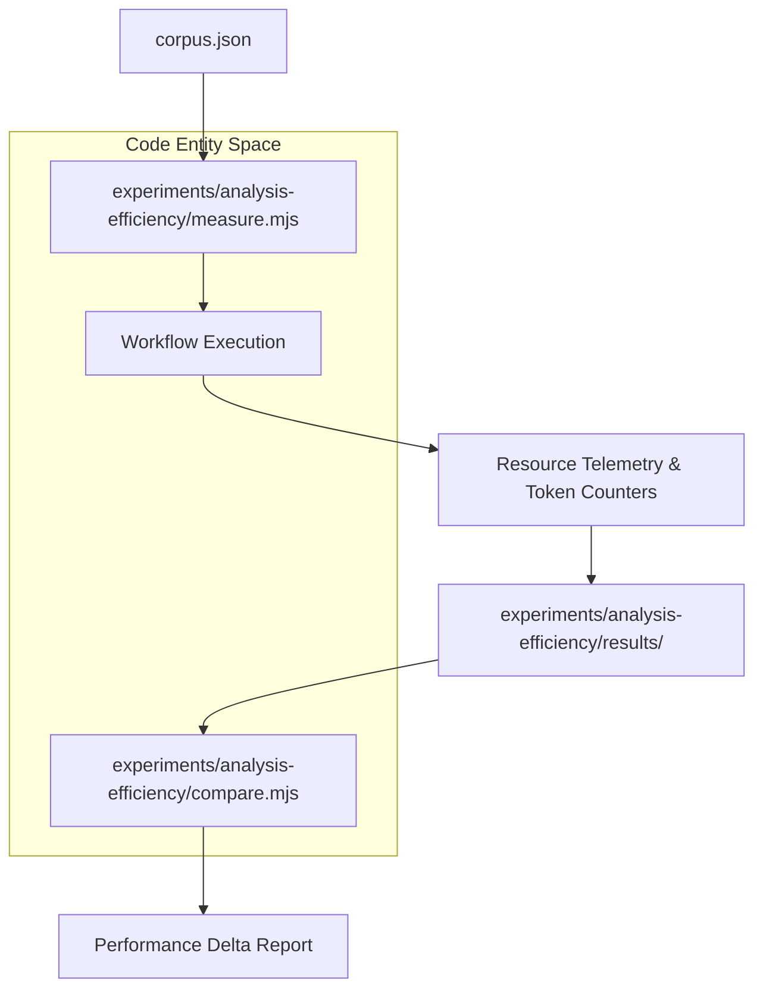
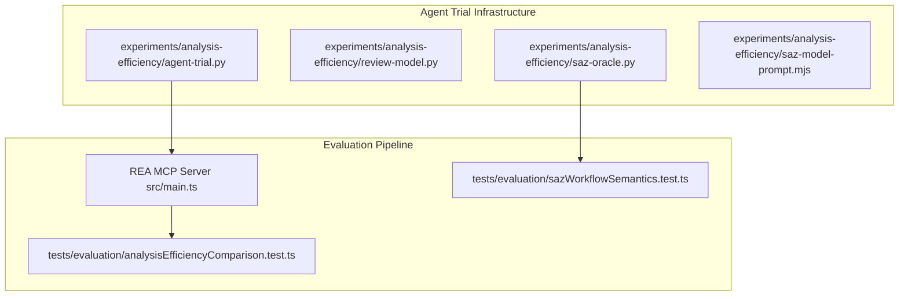

<!-- source: DeepWiki mcp.deepwiki.com · repo morluto/rea · page 8.4 Analysis Efficiency Experiments and Evaluations · fetched 2026-10-16 -->

# Analysis Efficiency Experiments and Evaluations

<details>
<summary>Relevant source files</summary>

The following files were used as context for generating this wiki page:

- [.github/workflows/ci.yml](.github/workflows/ci.yml)
- [.github/workflows/release.yml](.github/workflows/release.yml)
- [AGENTS.md](AGENTS.md)
- [CONTRIBUTING.md](CONTRIBUTING.md)
- [docs/releasing.md](docs/releasing.md)
- [docs/testing.md](docs/testing.md)
- [docs/tool-design.md](docs/tool-design.md)
- [experiments/analysis-efficiency/README.md](experiments/analysis-efficiency/README.md)
- [experiments/analysis-efficiency/agent-trial.py](experiments/analysis-efficiency/agent-trial.py)
- [experiments/analysis-efficiency/compare.mjs](experiments/analysis-efficiency/compare.mjs)
- [experiments/analysis-efficiency/corpus.json](experiments/analysis-efficiency/corpus.json)
- [experiments/analysis-efficiency/measure.mjs](experiments/analysis-efficiency/measure.mjs)
- [experiments/analysis-efficiency/pcap-small-captures.md](experiments/analysis-efficiency/pcap-small-captures.md)
- [experiments/analysis-efficiency/questions/pcap-http.txt](experiments/analysis-efficiency/questions/pcap-http.txt)
- [experiments/analysis-efficiency/review-model.py](experiments/analysis-efficiency/review-model.py)
- [experiments/analysis-efficiency/review-saz.mjs](experiments/analysis-efficiency/review-saz.mjs)
- [experiments/analysis-efficiency/saz-entry.mjs](experiments/analysis-efficiency/saz-entry.mjs)
- [experiments/analysis-efficiency/saz-model-prompt.mjs](experiments/analysis-efficiency/saz-model-prompt.mjs)
- [experiments/analysis-efficiency/saz-oracle.py](experiments/analysis-efficiency/saz-oracle.py)
- [experiments/analysis-efficiency/saz-selection-workflows.md](experiments/analysis-efficiency/saz-selection-workflows.md)
- [experiments/analysis-efficiency/test_codex_context.py](experiments/analysis-efficiency/test_codex_context.py)
- [experiments/analysis-efficiency/test_saz_oracle.py](experiments/analysis-efficiency/test_saz_oracle.py)
- [scripts/ci/plan.mjs](scripts/ci/plan.mjs)
- [scripts/ci/scopes.mjs](scripts/ci/scopes.mjs)
- [scripts/lib/release-checkpoint.mjs](scripts/lib/release-checkpoint.mjs)
- [scripts/verify-release-checkpoint.mjs](scripts/verify-release-checkpoint.mjs)
- [tests/boundary/filesystem/ciChangeScope.test.ts](tests/boundary/filesystem/ciChangeScope.test.ts)
- [tests/boundary/filesystem/ciRequiredLanes.test.ts](tests/boundary/filesystem/ciRequiredLanes.test.ts)
- [tests/boundary/filesystem/releaseCheckpoint.test.ts](tests/boundary/filesystem/releaseCheckpoint.test.ts)
- [tests/boundary/filesystem/releaseWorkflow.test.ts](tests/boundary/filesystem/releaseWorkflow.test.ts)
- [tests/boundary/filesystem/staticTaskCache.test.ts](tests/boundary/filesystem/staticTaskCache.test.ts)
- [tests/evaluation/analysisEfficiencyComparison.test.ts](tests/evaluation/analysisEfficiencyComparison.test.ts)
- [tests/evaluation/sazWorkflowSemantics.test.ts](tests/evaluation/sazWorkflowSemantics.test.ts)
- [tests/support/workflowGit.ts](tests/support/workflowGit.ts)
- [turbo.json](turbo.json)

</details>


The analysis efficiency corpus and evaluation subsystem—housed in `experiments/analysis-efficiency/` and verified through `tests/evaluation/`—quantifies REA's analysis effectiveness across agent token consumption, execution latency, process-family memory overhead, and CPU utilization [experiments/analysis-efficiency/README.md:1-110](). This section details the corpus structure, measurement harnesses, agent trial scripts, and automated model evaluation suites that ensure REA meets its performance priorities.

---

## Corpus Structure and Inventory

The analysis efficiency corpus defines a curated set of benchmarks, binaries, capture files, and analyst questions used to evaluate optimization impact. The core inventory is declared in `corpus.json` and documented across domain-specific follow-up guides [experiments/analysis-efficiency/README.md:9-45]().

| Corpus Domain / Target | Supporting Files | Measured Metrics |
| :--- | :--- | :--- |
| **Fiddler SAZ Captures** | `experiments/analysis-efficiency/saz-selection-workflows.md` | Default complete delivery vs. ordinal/page filtering [experiments/analysis-efficiency/README.md:3-8]() |
| **Dart AOT / Flutter** | `experiments/analysis-efficiency/flutter-aot-summary.md` | ABI selection, snapshot identity, string pool extraction [experiments/analysis-efficiency/README.md:20-23]() |
| **SQLite GeoPackage** | `experiments/analysis-efficiency/sqlite-existing-controls.md` | Column selection, table schemas, typed cell extraction [experiments/analysis-efficiency/README.md:24-27]() |
| **Small PCAP Recordings** | `experiments/analysis-efficiency/pcap-small-captures.md` | Complete delivery vs. summary pages [experiments/analysis-efficiency/README.md:28-31]() |
| **Native PE/DOS Entries** | `experiments/analysis-efficiency/native-entry-views.md` | Entry facts, small-function dossier overhead [experiments/analysis-efficiency/README.md:32-35]() |
| **EVM Smart Contracts** | `experiments/analysis-efficiency/evm-descriptor.md`, `evm-interface-summary.md` | Digest-pinned templates, ABI selector oracle, retained views [experiments/analysis-efficiency/README.md:36-43]() |
| **Managed (.NET) Assemblies** | `experiments/analysis-efficiency/managed-artifact-summary.md` | Assembly metadata, portable evidence, Codex trials [experiments/analysis-efficiency/README.md:52-55]() |
| **Android Packages (APK)** | `experiments/analysis-efficiency/android-package-summary.md` | Manifest extraction, SDK pairs, Codex client errors [experiments/analysis-efficiency/README.md:62-65]() |

Sources: `experiments/analysis-efficiency/README.md`, `experiments/analysis-efficiency/corpus.json`

---

## Measurement and Comparison Harnesses

Performance evaluations are driven by specialized Node.js scripts in `experiments/analysis-efficiency/` that execute workflows against local provider instances and capture resource telemetry.



### Key Measurement Components

*   `measure.mjs`: Executes representative analysis workflows, separating cold and warm runs. It logs token counts (input, output, cached, uncached), elapsed wall-clock time, CPU time, and peak process-family memory [experiments/analysis-efficiency/README.md:98-110]().
*   `compare.mjs`: Evaluates checkpoints before and after code changes, verifying whether optimizations successfully reduce model-visible bytes or execution latency without sacrificing Evidence provenance [experiments/analysis-efficiency/README.md:54-58]().
*   `resource counters`: Optional owned counter observations tracked at payload completion while preserving safeguards against memory growth [experiments/analysis-efficiency/README.md:67-70]().

Sources: `experiments/analysis-efficiency/README.md`, `experiments/analysis-efficiency/measure.mjs`, `experiments/analysis-efficiency/compare.mjs`

---

## Agent Trial Scripts and Model Reviews

To evaluate how coding agents interact with REA's Model Context Protocol (MCP) server, the framework includes Python-based evaluation harnesses and model prompt runners.



### Trial Script Responsibilities

*   `agent-trial.py`: Orchestrates multi-turn agent sessions (e.g., Codex or Claude Code cohorts) against fixed binaries or packages, measuring total task duration, retry frequency, and discovery overhead [experiments/analysis-efficiency/README.md:52-55]().
*   `review-model.py` & `review-saz.mjs`: Inspect model transcripts and extracted payloads to audit correctness, hallucination rates, and adherence to Evidence provenance rules [experiments/analysis-efficiency/README.md:75-78]().
*   `saz-oracle.py` & `saz-entry.mjs`: Provide independent ABI selector oracles and session state handlers for transport-level verification [experiments/analysis-efficiency/README.md:36-38]().

Sources: `experiments/analysis-efficiency/README.md`, `experiments/analysis-efficiency/agent-trial.py`, `tests/evaluation/sazWorkflowSemantics.test.ts`

---

## Automated Evaluation Test Suites

Automated assertions guard against analysis regressions by integrating efficiency and semantic checks directly into the Vitest test suite.

```typescript
// Conceptual flow within tests/evaluation/analysisEfficiencyComparison.test.ts
// Verifies token bounds and output payload constraints across optimization checkpoints.
```

*   `tests/evaluation/analysisEfficiencyComparison.test.ts`: Compares token usage and execution performance across standardized analysis tasks, enforcing that refactorings do not inflate agent context windows [tests/evaluation/analysisEfficiencyComparison.test.ts]().
*   `tests/evaluation/sazWorkflowSemantics.test.ts`: Validates SAZ capture filtering behaviors, summary vs. complete delivery modes, and strict answer limits [tests/evaluation/sazWorkflowSemantics.test.ts]().

Sources: `tests/evaluation/analysisEfficiencyComparison.test.ts`, `tests/evaluation/sazWorkflowSemantics.test.ts`, `turbo.json`

---

