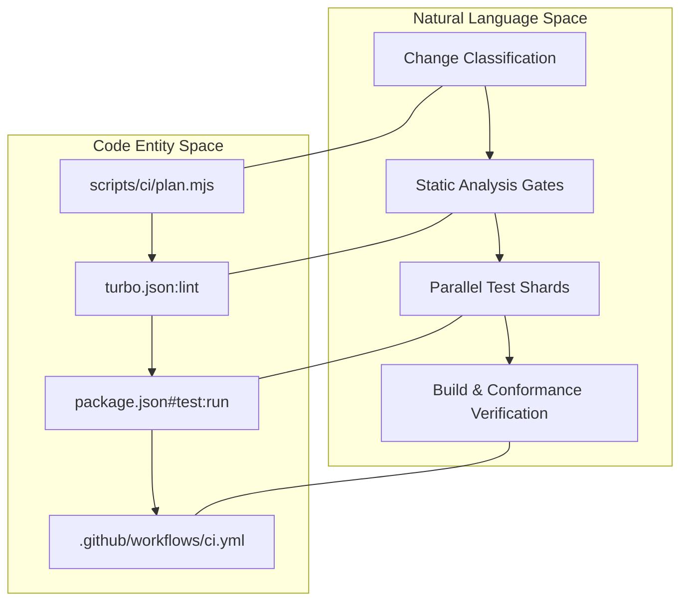
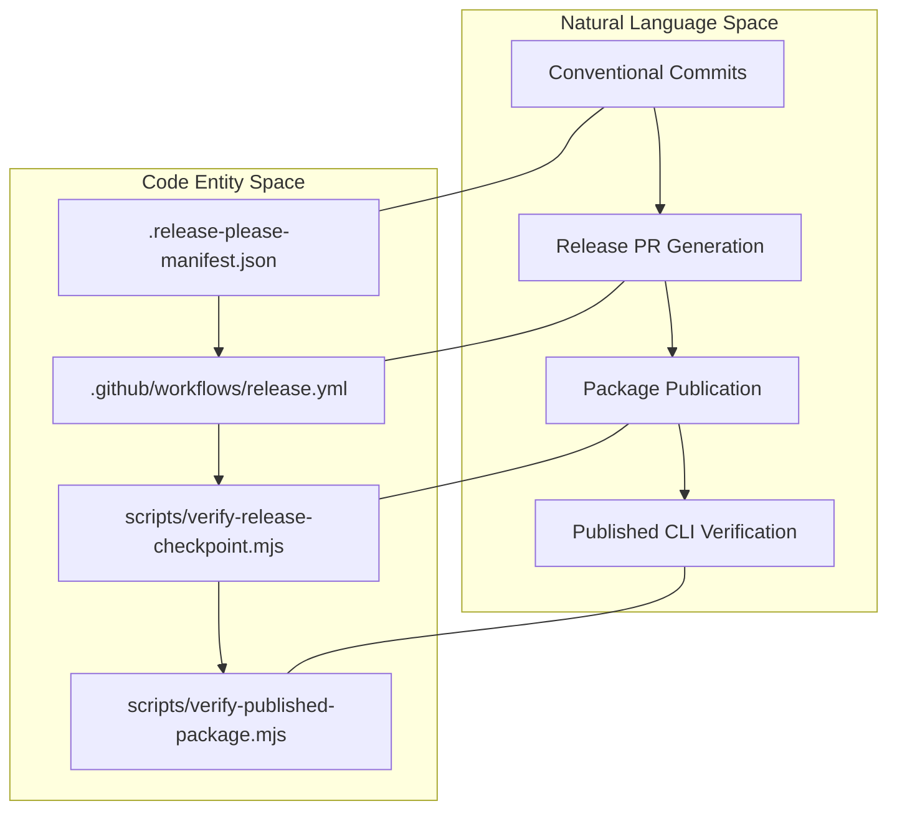
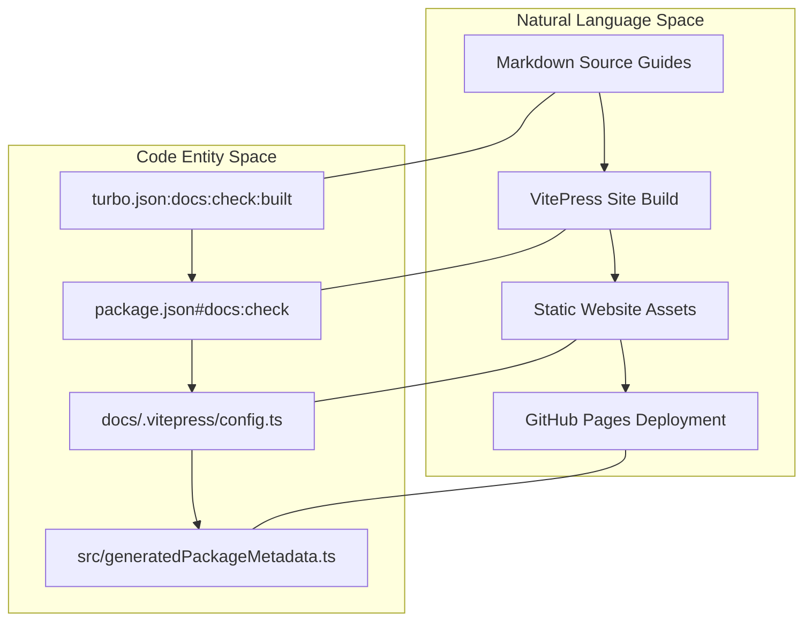

<!-- source: DeepWiki mcp.deepwiki.com · repo morluto/rea · page 9 CI/CD, Release and Website · fetched 2026-10-16 -->

# CI/CD, Release and Website

Relevant source files

The following files were used as context for generating this wiki page:

- [.github/workflows/ci.yml](.github/workflows/ci.yml)
- [.github/workflows/release.yml](.github/workflows/release.yml)
- [.release-please-manifest.json](.release-please-manifest.json)
- [AGENTS.md](AGENTS.md)
- [CHANGELOG.md](CHANGELOG.md)
- [CONTRIBUTING.md](CONTRIBUTING.md)
- [docs/releasing.md](docs/releasing.md)
- [docs/testing.md](docs/testing.md)
- [docs/tool-design.md](docs/tool-design.md)
- [package-lock.json](package-lock.json)
- [package.json](package.json)
- [scripts/ci/plan.mjs](scripts/ci/plan.mjs)
- [scripts/ci/scopes.mjs](scripts/ci/scopes.mjs)
- [scripts/lib/release-checkpoint.mjs](scripts/lib/release-checkpoint.mjs)
- [scripts/verify-release-checkpoint.mjs](scripts/verify-release-checkpoint.mjs)
- [server.json](server.json)
- [src/generatedPackageMetadata.ts](src/generatedPackageMetadata.ts)
- [tests/boundary/filesystem/ciChangeScope.test.ts](tests/boundary/filesystem/ciChangeScope.test.ts)
- [tests/boundary/filesystem/ciRequiredLanes.test.ts](tests/boundary/filesystem/ciRequiredLanes.test.ts)
- [tests/boundary/filesystem/releaseCheckpoint.test.ts](tests/boundary/filesystem/releaseCheckpoint.test.ts)
- [tests/boundary/filesystem/releaseWorkflow.test.ts](tests/boundary/filesystem/releaseWorkflow.test.ts)
- [tests/boundary/filesystem/staticTaskCache.test.ts](tests/boundary/filesystem/staticTaskCache.test.ts)
- [tests/support/workflowGit.ts](tests/support/workflowGit.ts)
- [turbo.json](turbo.json)

This page provides a high-level overview of the automation pipelines, release tooling, and documentation infrastructure that ensure the quality and delivery of REA. REA utilizes GitHub Actions workflows, Turborepo task caching, `release-please` versioning, and VitePress documentation to manage development lifecycle tasks.

For detailed information, see the child pages:
- [CI Pipeline and Code Quality Gates](#9.1)
- [Release Process](#9.2)
- [Documentation Site and Website](#9.3)

---

## CI Pipeline and Code Quality Gates

The Continuous Integration (CI) pipeline executes on every push and pull request to the `main` branch [/.github/workflows/ci.yml:4-7](). It classifies changes using `scripts/ci/plan.mjs` and executes targeted verification tasks managed by `turbo.json`.

Static analysis leverages tools configured in `package.json` [package.json:111-136]() such as `oxlint`, `knip`, `jscpd`, and `scan-todos`. For deep technical details on the job graph, test shards, static check reports, and module boundary checks, see [CI Pipeline and Code Quality Gates](#9.1).

Sources: [/.github/workflows/ci.yml:33-110](), [turbo.json:1-125](), [package.json:100-140]()

---

## Release Process

REA automates version management and changelog generation using Google's `release-please` action [/.github/workflows/release.yml:30-57]() combined with manifest tracking [/.release-please-manifest.json:1-3]() and generated package metadata [src/generatedPackageMetadata.ts:1-9](). 

When pull requests with Conventional Commits merge into `main`, the `release-please` workflow updates version fields, creates release tags, and triggers publication pipelines. For details on publishing packages to npm, verifying release checkpoints, and checking installed client binaries, see [Release Process](#9.2).

Sources: [/.release-please-manifest.json:1-3](), [/.github/workflows/release.yml:30-129](), [src/generatedPackageMetadata.ts:1-9]()

---

## Documentation Site and Website

REA maintains a VitePress-based documentation site inside `docs/` [turbo.json:152-186]() and static assets for marketing and guides under `website/` [package.json:48-99](). 

Documentation validation runs as part of CI checks to guarantee that API references, product catalog metadata, and guide files stay synchronized with core source contracts. For details on the VitePress style guide, static asset generation, and Pages deployment workflows, see [Documentation Site and Website](#9.3).

Sources: [turbo.json:152-186](), [package.json:48-99](), [src/generatedPackageMetadata.ts:1-9]()

---

