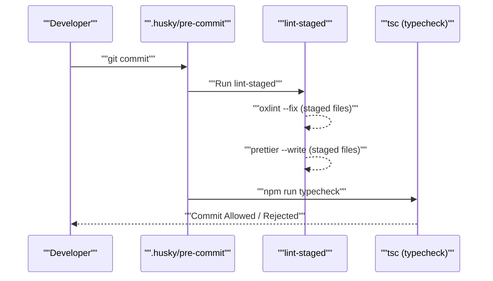

<!-- source: DeepWiki mcp.deepwiki.com · repo morluto/rea · page 9.1 CI Pipeline and Code Quality Gates · fetched 2026-10-16 -->

# CI Pipeline and Code Quality Gates

<details>
<summary>Relevant source files</summary>

The following files were used as context for generating this wiki page:

- [.github/workflows/ci.yml](.github/workflows/ci.yml)
- [.github/workflows/release.yml](.github/workflows/release.yml)
- [.husky/pre-commit](.husky/pre-commit)
- [.husky/pre-push](.husky/pre-push)
- [.oxlintrc.json](.oxlintrc.json)
- [AGENTS.md](AGENTS.md)
- [CONTRIBUTING.md](CONTRIBUTING.md)
- [docs/releasing.md](docs/releasing.md)
- [docs/testing.md](docs/testing.md)
- [docs/tool-design.md](docs/tool-design.md)
- [knip.json](knip.json)
- [scripts/ci/plan.mjs](scripts/ci/plan.mjs)
- [scripts/ci/scopes.mjs](scripts/ci/scopes.mjs)
- [scripts/lib/module-boundaries.d.mts](scripts/lib/module-boundaries.d.mts)
- [scripts/lib/module-boundaries.mjs](scripts/lib/module-boundaries.mjs)
- [scripts/lib/release-checkpoint.mjs](scripts/lib/release-checkpoint.mjs)
- [scripts/scan-todos.mjs](scripts/scan-todos.mjs)
- [scripts/verify-release-checkpoint.mjs](scripts/verify-release-checkpoint.mjs)
- [src/hopper/HopperProvider.test.ts](src/hopper/HopperProvider.test.ts)
- [tests/boundary/filesystem/ciChangeScope.test.ts](tests/boundary/filesystem/ciChangeScope.test.ts)
- [tests/boundary/filesystem/ciRequiredLanes.test.ts](tests/boundary/filesystem/ciRequiredLanes.test.ts)
- [tests/boundary/filesystem/releaseCheckpoint.test.ts](tests/boundary/filesystem/releaseCheckpoint.test.ts)
- [tests/boundary/filesystem/releaseWorkflow.test.ts](tests/boundary/filesystem/releaseWorkflow.test.ts)
- [tests/boundary/filesystem/staticTaskCache.test.ts](tests/boundary/filesystem/staticTaskCache.test.ts)
- [tests/evaluation/moduleBoundaries.test.ts](tests/evaluation/moduleBoundaries.test.ts)
- [tests/support/workflowGit.ts](tests/support/workflowGit.ts)
- [turbo.json](turbo.json)

</details>


The REA CI pipeline ensures code quality, maintainability, and reliability through a series of parallel automated checks. It enforces strict type safety, detects code duplication, monitors technical debt, and validates test coverage thresholds before any code is merged into the `main` branch.

## Pipeline Architecture

The pipeline is implemented via GitHub Actions and triggered on every push or pull request to the `main` branch [.github/workflows/ci.yml:3-11](). It consists of several distinct jobs that run in parallel on `ubuntu-latest` environments [.github/workflows/ci.yml:33-118](). The `concurrency` setting ensures that only one CI run is active for a given pull request, canceling in-progress runs if a new commit is pushed [.github/workflows/ci.yml:22-29](). Change classification is performed dynamically by `scripts/ci/plan.mjs` using `scripts/ci/scopes.mjs` to target specific verification lanes [.github/workflows/ci.yml:102-110](), [scripts/ci/scopes.mjs:4-146]().

### Data Flow and Job Execution

The following diagram illustrates how the CI pipeline processes the codebase from a pull request to a successful build.

**CI Job Flow**
```mermaid
graph TD
    PR[""Pull Request / Push""] --> Changes[""Classify changes (scripts/ci/plan.mjs)""]
    Changes -- ""code changes"" --> Static[""Static checks (.github/workflows/ci.yml:112)""]
    Changes -- ""code changes"" --> Build[""Build package (npm run build:cached)""]
    Changes -- ""docs changes"" --> Docs[""Docs build & check""]

    Static --> TestDiscovery[""Verify test discovery""]
    Static --> FormatCheck[""Format check""]
    Static --> CheckCI[""Static Check Suite""]

    CheckCI --> Typecheck[""Typecheck (tsc)""]
    CheckCI --> Lint[""Lint (oxlint)""]
    CheckCI --> Knip[""Dead Code (knip)""]
    CheckCI --> Jscpd[""Duplicates (jscpd)""]
    CheckCI --> ScanTodos[""Tech Debt (scan:todos)""]
    
    Build --> TestShard1[""Test shard (1/4)""]
    Build --> TestShard2[""Test shard (2/4)""]
    Build --> TestShard3[""Test shard (3/4)""]
    Build --> TestShard4[""Test shard (4/4)""]

    TestShard1 & TestShard2 & TestShard3 & TestShard4 --> Test[""Test (coverage + timing)""]

    Test --> Conformance[""Conformance fixtures""]
    Test --> WindowsNative[""Windows native""]
    Test --> PackageE2E[""Package E2E""]

    Static & Test & Conformance & WindowsNative & PackageE2E & Docs --> Result{""All Pass?""}
    Result -- Yes --> Success[""CI Green""]
    Result -- No --> Failure[""CI Red""]

    subgraph ""Pre-merge Checks""
        PRTitle[""Conventional PR title""]
    end
    PR --> PRTitle
```
Sources: [.github/workflows/ci.yml:1-246](), [scripts/ci/plan.mjs:1-180]()

## CI Job Details

### 1. Pre-merge Checks
*   **Conventional PR title**: For pull requests, this job validates that the PR title adheres to Conventional Commits specifications, which is crucial for `release-please` to generate changelogs correctly [.github/workflows/ci.yml:6-7](), [.github/workflows/release.yml:30-57]().

### 2. Change Classification
*   **Classify changes**: Executed via `scripts/ci/plan.mjs`, this job determines if the changes in a pull request affect code or only documentation. This classification is used to conditionally run subsequent jobs, skipping expensive code-related checks if only documentation has changed [.github/workflows/ci.yml:33-66](), [scripts/ci/plan.mjs:120-180]().

### 3. Static Analysis and Quality (`static` job)
This job runs various static checks to ensure code quality and adherence to standards [.github/workflows/ci.yml:112-152]().
*   **Require successful change classification**: Ensures that the `changes` job completed successfully before proceeding [.github/workflows/ci.yml:119-122]().
*   **Static Analysis Orchestration**: 
    *   **Typecheck**: Uses `tsc` to verify TypeScript integrity across the project, including `src`, `tests`, and `scripts` [turbo.json:27-48]().
    *   **Lint (Oxlint)**: Employs `oxlint` for high-performance linting [turbo.json:59-79](), [.oxlintrc.json:1-33]().
    *   **Dead Code (Knip)**: Uses `knip` to identify unused files, exports, and dependencies [turbo.json:103-122](), [knip.json:1-39]().
    *   **Duplicate Code (JSCPD)**: Scans for structural code duplication with a strict 3% threshold [turbo.json:123-134](), [.jscpd.json:1-17]().
    *   **Tech Debt Scan (`scan:todos`)**: Runs `scripts/scan-todos.mjs` to track and report `TODO` and `FIXME` comments in the codebase [turbo.json:135-142](), [scripts/scan-todos.mjs:1-50]().

Sources: [.github/workflows/ci.yml:112-152](), [turbo.json:27-142](), [.oxlintrc.json:1-33](), [knip.json:1-39](), [.jscpd.json:1-17]()

### 4. Build and Testing Lanes
*   **Build package**: Compiles the REA package using `npm run build:cached`. Turborepo's caching mechanism speeds up builds by only rebuilding tasks whose inputs have changed [turbo.json:8-26](), [docs/testing.md:49-54]().
*   **Test Shards**: Vitest tests run in parallel across multiple shards to reduce overall execution time [.github/workflows/ci.yml:85-117](), [docs/testing.md:18-21]().
*   **Conformance & Verification**: Conformance fixtures execute against source-built binaries, while Windows native and package E2E verification lanes validate platform-specific behavior [.github/workflows/ci.yml:198-234](), [docs/testing.md:18-21]().

Sources: [.github/workflows/ci.yml:85-234](), [turbo.json:1-26](), [docs/testing.md:18-54]().

## Turborepo Task Caching

Turborepo optimizes the CI pipeline by caching task outputs. If a task's inputs (defined in `turbo.json`) have not changed since the last run, Turborepo restores outputs from its cache instead of re-executing.

**Turborepo Task Caching Example (`compile` task)**
```json
{
  "$schema": "https://turborepo.dev/schema.json",
  "tasks": {
    "compile": {
      "dependsOn": ["metadata:check"],
      "inputs": [
        "package.json",
        "package-lock.json",
        "scripts/check-dependency-install.mjs",
        "scripts/clean-build-output.mjs",
        "scripts/bundle-runtime.mjs",
        "src/**/*.{cts,mts,ts,tsx}",
        "!src/**/*.test.ts",
        "!src/**/*.fixture.ts",
        "tsconfig.json",
        "tsconfig.build.json"
      ],
      "outputs": ["dist/**"]
    }
  }
}
```
The `inputs` array specifies all files and patterns that invalidate the cache when modified, while `outputs` defines artifacts produced and cached [turbo.json:8-26]().

Sources: [turbo.json:1-142]()

## Module Boundary Checks

REA enforces strict module boundaries to maintain its layered architecture and prevent unwanted dependencies, keeping provider-specific code out of domain and application layers [AGENTS.md:17-18]().

The `scripts/lib/module-boundaries.mjs` script inspects module imports to ensure they adhere to defined architectural layers. This check runs in CI and can be invoked locally via `npm run verify:module-boundaries` [CONTRIBUTING.md:17-19]().

**Module Boundary Enforcement**
```mermaid
graph TD
    Domain[""src/domain/""]
    Contracts[""src/contracts/""]
    Providers[""src/hopper/, src/ghidra/, etc.""]
    Application[""src/application/""]
    Composition[""src/composition/""]
    Server[""src/server/""]
    CLI[""src/cli.ts""]

    subgraph ""Allowed Dependencies""
        Domain --> Contracts
        Contracts --> Application
        Providers --> Application
        Composition --> Providers
        Application --> Server
        Application --> CLI
    end

    subgraph ""Disallowed Dependencies (Examples)""
        Application --X Domain
        Server --X Application
        Providers --X Domain
        CLI --X Application
    end
```
For instance, `src/domain/` modules are restricted from importing from `src/application/` or provider-specific directories [tests/evaluation/moduleBoundaries.test.ts:1-73](), [scripts/lib/module-boundaries.mjs:1-100]().

Sources: [AGENTS.md:17-18](), [CONTRIBUTING.md:17-19](), [tests/evaluation/moduleBoundaries.test.ts:1-350](), [scripts/lib/module-boundaries.mjs:1-100]()

## Pre-commit and Pre-push Hooks

To catch errors early, REA utilizes Husky and `lint-staged`.

**Commit Verification Sequence**

Sources: [.husky/pre-commit:1](), [CONTRIBUTING.md:70-74]()

### Implementation Details
*   **Husky Hooks**: Triggered on `pre-commit`, running `lint-staged` and project type checks [.husky/pre-commit:1](). Pre-push hooks validate push target criteria.
*   **Lint-Staged**: Configured to run `oxlint` and `prettier` only on staged files for speed and compliance [CONTRIBUTING.md:70-74]().

Sources: [.husky/pre-commit:1](), [.husky/pre-push:1](), [CONTRIBUTING.md:70-74]()

---

