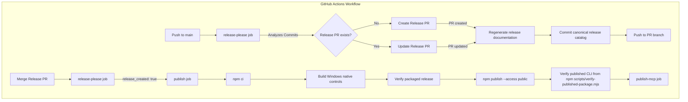
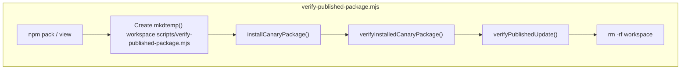
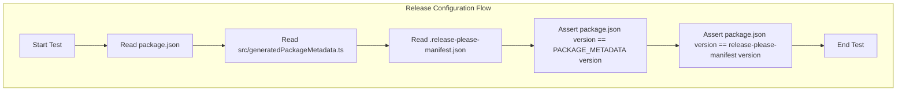

<!-- source: DeepWiki mcp.deepwiki.com · repo morluto/rea · page 9.2 Release Process · fetched 2026-10-16 -->

# Release Process

Relevant source files

The following files were used as context for generating this wiki page:

- [.agents/skills/rea-changelog-update/SKILL.md](.agents/skills/rea-changelog-update/SKILL.md)
- [.release-please-manifest.json](.release-please-manifest.json)
- [CHANGELOG.md](CHANGELOG.md)
- [package-lock.json](package-lock.json)
- [package.json](package.json)
- [scripts/lib/release-notes-github.mjs](scripts/lib/release-notes-github.mjs)
- [scripts/lib/release-notes-publication.mjs](scripts/lib/release-notes-publication.mjs)
- [scripts/lib/release-notes.mjs](scripts/lib/release-notes.mjs)
- [scripts/release-notes.mjs](scripts/release-notes.mjs)
- [scripts/verify-package-update.mjs](scripts/verify-package-update.mjs)
- [scripts/verify-published-package.mjs](scripts/verify-published-package.mjs)
- [server.json](server.json)
- [src/application/ClientConfigurationFiles.ts](src/application/ClientConfigurationFiles.ts)
- [src/application/GeminiClientSettings.ts](src/application/GeminiClientSettings.ts)
- [src/application/Update.test.ts](src/application/Update.test.ts)
- [src/application/Update.ts](src/application/Update.ts)
- [src/application/UpdateFailure.ts](src/application/UpdateFailure.ts)
- [src/application/UpdateMaintenance.ts](src/application/UpdateMaintenance.ts)
- [src/application/UpdateRuntime.release.test.ts](src/application/UpdateRuntime.release.test.ts)
- [src/application/UpdateRuntime.ts](src/application/UpdateRuntime.ts)
- [src/cliLogging.test.ts](src/cliLogging.test.ts)
- [src/cliLogging.ts](src/cliLogging.ts)
- [src/generatedPackageMetadata.ts](src/generatedPackageMetadata.ts)
- [tests/acceptance/setup/geminiWorkspaceTrust.test.ts](tests/acceptance/setup/geminiWorkspaceTrust.test.ts)
- [tests/boundary/cli/clientProfileLifecycle.test.ts](tests/boundary/cli/clientProfileLifecycle.test.ts)
- [tests/boundary/cli/clientProfiles.test.ts](tests/boundary/cli/clientProfiles.test.ts)
- [tests/boundary/cli/projectedErrorStatus.test.ts](tests/boundary/cli/projectedErrorStatus.test.ts)
- [tests/boundary/filesystem/releaseNotes.test.ts](tests/boundary/filesystem/releaseNotes.test.ts)
- [tests/boundary/filesystem/zcodeClientConfiguration.test.ts](tests/boundary/filesystem/zcodeClientConfiguration.test.ts)
- [tests/process-global/updateMaintenance.test.ts](tests/process-global/updateMaintenance.test.ts)

REA utilizes an automated release workflow powered by **release-please**. This system manages versioning, generates changelogs from Conventional Commits, and handles the publishing of the `rea-agents` package to the npm registry.

## Automated Versioning Workflow

The release process is divided into two distinct stages: version management via Pull Request and the automated publication job.

### Stage 1: Release Please (PR Generation)
When changes are merged into the `main` branch, the `release-please` job in `.github/workflows/release.yml` triggers. It analyzes the commit history since the last release tag to determine the next version number (SemVer).

1.  **Changelog Generation**: It updates `CHANGELOG.md` by grouping commits into categories based on their type [CHANGELOG.md:1-30]().
2.  **Manifest Update**: It updates the version in `.release-please-manifest.json` [.release-please-manifest.json:1-3]() and `package.json` [package.json:1-4]().
3.  **Pull Request**: It opens (or updates) a "Release PR". Merging this PR signals that the release is ready.
4.  **Generated Documentation**: If a Release PR is created, the workflow checks out the PR branch, installs dependencies, and regenerates release documentation. This ensures canonical catalog state for the release.

### Stage 2: Publication
Once the Release PR is merged, the `release-please` job outputs `release_created: true`. This triggers the publication workflow, which performs the following:
1.  **Environment Setup**: Configures Node.js and the npm registry URL.
2.  **Build Windows Native Controls**: Installs the necessary toolchain and builds the bundled Windows native controls, then verifies the artifact.
3.  **Verify Packaged Release**: Runs verification commands to ensure package integrity before publishing.
4.  **Publish**: Checks if the version is already published. If not, it executes `npm publish --access public` to distribute the package [package.json:33-35]().
5.  **Verify Published CLI**: After publishing, it attempts to install and run the newly published `rea-agents` package from npm to verify its functionality via `scripts/verify-published-package.mjs` [scripts/verify-published-package.mjs:1-25](). This step includes retries to account for npm registry propagation delays.
6.  **Publish to MCP Registry**: A separate publish-mcp job verifies package and registry metadata versions against `server.json` [server.json:1-30]().

### Release Data Flow
The following diagram illustrates the transition from commit to published artifact.

**Release Pipeline Flow**

Sources: [.release-please-manifest.json:1-3](), [package.json:1-48](), [server.json:1-30](), [scripts/verify-published-package.mjs:1-25]()

## Conventional Commits

The versioning logic depends on the format of commit messages. REA follows the Conventional Commits specification.

| Commit Type | Changelog Section | SemVer Impact |
| :--- | :--- | :--- |
| `feat` | Features | Minor (0.x.0) |
| `fix` | Bug Fixes | Patch (0.0.x) |
| `perf` | Performance Improvements | Patch (0.0.x) |
| `refactor` | Code Refactoring | Patch (0.0.x) |
| `docs` | Documentation | Patch (0.0.x) |
| `ci` | Continuous Integration | Patch (0.0.x) |
| `test` | Tests | Patch (0.0.x) |
| `chore` | (Hidden) | Patch (0.0.x) |

Any commit containing `BREAKING CHANGE` in the footer or a `!` after the type (e.g., `feat!:`) will trigger a Major version bump.

Sources: [CHANGELOG.md:1-30]()

## Verification and Safety

Before a release is finalized, the codebase undergoes rigorous verification to ensure package integrity.

### Package Verification Script
The `scripts/verify-published-package.mjs` script is used to smoke-test the actual npm tarball in an isolated environment. This ensures that:
*   **No Bytecode Leakage**: It checks that `__pycache__` or `.pyc` files are not included in the package [scripts/verify-published-package.mjs:27-31]().
*   **Isolated Execution**: It creates a temporary workspace with a fake `HOME` and `PATH` to ensure the CLI doesn't rely on local development files [scripts/verify-published-package.mjs:27-54]().
*   **Update Verification**: It exercises the production updater workflow against real previous installations [scripts/verify-published-package.mjs:59-171]().
*   **Idempotency**: It validates configuration flows and version transitions across package releases [scripts/verify-published-package.mjs:135-153]().

**Package Verification Logic**

Sources: [scripts/verify-published-package.mjs:1-194]()

### README Consistency and Release Configuration Tests
Tests ensure that configuration metadata and package versions remain consistent across files such as `package.json`, `.release-please-manifest.json`, and `src/generatedPackageMetadata.ts`.

*   **Version Sync**: Asserts that `package.json` version matches `src/generatedPackageMetadata.ts` (`PACKAGE_METADATA.version`) and `.release-please-manifest.json` [package.json:1-4](), [.release-please-manifest.json:1-3](), [src/generatedPackageMetadata.ts:1-9]().
*   **Client Registry Metadata**: Verifies that MCP server identity configurations conform to published release contracts [server.json:1-30]().

**Release Configuration Test Flow**

Sources: [package.json:1-4](), [.release-please-manifest.json:1-3](), [src/generatedPackageMetadata.ts:1-9]()

## Maintainer Release Checklist

While the process is automated, maintainers should follow this checklist when preparing a release:

1.  **Review Conventional Commits**: Ensure recent commits use the correct prefixes (`feat`, `fix`, etc.) to trigger the intended version bump.
2.  **Verify CI Green**: Ensure the standard CI pipeline (Typecheck, Lint, Test) is passing on the `main` branch.
3.  **Inspect Release PR**: When `release-please` opens the PR, review the generated `CHANGELOG.md` [CHANGELOG.md:1-30]() to ensure all significant changes are captured.
4.  **Local Smoke Test**: (Optional) Run `node scripts/verify-published-package.mjs` locally to confirm the package builds and installs correctly [scripts/verify-published-package.mjs:1-25]().
5.  **Merge Release PR**: Merging the PR will automatically trigger the npm publication.
6.  **Verify npm**: Confirm the new version is available via `npm view rea-agents version`.

Sources: [.release-please-manifest.json:1-3](), [package.json:1-48](), [CHANGELOG.md:1-30](), [scripts/verify-published-package.mjs:1-25]()

---

