# Page: REA Overview

# REA Overview

<details>
<summary>Relevant source files</summary>

The following files were used as context for generating this wiki page:

- [.agents/skills/reverse-engineer-anything/references/connection-and-recovery.md](.agents/skills/reverse-engineer-anything/references/connection-and-recovery.md)
- [.release-please-manifest.json](.release-please-manifest.json)
- [CHANGELOG.md](CHANGELOG.md)
- [README.md](README.md)
- [docs/client-configuration.md](docs/client-configuration.md)
- [docs/installation.md](docs/installation.md)
- [package-lock.json](package-lock.json)
- [package.json](package.json)
- [scripts/lib/catalog-builders.mjs](scripts/lib/catalog-builders.mjs)
- [scripts/lib/catalog-core.mjs](scripts/lib/catalog-core.mjs)
- [scripts/verify-package-environment.d.mts](scripts/verify-package-environment.d.mts)
- [scripts/verify-package-environment.mjs](scripts/verify-package-environment.mjs)
- [server.json](server.json)
- [src/application/CapabilityInventory.test.ts](src/application/CapabilityInventory.test.ts)
- [src/application/CapabilityInventory.ts](src/application/CapabilityInventory.ts)
- [src/application/ClientConfigurationDocument.ts](src/application/ClientConfigurationDocument.ts)
- [src/application/ClientRegistrationEnvironment.ts](src/application/ClientRegistrationEnvironment.ts)
- [src/application/ClientRegistrationStatus.ts](src/application/ClientRegistrationStatus.ts)
- [src/application/SetupClientConfiguration.ts](src/application/SetupClientConfiguration.ts)
- [src/application/SupportedClients.ts](src/application/SupportedClients.ts)
- [src/application/Uninstall.ts](src/application/Uninstall.ts)
- [src/cliCommandNames.ts](src/cliCommandNames.ts)
- [src/contracts/toolContracts.ts](src/contracts/toolContracts.ts)
- [src/contracts/toolEffects.ts](src/contracts/toolEffects.ts)
- [src/domain/hopperValues.test.ts](src/domain/hopperValues.test.ts)
- [src/generatedPackageMetadata.ts](src/generatedPackageMetadata.ts)
- [src/mcpStartupPolicy.ts](src/mcpStartupPolicy.ts)
- [src/server/createServer.ts](src/server/createServer.ts)
- [src/server/mcpClientMetadata.ts](src/server/mcpClientMetadata.ts)
- [src/server/registerSessionStatusTool.ts](src/server/registerSessionStatusTool.ts)
- [src/server/registerSessionTools.ts](src/server/registerSessionTools.ts)
- [tests/boundary/filesystem/clientConfigurationDialects.test.ts](tests/boundary/filesystem/clientConfigurationDialects.test.ts)
- [tests/boundary/filesystem/clientLifecycle.test.ts](tests/boundary/filesystem/clientLifecycle.test.ts)
- [tests/boundary/filesystem/kimiClientConfiguration.test.ts](tests/boundary/filesystem/kimiClientConfiguration.test.ts)
- [tests/boundary/filesystem/ompClientConfiguration.test.ts](tests/boundary/filesystem/ompClientConfiguration.test.ts)
- [tests/boundary/mcp/clientCapabilities.test.ts](tests/boundary/mcp/clientCapabilities.test.ts)
- [tests/boundary/mcp/enhancedTools.04-uses-complete-inventories-inline.test.ts](tests/boundary/mcp/enhancedTools.04-uses-complete-inventories-inline.test.ts)
- [tests/composition/idaProvider.test.ts](tests/composition/idaProvider.test.ts)
- [tests/fixtures/clientEnvironment.ts](tests/fixtures/clientEnvironment.ts)

</details>


REA (Reverse Engineer Anything) is a local-only CLI and Model Context Protocol (MCP) server designed to provide coding agents with advanced reverse engineering capabilities. It enables analysis of native binaries, managed assemblies, JavaScript/Electron applications, browsers, Android packages, and firmware. REA helps developers understand how features work at a low level and facilitates building interoperable implementations. [README.md:8-64]()

The project aims to bridge high-level agentic workflows with low-level static and dynamic analysis by integrating with various analysis providers like Hopper Disassembler, Ghidra, JADX, and Playwright [README.md:52]().

## Core Purpose

REA addresses the "black box" problem in software development, where source code is unavailable. It provides a systematic way for agents to:
1.  **Decompile**: Recover readable pseudo-code and assembly from binaries [README.md:66-68]().
2.  **Understand**: Trace execution flows, cross-references, and call graphs to explain how features or algorithms work [README.md:68-69]().
3.  **Recreate**: Translate observed logic into new code tailored to a different technology stack, UI, or requirements [README.md:69-70]().

Sources: [README.md:52-70]()

## Architecture Layers

REA is structured as a layered ESM TypeScript application where dependencies flow inward from adapters to the core domain logic. This design ensures modularity and maintainability.

**Diagram: REA Layered Architecture**
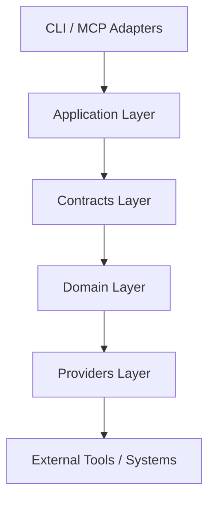
Sources: [README.md:52](), [package.json:32-34]()

## Tool Catalog

REA exposes a comprehensive set of tools to agents and CLI users, categorized by their function and target. The product catalog lists tools across various families [package.json:15-32]().

**Diagram: REA Tool Families**
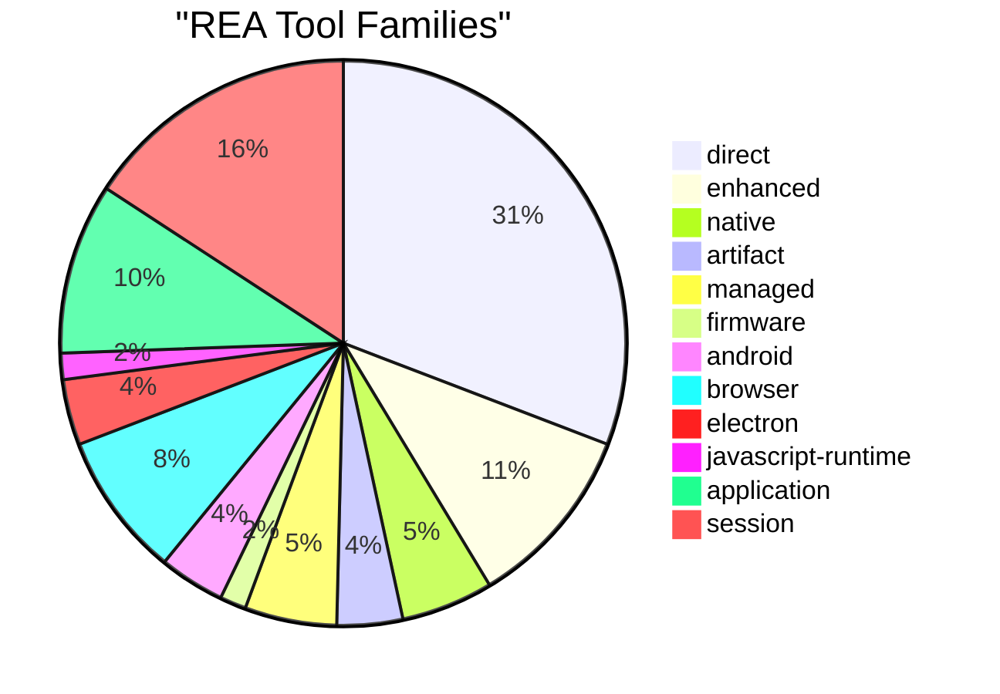
Sources: [package.json:15-32]()

## Integration with Coding Agents

REA is designed to integrate seamlessly with various AI coding assistants, providing them with the ability to perform reverse engineering tasks. The `rea setup` command registers REA with supported agents and installs matching workflow instructions [README.md:53-55]().

**Diagram: Agent Integration and MCP Flow**
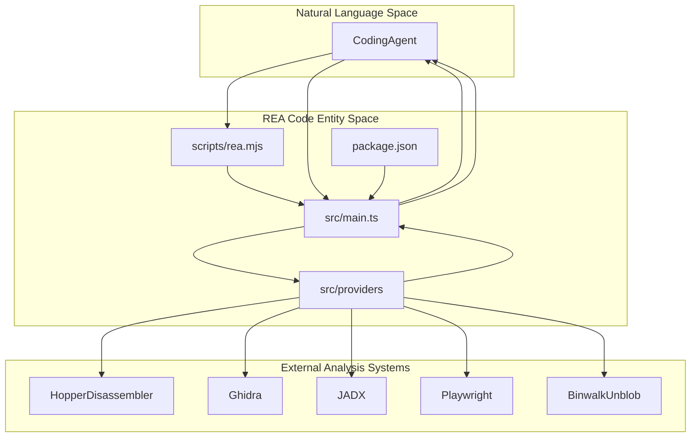
Sources: [README.md:53-55](), [README.md:70-86](), [package.json:32-34]()

## Navigation Guide

This wiki is organized to help you move from initial setup to deep architectural understanding.

### Getting Started
This page covers how to install REA via `npx` or `npm`, run `rea setup` to configure agents and analysis providers, and use `rea doctor` for diagnostics. It also details how to connect various coding agents like Claude Code, Codex, Cursor, Gemini, and VS Code. For details, see [Getting Started](#1.1).
Sources: [README.md:58-64](), [README.md:70-86](), [README.md:100-102]()

### Configuration Reference
This section provides a detailed reference for REA's configuration options, including environment variables, the `AppConfig` and `parseConfig` mechanisms, client configuration documents, identity and product catalog digests, and paths for cache and state management. For details, see [Configuration Reference](#1.2).
Sources: [package.json:1-46]()

### Setup, Doctor and Uninstall Internals
This page delves into the internal workings of REA's setup, doctor, and uninstall processes. It explains the plan/apply state machine used by `runSetup`, the roles of `SetupHost` and `SetupSkill`, how `Doctor` performs diagnostics and checks client registration status, and the mechanics of `Uninstall`. For details, see [Setup, Doctor and Uninstall Internals](#1.3).
Sources: [src/application/Uninstall.ts:1-181](), [src/application/ClientRegistrationStatus.ts:1-120]()

---

# Page: Getting Started

# Getting Started

<details>
<summary>Relevant source files</summary>

The following files were used as context for generating this wiki page:

- [.agents/skills/reverse-engineer-anything/references/connection-and-recovery.md](.agents/skills/reverse-engineer-anything/references/connection-and-recovery.md)
- [README.md](README.md)
- [docs/client-configuration.md](docs/client-configuration.md)
- [docs/installation.md](docs/installation.md)
- [scripts/hopper-demo-x11.py](scripts/hopper-demo-x11.py)
- [scripts/verify-package-environment.d.mts](scripts/verify-package-environment.d.mts)
- [scripts/verify-package-environment.mjs](scripts/verify-package-environment.mjs)
- [scripts/verify-package.mjs](scripts/verify-package.mjs)
- [src/application/ClientConfigurationDocument.ts](src/application/ClientConfigurationDocument.ts)
- [src/application/ClientRegistrationEnvironment.ts](src/application/ClientRegistrationEnvironment.ts)
- [src/application/ClientRegistrationIdentity.ts](src/application/ClientRegistrationIdentity.ts)
- [src/application/ClientRegistrationStatus.ts](src/application/ClientRegistrationStatus.ts)
- [src/application/Doctor.test.ts](src/application/Doctor.test.ts)
- [src/application/Doctor.ts](src/application/Doctor.ts)
- [src/application/DoctorDiagnostics.ts](src/application/DoctorDiagnostics.ts)
- [src/application/LinuxHopper.test.ts](src/application/LinuxHopper.test.ts)
- [src/application/LinuxHopper.ts](src/application/LinuxHopper.ts)
- [src/application/Setup.configuration.test.ts](src/application/Setup.configuration.test.ts)
- [src/application/Setup.fixture.ts](src/application/Setup.fixture.ts)
- [src/application/Setup.planning.test.ts](src/application/Setup.planning.test.ts)
- [src/application/Setup.recovery.test.ts](src/application/Setup.recovery.test.ts)
- [src/application/Setup.ts](src/application/Setup.ts)
- [src/application/SetupClientConfiguration.ts](src/application/SetupClientConfiguration.ts)
- [src/application/SetupHost.ts](src/application/SetupHost.ts)
- [src/application/SetupPlan.ts](src/application/SetupPlan.ts)
- [src/application/SetupSkill.ts](src/application/SetupSkill.ts)
- [src/application/SetupTypes.ts](src/application/SetupTypes.ts)
- [src/application/SupportedClients.ts](src/application/SupportedClients.ts)
- [src/application/Uninstall.ts](src/application/Uninstall.ts)
- [src/cli.ts](src/cli.ts)
- [src/cli/interactiveSetup.ts](src/cli/interactiveSetup.ts)
- [src/cli/setupCommands.ts](src/cli/setupCommands.ts)
- [src/domain/runtimeVersion.test.ts](src/domain/runtimeVersion.test.ts)
- [src/domain/runtimeVersion.ts](src/domain/runtimeVersion.ts)
- [src/identity.ts](src/identity.ts)
- [src/mcpStartupPolicy.ts](src/mcpStartupPolicy.ts)
- [src/process/snapshotEnvironment.test.ts](src/process/snapshotEnvironment.test.ts)
- [src/process/snapshotEnvironment.ts](src/process/snapshotEnvironment.ts)
- [src/setupEnvironment.test.ts](src/setupEnvironment.test.ts)
- [tests/boundary/cli/cliSetup.test.ts](tests/boundary/cli/cliSetup.test.ts)
- [tests/boundary/filesystem/clientConfigurationDialects.test.ts](tests/boundary/filesystem/clientConfigurationDialects.test.ts)
- [tests/boundary/filesystem/clientLifecycle.test.ts](tests/boundary/filesystem/clientLifecycle.test.ts)
- [tests/boundary/filesystem/kimiClientConfiguration.test.ts](tests/boundary/filesystem/kimiClientConfiguration.test.ts)
- [tests/boundary/filesystem/ompClientConfiguration.test.ts](tests/boundary/filesystem/ompClientConfiguration.test.ts)
- [tests/boundary/filesystem/setupSkill.test.ts](tests/boundary/filesystem/setupSkill.test.ts)
- [tests/boundary/filesystem/windowsNpxRegistration.test.ts](tests/boundary/filesystem/windowsNpxRegistration.test.ts)
- [tests/fixtures/clientEnvironment.ts](tests/fixtures/clientEnvironment.ts)

</details>


This page provides a technical guide for installing, configuring, and maintaining REA (Reverse Engineer Anything). It covers the idempotent setup workflow, environment verification via `rea doctor`, transactional client configuration for Model Context Protocol (MCP) coding agents, and maintenance commands like `rea update` and `rea uninstall`.

## Prerequisites and System Requirements

REA operates locally across native binaries, managed assemblies, JavaScript/Electron applications, and web runtimes. The installation requires compatible Node.js environments and optional analysis engines depending on target scopes.

| Requirement | Minimum Version / Spec | Verification Command |
| :--- | :--- | :--- |
| **Operating System** | macOS 12+, Ubuntu 24.04+, Fedora 41+, 64-bit Arch Linux, CachyOS, or Windows x64 | `uname -a` or `sw_vers -productVersion` |
| **Node.js** | 22.x (>=22.19), 24.x (>=24.11), or 26+ | `node --version` |
| **Hopper Disassembler** | v4 or v5 (macOS/Linux) | `rea doctor` |
| **Ghidra** | 12.1.x (Windows/Linux/macOS) | `rea doctor` |
| **JDK** | 17+ (for JADX), 21+ (for Ghidra 12.1.x) | `java -version` |

Sources: [docs/installation.md:1-5](), [src/application/Doctor.ts:94-126]()

## Installation and Setup

The primary entry point for agent and CLI configuration is the `setup` command implemented in `runSetup` [src/application/Setup.ts:32-36]() and hosted via `SetupHost` [src/application/SetupHost.ts:144-158]().

### Automated Setup via npx
To configure your agents and verify the local environment, run:
```bash
npx rea-agents setup
```
To explicitly select the latest published release:
```bash
npx rea-agents@latest setup
```
For non-interactive automation or CI pipelines, pass explicit flags such as `--yes`, `--all-detected`, or `--client <name>` along with `--json` [docs/installation.md:104-116]().

### Global Installation
To install the `rea` command globally on your system path:
```bash
npm install --global rea-agents
rea --help
```

### Skill-only Installation
To install only the agent instructions and bundled reference skills without registering REA's MCP server or analysis engines:
```bash
npx skills add morluto/rea --skill reverse-engineer-anything
```
Sources: [docs/installation.md:14-29](), [src/application/Setup.ts:32-36]()

### Setup Logic Flow and State Machine
The setup process follows a strict transaction lifecycle managed by `runSetup` [src/application/Setup.ts:32-36]() and `systemSetupHost` [src/application/SetupHost.ts:144-158](). It inspects system state, plans modifications, verifies existing configuration backups, and applies changes atomically.

Title: Setup State Machine and Execution Flow
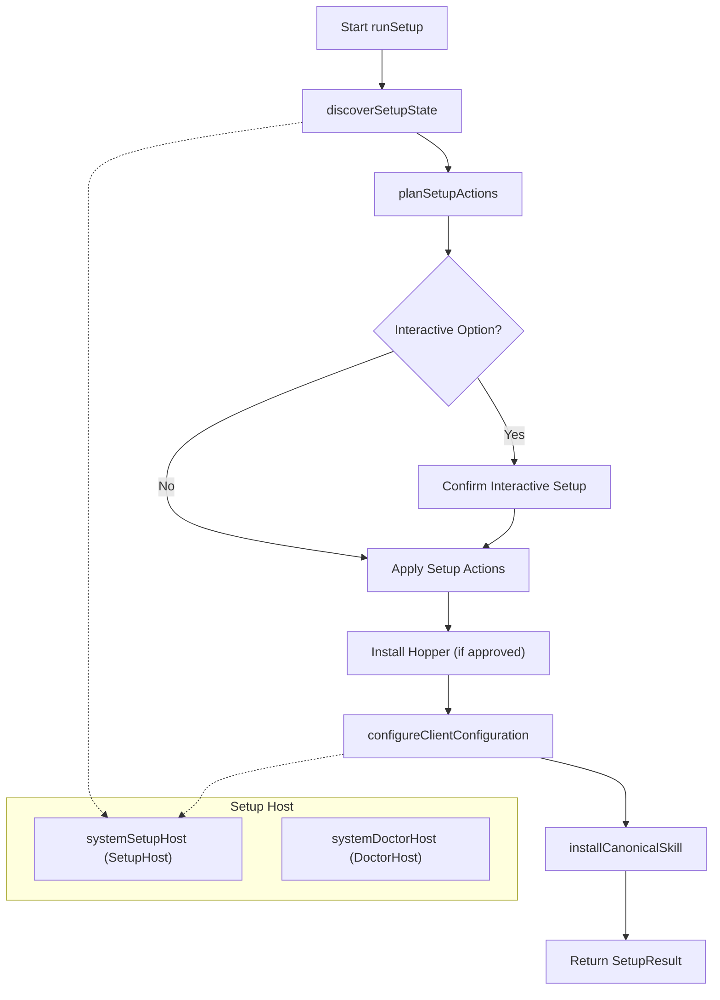
Sources: [src/application/Setup.ts:32-84](), [src/application/SetupHost.ts:144-179]()

## Verifying the Environment (`rea doctor`)

The `doctor` command executes a read-only health diagnostic across system dependencies, analysis provider runtimes, and client registrations [src/application/Doctor.ts:129-139]().

```bash
rea doctor
```

To scope diagnostics to specific components:
```bash
rea doctor --client codex --provider ghidra --skill
```

### Diagnostics Architecture
`collectDoctorDiagnostics` queries the `DoctorHost` interface [src/application/Doctor.ts:94-126]() to inspect Node.js compatibility, executable paths (`HOPPER_LAUNCHER_PATH`, `GHIDRA_INSTALL_DIR`, `JAVA_HOME`), OS distribution rules, and client configuration validity.

Title: Natural Language Space to Code Entity Space - Doctor Diagnostics
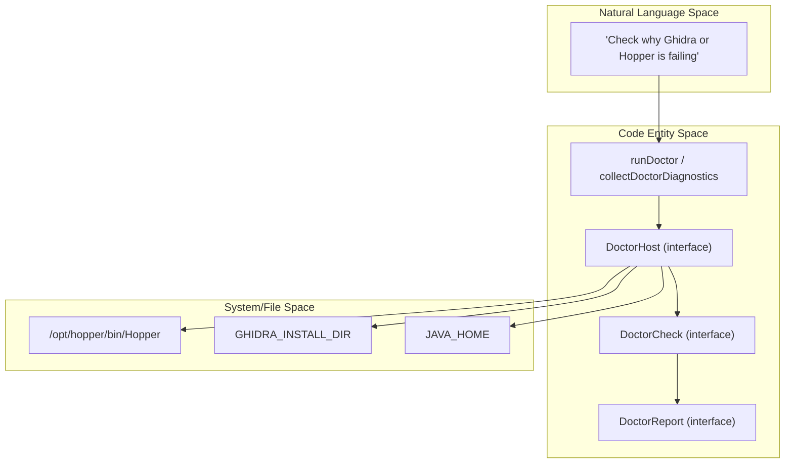
Sources: [src/application/Doctor.ts:44-52](), [src/application/Doctor.ts:94-126](), [src/application/Doctor.ts:129-139]()

## MCP Client Configuration and Transaction Lifecycle

REA integrates with coding agents by updating their respective JSON or TOML MCP configuration files via `configureClientConfiguration` [src/application/SetupClientConfiguration.ts:82-96]().

### Supported Agents and Configuration Formats
`rea setup` automatically discovers and configures supported agents:
- **Claude Code** (`claude_code`, JSON at `~/.claude.json`) [tests/boundary/filesystem/clientLifecycle.test.ts:50-84]()
- **Claude Desktop** (`claude_desktop`, JSON) [tests/boundary/filesystem/clientLifecycle.test.ts:56]()
- **Codex** (`codex`, TOML at `~/.codex/config.toml`) [tests/boundary/filesystem/clientLifecycle.test.ts:57]()
- **Cursor** (`cursor`, JSON at `~/.cursor/mcp.json`) [tests/boundary/filesystem/clientLifecycle.test.ts:58]()
- **Gemini CLI** (`gemini_cli`, JSON) [tests/boundary/filesystem/clientLifecycle.test.ts:59]()
- **VS Code** (`vscode`, JSON) [tests/boundary/filesystem/clientLifecycle.test.ts:68]()

### Transactional File Updates
To prevent corruption of user configurations, `configureClientConfiguration` executes a robust transaction protocol:
1. **Read Effective Configuration**: Parses existing files using `parseClientConfiguration` [src/application/ClientConfigurationDocument.ts:179-184]() while validating schema constraints (`ClientConfigurationShapeError`) [src/application/ClientConfigurationDocument.ts:144]().
2. **Backup Preservation**: Creates a `.rea.backup` file before overwriting [src/application/SetupClientConfiguration.ts:47-49]().
3. **Atomic Replacement**: Writes updated configuration blocks using `writeFileAtomic` [src/application/SetupClientConfiguration.ts:26]().
4. **Readback Verification**: Verifies the written file can be successfully parsed and loaded back into memory; rolls back automatically if verification fails.

Title: Natural Language Space to Code Entity Space - Client Configuration
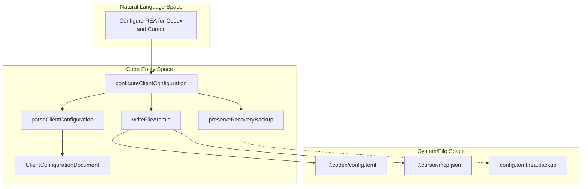
Sources: [src/application/SetupClientConfiguration.ts:82-207](), [src/application/ClientConfigurationDocument.ts:179-184]()

## Environment Variables

The following environment variables control REA's runtime setup, timeouts, and analysis engine discovery:

| Variable | Purpose |
| :--- | :--- |
| `HOPPER_LAUNCHER_PATH` | Explicit filesystem path to the Hopper Disassembler executable. |
| `GHIDRA_INSTALL_DIR` | Filesystem path to the Ghidra installation directory. |
| `JAVA_HOME` | Path to the Java Development Kit (JDK 17+ / JDK 21+). Required for Ghidra and JADX. |
| `REA_ANALYSIS_PROVIDER` | Default static/binary analysis provider override (e.g., `ghidra`, `hopper`). |
| `REA_LOG_LEVEL` | Logging verbosity (`debug`, `info`, `warn`, `error`, `silent`). |
| `REA_MCP_MAX_RESPONSE_BYTES` | Maximum allowed response payload size for MCP tool execution. |

Sources: [src/application/Doctor.ts:98-100](), [tests/boundary/filesystem/clientLifecycle.test.ts:103-106]()

## Maintenance: Update and Uninstall

REA provides dedicated CLI maintenance workflows for updating binaries and cleaning up client registrations.

### Updating REA (`rea update`)
To update a global installation of REA:
```bash
rea update
```
This command checks for package updates, downloads the latest distribution, and prompts the user to refresh their agent registrations.

### Uninstalling REA (`rea uninstall`)
To remove REA-owned agent configurations and managed skill files without touching third-party analysis engines like Hopper or Ghidra:
```bash
rea uninstall
```
To purge local caches and evidence state alongside registrations:
```bash
rea uninstall --purge-data
```
The uninstallation logic is implemented in `runUninstall` [src/application/Uninstall.ts:115-118]() via the `UninstallHost` abstraction [src/application/Uninstall.ts:98-107](), ensuring atomic, failure-resilient removal of REA artifacts.

Sources: [src/application/Uninstall.ts:115-118](), [src/application/Uninstall.ts:98-107]()

---

# Page: Configuration Reference

# Configuration Reference

<details>
<summary>Relevant source files</summary>

The following files were used as context for generating this wiki page:

- [.agents/skills/reverse-engineer-anything/references/connection-and-recovery.md](.agents/skills/reverse-engineer-anything/references/connection-and-recovery.md)
- [README.md](README.md)
- [docs/client-configuration.md](docs/client-configuration.md)
- [docs/installation.md](docs/installation.md)
- [docs/jeb-analysis.md](docs/jeb-analysis.md)
- [scripts/verify-deepseek-client.mjs](scripts/verify-deepseek-client.mjs)
- [scripts/verify-native-agent-client.mjs](scripts/verify-native-agent-client.mjs)
- [scripts/verify-package-environment.d.mts](scripts/verify-package-environment.d.mts)
- [scripts/verify-package-environment.mjs](scripts/verify-package-environment.mjs)
- [src/application/ClientConfigurationDocument.shape.test.ts](src/application/ClientConfigurationDocument.shape.test.ts)
- [src/application/ClientConfigurationDocument.ts](src/application/ClientConfigurationDocument.ts)
- [src/application/ClientRegistrationEnvironment.ts](src/application/ClientRegistrationEnvironment.ts)
- [src/application/ClientRegistrationStatus.ts](src/application/ClientRegistrationStatus.ts)
- [src/application/DshCordisYaml.ts](src/application/DshCordisYaml.ts)
- [src/application/HermesClientHome.ts](src/application/HermesClientHome.ts)
- [src/application/HermesConfigurationYaml.test.ts](src/application/HermesConfigurationYaml.test.ts)
- [src/application/HermesConfigurationYaml.ts](src/application/HermesConfigurationYaml.ts)
- [src/application/SetupClientConfiguration.ts](src/application/SetupClientConfiguration.ts)
- [src/application/SupportedClients.ts](src/application/SupportedClients.ts)
- [src/application/Uninstall.ts](src/application/Uninstall.ts)
- [src/application/jeb/JebAnalysisPort.ts](src/application/jeb/JebAnalysisPort.ts)
- [src/application/jeb/JebAnalysisService.test.ts](src/application/jeb/JebAnalysisService.test.ts)
- [src/composition/jeb.ts](src/composition/jeb.ts)
- [src/config.test.ts](src/config.test.ts)
- [src/config/environment.ts](src/config/environment.ts)
- [src/config/mcpInputSchemaProfile.ts](src/config/mcpInputSchemaProfile.ts)
- [src/config/mcpResponseBudget.ts](src/config/mcpResponseBudget.ts)
- [src/config/parseConfig.ts](src/config/parseConfig.ts)
- [src/config/parsers.ts](src/config/parsers.ts)
- [src/config/types.ts](src/config/types.ts)
- [src/jeb/JebMcpConnection.test.ts](src/jeb/JebMcpConnection.test.ts)
- [src/jeb/JebMcpConnection.ts](src/jeb/JebMcpConnection.ts)
- [src/jeb/JebProvider.test.ts](src/jeb/JebProvider.test.ts)
- [src/jeb/JebProvider.ts](src/jeb/JebProvider.ts)
- [src/mcpStartupPolicy.ts](src/mcpStartupPolicy.ts)
- [tests/acceptance/providers/jebConfigurationIsolation.test.ts](tests/acceptance/providers/jebConfigurationIsolation.test.ts)
- [tests/acceptance/setup/hermesClientSetup.test.ts](tests/acceptance/setup/hermesClientSetup.test.ts)
- [tests/acceptance/setup/piClientSetup.test.ts](tests/acceptance/setup/piClientSetup.test.ts)
- [tests/boundary/cli/jebCli.test.ts](tests/boundary/cli/jebCli.test.ts)
- [tests/boundary/filesystem/clientConfigurationDialects.test.ts](tests/boundary/filesystem/clientConfigurationDialects.test.ts)
- [tests/boundary/filesystem/clientConfigurationEnvironment.test.ts](tests/boundary/filesystem/clientConfigurationEnvironment.test.ts)
- [tests/boundary/filesystem/clientConfigurationTransactions.test.ts](tests/boundary/filesystem/clientConfigurationTransactions.test.ts)
- [tests/boundary/filesystem/clientLifecycle.test.ts](tests/boundary/filesystem/clientLifecycle.test.ts)
- [tests/boundary/filesystem/hermesClientConfiguration.test.ts](tests/boundary/filesystem/hermesClientConfiguration.test.ts)
- [tests/boundary/filesystem/hopperLauncherSelection.test.ts](tests/boundary/filesystem/hopperLauncherSelection.test.ts)
- [tests/boundary/filesystem/kimiClientConfiguration.test.ts](tests/boundary/filesystem/kimiClientConfiguration.test.ts)
- [tests/boundary/filesystem/ompClientConfiguration.test.ts](tests/boundary/filesystem/ompClientConfiguration.test.ts)
- [tests/boundary/filesystem/setupConfig.test.ts](tests/boundary/filesystem/setupConfig.test.ts)
- [tests/boundary/mcp/jebMcp.test.ts](tests/boundary/mcp/jebMcp.test.ts)
- [tests/boundary/providers/jebMcpCatalog.test.ts](tests/boundary/providers/jebMcpCatalog.test.ts)
- [tests/conformance/contracts/mcpInputSchemaProfile.test.ts](tests/conformance/contracts/mcpInputSchemaProfile.test.ts)
- [tests/fixtures/clientEnvironment.ts](tests/fixtures/clientEnvironment.ts)

</details>


The REA configuration system manages how the application interacts with analysis providers, validates target binaries and execution environments, handles logging, and integrates with client applications via Model Context Protocol (MCP) registrations. Configuration is primarily driven by environment variables parsed and validated into a type-safe `AppConfig` object at the application composition root. It also governs client configuration documents, registry dialects, identity and product catalog digests, cache/state paths, and logging levels.

---

## Configuration Data Flow and Composition Root

The configuration lifecycle begins when process inputs and environment maps are ingested at the composition root [src/config/parseConfig.ts:43-46](). The raw environment is processed, validated against schema definitions, and materialized into a structured `AppConfig` record before being supplied to downstream application services like `BinarySession` and transport adapters.

### Diagram: Configuration Flow and Composition Root

"Configuration Flow: Environment to Runtime"
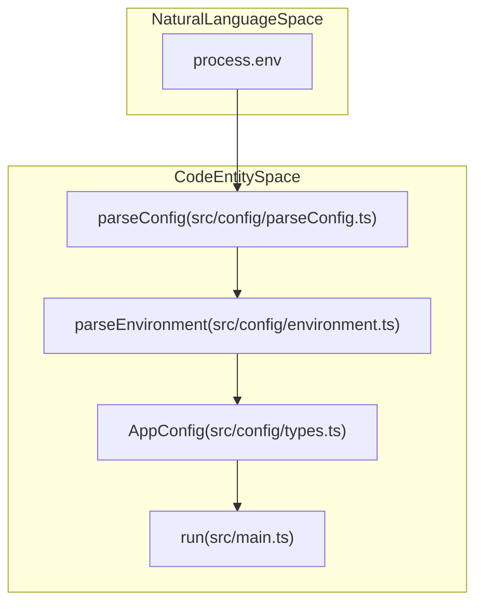

**Sources:** [src/config/parseConfig.ts:43-46](), [src/config/types.ts:5-18]()

---

## Environment Variables Reference

REA evaluates specific environment variables to control its execution profile, provider selections, and integration parameters. These are parsed and validated by `parseConfig` [src/config/parseConfig.ts:43-103]().

| Variable | Type | Default | Description |
| :--- | :--- | :--- | :--- |
| `REA_LOG_LEVEL` | Enum | `info` | Logging verbosity threshold (`trace`, `debug`, `info`, `warn`, `error`, `fatal`, `silent`). [src/config/parseConfig.ts:98]() |
| `REA_ANALYSIS_PROVIDER` | String | `auto` | Preferred analysis engine selector. [src/config/parseConfig.ts:61]() |
| `HOPPER_LAUNCHER_PATH` | String | Platform-specific | Path to Hopper Disassembler launcher or binary. [src/config/parseConfig.ts:88-93]() |
| `GHIDRA_INSTALL_DIR` | String | `undefined` | Installation root directory for Ghidra headless analyzer. [src/config/parseConfig.ts:65]() |
| `JAVA_HOME` | String | `undefined` | Java runtime path for Ghidra initialization. [src/config/parseConfig.ts:66]() |
| `REA_GHIDRA_STARTUP_TIMEOUT_MS` | Number | `undefined` | Initialization timeout threshold for Ghidra headless runs. [src/config/parseConfig.ts:67]() |
| `REA_GHIDRA_LANGUAGE_ID` | String | `undefined` | Optional Ghidra language override identifier. [src/config/parseConfig.ts:68-76]() |
| `REA_GHIDRA_COMPILER_SPEC_ID` | String | `undefined` | Optional Ghidra compiler specification ID. [src/config/parseConfig.ts:73-76]() |
| `REA_ILSPY_CMD_PATH` | String | `undefined` | Executable path for ILSpy CLI managed analysis provider. [src/config/parseConfig.ts:87]() |
| `REA_MCP_MAX_RESPONSE_BYTES` | Number | `undefined` | Maximum response byte limit for MCP payloads. [src/config/parseConfig.ts:55-57]() |
| `REA_MCP_INPUT_SCHEMA_PROFILE` | String | `undefined` | Schema profile level (`compact`, `full`) for MCP tool advertisements. [src/config/parseConfig.ts:58-60]() |

**Sources:** [src/config/parseConfig.ts:43-103]()

---

## The AppConfig Interface and Parsing

The internal configuration state is encapsulated by the `AppConfig` interface, ensuring type safety across boundaries.

```typescript
export interface AppConfig {
  readonly logLevel: LogLevel;
  readonly analysisProvider: AnalysisProviderSelection;
  readonly hopperPath: string | undefined;
  readonly ghidraPath: string | undefined;
  // ... additional provider paths and runtime policies
}
```

The parsing utility `parseConfig` validates the input environment map, resolves default tool locations (such as `defaultHopperLauncherPath` for Hopper binaries), and maps individual environment keys to `AppConfig` properties [src/config/parseConfig.ts:25-40]().

### Diagram: Mapping Natural Language Configuration Concepts to Code Entities

"Mapping Config Concepts to Code Symbols"
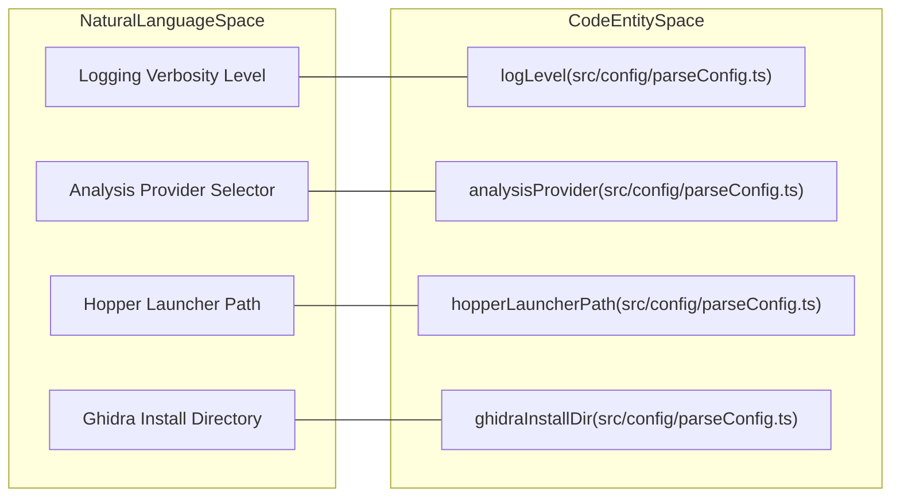

**Sources:** [src/config/parseConfig.ts:25-103](), [src/config/types.ts:5-18]()

---

## Client Configuration Documents and Dialects

REA registers itself as an MCP server within various coding agents and client applications. Each client uses distinct configuration structures, formats (JSON, JSONC, TOML, YAML), and server table paths, categorized as dialects via `ClientRegistrationDialect` [src/application/ClientConfigurationDocument.ts:37-48]().

The `ClientConfigurationDocument` structure holds the parsed configuration root, the resolved server table reference (`servers`), its structural location (`serversPath`), and legacy server mappings [src/application/ClientConfigurationDocument.ts:42-54]().

### Client Configuration Processing

The function `parseClientConfiguration` evaluates raw configuration text according to the target client format specification, handling JSONC comment stripping, TOML parsing, and OpenCode V1/V2 variations [src/application/ClientConfigurationDocument.ts:179-184]().

### Diagram: Client Configuration Document Processing

"Client Configuration Document Processing"
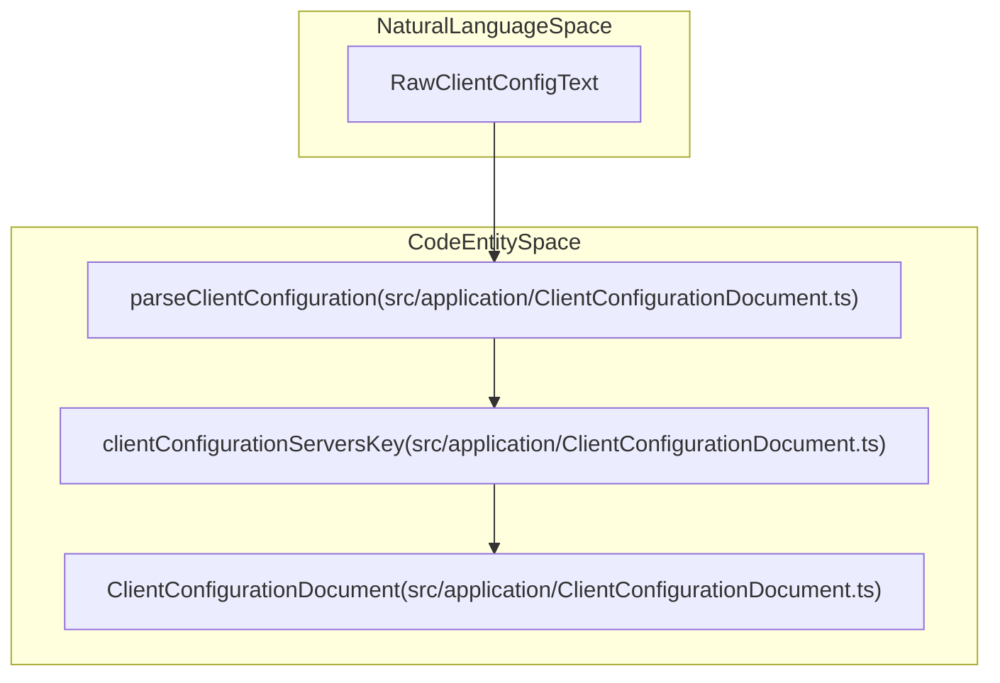

**Sources:** [src/application/ClientConfigurationDocument.ts:37-54](), [src/application/ClientConfigurationDocument.ts:179-184](), [src/application/SupportedClients.ts:14-54]()

---

## Digests, Cache, State Paths, and Logging Levels

REA relies on deterministic path resolution and cryptographic digests for configuration integrity:
*   **Cache and State Paths**: Temporary storage and caching directories default to local user paths (`~/.rea/cache` and `~/.rea/state`), governed by environment definitions and managed by setup/uninstall hosts [src/application/Uninstall.ts:69-82]().
*   **Logging Levels**: Managed via `pino` based on `REA_LOG_LEVEL`, writing output strictly to `stderr` during MCP operations to protect `stdout` JSON-RPC streams [src/config/parseConfig.ts:98]().
*   **Identity & Catalog Digests**: SHA-256 verification strings ensure immutable product catalog and capability matching during composition.

**Sources:** [src/config/parseConfig.ts:98](), [src/application/Uninstall.ts:69-82]()

---

# Page: Setup, Doctor and Uninstall Internals

# Setup, Doctor and Uninstall Internals

<details>
<summary>Relevant source files</summary>

The following files were used as context for generating this wiki page:

- [.agents/skills/rea-changelog-update/SKILL.md](.agents/skills/rea-changelog-update/SKILL.md)
- [scripts/hopper-demo-x11.py](scripts/hopper-demo-x11.py)
- [scripts/lib/release-notes-github.mjs](scripts/lib/release-notes-github.mjs)
- [scripts/lib/release-notes-publication.mjs](scripts/lib/release-notes-publication.mjs)
- [scripts/lib/release-notes.mjs](scripts/lib/release-notes.mjs)
- [scripts/release-notes.mjs](scripts/release-notes.mjs)
- [scripts/verify-package-update.mjs](scripts/verify-package-update.mjs)
- [scripts/verify-package.mjs](scripts/verify-package.mjs)
- [scripts/verify-published-package.mjs](scripts/verify-published-package.mjs)
- [src/application/ClientConfigurationFiles.ts](src/application/ClientConfigurationFiles.ts)
- [src/application/Doctor.test.ts](src/application/Doctor.test.ts)
- [src/application/Doctor.ts](src/application/Doctor.ts)
- [src/application/DoctorDiagnostics.ts](src/application/DoctorDiagnostics.ts)
- [src/application/GeminiClientSettings.ts](src/application/GeminiClientSettings.ts)
- [src/application/LinuxHopper.test.ts](src/application/LinuxHopper.test.ts)
- [src/application/LinuxHopper.ts](src/application/LinuxHopper.ts)
- [src/application/Setup.fixture.ts](src/application/Setup.fixture.ts)
- [src/application/Setup.planning.test.ts](src/application/Setup.planning.test.ts)
- [src/application/Setup.recovery.test.ts](src/application/Setup.recovery.test.ts)
- [src/application/Setup.ts](src/application/Setup.ts)
- [src/application/SetupHost.ts](src/application/SetupHost.ts)
- [src/application/SetupPlan.ts](src/application/SetupPlan.ts)
- [src/application/SetupSkill.ts](src/application/SetupSkill.ts)
- [src/application/SetupTypes.ts](src/application/SetupTypes.ts)
- [src/application/Update.test.ts](src/application/Update.test.ts)
- [src/application/Update.ts](src/application/Update.ts)
- [src/application/UpdateFailure.ts](src/application/UpdateFailure.ts)
- [src/application/UpdateMaintenance.ts](src/application/UpdateMaintenance.ts)
- [src/application/UpdateRuntime.release.test.ts](src/application/UpdateRuntime.release.test.ts)
- [src/application/UpdateRuntime.ts](src/application/UpdateRuntime.ts)
- [src/cli.ts](src/cli.ts)
- [src/cliLogging.test.ts](src/cliLogging.test.ts)
- [src/cliLogging.ts](src/cliLogging.ts)
- [src/domain/runtimeVersion.test.ts](src/domain/runtimeVersion.test.ts)
- [src/domain/runtimeVersion.ts](src/domain/runtimeVersion.ts)
- [src/identity.ts](src/identity.ts)
- [tests/acceptance/setup/geminiWorkspaceTrust.test.ts](tests/acceptance/setup/geminiWorkspaceTrust.test.ts)
- [tests/boundary/cli/clientProfileLifecycle.test.ts](tests/boundary/cli/clientProfileLifecycle.test.ts)
- [tests/boundary/cli/clientProfiles.test.ts](tests/boundary/cli/clientProfiles.test.ts)
- [tests/boundary/cli/projectedErrorStatus.test.ts](tests/boundary/cli/projectedErrorStatus.test.ts)
- [tests/boundary/filesystem/releaseNotes.test.ts](tests/boundary/filesystem/releaseNotes.test.ts)
- [tests/boundary/filesystem/setupSkill.test.ts](tests/boundary/filesystem/setupSkill.test.ts)
- [tests/boundary/filesystem/zcodeClientConfiguration.test.ts](tests/boundary/filesystem/zcodeClientConfiguration.test.ts)
- [tests/process-global/updateMaintenance.test.ts](tests/process-global/updateMaintenance.test.ts)

</details>


This page details the internal workings of REA's setup, doctor, update maintenance, and uninstall processes. It covers the state machine used by `runSetup`, the roles of `SetupHost` and `SetupSkill`, how `Doctor` performs diagnostics and reports client registration status, update maintenance rules, and the mechanics of `Uninstall`. The goal is to provide a deep technical understanding of these core lifecycle operations.

## Setup Internals

The `runSetup` function orchestrates the setup process, which involves discovering the current state of the system, planning necessary actions, and then applying those actions. It operates as a state machine, moving through discovery, planning, and application phases, with optional interactive confirmation steps.

### Setup State Machine (`runSetup`)

The `runSetup` function [src/application/Setup.ts:32-36]() is the entry point for the setup process. It takes `SetupOptions`, a `SetupHost` implementation [src/application/SetupHost.ts:144-147](), and an optional `SetupConfirmation` callback.

The process begins by checking for unsupported host environments using `hostRemediation` [src/application/Setup.ts:108-109](). If the host is unsupported, the setup fails.

Next, it discovers the initial setup state, including the current Hopper path and provider environment, from the `SetupHost` [src/application/Setup.ts:110-111]().

The core discovery phase is handled by `discoverSetupState` [src/application/Setup.ts:112-120](), which identifies detected clients, default clients, and whether the REA skill needs installation [src/application/SetupPlan.ts:38-45]().

Based on the discovery, `runSetup` determines which clients are selected for configuration [src/application/Setup.ts:131-139](). If interactive selection is enabled, `planSetupActions` is called to generate a preliminary set of actions for user confirmation [src/application/Setup.ts:159-173]().

After selection, `planSetupActions` is called again with the resolved client IDs and skill installation status to generate the final `plannedActions` [src/application/SetupPlan.ts:134-147](). This plan includes actions like installing Hopper, installing the REA skill, and configuring clients.

Finally, the `plannedActions` are iterated, and each action is applied [src/application/Setup.ts:200-240]().

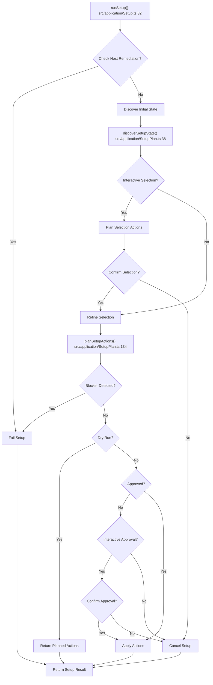
Sources: [src/application/Setup.ts:32-139](), [src/application/SetupPlan.ts:38-45](), [src/application/SetupPlan.ts:134-147]()

### `SetupHost` and `SetupSkill`

`SetupHost` is an interface that abstracts system operations required for setup. `systemSetupHost` provides a concrete implementation [src/application/SetupHost.ts:144-147]().

Key responsibilities of `SetupHost` include:
* `doctor()`: Runs diagnostics to assess system health and readiness [src/application/Doctor.ts:154-184]().
* `installHopper()` / `uninstallHopper()`: Manages Hopper binaries [src/application/Setup.fixture.ts:87-105]().
* `installSkill()` / `uninstallSkill()`: Manages the canonical skill bundle via `SetupSkill` [src/application/SetupSkill.ts:152-168]().
* `configureClient()` / `unconfigureClient()`: Modifies agent configuration documents [src/application/Setup.fixture.ts:110-121]().

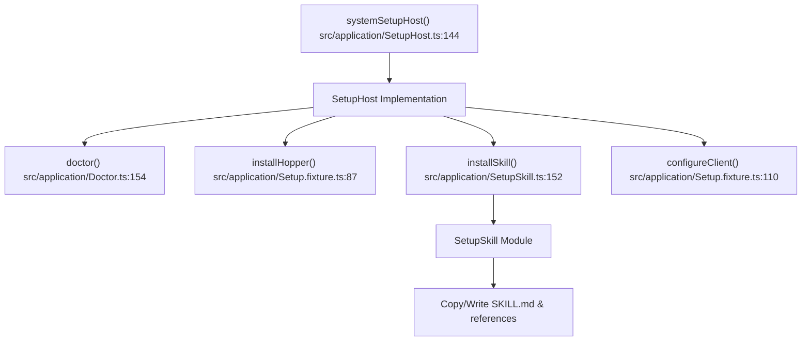
Sources: [src/application/SetupHost.ts:144-147](), [src/application/Setup.fixture.ts:87-121](), [src/application/SetupSkill.ts:152-168]()

## Doctor Internals

The `doctor` command provides diagnostics about the REA environment, including system health, provider readiness, and client registration status [src/application/Doctor.ts:129-139]().

### `DoctorHost` and `DoctorReport`

`runDoctor` executes diagnostic checks across the system and gathers runtime details through `DoctorHost` [src/application/Doctor.ts:94-126](). The resulting `DoctorReport` structures information into healthy/unhealthy checks, scope reports, and installation identities [src/application/Doctor.ts:129-139]().

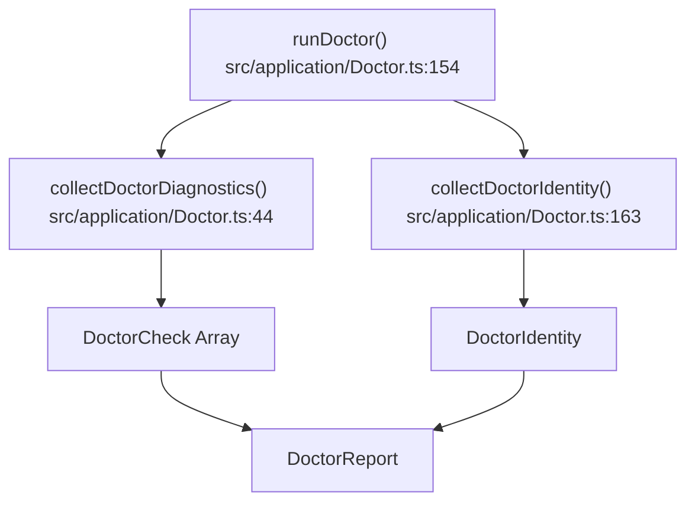
Sources: [src/application/Doctor.ts:44-46](), [src/application/Doctor.ts:129-139](), [src/application/Doctor.ts:154-163]()

## Update Maintenance Internals

Update maintenance handles updating existing client registrations and skill files when a new version of REA is installed [tests/process-global/updateMaintenance.test.ts:10-12]().

* `existingMaintenanceScope` checks which installed agent integrations currently reference REA and require updates [tests/process-global/updateMaintenance.test.ts:92-93]().
* User-disabled or natively foreign integrations are carefully excluded from automatic maintenance updates to prevent overriding user intent [tests/process-global/updateMaintenance.test.ts:106-116]().

Sources: [tests/process-global/updateMaintenance.test.ts:10-12](), [tests/process-global/updateMaintenance.test.ts:92-116]()

## Uninstall Internals

The `uninstall` command removes REA-owned state from the system, including client registrations, the REA skill, and cached data [tests/boundary/cli/clientProfileLifecycle.test.ts:92-120]().

### `runUninstall` and Purge Behavior

When run with `--purge-data`, `runUninstall` removes local state and cache directories, ensuring that symbolic links or unrelated application directories are properly verified or retained [tests/boundary/cli/clientProfileLifecycle.test.ts:92-130]().

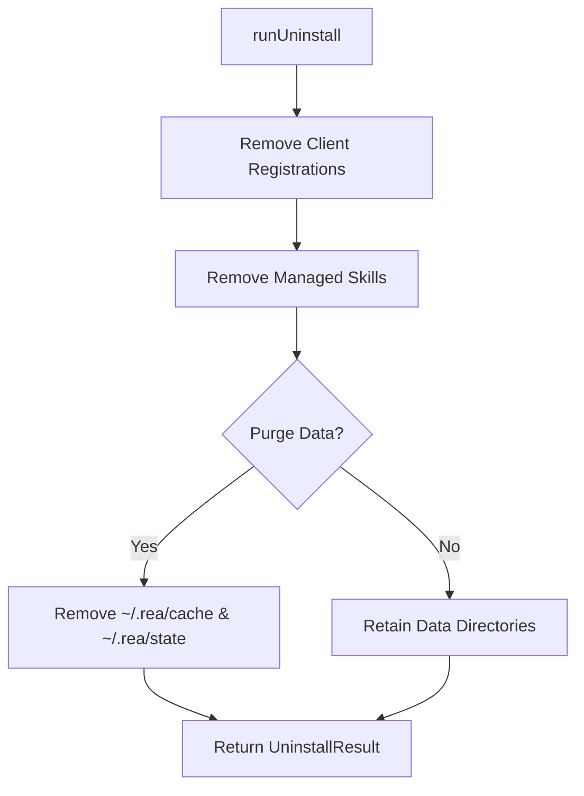
Sources: [tests/boundary/cli/clientProfileLifecycle.test.ts:92-130]()

---
Sources: `scripts/verify-package.mjs`, `src/application/Doctor.ts`, `src/application/Setup.ts`, `src/cli.ts`, `src/application/SetupHost.ts`, `src/application/SetupPlan.ts`, `src/application/SetupSkill.ts`, `tests/boundary/cli/clientProfileLifecycle.test.ts`, `src/application/Doctor.test.ts`, `tests/process-global/updateMaintenance.test.ts`, `scripts/verify-published-package.mjs`, `src/application/Setup.fixture.ts`

---

# Page: Architecture

# Architecture

<details>
<summary>Relevant source files</summary>

The following files were used as context for generating this wiki page:

- [.github/workflows/ci.yml](.github/workflows/ci.yml)
- [.github/workflows/release.yml](.github/workflows/release.yml)
- [.husky/pre-commit](.husky/pre-commit)
- [.husky/pre-push](.husky/pre-push)
- [.oxlintrc.json](.oxlintrc.json)
- [AGENTS.md](AGENTS.md)
- [CONTRIBUTING.md](CONTRIBUTING.md)
- [docs/releasing.md](docs/releasing.md)
- [docs/testing.md](docs/testing.md)
- [docs/tool-design.md](docs/tool-design.md)
- [knip.json](knip.json)
- [scripts/ci/plan.mjs](scripts/ci/plan.mjs)
- [scripts/ci/scopes.mjs](scripts/ci/scopes.mjs)
- [scripts/lib/catalog-builders.mjs](scripts/lib/catalog-builders.mjs)
- [scripts/lib/catalog-core.mjs](scripts/lib/catalog-core.mjs)
- [scripts/lib/module-boundaries.d.mts](scripts/lib/module-boundaries.d.mts)
- [scripts/lib/module-boundaries.mjs](scripts/lib/module-boundaries.mjs)
- [scripts/lib/release-checkpoint.mjs](scripts/lib/release-checkpoint.mjs)
- [scripts/scan-todos.mjs](scripts/scan-todos.mjs)
- [scripts/verify-release-checkpoint.mjs](scripts/verify-release-checkpoint.mjs)
- [src/application/CapabilityInventory.test.ts](src/application/CapabilityInventory.test.ts)
- [src/application/CapabilityInventory.ts](src/application/CapabilityInventory.ts)
- [src/cliCommandNames.ts](src/cliCommandNames.ts)
- [src/contracts/toolContracts.ts](src/contracts/toolContracts.ts)
- [src/contracts/toolEffects.ts](src/contracts/toolEffects.ts)
- [src/domain/hopperValues.test.ts](src/domain/hopperValues.test.ts)
- [src/hopper/HopperProvider.test.ts](src/hopper/HopperProvider.test.ts)
- [src/server/createServer.ts](src/server/createServer.ts)
- [src/server/mcpClientMetadata.ts](src/server/mcpClientMetadata.ts)
- [src/server/registerSessionStatusTool.ts](src/server/registerSessionStatusTool.ts)
- [src/server/registerSessionTools.ts](src/server/registerSessionTools.ts)
- [tests/boundary/filesystem/ciChangeScope.test.ts](tests/boundary/filesystem/ciChangeScope.test.ts)
- [tests/boundary/filesystem/ciRequiredLanes.test.ts](tests/boundary/filesystem/ciRequiredLanes.test.ts)
- [tests/boundary/filesystem/releaseCheckpoint.test.ts](tests/boundary/filesystem/releaseCheckpoint.test.ts)
- [tests/boundary/filesystem/releaseWorkflow.test.ts](tests/boundary/filesystem/releaseWorkflow.test.ts)
- [tests/boundary/filesystem/staticTaskCache.test.ts](tests/boundary/filesystem/staticTaskCache.test.ts)
- [tests/boundary/mcp/clientCapabilities.test.ts](tests/boundary/mcp/clientCapabilities.test.ts)
- [tests/boundary/mcp/enhancedTools.04-uses-complete-inventories-inline.test.ts](tests/boundary/mcp/enhancedTools.04-uses-complete-inventories-inline.test.ts)
- [tests/composition/idaProvider.test.ts](tests/composition/idaProvider.test.ts)
- [tests/evaluation/moduleBoundaries.test.ts](tests/evaluation/moduleBoundaries.test.ts)
- [tests/support/workflowGit.ts](tests/support/workflowGit.ts)
- [turbo.json](turbo.json)

</details>


Purpose: Overview of the layered architecture (`src/domain/` → `src/contracts/` → `src/hopper/`, `src/ghidra/` → `src/application/` → `src/server/`, `src/cli.ts`), dependency rules from `AGENTS.md`, module boundary enforcement, and data flow. This is a parent page; detailed explanations reside in the linked child pages.

Sources: [AGENTS.md:15-18](), [tests/evaluation/moduleBoundaries.test.ts:1-31]()

## Layered Architecture Overview

The system is organized into distinct layers, with dependencies flowing inward from pure domain logic through contracts, providers, application workflows, and finally to CLI/MCP adapters. This structure is explicitly enforced to maintain separation of concerns and prevent circular dependencies.

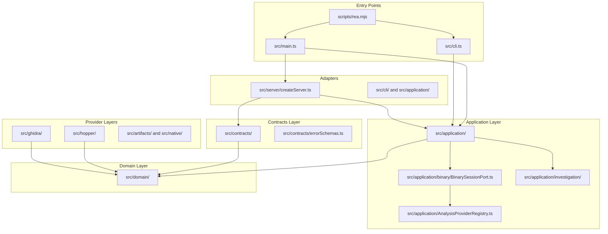

Sources: [AGENTS.md:15-18](), [docs/architecture.mermaid:1-70]()

## Dependency Rules and Module Boundaries

REA enforces strict dependency rules to maintain its layered architecture. Dependencies flow inward: domain semantics and contracts, provider adapters, shared application workflows, then CLI/MCP adapters [AGENTS.md:15-18](). Engine protocols and provider-specific code are strictly kept out of domain and application layers.

Module boundaries are programmatically enforced via `src/evaluation/moduleBoundaries.test.ts` and `scripts/lib/module-boundaries.mjs`, which inspect import paths during static analysis checks [tests/evaluation/moduleBoundaries.test.ts:1-31]().

Sources: [AGENTS.md:15-18](), [tests/evaluation/moduleBoundaries.test.ts:1-31]()

## Data Flow

Data flows inward from entry points (`scripts/rea.mjs`, `src/main.ts`, `src/cli.ts`) to application services (`src/application/`), which query provider adapters (`src/hopper/`, `src/ghidra/`) or artifact readers (`src/artifacts/`). Results are projected through typed structures in `src/contracts/` before delivery via MCP `createServer` or CLI stdout.

Sources: [AGENTS.md:15-18](), [src/server/createServer.ts:1-50]()

---

## Architectural Sub-Topics

### 2.1 Entry Points and Dispatching
The script `scripts/rea.mjs` acts as the primary dispatcher routing execution to `src/main.ts` (MCP stdio server) or `src/cli.ts` (one-shot command router). 

For details, see [Entry Points and Dispatching](#2.1).

Sources: [docs/architecture.mermaid:3-5]()

### 2.2 Domain Layer
Pure, provider-neutral logic resides in `src/domain/`, implementing core concepts such as `Result` error algebras, canonical digests, evidence schemas, and binary target parsers [AGENTS.md:15-18]().

For details, see [Domain Layer](#2.2).

Sources: [AGENTS.md:15-18](), [docs/architecture.mermaid:54-56]()

### 2.3 Contracts and Tool Catalog
`src/contracts/` defines `ToolContract` inventories, input/output schemas, tool effects, and generates build artifacts like `.cache/mcp-tool-catalog.json` and `docs/public/product-catalog.json`.

For details, see [Contracts and Tool Catalog](#2.3).

Sources: [AGENTS.md:27-28](), [src/contracts/toolContracts.ts:1-38]()

### 2.4 Application Layer
`src/application/` coordinates binary sessions, `CapabilityInventory`, `DirectAnalysis`, and analysis snapshot caching across providers.

For details, see [Application Layer](#2.4).

Sources: [src/application/CapabilityInventory.ts:1-40]()

### 2.5 Server Layer (MCP Adapter)
`src/server/createServer.ts` assembles the MCP server instance, registering tool modules (`registerOfficialTools`, `registerEnhancedTools`, `registerSessionTools`, etc.) and mapping execution outputs via `toolResult.ts`.

For details, see [Server Layer (MCP Adapter)](#2.5).

Sources: [src/server/createServer.ts:1-60]()

---

# Page: Entry Points and Dispatching

# Entry Points and Dispatching

<details>
<summary>Relevant source files</summary>

The following files were used as context for generating this wiki page:

- [docs/.vitepress/config.ts](docs/.vitepress/config.ts)
- [docs/cli.md](docs/cli.md)
- [docs/error-contract.schema.json](docs/error-contract.schema.json)
- [docs/index.md](docs/index.md)
- [scripts/bundle-runtime.mjs](scripts/bundle-runtime.mjs)
- [scripts/prepack.mjs](scripts/prepack.mjs)
- [scripts/rea.mjs](scripts/rea.mjs)
- [scripts/verify/javascript/output.mjs](scripts/verify/javascript/output.mjs)
- [src/application/JsonFiles.ts](src/application/JsonFiles.ts)
- [src/application/JsonInputFile.ts](src/application/JsonInputFile.ts)
- [src/application/RegularFileRead.ts](src/application/RegularFileRead.ts)
- [src/application/Utf8JsonInput.ts](src/application/Utf8JsonInput.ts)
- [src/application/binary/AnalysisSnapshotFiles.ts](src/application/binary/AnalysisSnapshotFiles.ts)
- [src/cli/cliResultOutput.ts](src/cli/cliResultOutput.ts)
- [src/cli/jsonOutput.ts](src/cli/jsonOutput.ts)
- [src/cliBrowserContext.ts](src/cliBrowserContext.ts)
- [src/cliHostInputs.test.ts](src/cliHostInputs.test.ts)
- [src/cliJsonInput.ts](src/cliJsonInput.ts)
- [src/cliOutput.ts](src/cliOutput.ts)
- [src/contracts/errorSchemas.ts](src/contracts/errorSchemas.ts)
- [src/main.ts](src/main.ts)
- [src/main/processShutdown.ts](src/main/processShutdown.ts)
- [src/main/shutdown.ts](src/main/shutdown.ts)
- [src/main/startup.ts](src/main/startup.ts)
- [src/main/transport.ts](src/main/transport.ts)
- [tests/boundary/cli/cliOutput.test.ts](tests/boundary/cli/cliOutput.test.ts)
- [tests/boundary/cli/closedStdout.test.ts](tests/boundary/cli/closedStdout.test.ts)
- [tests/boundary/cli/dispatcher.test.ts](tests/boundary/cli/dispatcher.test.ts)
- [tests/boundary/cli/jsonInputSize.test.ts](tests/boundary/cli/jsonInputSize.test.ts)
- [tests/boundary/cli/jsonInputStatus.test.ts](tests/boundary/cli/jsonInputStatus.test.ts)
- [tests/boundary/cli/jsonOutput.test.ts](tests/boundary/cli/jsonOutput.test.ts)
- [tests/boundary/filesystem/analysisSnapshot.test.ts](tests/boundary/filesystem/analysisSnapshot.test.ts)
- [tests/boundary/filesystem/analysisSnapshotInput.test.ts](tests/boundary/filesystem/analysisSnapshotInput.test.ts)
- [tests/boundary/filesystem/boundedFileBytes.test.ts](tests/boundary/filesystem/boundedFileBytes.test.ts)
- [tests/boundary/filesystem/cliJsonInput.test.ts](tests/boundary/filesystem/cliJsonInput.test.ts)
- [tests/boundary/mcp/shutdown.test.ts](tests/boundary/mcp/shutdown.test.ts)
- [tests/boundary/process/browserScenarioProbeLifecycle.test.ts](tests/boundary/process/browserScenarioProbeLifecycle.test.ts)
- [tests/boundary/process/runtimeBundle.test.ts](tests/boundary/process/runtimeBundle.test.ts)
- [tests/process-global/cliJsonInputStatus.test.ts](tests/process-global/cliJsonInputStatus.test.ts)

</details>


REA provides three primary entry points to facilitate interaction via coding agents (MCP), direct terminal usage (CLI), and internal script routing. The system is designed around a shared `BinarySession` that manages the lifecycle of analysis providers.

## The Dispatcher: `scripts/rea.mjs`

The `scripts/rea.mjs` file serves as the universal binary entry point [scripts/rea.mjs:1-15](). It is responsible for routing execution flow based on command-line arguments before heavyweight TypeScript-transpiled modules are loaded.

- **MCP Routing**: If the arguments specify `--mcp` or `mcp`, it imports and invokes `runEntrypoint` from `dist/mcp/main.js` [scripts/rea.mjs:14-15, 58-60]().
- **MCP Doctor Routing**: If the command is `mcp doctor`, it invokes `runProductionMcpDoctorCli` from `dist/cli-runtime/mcpDoctor.js` [scripts/rea.mjs:16, 63-70]().
- **CLI Routing**: For all other commands, it loads `createCli`, `cliResultOutput`, and output validation utilities from the `dist/cli-runtime/` bundle [scripts/rea.mjs:71-84](). It guards against closed output pipes via `guardClosedStdout()` to handle `SIGPIPE` (`SIGPIPE_EXIT_STATUS = 141`) gracefully [scripts/rea.mjs:17-20, 82, 119-129]().
- **Runtime Check**: Before loading modules, it checks for compiled runtime existence using `compiledRuntimeExists()` [scripts/rea.mjs:53, 135-145](). If missing, it outputs an instruction to run `npm ci && npm run build:cached` and exits with status 1 [scripts/rea.mjs:53-57]().

### Entry Point Dispatch Logic

**Title: Entry Point Dispatch Logic**
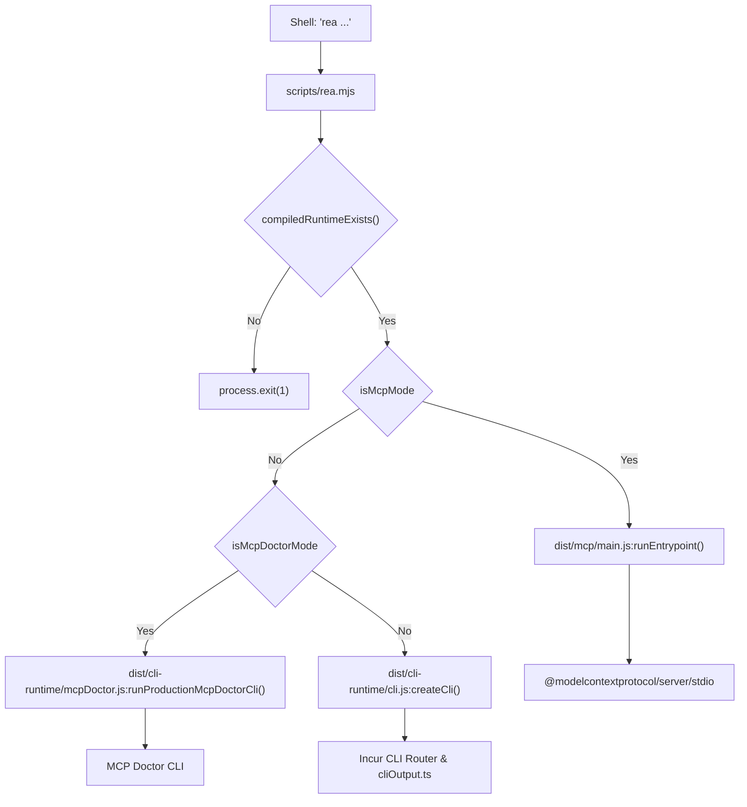
Sources: [scripts/rea.mjs:1-111]()

---

## MCP Stdio Adapter: `src/main.ts`

The `src/main.ts` module implements the long-lived Model Context Protocol (MCP) server adapter. It acts as the bridge between AI agents and analysis engines.

### Initialization and Session Startup
1. **Environment & Config**: It snapshots `process.env` via `snapshotEnvironment()` and validates configuration using `parseConfig()` [src/main.ts:44-45](). Invalid configuration prints a projected error to `stderr` and exits with code 1 [src/main.ts:46-49]().
2. **Logger & Session**: It instantiates a pino logger (`createLogger`) and a `BinarySession` via `createBinarySession()` [src/main.ts:50-52]().
3. **Initial Target**: It opens an initial target if specified (`openInitialTarget`) [src/main.ts:53-58]().
4. **Transport**: It starts the MCP transport via `startMcpTransport()` and attaches tool result delivery constraints (`mcpMaxResponseBytes`) [src/main.ts:60-71]().
5. **Shutdown**: Idempotent process shutdown handlers are registered via `createShutdown()` and `registerProcessShutdown` [src/main.ts:24, 73-80]().

### Natural Language to Code Entity Mapping: MCP Lifecycle

**Title: MCP Stdio Adapter Code Entity Map**
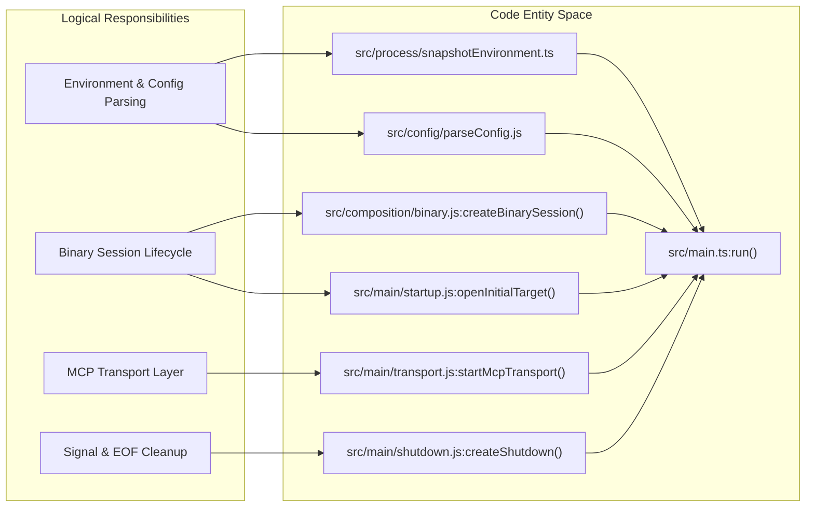
Sources: [src/main.ts:41-82]()

---

## One-Shot CLI and Command Registration: `src/cli.ts`

The `src/cli.ts` module defines the terminal interface using the Incur library. CLI commands operate in a "one-shot" mode: they parse parameters, execute a single command, and exit.

### Command Families Registered
The `createCli` function registers numerous domains:
- Core analysis (`registerCoreCommands`)
- Setup and diagnostics (`registerSetupCommands`)
- Artifact inspection (`registerArtifactCommands`)
- Managed assemblies (`registerManagedCommands`)
- Firmware and hardware (`registerFirmwareCommands`)
- Browser observation (`registerBrowserCommands`)
- Electron inspection (`registerElectronCommands`)
- Application graphs (`registerApplicationCommands`)
- Evidence ledgers (`registerEvidenceCommands`)

Sources: [src/cli.ts:15-28]()

---

## JSON Input and Output Handling

CLI commands frequently accept JSON input (either inline strings or file paths) and structured output formats.

### JSON Input Resolution (`src/cliJsonInput.ts`)
- **Parsing**: `parseCliJsonInput()` tests if the input string is valid inline JSON via `safeParseJson()`. If that fails, it treats the input as a filesystem path using `readJsonInputFile()` [src/cliJsonInput.ts:14-24]().
- **Path Resolution**: `resolveCliJsonPaths()` resolves operator-relative path fields within JSON input documents against the working directory while ignoring non-file schemes and URLs [src/cliJsonInput.ts:75-114]().
- **Error Diagnostics**: File access denials (`EACCES`, `EPERM`) and non-regular file reads (e.g., named pipes, character devices like `/dev/null`) are caught and projected with typed error codes (`invalid_request`, `read-failed`) [src/cliJsonInput.ts:39-57]().

### CLI Output Controls (`src/cliOutput.ts`)
- **Argument Normalization**: `normalizeCliOutputArguments()` splits `--flag=value` formats for valued output flags so Incur can consume them [src/cliOutput.ts:19-29]().
- **Validation**: `validateCliOutputArguments()` ensures output combinations are safe (e.g., rejecting `--token-limit` combined with structured formats like `json`, `jsonl`, or `yaml` which would corrupt structured payloads) [src/cliOutput.ts:142-176]().

### Natural Language to Code Entity Mapping: CLI Input Pipeline

**Title: CLI JSON Input Pipeline Entity Map**
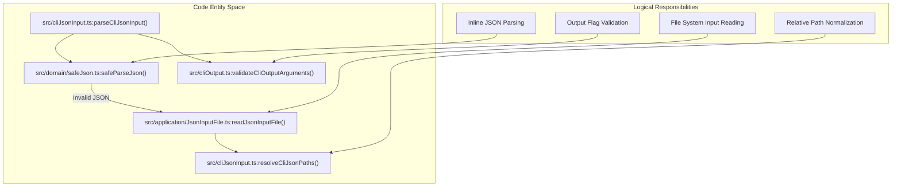
Sources: [src/cliJsonInput.ts:14-114](), [src/cliOutput.ts:142-176]()

---

## The Dispatching Core: `BinarySession`

The `BinarySession` class in `src/application/BinarySession.ts` coordinates target lifecycle management for both the MCP server and CLI commands.

### Session Management Implementation
- **Serialization**: All target transitions (opening and closing) are serialized using a promise chain (`#transition`) to prevent race conditions during engine teardown [src/application/BinarySession.ts:43, 152-159]().
- **Draining**: Prior to closing a provider client, the session drains pending tool executions via `#drainCalls` [src/application/BinarySession.ts:103, 161-163]().
- **Restoration**: If opening a new target fails, the session attempts to restore the prior valid client state [src/application/BinarySession.ts:85-90, 165-175]().

Sources: [src/application/BinarySession.ts:39-175]()

---

# Page: Domain Layer

# Domain Layer

<details>
<summary>Relevant source files</summary>

The following files were used as context for generating this wiki page:

- [docs/user-visible-errors.csv](docs/user-visible-errors.csv)
- [install.sh](install.sh)
- [scripts/verify-real-ghidra-swift.mjs](scripts/verify-real-ghidra-swift.mjs)
- [src/application/binary/AnalysisSnapshotCache.test.ts](src/application/binary/AnalysisSnapshotCache.test.ts)
- [src/application/binary/AnalysisSnapshotCache.ts](src/application/binary/AnalysisSnapshotCache.ts)
- [src/application/managed/ManagedReconstructionService.test.ts](src/application/managed/ManagedReconstructionService.test.ts)
- [src/contracts/analysisViewApiSurfaceExample.ts](src/contracts/analysisViewApiSurfaceExample.ts)
- [src/domain/analysisErrorBase.ts](src/domain/analysisErrorBase.ts)
- [src/domain/analysisErrorPresentation.ts](src/domain/analysisErrorPresentation.ts)
- [src/domain/analysisErrorProjection.test.ts](src/domain/analysisErrorProjection.test.ts)
- [src/domain/analysisErrorProjection.ts](src/domain/analysisErrorProjection.ts)
- [src/domain/analysisProfile.test.ts](src/domain/analysisProfile.test.ts)
- [src/domain/analysisProfile.ts](src/domain/analysisProfile.ts)
- [src/domain/analysisSnapshot.test.ts](src/domain/analysisSnapshot.test.ts)
- [src/domain/analysisSnapshot.ts](src/domain/analysisSnapshot.ts)
- [src/domain/configurationErrors.ts](src/domain/configurationErrors.ts)
- [src/domain/evidence.test.ts](src/domain/evidence.test.ts)
- [src/domain/evidence.ts](src/domain/evidence.ts)
- [src/domain/functionComparison.test.ts](src/domain/functionComparison.test.ts)
- [src/domain/functionComparison.ts](src/domain/functionComparison.ts)
- [src/domain/functionComparisonDimensions.ts](src/domain/functionComparisonDimensions.ts)
- [src/domain/functionComparisonNormalization.ts](src/domain/functionComparisonNormalization.ts)
- [src/domain/functionComparisonResults.ts](src/domain/functionComparisonResults.ts)
- [src/domain/functionComparisonSchemas.ts](src/domain/functionComparisonSchemas.ts)
- [src/domain/functionDossierEvidence.ts](src/domain/functionDossierEvidence.ts)
- [src/domain/jsonValue.test.ts](src/domain/jsonValue.test.ts)
- [src/domain/jsonValue.ts](src/domain/jsonValue.ts)
- [src/domain/managed/managedReconstruction.ts](src/domain/managed/managedReconstruction.ts)
- [src/domain/native/objcSwiftMetadata.test.ts](src/domain/native/objcSwiftMetadata.test.ts)
- [src/domain/native/objcSwiftMetadata.ts](src/domain/native/objcSwiftMetadata.ts)
- [src/domain/rawBinary.test.ts](src/domain/rawBinary.test.ts)
- [src/domain/rawBinary.ts](src/domain/rawBinary.ts)
- [src/domain/reconstructionUnknowns.test.ts](src/domain/reconstructionUnknowns.test.ts)
- [src/domain/reconstructionUnknowns.ts](src/domain/reconstructionUnknowns.ts)
- [src/domain/residualUnknown.test.ts](src/domain/residualUnknown.test.ts)
- [src/domain/residualUnknown.ts](src/domain/residualUnknown.ts)
- [src/domain/result.ts](src/domain/result.ts)
- [src/domain/swiftSymbolClassification.ts](src/domain/swiftSymbolClassification.ts)
- [src/domain/symbolAnalysis.test.ts](src/domain/symbolAnalysis.test.ts)
- [src/domain/symbolAnalysis.ts](src/domain/symbolAnalysis.ts)
- [src/native/parsers/demangle.test.ts](src/native/parsers/demangle.test.ts)
- [src/native/parsers/demangle.ts](src/native/parsers/demangle.ts)
- [tests/boundary/cli/nativeDemangleCli.test.ts](tests/boundary/cli/nativeDemangleCli.test.ts)
- [tests/boundary/cli/rawBinaryCli.test.ts](tests/boundary/cli/rawBinaryCli.test.ts)
- [tests/boundary/filesystem/installScript.test.ts](tests/boundary/filesystem/installScript.test.ts)
- [tests/boundary/filesystem/targetDiagnostics.test.ts](tests/boundary/filesystem/targetDiagnostics.test.ts)
- [tests/boundary/mcp/enhancedTools.swiftTypes.test.ts](tests/boundary/mcp/enhancedTools.swiftTypes.test.ts)
- [tests/boundary/mcp/evidenceBundleInline.test.ts](tests/boundary/mcp/evidenceBundleInline.test.ts)
- [tests/boundary/mcp/functionComparisonMcp.test.ts](tests/boundary/mcp/functionComparisonMcp.test.ts)
- [tests/boundary/mcp/nativeDemangleMcp.test.ts](tests/boundary/mcp/nativeDemangleMcp.test.ts)
- [tests/conformance/providers/conformancePackage.test.ts](tests/conformance/providers/conformancePackage.test.ts)
- [tests/conformance/providers/hopper/realHopperAssertions.test.ts](tests/conformance/providers/hopper/realHopperAssertions.test.ts)

</details>


The **Domain Layer** contains the pure, side-effect-free modules located in `src/domain`. It defines core data structures, error algebra, boundary parsers, comparison semantics, and symbol analysis. This layer operates independently of network protocols, disk I/O (aside from direct target validation), or provider runtime managers.

## Core Result and Error Algebra

REA uses a functional approach to error handling through a `Result` type and a tagged error class hierarchy. This ensures expected failures are explicitly modeled.

### Result Type
The `Result<T, E>` type represents the outcome of operations without throwing exceptions:
- `ok(value)` wraps a successful result `[src/domain/result.ts:7-7]()`.
- `err(error)` wraps a failure `[src/domain/result.ts:10-10]()`.

### Analysis Error Hierarchy
All domain-specific errors inherit from `AnalysisError` (`[src/domain/analysisErrorBase.ts:64-121]()`), which defines stable tags (`_tag`) for type-safe error projection and remediation `[src/domain/analysisErrorBase.ts:4-35]()`. Expected failures are projected into structured error outputs via `projectAnalysisError` (`[src/domain/analysisErrorProjection.ts:46-96]()`).

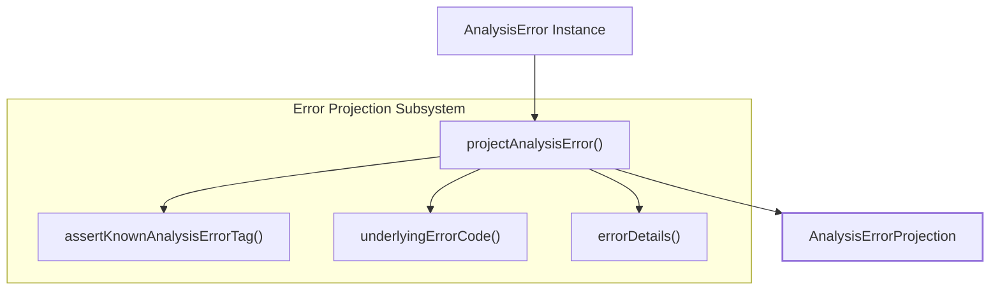
**Sources:** `[src/domain/result.ts:1-10]()`, `[src/domain/analysisErrorBase.ts:4-121]`, `[src/domain/analysisErrorProjection.ts:46-96]()`

---

## Binary Target Resolution and App Bundles

The domain layer handles target identification and validation before passing binaries to providers. This includes resolving bundle structures and parsing headers.

### Target Parsing Flow
Binary target identification validates file formats and loads architectural metadata.

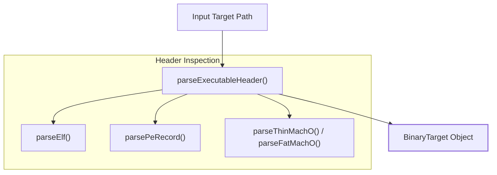
**Sources:** `[src/domain/evidence.ts:201-205]()`, `[src/domain/analysisSnapshot.ts:108-121]()`

---

## Evidence Schema

The `evidence.ts` module defines a strict schema (`evidenceSchema`) for analysis observations. Every tool output embeds deterministic provenance metadata.

### Evidence Structure
- `subject`: Path, SHA-256 hash, format, and architecture of the target `[src/domain/evidence.ts:71-86]()`.
- `provider`: Identity of the analysis provider `[src/domain/evidence.ts:36-40]()`.
- `operation`: The executed tool or analysis name `[src/domain/evidence.ts:130-130]()`.
- `parameters`: Input arguments supplied to the operation `[src/domain/evidence.ts:131-131]()`.
- `normalized_result`: Stable normalized output schema `[src/domain/evidence.ts:133-133]()`.
- `confidence`: Observed, derived, or inferred status `[src/domain/evidence.ts:134-134]()`.

**Sources:** `[src/domain/evidence.ts:36-142]`, `[src/domain/evidence.ts:167-169]()`

---

## Canonical Digests and Comparison

The domain layer provides utilities for creating canonical JSON digests and comparing structured values.

### Canonical Digest
`digestCanonicalValue` generates a SHA-256 hash of a JSON-serializable value after canonicalizing its keys and formatting, ensuring identical semantics produce deterministic digests regardless of key ordering.

### Function Comparison Normalization
The `functionComparisonNormalization.ts` module prepares `FunctionSnapshot` records for comparative analysis:
- `identityProjection`: Extracts names, signatures, and sorted local variables `[src/domain/functionComparisonNormalization.ts:7-13]()`.
- `functionMatch`: Evaluates symbol stability and determines whether a function match is `matched`, `mismatched`, or `ambiguous` `[src/domain/functionComparisonNormalization.ts:15-35]()`.
- `normalizeCfg`: Orders basic blocks by address and maps successors to indices `[src/domain/functionComparisonNormalization.ts:37-73]()`.

**Sources:** `[src/domain/canonicalDigest.ts:1-25]()`, `[src/domain/functionComparisonNormalization.ts:7-73]()`

---

## Symbol Analysis and Unicode Ordering

Symbol analysis and ordering utilities handle language-specific naming conventions and string sorting.

### Symbol Analysis
The `symbolAnalysis.ts` module classifies mangled symbols for Swift and Objective-C targets, categorizing types into classes (`_TtC`), structs (`_TtV`), enums (`_TtO`), and protocols (`_TtP`).

### Unicode Ordering
`compareUnicodeCodePoints` and `compositeKey` provide deterministic collation ties based on Unicode code points (`[src/domain/unicodeCodePointOrder.js]`), ensuring consistent sorting across platforms.

**Sources:** `[src/domain/symbolAnalysis.ts]`, `[src/domain/analysisSnapshot.ts:7-9]()`

---

# Page: Contracts and Tool Catalog

# Contracts and Tool Catalog

<details>
<summary>Relevant source files</summary>

The following files were used as context for generating this wiki page:

- [docs/mcp-contracts.md](docs/mcp-contracts.md)
- [scripts/verify-gemini-client.mjs](scripts/verify-gemini-client.mjs)
- [scripts/verify/clients/gemini-model-fixture.mjs](scripts/verify/clients/gemini-model-fixture.mjs)
- [src/application/CallPathTracing.ts](src/application/CallPathTracing.ts)
- [src/application/EnhancedLiteralTracing.ts](src/application/EnhancedLiteralTracing.ts)
- [src/application/EnhancedToolSelectorOrigin.test.ts](src/application/EnhancedToolSelectorOrigin.test.ts)
- [src/application/EnhancedTools.ts](src/application/EnhancedTools.ts)
- [src/application/ProcedureAddressResolution.ts](src/application/ProcedureAddressResolution.ts)
- [src/browser/history/CaptureFailures.test.ts](src/browser/history/CaptureFailures.test.ts)
- [src/browser/history/CaptureFailures.ts](src/browser/history/CaptureFailures.ts)
- [src/browser/history/CaptureRelease.ts](src/browser/history/CaptureRelease.ts)
- [src/composition/webNetworkCaptures.ts](src/composition/webNetworkCaptures.ts)
- [src/contracts/enhancedInputs.ts](src/contracts/enhancedInputs.ts)
- [src/contracts/enhancedToolContracts.ts](src/contracts/enhancedToolContracts.ts)
- [src/contracts/fridaToolContracts.ts](src/contracts/fridaToolContracts.ts)
- [src/contracts/gdbToolContracts.ts](src/contracts/gdbToolContracts.ts)
- [src/contracts/inputSchemaPresentation.ts](src/contracts/inputSchemaPresentation.ts)
- [src/contracts/rizinDebugToolContracts.ts](src/contracts/rizinDebugToolContracts.ts)
- [src/contracts/toolInputReferences.test.ts](src/contracts/toolInputReferences.test.ts)
- [src/contracts/toolOutputReferences.test.ts](src/contracts/toolOutputReferences.test.ts)
- [src/contracts/toolOutputSchemaGroups.ts](src/contracts/toolOutputSchemaGroups.ts)
- [src/contracts/toolSchemaMetadata.ts](src/contracts/toolSchemaMetadata.ts)
- [src/domain/hopperValues.ts](src/domain/hopperValues.ts)
- [src/domain/webNetworkCaptureCoordinates.ts](src/domain/webNetworkCaptureCoordinates.ts)
- [src/ida/IdaOperationFailures.test.ts](src/ida/IdaOperationFailures.test.ts)
- [src/process/ProviderDiagnosticRedaction.ts](src/process/ProviderDiagnosticRedaction.ts)
- [src/process/capture/ProcessScenarioRuntimeValidation.test.ts](src/process/capture/ProcessScenarioRuntimeValidation.test.ts)
- [src/process/capture/ProcessScenarioRuntimeValidation.ts](src/process/capture/ProcessScenarioRuntimeValidation.ts)
- [src/server/registerWebNetworkCaptureTool.ts](src/server/registerWebNetworkCaptureTool.ts)
- [src/server/toolRegistrationOptions.ts](src/server/toolRegistrationOptions.ts)
- [tests/acceptance/tools/historicalCaptureResources.test.ts](tests/acceptance/tools/historicalCaptureResources.test.ts)
- [tests/acceptance/tools/inspectorLifecycle.test.ts](tests/acceptance/tools/inspectorLifecycle.test.ts)
- [tests/acceptance/tools/localToolContracts.test.ts](tests/acceptance/tools/localToolContracts.test.ts)
- [tests/boundary/filesystem/javascript-applications/javascriptBundlerAdapters.test.ts](tests/boundary/filesystem/javascript-applications/javascriptBundlerAdapters.test.ts)
- [tests/boundary/mcp/browserComparisonInput.test.ts](tests/boundary/mcp/browserComparisonInput.test.ts)
- [tests/boundary/mcp/compactInputSchemaMcp.test.ts](tests/boundary/mcp/compactInputSchemaMcp.test.ts)
- [tests/boundary/mcp/enhancedTools.03-returns-typed-graph-failures-and.test.ts](tests/boundary/mcp/enhancedTools.03-returns-typed-graph-failures-and.test.ts)
- [tests/boundary/mcp/enhancedTools.callPathsAndBatches.test.ts](tests/boundary/mcp/enhancedTools.callPathsAndBatches.test.ts)
- [tests/boundary/mcp/outputSchemaSemanticConstraints.test.ts](tests/boundary/mcp/outputSchemaSemanticConstraints.test.ts)
- [tests/boundary/mcp/outputValidatorReuse.test.ts](tests/boundary/mcp/outputValidatorReuse.test.ts)
- [tests/boundary/mcp/toolSchemaValidity.test.ts](tests/boundary/mcp/toolSchemaValidity.test.ts)
- [tests/boundary/process/providerProcessOutput.test.ts](tests/boundary/process/providerProcessOutput.test.ts)
- [tests/boundary/providers/ida/calleeRelationships.test.ts](tests/boundary/providers/ida/calleeRelationships.test.ts)
- [tests/fixtures/mcpClientSchemaConstraints.ts](tests/fixtures/mcpClientSchemaConstraints.ts)

</details>


This page details the structure and management of tool contracts within REA, covering `ToolContract` inventory, tool effects and annotations, output schema groups, the generated MCP tool catalog, `product-catalog.json`, capability migration guidelines, and contract snapshot verification.

## ToolContract Inventory

REA defines a comprehensive set of `ToolContract` specifications representing the available capabilities exposed to clients. Each `ToolContract` defines its unique tool name, human-readable title, detailed description, Zod-backed `inputSchema`, `outputSchema`, and operational `annotations`. These contracts are managed across domain-specific contract modules such as official bridge tools, enhanced workflow tools, and session management facilities [tests/boundary/mcp/toolSchemaValidity.test.ts:8-11]().

Tool registration uses `toolRegistrationOptions` [src/server/toolRegistrationOptions.ts:20-34]() to project the canonical Zod schemas into Model Context Protocol (MCP) registration records. Input schemas are wrapped with metadata transformations using `toolInputSchemaWithMetadata` [src/contracts/toolSchemaMetadata.ts:56-76](), while output schemas receive content-bound validation identities via `toolOutputSchemaWithMetadata` [src/contracts/toolSchemaMetadata.ts:87-109]().

Sources:
- [tests/boundary/mcp/toolSchemaValidity.test.ts:8-11]()
- [src/server/toolRegistrationOptions.ts:20-34]()
- [src/contracts/toolSchemaMetadata.ts:56-109]()

## Tool Effects and Annotations

Tool contracts specify operational `annotations` that declare authority and safety hints to clients and execution guards [tests/boundary/mcp/toolSchemaValidity.test.ts:98-180](). These hints include:
- `readOnlyHint`: Indicates if the operation avoids modifying state.
- `destructiveHint`: Indicates if the operation mutates analysis state, filesystems, or live processes.
- `idempotentHint`: Indicates if repeating the operation yields identical side effects.
- `openWorldHint`: Indicates if the operation interacts with external environments or open-world targets.

The `EnhancedTools` class [src/application/EnhancedTools.ts:98-174]() routes and validates execution requests for high-level workflows. It provides both `execute` [src/application/EnhancedTools.ts:102-174]() for untrusted input payloads and `executeValidated` [src/application/EnhancedTools.ts:177-182]() for pre-parsed trusted calls.

### Diagram: Tool Execution and Annotation Flow
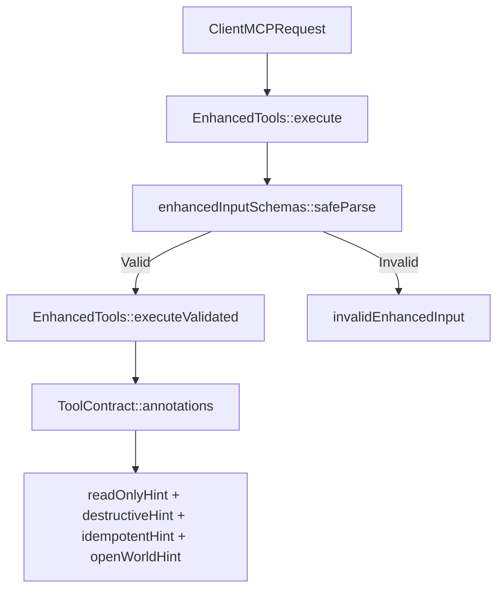
Sources:
- [tests/boundary/mcp/toolSchemaValidity.test.ts:98-180]()
- [src/application/EnhancedTools.ts:98-182]()

## Output Schema Groups

Tool output schemas are structured into reusable groups that standardize analysis return types. The official output schemas are cataloged in `officialOutputSchemas` [src/contracts/toolOutputSchemaGroups.ts:114-150](), tying execution responses to explicit structures such as `evidenceResultOf` wrappers and domain models.

Domain models enforce strict invariants using Zod refinements. For example, `functionBodySchema` [src/domain/hopperValues.ts:93-179]() verifies inclusive address ranges, continuity flags, and span arithmetic using `.superRefine()` [src/domain/hopperValues.ts:117-178]().

Sources:
- [src/contracts/toolOutputSchemaGroups.ts:114-150]()
- [src/domain/hopperValues.ts:93-179]()

## Generated MCP Tool Catalog and `product-catalog.json`

The MCP tool catalog aggregates all `ToolContract` definitions into a machine-readable inventory. The snapshot of this catalog is persisted in `product-catalog.json`, which categorizes capabilities by family (such as direct, enhanced, native, artifact, managed, firmware, android, browser, electron, javascript-runtime, application, and session).

Catalog validation is enforced through test harnesses such as `toolSchemaValidity.test.ts` [tests/boundary/mcp/toolSchemaValidity.test.ts:1-64](), which compiles schemas using Ajv2020 to verify wire compatibility.

### Diagram: Catalog Generation to MCP Registration
```mermaid
graph TD
    TC["TOOL_CONTRACTS"] --> Reg["toolRegistrationOptions"];
    Reg --> Meta["toolInputSchemaWithMetadata"];
    Meta --> Wire["MCPWireProtocol"];
    TC --> Cat["product-catalog.json"];
    Cat --> Test["toolSchemaValidity.test.ts"];
```
Sources:
- [tests/boundary/mcp/toolSchemaValidity.test.ts:1-64]()
- [src/contracts/toolSchemaMetadata.ts:56-84]()
- [src/server/toolRegistrationOptions.ts:20-34]()

## Capability Migration and Contract Snapshot Tests

Capability changes follow strict architecture boundaries to prevent accidental API breakage. 

### Capability Migration Rules
- **Explicit Ownership**: Maintain separation between domain analytics, contract schemas, and provider transport adapters.
- **Incremental Refactoring**: Validate boundary rules before generalizing common utilities.
- **Snapshot and Schema Tests**: Ensure wire schema transformations and input reference handling remain consistent across targets (such as draft-07 and draft-2020-12) as tested in `toolInputReferences.test.ts` [src/contracts/toolInputReferences.test.ts:14-41]().

Sources:
- [src/contracts/toolInputReferences.test.ts:14-41]()
- [tests/boundary/mcp/toolSchemaValidity.test.ts:66-96]()

---

# Page: Application Layer

# Application Layer

<details>
<summary>Relevant source files</summary>

The following files were used as context for generating this wiki page:

- [.agents/skills/reverse-engineer-anything/SKILL.md](.agents/skills/reverse-engineer-anything/SKILL.md)
- [.agents/skills/reverse-engineer-anything/references/android-applications.md](.agents/skills/reverse-engineer-anything/references/android-applications.md)
- [.agents/skills/reverse-engineer-anything/references/evidence-workflows.md](.agents/skills/reverse-engineer-anything/references/evidence-workflows.md)
- [.agents/skills/reverse-engineer-anything/references/native-and-artifacts.md](.agents/skills/reverse-engineer-anything/references/native-and-artifacts.md)
- [.agents/skills/reverse-engineer-anything/references/runtime-observation.md](.agents/skills/reverse-engineer-anything/references/runtime-observation.md)
- [scripts/lib/ghidra-reference-snapshot-e2e.mjs](scripts/lib/ghidra-reference-snapshot-e2e.mjs)
- [scripts/lib/real-ghidra-snapshot-lifecycle.mjs](scripts/lib/real-ghidra-snapshot-lifecycle.mjs)
- [scripts/record-catalog-digests.mjs](scripts/record-catalog-digests.mjs)
- [src/application/DirectAnalysis.ts](src/application/DirectAnalysis.ts)
- [src/application/ReferenceSourceImport.ts](src/application/ReferenceSourceImport.ts)
- [src/application/ReferenceSourceImportPolicy.ts](src/application/ReferenceSourceImportPolicy.ts)
- [src/application/ReferenceSourceImportTypes.test.ts](src/application/ReferenceSourceImportTypes.test.ts)
- [src/application/ReferenceSourceImportTypes.ts](src/application/ReferenceSourceImportTypes.ts)
- [src/application/analysisView/AnalysisViewService.test.ts](src/application/analysisView/AnalysisViewService.test.ts)
- [src/application/analysisView/AnalysisViewService.ts](src/application/analysisView/AnalysisViewService.ts)
- [src/application/binary/BinarySession.ts](src/application/binary/BinarySession.ts)
- [src/application/binary/BinarySessionOpen.ts](src/application/binary/BinarySessionOpen.ts)
- [src/application/binary/BinarySessionPort.ts](src/application/binary/BinarySessionPort.ts)
- [src/application/binary/BinarySessionRecords.ts](src/application/binary/BinarySessionRecords.ts)
- [src/catalogIdentity.ts](src/catalogIdentity.ts)
- [src/cli/referenceSourceImportStatus.ts](src/cli/referenceSourceImportStatus.ts)
- [src/cliEvidenceCommands.ts](src/cliEvidenceCommands.ts)
- [src/contracts/analysisViewToolContracts.ts](src/contracts/analysisViewToolContracts.ts)
- [src/domain/analysisView/WebNetworkApiSurfaceAccumulator.test.ts](src/domain/analysisView/WebNetworkApiSurfaceAccumulator.test.ts)
- [src/domain/analysisView/WebNetworkApiSurfaceAccumulator.ts](src/domain/analysisView/WebNetworkApiSurfaceAccumulator.ts)
- [src/domain/analysisView/analysisView.test.ts](src/domain/analysisView/analysisView.test.ts)
- [src/domain/analysisView/analysisView.ts](src/domain/analysisView/analysisView.ts)
- [src/domain/analysisView/analysisViewDataAdmission.ts](src/domain/analysisView/analysisViewDataAdmission.ts)
- [src/domain/analysisView/binaryLayoutView.ts](src/domain/analysisView/binaryLayoutView.ts)
- [src/domain/analysisView/javascriptApplicationView.ts](src/domain/analysisView/javascriptApplicationView.ts)
- [src/domain/analysisView/nativeFunctionView.ts](src/domain/analysisView/nativeFunctionView.ts)
- [src/domain/analysisView/webNetworkApiSurfaceView.test.ts](src/domain/analysisView/webNetworkApiSurfaceView.test.ts)
- [src/domain/analysisView/webNetworkApiSurfaceView.ts](src/domain/analysisView/webNetworkApiSurfaceView.ts)
- [src/domain/recordedTransportUrl.ts](src/domain/recordedTransportUrl.ts)
- [src/domain/referenceSourceGraph.test.ts](src/domain/referenceSourceGraph.test.ts)
- [src/domain/referenceSourceGraph.ts](src/domain/referenceSourceGraph.ts)
- [src/domain/referenceSourcePolicy.ts](src/domain/referenceSourcePolicy.ts)
- [src/domain/referenceSourceSummary.test.ts](src/domain/referenceSourceSummary.test.ts)
- [src/domain/referenceSourceSummary.ts](src/domain/referenceSourceSummary.ts)
- [src/recordedCatalogDigests.ts](src/recordedCatalogDigests.ts)
- [src/reference/ReferenceSourceReaderErrors.ts](src/reference/ReferenceSourceReaderErrors.ts)
- [src/reference/ReferenceSourceReaderValidate.ts](src/reference/ReferenceSourceReaderValidate.ts)
- [src/server/EvidenceMcpServer.test.ts](src/server/EvidenceMcpServer.test.ts)
- [src/server/EvidenceMcpServer.ts](src/server/EvidenceMcpServer.ts)
- [src/server/registerCloseLifecycleTool.ts](src/server/registerCloseLifecycleTool.ts)
- [src/server/registerEnhancedTools.ts](src/server/registerEnhancedTools.ts)
- [src/server/registerOfficialTools.ts](src/server/registerOfficialTools.ts)
- [src/server/toolResult.ts](src/server/toolResult.ts)
- [src/server/toolResultEncoding.test.ts](src/server/toolResultEncoding.test.ts)
- [src/server/toolResultEncoding.ts](src/server/toolResultEncoding.ts)
- [tests/boundary/cli/analysisViewCli.test.ts](tests/boundary/cli/analysisViewCli.test.ts)
- [tests/boundary/cli/referenceSourceExclusions.test.ts](tests/boundary/cli/referenceSourceExclusions.test.ts)
- [tests/boundary/cli/referenceSourceImportStatus.test.ts](tests/boundary/cli/referenceSourceImportStatus.test.ts)
- [tests/boundary/filesystem/referenceSourceFailureDetails.test.ts](tests/boundary/filesystem/referenceSourceFailureDetails.test.ts)
- [tests/boundary/filesystem/referenceSourceImport.test.ts](tests/boundary/filesystem/referenceSourceImport.test.ts)
- [tests/boundary/mcp/analysisViewMcp.test.ts](tests/boundary/mcp/analysisViewMcp.test.ts)
- [tests/boundary/mcp/contractPresentation.test.ts](tests/boundary/mcp/contractPresentation.test.ts)
- [tests/boundary/mcp/largeToolResult.test.ts](tests/boundary/mcp/largeToolResult.test.ts)
- [tests/boundary/mcp/oversizedErrorDeliveryMcp.test.ts](tests/boundary/mcp/oversizedErrorDeliveryMcp.test.ts)
- [tests/boundary/mcp/serverIdentity.test.ts](tests/boundary/mcp/serverIdentity.test.ts)
- [tests/boundary/mcp/sessionMcp.test.ts](tests/boundary/mcp/sessionMcp.test.ts)
- [tests/boundary/mcp/sessionMcpHarness.ts](tests/boundary/mcp/sessionMcpHarness.ts)
- [tests/composition/analysis-sessions/binarySession.test.ts](tests/composition/analysis-sessions/binarySession.test.ts)
- [tests/process-global/mcpDeliveryEnvironment.test.ts](tests/process-global/mcpDeliveryEnvironment.test.ts)

</details>


The Application Layer provides a shared runtime for the CLI and MCP adapters. It manages the lifecycle of analysis sessions, composes low-level engine operations into high-level workflows, and provides idempotent system utilities for environment diagnostics, capability inventory, artifact graph construction, and reference source imports.

## Session Management

The core of the application layer is the `BinarySession`, which maintains the state of a single active analysis target across CLI and MCP adapters. Because engine dispatches work on dedicated worker threads or background processes and requires bridge teardowns to switch binaries, `BinarySession` serializes all target transitions to prevent race conditions [src/application/binary/BinarySession.ts:34-91]().

### BinarySession Lifecycle
1.  **Open**: Parses the `BinaryTarget`, drains any pending calls to the previous target, closes the old client bridge, and initializes a new `AnalysisClient` [src/application/binary/BinarySession.ts:38-43]().
2.  **Execute**: Proxies tool calls to the active client. If a transition is in progress, calls wait for the transition to settle [src/application/binary/BinarySession.ts:134-150]().
3.  **Restore**: If a switch to a new binary fails, the session attempts to recreate the previous target's client to avoid leaving the system in a broken state [src/application/binary/BinarySession.ts:165-175]().
4.  **Close**: Drains calls and shuts down the active provider bridge [src/application/binary/BinarySession.ts:99-107]().

### Session Data Flow
The following diagram illustrates how the `BinarySession` manages the transition between two different binary targets.

**Binary Target Transition Flow**
```mermaid
sequenceDiagram
    participant A as "Adapter"
    participant S as "BinarySession"
    participant C1 as "AnalysisClientA"
    participant C2 as "AnalysisClientB"

    A->>S: "open(path_B)"
    S->>S: "#serialize()"
    S->>S: "#drainCalls()"
    S->>C1: "close()"
    destroy C1
    S->>C2: "createClient(target_B)"
    S->>C2: "execute(health)"
    C2-->>S: "ok"
    S-->>A: "ok(target_B)"
```
Sources: [src/application/binary/BinarySession.ts:34-107]()

## Direct Analysis (CLI Mode)

For one-shot commands like `rea analyze <path>`, the `runDirectAnalysis` function manages a transient session. Unlike the MCP server which keeps the bridge open, `DirectAnalysis` follows a strict "Open -> Execute -> Close" pattern to ensure no background processes are left running after the CLI exits [src/application/DirectAnalysis.ts:89-127](). It wraps the output in the `Evidence` schema, associating the result with the binary's content hash [src/application/DirectAnalysis.ts:10-38]().

Sources: [src/application/DirectAnalysis.ts:89-127]()

## Analysis Snapshot Cache

The `AnalysisSnapshotCache` stores results of analysis operations to avoid redundant computations. It partitions cached data by `BinaryTarget`, `AnalysisProfileCommitment`, and `ProviderIdentity` [src/application/binary/BinarySession.ts:28-35]().

Key aspects:
*   **Partitioning**: Snapshots are stored in a nested map structure, ensuring that results from different targets, profiles, or providers do not conflict.
*   **Cacheability**: Determines if an operation's result can be cached based on parameter specificity and whether native source admission is required before replay [src/application/DirectAnalysis.ts:28-35]().
*   **Integrity**: Verifies that the imported snapshot entries match expected execution parameters to prevent tampering [src/application/binary/BinarySession.ts:127-129]().

**Analysis Snapshot Cache Structure**
```mermaid
graph TD
    subgraph "AnalysisSnapshotCache"
        C["CacheRegistry"]
    end
    T["BinaryTarget"]
    P["AnalysisProfileCommitment"]
    Pr["ProviderIdentity"]
    E["AnalysisExecution"]

    T -- "targetKey" --> C
    P -- "profileKey" --> C
    Pr -- "providerKey" --> C
    C -- "stores" --> E
```
Sources: [src/application/binary/BinarySession.ts:28-35](), [src/application/DirectAnalysis.ts:28-35]()

## Provider Registry and Evaluation

The provider router and evaluation modules manage the collection of available `AnalysisProvider` instances, selecting the most suitable provider based on capability descriptors, profiles, and target compatibility [src/application/binary/BinarySession.ts:31-33]().

**Provider Registry and Evaluation Flow**
```mermaid
graph TD
    subgraph "ApplicationLayer"
        PR["SessionProviderRouter"]
        BS["BinarySession"]
    end
    AP["AnalysisProvider"]
    BT["BinaryTarget"]
    CD["CapabilityDescriptor"]

    PR -- "registers" --> AP
    BS -- "routesTo" --> BT
    PR -- "evaluates" --> CD
    BS -- "createsClient" --> AP
```
Sources: [src/application/binary/BinarySession.ts:31-33]()

## Capability Inventory

The `buildCapabilityInventory` function constructs a comprehensive list of all available tools and their current availability status [tests/boundary/mcp/serverIdentity.test.ts:30-34]().

Key aspects:
*   **Tool Contracts**: Iterates through known tool definitions to establish a baseline.
*   **Provider Descriptors**: Incorporates provider capability metadata from the active session status.
*   **Client Requirements**: Validates whether the connected client supports necessary features for each tool.

Sources: [tests/boundary/mcp/serverIdentity.test.ts:30-34]()

## Analysis Views

The analysis view subsystem projects bounded representations of completed binary-layout, JavaScript application, native function, or capture evidence without repeating analysis [src/domain/analysisView/analysisView.ts:38-116](). It supports paging, collection filtering, and stable view digests [src/domain/analysisView/analysisView.test.ts:66-101]().

Sources: [src/domain/analysisView/analysisView.ts:38-116](), [src/domain/analysisView/analysisView.test.ts:66-101]()

## Artifact Inventory and Graph Construction

The artifact inventory and graph construction modules scan ZIP archives, ASAR bundles, directories, or DMG images, producing content-addressed `ArtifactNode` entries and `ArtifactEdge` relations with deterministic ordering [src/domain/analysisView/analysisView.ts:26-31]().

**Artifact Inventory Graph Flow**
```mermaid
graph TD
    subgraph "ArtifactProcessing"
        R["ArtifactReader"]
        I["ArtifactInventory"]
        G["ArtifactGraphConstruction"]
    end
    N["ArtifactNode"]
    E["ArtifactEdge"]

    R -- "yieldsEntries" --> I
    I -- "hashesContent" --> N
    I -- "constructsEdges" --> E
    G -- "materializes" --> N
```
Sources: [src/domain/analysisView/analysisView.ts:26-31]()

## Reference Source Import

The `importReferenceSource` function imports a directory of source code into a `HistoricalSourceGraph`, applying security exclusion policies, parsing file entries, extracting relationships (imports/references), and computing content hashes and inventories [tests/boundary/filesystem/referenceSourceImport.test.ts:10-18]().

**Reference Source Import Flow**
```mermaid
graph TD
    subgraph "ReferenceSource"
        ISR["importReferenceSource"]
        PRS["prepareReferenceSourceImport"]
        RRS["readReferenceSource"]
        H SG["createHistoricalSourceGraph"]
    end
    PP["PreparedPolicy"]
    RR["ReadResult"]
    HSG["HistoricalSourceGraph"]

    ISR -- "configures" --> PRS
    PRS -- "outputs" --> PP
    ISR -- "calls" --> RRS
    RRS -- "outputs" --> RR
    RR -- "buildsGraph" --> HSG
```
Sources: [tests/boundary/filesystem/referenceSourceImport.test.ts:10-18](), [src/domain/referenceSourceGraph.ts:204-214]()

---

# Page: Server Layer (MCP Adapter)

# Server Layer (MCP Adapter)

<details>
<summary>Relevant source files</summary>

The following files were used as context for generating this wiki page:

- [scripts/lib/catalog-builders.mjs](scripts/lib/catalog-builders.mjs)
- [scripts/lib/catalog-core.mjs](scripts/lib/catalog-core.mjs)
- [scripts/verify-package-mcp.mjs](scripts/verify-package-mcp.mjs)
- [scripts/verify-package-prompts.mjs](scripts/verify-package-prompts.mjs)
- [src/application/CapabilityInventory.test.ts](src/application/CapabilityInventory.test.ts)
- [src/application/CapabilityInventory.ts](src/application/CapabilityInventory.ts)
- [src/application/DirectAnalysis.ts](src/application/DirectAnalysis.ts)
- [src/cliCommandNames.ts](src/cliCommandNames.ts)
- [src/cliEvidenceCommands.ts](src/cliEvidenceCommands.ts)
- [src/contracts/toolContracts.ts](src/contracts/toolContracts.ts)
- [src/contracts/toolEffects.ts](src/contracts/toolEffects.ts)
- [src/domain/hopperValues.test.ts](src/domain/hopperValues.test.ts)
- [src/server/EvidenceMcpServer.test.ts](src/server/EvidenceMcpServer.test.ts)
- [src/server/EvidenceMcpServer.ts](src/server/EvidenceMcpServer.ts)
- [src/server/createServer.ts](src/server/createServer.ts)
- [src/server/mcpClientMetadata.ts](src/server/mcpClientMetadata.ts)
- [src/server/promptCompletion.ts](src/server/promptCompletion.ts)
- [src/server/registerBrowserScenarioTool.ts](src/server/registerBrowserScenarioTool.ts)
- [src/server/registerBrowserTools.ts](src/server/registerBrowserTools.ts)
- [src/server/registerElectronTools.ts](src/server/registerElectronTools.ts)
- [src/server/registerEnhancedTools.ts](src/server/registerEnhancedTools.ts)
- [src/server/registerJavaScriptRuntimeObservationTools.ts](src/server/registerJavaScriptRuntimeObservationTools.ts)
- [src/server/registerOfficialTools.ts](src/server/registerOfficialTools.ts)
- [src/server/registerPrompts.ts](src/server/registerPrompts.ts)
- [src/server/registerSessionStatusTool.ts](src/server/registerSessionStatusTool.ts)
- [src/server/registerSessionTools.ts](src/server/registerSessionTools.ts)
- [src/server/toolResult.ts](src/server/toolResult.ts)
- [src/server/toolResultEncoding.test.ts](src/server/toolResultEncoding.test.ts)
- [src/server/toolResultEncoding.ts](src/server/toolResultEncoding.ts)
- [tests/boundary/mcp/clientCapabilities.test.ts](tests/boundary/mcp/clientCapabilities.test.ts)
- [tests/boundary/mcp/contractPresentation.test.ts](tests/boundary/mcp/contractPresentation.test.ts)
- [tests/boundary/mcp/enhancedTools.04-uses-complete-inventories-inline.test.ts](tests/boundary/mcp/enhancedTools.04-uses-complete-inventories-inline.test.ts)
- [tests/boundary/mcp/javascriptRuntimeObservationMcp.test.ts](tests/boundary/mcp/javascriptRuntimeObservationMcp.test.ts)
- [tests/boundary/mcp/largeToolResult.test.ts](tests/boundary/mcp/largeToolResult.test.ts)
- [tests/boundary/mcp/oversizedErrorDeliveryMcp.test.ts](tests/boundary/mcp/oversizedErrorDeliveryMcp.test.ts)
- [tests/boundary/mcp/promptCompletion.test.ts](tests/boundary/mcp/promptCompletion.test.ts)
- [tests/boundary/mcp/promptMcp.test.ts](tests/boundary/mcp/promptMcp.test.ts)
- [tests/boundary/mcp/serverWorkflowMcp.test.ts](tests/boundary/mcp/serverWorkflowMcp.test.ts)
- [tests/composition/idaProvider.test.ts](tests/composition/idaProvider.test.ts)
- [tests/process-global/mcpDeliveryEnvironment.test.ts](tests/process-global/mcpDeliveryEnvironment.test.ts)

</details>


The Server Layer acts as the bridge between the Model Context Protocol (MCP) and REA's application and domain logic. It is responsible for assembling the `EvidenceMcpServer` instance, registering tools spanning official proxies, enhanced workflows, session management, and specialized observation domains, and translating domain outcomes into robust MCP-compliant responses.

Sources: [src/server/createServer.ts:1-110](), [src/server/EvidenceMcpServer.ts:107-135]()

## Core Assembly: `createServer`

The `createServer` function initializes and wires the MCP server instance based on the presence of a `BinarySessionPort` or fixed-target configuration [src/server/createServer.ts:1-110]().

- **Fixed-Target Mode**: When `session` is `undefined`, the server assumes a pre-configured target from environment variables and registers core official and enhanced toolsets.
- **Session Mode**: When a `BinarySessionPort` is supplied, the server registers session lifecycle tools (`open_binary`, `close_binary`, `binary_session`), enabling dynamic switching across analysis targets [src/server/registerSessionTools.ts:148-170]().
- **Optional Services & Policy**: Dynamic availability of packet capture, signal recording, WebAssembly, EVM interfaces, SQLite databases, and Frida instrumentation are evaluated against environment capabilities and injected into registration functions [src/server/createServer.ts:1-100]().

```mermaid
graph TD
    subgraph "Server Layer (Code Space)"
        CS["createServer(analysis, session, options)"]
        RO["registerOfficialTools"]
        RE["registerEnhancedTools"]
        RS["registerSessionTools"]
        RA["registerArtifactTools"]
        RM["registerManagedTools"]
        RN["registerNativeTools"]
        EM["EvidenceMcpServer"]
    end

    subgraph "Application Layer (Code Space)"
        AP["AnalysisOperationPort"]
        BS["BinarySessionPort"]
        ET["EnhancedTools"]
    end

    subgraph "MCP SDK"
        MS["McpServer Instance"]
    end

    CS --> EM
    EM --> MS
    CS --> RO
    CS --> RE
    CS --> RS
    CS --> RA
    CS --> RM
    CS --> RN

    RO -- "proxies to" --> AP
    RE -- "proxies to" --> AP & ET
    RS -- "proxies to" --> BS
    RA -- "proxies to" --> AP
    RM -- "proxies to" --> AP
    RN -- "proxies to" --> AP
```
Sources: [src/server/createServer.ts:1-110](), [src/server/EvidenceMcpServer.ts:107-194]()

## Tool Registration Modules

REA categorizes its tool catalog into granular registration modules that populate the `EvidenceMcpServer` with typed contracts defined in `TOOL_CONTRACTS` [src/contracts/toolContracts.ts:39-76]().

### 1. Official and Enhanced Tools (`registerOfficialTools`, `registerEnhancedTools`)
- **Official Tools (`registerOfficialTools`)**: Bridge directly to low-level target operations (e.g., `address_name`, `read_bytes`, `xrefs`, `set_comment`) using `OFFICIAL_TOOL_CONTRACTS` [src/contracts/toolContracts.ts:29](). Inputs are projected via `projectOfficialArguments` and outcomes are wrapped with target evidence metadata [src/server/registerOfficialTools.ts:78-91]().
- **Enhanced Tools (`registerEnhancedTools`)**: Register composed multi-step workflows like `analyze_function`, `binary_overview`, `batch_decompile`, and `get_call_graph` instantiated via the `EnhancedTools` class [src/server/registerEnhancedTools.ts:14-180]().

### 2. Session and Investigation Tools (`registerSessionTools`, `registerInvestigationTools`)
- **Session Tools**: Manage the target lifecycle (`open_binary`, `close_binary`, `binary_session`) and record process execution via `capture_process_scenario` [src/server/registerSessionTools.ts:91-170]().
- **Investigation Tools**: Operate over the evidence ledger to perform cross-session correlation, find changed behavior, and track unresolved unknowns [src/server/registerSessionTools.ts:28-33]().

### 3. Specialized Domain Modules
- **Artifacts (`registerArtifactTools`)**: Inventory and inspect archive or compressed structures [src/server/createServer.ts:64]().
- **Managed Code (`registerManagedTools`, `registerManagedWorkflowTools`)**: .NET metadata inspection, CIL decoding, and managed application graph projection [src/server/createServer.ts:89]().
- **Electron & Web (`registerElectronTools`, `registerBrowserTools`, `registerWebRuntimeTools`)**: Runtime observation, CDP inspection, source location mapping, and JavaScript recovery (`JavaScriptRecoveryService`) [src/server/createServer.ts:67-85]().
- **Android, Firmware & Binary Diagnostics (`registerAndroidTools`, `registerFirmwareTools`, `registerBinaryDiagnosticsTools`)**: APK analysis, firmware region extraction (`FirmwareAnalysisService`), PE resource diagnostics, and crash analysis [src/server/createServer.ts:33-94]().

Sources: [src/contracts/toolContracts.ts:39-76](), [src/server/registerEnhancedTools.ts:56-180](), [src/server/registerSessionTools.ts:91-170]()

## Tool Registration Options and Effects

Every tool registration applies execution hints derived from `TOOL_EFFECTS` using `toolRegistrationOptions` [src/contracts/toolEffects.ts:55-780]().

```mermaid
graph LR
    TE["TOOL_EFFECTS record"] --> TRO["toolRegistrationOptions(contract)"]
    TRO --> TA["ToolAnnotations"]
    TA --> MS["EvidenceMcpServer.registerTool"]
```
Sources: [src/contracts/toolEffects.ts:55-100](), [src/server/toolRegistrationOptions.ts:1-19]()

These annotations provide the MCP client with explicit hints regarding `readOnlyHint`, `destructiveHint`, `idempotentHint`, and `openWorldHint` based on whether operations mutate session state, launch external processes, or access the network [src/contracts/toolEffects.ts:25-30]().

Sources: [src/contracts/toolEffects.ts:25-50](), [src/server/toolRegistrationOptions.ts:1-19]()

## Tool Result Mapping (`toCallToolResult`)

The `ToolResultDelivery` class translates REA's internal `Result<JsonValue, AnalysisError>` structures into MCP `CallToolResult` objects under strict response budget constraints [src/server/toolResult.ts:23-52]().

```mermaid
graph TD
    subgraph "Result Mapping (Code Space)"
        RES["Result<JsonValue, AnalysisError>"] --> TRD["ToolResultDelivery.toCallToolResult"]
        TRD --> OK{Result.ok?}
        OK -- Yes --> SR["successResult()"]
        OK -- No --> ER["toErrorToolResult()"]
        SR --> ENC["encodeToolResult()"]
        ER --> PROJ["projectAnalysisError()"]
    end

    subgraph "MCP Wire Format"
        ENC --> CTR["CallToolResult (text + structuredContent)"]
        PROJ --> ECTR["CallToolResult (isError: true)"]
    end
```
Sources: [src/server/toolResult.ts:47-65](), [src/server/toolResult.ts:95-103]()

- **Success Delivery (`successResult`)**: Formats the payload into text content while preserving the typed `structuredContent` [src/server/toolResult.ts:152-170](). If results exceed the budget (`resultBudgetBytes`), actionable recovery advice or continuation pointers are returned [src/server/toolResult.ts:171-180]().
- **Error Projection (`toErrorToolResult`)**: Projects domain errors into structured error payloads via `projectAnalysisError`, omitting sensitive stack traces while retaining diagnostic metadata [src/server/toolResult.ts:95-103]().

Sources: [src/server/toolResult.ts:23-152]()

## Guided Prompts and Completion

REA exposes investigation workflows through the MCP `prompts` capability, supported by session-aware argument completers [src/server/promptCompletion.ts:35-52]().

- **Prompt Inventory**: Structured templates like `investigate_feature`, `compare_application_versions`, and `verify_reconstruction` guide agent workflows with defined objectives and steps.
- **Session-Aware Completion (`createPromptCompletionSource`)**: Dynamically resolves completion candidates from the live session state and evidence ledger [src/server/promptCompletion.ts:35-52]().
  - **Documents**: Queried via `list_documents` [src/server/promptCompletion.ts:81-95]().
  - **Procedures**: Queried via `list_procedures` [src/server/promptCompletion.ts:97-132]().
  - **Evidence & Captures**: Extracted from `session.exportEvidenceBundle()` [src/server/promptCompletion.ts:161-170]().
  - **Deduplication**: Results are Unicode-normalized, case-insensitive, filtered by prefix, and sorted deterministically [src/server/promptCompletion.ts:40-51]().

Sources: [src/server/promptCompletion.ts:35-79]()

## Tool Execution Lifecycle

Every tool call dispatched by the MCP client passes through a logging and telemetry wrapper (`logToolExecution`) to record duration and status safely without logging sensitive payload data [src/server/toolLogging.ts:1-21]().

```mermaid
sequenceDiagram
    participant C as MCP Client
    participant S as EvidenceMcpServer
    participant L as logToolExecution
    participant A as BinarySessionPort
    participant P as Analysis Provider

    C->>S: callTool(name, arguments)
    S->>L: execute(name, input)
    Note over L: Record performance.now()
    L->>A: session.execute(name, args)
    A->>P: Provider Dispatch
    P-->>A: Domain Result
    A-->>L: Result<Value, Error>
    Note over L: Log durationMs & status
    L-->>S: Result
    S-->>C: CallToolResult
```
Sources: [src/server/registerSessionTools.ts:110-124](), [src/server/toolLogging.ts:5-21]()

---

# Page: Tool and CLI Reference

# Tool and CLI Reference

<details>
<summary>Relevant source files</summary>

The following files were used as context for generating this wiki page:

- [docs/.vitepress/config.ts](docs/.vitepress/config.ts)
- [docs/cli.md](docs/cli.md)
- [docs/index.md](docs/index.md)
- [scripts/bundle-runtime.mjs](scripts/bundle-runtime.mjs)
- [scripts/prepack.mjs](scripts/prepack.mjs)
- [scripts/rea.mjs](scripts/rea.mjs)
- [scripts/verify/javascript/output.mjs](scripts/verify/javascript/output.mjs)
- [src/application/CallPathTracing.ts](src/application/CallPathTracing.ts)
- [src/application/EnhancedLiteralTracing.ts](src/application/EnhancedLiteralTracing.ts)
- [src/application/EnhancedToolSelectorOrigin.test.ts](src/application/EnhancedToolSelectorOrigin.test.ts)
- [src/application/EnhancedTools.ts](src/application/EnhancedTools.ts)
- [src/application/ProcedureAddressResolution.ts](src/application/ProcedureAddressResolution.ts)
- [src/cli/cliResultOutput.ts](src/cli/cliResultOutput.ts)
- [src/cli/jsonOutput.ts](src/cli/jsonOutput.ts)
- [src/cliOutput.ts](src/cliOutput.ts)
- [src/contracts/enhancedInputs.ts](src/contracts/enhancedInputs.ts)
- [src/contracts/enhancedToolContracts.ts](src/contracts/enhancedToolContracts.ts)
- [src/contracts/toolOutputSchemaGroups.ts](src/contracts/toolOutputSchemaGroups.ts)
- [src/domain/hopperValues.ts](src/domain/hopperValues.ts)
- [src/ida/IdaOperationFailures.test.ts](src/ida/IdaOperationFailures.test.ts)
- [tests/boundary/cli/cliOutput.test.ts](tests/boundary/cli/cliOutput.test.ts)
- [tests/boundary/cli/closedStdout.test.ts](tests/boundary/cli/closedStdout.test.ts)
- [tests/boundary/cli/dispatcher.test.ts](tests/boundary/cli/dispatcher.test.ts)
- [tests/boundary/cli/jsonOutput.test.ts](tests/boundary/cli/jsonOutput.test.ts)
- [tests/boundary/filesystem/javascript-applications/javascriptBundlerAdapters.test.ts](tests/boundary/filesystem/javascript-applications/javascriptBundlerAdapters.test.ts)
- [tests/boundary/mcp/enhancedTools.03-returns-typed-graph-failures-and.test.ts](tests/boundary/mcp/enhancedTools.03-returns-typed-graph-failures-and.test.ts)
- [tests/boundary/mcp/enhancedTools.callPathsAndBatches.test.ts](tests/boundary/mcp/enhancedTools.callPathsAndBatches.test.ts)
- [tests/boundary/process/runtimeBundle.test.ts](tests/boundary/process/runtimeBundle.test.ts)
- [tests/boundary/providers/ida/calleeRelationships.test.ts](tests/boundary/providers/ida/calleeRelationships.test.ts)

</details>


REA provides a comprehensive collection of tools and CLI commands designed to analyze native binaries, managed assemblies, JavaScript and Electron applications, browsers, Android packages, and firmware [docs/cli.md:1-120](). This page provides a high-level overview of the tool and CLI command surface organized by family (`direct`, `enhanced`, `native`, `artifact`, `managed`, `firmware`, `android`, `browser`, `electron`, `javascript-runtime`, `application`, `session`), linking to detailed child pages where appropriate.

### Tool Architecture and Contract Mapping

All tools in REA are formally defined using a `ToolContract` inventory [docs/cli.md:117-118]() that governs tool identity, effects, annotations, and input/output schema groups [src/contracts/toolOutputSchemaGroups.ts:114-150]().

The following diagram bridges natural language tool calls from agents to the underlying code entities in the REA server and provider layers:

```mermaid
graph TD
    subgraph "NaturalLanguageSpace"
        A["AgentIntent: \"Decompile function main\""]
    end

    subgraph "CodeEntitySpace"
        B["ToolName: \"procedure_pseudo_code\""]
        C["ToolContract"]
        D["zodInputSchema"]
        E["zodOutputSchema"]
        F["EnhancedTools"]
        G["AnalysisOperationPort"]

        B --> C
        C --> D
        C --> E
        C --> F
        F --> G
    end

    subgraph "ProviderLayer"
        H["AnalysisExecution"]
        I["HopperProvider / GhidraProvider"]
    end

    A -- "MCP Tool Call" --> B
    D -- "Validation" --> F
    F -- "Execute" --> G
    G -- "Provider Bridge" --> H
    H --> I
```
Sources: [src/contracts/toolOutputSchemaGroups.ts:114-150](), [src/application/EnhancedTools.ts:98-106]()

---

### Tool Families Overview

REA's tool capabilities are organized into 12 distinct families:

1. **Direct Tools**: Direct bridge tools operating on individual procedures, symbols, and memory addresses. For details, see [Official Proxy Tools](#3.1).
2. **Enhanced Workflow Tools**: Composed workflows combining multiple direct steps, such as `get_call_graph` [src/application/EnhancedTools.ts:148-153]() and `trace_call_path` [src/application/CallPathTracing.ts:76-81](). For details, see [Enhanced Workflow Tools](#3.2).
3. **Native Tools**: Specialized native binary analysis commands (Mach-O inspection, Swift/ObjC metadata, native value/UI traces).
4. **Artifact Tools**: Inspection and extraction utilities for ZIP, ASAR, DMG, and directory archive structures.
5. **Managed Tools (.NET)**: PE/CLI metadata inspection, member enumeration, CIL decoding, and managed-native boundary verification.
6. **Firmware Tools**: Binwalk/unblob integration for inspecting and extracting firmware regions.
7. **Android Tools**: APK package structure, class/method discovery, and resource decoding.
8. **Browser Tools**: CDP connection management, target sessions, page capture, and storage fingerprints.
9. **Electron Tools**: Electron app inspection, fuse reporting [src/contracts/toolOutputSchemaGroups.ts:92-92](), and scenario hooks.
10. **JavaScript Runtime Tools**: Runtime target listing and inspection.
11. **Application Tools**: Higher-level application graphing, feature tracing, version comparison, and source-to-bundle reconciliation.
12. **Session Tools**: Session lifecycle management (`open_binary`, `close_binary`), evidence ledgers, and comparison utilities. For details, see [Session and Evidence Tools](#3.3).

Sources: [docs/cli.md:1-160](), [src/contracts/toolOutputSchemaGroups.ts:114-150](), [src/application/EnhancedTools.ts:98-174]()

---

### CLI Command Surface and Execution Flow

The REA CLI (`scripts/rea.mjs`) serves as an independent execution path that shares application workflows and evidence contracts with the MCP server [docs/cli.md:3-6](). Commands are registered per domain and process inputs through explicit CLI argument validation [src/cliOutput.ts:142-176]() and result projection [scripts/rea.mjs:71-110]().

The following diagram bridges CLI command entry points to domain and application execution entities:

```mermaid
graph TD
    subgraph "CLIEntrySpace"
        A["reaMjsDispatcher: scripts/rea.mjs"]
        B["CliConfiguration: src/cli-runtime/cli.ts"]
    end

    subgraph "CodeEntitySpace"
        C["normalizeCliOutputArguments"]
        D["validateCliOutputArguments"]
        E["createCliResultOutput"]
        F["EnhancedTools / BinarySession"]
    end

    subgraph "TargetDomain"
        G["AnalysisOperationPort"]
        H["EvidenceLedger"]
    end

    A -- "Invoke" --> B
    B -- "Normalize" --> C
    C -- "Validate" --> D
    D -- "Create Output" --> E
    E -- "Execute" --> F
    F --> G
    F --> H
```
Sources: [scripts/rea.mjs:43-110](), [src/cliOutput.ts:19-176](), [src/application/EnhancedTools.ts:98-106]()

For details on command registration across domains, JSON input conventions, and error/status projection, see [CLI Command Surface](#3.4).
Sources: [docs/cli.md:1-160](), [scripts/rea.mjs:1-154](), [src/cliOutput.ts:1-204]()

---

# Page: Official Proxy Tools

# Official Proxy Tools

<details>
<summary>Relevant source files</summary>

The following files were used as context for generating this wiki page:

- [bridge/hopper_bridge.py](bridge/hopper_bridge.py)
- [src/application/DirectAnalysis.ts](src/application/DirectAnalysis.ts)
- [src/cliEvidenceCommands.ts](src/cliEvidenceCommands.ts)
- [src/contracts/officialToolContracts.ts](src/contracts/officialToolContracts.ts)
- [src/domain/hopperErrors.ts](src/domain/hopperErrors.ts)
- [src/hopper/BridgeLauncher.ts](src/hopper/BridgeLauncher.ts)
- [src/hopper/HopperAnalysisProfile.ts](src/hopper/HopperAnalysisProfile.ts)
- [src/hopper/HopperCleanup.test.ts](src/hopper/HopperCleanup.test.ts)
- [src/hopper/HopperCleanup.ts](src/hopper/HopperCleanup.ts)
- [src/hopper/HopperClient.ts](src/hopper/HopperClient.ts)
- [src/hopper/HopperProvider.ts](src/hopper/HopperProvider.ts)
- [src/hopper/HopperProviderCapabilities.ts](src/hopper/HopperProviderCapabilities.ts)
- [src/hopper/HopperRegexSearch.ts](src/hopper/HopperRegexSearch.ts)
- [src/server/EvidenceMcpServer.test.ts](src/server/EvidenceMcpServer.test.ts)
- [src/server/EvidenceMcpServer.ts](src/server/EvidenceMcpServer.ts)
- [src/server/registerEnhancedTools.ts](src/server/registerEnhancedTools.ts)
- [src/server/registerOfficialTools.ts](src/server/registerOfficialTools.ts)
- [src/server/toolResult.ts](src/server/toolResult.ts)
- [src/server/toolResultEncoding.test.ts](src/server/toolResultEncoding.test.ts)
- [src/server/toolResultEncoding.ts](src/server/toolResultEncoding.ts)
- [tests/boundary/mcp/contractPresentation.test.ts](tests/boundary/mcp/contractPresentation.test.ts)
- [tests/boundary/mcp/largeToolResult.test.ts](tests/boundary/mcp/largeToolResult.test.ts)
- [tests/boundary/mcp/oversizedErrorDeliveryMcp.test.ts](tests/boundary/mcp/oversizedErrorDeliveryMcp.test.ts)
- [tests/boundary/providers/hopper/hopperAnalysisProfile.test.ts](tests/boundary/providers/hopper/hopperAnalysisProfile.test.ts)
- [tests/boundary/providers/hopper/hopperBridgeReconnect.test.ts](tests/boundary/providers/hopper/hopperBridgeReconnect.test.ts)
- [tests/boundary/providers/hopper/hopperClient.cleanup.test.ts](tests/boundary/providers/hopper/hopperClient.cleanup.test.ts)
- [tests/boundary/providers/hopper/hopperClient.cleanupRetry.test.ts](tests/boundary/providers/hopper/hopperClient.cleanupRetry.test.ts)
- [tests/boundary/providers/hopper/hopperClient.externalExit.test.ts](tests/boundary/providers/hopper/hopperClient.externalExit.test.ts)
- [tests/boundary/providers/hopper/hopperClient.fixture.ts](tests/boundary/providers/hopper/hopperClient.fixture.ts)
- [tests/boundary/providers/hopper/hopperClient.handshakeRecovery.test.ts](tests/boundary/providers/hopper/hopperClient.handshakeRecovery.test.ts)
- [tests/boundary/providers/hopper/hopperClient.health.test.ts](tests/boundary/providers/hopper/hopperClient.health.test.ts)
- [tests/boundary/providers/hopper/hopperClient.helperFailure.test.ts](tests/boundary/providers/hopper/hopperClient.helperFailure.test.ts)
- [tests/boundary/providers/hopper/hopperClient.protocol.test.ts](tests/boundary/providers/hopper/hopperClient.protocol.test.ts)
- [tests/boundary/providers/hopper/hopperClient.startupFailures.test.ts](tests/boundary/providers/hopper/hopperClient.startupFailures.test.ts)
- [tests/fixtures/fakeHopper.mjs](tests/fixtures/fakeHopper.mjs)
- [tests/fixtures/hopperBridgeReconnectProbe.py](tests/fixtures/hopperBridgeReconnectProbe.py)
- [tests/process-global/mcpDeliveryEnvironment.test.ts](tests/process-global/mcpDeliveryEnvironment.test.ts)

</details>


## Purpose and Scope
The **Official Proxy Tools** provide a direct, low-latency bridge to underlying native analysis backends such as Hopper and Ghidra. Unlike enhanced workflow tools that compose multiple operations, official proxy tools map 1:1 to the provider's internal analysis primitives. This page details their inventory, schema definitions, registration pipeline, execution data flow, and evidence generation. Covered capabilities include address resolution (`address_name`), procedure disassembly and pseudocode (`procedure_pseudo_code`, `procedure_assembly`), structural inventories (`list_procedures`, `list_strings`, `list_names`, `list_segments`), searches, cross-references (`xrefs`), memory reads (`read_bytes`), metadata modifications (`set_comment`), and bookmark management.

Sources: [src/contracts/officialToolContracts.ts:38-40](), [src/server/registerOfficialTools.ts:31-43]()

---

## Architecture and Data Flow

Official tools are registered dynamically via `registerOfficialTools` [src/server/registerOfficialTools.ts:31-43](), which iterates over `OFFICIAL_TOOL_CONTRACTS` [src/contracts/officialToolContracts.ts:39-124](). When an MCP client invokes a tool, the request passes through Zod strict input validation (`contract.inputSchema.parse`), is admitted by session access controls (`withAdmittedAnalysis`), and executes against the active binary session via `runOfficialOperation` [src/server/registerOfficialTools.ts:55-113](). Successful results are automatically wrapped in an `Evidence` envelope via `createEvidence` [src/domain/evidence.ts:10-11]() and registered with the investigation ledger before delivery.

```mermaid
graph TD
    subgraph "Natural Language Space"
        A["LLM Prompt: 'Decompile procedure at 0x1000'"]
    end

    subgraph "Code Entity Space"
        B["OFFICIAL_TOOL_CONTRACTS (name: 'procedure_pseudo_code')"]
        C["registerOfficialTool()"]
        D["runOfficialOperation()"]
        E["AnalysisOperationPort.execute()"]
        F["HopperClient / GhidraClient"]
    end

    A -->|"callTool('procedure_pseudo_code', {address: '0x1000'})"| B
    B --> C
    C --> D
    D --> E
    E --> F
```
Sources: [src/contracts/officialToolContracts.ts:39-40](), [src/server/registerOfficialTools.ts:31-145](), [src/application/AnalysisProvider.ts:7-16]()

---

## Tool Categories and Implementation

The official proxy tool suite is defined in `OFFICIAL_TOOL_CONTRACTS` [src/contracts/officialToolContracts.ts:39-124](). They enforce strict input schemas and tie directly into output schema groups.

### 1. Navigation and State Tools
These tools manage interactive or session-bound cursor states and document enumeration.

| Tool Name | Purpose | Implementation Detail |
| :--- | :--- | :--- |
| `current_address` | Returns the provider's current cursor address for UI-backed sessions. | [src/contracts/officialToolContracts.ts:76-79]() |
| `goto_address` | Moves the provider's GUI cursor to a mapped address. | [src/contracts/officialToolContracts.ts:91-94]() |
| `current_document` | Returns the document currently selected by the provider bridge. | [src/contracts/officialToolContracts.ts:88-90]() |
| `list_documents` | Enumerates provider program or document identities. | [src/contracts/officialToolContracts.ts:106-109]() |

Sources: [src/contracts/officialToolContracts.ts:76-109]()

### 2. Analysis Discovery and Inventories
Discovery tools extract structural metadata (names, procedures, strings, and memory segments) from the binary database.

```mermaid
graph LR
    subgraph "Natural Language Space"
        NL["LLM Prompt: 'List all procedures and segments'"]
    end

    subgraph "Code Entity Space"
        TC["OFFICIAL_TOOL_CONTRACTS"]
        LP["list_procedures"]
        LS["list_segments"]
        LN["list_names"]
        BR["bridge/hopper_bridge.py"]
    end

    NL -->|"Request inventory"| TC
    TC --> LP
    TC --> LS
    TC --> LN
    LP --> BR
    LS --> BR
    LN --> BR
```
Sources: [src/contracts/officialToolContracts.ts:110-124](), [bridge/hopper_bridge.py:137-155]()

### 3. Procedure and Symbol Analysis
These extract low-level disassembly, decompiled pseudocode, basic block boundaries, and incoming/outgoing references.

*   `procedure_pseudo_code`: Retrieves C-like decompiled representations for a specified function or address [src/contracts/officialToolContracts.ts:39-44]().
*   `procedure_assembly`: Retrieves ordered instruction disassembly arrays.
*   `xrefs`: Queries incoming and outgoing cross-reference paths for a target address [src/contracts/officialToolContracts.ts:229-232]().
*   `address_name`: Resolves the primary analyzed symbol name at code or data addresses [src/contracts/officialToolContracts.ts:66-69]().

Sources: [src/contracts/officialToolContracts.ts:66-69](), [src/contracts/officialToolContracts.ts:178-193]()

### 4. Mutation and Annotation Tools
Destructive or state-updating operations modify the ephemeral or persistent analysis database.

*   `annotate_native_function`: Atomically updates function names and/or entry comments, rolling back on validation failure [src/contracts/officialToolContracts.ts:40-44]().
*   `comment`: Reads regular analysis comments at an address [src/contracts/officialToolContracts.ts:71-74]().
*   `list_bookmarks`: Enumerates bookmarks as address-name pairs [src/contracts/officialToolContracts.ts:101-104]().

Sources: [src/contracts/officialToolContracts.ts:40-104]()

---

## Evidence Wrapping and Result Delivery

When an official tool executes successfully, the resulting value is packaged into an immutable `Evidence` record linking the output to the exact SHA-256 binary hash and analysis parameters.

```mermaid
graph TD
    subgraph "Natural Language Space"
        P["LLM Request: Execute bridge tool"]
    end

    subgraph "Code Entity Space"
        EO["runOfficialOperation()"]
        CE["createEvidence()"]
        RE["EvidenceWriter.recordEvidence()"]
        DT["server.delivery.toEvidenceToolResult()"]
    end

    P --> EO
    EO -->|"Result ok"| CE
    CE -->|"Produce Evidence"| RE
    RE --> DT
    DT -->|"MCP Wire Format"| P
```
Sources: [src/server/registerOfficialTools.ts:67-105](), [src/domain/evidence.ts:10-11]()

---

## Schema and Input Validation

All official tools use strict Zod schemas defined via `officialToolContracts.ts`. Optional parameters like `document` or `address` are coerced or validated against helper definitions (`toolContractHelpers.ts`). Oversized responses or failure states are processed through `ToolResultDelivery` [src/server/toolResult.ts:47-65]() to guarantee that result payloads remain within MCP transport buffer constraints.

Sources: [src/contracts/officialToolContracts.ts:21-36](), [src/server/toolResult.ts:47-65]()

---

# Page: Enhanced Workflow Tools

# Enhanced Workflow Tools

<details>
<summary>Relevant source files</summary>

The following files were used as context for generating this wiki page:

- [src/application/CallPathTracing.ts](src/application/CallPathTracing.ts)
- [src/application/EnhancedLiteralTracing.ts](src/application/EnhancedLiteralTracing.ts)
- [src/application/EnhancedToolSelectorOrigin.test.ts](src/application/EnhancedToolSelectorOrigin.test.ts)
- [src/application/EnhancedTools.ts](src/application/EnhancedTools.ts)
- [src/application/ProcedureAddressResolution.ts](src/application/ProcedureAddressResolution.ts)
- [src/application/SourceLimitations.ts](src/application/SourceLimitations.ts)
- [src/application/WorkflowEvidence.test.ts](src/application/WorkflowEvidence.test.ts)
- [src/application/WorkflowEvidence.ts](src/application/WorkflowEvidence.ts)
- [src/application/native/EnhancedNativeInvestigation.test.ts](src/application/native/EnhancedNativeInvestigation.test.ts)
- [src/application/native/NativeApiInspection.test.ts](src/application/native/NativeApiInspection.test.ts)
- [src/application/native/NativeCallRoutes.test.ts](src/application/native/NativeCallRoutes.test.ts)
- [src/application/native/NativeCallRoutes.ts](src/application/native/NativeCallRoutes.ts)
- [src/application/native/NativeDispatchMetadataInspection.ts](src/application/native/NativeDispatchMetadataInspection.ts)
- [src/application/native/NativeUiActionTrace.ts](src/application/native/NativeUiActionTrace.ts)
- [src/application/native/NativeValueTrace.test.ts](src/application/native/NativeValueTrace.test.ts)
- [src/application/native/NativeValueTrace.ts](src/application/native/NativeValueTrace.ts)
- [src/contracts/enhancedInputs.ts](src/contracts/enhancedInputs.ts)
- [src/contracts/enhancedToolContracts.ts](src/contracts/enhancedToolContracts.ts)
- [src/contracts/toolOutputSchemaGroups.ts](src/contracts/toolOutputSchemaGroups.ts)
- [src/domain/hopperValues.ts](src/domain/hopperValues.ts)
- [src/domain/native/nativeValueFlow.ts](src/domain/native/nativeValueFlow.ts)
- [src/ida/IdaOperationFailures.test.ts](src/ida/IdaOperationFailures.test.ts)
- [tests/boundary/filesystem/javascript-applications/javascriptBundlerAdapters.test.ts](tests/boundary/filesystem/javascript-applications/javascriptBundlerAdapters.test.ts)
- [tests/boundary/mcp/enhancedTools.01-lists-the-complete-target-open.test.ts](tests/boundary/mcp/enhancedTools.01-lists-the-complete-target-open.test.ts)
- [tests/boundary/mcp/enhancedTools.03-returns-typed-graph-failures-and.test.ts](tests/boundary/mcp/enhancedTools.03-returns-typed-graph-failures-and.test.ts)
- [tests/boundary/mcp/enhancedTools.callPathsAndBatches.test.ts](tests/boundary/mcp/enhancedTools.callPathsAndBatches.test.ts)
- [tests/boundary/mcp/enhancedTools.limitations.test.ts](tests/boundary/mcp/enhancedTools.limitations.test.ts)
- [tests/boundary/mcp/serverLifecycleMcp.test.ts](tests/boundary/mcp/serverLifecycleMcp.test.ts)
- [tests/boundary/providers/ida/calleeRelationships.test.ts](tests/boundary/providers/ida/calleeRelationships.test.ts)

</details>


The **Enhanced Workflow Tools** layer in REA provides high-level, composed workflows that aggregate multiple low-level provider operations into a single logical action [src/application/EnhancedTools.ts:93-97](). Unlike official proxy tools which map 1:1 to a provider's API, enhanced tools handle complex, multi-step reverse-engineering routines such as recursive call-graph traversal, pattern-based symbol analysis for Swift and Objective-C [src/application/EnhancedTools.ts:134-160](), native value flow tracking [src/application/native/NativeValueTrace.ts:24-28](), and UI-to-code investigation [src/application/native/NativeUiActionTrace.ts:27-31]().

---

## Architecture and Composition Logic

Enhanced workflows are centralized in the `EnhancedTools` class located in `src/application/EnhancedTools.ts` [src/application/EnhancedTools.ts:98-100](). They accept an `AnalysisOperationPort` [src/application/EnhancedTools.ts:99-99]() to dispatch primitive operations across analysis providers.

To ensure performance and correctness, callers use `execute` for untrusted inputs which are parsed once via Zod schemas, or `executeValidated` when the input boundary has already validated the payload [src/application/EnhancedTools.ts:101-180](). Additionally, `executeComposedWorkflow` [src/application/WorkflowEvidence.ts:33-43]() tracks all dependent observations and collects source limitations into a unified ledger [src/application/WorkflowEvidence.ts:44-64]().

### Natural Language Space to Code Entity Space: Workflow Orchestration

The following diagram bridges analyst intents (Natural Language Space) to specific application classes, methods, and provider operations (Code Entity Space).

**Workflow Tool Dispatch Flow**
```mermaid
graph TD
    subgraph "Natural Language Space"
        REQ_SWIFT["\"Show me Swift classes matching Auth\""]
        REQ_VALS["\"Trace native values for procedure 0x1000\""]
        REQ_UI["\"Trace UI action buildTapped: to code\""]
    end

    subgraph "Application Layer (src/application)"
        DISPATCH["EnhancedTools.execute()"]
        SWIFT_EXEC["EnhancedTools.executeValidated(analyze_swift_types)"]
        VAL_TRACE["traceNativeValues()"]
        UI_TRACE["traceNativeUiAction()"]
    end

    subgraph "Code Entity Space (Provider & Domain)"
        LIST_PROC["AnalysisOperationPort.execute(list_procedures)"]
        CAT_SWIFT["categorizeSwiftTypes()"]
        ANALYZE_FUNC["AnalysisOperationPort.execute(analyze_function)"]
        DECODE_UI["AnalysisOperationPort.execute(decode_interface_builder)"]
    end

    REQ_SWIFT --> DISPATCH
    REQ_VALS --> DISPATCH
    REQ_UI --> DISPATCH

    DISPATCH --> SWIFT_EXEC
    DISPATCH --> VAL_TRACE
    DISPATCH --> UI_TRACE

    SWIFT_EXEC --> LIST_PROC
    LIST_PROC --> CAT_SWIFT

    VAL_TRACE --> ANALYZE_FUNC
    UI_TRACE --> DECODE_UI
```
Sources: [src/application/EnhancedTools.ts:102-174](), [src/application/native/NativeValueTrace.ts:24-28](), [src/application/native/NativeUiActionTrace.ts:27-31](), [src/domain/symbolAnalysis.ts:47-81]()

---

## Tool Reference and Implementation Surface

### 1. `analyze_function`
*   **Purpose:** Fetches a comprehensive function dossier combining disassembly, metadata, basic blocks, and native value or API flows [src/application/EnhancedTools.ts:122-123]().
*   **Implementation:** Dispatches directly to the underlying provider via `AnalysisOperationPort` and parses the output through `functionDossierSchema` [src/domain/hopperValues.ts:93-178]().

### 2. `binary_overview`
*   **Purpose:** Aggregates segment layouts, procedure counts, symbol inventories, and string summaries [src/application/EnhancedTools.ts:167-172]().
*   **Implementation:** Executes parallel or sequential probes for `list_segments`, `list_procedures`, `list_names`, and `list_strings` [src/application/EnhancedTools.ts:167-172]().

### 3. `batch_decompile`
*   **Purpose:** Decompiles multiple target addresses concurrently [src/application/EnhancedTools.ts:142-147]().
*   **Implementation:** Maps an array of addresses to concurrent procedure pseudo-code requests, isolating individual failures without crashing the entire batch [src/application/EnhancedTools.ts:142-147]().

### 4. `get_call_graph`
*   **Purpose:** Recursively traverses forward (callees) or backward (callers) relationships up to a requested depth [src/application/EnhancedTools.ts:148-153]().
*   **Implementation:** Maintains a breadth-first search queue with visited address tracking to prevent infinite recursion on cyclic control flow [src/application/EnhancedTools.ts:148-153]().

### 5. `trace_call_path`
*   **Purpose:** Reconstructs call paths between a `start` address and a `goal` address [src/application/EnhancedTools.ts:107-108]().
*   **Implementation:** Delegates to `traceCallPath` [src/application/CallPathTracing.ts]() using recorded function snapshots and call edges.

### 6. Swift and Objective-C Analysis (`analyze_swift_types`, `get_objc_classes`, `get_objc_protocols`)
*   **`analyze_swift_types`**: Scans procedures for mangled Swift symbols using `categorizeSwiftTypes` [src/domain/symbolAnalysis.ts:47-81](), recognizing prefixes like `_TtC` (classes), `_TtV` (structs), and `_TtP` (protocols) [src/application/EnhancedTools.ts:154-160]().
*   **`get_objc_classes` / `get_objc_protocols`**: Inspects symbol tables via `discoverObjcClasses` and `discoverObjcProtocols` to build class and protocol hierarchies [src/application/EnhancedTools.ts:134-141](), [src/domain/symbolAnalysis.ts:5-35]().

### 7. Native Value and UI Traces (`trace_native_values`, `trace_native_ui_action`)
*   **`trace_native_values`**: Composes bounded high-level p-code def-use graphs across resolved call boundaries [src/application/native/NativeValueTrace.ts:24-28]().
*   **`trace_native_ui_action`**: Correlates compiled Interface Builder archives (NIB/Storyboard) with native Objective-C/Swift dispatch metadata to map UI actions to native handlers [src/application/native/NativeUiActionTrace.ts:27-31]().

---

### Natural Language Space to Code Entity Space: Advanced Tracing

**UI and Value Trace Dispatch Flow**
```mermaid
graph TD
    subgraph "Natural Language Space"
        REQ_UI_TRACE["\"Connect UI button press to disassembly\""]
        REQ_VAL_TRACE["\"Trace variable definitions across calls\""]
    end

    subgraph "Application Layer"
        UI_ACTION_FN["traceNativeUiAction()"]
        VAL_TRACE_FN["traceNativeValues()"]
    end

    subgraph "Code Entity Space"
        DECODE_IB["AnalysisOperationPort.execute(decode_interface_builder)"]
        INSPECT_DISPATCH["inspectNativeDispatch()"]
        JOIN_GRAPH["joinInterfaceBuilderDispatch()"]
        ANALYZE_FN["AnalysisOperationPort.execute(analyze_function)"]
    end

    REQ_UI_TRACE --> UI_ACTION_FN
    REQ_VAL_TRACE --> VAL_TRACE_FN

    UI_ACTION_FN --> DECODE_IB
    UI_ACTION_FN --> INSPECT_DISPATCH
    DECODE_IB --> JOIN_GRAPH
    INSPECT_DISPATCH --> JOIN_GRAPH

    VAL_TRACE_FN --> ANALYZE_FN
```
Sources: [src/application/native/NativeUiActionTrace.ts:27-43](), [src/application/native/NativeValueTrace.ts:96-103]()

---

## Budgeting, Pagination, and Evidence Management

Enhanced workflow tools enforce strict resource budgets and produce verifiable `Evidence` records to ensure safety during large-scale binary analysis.

### Budgeting and Pagination Limits
*   **Node and Payload Budgets:** `traceNativeValues` enforces strict node limits (`input.max_nodes`) and an aggregate payload byte ceiling (`NODE_PAYLOAD_BYTES = 8 * 1024 * 1024`) using JSON serialization chunking to prevent memory exhaustion [src/application/native/NativeValueTrace.ts:21-21], [src/application/native/NativeValueTrace.ts:54-70]().
*   **Decompilation Budgets:** Graph and tracing workflows limit recursive function analysis via `input.max_functions` to bound execution time [src/application/native/NativeValueTrace.ts:84-92]().

### Workflow Evidence Generation
Successful tool executions are encapsulated as canonical `Evidence` records via `createWorkflowEvidence` [src/application/WorkflowEvidence.ts:68-76](). These records link upstream analysis profile commitments, capture parameter dictionaries, record limitation ledgers, and associate extracted location markers [src/application/WorkflowEvidence.ts:76-96]().

Sources: [src/application/native/NativeValueTrace.ts:21-73](), [src/application/WorkflowEvidence.ts:68-96]()

---

# Page: Session and Evidence Tools

# Session and Evidence Tools

<details>
<summary>Relevant source files</summary>

The following files were used as context for generating this wiki page:

- [.agents/skills/rea-ci-tests-audit/SKILL.md](.agents/skills/rea-ci-tests-audit/SKILL.md)
- [.agents/skills/rea-ci-tests-audit/agents/openai.yaml](.agents/skills/rea-ci-tests-audit/agents/openai.yaml)
- [.agents/skills/rea-ci-tests-audit/references/measurement-and-ci.md](.agents/skills/rea-ci-tests-audit/references/measurement-and-ci.md)
- [experiments/analysis-efficiency/unknown-pagination.md](experiments/analysis-efficiency/unknown-pagination.md)
- [scripts/lib/ghidra-reference-snapshot-e2e.mjs](scripts/lib/ghidra-reference-snapshot-e2e.mjs)
- [scripts/lib/real-ghidra-snapshot-lifecycle.mjs](scripts/lib/real-ghidra-snapshot-lifecycle.mjs)
- [scripts/record-catalog-digests.mjs](scripts/record-catalog-digests.mjs)
- [src/application/EvidenceBundleCommands.ts](src/application/EvidenceBundleCommands.ts)
- [src/application/EvidenceBundleFiles.ts](src/application/EvidenceBundleFiles.ts)
- [src/application/EvidenceInputResolver.test.ts](src/application/EvidenceInputResolver.test.ts)
- [src/application/binary/BinarySession.ts](src/application/binary/BinarySession.ts)
- [src/application/binary/BinarySessionOpen.ts](src/application/binary/BinarySessionOpen.ts)
- [src/application/binary/BinarySessionPort.ts](src/application/binary/BinarySessionPort.ts)
- [src/application/binary/BinarySessionRecords.ts](src/application/binary/BinarySessionRecords.ts)
- [src/application/investigation/EvidenceLedger.residualUnknown.test.ts](src/application/investigation/EvidenceLedger.residualUnknown.test.ts)
- [src/application/investigation/EvidenceLedger.test.ts](src/application/investigation/EvidenceLedger.test.ts)
- [src/application/investigation/EvidenceLedger.ts](src/application/investigation/EvidenceLedger.ts)
- [src/application/investigation/InvestigationRecordPort.ts](src/application/investigation/InvestigationRecordPort.ts)
- [src/application/investigation/InvestigationRecords.test.ts](src/application/investigation/InvestigationRecords.test.ts)
- [src/application/investigation/InvestigationRecords.ts](src/application/investigation/InvestigationRecords.ts)
- [src/application/investigation/UnknownEvidence.ts](src/application/investigation/UnknownEvidence.ts)
- [src/catalogIdentity.ts](src/catalogIdentity.ts)
- [src/contracts/sessionToolContracts.ts](src/contracts/sessionToolContracts.ts)
- [src/contracts/sessionToolSchemas.ts](src/contracts/sessionToolSchemas.ts)
- [src/contracts/toolContractExamples.ts](src/contracts/toolContractExamples.ts)
- [src/contracts/unknownContractExamples.ts](src/contracts/unknownContractExamples.ts)
- [src/domain/evidenceBundle.test.ts](src/domain/evidenceBundle.test.ts)
- [src/domain/evidenceBundle.ts](src/domain/evidenceBundle.ts)
- [src/domain/evidenceErrors.ts](src/domain/evidenceErrors.ts)
- [src/process/ProviderDeadline.test.ts](src/process/ProviderDeadline.test.ts)
- [src/process/ProviderDeadline.ts](src/process/ProviderDeadline.ts)
- [src/recordedCatalogDigests.ts](src/recordedCatalogDigests.ts)
- [src/server/registerArtifactComparisonTool.ts](src/server/registerArtifactComparisonTool.ts)
- [src/server/registerBundleComparisonTool.ts](src/server/registerBundleComparisonTool.ts)
- [src/server/registerCloseLifecycleTool.ts](src/server/registerCloseLifecycleTool.ts)
- [src/server/registerFunctionComparisonTool.ts](src/server/registerFunctionComparisonTool.ts)
- [src/server/registerSessionRecordTools.ts](src/server/registerSessionRecordTools.ts)
- [tests/acceptance/derivedEvidenceReplay.test.ts](tests/acceptance/derivedEvidenceReplay.test.ts)
- [tests/boundary/cli/emptyHomeStartup.test.ts](tests/boundary/cli/emptyHomeStartup.test.ts)
- [tests/boundary/cli/evidenceBundleCommands.test.ts](tests/boundary/cli/evidenceBundleCommands.test.ts)
- [tests/boundary/filesystem/evidenceBundleFiles.test.ts](tests/boundary/filesystem/evidenceBundleFiles.test.ts)
- [tests/boundary/mcp/bundleComparisonCancellation.test.ts](tests/boundary/mcp/bundleComparisonCancellation.test.ts)
- [tests/boundary/mcp/evidenceImportLifecycle.test.ts](tests/boundary/mcp/evidenceImportLifecycle.test.ts)
- [tests/boundary/mcp/serverIdentity.test.ts](tests/boundary/mcp/serverIdentity.test.ts)
- [tests/boundary/mcp/serverUnknownsMcp.test.ts](tests/boundary/mcp/serverUnknownsMcp.test.ts)
- [tests/boundary/mcp/sessionMcp.test.ts](tests/boundary/mcp/sessionMcp.test.ts)
- [tests/boundary/mcp/sessionMcpHarness.ts](tests/boundary/mcp/sessionMcpHarness.ts)
- [tests/boundary/mcp/workflowSnapshotReplayMcp.test.ts](tests/boundary/mcp/workflowSnapshotReplayMcp.test.ts)
- [tests/composition/analysis-sessions/binarySession.test.ts](tests/composition/analysis-sessions/binarySession.test.ts)

</details>


This page details the lifecycle of binary analysis sessions, the management of unknown findings, and the import, export, and comparison of evidence bundles within REA. It covers the `open_binary`, `close_binary`, and `binary_session` lifecycle tools, as well as the unknown registry, the `EvidenceLedger`, and evidence bundle commands.

## The BinarySession Lifecycle

The `BinarySession` class in `[src/application/binary/BinarySession.ts:77-107]()` owns the single active analysis target shared by CLI and MCP adapters. It manages state transitions of the underlying analysis provider process, ensuring serialized target switching and active call draining.

### Serialized Transitions and Fast-Path Liveness
Because analysis providers are bound to specific processes, target transitions are serialized through a promise chain (`#transition`) `[src/application/binary/BinarySession.ts:89-91]()`. The fast-path liveness gate (`#tryRetainedFastPath`) short-circuits validation when the retained client is confirmed live by probing operation health `[src/application/binary/BinarySession.ts:117-131]()`. A failed switch safely cleans up resources and preserves error state.

### Call Draining
Before tearing down or switching targets, active tool executions tracked in `#calls` are drained to prevent dangling RPC requests `[src/application/binary/BinarySession.ts:92-92]()`.

Sources: `[src/application/binary/BinarySession.ts:77-131]()`, `[src/application/binary/BinarySession.ts:184-184]()`

## Tool Reference

### Session Management Tools

| Tool Name | Purpose | Key Output Fields |
| :--- | :--- | :--- |
| `open_binary` | Open a local executable, application bundle, archive, JavaScript, source map, plist, or analysis database after validation. | `path`, `sha256`, `format`, `loaderArgs` |
| `close_binary` | Optionally write a provider-neutral analysis snapshot, then close the active target and every provider resource. | `ok: true` |
| `binary_session` | Report the complete current target, provider, capability availability, client-feature, analysis, and server-identity status. | `open`, `path`, `kind`, `architecture`, `capabilities` |

Sources: `[src/contracts/sessionToolContracts.ts:69-84]()`, `[src/application/binary/BinarySession.ts:77-107]()`

### Unknown Registry Tools

REA maintains an unknown registry to track residual unknowns identified during analysis.

| Tool Name | Purpose | Key Input Fields | Key Output Fields |
| :--- | :--- | :--- | :--- |
| `record_unknown` | Record a new residual unknown, optionally linking it to a specific binary target. | `question`, `severity`, `domain`, `supporting_evidence_ids` | `unknown_id`, `revision`, `scope_digest` |
| `update_unknown` | Update the status or resolution of an existing residual unknown. | `unknown_id`, `expected_revision`, `status`, `severity`, `resolution` | `unknown_id`, `revision`, `scope_digest` |
| `list_unknowns` | List residual unknowns, optionally filtered by status, severity, or domain. | `status`, `severity`, `domain` | Array of `ResidualUnknown` objects |
| `verify_unknown_resolution` | Revalidate the resolution of a specific unknown, ensuring all supporting evidence is still present and valid. | `unknown_id` | `unknown_id`, `status`, `resolution_valid` |

Sources: `[src/contracts/sessionToolContracts.ts:11-32]`, `[src/server/registerSessionRecordTools.ts:155-202]()`

### Evidence Bundle Tools

Evidence bundles are canonical, byte-stable JSON files encapsulating evidence records and unknown findings.

| Tool Name | Purpose | Key Input Fields | Key Output Fields |
| :--- | :--- | :--- | :--- |
| `export_evidence_bundle` | Atomically write the session's deterministic Evidence bundle to the requested local path. | `path`, `overwrite` | `path`, `bytes`, `records`, `unknowns` |
| `import_evidence_bundle` | Read the JSON bundle at the supplied local path, validate every Evidence ID and canonical manifest, then atomically merge it. | `path` | `imported`, `unknowns_added`, `total` |
| `get_evidence_bundle` | Inspect or snapshot the current evidence bundle state. | Filtering options | Bundle records and statistics |

Sources: `[src/contracts/sessionToolContracts.ts:55-94]`, `[src/server/registerSessionRecordTools.ts:34-146]()`

## Evidence Ledger and Bundle Management

The `EvidenceLedger` class in `[src/application/investigation/EvidenceLedger.ts:44-72]()` manages session-owned sets of immutable evidence records and residual unknowns. 

### Bundle Serialization and Import
Evidence records are frozen and indexed by `evidence_id`. The `createImmutableEvidenceBundle` function in `[src/domain/evidenceBundle.ts:64-83]()` validates record uniqueness, checks unknown graphs, and projects bundles into a deterministic, sorted representation where record order has no semantics `[src/domain/evidenceBundle.ts:85-92]()`. File-level I/O is handled atomically via `readEvidenceBundle`, `readImmutableEvidenceBundle`, and `writeEvidenceBundle` in `[src/application/EvidenceBundleFiles.ts:38-148]()`.

Sources: `[src/application/investigation/EvidenceLedger.ts:44-128]`, `[src/domain/evidenceBundle.ts:64-141]`, `[src/application/EvidenceBundleFiles.ts:38-148]()`

## Architecture and Data Flow

### Natural Language Space to Code Entity Space: Session Transition

```mermaid
graph TD
    UserNL[""Open the binary at /usr/bin/ls""] --> OpenTool["registerTool(\"open_binary\")"]
    UserNL2[""Close the current binary""] --> CloseTool["registerTool(\"close_binary\")"]
    UserNL3[""What is the current session status?""] --> SessionTool["registerTool(\"binary_session\")"]

    OpenTool --> SessionOpen["BinarySession.open()"]
    SessionOpen --> ParseBinaryTarget["parseBinaryTarget()"]
    SessionOpen --> DrainCalls["#drainCalls()"]
    SessionOpen --> ToResult["toCallToolResult()"]

    CloseTool --> SessionClose["BinarySession.close()"]
    SessionClose --> DrainCalls
    SessionClose --> ToResult

    SessionTool --> SessionStatus["BinarySession.status()"]
    SessionStatus --> ToResult
```
Sources: `[src/server/registerSessionRecordTools.ts:34-146]()`, `[src/application/binary/BinarySession.ts:77-107]()`, `[src/contracts/sessionToolContracts.ts:69-84]()`

### Natural Language Space to Code Entity Space: Evidence Management

```mermaid
graph TD
    UserExport[""Export evidence to /tmp/bundle.json""] --> ExportTool["registerTool(\"export_evidence_bundle\")"]
    UserImport[""Import evidence from /tmp/bundle.json""] --> ImportTool["registerTool(\"import_evidence_bundle\")"]
    UserRecordUnknown[""Record unknown findings""] --> RecordUnknownTool["registerTool(\"record_unknown\")"]

    ExportTool --> ExportCmd["writeEvidenceBundle()"]
    ExportCmd --> CreateBundle["createEvidenceBundle()"]
    ExportCmd --> ToResult["toCallToolResult()"]

    ImportTool --> ImportCmd["readImmutableEvidenceBundle()"]
    ImportCmd --> MergeLedger["EvidenceLedger.import()"]
    MergeLedger --> ToResult

    RecordUnknownTool --> RecordUnknown["InvestigationRecords.recordUnknown()"]
    RecordUnknown --> ToResult
```
Sources: `[src/server/registerSessionRecordTools.ts:34-194]()`, `[src/application/EvidenceBundleFiles.ts:38-148]()`, `[src/application/investigation/EvidenceLedger.ts:44-72]()`

## Implementation Details

### `BinarySessionPort`
`BinarySession` implements `BinarySessionPort`, extending `AnalysisOperationPort` to act as a transparent proxy. It ensures transitions complete before forwarding execution requests to the active `AnalysisClient` `[src/application/binary/BinarySession.ts:77-107]`, `[src/application/binary/BinarySession.ts:134-150]()`.

### Error Handling
Operations attempted without an active binary throw or return a `NoBinaryOpenError` `[src/application/binary/BinarySession.ts:142-142]()`. Aborted operations via `AbortSignal` yield `AnalysisCancelledError` `[src/domain/analysisErrorCore.ts:9-11]`, `[src/application/binary/BinarySession.ts:123-124]()`.

Sources: `[src/application/binary/BinarySession.ts:77-184]()`, `[src/domain/analysisErrorCore.ts:9-15]()`

---

# Page: CLI Command Surface

# CLI Command Surface

<details>
<summary>Relevant source files</summary>

The following files were used as context for generating this wiki page:

- [scripts/verify-real-ghidra-raw.mjs](scripts/verify-real-ghidra-raw.mjs)
- [src/application/InventoryProjectionEvidence.ts](src/application/InventoryProjectionEvidence.ts)
- [src/application/ReconstructionCoverageService.ts](src/application/ReconstructionCoverageService.ts)
- [src/application/ReconstructionObligationLedgerService.ts](src/application/ReconstructionObligationLedgerService.ts)
- [src/application/binaryDiagnostics/RecordedCrashPort.ts](src/application/binaryDiagnostics/RecordedCrashPort.ts)
- [src/application/managed/ManagedApplicationGraphService.ts](src/application/managed/ManagedApplicationGraphService.ts)
- [src/application/managed/ManagedMemberComparisonService.ts](src/application/managed/ManagedMemberComparisonService.ts)
- [src/application/managed/ManagedNativeVerificationService.ts](src/application/managed/ManagedNativeVerificationService.ts)
- [src/application/managed/ManagedReconstructionService.ts](src/application/managed/ManagedReconstructionService.ts)
- [src/application/reverse/ReverseEngineeringService.ts](src/application/reverse/ReverseEngineeringService.ts)
- [src/cli/analysisViewCommands.ts](src/cli/analysisViewCommands.ts)
- [src/cli/applicationCommands.ts](src/cli/applicationCommands.ts)
- [src/cli/binaryDiagnosticsCommands.ts](src/cli/binaryDiagnosticsCommands.ts)
- [src/cli/coreAnalysisCommands.ts](src/cli/coreAnalysisCommands.ts)
- [src/cli/coreBinaryCommands.ts](src/cli/coreBinaryCommands.ts)
- [src/cli/coreNativeCommands.ts](src/cli/coreNativeCommands.ts)
- [src/cli/electronCommands.ts](src/cli/electronCommands.ts)
- [src/cli/goCommands.ts](src/cli/goCommands.ts)
- [src/cli/javascriptApplicationAnalysis.ts](src/cli/javascriptApplicationAnalysis.ts)
- [src/cli/managedCommands.ts](src/cli/managedCommands.ts)
- [src/cli/omittableDefaults.ts](src/cli/omittableDefaults.ts)
- [src/cli/rustCommands.ts](src/cli/rustCommands.ts)
- [src/cli/utilityCommands.ts](src/cli/utilityCommands.ts)
- [src/dotnet/ManagedDecodeBudget.test.ts](src/dotnet/ManagedDecodeBudget.test.ts)
- [src/dotnet/ManagedDecodeBudget.ts](src/dotnet/ManagedDecodeBudget.ts)
- [src/native/pwndbg/PwndbgCoreContext.ts](src/native/pwndbg/PwndbgCoreContext.ts)
- [src/native/pwntools/PwntoolsRecordedCrashProvider.ts](src/native/pwntools/PwntoolsRecordedCrashProvider.ts)
- [src/native/pwntools/PwntoolsResourceLimits.ts](src/native/pwntools/PwntoolsResourceLimits.ts)
- [tests/acceptance/managedCliOutput.test.ts](tests/acceptance/managedCliOutput.test.ts)
- [tests/boundary/cli/analyzeAppBundlePathCli.test.ts](tests/boundary/cli/analyzeAppBundlePathCli.test.ts)
- [tests/boundary/cli/cliInputSchemaRequired.test.ts](tests/boundary/cli/cliInputSchemaRequired.test.ts)
- [tests/boundary/cli/cliOptionAliases.test.ts](tests/boundary/cli/cliOptionAliases.test.ts)
- [tests/boundary/cli/cliStartupImports.test.ts](tests/boundary/cli/cliStartupImports.test.ts)
- [tests/boundary/cli/javascriptIntegrityPolicyCli.test.ts](tests/boundary/cli/javascriptIntegrityPolicyCli.test.ts)
- [tests/boundary/cli/nativeUiScenarioInputCli.test.ts](tests/boundary/cli/nativeUiScenarioInputCli.test.ts)
- [tests/boundary/cli/reconstructionObligationLedgerCli.test.ts](tests/boundary/cli/reconstructionObligationLedgerCli.test.ts)
- [tests/boundary/mcp/reconstructionObligationLedgerMcp.test.ts](tests/boundary/mcp/reconstructionObligationLedgerMcp.test.ts)
- [tests/boundary/native/PwndbgCoreContext.test.ts](tests/boundary/native/PwndbgCoreContext.test.ts)
- [tests/boundary/providers/managed/managedMemberComparison.test.ts](tests/boundary/providers/managed/managedMemberComparison.test.ts)

</details>


This page details how REA's Command Line Interface (CLI) commands are structured and registered across different domains, including core analysis, utility, artifact, managed, firmware, browser, Electron, Android, application, setup, and evidence. It also covers conventions for JSON input and how errors and status are projected to the user.

## Command Registration by Domain

REA organizes its CLI commands into logical domains, each handled by specific registration functions. This modular approach ensures maintainability and clear separation of concerns.

### Core Analysis Commands

Core analysis commands are fundamental operations for binary analysis. They are registered by `registerCoreAnalysisCommands` [src/cli/coreAnalysisCommands.ts:8-16] and include tools for inspecting procedures, strings, names, segments, and performing searches and cross-references.

Sources:
* [src/cli/coreAnalysisCommands.ts:8-15]()

### Utility Commands

Utility commands provide general-purpose functionalities, such as listing provider capabilities and status, and native macOS-specific inspections. These are registered by `registerUtilityCommands` [src/cli/utilityCommands.ts:26-38] and include operations like `capabilities`, `providers`, `inspect-macho`, `inspect-signature`, `list-architectures`, `inspect-plist`, and `demangle-swift`.

For example, the `observe-native-ui` and `capture-native-ui-scenario` commands are registered here [src/cli/utilityCommands.ts:83-144]. These commands allow interaction with native application UIs.

Sources:
* [src/cli/utilityCommands.ts:26-38]()
* [src/cli/utilityCommands.ts:83-144]()

### Artifact Commands

Artifact commands deal with the inspection and extraction of various archive and artifact formats. These are registered across core analysis and binary pipelines [src/cli/coreAnalysisCommands.ts:8-16] and include operations like `inspect-zip`, `extract-zip`, `inspect-asar`, `extract-asar`, `inspect-dmg`, `extract-dmg`, `inspect-pkg`, `extract-pkg`, `inspect-javascript`, `inspect-source-map`, and `inspect-plist`.

Sources:
* [src/cli/coreAnalysisCommands.ts:8-15]()

### Managed (.NET) Commands

Managed commands focus on analyzing .NET binaries. They are registered by `registerManagedCommands` [src/cli/managedCommands.ts:21-33] and provide tools for inspecting managed assemblies, types, methods via `inspectManagedMembers` [src/cli/managedCommands.ts:57-77], and comparing managed artifacts via `compareManagedMembers` [src/cli/managedCommands.ts:108-163].

Sources:
* [src/cli/managedCommands.ts:21-33]()
* [src/cli/managedCommands.ts:57-77]()
* [src/cli/managedCommands.ts:108-163]()

### Firmware Commands

Firmware commands are used for inspecting and extracting firmware images. These include `inspect-firmware-regions` and `extract-firmware` [tests/boundary/cli/cliInputSchemaRequired.test.ts:138-138].

Sources:
* [tests/boundary/cli/cliInputSchemaRequired.test.ts:138-138]()

### Browser Commands

Browser commands facilitate interaction with web browsers, primarily through Playwright scenarios. The `capture-browser-scenario` command takes a JSON input describing the scenario to execute.

Sources:
* [tests/boundary/cli/cliStartupImports.test.ts:165-176]()

### Electron Commands

Electron commands are designed for inspecting and interacting with Electron applications. These are registered by `registerElectronCommands` [src/cli/electronCommands.ts:27-37] and include `list-electron-targets` [src/cli/electronCommands.ts:176-181], `inspect-electron-page`, `capture-electron-scenario` [src/cli/electronCommands.ts:82-90], and `analyze-javascript-application` [src/cli/coreBinaryCommands.ts:66-77].

Sources:
* [src/cli/electronCommands.ts:27-37]()
* [src/cli/electronCommands.ts:82-90]()
* [src/cli/electronCommands.ts:176-181]()
* [src/cli/coreBinaryCommands.ts:66-77]()

### Android Commands

Android commands provide functionality for analyzing Android packages (APKs). These include `inspect-apk` and `extract-apk`.

Sources:
* [src/cli/coreAnalysisCommands.ts:8-15]()

### Application Commands

Application commands are higher-level workflows that combine multiple analysis steps, such as application graph projection, feature tracing, and version comparisons. These are registered by `registerApplicationCommands` [src/cli/applicationCommands.ts:25-28].

Sources:
* [src/cli/applicationCommands.ts:25-28]()

### Setup Commands

Setup commands are used for initial configuration and diagnostics of the REA environment, including `setup`, `doctor`, and `uninstall` [tests/boundary/cli/cliStartupImports.test.ts:27-44].

Sources:
* [tests/boundary/cli/cliStartupImports.test.ts:27-44]()

### Evidence Commands

Evidence commands manage the collection, import, and export of analysis evidence bundles.

Sources:
* [src/cli/coreAnalysisCommands.ts:8-15]()

## CLI Command Registration Flow

The following diagram illustrates the overall flow of how CLI commands are registered within REA, bridging domain registration modules to code entities.

Diagram: CLI Command Registration Flow
```mermaid
graph TD
    A["src/cli.ts"] --> B["registerAllCliCommands"]
    B --> C["registerCoreAnalysisCommands"]
    B --> D["registerUtilityCommands"]
    B --> E["registerManagedCommands"]
    B --> F["registerElectronCommands"]
    B --> G["registerApplicationCommands"]

    C --> C1["registerCoreBinaryCommands"]
    D --> D1["registerNativeUiCommands"]
    E --> E1["registerInspectManagedMembers"]
    F --> F1["registerElectronActiveCommand"]
    G --> G1["registerJsonCommand"]

    C1 --> C2["CLI_COMMANDS.analyze"]
    D1 --> D2["CLI_COMMANDS.captureNativeUiScenario"]
    E1 --> E2["CLI_COMMANDS.inspectManagedMembers"]
    F1 --> F2["CLI_COMMANDS.captureElectronScenario"]
    G1 --> G2["CLI_COMMANDS.traceApplicationFeature"]
```
Sources:
* [src/cli/coreAnalysisCommands.ts:8-15]()
* [src/cli/utilityCommands.ts:26-38]()
* [src/cli/managedCommands.ts:21-33]()
* [src/cli/electronCommands.ts:27-37]()
* [src/cli/applicationCommands.ts:25-28]()

## JSON Input Conventions

Many REA CLI commands accept JSON input, either directly as an inline string or from a file path. This allows for complex and structured parameters to be passed to analysis operations.

The `parseCliJsonInput` function is responsible for parsing this input [src/cli/electronCommands.ts:97-100]. It first attempts to parse the input string as inline JSON. If that fails, it treats the input as a file path and attempts to read and parse the JSON content from that file.

Diagram: JSON Input Parsing and Resolution Flow
```mermaid
graph TD
    A["CLI Command Input String"] --> B["parseCliJsonInput"]
    B --> C["Is inline JSON?"]
    C -- "Yes" --> D["Parse inline JSON"]
    C -- "No" --> E["Treat as file path and read file"]
    D --> F["Parsed JSON Object"]
    E --> F
    F --> G["resolveCliJsonPaths"]
    G --> H["Validated Zod Schema"]
    H --> I["Workflow Execution"]
```
Sources:
* [src/cli/electronCommands.ts:97-100]()
* [src/cli/electronCommands.ts:103-107]()

### Path Resolution in JSON Input

For certain commands, JSON input may contain paths that need to be resolved relative to the current working directory. The `resolveCliJsonPaths` function handles this by taking a parsed JSON object and a list of key paths [src/cli/electronCommands.ts:103-107]. It recursively traverses the JSON structure and resolves string values at the specified key paths to absolute paths.

Sources:
* [src/cli/electronCommands.ts:103-107]()

### Absolute Path Requirements

Many input schemas, particularly for session management and artifact handling, explicitly require absolute local file paths. This is validated using Zod schemas and helper utilities across application boundaries.

Sources:
* [tests/boundary/cli/cliInputSchemaRequired.test.ts:110-120]()

## Error and Status Projection

REA aims to provide clear and actionable feedback to the user, especially when errors occur. The `projectAnalysisError` function is central to this, transforming internal `AnalysisError` objects into a user-friendly JSON representation [src/cli/electronCommands.ts:12].

Common error types projected include `AnalysisInputError` [src/cli/coreBinaryCommands.ts:17], `ProviderCleanupError` [src/cli/javascriptApplicationAnalysis.ts:8], and other domain-specific error structures.

The `logCliCommand` function wraps command execution, ensuring that errors are caught and projected consistently with appropriate exit codes and logging [src/cli/utilityCommands.ts:18].

Sources:
* [src/cli/utilityCommands.ts:18]()
* [src/cli/electronCommands.ts:12]()
* [src/cli/coreBinaryCommands.ts:17]()
* [src/cli/javascriptApplicationAnalysis.ts:8]()

### Example Error Projection

When an `AnalysisInputError` or validation error occurs, the output is formatted as a structured JSON object containing the error reason, operation name, and validation issues.

```json
{
  "error": "Application workflow failed",
  "analysis_error": {
    "kind": "input-validation",
    "operation": "capture_native_ui_scenario",
    "issues": [
      {
        "path": ["steps"],
        "reason": "invalid_format",
        "expected": "JSON"
      }
    ]
  }
}
```
Sources:
* [src/cli/utilityCommands.ts:146-152]()

---

# Page: Analysis Providers

# Analysis Providers

<details>
<summary>Relevant source files</summary>

The following files were used as context for generating this wiki page:

- [scripts/lib/catalog-builders.mjs](scripts/lib/catalog-builders.mjs)
- [scripts/lib/catalog-core.mjs](scripts/lib/catalog-core.mjs)
- [src/android/JadxMcpTransport.ts](src/android/JadxMcpTransport.ts)
- [src/application/CapabilityInventory.test.ts](src/application/CapabilityInventory.test.ts)
- [src/application/CapabilityInventory.ts](src/application/CapabilityInventory.ts)
- [src/application/WindowsCapabilities.ts](src/application/WindowsCapabilities.ts)
- [src/cliCommandNames.ts](src/cliCommandNames.ts)
- [src/contracts/toolContracts.ts](src/contracts/toolContracts.ts)
- [src/contracts/toolEffects.ts](src/contracts/toolEffects.ts)
- [src/domain/hopperValues.test.ts](src/domain/hopperValues.test.ts)
- [src/domain/javascript/javascriptAnalysisResourceControls.ts](src/domain/javascript/javascriptAnalysisResourceControls.ts)
- [src/domain/javascript/javascriptApplicationProjectionResources.ts](src/domain/javascript/javascriptApplicationProjectionResources.ts)
- [src/javascript/analysis/JavaScriptAnalysisWorker.ts](src/javascript/analysis/JavaScriptAnalysisWorker.ts)
- [src/javascript/analysis/JavaScriptAnalysisWorkerProtocol.ts](src/javascript/analysis/JavaScriptAnalysisWorkerProtocol.ts)
- [src/javascript/analysis/JavaScriptAnalysisWorkerServer.ts](src/javascript/analysis/JavaScriptAnalysisWorkerServer.ts)
- [src/process/PrivateRuntimeRoot.ts](src/process/PrivateRuntimeRoot.ts)
- [src/process/ProviderProcess.ts](src/process/ProviderProcess.ts)
- [src/process/ProviderProcessOutput.test.ts](src/process/ProviderProcessOutput.test.ts)
- [src/server/createServer.ts](src/server/createServer.ts)
- [src/server/mcpClientMetadata.ts](src/server/mcpClientMetadata.ts)
- [src/server/registerSessionStatusTool.ts](src/server/registerSessionStatusTool.ts)
- [src/server/registerSessionTools.ts](src/server/registerSessionTools.ts)
- [src/windows/WindowsOwnedProcess.test.ts](src/windows/WindowsOwnedProcess.test.ts)
- [src/windows/WindowsOwnedProcess.ts](src/windows/WindowsOwnedProcess.ts)
- [tests/acceptance/applications/javascriptCheckpointReserveCli.test.ts](tests/acceptance/applications/javascriptCheckpointReserveCli.test.ts)
- [tests/boundary/android/jadxMcpTransport.test.ts](tests/boundary/android/jadxMcpTransport.test.ts)
- [tests/boundary/javascript/javascriptSourceAnalysisWorker.test.ts](tests/boundary/javascript/javascriptSourceAnalysisWorker.test.ts)
- [tests/boundary/mcp/clientCapabilities.test.ts](tests/boundary/mcp/clientCapabilities.test.ts)
- [tests/boundary/mcp/enhancedTools.04-uses-complete-inventories-inline.test.ts](tests/boundary/mcp/enhancedTools.04-uses-complete-inventories-inline.test.ts)
- [tests/boundary/process/providerProcess.test.ts](tests/boundary/process/providerProcess.test.ts)
- [tests/composition/idaProvider.test.ts](tests/composition/idaProvider.test.ts)

</details>


REA employs a "bring-your-own" (BYO) provider model, allowing integration with various external and internal analysis engines. This page provides a high-level overview of how these providers are identified, how their capabilities are described, the mechanisms for their selection and analysis profiles, their process ownership model, and the assets found in the `bridge/` directory. Detailed information for each specific provider is available on their respective child pages.

## Provider Identity and Capability Descriptors

Each analysis provider in REA has a unique identity comprising an `id`, `name`, and `version` [src/application/CapabilityInventory.ts:72](). This identity is crucial for tracking provenance and ensuring consistent analysis results. Providers declare their capabilities through descriptor objects that specify the operations they can perform, their availability, and any associated effects such as whether they mutate artifacts, launch processes, or access the network [src/application/CapabilityInventory.ts:38-40]().

The `AnalysisOperation` type and capability inventory structures define the closed set of operations that provider-backed analysis sessions can accept, encompassing official proxy tools, enhanced workflows, native tools, artifact inspection, and managed code features [src/application/CapabilityInventory.ts:136-141](). This structured approach ensures that REA can validate and dispatch requests to the appropriate provider based on its declared capabilities.

```mermaid
graph TD
    subgraph "REA Core"
        A["CapabilityInventory"] --> B["ProviderDescriptor"];
        B --> C["ToolContract"];
    end

    subgraph "Provider Surface"
        B --> D["HopperProvider"];
        B --> E["GhidraProvider"];
        B --> F["NativeMacOSProvider"];
        B --> G["JadxRelease"];
    end

    style A fill:none,stroke:#333,stroke-width:2px
    style B fill:none,stroke:#333,stroke-width:2px
    style C fill:none,stroke:#333,stroke-width:2px
    style D fill:none,stroke:#333,stroke-width:2px
    style E fill:none,stroke:#333,stroke-width:2px
    style F fill:none,stroke:#333,stroke-width:2px
    style G fill:none,stroke:#333,stroke-width:2px
```
Sources:
- [src/application/CapabilityInventory.ts:38-40]()
- [src/application/CapabilityInventory.ts:72]()
- [src/application/CapabilityInventory.ts:136-141]()

## Provider Selection and Analysis Profiles

The selection of an analysis provider is a deterministic process governed by target support evaluation, option parsing, and profile resolution. REA uses provider registries to manage candidate deep analysis engines like Hopper and Ghidra. Once a provider is selected, it is bound to an active target for its session lifecycle, preventing silent failovers between distinct analysis engines.

An analysis profile commitment captures the selected provider, its version, and normalized semantic analysis settings. This commitment is vital for snapshot compatibility and ensuring that analyses of the same target bytes yield consistent results across different runs or execution environments.

```mermaid
graph TD
    subgraph "Analysis Registry"
        A["AnalysisProviderRegistry"] --> B["Discovery"];
        B --> C["TargetEvaluation"];
        C --> D["OptionParsing"];
        D --> E["ProfileResolution"];
        E --> F["BoundProviderSession"];
    end

    style A fill:none,stroke:#333,stroke-width:2px
    style B fill:none,stroke:#333,stroke-width:2px
    style C fill:none,stroke:#333,stroke-width:2px
    style D fill:none,stroke:#333,stroke-width:2px
    style E fill:none,stroke:#333,stroke-width:2px
    style F fill:none,stroke:#333,stroke-width:2px
```
Sources:
- [src/application/CapabilityInventory.ts:172-180]()
- [src/contracts/toolContracts.ts:39-76]()

## Process Ownership

Many analysis providers operate as external processes (e.g., headless Ghidra, JADX, LLDB, Frida). REA takes ownership of these processes to ensure proper lifecycle management, including startup deadlines, output capture, and cleanup. The `spawnOwnedProviderProcess` function is responsible for launching provider processes, placing them in an owned Windows job object or a dedicated POSIX process group [src/process/ProviderProcess.ts:178-181](). This ensures that all descendant processes are tracked and terminated correctly even if the main REA process exits abruptly.

The `ProviderProcessSupervisor` monitors spawned processes, capturing stdout and stderr streams within strict byte budgets and handling exit signals [src/process/ProviderProcess.ts:147-153]().

```mermaid
graph TD
    subgraph "Process Subsystem"
        A["AnalysisClient"] --> B["spawnOwnedProviderProcess"];
        B --> C["PlatformCheck"];
        C -- "Windows" --> D["WindowsOwnedProcess"];
        C -- "POSIX" --> E["DetachedProcessGroup"];
        D --> F["ProviderProcessSupervisor"];
        E --> F;
        F --> G["ProviderProcessHandle"];
        F --> H["cleanupOwnedProcessGroup"];
    end

    style A fill:none,stroke:#333,stroke-width:2px
    style B fill:none,stroke:#333,stroke-width:2px
    style C fill:none,stroke:#333,stroke-width:2px
    style D fill:none,stroke:#333,stroke-width:2px
    style E fill:none,stroke:#333,stroke-width:2px
    style F fill:none,stroke:#333,stroke-width:2px
    style G fill:none,stroke:#333,stroke-width:2px
    style H fill:none,stroke:#333,stroke-width:2px
```
Sources:
- [src/process/ProviderProcess.ts:22-47]()
- [src/process/ProviderProcess.ts:147-153]()
- [src/process/ProviderProcess.ts:178-181]()

## `bridge/` Directory Assets

The `bridge/` directory contains assets that facilitate communication and interaction with external analysis engines:
- **Python scripts:** Used by Hopper (`bridge/hopper_bridge.py`) to run analysis commands via Unix sockets.
- **Java code:** Used by Ghidra (`bridge/ghidra/*.java`) to interact with the Ghidra headless analyzer API.
- **Native helpers:** Binaries and wrapper modules for interacting with platform-specific debugging and instrumentation interfaces.

For details, refer to the child pages below.

Sources:
- [scripts/lib/catalog-core.mjs:35-116]()

## Per-Provider Child Pages

REA supports a wide array of analysis engines and runtime integration layers. Detailed information for each provider is organized into the following child pages:

*   **[Hopper Provider](#4.1)** — HopperProvider, BridgeLauncher injection, bootstrap, HopperClient Unix-socket NDJSON protocol, request queue and response stream, Linux X11/private display handling, `bridge/hopper_bridge.py`.
*   **[Ghidra Provider](#4.2)** — GhidraLauncher headless launch, Java bridge (`bridge/ghidra/*.java`), socket transport and response buffering, installation/doctor probes, MIPS/PSP profiles, NativeAOT extensions, Windows packaged Ghidra.
*   **[Apple / Native macOS Provider](#4.3)** — NativeMacOSProvider and `xcrun` command runners, Mach-O/otool/codesign/dyld parsers, plist parsing, Apple dispatch metadata (ObjC/Swift), Interface Builder and keyed-archive decoding, dylib resolution.
*   **[Managed (.NET) Provider](#4.4)** — ManagedStaticProvider, ManagedPeReader, metadata heaps/inventory rows, member inspector and CIL decoding, native boundary inspection, member comparison across builds, managed workflow services.
*   **[Android, Firmware and IDA Providers](#4.5)** — JADX provider/session/MCP transport for APKs, apktool resource decoding, ADB device analysis, binwalk/unblob firmware region inspection, and the IDA provider capability surface.
*   **[Debuggers and Dynamic Instrumentation](#4.6)** — LLDB call tracing bridge, Frida instrumentation manager, GDB/Rizin debug sessions, pwndbg/pwntools recorded-crash providers, Cutter bridge, and their tool contracts and process ownership rules.
*   **[Additional Providers (Kuna, JEB, WASM, EVM, Flutter, Go/Rust)](#4.7)** — Secondary provider adapters: Kuna session client and project reader, JEB MCP connection, WABT WASM artifact provider, evmole EVM interface adapter, Flutter build provider, Go/Rust binary commands, SQLite and signal/pcap capture adapters.

Sources:
- [src/contracts/toolContracts.ts:39-76]()
- [src/application/CapabilityInventory.ts:38-68]()

---

# Page: Hopper Provider

# Hopper Provider

<details>
<summary>Relevant source files</summary>

The following files were used as context for generating this wiki page:

- [.github/workflows/ci-full-pr.yml](.github/workflows/ci-full-pr.yml)
- [.github/workflows/pr-title.yml](.github/workflows/pr-title.yml)
- [bridge/hopper_bridge.py](bridge/hopper_bridge.py)
- [scripts/lib/clean-linux-hopper-runtime.d.mts](scripts/lib/clean-linux-hopper-runtime.d.mts)
- [scripts/lib/clean-linux-hopper-runtime.mjs](scripts/lib/clean-linux-hopper-runtime.mjs)
- [scripts/lib/real-hopper-boundaries.mjs](scripts/lib/real-hopper-boundaries.mjs)
- [scripts/lib/real-hopper-search.d.mts](scripts/lib/real-hopper-search.d.mts)
- [scripts/lib/real-hopper-search.mjs](scripts/lib/real-hopper-search.mjs)
- [scripts/lib/real-hopper-semantic.mjs](scripts/lib/real-hopper-semantic.mjs)
- [scripts/lib/real-hopper-session-isolation.mjs](scripts/lib/real-hopper-session-isolation.mjs)
- [scripts/verify-linux-setup-e2e.mjs](scripts/verify-linux-setup-e2e.mjs)
- [scripts/verify-real-hopper.mjs](scripts/verify-real-hopper.mjs)
- [src/contracts/officialToolContracts.ts](src/contracts/officialToolContracts.ts)
- [src/domain/ghidraValues.fixture.ts](src/domain/ghidraValues.fixture.ts)
- [src/domain/hopperErrors.ts](src/domain/hopperErrors.ts)
- [src/hopper/BridgeLauncher.ts](src/hopper/BridgeLauncher.ts)
- [src/hopper/HopperAnalysisProfile.ts](src/hopper/HopperAnalysisProfile.ts)
- [src/hopper/HopperCleanup.test.ts](src/hopper/HopperCleanup.test.ts)
- [src/hopper/HopperCleanup.ts](src/hopper/HopperCleanup.ts)
- [src/hopper/HopperClient.ts](src/hopper/HopperClient.ts)
- [src/hopper/HopperProvider.ts](src/hopper/HopperProvider.ts)
- [src/hopper/HopperProviderCapabilities.ts](src/hopper/HopperProviderCapabilities.ts)
- [src/hopper/HopperRegexSearch.ts](src/hopper/HopperRegexSearch.ts)
- [tests/boundary/evm/solidityMetadataWorker.test.ts](tests/boundary/evm/solidityMetadataWorker.test.ts)
- [tests/boundary/filesystem/ciPrEvents.test.ts](tests/boundary/filesystem/ciPrEvents.test.ts)
- [tests/boundary/providers/hopper/bridgeTargetLease.integration.test.ts](tests/boundary/providers/hopper/bridgeTargetLease.integration.test.ts)
- [tests/boundary/providers/hopper/hopperAnalysisProfile.test.ts](tests/boundary/providers/hopper/hopperAnalysisProfile.test.ts)
- [tests/boundary/providers/hopper/hopperBridgeFacade.test.ts](tests/boundary/providers/hopper/hopperBridgeFacade.test.ts)
- [tests/boundary/providers/hopper/hopperBridgeReconnect.test.ts](tests/boundary/providers/hopper/hopperBridgeReconnect.test.ts)
- [tests/boundary/providers/hopper/hopperClient.cleanup.test.ts](tests/boundary/providers/hopper/hopperClient.cleanup.test.ts)
- [tests/boundary/providers/hopper/hopperClient.cleanupRetry.test.ts](tests/boundary/providers/hopper/hopperClient.cleanupRetry.test.ts)
- [tests/boundary/providers/hopper/hopperClient.externalExit.test.ts](tests/boundary/providers/hopper/hopperClient.externalExit.test.ts)
- [tests/boundary/providers/hopper/hopperClient.fixture.ts](tests/boundary/providers/hopper/hopperClient.fixture.ts)
- [tests/boundary/providers/hopper/hopperClient.handshakeRecovery.test.ts](tests/boundary/providers/hopper/hopperClient.handshakeRecovery.test.ts)
- [tests/boundary/providers/hopper/hopperClient.health.test.ts](tests/boundary/providers/hopper/hopperClient.health.test.ts)
- [tests/boundary/providers/hopper/hopperClient.helperFailure.test.ts](tests/boundary/providers/hopper/hopperClient.helperFailure.test.ts)
- [tests/boundary/providers/hopper/hopperClient.protocol.test.ts](tests/boundary/providers/hopper/hopperClient.protocol.test.ts)
- [tests/boundary/providers/hopper/hopperClient.startupFailures.test.ts](tests/boundary/providers/hopper/hopperClient.startupFailures.test.ts)
- [tests/conformance/c/fixture.c](tests/conformance/c/fixture.c)
- [tests/conformance/objc/fixture.m](tests/conformance/objc/fixture.m)
- [tests/conformance/providers/hopper/realHopperSearch.test.ts](tests/conformance/providers/hopper/realHopperSearch.test.ts)
- [tests/fixtures/fakeHopper.mjs](tests/fixtures/fakeHopper.mjs)
- [tests/fixtures/hopperBridgeFacadeProbe.py](tests/fixtures/hopperBridgeFacadeProbe.py)
- [tests/fixtures/hopperBridgeReconnectProbe.py](tests/fixtures/hopperBridgeReconnectProbe.py)
- [tests/process-global/cleanLinuxHopperRuntime.test.ts](tests/process-global/cleanLinuxHopperRuntime.test.ts)

</details>


## Purpose and Scope

This page details the implementation of `HopperProvider` [src/hopper/HopperProvider.ts:43-373](), which integrates REA with Hopper Disassembler. It covers `HopperProvider` capability mapping, `BridgeLauncher` injection and bootstrap mechanisms [src/hopper/BridgeLauncher.ts:79-91](), the `HopperClient` Unix-socket NDJSON communication protocol [src/hopper/HopperClient.ts:107-1170](), concurrent request queueing [src/hopper/HopperRequestQueue.ts:1-1](), incremental response streaming [src/hopper/HopperResponseStream.ts:1-1](), Linux X11/private display setup, and the core Python bridge script `bridge/hopper_bridge.py` [bridge/hopper_bridge.py:1-1181]().

Sources: [src/hopper/HopperProvider.ts:43-373](), [src/hopper/BridgeLauncher.ts:79-91](), [src/hopper/HopperClient.ts:107-1170](), [bridge/hopper_bridge.py:1-1181]()

---

## Hopper Provider and Capabilities

The `HopperProvider` class implements `AnalysisProviderCandidate` [src/hopper/HopperProvider.ts:43-373](). It exposes provider identity, capability descriptors, availability probes, and target support rules.

- **Identity**: Defined by `HOPPER_PROVIDER_IDENTITY` [src/hopper/HopperProviderCapabilities.ts:1-1]().
- **Capabilities**: Includes navigation, decompilation, native function inspection, comments, bookmarks, and search [src/hopper/HopperProviderCapabilities.ts:1-1]().
- **Availability Probing**: `inspectAvailability()` checks if the configured `hopperLauncherPath` is executable on macOS or Linux hosts [src/hopper/HopperProvider.ts:69-102]().
- **Target Support**: `inspectTargetSupport()` validates executable and database targets, rejecting unsupported architectures or formats (such as 16-bit DOS MZ/COM or MIPS/RISC-V/PowerPC binaries) [src/hopper/HopperProvider.ts:104-167]().

```mermaid
graph TD
    HP["HopperProvider"] --> ID["identity() -> HOPPER_PROVIDER_IDENTITY"]
    HP --> CAP["capabilities() -> CAPABILITIES"]
    HP --> AVAIL["inspectAvailability() -> ProviderAvailability"]
    HP --> SUP["inspectTargetSupport(target) -> ProviderTargetSupport"]
    HP --> CLIENT["createClient(target, profile, context) -> HopperClient"]
```
Sources: [src/hopper/HopperProvider.ts:43-193](), [src/hopper/HopperProviderCapabilities.ts:1-1]()

---

## Bridge Launcher and Bootstrap Injection

Hopper lacks a resident background service API for external automation, so REA injects its own authenticated Python bridge script via Hopper's CLI startup options.

- **`BridgeLauncher`**: Abstracted by the `BridgeLauncher` interface [src/hopper/BridgeLauncher.ts:79-91]().
- **`HopperApplicationLauncher`**: Implements `BridgeLauncher` by writing session parameters (`REA_SOCKET`, `REA_TOKEN`) and executing Hopper with python bootstrap arguments [src/hopper/BridgeLauncher.ts:145-178]().
- **Process Ownership**: REA owns the short-lived launcher helper's process group (`shutdownMode: "bridge-request"` or `"process-cleanup"`), distinguishing between owned helper processes and unowned external GUI instances [src/hopper/BridgeLauncher.ts:54-76]().

### Natural Language to Code Entity Mapping: Launch Subsystem

This diagram maps the conceptual launching actions to concrete TypeScript classes and functions.

```mermaid
graph TD
    LaunchConcept[""Bridge Launch Request""] --> HAL["HopperApplicationLauncher (src/hopper/BridgeLauncher.ts)"]
    HAL --> Lease["acquireHopperTargetLease (src/process/HopperLease.ts)"]
    HAL --> Display["selectLinuxPrivateDisplayStrategy (src/hopper/LinuxPrivateDisplayProbe.ts)"]
    HAL --> Spawn["spawnOwnedProviderProcess (src/process/ProviderProcess.js)"]
    Spawn --> Helper["bootstrap.py / Hopper --python"]
```
Sources: [src/hopper/BridgeLauncher.ts:32-36](), [src/hopper/BridgeLauncher.ts:145-178](), [src/process/ProviderProcess.ts:1-1]()

---

## HopperClient Unix-Socket NDJSON Protocol

The `HopperClient` manages an authenticated NDJSON (Newline-Delimited JSON) session over a private Unix domain socket [src/hopper/HopperClient.ts:107-1170]().

- **Session Initialization**: Creates a secure temporary runtime root directory, generates a random bearer token (`REA_TOKEN`), binds a Unix socket path (`REA_SOCKET`), and starts the bridge process [src/hopper/HopperClient.ts:1-7]().
- **Message Format**: Every request is a single JSON line containing an incrementing numeric `id`, a `method`, parameter objects, and the authentication `token` [src/hopper/HopperClient.ts:123-125]().
- **Error Handling**: Rejects timed-out operations (`HopperTimeoutError`), protocol violations (`HopperProtocolError`), or unreachable process states (`HopperProcessError`) [src/hopper/HopperClient.ts:11-19]().

```mermaid
graph TD
    Client["HopperClient.callTool()"] --> Q["HopperRequestQueue"]
    Q --> Write["Socket.write(NDJSON)"]
    Write --> Socket["Unix Domain Socket"]
    Socket --> Bridge["hopper_bridge.py _dispatch()"]
    Bridge --> SocketRes["Unix Domain Socket Response"]
    SocketRes --> Stream["HopperResponseStream"]
    Stream --> Resolve["HopperRequestQueue.resolve()"]
```
Sources: [src/hopper/HopperClient.ts:107-184](), [src/hopper/HopperRequestQueue.ts:1-1](), [src/hopper/HopperResponseStream.ts:1-1]()

---

## Request Queue and Response Stream

Because multiple asynchronous analysis operations can occur concurrently against Hopper, the client employs specialized queueing and streaming structures:

- **`HopperRequestQueue`**: Correlates outbound request IDs with pending JavaScript promises, managing timeouts and concurrency limits.
- **`HopperResponseStream`**: Accepts raw chunks from `Socket.on('data')`, buffers text across chunk boundaries, splits on newline characters (`\n`), and feeds parsed objects to the message dispatcher [src/hopper/HopperClient.ts:134-136]().

Sources: [src/hopper/HopperClient.ts:134-184](), [src/hopper/HopperRequestQueue.ts:1-1](), [src/hopper/HopperResponseStream.ts:1-1]()

---

## Linux X11 and Private Display Handling

On Linux hosts, running Hopper headless requires a valid X11 display context. 

- **`LinuxPrivateDisplayProbe`**: Inspects the host environment for available X11 socket directories (e.g., `/tmp/.X11-unix`) and selects an appropriate launch strategy [src/hopper/BridgeLauncher.ts:22-25]().
- **Virtual Framebuffer (`Xvfb`)**: Spawns an isolated `Xvfb` instance with custom `xauth` credentials when no active user display is available, ensuring automated CI or containerized environments can execute Hopper without desktop interference.

Sources: [src/hopper/BridgeLauncher.ts:22-25](), [tests/boundary/providers/hopper/hopperClient.startupFailures.test.ts:75-110]()

---

## Bridge Script Implementation (`bridge/hopper_bridge.py`)

The python bridge script (`bridge/hopper_bridge.py`) runs directly on Hopper's dedicated Python thread to avoid deadlocks in Hopper's internal UI/analysis engine [bridge/hopper_bridge.py:1-6]().

- **API Facade**: `HopperApiFacade` wraps Hopper's global `Document` provider safely [bridge/hopper_bridge.py:45-65]().
- **Session Binding**: `_session_document()` resolves and anchors observations and mutations to the exact target binary path specified by `REA_TARGET_PATH` [bridge/hopper_bridge.py:87-127]().
- **JSON Safety**: `_json_safe()` projects Hopper-specific internal types (such as addresses, segments, and procedures) into standard JSON primitives (`bool`, `int`, `float`, `str`, `list`, `dict`) [bridge/hopper_bridge.py:167-175]().

### Natural Language to Code Entity Mapping: Python Bridge Core

```mermaid
graph TD
    ReqConcept[""Incoming NDJSON Request""] --> Dispatch["_dispatch() (bridge/hopper_bridge.py)"]
    Dispatch --> Auth["HMAC Token Verification"]
    Auth --> Session["_session_document() (bridge/hopper_bridge.py)"]
    Session --> Api["HopperApiFacade (bridge/hopper_bridge.py)"]
    Api --> Sdk["Hopper SDK Native Calls"]
    Sdk --> Proj["_json_safe() (bridge/hopper_bridge.py)"]
```
Sources: [bridge/hopper_bridge.py:45-127](), [bridge/hopper_bridge.py:167-175]()

---

## Code Entity Mapping

The following table associates architectural concepts with their implementation symbols across the REA codebase.

| Architectural Concept | Python Code Entity | Node.js Code Entity |
| :--- | :--- | :--- |
| **Provider Initialization** | N/A | `HopperProvider` [src/hopper/HopperProvider.ts:43-373]() |
| **Bridge Process Spawning** | `bootstrap.py` | `HopperApplicationLauncher` [src/hopper/BridgeLauncher.ts:145-178]() |
| **Socket Protocol Client** | N/A | `HopperClient` [src/hopper/HopperClient.ts:107-1170]() |
| **Request Correlation** | `_dispatch()` [bridge/hopper_bridge.py:1-6]() | `HopperRequestQueue` [src/hopper/HopperRequestQueue.ts:1-1]() |
| **Response Parsing** | N/A | `HopperResponseStream` [src/hopper/HopperResponseStream.ts:1-1]() |
| **API Facade & Document Binding**| `HopperApiFacade` / `_session_document()` [bridge/hopper_bridge.py:45-127]() | N/A |

Sources: [src/hopper/HopperProvider.ts:43-373](), [src/hopper/BridgeLauncher.ts:145-178](), [src/hopper/HopperClient.ts:107-1170](), [src/hopper/HopperRequestQueue.ts:1-1](), [src/hopper/HopperResponseStream.ts:1-1](), [bridge/hopper_bridge.py:1-127]()

---

# Page: Ghidra Provider

# Ghidra Provider

<details>
<summary>Relevant source files</summary>

The following files were used as context for generating this wiki page:

- [bridge/ghidra/ReaGhidraBridge.java](bridge/ghidra/ReaGhidraBridge.java)
- [docs/ghidra-mips.md](docs/ghidra-mips.md)
- [docs/ghidra-provider.md](docs/ghidra-provider.md)
- [docs/ghidra-psp.md](docs/ghidra-psp.md)
- [docs/native-investigation.md](docs/native-investigation.md)
- [docs/windows-ghidra-p0.md](docs/windows-ghidra-p0.md)
- [scripts/create-ghidra-windows-fixture.mjs](scripts/create-ghidra-windows-fixture.mjs)
- [scripts/lib/real-ghidra-boundaries.mjs](scripts/lib/real-ghidra-boundaries.mjs)
- [scripts/lib/real-ghidra-target-admission.mjs](scripts/lib/real-ghidra-target-admission.mjs)
- [scripts/verify-packaged-ghidra-windows.mjs](scripts/verify-packaged-ghidra-windows.mjs)
- [scripts/verify-real-ghidra-mips.mjs](scripts/verify-real-ghidra-mips.mjs)
- [scripts/verify-real-ghidra-windows.mjs](scripts/verify-real-ghidra-windows.mjs)
- [src/application/MipsElfMetadata.ts](src/application/MipsElfMetadata.ts)
- [src/ghidra/GhidraAnalysisProfile.ts](src/ghidra/GhidraAnalysisProfile.ts)
- [src/ghidra/GhidraAnalysisSeeds.test.ts](src/ghidra/GhidraAnalysisSeeds.test.ts)
- [src/ghidra/GhidraClient.ts](src/ghidra/GhidraClient.ts)
- [src/ghidra/GhidraClientTypes.ts](src/ghidra/GhidraClientTypes.ts)
- [src/ghidra/GhidraDiagnostics.ts](src/ghidra/GhidraDiagnostics.ts)
- [src/ghidra/GhidraDoctor.test.ts](src/ghidra/GhidraDoctor.test.ts)
- [src/ghidra/GhidraFunctionValues.test.ts](src/ghidra/GhidraFunctionValues.test.ts)
- [src/ghidra/GhidraFunctionValues.ts](src/ghidra/GhidraFunctionValues.ts)
- [src/ghidra/GhidraInstallation.test.ts](src/ghidra/GhidraInstallation.test.ts)
- [src/ghidra/GhidraInstallation.ts](src/ghidra/GhidraInstallation.ts)
- [src/ghidra/GhidraInstallationPolicy.ts](src/ghidra/GhidraInstallationPolicy.ts)
- [src/ghidra/GhidraJavaLaunch.ts](src/ghidra/GhidraJavaLaunch.ts)
- [src/ghidra/GhidraJavaProperties.ts](src/ghidra/GhidraJavaProperties.ts)
- [src/ghidra/GhidraLanguageCatalog.ts](src/ghidra/GhidraLanguageCatalog.ts)
- [src/ghidra/GhidraLanguageOverride.test.ts](src/ghidra/GhidraLanguageOverride.test.ts)
- [src/ghidra/GhidraLauncher.ts](src/ghidra/GhidraLauncher.ts)
- [src/ghidra/GhidraMipsProfile.test.ts](src/ghidra/GhidraMipsProfile.test.ts)
- [src/ghidra/GhidraMipsProfile.ts](src/ghidra/GhidraMipsProfile.ts)
- [src/ghidra/GhidraProvider.behavior.test.ts](src/ghidra/GhidraProvider.behavior.test.ts)
- [src/ghidra/GhidraProvider.ts](src/ghidra/GhidraProvider.ts)
- [src/ghidra/GhidraProviderCapabilities.ts](src/ghidra/GhidraProviderCapabilities.ts)
- [src/ghidra/GhidraProviderClient.ts](src/ghidra/GhidraProviderClient.ts)
- [src/ghidra/GhidraPspExtension.ts](src/ghidra/GhidraPspExtension.ts)
- [src/ghidra/GhidraPspProfile.ts](src/ghidra/GhidraPspProfile.ts)
- [src/ghidra/GhidraRiscvProfile.test.ts](src/ghidra/GhidraRiscvProfile.test.ts)
- [src/ghidra/GhidraSessionValues.test.ts](src/ghidra/GhidraSessionValues.test.ts)
- [src/ghidra/GhidraSessionValues.ts](src/ghidra/GhidraSessionValues.ts)
- [src/ghidra/GhidraSnapshotCache.test.ts](src/ghidra/GhidraSnapshotCache.test.ts)
- [src/ghidra/GhidraSocketConnection.ts](src/ghidra/GhidraSocketConnection.ts)
- [src/ghidra/GhidraTargetSnapshot.ts](src/ghidra/GhidraTargetSnapshot.ts)
- [src/ghidra/GhidraTransport.ts](src/ghidra/GhidraTransport.ts)
- [src/process/WindowsAuthority.ts](src/process/WindowsAuthority.ts)
- [src/windows/WindowsNativeLoader.test.ts](src/windows/WindowsNativeLoader.test.ts)
- [src/windows/WindowsNativeLoader.ts](src/windows/WindowsNativeLoader.ts)
- [tests/boundary/filesystem/ghidraJavaProbe.test.ts](tests/boundary/filesystem/ghidraJavaProbe.test.ts)
- [tests/boundary/filesystem/ghidraPspExtension.test.ts](tests/boundary/filesystem/ghidraPspExtension.test.ts)
- [tests/boundary/filesystem/mipsAbiFlags.test.ts](tests/boundary/filesystem/mipsAbiFlags.test.ts)
- [tests/boundary/filesystem/mipsSharedLoad.test.ts](tests/boundary/filesystem/mipsSharedLoad.test.ts)
- [tests/boundary/mcp/ghidraEvidenceMcp.test.ts](tests/boundary/mcp/ghidraEvidenceMcp.test.ts)
- [tests/boundary/mcp/ghidraInventoryMcp.test.ts](tests/boundary/mcp/ghidraInventoryMcp.test.ts)
- [tests/boundary/mcp/ghidraMcpHarness.ts](tests/boundary/mcp/ghidraMcpHarness.ts)
- [tests/boundary/mcp/ghidraReopen.test.ts](tests/boundary/mcp/ghidraReopen.test.ts)
- [tests/boundary/process/windowsOutputCapture.test.ts](tests/boundary/process/windowsOutputCapture.test.ts)
- [tests/boundary/providers/ghidra/ghidraClient.test.ts](tests/boundary/providers/ghidra/ghidraClient.test.ts)
- [tests/boundary/providers/ghidra/ghidraJavaLaunch.test.ts](tests/boundary/providers/ghidra/ghidraJavaLaunch.test.ts)
- [tests/boundary/providers/ghidra/ghidraLauncher.test.ts](tests/boundary/providers/ghidra/ghidraLauncher.test.ts)
- [tests/boundary/providers/ghidra/ghidraTargetSnapshot.test.ts](tests/boundary/providers/ghidra/ghidraTargetSnapshot.test.ts)
- [tests/conformance/ghidra/mips-checks.d.mts](tests/conformance/ghidra/mips-checks.d.mts)
- [tests/conformance/ghidra/mips-checks.mjs](tests/conformance/ghidra/mips-checks.mjs)
- [tests/conformance/ghidra/mips-checks.test.ts](tests/conformance/ghidra/mips-checks.test.ts)
- [tests/conformance/ghidra/mips-fixture.mjs](tests/conformance/ghidra/mips-fixture.mjs)
- [tests/conformance/ghidra/psp-checks.test.ts](tests/conformance/ghidra/psp-checks.test.ts)
- [tests/conformance/ghidra/psp-fixture.d.mts](tests/conformance/ghidra/psp-fixture.d.mts)
- [tests/conformance/ghidra/psp-fixture.mjs](tests/conformance/ghidra/psp-fixture.mjs)
- [tests/fixtures/fakeGhidra.mjs](tests/fixtures/fakeGhidra.mjs)

</details>


The Ghidra Provider integrates Ghidra as a headless analysis backend for REA. This page details the architecture, implementation, and data flow for launching Ghidra, communicating with it via a Java bridge, and leveraging its capabilities within REA. It covers the `GhidraLauncher` for headless execution, the Java bridge implementation (`bridge/ghidra/*.java`), socket-based transport and response buffering, installation and doctor probes, MIPS/PSP profiles, NativeAOT extensions, and considerations for packaged Ghidra on Windows.

## Ghidra Headless Launch and Installation Probes

The `GhidraHeadlessLauncher` class [src/ghidra/GhidraLauncher.ts:77-88]() is responsible for initiating a headless Ghidra analysis session. It orchestrates the creation of a private runtime environment, prepares session-specific configuration, and executes Ghidra's `analyzeHeadless` script. Prior to launching, `inspectGhidraInstallation` [src/ghidra/GhidraInstallation.ts:167-173]() validates the installation directory, application properties, and compatible Java runtime requirements (`GhidraInstallationInspection`) [src/ghidra/GhidraInstallation.ts:175-188]().

### Launch Process

1.  **Runtime Environment Setup**: A private runtime directory is created for each Ghidra session [src/ghidra/GhidraLauncher.ts:51-61](). This directory contains all necessary files for the session, including project files, logs, and the session descriptor.
2.  **Extension Snapshotting**: Configured Ghidra extensions are snapshotted into the runtime directory via `snapshotGhidraExtensions` [src/ghidra/GhidraLauncher.ts:41-44]().
3.  **Session Descriptor**: A JSON descriptor file is written containing critical session parameters such as `transport`, `endpoint_path`, `token`, `run_id`, `target_sha256`, `provider_version`, and `profile_digest` [src/ghidra/GhidraLauncher.ts:51-61]().
4.  **Headless Arguments Construction**: The `ghidraHeadlessArguments` function [src/ghidra/GhidraLauncher.ts:147-170]() constructs command-line arguments for `analyzeHeadless`, pointing to `ReaGhidraBridge.java` and handling loader/processor options [tests/boundary/providers/ghidra/ghidraLauncher.test.ts:98-120]().
5.  **Process Spawning**: `spawnOwnedProviderProcess` [src/ghidra/GhidraLauncher.ts:34-36]() launches Ghidra as an owned process with an isolated environment (`JAVA_HOME`, `HOME`, `TMPDIR`, `XDG_*`) [tests/boundary/providers/ghidra/ghidraLauncher.test.ts:53-86]().

```mermaid
graph TD
    sub5["Code Entity Space"]
    sub5 --> A[GhidraProvider.resolveAnalysisProfile]
    A --> B[GhidraHeadlessLauncher.launch]
    B --> C[spawnOwnedProviderProcess]
    C --> D[ReaGhidraBridge.main]
    
    sub6["Natural Language Space"]
    sub6 --> E["Verify Installation & Java"]
    E --> F["Build Ephemeral Runtime"]
    F --> G["Execute analyzeHeadless"]
    G --> H["Serve JSON-RPC over Socket"]
```
Sources: [src/ghidra/GhidraLauncher.ts:77-88](), [src/ghidra/GhidraInstallation.ts:167-173](), [tests/boundary/providers/ghidra/ghidraLauncher.test.ts:53-86]()

## Java Bridge (`bridge/ghidra/*.java`)

The core of the Ghidra integration is the Java bridge, implemented primarily in `ReaGhidraBridge.java` [bridge/ghidra/ReaGhidraBridge.java:118-118](). This script runs within the headless Ghidra instance and acts as a server communicating with the REA client.

### Bridge Initialization and Protocol

1.  **Argument Parsing & Descriptor Reading**: The bridge receives the session descriptor path as an argument, reads socket endpoint details, token authentication secrets, and validates constraints [bridge/ghidra/ReaGhidraBridge.java:128-135]().
2.  **Request Handling Loop**: The server binds to a Unix domain socket or TCP loopback socket, accepting JSON requests structured with `id`, `token`, `method`, and `params` [bridge/ghidra/ReaGhidraBridge.java:136-141]().
3.  **Method Dispatch**: Methods are dispatched to inventory builders, procedure analyzers (`analyze_function`), decompiler interfaces (`DecompInterface`), and memory read/annotation managers [bridge/ghidra/ReaGhidraBridge.java:142-174]().

Sources: [bridge/ghidra/ReaGhidraBridge.java:118-174]()

## Socket Transport and Response Buffering

Communication between the REA client (`GhidraClient`) and the Ghidra Java bridge occurs over sockets designed for robustness and fragment reassembly.

### Transport Mechanisms

1.  **Unix Domain Sockets**: Used on POSIX hosts (Linux, macOS) for high-performance IPC [src/ghidra/GhidraTransport.ts:10-10]().
2.  **Authenticated Loopback TCP**: Used on Windows or fallback environments utilizing `127.0.0.1` with bearer tokens [src/ghidra/GhidraTransport.ts:11-11]().

### Buffering and Flow

The `GhidraSocketConnection` accumulates incoming TCP chunks into an internal buffer, splitting lines by newline characters (`\n`) to parse complete JSON messages and handle fragmented payloads without dropping frames [tests/boundary/providers/ghidra/ghidraClient.test.ts:161-191]().

```mermaid
sequenceDiagram
    participant C as GhidraClient
    participant S as GhidraSocketConnection
    participant B as ReaGhidraBridge.java

    C->>B: Connect Socket (Unix/TCP)
    loop Request-Response
        C->>B: Send JSON Request (id, token, method, params)
        B->>B: Validate Token & Invoke API
        B-->>C: Send JSON Response (Newline Terminated)
        S->>S: Accumulate Chunks & Extract Line
    end
    C->>B: Shutdown Request
    B->>Ghidra: Close Project & Exit
```
Sources: [src/ghidra/GhidraTransport.ts:10-15](), [tests/boundary/providers/ghidra/ghidraClient.test.ts:161-191]()

## MIPS, PSP Profiles, and Target Admission

The Ghidra provider implements rigorous target admission and profile resolution to pin specific architectures, ABIs, and loaders before analysis.

### Processor Overrides and MIPS/PSP Handling

*   `resolveGhidraAnalysisProfile` inspects binary targets and applies version-bound semantics [src/ghidra/GhidraAnalysisProfile.ts:62-69]().
*   `ghidraPinnedLanguage` commits architectural lanes like MIPS, RISC-V, or PowerPC overrides [src/ghidra/GhidraAnalysisProfile.ts:54-59]().
*   PSP (PlayStation Portable) targets are identified via `isGhidraPspTarget` [src/ghidra/GhidraPspProfile.ts:33-34]() and bound to the Allegrex processor profile with dedicated extension validation (`resolveGhidraPspExtension`) [src/ghidra/GhidraAnalysisProfile.ts:98-101]().

```mermaid
graph TD
    sub3["Code Entity Space"]
    sub3 --> A[resolveGhidraAnalysisProfile]
    A --> B{BinaryTarget.format}
    B -->|raw-binary| C[ghidraRawBinaryLanguage]
    B -->|executable| D{isGhidraPspTarget}
    D -->|yes| E[resolveGhidraPspExtension]
    D -->|no| F[ghidraPinnedLanguage]

    sub4["Natural Language Space"]
    sub4 --> G["Check Target Properties"]
    G --> H["Admit Raw or Executable Profile"]
    H --> I["Pin Architecture & Processor Spec"]
```
Sources: [src/ghidra/GhidraAnalysisProfile.ts:54-101](), [src/ghidra/GhidraPspProfile.ts:33-34]()

## Provider Capabilities and Annotations

The `GhidraProvider` declares supported operations through capabilities (`CAPABILITIES`) [src/ghidra/GhidraProvider.ts:101-105]() and handles metadata mutation via `annotate_native_function` [src/ghidra/GhidraProviderCapabilities.ts:57-63]().

### Capabilities & Limitations
*   Operations include procedure inspection, pseudocode generation, xrefs, and byte searches [src/ghidra/GhidraProviderCapabilities.ts:25-28]().
*   Metadata edits (renaming functions, adding comments, defining signatures) use Ghidra's `USER_DEFINED` source and are ephemeral to the session [src/ghidra/GhidraProviderCapabilities.ts:60-63]().

Sources: [src/ghidra/GhidraProvider.ts:101-105](), [src/ghidra/GhidraProviderCapabilities.ts:25-63]()

## NativeAOT Extensions

REA extends Ghidra's headless analysis with custom Java extensions packaged as JARs to extract metadata from complex managed-to-native boundaries like .NET NativeAOT binaries [src/ghidra/extensions/GhidraExtensions.ts:24-43]().

### Extension Lifecycle
1.  **Discovery & Snapshotting**: Extensions are discovered and snapshotted into the runtime project folder during launch [src/ghidra/GhidraLauncher.ts:41-44]().
2.  **Bridge Loading**: `ReaGhidraBridge` instantiates and invokes extension routines to parse specialized NativeAOT metadata tables [bridge/ghidra/ReaGhidraBridge.java:154-154]().

Sources: [src/ghidra/extensions/GhidraExtensions.ts:24-43](), [src/ghidra/GhidraLauncher.ts:41-44]()

## Windows Packaged Ghidra

Running Ghidra on Windows requires native isolation enforcement to guarantee safe process ownership and filesystem protection.

### Windows Native Authority
*   `WindowsNativeLoader` leverages native addons (`WindowsNativeLoader`) to manage Windows Job Objects, process tree termination, and strict DACLs on session temp directories [scripts/verify-packaged-ghidra-windows.mjs:133-147]().
*   `scripts/verify-packaged-ghidra-windows.mjs` validates packaged installations, headless batch execution (`analyzeHeadless.bat`), Java runtimes, and loopback socket communication under non-elevated user accounts [scripts/verify-packaged-ghidra-windows.mjs:33-78]().

Sources: [scripts/verify-packaged-ghidra-windows.mjs:33-147](), [src/windows/WindowsNativeLoader.ts:1-20]()

---

# Page: Apple / Native macOS Provider

# Apple / Native macOS Provider

<details>
<summary>Relevant source files</summary>

The following files were used as context for generating this wiki page:

- [docs/apple-application-analysis.md](docs/apple-application-analysis.md)
- [docs/verification/javascript-analysis-effects-2026-10-15.json](docs/verification/javascript-analysis-effects-2026-10-15.json)
- [docs/verification/javascript-analysis-effects-2026-10-15.md](docs/verification/javascript-analysis-effects-2026-10-15.md)
- [scripts/verify/apple/dyld-environment.mjs](scripts/verify/apple/dyld-environment.mjs)
- [src/artifacts/ArtifactHash.ts](src/artifacts/ArtifactHash.ts)
- [src/artifacts/OrderedReads.test.ts](src/artifacts/OrderedReads.test.ts)
- [src/artifacts/OrderedReads.ts](src/artifacts/OrderedReads.ts)
- [src/artifacts/apple/DylibResolutionReader.ts](src/artifacts/apple/DylibResolutionReader.ts)
- [src/artifacts/apple/InterfaceBuilderAnalysis.ts](src/artifacts/apple/InterfaceBuilderAnalysis.ts)
- [src/artifacts/apple/InterfaceBuilderDecodeBudget.test.ts](src/artifacts/apple/InterfaceBuilderDecodeBudget.test.ts)
- [src/artifacts/apple/InterfaceBuilderDecodeBudget.ts](src/artifacts/apple/InterfaceBuilderDecodeBudget.ts)
- [src/artifacts/apple/KeyedArchiveReader.test.ts](src/artifacts/apple/KeyedArchiveReader.test.ts)
- [src/artifacts/apple/MachoImage.fixture.ts](src/artifacts/apple/MachoImage.fixture.ts)
- [src/artifacts/apple/MachoLoadCommandReader.test.ts](src/artifacts/apple/MachoLoadCommandReader.test.ts)
- [src/artifacts/apple/MachoLoadCommandReader.ts](src/artifacts/apple/MachoLoadCommandReader.ts)
- [src/artifacts/apple/NibArchive.test.ts](src/artifacts/apple/NibArchive.test.ts)
- [src/artifacts/apple/NibArchive.ts](src/artifacts/apple/NibArchive.ts)
- [src/artifacts/apple/NibViewHierarchy.ts](src/artifacts/apple/NibViewHierarchy.ts)
- [src/domain/apple/dyldEnvironment.ts](src/domain/apple/dyldEnvironment.ts)
- [src/domain/apple/dyldPaths.ts](src/domain/apple/dyldPaths.ts)
- [src/domain/apple/dylibResolution.test.ts](src/domain/apple/dylibResolution.test.ts)
- [src/domain/apple/dylibResolution.ts](src/domain/apple/dylibResolution.ts)
- [src/domain/apple/dylibResolutionFindings.ts](src/domain/apple/dylibResolutionFindings.ts)
- [src/domain/apple/interfaceBuilderGraph.test.ts](src/domain/apple/interfaceBuilderGraph.test.ts)
- [src/domain/apple/interfaceBuilderGraph.ts](src/domain/apple/interfaceBuilderGraph.ts)
- [src/domain/apple/interfaceBuilderKeyedArchive.ts](src/domain/apple/interfaceBuilderKeyedArchive.ts)
- [src/domain/apple/jvmClassFile.ts](src/domain/apple/jvmClassFile.ts)
- [src/domain/apple/machoCpuIdentity.ts](src/domain/apple/machoCpuIdentity.ts)
- [src/domain/apple/plistValue.test.ts](src/domain/apple/plistValue.test.ts)
- [src/domain/apple/plistValue.ts](src/domain/apple/plistValue.ts)
- [src/domain/javascript/electronStaticAnalysisBrowser.ts](src/domain/javascript/electronStaticAnalysisBrowser.ts)
- [src/domain/javascript/electronStaticAnalysisComputedPreferences.test.ts](src/domain/javascript/electronStaticAnalysisComputedPreferences.test.ts)
- [src/domain/javascript/electronStaticAnalysisIpc.ts](src/domain/javascript/electronStaticAnalysisIpc.ts)
- [src/domain/javascript/javascriptContextBridgeExposure.ts](src/domain/javascript/javascriptContextBridgeExposure.ts)
- [src/domain/javascript/javascriptFeatureSeed.array_members.test.ts](src/domain/javascript/javascriptFeatureSeed.array_members.test.ts)
- [src/domain/propertyListKeys.test.ts](src/domain/propertyListKeys.test.ts)
- [src/domain/propertyListKeys.ts](src/domain/propertyListKeys.ts)
- [src/evm/EvmoleInterfaceAdapter.test.ts](src/evm/EvmoleInterfaceAdapter.test.ts)
- [src/evm/EvmoleInterfaceAdapter.ts](src/evm/EvmoleInterfaceAdapter.ts)
- [src/native/AppleDispatchCoverage.ts](src/native/AppleDispatchCoverage.ts)
- [src/native/AppleDispatchDecodeFacts.ts](src/native/AppleDispatchDecodeFacts.ts)
- [src/native/AppleDispatchMetadata.test.ts](src/native/AppleDispatchMetadata.test.ts)
- [src/native/AppleDispatchMetadata.ts](src/native/AppleDispatchMetadata.ts)
- [src/native/AppleMachoFixups.test.ts](src/native/AppleMachoFixups.test.ts)
- [src/native/AppleMachoFixups.ts](src/native/AppleMachoFixups.ts)
- [src/native/AppleMachoSelection.test.ts](src/native/AppleMachoSelection.test.ts)
- [src/native/AppleMachoSelection.ts](src/native/AppleMachoSelection.ts)
- [src/native/AppleObjcCategories.ts](src/native/AppleObjcCategories.ts)
- [src/native/AppleObjcDispatchFacets.ts](src/native/AppleObjcDispatchFacets.ts)
- [src/native/AppleObjcProperties.ts](src/native/AppleObjcProperties.ts)
- [src/native/AppleObjcProtocols.ts](src/native/AppleObjcProtocols.ts)
- [src/native/AppleSwiftDispatchFacets.ts](src/native/AppleSwiftDispatchFacets.ts)
- [src/native/AppleSwiftVtables.test.ts](src/native/AppleSwiftVtables.test.ts)
- [src/native/AppleSwiftVtables.ts](src/native/AppleSwiftVtables.ts)
- [src/native/CommandRunner.ts](src/native/CommandRunner.ts)
- [src/native/MachoArchitectureSelection.ts](src/native/MachoArchitectureSelection.ts)
- [src/native/NativeMacOSProvider.ts](src/native/NativeMacOSProvider.ts)
- [src/native/NativeMachoInspection.test.ts](src/native/NativeMachoInspection.test.ts)
- [src/native/NativeMachoInspection.ts](src/native/NativeMachoInspection.ts)
- [src/native/parsers/codesign.ts](src/native/parsers/codesign.ts)
- [src/native/parsers/otool.ts](src/native/parsers/otool.ts)
- [src/native/parsers/plist.test.ts](src/native/parsers/plist.test.ts)
- [src/native/parsers/plist.ts](src/native/parsers/plist.ts)
- [src/native/pe/PeResourceParser.ts](src/native/pe/PeResourceParser.ts)
- [tests/acceptance/applications/electronPreloadOverridesCli.test.ts](tests/acceptance/applications/electronPreloadOverridesCli.test.ts)
- [tests/acceptance/applications/interfaceBuilderPlistNumbers.test.ts](tests/acceptance/applications/interfaceBuilderPlistNumbers.test.ts)
- [tests/acceptance/applications/nibFieldIdentity.test.ts](tests/acceptance/applications/nibFieldIdentity.test.ts)
- [tests/boundary/cli/dylibResolutionCli.test.ts](tests/boundary/cli/dylibResolutionCli.test.ts)
- [tests/boundary/cli/keyedArchivePrototypeKeyCli.test.ts](tests/boundary/cli/keyedArchivePrototypeKeyCli.test.ts)
- [tests/boundary/cli/keyedArchiveXmlNestingCli.test.ts](tests/boundary/cli/keyedArchiveXmlNestingCli.test.ts)
- [tests/boundary/cli/nativeDispatchPropertyAttributes.test.ts](tests/boundary/cli/nativeDispatchPropertyAttributes.test.ts)
- [tests/boundary/cli/nativeMachoDylibIdentityCli.test.ts](tests/boundary/cli/nativeMachoDylibIdentityCli.test.ts)
- [tests/boundary/cli/nativeMachoLinkerOptionsCli.test.ts](tests/boundary/cli/nativeMachoLinkerOptionsCli.test.ts)
- [tests/boundary/cli/nativeMachoObjectSegmentCli.test.ts](tests/boundary/cli/nativeMachoObjectSegmentCli.test.ts)
- [tests/boundary/cli/nativePlistCli.test.ts](tests/boundary/cli/nativePlistCli.test.ts)
- [tests/boundary/cli/nativePlistSelectionFailureCli.test.ts](tests/boundary/cli/nativePlistSelectionFailureCli.test.ts)
- [tests/boundary/cli/nativeSignatureCli.test.ts](tests/boundary/cli/nativeSignatureCli.test.ts)
- [tests/boundary/cli/scenarioCliInputDiagnostics.test.ts](tests/boundary/cli/scenarioCliInputDiagnostics.test.ts)
- [tests/boundary/filesystem/interfaceBuilderBundle.test.ts](tests/boundary/filesystem/interfaceBuilderBundle.test.ts)
- [tests/boundary/filesystem/keyedArchiveDateRange.test.ts](tests/boundary/filesystem/keyedArchiveDateRange.test.ts)
- [tests/boundary/filesystem/keyedArchiveXmlNesting.test.ts](tests/boundary/filesystem/keyedArchiveXmlNesting.test.ts)
- [tests/boundary/mcp/dylibResolutionMcp.test.ts](tests/boundary/mcp/dylibResolutionMcp.test.ts)
- [tests/boundary/mcp/electronMcp.test.ts](tests/boundary/mcp/electronMcp.test.ts)
- [tests/boundary/mcp/keyedArchivePrototypeKeyMcp.test.ts](tests/boundary/mcp/keyedArchivePrototypeKeyMcp.test.ts)
- [tests/boundary/mcp/toolErrorSchemaDelivery.test.ts](tests/boundary/mcp/toolErrorSchemaDelivery.test.ts)
- [tests/boundary/providers/native/nativeCommandTermination.test.ts](tests/boundary/providers/native/nativeCommandTermination.test.ts)
- [tests/boundary/providers/native/nativeInventory.golden.test.ts](tests/boundary/providers/native/nativeInventory.golden.test.ts)
- [tests/boundary/providers/native/nativeLoadKinds.golden.test.ts](tests/boundary/providers/native/nativeLoadKinds.golden.test.ts)
- [tests/boundary/providers/native/nativeLoadText.golden.test.ts](tests/boundary/providers/native/nativeLoadText.golden.test.ts)
- [tests/boundary/providers/native/nativeMachoHeader.golden.test.ts](tests/boundary/providers/native/nativeMachoHeader.golden.test.ts)
- [tests/boundary/providers/native/nativeProvider.test.ts](tests/boundary/providers/native/nativeProvider.test.ts)
- [tests/boundary/providers/native/nativeReexport.golden.test.ts](tests/boundary/providers/native/nativeReexport.golden.test.ts)
- [tests/boundary/providers/native/nativeSelectedArchitecture.test.ts](tests/boundary/providers/native/nativeSelectedArchitecture.test.ts)
- [tests/conformance/native/dispatch.m](tests/conformance/native/dispatch.m)
- [tests/conformance/native/keyed-archive-hierarchy.swift](tests/conformance/native/keyed-archive-hierarchy.swift)
- [tests/fixtures/interface-builder/MacFixture.storyboard](tests/fixtures/interface-builder/MacFixture.storyboard)
- [tests/fixtures/keyedArchivePrototypeKeys.ts](tests/fixtures/keyedArchivePrototypeKeys.ts)
- [tests/fixtures/keyedArchiveXmlNesting.ts](tests/fixtures/keyedArchiveXmlNesting.ts)
- [tests/fixtures/native-macos/lipo-same-cpu/README.md](tests/fixtures/native-macos/lipo-same-cpu/README.md)
- [tests/fixtures/native-macos/lipo-same-cpu/calculator.txt](tests/fixtures/native-macos/lipo-same-cpu/calculator.txt)
- [tests/fixtures/native-macos/lipo-same-cpu/shortcut-droplet.txt](tests/fixtures/native-macos/lipo-same-cpu/shortcut-droplet.txt)
- [tests/fixtures/native-macos/otool-load.md](tests/fixtures/native-macos/otool-load.md)
- [tests/fixtures/native-macos/otool-load.txt](tests/fixtures/native-macos/otool-load.txt)
- [tests/fixtures/nativeCommands.ts](tests/fixtures/nativeCommands.ts)
- [tests/fixtures/objcPropertyMacho.ts](tests/fixtures/objcPropertyMacho.ts)

</details>


The Native macOS Provider (`NativeMacOSProvider`) is responsible for interacting with macOS-specific tools and APIs to extract detailed information from Apple binaries and applications. This includes parsing Mach-O executables, decoding Apple-specific metadata (Objective-C and Swift dispatch information), analyzing Interface Builder archives, resolving dynamic libraries, and observing native UI elements. It leverages command-line utilities like `xcrun`, `otool`, `codesign`, and `plutil`, alongside custom high-performance parsers for their output formats.

Sources:
- [src/native/NativeMacOSProvider.ts:101-140]()
- [src/artifacts/apple/InterfaceBuilderAnalysis.ts:54-75]()
- [src/artifacts/apple/MachoLoadCommandReader.ts:131-141]()

## NativeMacOSProvider and XcrunCommandRunner

The `NativeMacOSProvider` class [src/native/NativeMacOSProvider.ts:101-140]() serves as the entry point for macOS-specific analysis. It initializes an `XcrunCommandRunner` [src/native/NativeMacOSProvider.ts:109-111]() to execute command-line tools under a snapshotted environment [src/native/NativeMacOSProvider.ts:116-116]. The provider exposes capabilities defined in metadata [src/native/NativeMacOSProviderMetadata.ts:3-5]() and creates `NativeMacOSClient` instances for specific binary targets [src/native/NativeMacOSProvider.ts:131-139]().

The `XcrunCommandRunner` handles tool resolution via `xcrun`, process execution, and capturing standard output and error streams while enforcing output budget limits (`NATIVE_COMMAND_OUTPUT_BUDGET_BYTES`) and timeouts (`NATIVE_COMMAND_TIMEOUT_MS`) [src/native/CommandRunner.ts:16-69]().

Diagram: Native macOS Provider Execution Flow
```mermaid
graph TD
    NativeMacOSProvider["NativeMacOSProvider"] -->|createClient| NativeMacOSClient["NativeMacOSClient"]
    NativeMacOSClient -->|execute| OperationRouter["execute(operation, parameters)"]
    OperationRouter -->|inspect_macho| InspectMacho["inspectNativeMacho()"]
    OperationRouter -->|inspect_plist| InspectPlist["parsePlistXml / parsePlistJson"]
    OperationRouter -->|inspect_native_dispatch_metadata| InspectMetadata["decodeAppleDispatchMetadata()"]
    OperationRouter -->|trace_dylib_resolution| DylibReader["DylibResolutionReader"]
    InspectMacho --> CommandRunner["XcrunCommandRunner"]
    CommandRunner -->|xcrun otool/codesign/lipo| NativeTools["macOS CLI Tools"]
```

**Key Functions/Classes:**
- `NativeMacOSProvider` [src/native/NativeMacOSProvider.ts:101-140](): Main provider class implementing `AnalysisProvider`.
- `NativeMacOSClient` [src/native/NativeMacOSProvider.ts:142-157](): Client bound to a `BinaryTarget`, managing operational requests.
- `XcrunCommandRunner` [src/native/CommandRunner.ts:51-120](): Executes Xcode toolchain commands with safety boundaries.

Sources:
- [src/native/NativeMacOSProvider.ts:101-140]()
- [src/native/NativeMacOSProviderMetadata.ts:3-5]()
- [src/native/CommandRunner.ts:16-120]()

## Mach-O Inspection (`inspect_macho`)

The `inspect_macho` operation provides comprehensive analysis of Mach-O binaries, orchestrating tool invocations and normalizing output structures.

**Data Flow:**
1. `NativeMacOSClient` delegates `inspect_macho` to `inspectNativeMacho` [src/native/NativeMachoInspection.ts:62-64]().
2. Discovery commands (`lipo -detailed_info`) identify architecture slices [src/native/NativeMachoInspection.ts:42-42, 66-74]().
3. Slice-specific commands (`otool -h -l`, `nm`, `dyld_info`, `dwarfdump`) execute concurrently against the target slice [src/native/NativeMachoInspection.ts:50-58, 108-114]().
4. Parsers like `parseOtoolLoadCommands` [src/native/parsers/otool.ts:127-148]() process raw output into structured load commands, segments, and dependencies.

Diagram: Mach-O Inspection Pipeline
```mermaid
graph TD
    Start["inspectNativeMacho()"] --> RunLipo["Run lipo -detailed_info"]
    RunLipo --> SelectArch["selectArchitecture()"]
    SelectArch --> RunSliceCmds["Run otool, nm, dyld_info, dwarfdump"]
    RunSliceCmds --> ParseOtool["parseOtoolLoadCommands()"]
    RunSliceCmds --> ParseNm["parseDyldSymbols()"]
    ParseOtool --> Normalize["normalizeMacho()"]
    ParseNm --> Normalize
    Normalize --> Output["Return NativeMachoObservation"]
```

**Key Functions/Classes:**
- `inspectNativeMacho` [src/native/NativeMachoInspection.ts:62-64](): Orchestrates multi-tool slice inspection.
- `parseOtoolLoadCommands` [src/native/parsers/otool.ts:127-148](): Parses `otool -l` output for segments and load commands.
- `parseCodeSignature` [tests/boundary/providers/native/nativeProvider.test.ts:74-81](): Extracts code signature details from `codesign` output.

Sources:
- [src/native/NativeMachoInspection.ts:42-64]()
- [src/native/parsers/otool.ts:127-148]()
- [tests/boundary/providers/native/nativeProvider.test.ts:74-81]()

## Plist Parsing (`inspect_plist`)

The `inspect_plist` operation decodes property list files (such as `Info.plist`), handling XML and binary formats while preventing JavaScript integer precision loss.

**Data Flow:**
1. `plutil` converts the plist file into JSON and XML formats [src/native/parsers/plist.ts:66-136]().
2. `plistJsonNeedsNumberTypes` evaluates whether numeric values exceed safe integer bounds [src/native/parsers/plist.ts:66-77]().
3. If necessary, `parsePlistXml` decodes the XML representation using `parseXmlPropertyList` and `projectPlistValue` [src/domain/propertyListKeys.ts:13-51]() to maintain exact numerical fidelity.

Sources:
- [src/native/parsers/plist.ts:66-136]()
- [src/domain/propertyListKeys.ts:13-51]()

## Apple Dispatch Metadata (Objective-C/Swift)

The `inspect_native_dispatch_metadata` operation extracts Objective-C and Swift metadata directly from binary headers, sections, and pointer fixups without launching the application.

**Data Flow:**
1. `inspectAppleDispatchMetadata` reads binary streams and invokes `decodeAppleDispatchMetadata` [src/native/AppleDispatchMetadata.ts:24-29]().
2. The decoder parses Mach-O layouts, pointer fixups (`parsePointerFixups`), and dispatches facets for Objective-C (`decodeObjcDispatchFacets`) and Swift (`decodeSwiftDispatchFacets`, `decodeSwiftClassVtables`) [src/native/AppleDispatchMetadata.ts:165-170]().
3. A `DispatchRecordBudget` controls record counts to prevent resource exhaustion on large binaries [src/native/AppleDispatchMetadata.ts:77-89]().

Sources:
- [src/native/AppleDispatchMetadata.ts:24-170]()

## Interface Builder and Keyed-Archive Decoding

The `analyzeInterfaceBuilderBundle` function scans local application bundles for compiled Interface Builder artifacts (`.nib` and `.storyboardc`) [src/artifacts/apple/InterfaceBuilderAnalysis.ts:54-75]().

**Data Flow:**
1. Files are read via `DirectoryArtifactReader` [src/artifacts/apple/InterfaceBuilderAnalysis.ts:61-61]().
2. Archives with NIB signatures or binary property lists are preflight-decoded with budget constraints (`InterfaceBuilderDecodeBudget`) [src/artifacts/apple/InterfaceBuilderAnalysis.ts:73-146]().
3. Parsed records are transformed into normalized graph structures via `buildInterfaceBuilderAnalysis` [src/domain/apple/interfaceBuilderGraph.ts:52-57]().

Sources:
- [src/artifacts/apple/InterfaceBuilderAnalysis.ts:54-146]()
- [src/domain/apple/interfaceBuilderGraph.ts:52-57]()

## Dylib Resolution and Mach-O Load Commands

The provider includes low-level loaders like `readMachoImage` [src/artifacts/apple/MachoLoadCommandReader.ts:131-141]() that decode dependent libraries, `LC_RPATH` search paths, and build versions directly from binary headers without requiring external toolchain processes. CLI commands such as `trace-dylib-resolution` utilize these readers to trace dependency closures across application bundles [tests/boundary/cli/dylibResolutionCli.test.ts:161-175]().

Sources:
- [src/artifacts/apple/MachoLoadCommandReader.ts:131-141]()
- [tests/boundary/cli/dylibResolutionCli.test.ts:161-175]()

## Native UI Observation via Swift Helper

The `observe_native_ui` and `capture_native_ui_scenario` operations interact with macOS Accessibility APIs via a compiled Swift helper binary (`ReaNativeUI`) to capture window screenshots, inspect UI element hierarchies, and execute declarative assertions.

Sources:
- [src/native/NativeUiObservation.ts:10-15]()
- [bridge/native/ReaNativeUI.swift:1-10]()

---

# Page: Managed (.NET) Provider

# Managed (.NET) Provider

<details>
<summary>Relevant source files</summary>

The following files were used as context for generating this wiki page:

- [docs/managed-code-analysis.md](docs/managed-code-analysis.md)
- [src/application/InventoryProjectionEvidence.ts](src/application/InventoryProjectionEvidence.ts)
- [src/application/ReconstructionCoverageService.ts](src/application/ReconstructionCoverageService.ts)
- [src/application/ReconstructionObligationLedgerService.ts](src/application/ReconstructionObligationLedgerService.ts)
- [src/application/managed/ManagedApplicationGraphService.ts](src/application/managed/ManagedApplicationGraphService.ts)
- [src/application/managed/ManagedMemberComparisonService.ts](src/application/managed/ManagedMemberComparisonService.ts)
- [src/application/managed/ManagedNativeVerificationService.ts](src/application/managed/ManagedNativeVerificationService.ts)
- [src/application/managed/ManagedReconstructionService.ts](src/application/managed/ManagedReconstructionService.ts)
- [src/cli/managedCommands.ts](src/cli/managedCommands.ts)
- [src/contracts/managed/managedWorkflowExamples.ts](src/contracts/managed/managedWorkflowExamples.ts)
- [src/domain/analysisView/managedMemberView.ts](src/domain/analysisView/managedMemberView.ts)
- [src/domain/managed/managedArtifact.ts](src/domain/managed/managedArtifact.ts)
- [src/domain/managed/managedMemberComparisonCoverage.ts](src/domain/managed/managedMemberComparisonCoverage.ts)
- [src/domain/managed/managedMemberComparisonItems.ts](src/domain/managed/managedMemberComparisonItems.ts)
- [src/domain/managed/managedMemberComparisonMatch.ts](src/domain/managed/managedMemberComparisonMatch.ts)
- [src/domain/managed/managedNativeVerificationMatch.ts](src/domain/managed/managedNativeVerificationMatch.ts)
- [src/dotnet/ManagedArtifactFailures.test.ts](src/dotnet/ManagedArtifactFailures.test.ts)
- [src/dotnet/ManagedArtifactInspector.test.ts](src/dotnet/ManagedArtifactInspector.test.ts)
- [src/dotnet/ManagedArtifactInspector.ts](src/dotnet/ManagedArtifactInspector.ts)
- [src/dotnet/ManagedCilDecoding.test.ts](src/dotnet/ManagedCilDecoding.test.ts)
- [src/dotnet/ManagedDecodeBudget.test.ts](src/dotnet/ManagedDecodeBudget.test.ts)
- [src/dotnet/ManagedDecodeBudget.ts](src/dotnet/ManagedDecodeBudget.ts)
- [src/dotnet/ManagedMemberInspector.test.ts](src/dotnet/ManagedMemberInspector.test.ts)
- [src/dotnet/ManagedMemberInspector.ts](src/dotnet/ManagedMemberInspector.ts)
- [src/dotnet/ManagedMemberInspectorCore.ts](src/dotnet/ManagedMemberInspectorCore.ts)
- [src/dotnet/ManagedMemberInstructionDecoder.ts](src/dotnet/ManagedMemberInstructionDecoder.ts)
- [src/dotnet/ManagedMemberPointers.ts](src/dotnet/ManagedMemberPointers.ts)
- [src/dotnet/ManagedMemberRows.ts](src/dotnet/ManagedMemberRows.ts)
- [src/dotnet/ManagedMetadataExtraData.test.ts](src/dotnet/ManagedMetadataExtraData.test.ts)
- [src/dotnet/ManagedMetadataHeaps.ts](src/dotnet/ManagedMetadataHeaps.ts)
- [src/dotnet/ManagedMetadataInventory.ts](src/dotnet/ManagedMetadataInventory.ts)
- [src/dotnet/ManagedMetadataInventoryRows.ts](src/dotnet/ManagedMetadataInventoryRows.ts)
- [src/dotnet/ManagedMetadataLayout.ts](src/dotnet/ManagedMetadataLayout.ts)
- [src/dotnet/ManagedMethodBodyReader.ts](src/dotnet/ManagedMethodBodyReader.ts)
- [src/dotnet/ManagedNativeBoundaryHelpers.ts](src/dotnet/ManagedNativeBoundaryHelpers.ts)
- [src/dotnet/ManagedNativeBoundaryInspector.test.ts](src/dotnet/ManagedNativeBoundaryInspector.test.ts)
- [src/dotnet/ManagedNativeBoundaryInspector.ts](src/dotnet/ManagedNativeBoundaryInspector.ts)
- [src/dotnet/ManagedPe.fixture.ts](src/dotnet/ManagedPe.fixture.ts)
- [src/dotnet/ManagedPeReader.ts](src/dotnet/ManagedPeReader.ts)
- [src/dotnet/ManagedReaderFailure.ts](src/dotnet/ManagedReaderFailure.ts)
- [src/dotnet/ManagedStaticProvider.ts](src/dotnet/ManagedStaticProvider.ts)
- [tests/acceptance/managedCliOutput.test.ts](tests/acceptance/managedCliOutput.test.ts)
- [tests/acceptance/managedMetadataExtraData.test.ts](tests/acceptance/managedMetadataExtraData.test.ts)
- [tests/boundary/cli/reconstructionObligationLedgerCli.test.ts](tests/boundary/cli/reconstructionObligationLedgerCli.test.ts)
- [tests/boundary/mcp/reconstructionObligationLedgerMcp.test.ts](tests/boundary/mcp/reconstructionObligationLedgerMcp.test.ts)
- [tests/boundary/providers/managed/managedMemberComparison.test.ts](tests/boundary/providers/managed/managedMemberComparison.test.ts)
- [tests/boundary/providers/managed/managedMemberComparisonFromMetadata.test.ts](tests/boundary/providers/managed/managedMemberComparisonFromMetadata.test.ts)
- [tests/boundary/providers/managed/managedStaticProvider.test.ts](tests/boundary/providers/managed/managedStaticProvider.test.ts)
- [tests/conformance/providers/managed/managedNativeVerification.test.ts](tests/conformance/providers/managed/managedNativeVerification.test.ts)

</details>


REA provides inspection capabilities for .NET PE/CLI artifacts without loading or executing their target code [docs/managed-code-analysis.md:3-5](). The managed provider identifies assemblies, inspects metadata and Common Intermediate Language (CIL), compares members across builds, and correlates declared native calls with exported native evidence [docs/managed-code-analysis.md:3-5]().

## Purpose and Scope

The managed provider exposes static inspection capabilities through seven core tools, available via both MCP and CLI interfaces [docs/managed-code-analysis.md:9-22]():
- `inspect_managed_artifact` (`src/dotnet/ManagedArtifactInspector.ts`)
- `inspect_managed_members` (`src/dotnet/ManagedMemberInspector.ts`)
- `inspect_managed_native_boundaries` (`src/dotnet/ManagedNativeBoundaryInspector.ts`)
- `compare_managed_members` (`src/application/managed/ManagedMemberComparisonService.ts`)
- `verify_managed_native_boundaries` (`src/application/managed/ManagedNativeVerificationService.ts`)
- `import_managed_reconstruction` (`src/application/managed/ManagedReconstructionService.ts`)
- `project_managed_application_graph` (`src/application/managed/ManagedApplicationGraphService.ts`)

These components operate strictly on admitted PE/CLI bytes and metadata heaps. They do not unpack single-file .NET hosts, decode IL2CPP metadata, or infer NativeAOT identity from ordinary native PEs [docs/managed-code-analysis.md:120-125]().

Sources:
- [docs/managed-code-analysis.md:1-25]()
- [src/dotnet/ManagedArtifactInspector.ts:1-30]()
- [src/dotnet/ManagedMemberInspector.ts:1-45]()
- [src/dotnet/ManagedNativeBoundaryInspector.ts:1-33]()

## ManagedStaticProvider Architecture

The `ManagedStaticProvider` coordinates static parsing routines by delegating specific analysis tasks to dedicated domain and infrastructure modules. 

```mermaid
graph TD
    subgraph "Code Entity Space"
        MSP["ManagedStaticProvider"]
        MAI["ManagedArtifactInspector.ts"]
        MMI["ManagedMemberInspector.ts"]
        MNI["ManagedNativeBoundaryInspector.ts"]
        MCS["ManagedMemberComparisonService.ts"]
        
        PER["ManagedPeReader.ts"]
        MLY["ManagedMetadataLayout.ts"]
        MIN["ManagedMetadataInventory.ts"]
        MHR["ManagedMetadataHeaps.ts"]
        
        MSP -->|Artifact Identity| MAI
        MSP -->|Member Inspection| MMI
        MSP -->|Native Boundaries| MNI
        MSP -->|Member Comparison| MCS
        
        MAI --> PER
        MMI --> PER
        MNI --> PER
        
        PER --> MLY
        MLY --> MIN
        MIN --> MHR
    end
```
Title: ManagedStaticProvider and Core Parsers
Sources:
- [src/dotnet/ManagedArtifactInspector.ts:1-30]()
- [src/dotnet/ManagedMemberInspector.ts:103-130]()
- [src/dotnet/ManagedNativeBoundaryInspector.ts:94-121]()
- [src/dotnet/ManagedPeReader.ts:55-67]()

## ManagedPeReader and PE Layout

The `ManagedPeReader` module parses Portable Executable container structures to locate CLI metadata headers and data directories [src/dotnet/ManagedPeReader.ts:20-32]().

Key responsibilities include:
- Validating DOS headers, PE signatures, and COFF/Optional headers [src/dotnet/ManagedPeReader.ts:220-300]().
- Mapping Relative Virtual Addresses (RVAs) to file offsets via `rvaToOffset` [src/dotnet/ManagedPeReader.ts:65-65]().
- Extracting the `ManagedCliHeader`, runtime version flags, and directory bounds [src/dotnet/ManagedPeReader.ts:20-32]().
- Raising structured `ManagedReaderFailure` exceptions when boundaries are violated [src/dotnet/ManagedReaderFailure.ts:1-6]().

Sources:
- [src/dotnet/ManagedPeReader.ts:20-67]()
- [src/dotnet/ManagedReaderFailure.ts:1-25]()

## Metadata Heaps and Inventory Rows

Metadata decoding relies on layout and inventory extractors that map raw heap structures into structured records.

```mermaid
graph TD
    subgraph "Code Entity Space"
        PE["ManagedPeReader.ts"] -->|CLI Directory| ML["ManagedMetadataLayout.ts"]
        ML -->|Stream Offsets| INV["ManagedMetadataInventory.ts"]
        INV -->|Row Cursors| RWS["ManagedMetadataInventoryRows.ts"]
        RWS -->|Heap Blobs/Strings| HPS["ManagedMetadataHeaps.ts"]
    end
```
Title: Metadata Inventory and Heap Resolution Flow
Sources:
- [src/dotnet/ManagedMetadataLayout.ts:1-20]()
- [src/dotnet/ManagedMetadataInventory.ts:1-25]()
- [src/dotnet/ManagedMetadataInventoryRows.ts:1-30]()
- [src/dotnet/ManagedMetadataHeaps.ts:1-30]()

`ManagedMetadataInventoryRows` parses specialized metadata records such as modules (`readModule`), assemblies (`readAssembly`), assembly references (`readAssemblyReference`), and custom attributes [src/dotnet/ManagedMetadataInventoryRows.ts:62-151]().

Sources:
- [src/dotnet/ManagedMetadataLayout.ts:1-30]()
- [src/dotnet/ManagedMetadataInventory.ts:1-30]()
- [src/dotnet/ManagedMetadataInventoryRows.ts:62-209]()

## Member Inspector and CIL Decoding

The member inspection subsystem extracts types, fields, methods, and method bodies without execution.

- **Types and Fields**: `parseTypes` and `parseFields` extract definitions and ranges using `ManagedMemberRows.ts` [src/dotnet/ManagedMemberRows.ts:48-68]().
- **Method Bodies**: `ManagedMethodBodyReader.ts` parses tiny and fat method header formats, local variable signatures, and exception handling clauses [src/dotnet/ManagedMethodBodyReader.ts:11-30]().
- **Instruction Decoding**: `ManagedMemberInstructionDecoder.ts` decodes CIL byte streams into instruction anchors, identifying opcodes, operands, call edges, and field accesses [src/dotnet/ManagedMemberInstructionDecoder.ts:18-100]().

Sources:
- [src/dotnet/ManagedMemberInspector.ts:165-180]()
- [src/dotnet/ManagedMemberRows.ts:48-114]()
- [src/dotnet/ManagedMethodBodyReader.ts:1-40]()
- [src/dotnet/ManagedMemberInstructionDecoder.ts:18-100]()

## Native Boundary Inspection

`ManagedNativeBoundaryInspector` inspects P/Invoke imports, module references, and native implementation markers [src/dotnet/ManagedNativeBoundaryInspector.ts:124-127]().

- `parseImplMaps` extracts `ImplMap` metadata table rows corresponding to unmanaged target exports [src/dotnet/ManagedNativeBoundaryHelpers.ts:134-208]().
- `nativeImplementations` identifies methods backed by native implementations via implementation flags [src/dotnet/ManagedNativeBoundaryHelpers.ts:30-45]().
- Verification services check these declarations against external export evidence [docs/managed-code-analysis.md:15-17]().

Sources:
- [src/dotnet/ManagedNativeBoundaryInspector.ts:124-192]()
- [src/dotnet/ManagedNativeBoundaryHelpers.ts:1-58]()

## Member Comparison Across Builds

`compareManagedMembers` matches members across distinct builds to detect additions, removals, and modifications without relying solely on names [tests/boundary/providers/managed/managedMemberComparisonFromMetadata.test.ts:86-102]().

Comparison strategy tiers:
1. **Exact CIL and Signature**: Strongest match indicating identical execution semantics and type signatures [tests/boundary/providers/managed/managedMemberComparisonFromMetadata.test.ts:102-118]().
2. **Exact Signature**: Matches methods with modified CIL but identical signatures [tests/boundary/providers/managed/managedMemberComparisonFromMetadata.test.ts:145-152]().
3. **Structural Shape**: Fallback heuristics matching method shapes when signatures or tokens shift across compiler passes [tests/boundary/providers/managed/managedMemberComparisonFromMetadata.test.ts:72-82]().

Sources:
- [tests/boundary/providers/managed/managedMemberComparisonFromMetadata.test.ts:6-121]()
- [src/application/managed/ManagedMemberComparisonService.ts:1-25]()

## Managed Workflow Services

Higher-level application services integrate managed inspection findings into REA workflows:
- `ManagedReconstructionService`: Imports and correlates decompiled code with static member definitions [docs/managed-code-analysis.md:18-18]().
- `ManagedNativeVerificationService`: Verifies native boundary declarations against symbol ledgers [docs/managed-code-analysis.md:17-17]().
- `ManagedApplicationGraphService`: Projects managed nodes and call edges into the overarching application analysis graph [docs/managed-code-analysis.md:19-19]().

Sources:
- [docs/managed-code-analysis.md:16-20]()
- [src/application/managed/ManagedReconstructionService.ts:1-20]()
- [src/application/managed/ManagedNativeVerificationService.ts:1-20]()
- [src/application/managed/ManagedApplicationGraphService.ts:1-20]()

---

# Page: Android, Firmware and IDA Providers

# Android, Firmware and IDA Providers

<details>
<summary>Relevant source files</summary>

The following files were used as context for generating this wiki page:

- [bridge/android/ReaJadxBridge.java](bridge/android/ReaJadxBridge.java)
- [docs/adb-device-analysis.md](docs/adb-device-analysis.md)
- [docs/android-analysis.md](docs/android-analysis.md)
- [docs/apktool-resource-analysis.md](docs/apktool-resource-analysis.md)
- [docs/ida-provider.md](docs/ida-provider.md)
- [experiments/analysis-efficiency/ida-native-windows.md](experiments/analysis-efficiency/ida-native-windows.md)
- [scripts/rea-android-workspace-guardian.mjs](scripts/rea-android-workspace-guardian.mjs)
- [scripts/verify-apktool.mjs](scripts/verify-apktool.mjs)
- [scripts/verify-real-ida.mjs](scripts/verify-real-ida.mjs)
- [scripts/verify/android/analysis.mjs](scripts/verify/android/analysis.mjs)
- [scripts/verify/android/cli-cancellation.mjs](scripts/verify/android/cli-cancellation.mjs)
- [scripts/verify/android/failure-recovery.mjs](scripts/verify/android/failure-recovery.mjs)
- [scripts/verify/android/metadata.mjs](scripts/verify/android/metadata.mjs)
- [scripts/verify/android/windows-guardian-isolation.mjs](scripts/verify/android/windows-guardian-isolation.mjs)
- [scripts/verify/android/windows-lifecycle.mjs](scripts/verify/android/windows-lifecycle.mjs)
- [src/adb/AdbConfiguration.test.ts](src/adb/AdbConfiguration.test.ts)
- [src/adb/AdbConfiguration.ts](src/adb/AdbConfiguration.ts)
- [src/adb/AdbDeviceOutput.test.ts](src/adb/AdbDeviceOutput.test.ts)
- [src/adb/AdbDeviceOutput.ts](src/adb/AdbDeviceOutput.ts)
- [src/adb/AdbHostFileName.test.ts](src/adb/AdbHostFileName.test.ts)
- [src/adb/AdbHostFileName.ts](src/adb/AdbHostFileName.ts)
- [src/adb/AdbProvider.test.ts](src/adb/AdbProvider.test.ts)
- [src/adb/AdbProvider.ts](src/adb/AdbProvider.ts)
- [src/adb/AdbShellOutput.test.ts](src/adb/AdbShellOutput.test.ts)
- [src/adb/AdbShellOutput.ts](src/adb/AdbShellOutput.ts)
- [src/android/AndroidTargetSnapshot.ts](src/android/AndroidTargetSnapshot.ts)
- [src/android/JadxAnalysis.ts](src/android/JadxAnalysis.ts)
- [src/android/JadxConfiguration.ts](src/android/JadxConfiguration.ts)
- [src/android/JadxProtocol.ts](src/android/JadxProtocol.ts)
- [src/android/JadxProvider.ts](src/android/JadxProvider.ts)
- [src/android/JadxRelease.ts](src/android/JadxRelease.ts)
- [src/android/JadxSession.ts](src/android/JadxSession.ts)
- [src/apktool/ApktoolConfiguration.test.ts](src/apktool/ApktoolConfiguration.test.ts)
- [src/apktool/ApktoolConfiguration.ts](src/apktool/ApktoolConfiguration.ts)
- [src/apktool/ApktoolDecodeOutput.test.ts](src/apktool/ApktoolDecodeOutput.test.ts)
- [src/apktool/ApktoolDecodeOutput.ts](src/apktool/ApktoolDecodeOutput.ts)
- [src/apktool/ApktoolProvider.test.ts](src/apktool/ApktoolProvider.test.ts)
- [src/apktool/ApktoolProvider.ts](src/apktool/ApktoolProvider.ts)
- [src/apktool/ApktoolVersionProbe.lifecycle.test.ts](src/apktool/ApktoolVersionProbe.lifecycle.test.ts)
- [src/apktool/ApktoolVersionProbe.test.ts](src/apktool/ApktoolVersionProbe.test.ts)
- [src/contracts/adb/adbToolContracts.ts](src/contracts/adb/adbToolContracts.ts)
- [src/contracts/android/androidToolContracts.ts](src/contracts/android/androidToolContracts.ts)
- [src/contracts/functionComparisonExample.ts](src/contracts/functionComparisonExample.ts)
- [src/domain/adb/adbDeviceAnalysis.ts](src/domain/adb/adbDeviceAnalysis.ts)
- [src/domain/android/androidAnalysis.ts](src/domain/android/androidAnalysis.ts)
- [src/ida/IdaBusyHealth.test.ts](src/ida/IdaBusyHealth.test.ts)
- [src/ida/IdaBusyHealth.ts](src/ida/IdaBusyHealth.ts)
- [src/ida/IdaDoctor.ts](src/ida/IdaDoctor.ts)
- [src/ida/IdaMcpConnection.test.ts](src/ida/IdaMcpConnection.test.ts)
- [src/ida/IdaMcpConnection.ts](src/ida/IdaMcpConnection.ts)
- [src/ida/IdaNativeProtocol.test.ts](src/ida/IdaNativeProtocol.test.ts)
- [src/ida/IdaNativeProtocol.ts](src/ida/IdaNativeProtocol.ts)
- [src/ida/IdaOperationRunner.ts](src/ida/IdaOperationRunner.ts)
- [src/ida/IdaProtocolValues.ts](src/ida/IdaProtocolValues.ts)
- [src/ida/IdaSessionClient.test.ts](src/ida/IdaSessionClient.test.ts)
- [src/ida/IdaSessionClient.ts](src/ida/IdaSessionClient.ts)
- [tests/boundary/android/androidTargetSnapshot.test.ts](tests/boundary/android/androidTargetSnapshot.test.ts)
- [tests/boundary/android/jadxConfiguration.test.ts](tests/boundary/android/jadxConfiguration.test.ts)
- [tests/boundary/cli/idaRetainedCleanupCli.test.ts](tests/boundary/cli/idaRetainedCleanupCli.test.ts)
- [tests/boundary/idaStartupDiagnostics.test.ts](tests/boundary/idaStartupDiagnostics.test.ts)
- [tests/boundary/mcp/adbMcp.test.ts](tests/boundary/mcp/adbMcp.test.ts)
- [tests/boundary/mcp/adbStartMcp.test.ts](tests/boundary/mcp/adbStartMcp.test.ts)
- [tests/boundary/process/jadxIntegration.test.ts](tests/boundary/process/jadxIntegration.test.ts)
- [tests/boundary/providers/adb/adbInputSnapshotOwnership.test.ts](tests/boundary/providers/adb/adbInputSnapshotOwnership.test.ts)
- [tests/boundary/providers/adb/adbScreenPublicationCancellation.test.ts](tests/boundary/providers/adb/adbScreenPublicationCancellation.test.ts)
- [tests/boundary/providers/ida/retainedConnectionRetry.test.ts](tests/boundary/providers/ida/retainedConnectionRetry.test.ts)
- [tests/boundary/providers/ida/verifierObservations.test.ts](tests/boundary/providers/ida/verifierObservations.test.ts)
- [tests/conformance/android/ReaJadxMetadataRegression.java](tests/conformance/android/ReaJadxMetadataRegression.java)
- [tests/fixtures/android/jadx-mcp.mjs](tests/fixtures/android/jadx-mcp.mjs)
- [tests/fixtures/android/jadx.ts](tests/fixtures/android/jadx.ts)
- [tests/fixtures/idaMcp.ts](tests/fixtures/idaMcp.ts)
- [tests/process-global/apktoolEnvironment.test.ts](tests/process-global/apktoolEnvironment.test.ts)
- [tests/process-global/regularFileNoFollowFallback.test.ts](tests/process-global/regularFileNoFollowFallback.test.ts)

</details>


This page details the implementation of providers for Android application analysis (covering JADX static analysis, Apktool resource decoding, and ADB device inspection), firmware region inspection and extraction via `binwalk` and `unblob`, and the IDA Pro provider capability surface.

---

## 1. Android Analysis Ecosystem

The Android analysis ecosystem in REA encompasses static analysis of APKs and JAR files via JADX, resource decoding via Apktool, and device inspection/acquisition via the Android Debug Bridge (ADB).

### JADX Static Analysis Provider

The `JadxProvider` acts as the interface between REA's application layer and the JADX headless MCP tool. It manages the lifecycle of JADX processes and IPC communication.

1.  **Initialization**: When an Android analysis operation is requested, `AndroidAnalysisService` creates a `JadxProvider` instance [tests/fixtures/android/jadx.ts:12-14]().
2.  **Session Management**: The `JadxProvider` maintains `JadxSession` instances. Each session corresponds to a specific APK/JAR and JADX engine configuration. Sessions are retired if APK bytes, JADX engine bytes, or JVM options change [tests/fixtures/android/jadx.ts:60-126]().
3.  **Process Launch & Transport**: The session launches JADX via `JadxMcpTransport` using an owned subprocess with NDJSON over a Unix socket or named pipe [tests/fixtures/android/jadx.ts:63-77]().
4.  **Execution & Result Mapping**: Analysis requests (e.g., `inspect_android_package`, `inspect_android_class`) are processed and mapped to REA's canonical schemas.

```mermaid
graph TD
    sub5[ApplicationLayer]
    sub4[AndroidAnalysisService]
    sub3[JadxProvider]
    sub2[JadxSession]
    sub1[JadxMcpTransport]
    nodeJadx[JadxProcess]

    sub5 -->|Calls| sub4
    sub4 -->|Manages| sub3
    sub3 -->|Spawns| sub2
    sub2 -->|Connects via| sub1
    sub1 -->|NDJSON IPC| nodeJadx
```
Sources:
- [src/android/JadxProvider.ts]()
- [tests/fixtures/android/jadx.ts:12-14]()
- [tests/fixtures/android/jadx.ts:60-126]()

### Apktool Resource Decoding

The `ApktoolProvider` handles APK resource decoding, manifest extraction, and string analysis [src/apktool/ApktoolProvider.ts:74-78](). It coordinates bounded command execution via `runOwnedCommand` [src/apktool/ApktoolProvider.ts:192-202]() and parses output via `parseApktoolYml`, `parseDecodedStrings`, and `parseManifestPackage` [src/apktool/ApktoolProvider.ts:67-72]().

### ADB Device Analysis (`AdbProvider`)

The `AdbProvider` [src/adb/AdbProvider.ts:34-36]() inspects connected devices, reads device states, and transfers files/packages through the host's `adb` binary. It parses device lists [src/adb/AdbProvider.ts:63-68]() and executes shell operations with strict timeouts and buffer limits [src/adb/AdbProvider.ts:98-121]().

Sources:
- [src/apktool/ApktoolProvider.ts:74-78]()
- [src/apktool/ApktoolProvider.ts:67-72]()
- [src/adb/AdbProvider.ts:34-36]()
- [src/adb/AdbProvider.ts:98-121]()

---

## 2. Firmware Inspection Provider

The firmware provider integrates `binwalk` and `unblob` for inspecting and extracting regions from firmware binary images.

### Architecture and Data Flow

1.  **Initialization**: `FirmwareAnalysisService` receives a firmware provider instance [docs/android-analysis.md]() configured to invoke external tools.
2.  **Tool Invocation**: The provider executes `binwalk` for signature identification and `unblob` for archive/filesystem extraction as bounded child processes.
3.  **Result Normalization**: Output streams are parsed into `FirmwareAnalysisResult` structures, preserving provenance and block offsets.

```mermaid
graph TD
    nodeService[FirmwareAnalysisService] -->|Executes| nodeProvider[FirmwareAnalysisProvider]
    nodeProvider -->|Spawns Bounded Process| nodeBinwalk[BinwalkTool]
    nodeProvider -->|Spawns Bounded Process| nodeUnblob[UnblobTool]
    nodeBinwalk -->|Raw Output| nodeProvider
    nodeUnblob -->|Extracted Regions| nodeProvider
```
Sources:
- [docs/android-analysis.md]()

---

## 3. IDA Pro Provider

The IDA Pro provider (`IdaSessionClient` [src/ida/IdaSessionClient.ts:154](), `IdaMcpConnection` [src/ida/IdaMcpConnection.ts:33](), and `IdaOperationRunner` [src/ida/IdaOperationRunner.ts:89]()) adapts external IDA Pro MCP servers (such as `mrexodia/ida-pro-mcp` or native plugins) into REA's native analysis tool contracts [docs/ida-provider.md:3-6]().

### Protocol Modes and Lifecycle

The IDA provider supports three operational profiles checked against capabilities before analysis execution:
1.  **Attached (Legacy GUI Tools)**: Connects to an already-open IDA GUI instance using legacy tools (`get_metadata`, `list_functions`, `decompile_function`) [docs/ida-provider.md:13-20]().
2.  **Headless (Database Supervisor)**: Uses database supervisor APIs (`idb_open`, `idb_list`, `idb_close`) for batch or headless inspection [docs/ida-provider.md:11-16]().
3.  **Native Plugin Protocol**: Interfaces via Streamable HTTP/WebSocket endpoints supporting custom resource reads (`ida://idb/metadata`) [docs/ida-provider.md:52-58]().

### Key Components

*   **`IdaSessionClient`** [src/ida/IdaSessionClient.ts:154](): Manages the session lifecycle, serializing operation queues and verifying database identity and image base around requests [docs/ida-provider.md:42-44]().
*   **`IdaMcpConnection`** [src/ida/IdaMcpConnection.ts:33](): Abstracts the MCP transport layer (Stdio or Streamable HTTP), decoding tool results and handling redacting diagnostic output [src/ida/IdaMcpConnection.ts:88-145]().
*   **`IdaOperationRunner`** [src/ida/IdaOperationRunner.ts:89](): Translates higher-level analysis queries (such as pagination, procedure resolution, string searches, and decompilation) into upstream protocol calls [src/ida/IdaOperationRunner.ts:88-125]().

```mermaid
graph TD
    nodeClient[IdaSessionClient] -->|Invokes| nodeRunner[IdaOperationRunner]
    nodeRunner -->|Sends Call| nodeConn[IdaMcpConnection]
    nodeConn -->|MCP Transport Stdio / HTTP| nodeUpstream[UpstreamIdaMcpServer]
    nodeUpstream -->|JSON-RPC / NDJSON| nodeConn
    nodeConn -->|Decodes Tool Result| nodeRunner
    nodeRunner -->|Returns Dossiery / Inventory| nodeClient
```
Sources:
- [src/ida/IdaSessionClient.ts:154]()
- [src/ida/IdaMcpConnection.ts:33]()
- [src/ida/IdaOperationRunner.ts:89]()
- [docs/ida-provider.md:3-6]()
- [docs/ida-provider.md:42-44]()

---

# Page: Debuggers and Dynamic Instrumentation

# Debuggers and Dynamic Instrumentation

<details>
<summary>Relevant source files</summary>

The following files were used as context for generating this wiki page:

- [bridge/native/rea_lldb_tracer.py](bridge/native/rea_lldb_tracer.py)
- [bridge/native/test_rea_lldb_tracer.py](bridge/native/test_rea_lldb_tracer.py)
- [scripts/verify-real-ghidra-raw.mjs](scripts/verify-real-ghidra-raw.mjs)
- [src/application/binaryDiagnostics/RecordedCrashPort.ts](src/application/binaryDiagnostics/RecordedCrashPort.ts)
- [src/application/reverse/ReverseEngineeringService.ts](src/application/reverse/ReverseEngineeringService.ts)
- [src/browser/assets/WebSourceLocationArtifacts.ts](src/browser/assets/WebSourceLocationArtifacts.ts)
- [src/browser/history/CaptureFailures.test.ts](src/browser/history/CaptureFailures.test.ts)
- [src/browser/history/CaptureFailures.ts](src/browser/history/CaptureFailures.ts)
- [src/browser/history/CaptureRelease.ts](src/browser/history/CaptureRelease.ts)
- [src/browser/modules/WebModuleArtifacts.ts](src/browser/modules/WebModuleArtifacts.ts)
- [src/cli/analysisViewCommands.ts](src/cli/analysisViewCommands.ts)
- [src/cli/binaryDiagnosticsCommands.ts](src/cli/binaryDiagnosticsCommands.ts)
- [src/cli/coreNativeCommands.ts](src/cli/coreNativeCommands.ts)
- [src/cli/goCommands.ts](src/cli/goCommands.ts)
- [src/cli/omittableDefaults.ts](src/cli/omittableDefaults.ts)
- [src/cli/rustCommands.ts](src/cli/rustCommands.ts)
- [src/cli/utilityCommands.ts](src/cli/utilityCommands.ts)
- [src/composition/webNetworkCaptures.ts](src/composition/webNetworkCaptures.ts)
- [src/contracts/fridaToolContracts.ts](src/contracts/fridaToolContracts.ts)
- [src/contracts/gdbToolContracts.ts](src/contracts/gdbToolContracts.ts)
- [src/contracts/native/nativeToolContracts.ts](src/contracts/native/nativeToolContracts.ts)
- [src/contracts/rizinDebugToolContracts.ts](src/contracts/rizinDebugToolContracts.ts)
- [src/domain/javascript/electronActiveObservation.ts](src/domain/javascript/electronActiveObservation.ts)
- [src/domain/localPath.ts](src/domain/localPath.ts)
- [src/domain/native/nativeCallObservation.ts](src/domain/native/nativeCallObservation.ts)
- [src/domain/native/nativeCallPartialObservation.ts](src/domain/native/nativeCallPartialObservation.ts)
- [src/domain/portableSchemaPatterns.test.ts](src/domain/portableSchemaPatterns.test.ts)
- [src/domain/providerAdapterError.ts](src/domain/providerAdapterError.ts)
- [src/domain/providerCleanupError.ts](src/domain/providerCleanupError.ts)
- [src/domain/webNetworkCaptureCoordinates.ts](src/domain/webNetworkCaptureCoordinates.ts)
- [src/native/LldbCallTracer.ts](src/native/LldbCallTracer.ts)
- [src/native/pwndbg/PwndbgCoreContext.ts](src/native/pwndbg/PwndbgCoreContext.ts)
- [src/native/pwntools/PwntoolsRecordedCrashProvider.ts](src/native/pwntools/PwntoolsRecordedCrashProvider.ts)
- [src/native/pwntools/PwntoolsResourceLimits.ts](src/native/pwntools/PwntoolsResourceLimits.ts)
- [src/process/ProviderDiagnosticRedaction.ts](src/process/ProviderDiagnosticRedaction.ts)
- [src/process/capture/ProcessScenarioRuntimeValidation.test.ts](src/process/capture/ProcessScenarioRuntimeValidation.test.ts)
- [src/process/capture/ProcessScenarioRuntimeValidation.ts](src/process/capture/ProcessScenarioRuntimeValidation.ts)
- [src/server/registerWebNetworkCaptureTool.ts](src/server/registerWebNetworkCaptureTool.ts)
- [tests/acceptance/tools/historicalCaptureResources.test.ts](tests/acceptance/tools/historicalCaptureResources.test.ts)
- [tests/acceptance/tools/inspectorLifecycle.test.ts](tests/acceptance/tools/inspectorLifecycle.test.ts)
- [tests/acceptance/tools/localToolContracts.test.ts](tests/acceptance/tools/localToolContracts.test.ts)
- [tests/boundary/cli/cliInputSchemaRequired.test.ts](tests/boundary/cli/cliInputSchemaRequired.test.ts)
- [tests/boundary/cli/cliOptionAliases.test.ts](tests/boundary/cli/cliOptionAliases.test.ts)
- [tests/boundary/cli/nativeUiScenarioInputCli.test.ts](tests/boundary/cli/nativeUiScenarioInputCli.test.ts)
- [tests/boundary/filesystem/webArtifactReadOwnership.test.ts](tests/boundary/filesystem/webArtifactReadOwnership.test.ts)
- [tests/boundary/mcp/advertisedPatternsVMode.test.ts](tests/boundary/mcp/advertisedPatternsVMode.test.ts)
- [tests/boundary/native/PwndbgCoreContext.test.ts](tests/boundary/native/PwndbgCoreContext.test.ts)
- [tests/boundary/process/providerProcessOutput.test.ts](tests/boundary/process/providerProcessOutput.test.ts)
- [tests/boundary/providers/native/lldbCallTracerFailures.test.ts](tests/boundary/providers/native/lldbCallTracerFailures.test.ts)
- [tests/boundary/providers/native/lldbRetainedObservations.test.ts](tests/boundary/providers/native/lldbRetainedObservations.test.ts)

</details>


Purpose and scope: This leaf page documents REA's dynamic instrumentation and debugger integration subsystems, covering the LLDB call tracing bridge (`LldbCallTracer`), Frida instrumentation manager, GDB/Rizin debug session contracts, Pwndbg/Pwntools recorded-crash providers, the Cutter bridge, and their associated process ownership rules and tool contracts.

---

## 1. LLDB Call Tracing Architecture and Bridge

The LLDB call tracing subsystem launches a native target process as an owned subprocess under LLDB (`lldb --batch`), executes the embedded Python bridge script `bridge/native/rea_lldb_tracer.py`, and records bounded executions into function or Objective-C method breakpoints without executing user-supplied expressions.

The orchestration is implemented by `LldbCallTracer` in `src/native/LldbCallTracer.ts` [src/native/LldbCallTracer.ts:172-182](), which interacts with the Python helper `bridge/native/rea_lldb_tracer.py` [bridge/native/rea_lldb_tracer.py:1-10](). Input constraints are validated via `nativeCallObservationInputSchema` in `src/domain/native/nativeCallObservation.ts` [src/domain/native/nativeCallObservation.ts:56-104](), exposed under the MCP and CLI tool contract `observe_native_calls` [src/contracts/native/nativeToolContracts.ts:90-93]().

```mermaid
graph TD
    A["CLI / MCP Client"] --> B["observe_native_calls"]
    B --> C["LldbCallTracer.trace"]
    C --> D["PrivateRuntimeRoot"]
    D --> E["lldb --batch"]
    E --> F["bridge/native/rea_lldb_tracer.py"]
    F --> G["Target Process"]
    G --> H["Captured Events & FIFOs"]
    H --> C
    C --> I["nativeCallObservationResultSchema"]

    subCode1["src/contracts/native/nativeToolContracts.ts:90-93"]:::reference
    subCode2["src/native/LldbCallTracer.ts:172-182"]:::reference
    subCode3["bridge/native/rea_lldb_tracer.py:1-10"]:::reference
```
*Diagram 1: LLDB Call Tracing Bridge Flow from Natural Language invocation to Code Entities.*

Sources: 
- `src/native/LldbCallTracer.ts` [src/native/LldbCallTracer.ts:1-182]()
- `bridge/native/rea_lldb_tracer.py` [bridge/native/rea_lldb_tracer.py:1-10]()
- `src/domain/native/nativeCallObservation.ts` [src/domain/native/nativeCallObservation.ts:56-104]()
- `src/contracts/native/nativeToolContracts.ts` [src/contracts/native/nativeToolContracts.ts:90-93]()

---

## 2. Frida Instrumentation Manager and Tool Contracts

Dynamic instrumentation workflows that inject scripts or track runtime hooks utilize Frida contract definitions. These contracts govern hooking JavaScript agents, intercepting native functions, and streaming dynamic message payloads back to REA sessions.

The Frida provider framework defines schemas and effect annotations in `src/contracts/fridaToolContracts.ts`, mapping high-level script injection requests to structured agent lifecycles.

```mermaid
graph TD
    A["Frida Tool Request"] --> B["fridaToolContracts.ts"]
    B --> C["Frida Instrumentation Manager"]
    C --> D["Target Application Process"]
    D --> E["Injected JavaScript Agent"]
    E --> F["Structured Message Stream"]
    F --> C

    subCode["src/contracts/fridaToolContracts.ts:1-50"]:::reference
```
*Diagram 2: Frida Instrumentation Architecture.*

Sources:
- `src/contracts/fridaToolContracts.ts` [src/contracts/fridaToolContracts.ts:1-50]()

---

## 3. GDB, Rizin, and Cutter Debug Sessions

REA supports fallback and specialized debug session adapters for non-macOS environments (such as Linux ELF binaries or custom firmware images) via GDB and Rizin protocol handlers, as well as the Cutter GUI bridge integration.

These providers expose structured debug commands defined by `gdbToolContracts.ts` and `rizinDebugToolContracts.ts`, establishing remote socket connections or command pipes to control breakpoints, register states, and memory maps.

| Debug Adapter | Contract File | Transport Mechanism | Primary Target Platform |
| :--- | :--- | :--- | :--- |
| **GDB** | `src/contracts/gdbToolContracts.ts` | GDB Remote Serial Protocol (RSP) / Stdio | Linux / Embedded ELF |
| **Rizin** | `src/contracts/rizinDebugToolContracts.ts` | Rizin Pipes / JSON-RPC over Socket | Cross-platform binaries |
| **Cutter** | Internal Plugin Bridge | Shared Plugin / REST / Pipe | Interactive UI Synchronizers |

Sources:
- `src/contracts/gdbToolContracts.ts` [src/contracts/gdbToolContracts.ts:1-40]()
- `src/contracts/rizinDebugToolContracts.ts` [src/contracts/rizinDebugToolContracts.ts:1-40]()

---

## 4. Pwndbg and Pwntools Recorded-Crash Providers

For exploit analysis and crash debugging workflows, REA integrates Pwndbg context providers and Pwntools recorded-crash parsers. These components extract register state, stack backtraces, heap chunk summaries, and coredump metadata into canonical evidence structures.

The subsystem relies on core context parsers like `PwndbgCoreContext.ts` and crash import handlers like `PwntoolsRecordedCrashProvider.ts`, implementing the `RecordedCrashPort` interface.

```mermaid
graph TD
    A["Coredump / Crash File"] --> B["PwntoolsRecordedCrashProvider.ts"]
    B --> C["PwndbgCoreContext.ts"]
    C --> D["RecordedCrashPort"]
    D --> E["Canonical Evidence Ledger"]

    subCode1["src/native/pwndbg/PwndbgCoreContext.ts:1-30"]:::reference
    subCode2["src/native/pwntools/PwntoolsRecordedCrashProvider.ts:1-30"]:::reference
    subCode3["src/application/binaryDiagnostics/RecordedCrashPort.ts:1-25"]:::reference
```
*Diagram 3: Recorded Crash Ingestion Data Flow.*

Sources:
- `src/native/pwndbg/PwndbgCoreContext.ts` [src/native/pwndbg/PwndbgCoreContext.ts:1-30]()
- `src/native/pwntools/PwntoolsRecordedCrashProvider.ts` [src/native/pwntools/PwntoolsRecordedCrashProvider.ts:1-30]()
- `src/application/binaryDiagnostics/RecordedCrashPort.ts` [src/application/binaryDiagnostics/RecordedCrashPort.ts:1-24]()

---

## 5. Process Ownership and Lifecycle Rules

Dynamic instrumentation and debugger sessions involve strict process isolation and cleanup guarantees. REA enforces process ownership rules through supervisor utilities (`ProviderProcess.js`), ownership observers (`ProcessOwnership.js`), and isolated workspace roots (`PrivateRuntimeRoot.js`).

- **Process Supervision**: Spawns and tracks child processes with dedicated cancellation signals and timeout deadlines (`ProviderStartupDeadline`).
- **Orphan Prevention**: Ensures spawned debuggers (like `lldb`) and target subprocesses are terminated and reaped when observation windows elapse or parent processes exit unexpectedly.
- **Resource Containment**: FIFOs and diagnostic temporary files are contained within private runtime directories and scrubbed upon session termination.

Sources:
- `src/native/LldbCallTracer.ts` [src/native/LldbCallTracer.ts:25-45]()
- `bridge/native/rea_lldb_tracer.py` [bridge/native/rea_lldb_tracer.py:140-190]()

---

# Page: Additional Providers (Kuna, JEB, WASM, EVM, Flutter, Go/Rust)

# Additional Providers (Kuna, JEB, WASM, EVM, Flutter, Go/Rust)

<details>
<summary>Relevant source files</summary>

The following files were used as context for generating this wiki page:

- [docs/jeb-analysis.md](docs/jeb-analysis.md)
- [docs/kuna-provider.md](docs/kuna-provider.md)
- [docs/wasm-artifacts.md](docs/wasm-artifacts.md)
- [scripts/lib/wabt-verifier-timeouts.mjs](scripts/lib/wabt-verifier-timeouts.mjs)
- [scripts/verify-real-kuna.mjs](scripts/verify-real-kuna.mjs)
- [scripts/verify-wasm-artifact.mjs](scripts/verify-wasm-artifact.mjs)
- [src/application/jeb/JebAnalysisPort.ts](src/application/jeb/JebAnalysisPort.ts)
- [src/application/jeb/JebAnalysisService.test.ts](src/application/jeb/JebAnalysisService.test.ts)
- [src/artifacts/ArtifactResourceScope.ts](src/artifacts/ArtifactResourceScope.ts)
- [src/artifacts/DirectoryArtifactReader.ts](src/artifacts/DirectoryArtifactReader.ts)
- [src/artifacts/OwnedFileHandle.test.ts](src/artifacts/OwnedFileHandle.test.ts)
- [src/artifacts/RegularFileAdmission.test.ts](src/artifacts/RegularFileAdmission.test.ts)
- [src/artifacts/hostExecutableMarking.test.ts](src/artifacts/hostExecutableMarking.test.ts)
- [src/artifacts/hostExecutableMarking.ts](src/artifacts/hostExecutableMarking.ts)
- [src/artifacts/inventory/hashStableRootArtifact.ts](src/artifacts/inventory/hashStableRootArtifact.ts)
- [src/browser/CdpBrowserProvider.ts](src/browser/CdpBrowserProvider.ts)
- [src/browser/CdpElectronProvider.ts](src/browser/CdpElectronProvider.ts)
- [src/browser/CdpTargetSession.ts](src/browser/CdpTargetSession.ts)
- [src/cli/flutterCommands.ts](src/cli/flutterCommands.ts)
- [src/composition/jeb.ts](src/composition/jeb.ts)
- [src/config.test.ts](src/config.test.ts)
- [src/config/environment.ts](src/config/environment.ts)
- [src/config/mcpInputSchemaProfile.ts](src/config/mcpInputSchemaProfile.ts)
- [src/config/mcpResponseBudget.ts](src/config/mcpResponseBudget.ts)
- [src/config/parseConfig.ts](src/config/parseConfig.ts)
- [src/config/parsers.ts](src/config/parsers.ts)
- [src/config/types.ts](src/config/types.ts)
- [src/evm/EvmoleFailures.ts](src/evm/EvmoleFailures.ts)
- [src/evm/EvmoleInterfaceProvider.ts](src/evm/EvmoleInterfaceProvider.ts)
- [src/filesystem/OwnedDirectoryHandle.ts](src/filesystem/OwnedDirectoryHandle.ts)
- [src/filesystem/OwnedFileHandle.ts](src/filesystem/OwnedFileHandle.ts)
- [src/filesystem/RegularFile.ts](src/filesystem/RegularFile.ts)
- [src/filesystem/readFileHandleChunks.ts](src/filesystem/readFileHandleChunks.ts)
- [src/flutter/FlutterBuildProvider.ts](src/flutter/FlutterBuildProvider.ts)
- [src/jeb/JebMcpConnection.test.ts](src/jeb/JebMcpConnection.test.ts)
- [src/jeb/JebMcpConnection.ts](src/jeb/JebMcpConnection.ts)
- [src/jeb/JebProvider.test.ts](src/jeb/JebProvider.test.ts)
- [src/jeb/JebProvider.ts](src/jeb/JebProvider.ts)
- [src/kuna/KunaAddress.ts](src/kuna/KunaAddress.ts)
- [src/kuna/KunaCommand.ts](src/kuna/KunaCommand.ts)
- [src/kuna/KunaProjectReader.ts](src/kuna/KunaProjectReader.ts)
- [src/kuna/KunaProvider.ts](src/kuna/KunaProvider.ts)
- [src/kuna/KunaProviderCapabilities.ts](src/kuna/KunaProviderCapabilities.ts)
- [src/kuna/KunaReferenceFiles.ts](src/kuna/KunaReferenceFiles.ts)
- [src/kuna/KunaReferenceQueries.ts](src/kuna/KunaReferenceQueries.ts)
- [src/kuna/KunaRunSlots.ts](src/kuna/KunaRunSlots.ts)
- [src/kuna/KunaSessionClient.ts](src/kuna/KunaSessionClient.ts)
- [src/kuna/KunaUnavailable.ts](src/kuna/KunaUnavailable.ts)
- [src/native/SignatureTargetBinding.test.ts](src/native/SignatureTargetBinding.test.ts)
- [src/native/SignatureTargetBinding.ts](src/native/SignatureTargetBinding.ts)
- [src/wasm/WabtArtifactProvider.test.ts](src/wasm/WabtArtifactProvider.test.ts)
- [src/wasm/WabtArtifactProvider.ts](src/wasm/WabtArtifactProvider.ts)
- [src/wasm/WabtFailures.ts](src/wasm/WabtFailures.ts)
- [src/wasm/WabtOutput.test.ts](src/wasm/WabtOutput.test.ts)
- [src/wasm/WabtOutput.ts](src/wasm/WabtOutput.ts)
- [src/wasm/WabtWat.ts](src/wasm/WabtWat.ts)
- [src/wasm/WasmGlueAdapter.ts](src/wasm/WasmGlueAdapter.ts)
- [tests/acceptance/providers/jebConfigurationIsolation.test.ts](tests/acceptance/providers/jebConfigurationIsolation.test.ts)
- [tests/acceptance/setup/piClientSetup.test.ts](tests/acceptance/setup/piClientSetup.test.ts)
- [tests/boundary/browser/cdpCleanupCancellation.test.ts](tests/boundary/browser/cdpCleanupCancellation.test.ts)
- [tests/boundary/cli/jebCli.test.ts](tests/boundary/cli/jebCli.test.ts)
- [tests/boundary/evm/evmoleInterfaceProvider.test.ts](tests/boundary/evm/evmoleInterfaceProvider.test.ts)
- [tests/boundary/filesystem/artifactInventoryDescriptorCleanup.test.ts](tests/boundary/filesystem/artifactInventoryDescriptorCleanup.test.ts)
- [tests/boundary/filesystem/clientConfigurationEnvironment.test.ts](tests/boundary/filesystem/clientConfigurationEnvironment.test.ts)
- [tests/boundary/filesystem/directoryArtifactReaderOpen.test.ts](tests/boundary/filesystem/directoryArtifactReaderOpen.test.ts)
- [tests/boundary/filesystem/flutterBuildProvider.test.ts](tests/boundary/filesystem/flutterBuildProvider.test.ts)
- [tests/boundary/filesystem/hopperLauncherSelection.test.ts](tests/boundary/filesystem/hopperLauncherSelection.test.ts)
- [tests/boundary/filesystem/qwenClientConfiguration.test.ts](tests/boundary/filesystem/qwenClientConfiguration.test.ts)
- [tests/boundary/mcp/jebMcp.test.ts](tests/boundary/mcp/jebMcp.test.ts)
- [tests/boundary/mcp/nativeSignatureTargetBindingMcp.test.ts](tests/boundary/mcp/nativeSignatureTargetBindingMcp.test.ts)
- [tests/boundary/providers/jebMcpCatalog.test.ts](tests/boundary/providers/jebMcpCatalog.test.ts)
- [tests/boundary/providers/kuna/fakeKuna.ts](tests/boundary/providers/kuna/fakeKuna.ts)
- [tests/boundary/providers/kuna/kunaCommandFailures.test.ts](tests/boundary/providers/kuna/kunaCommandFailures.test.ts)
- [tests/boundary/providers/kuna/kunaInstallation.test.ts](tests/boundary/providers/kuna/kunaInstallation.test.ts)
- [tests/boundary/providers/kuna/kunaProvider.test.ts](tests/boundary/providers/kuna/kunaProvider.test.ts)
- [tests/boundary/providers/kuna/kunaReaderCancellation.test.ts](tests/boundary/providers/kuna/kunaReaderCancellation.test.ts)
- [tests/boundary/providers/kuna/kunaSessionFixture.ts](tests/boundary/providers/kuna/kunaSessionFixture.ts)
- [tests/boundary/providers/kuna/kunaSingleFunctionRuns.test.ts](tests/boundary/providers/kuna/kunaSingleFunctionRuns.test.ts)
- [tests/boundary/providers/kuna/kunaVerifier.test.ts](tests/boundary/providers/kuna/kunaVerifier.test.ts)
- [tests/boundary/providers/native/nativeSignatureTargetBinding.test.ts](tests/boundary/providers/native/nativeSignatureTargetBinding.test.ts)
- [tests/conformance/contracts/mcpInputSchemaProfile.test.ts](tests/conformance/contracts/mcpInputSchemaProfile.test.ts)
- [tests/fixtures/native-macos/otool-dylib-use.md](tests/fixtures/native-macos/otool-dylib-use.md)
- [tests/fixtures/native-macos/otool-dylib-use.txt](tests/fixtures/native-macos/otool-dylib-use.txt)
- [tests/fixtures/wasm/README.md](tests/fixtures/wasm/README.md)
- [tests/fixtures/wasm/custom-names.wat](tests/fixtures/wasm/custom-names.wat)

</details>


## Purpose and Scope

This page documents REA's secondary and specialized provider adapters. While core providers (such as Ghidra, Hopper, and IDA) handle standard native interactive disassembly and debugging, REA includes a modular array of additional provider adapters for niche binaries, virtual machines, web assembly, bytecode decompilers, application builds, and capture signals. Specifically, this page covers:
- **Kuna**: Static decompiler session client and project reader (`src/kuna/KunaSessionClient.ts`, `src/kuna/KunaProjectReader.ts`).
- **JEB**: Model Context Protocol (MCP) connection bridge and provider (`src/jeb/JebMcpConnection.ts`, `src/jeb/JebProvider.ts`).
- **WASM (WABT)**: WebAssembly artifact provider (`src/wasm/WabtArtifactProvider.ts`).
- **EVM (evmole)**: Ethereum Virtual Machine interface adapter (`src/evm/EvmoleInterfaceProvider.ts`).
- **Flutter**: Build and artifact inspector provider (`src/flutter/FlutterBuildProvider.ts`).
- **Go/Rust & Capture Adapters**: Binary command integrations, SQLite stores, and network/signal capture handlers.

Sources: `src/kuna/KunaSessionClient.ts:1-181`, `src/jeb/JebMcpConnection.ts:1-50`, `src/wasm/WabtArtifactProvider.ts:1-30`, `src/evm/EvmoleInterfaceProvider.ts:1-30`, `src/flutter/FlutterBuildProvider.ts:1-30`, `src/config/parseConfig.ts:43-103`

---

## 1. Kuna Static Decompiler Provider

[Kuna](https://github.com/Noelo-Lab/kuna) is an Apache-2.0 static decompiler integrated into REA via `KunaProvider` and `KunaSessionClient`. Kuna is purely static: it reads selected ELF or thin Mach-O executables and never executes target code `[docs/kuna-provider.md:3-5]`. 

### Session Architecture and Project Exports

When an analysis session starts with Kuna, REA manages execution through a background process lifecycle. The session checks for a cached project export based on the target binary's SHA-256, the `kuna` executable's SHA-256, its version, and concurrency settings (`--jobs`) `[docs/kuna-provider.md:44]`.

```mermaid
graph TD
    subcode["Code Entity Space"]
        Client["KunaSessionClient.ts"]
        Cache["KunaProjectCache.ts"]
        Reader["KunaProjectReader.ts"]
        Launcher["KunaCommand.ts"]
    end

    Start["Open Binary Request"] --> CheckCache{"Export Cached?"}
    CheckCache -- "Warm" --> Reader
    CheckCache -- "Cold" --> Launcher
    Launcher --> Background["kuna decompile-project"]
    Background --> Cache
    Cache --> Reader
    Reader --> Client
```
*Figure 1: Kuna Session Architecture bridging request lifecycles to project cache and readers.*

Sources: `src/kuna/KunaSessionClient.ts:1-181`, `docs/kuna-provider.md:1-50`, `src/kuna/KunaProjectReader.ts:1-40`

---

## 2. JEB MCP Connection & Provider

The JEB decompiler integration uses an MCP (Model Context Protocol) connection layer to bridge REA tool requests with a running or spawned JEB analysis instance `[src/jeb/JebMcpConnection.ts:1-50]`. 

Configuration isolation ensures that JEB-specific timeouts (`REA_JEB_MCP_TIMEOUT_MS`) do not disrupt general CLI or MCP server bootstrap `[src/config/parseConfig.ts:46-48]`. The configuration parser extracts `REA_JEB_MCP_TIMEOUT_MS` at an isolated composition boundary before forwarding general environment values to `parseEnvironment` `[src/config/environment.ts:81-100]`.

```mermaid
graph TD
    subcode["Code Entity Space"]
        Env["parseConfig.ts"]
        Timeout["parseJebMcpTimeoutMs"]
        Conn["JebMcpConnection.ts"]
        Prov["JebProvider.ts"]
    end

    Env --> Timeout
    Timeout -->|"REA_JEB_MCP_TIMEOUT_MS"| Conn
    Conn --> Prov
    Prov -->|"Tool Request"| MCP["JEB MCP Server"]
```
*Figure 2: JEB configuration isolation and connection flow.*

Sources: `src/config/parseConfig.ts:43-103`, `src/config/environment.ts:81-100`, `src/jeb/JebMcpConnection.ts:1-50`, `src/jeb/JebProvider.ts:1-40`

---

## 3. WABT WASM Artifact Provider

The WebAssembly artifact provider (`WabtArtifactProvider`) uses WABT (The WebAssembly Binary Toolkit) command-line utilities (`wasm-validate`, `wasm-objdump`, `wasm2wat`) to inspect, validate, and parse `.wasm` modules and their custom sections `[src/wasm/WabtArtifactProvider.ts:1-50]`, `[scripts/verify-wasm-artifact.mjs:96-100]`.

### Resource Safety and Process Execution

`WabtArtifactProvider` interacts with temporary file leases via `PrivateRuntimeRoot` to prevent handle leaks and clean up scratch workspaces even when child executions time out or are cancelled `[src/wasm/WabtArtifactProvider.ts:1-70]`, `[scripts/verify-wasm-artifact.mjs:62-90]`.

```mermaid
graph TD
    subcode["Code Entity Space"]
        WabtProv["WabtArtifactProvider.ts"]
        Root["PrivateRuntimeRoot.ts"]
        Output["WabtOutput.ts"]
        Verify["verify-wasm-artifact.mjs"]
    end

    Verify --> WabtProv
    WabtProv --> Root
    Root -->|"Leased Temp Workspace"| Tool["wasm-objdump / wasm2wat"]
    Tool --> Output
    Output -->|"Parsed Sections"| WabtProv
```
*Figure 3: WABT execution and output parsing architecture.*

Sources: `src/wasm/WabtArtifactProvider.ts:1-70`, `scripts/verify-wasm-artifact.mjs:60-145`, `src/wasm/WabtOutput.ts:1-40`

---

## 4. evmole EVM Interface Adapter

The `EvmoleInterfaceProvider` (`src/evm/EvmoleInterfaceProvider.ts`) provides static analysis and signature extraction for Ethereum Virtual Machine (EVM) bytecode. It parses raw bytecode payloads, recovers function selectors, storage layouts, and interface ABIs without executing state transactions.

Sources: `src/evm/EvmoleInterfaceProvider.ts:1-45`

---

## 5. Flutter Build Provider & Binary Commands

The Flutter build provider (`src/flutter/FlutterBuildProvider.ts`) inspects Flutter application packages, asset bundles, and compiled snapshot binaries (`App.framework`, `kernel_blob.bin`, `snapshot_blob.bin`). It works alongside companion binary command wrappers for compiled Go and Rust binaries which parse symbol tables, metadata sections, and panic structures.

Sources: `src/flutter/FlutterBuildProvider.ts:1-40`, `src/config/environment.ts:23-79`

---

## 6. SQLite, Signal, and PCAP Capture Adapters

REA incorporates auxiliary database and capture adapters for specialized investigation streams:
- **SQLite Adapters**: Used for local state caching, evidence ledgers, and structured application storage inspection.
- **Signal & PCAP Captures**: Network and inter-process communication capture adapters process historical HAR/qlog streams, mitmproxy integrations, and packet capture files (`.pcap`) to reconstruct web and native runtime observations.

Sources: `src/browser/CdpBrowserProvider.ts:1-88`, `src/artifacts/DirectoryArtifactReader.ts:1-40`

---

# Page: Artifacts and Packages

# Artifacts and Packages

<details>
<summary>Relevant source files</summary>

The following files were used as context for generating this wiki page:

- [scripts/verify-package-artifact.mjs](scripts/verify-package-artifact.mjs)
- [src/artifacts/ArtifactProvider.ts](src/artifacts/ArtifactProvider.ts)
- [src/artifacts/apple/KeyedArchiveReader.ts](src/artifacts/apple/KeyedArchiveReader.ts)
- [src/artifacts/inventory/ArtifactInventory.ts](src/artifacts/inventory/ArtifactInventory.ts)
- [src/artifacts/inventory/classify.ts](src/artifacts/inventory/classify.ts)
- [src/artifacts/inventory/reader.ts](src/artifacts/inventory/reader.ts)
- [src/artifacts/inventory/scanCanonical.ts](src/artifacts/inventory/scanCanonical.ts)
- [src/cli/artifactCommands.ts](src/cli/artifactCommands.ts)
- [src/contracts/artifactToolContracts.ts](src/contracts/artifactToolContracts.ts)
- [src/domain/android/androidApplication.ts](src/domain/android/androidApplication.ts)
- [src/domain/apple/appleApplication.test.ts](src/domain/apple/appleApplication.test.ts)
- [src/domain/apple/appleApplication.ts](src/domain/apple/appleApplication.ts)
- [src/domain/apple/appleBundleAnatomy.ts](src/domain/apple/appleBundleAnatomy.ts)
- [src/domain/apple/keyedArchive.test.ts](src/domain/apple/keyedArchive.test.ts)
- [src/domain/apple/keyedArchive.ts](src/domain/apple/keyedArchive.ts)
- [src/domain/artifactComparison.ts](src/domain/artifactComparison.ts)
- [src/domain/artifactInspection.ts](src/domain/artifactInspection.ts)
- [src/domain/artifactInventoryEvidence.test.ts](src/domain/artifactInventoryEvidence.test.ts)
- [src/domain/artifactInventoryEvidence.ts](src/domain/artifactInventoryEvidence.ts)
- [src/domain/artifactInventorySnapshot.ts](src/domain/artifactInventorySnapshot.ts)
- [src/domain/harmony/harmonyApplication.ts](src/domain/harmony/harmonyApplication.ts)
- [src/domain/mobileApplicationGraphProjection.ts](src/domain/mobileApplicationGraphProjection.ts)
- [src/domain/zipPackageFormat.ts](src/domain/zipPackageFormat.ts)
- [tests/acceptance/artifactComparisonPlist.test.ts](tests/acceptance/artifactComparisonPlist.test.ts)
- [tests/acceptance/emptyTargetPathCli.test.ts](tests/acceptance/emptyTargetPathCli.test.ts)
- [tests/boundary/filesystem/android/application.test.ts](tests/boundary/filesystem/android/application.test.ts)
- [tests/boundary/filesystem/appleApplication.test.ts](tests/boundary/filesystem/appleApplication.test.ts)
- [tests/boundary/filesystem/artifactComparison.test.ts](tests/boundary/filesystem/artifactComparison.test.ts)
- [tests/boundary/filesystem/artifactComparisonSummary.test.ts](tests/boundary/filesystem/artifactComparisonSummary.test.ts)
- [tests/boundary/filesystem/artifactMzInventory.test.ts](tests/boundary/filesystem/artifactMzInventory.test.ts)
- [tests/boundary/filesystem/asarInventoryContainment.test.ts](tests/boundary/filesystem/asarInventoryContainment.test.ts)
- [tests/boundary/filesystem/clientConfigurationBom.test.ts](tests/boundary/filesystem/clientConfigurationBom.test.ts)
- [tests/boundary/filesystem/harmony/application.test.ts](tests/boundary/filesystem/harmony/application.test.ts)
- [tests/boundary/filesystem/keyedArchiveSelection.test.ts](tests/boundary/filesystem/keyedArchiveSelection.test.ts)
- [tests/boundary/filesystem/zipDetection.test.ts](tests/boundary/filesystem/zipDetection.test.ts)
- [tests/boundary/providers/native/artifactProvider.archiveInventory.test.ts](tests/boundary/providers/native/artifactProvider.archiveInventory.test.ts)
- [tests/boundary/providers/native/artifactProvider.extraction.test.ts](tests/boundary/providers/native/artifactProvider.extraction.test.ts)

</details>


REA provides a robust capability set for inspecting, inventorying, and extracting contents from various package formats, archives, and directories. This infrastructure includes specialized readers for zip, asar, dmg, and directory targets, content-addressed artifact graphs, deterministically ordered inventories, comparison utilities, and secure extraction pipelines.

This page offers a high-level overview of REA's artifact handling architecture. For in-depth technical specifications, please consult the child pages linked below.

## Artifact Readers

REA implements a collection of format-specific readers via the `ArtifactReader` abstraction layer [src/artifacts/inventory/scanCanonical.ts:12-14](). These readers handle format-specific extraction mechanics while exposing a unified asynchronous iterator interface for traversing entries:

*   **Zip archives**: Handled by `ZipArtifactReader`.
*   **ASAR archives**: Handled by `AsarArtifactReader` [src/artifacts/inventory/scanCanonical.ts:4](), supporting direct entry streaming and pickle header parsing.
*   **DMG disk images**: Handled by `NativeDmgArtifactReader` with read-only mounting capabilities on supported macOS hosts.
*   **Directories**: Handled by `DirectoryArtifactReader` [src/artifacts/apple/KeyedArchiveReader.ts:28]() treating ordinary file system trees as canonical containers.
*   **Mach-O slices**: Handled by `MachOSliceArtifactReader` for universal binary slices.

These readers incorporate cancellation signals (`AbortSignal`), backpressure management, and robust lifecycle hooks to handle resource ownership safely through `ArtifactResourceScope` [src/artifacts/ArtifactProvider.ts:76]().

```mermaid
graph TD
    subgraph "Natural Language Space"
        A["Zip Package Reader"] --> B["ASAR Archive Streamer"]
        B --> C["DMG Image Mount Reader"]
        C --> D["Directory Tree Reader"]
    end
    subgraph "Code Entity Space"
        E["ZipArtifactReader"] --> F["AsarArtifactReader"]
        F --> G["NativeDmgArtifactReader"]
        G --> H["DirectoryArtifactReader"]
        H --> I["MachOSliceArtifactReader"]
    end
    A -.-> E
    B -.-> F
    C -.-> G
    D -.-> H
```
**Diagram: Artifact Readers Bridge from Concepts to Code Classes**

Sources:
- [src/artifacts/ArtifactProvider.ts:76]()
- [src/artifacts/AsarArtifactReader.ts]()
- [src/artifacts/DirectoryArtifactReader.ts]()
- [src/artifacts/inventory/scanCanonical.ts:1-53]()
- [src/artifacts/apple/KeyedArchiveReader.ts:28]()

For details, see [Artifact Readers](#5.1).

---

## Artifact Inventory and Extraction

The `ArtifactProvider` class [src/artifacts/ArtifactProvider.ts:48-73]() orchestrates read-only inventory scanning and exclusive extraction workflows. The inventory workflow (`scanCanonicalArtifactInventory` [src/artifacts/inventory/scanCanonical.ts:53-60]()) scans target paths, classifies roots via `classifyAndHashRootForInventory` [src/artifacts/inventory/classify.ts:82-149](), and builds a content-addressed graph of `ArtifactNode` and `ArtifactOccurrence` records [src/domain/artifactInventoryEvidence.ts:25-36](). 

Key aspects of this subsystem include:
*   **Authorized Inventory**: Validates input boundaries and prevents path traversal [src/domain/artifactInventoryEvidence.ts:131-153]().
*   **Deterministic Ordering**: Enforces stable sorting of entries by code point order [src/domain/artifactInventoryEvidence.ts:9]() to guarantee reproducible manifests.
*   **Artifact Comparison**: The `compareArtifacts` utility [src/domain/artifactComparison.ts:99-102]() evaluates two inventory evidence payloads across dimensions such as content, format, and size.
*   **Extraction**: `extractArtifact` [src/artifacts/ArtifactProvider.ts:15]() materializes regular files into isolated temporary directories under strict integrity verification and policies defined in `artifactExtractionInputSchema` [src/contracts/artifactToolContracts.ts:31-33](). Exposed via tool contracts (`ARTIFACT_TOOL_CONTRACTS`) [src/contracts/artifactToolContracts.ts:80-121]() and CLI commands [src/cli/artifactCommands.ts:10-16]().

```mermaid
graph TD
    subgraph "Natural Language Space"
        A["Inventory Scanner"] --> B["Authorized Guard"]
        B --> C["Graph Constructor"]
        C --> D["Extraction Engine"]
    end
    subgraph "Code Entity Space"
        E["scanCanonicalArtifactInventory"] --> F["classifyAndHashRootForInventory"]
        F --> G["ArtifactInventory"]
        G --> H["extractArtifact"]
        H --> I["ArtifactProvider"]
    end
    A -.-> E
    B -.-> F
    C -.-> G
    D -.-> H
```
**Diagram: Inventory and Extraction Architecture Bridge**

Sources:
- [src/artifacts/ArtifactProvider.ts:14-16]()
- [src/artifacts/inventory/classify.ts:82-149]()
- [src/artifacts/inventory/scanCanonical.ts:53-60]()
- [src/contracts/artifactToolContracts.ts:31-33]()
- [src/domain/artifactComparison.ts:99-102]()
- [src/domain/artifactInventoryEvidence.ts:25-36]()

For details, see [Artifact Inventory and Extraction](#5.2).

---

## Binary Target Resolution

When artifacts contain executable binaries, REA performs target resolution to identify entry points, parse format headers, and compute digests. This involves:

*   **Target Parsing**: Identifying executable targets (`parseBinaryTarget`) across container boundaries.
*   **App Bundle Resolution**: Locating application bundles (such as macOS `.app` directories or iOS `.ipa` containers) and extracting layout metadata [src/domain/apple/appleApplication.ts:109-111]().
*   **Slice Selection**: Extracting specific architecture slices from universal (FAT) Mach-O files.
*   **Header Parsing**: Inspecting ELF, PE, and Mach-O headers for load commands, symbols, and dependencies.
*   **Digest Calculation**: Applying SHA-256 hashing to reliably fingerprint individual target components.

Sources:
- [src/domain/apple/appleApplication.ts:109-111]()

For details, see [Binary Target Resolution](#5.3).

---

# Page: Artifact Readers

# Artifact Readers

<details>
<summary>Relevant source files</summary>

The following files were used as context for generating this wiki page:

- [src/adb/AdbDirectoryListing.ts](src/adb/AdbDirectoryListing.ts)
- [src/application/javascript/JavaScriptArtifactAnalysis.sourceMaps.test.ts](src/application/javascript/JavaScriptArtifactAnalysis.sourceMaps.test.ts)
- [src/artifacts/ArtifactReader.ts](src/artifacts/ArtifactReader.ts)
- [src/artifacts/ArtifactResourceScope.ts](src/artifacts/ArtifactResourceScope.ts)
- [src/artifacts/AsarArtifactReader.ts](src/artifacts/AsarArtifactReader.ts)
- [src/artifacts/AsarEntryStream.ts](src/artifacts/AsarEntryStream.ts)
- [src/artifacts/AsarHeader.ts](src/artifacts/AsarHeader.ts)
- [src/artifacts/DirectoryArtifactReader.ts](src/artifacts/DirectoryArtifactReader.ts)
- [src/artifacts/MachOSliceArtifactReader.test.ts](src/artifacts/MachOSliceArtifactReader.test.ts)
- [src/artifacts/MachOSliceArtifactReader.ts](src/artifacts/MachOSliceArtifactReader.ts)
- [src/artifacts/NativeDmgArtifactReader.ts](src/artifacts/NativeDmgArtifactReader.ts)
- [src/artifacts/NativeDmgOwnership.ts](src/artifacts/NativeDmgOwnership.ts)
- [src/artifacts/OwnedFileHandle.test.ts](src/artifacts/OwnedFileHandle.test.ts)
- [src/artifacts/RegularFileAdmission.test.ts](src/artifacts/RegularFileAdmission.test.ts)
- [src/artifacts/SafeOutputTree.ts](src/artifacts/SafeOutputTree.ts)
- [src/artifacts/SafeOutputTreeCleanup.ts](src/artifacts/SafeOutputTreeCleanup.ts)
- [src/artifacts/SafeOutputTreeCreationFailure.ts](src/artifacts/SafeOutputTreeCreationFailure.ts)
- [src/artifacts/SafeOutputTreeIdentity.ts](src/artifacts/SafeOutputTreeIdentity.ts)
- [src/artifacts/SafeOutputTreeReadback.ts](src/artifacts/SafeOutputTreeReadback.ts)
- [src/artifacts/ZipArtifactReader.ts](src/artifacts/ZipArtifactReader.ts)
- [src/artifacts/extraction/ArtifactExtraction.ts](src/artifacts/extraction/ArtifactExtraction.ts)
- [src/artifacts/hostExecutableMarking.test.ts](src/artifacts/hostExecutableMarking.test.ts)
- [src/artifacts/hostExecutableMarking.ts](src/artifacts/hostExecutableMarking.ts)
- [src/artifacts/inventory/hashStableRootArtifact.ts](src/artifacts/inventory/hashStableRootArtifact.ts)
- [src/artifacts/javascript/JavaScriptArtifactFiles.ts](src/artifacts/javascript/JavaScriptArtifactFiles.ts)
- [src/cli/flutterCommands.ts](src/cli/flutterCommands.ts)
- [src/domain/artifactPartialObservation.ts](src/domain/artifactPartialObservation.ts)
- [src/domain/javascript/javascriptArtifactFiles.ts](src/domain/javascript/javascriptArtifactFiles.ts)
- [src/domain/javascript/javascriptModuleResolutionMode.ts](src/domain/javascript/javascriptModuleResolutionMode.ts)
- [src/domain/javascript/javascriptRecovery.ts](src/domain/javascript/javascriptRecovery.ts)
- [src/filesystem/OwnedDirectoryHandle.ts](src/filesystem/OwnedDirectoryHandle.ts)
- [src/filesystem/OwnedFileHandle.ts](src/filesystem/OwnedFileHandle.ts)
- [src/filesystem/RegularFile.ts](src/filesystem/RegularFile.ts)
- [src/filesystem/readFileHandleChunks.ts](src/filesystem/readFileHandleChunks.ts)
- [src/flutter/FlutterBuildProvider.ts](src/flutter/FlutterBuildProvider.ts)
- [src/native/SignatureTargetBinding.test.ts](src/native/SignatureTargetBinding.test.ts)
- [src/native/SignatureTargetBinding.ts](src/native/SignatureTargetBinding.ts)
- [src/native/parsers/echoedPath.test.ts](src/native/parsers/echoedPath.test.ts)
- [src/native/parsers/echoedPath.ts](src/native/parsers/echoedPath.ts)
- [src/native/parsers/lipo.test.ts](src/native/parsers/lipo.test.ts)
- [src/native/parsers/lipo.ts](src/native/parsers/lipo.ts)
- [src/process/ExecFileOutput.test.ts](src/process/ExecFileOutput.test.ts)
- [src/process/ExecFileOutput.ts](src/process/ExecFileOutput.ts)
- [tests/acceptance/artifactZipCurrentDirectory.test.ts](tests/acceptance/artifactZipCurrentDirectory.test.ts)
- [tests/boundary/cli/nativeMachoEchoedPathCli.test.ts](tests/boundary/cli/nativeMachoEchoedPathCli.test.ts)
- [tests/boundary/filesystem/artifactInventoryDescriptorCleanup.test.ts](tests/boundary/filesystem/artifactInventoryDescriptorCleanup.test.ts)
- [tests/boundary/filesystem/artifactInventorySnapshot.test.ts](tests/boundary/filesystem/artifactInventorySnapshot.test.ts)
- [tests/boundary/filesystem/artifactZipIntegrity.test.ts](tests/boundary/filesystem/artifactZipIntegrity.test.ts)
- [tests/boundary/filesystem/artifactZipRelativePaths.test.ts](tests/boundary/filesystem/artifactZipRelativePaths.test.ts)
- [tests/boundary/filesystem/asarInventoryFreshness.test.ts](tests/boundary/filesystem/asarInventoryFreshness.test.ts)
- [tests/boundary/filesystem/asarReaderCleanup.test.ts](tests/boundary/filesystem/asarReaderCleanup.test.ts)
- [tests/boundary/filesystem/asarStreamingAllocation.test.ts](tests/boundary/filesystem/asarStreamingAllocation.test.ts)
- [tests/boundary/filesystem/directoryArtifactReaderOpen.test.ts](tests/boundary/filesystem/directoryArtifactReaderOpen.test.ts)
- [tests/boundary/filesystem/flutterBuildProvider.test.ts](tests/boundary/filesystem/flutterBuildProvider.test.ts)
- [tests/boundary/filesystem/javascriptArtifactContentIdentity.test.ts](tests/boundary/filesystem/javascriptArtifactContentIdentity.test.ts)
- [tests/boundary/filesystem/javascriptIntegrityPolicy.test.ts](tests/boundary/filesystem/javascriptIntegrityPolicy.test.ts)
- [tests/boundary/filesystem/javascriptNestedReaderCleanup.test.ts](tests/boundary/filesystem/javascriptNestedReaderCleanup.test.ts)
- [tests/boundary/filesystem/safeOutputTree.test.ts](tests/boundary/filesystem/safeOutputTree.test.ts)
- [tests/boundary/filesystem/safeOutputTreeCloseFailures.test.ts](tests/boundary/filesystem/safeOutputTreeCloseFailures.test.ts)
- [tests/boundary/filesystem/stableArtifact.test.ts](tests/boundary/filesystem/stableArtifact.test.ts)
- [tests/boundary/mcp/javascriptSourceSelection.test.ts](tests/boundary/mcp/javascriptSourceSelection.test.ts)
- [tests/boundary/mcp/nativeSignatureTargetBindingMcp.test.ts](tests/boundary/mcp/nativeSignatureTargetBindingMcp.test.ts)
- [tests/boundary/process/adbDirectoryListing.test.ts](tests/boundary/process/adbDirectoryListing.test.ts)
- [tests/boundary/providers/native/artifactProvider.extractionCompleteness.test.ts](tests/boundary/providers/native/artifactProvider.extractionCompleteness.test.ts)
- [tests/boundary/providers/native/artifactProvider.extractionFormat.test.ts](tests/boundary/providers/native/artifactProvider.extractionFormat.test.ts)
- [tests/boundary/providers/native/artifactProvider.machOSlices.test.ts](tests/boundary/providers/native/artifactProvider.machOSlices.test.ts)
- [tests/boundary/providers/native/machoSliceReader.test.ts](tests/boundary/providers/native/machoSliceReader.test.ts)
- [tests/boundary/providers/native/nativeDmgArtifactReader.test.ts](tests/boundary/providers/native/nativeDmgArtifactReader.test.ts)
- [tests/boundary/providers/native/nativeSignatureTargetBinding.test.ts](tests/boundary/providers/native/nativeSignatureTargetBinding.test.ts)
- [tests/fixtures/javascriptPrimitiveExpansion.ts](tests/fixtures/javascriptPrimitiveExpansion.ts)
- [tests/process-global/asarSnapshotOperation.test.ts](tests/process-global/asarSnapshotOperation.test.ts)
- [tests/support/javascriptApplicationScope.ts](tests/support/javascriptApplicationScope.ts)

</details>


This page details the implementation of various artifact readers within REA, which are responsible for abstracting the complexities of different archive and filesystem formats. These readers provide a unified interface (`ArtifactReader`) for iterating over entries and streaming their contents, enabling REA to analyze diverse binary targets. The focus is on `ZipArtifactReader`, `AsarArtifactReader`, `NativeDmgArtifactReader`, `DirectoryArtifactReader`, and `MachOSliceArtifactReader`, including their mechanisms for handling entry streaming, backpressure, cancellation, and FIFO race conditions.

## ArtifactReader Interface

The core abstraction for reading artifacts is the `ArtifactReader` interface [src/artifacts/ArtifactReader.ts](). This interface defines methods for iterating over artifact entries and opening individual entries as readable streams.

```typescript
interface ArtifactReader {
  readonly format: ArtifactFormat;
  entries(signal?: AbortSignal): AsyncIterable<ArtifactEntry>;
  open(entry: ArtifactEntry, signal?: AbortSignal): Promise<Readable>;
  close(): Promise<void>;
  provenance(): readonly ArtifactCommand[];
}
```

The `ArtifactEntry` type describes a single item within an artifact, providing metadata such as its path, kind (`file`, `directory`, `symlink`), declared size, and other format-specific attributes.

Sources:
* [src/artifacts/ArtifactReader.ts]()

## ZipArtifactReader

The `ZipArtifactReader` [src/artifacts/ZipArtifactReader.ts:161-188]() is responsible for reading entries from ZIP archives, including Zip64 formats. It leverages the `@zip.js/zip.js` library for underlying ZIP file parsing.

### Implementation Details

The `ZipArtifactReader` uses a `NodeFileReader` [src/artifacts/ZipArtifactReader.ts:56-158]() to interact with the underlying file system. This custom reader extends `@zip.js/zip.js`'s `Reader` class to provide Node.js `FileHandle` based file access.

Key aspects of its implementation include:
*   **Lazy Initialization**: The `NodeFileReader` opens the file handle only when `init()` [src/artifacts/ZipArtifactReader.ts:71-74]() is called, typically by the `ZipReader` when it needs to access the archive.
*   **Entry Iteration**: The `entries()` method [src/artifacts/ZipArtifactReader.ts:190-250]() asynchronously iterates over all entries in the ZIP archive. It maps each `Entry` object from `@zip.js/zip.js` to an `ArtifactEntry`, handling different entry kinds and extracting metadata like `declaredSize`, `compressedSize`, and `executable` flags.
*   **Entry Streaming**: The `open()` method [src/artifacts/ZipArtifactReader.ts:251-290]() retrieves the corresponding `Entry` object and creates a `Readable` stream for the entry's content using internal buffering and decompression handlers.
*   **Integrity Checks**: The `ZipReader` is configured with `checkSignature: true` and `checkOverlappingEntry: true` [src/artifacts/ZipArtifactReader.ts:178-187]() to ensure the integrity of the ZIP archive and prevent issues with overlapping entries.
*   **Cancellation and Backpressure**: Stream extraction handles cancellation via `AbortSignal` and backpressure during streaming using a `PassThrough` stream and a `WritableStream` to consume data from `entry.getData()`.

### Backpressure and Cancellation

```mermaid
graph TD
    A["Consumer"] --> B["ZipArtifactReader.open()"];
    B --> C["extractStream()"];
    C --> D["PassThrough output"];
    C --> E["WritableStream writable"];
    E --> F["entry.getData()"];
    F -- "Chunks" --> E;
    E -- "write()" --> D;
    D -- "Data" --> A;

    subgraph "Cancellation"
        G["AbortSignal signal"] --> H["signal.addEventListener()"];
        H -- "onAbort" --> I["controller.abort()"];
        I --> F;
        H -- "onAbort" --> J["output.destroy()"];
        J --> A;
    end

    subgraph "Backpressure"
        E -- "output.write() returns false" --> K["await once(output, drain)"];
        K --> E;
    end
```
**Diagram: ZipArtifactReader Stream Flow with Backpressure and Cancellation**

Sources:
* [src/artifacts/ZipArtifactReader.ts:56-158]()
* [src/artifacts/ZipArtifactReader.ts:161-188]()
* [src/artifacts/ZipArtifactReader.ts:190-250]()
* [src/artifacts/ZipArtifactReader.ts:251-290]()

## AsarArtifactReader and Entry Streaming

The `AsarArtifactReader` [src/artifacts/AsarArtifactReader.ts:42-122]() provides read access to Electron ASAR archives. It uses the `@electron/asar` library for parsing ASAR headers and listing entries.

### Implementation Details

*   **ASAR Header and Entry Metadata**: The `entries()` method [src/artifacts/AsarArtifactReader.ts:57-122]() invokes `uncache(this.path)` indirectly via archive preparation to ensure it reads the freshest archive data, as `@electron/asar` caches headers by path. It uses `readAsarListing()` [src/artifacts/AsarAsarListing.ts]() to get a list of paths and parses the raw header.
*   **Unpacked Entries**: ASAR archives can contain "unpacked" entries stored as separate files alongside the `.asar` archive in a `<archive>.unpacked` directory. The `AsarArtifactReader` handles these by opening them directly from the filesystem [src/artifacts/AsarArtifactReader.ts:182-183]().
*   **Packed Entries**: For packed entries, the `open()` method calculates the byte offset and size within the ASAR archive using metadata and creates a `Readable` stream for the specific byte range [src/artifacts/AsarArtifactReader.ts:187-210]().
*   **`readValidatedAsarEntry`**: Packed and unpacked entry streams are piped through `readValidatedAsarEntry()` [src/artifacts/AsarEntryStream.ts](). This function wraps the raw stream, validating that observed bytes match expected sizes, handling cancellation, and projecting filesystem errors into `ArtifactReaderFailure` objects.

### FIFO Race Handling

The `AsarArtifactReader` handles FIFO race conditions by ensuring that the inventory process is fresh and subsequent `open` calls validate against inventoried metadata.

```mermaid
graph TD
    A["AsarArtifactReader.entries()"] --> B["uncache(this.path)"];
    B --> C["readAsarListing()"];
    C --> D["statFile() for each entry"];
    D --> E["Yield ArtifactEntry"];

    F["AsarArtifactReader.open(entry)"] --> G["Validate metadata against state"];
    G -- "Unpacked" --> H["openUnpackedStream()"];
    G -- "Packed" --> I["open(archivePath) + createReadStream()"];
    H --> J["readValidatedAsarEntry()"];
    I --> J;
    J --> K["Return Readable Stream"];
```
**Diagram: AsarArtifactReader Flow**

Sources:
* [src/artifacts/AsarArtifactReader.ts:42-122]()
* [src/artifacts/AsarArtifactReader.ts:182-210]()
* [src/artifacts/AsarEntryStream.ts]()

## NativeDmgArtifactReader

The `NativeDmgArtifactReader` [src/artifacts/NativeDmgArtifactReader.ts:137-167]() is a macOS-specific reader for Disk Image (DMG) files using the `hdiutil` command-line utility.

### Implementation Details

*   **macOS-only**: Checks `process.platform !== "darwin"` [src/artifacts/NativeDmgArtifactReader.ts:161-165]() and throws an `ArtifactReaderFailure` if instantiated on other platforms.
*   **`NativeDmgHost`**: Abstracts execution of `hdiutil` commands through the `NativeDmgHost` interface [src/artifacts/NativeDmgArtifactReader.ts:38-51](). The default implementation executes `/usr/bin/hdiutil` [src/artifacts/NativeDmgArtifactReader.ts:98]().
*   **Attachment Lifecycle**: The reader verifies the DMG, creates a temporary mount root using `mkdtemp` [src/artifacts/NativeDmgArtifactReader.ts:1-3](), attaches the image via `hdiutil attach`, and delegates subsequent file operations to an internal `DirectoryArtifactReader` [src/artifacts/NativeDmgArtifactReader.ts:142]().
*   **Detachment**: The `close()` method detaches mounted devices in reverse order and cleans up temporary mount directories.

```mermaid
graph TD
    A["NativeDmgArtifactReader.entries()"] --> B["ensureAttached()"];
    B --> C["hdiutil verify & attach"];
    C --> D["Parse plist output"];
    D --> E["Create DirectoryArtifactReader"];
    E --> F["Delegate entry iteration"];
    F --> G["Yield prefixed ArtifactEntry"];
```
**Diagram: NativeDmgArtifactReader Attachment & Traversal**

Sources:
* [src/artifacts/NativeDmgArtifactReader.ts:38-51]()
* [src/artifacts/NativeDmgArtifactReader.ts:98]()
* [src/artifacts/NativeDmgArtifactReader.ts:137-167]()
* [src/artifacts/NativeDmgArtifactReader.ts:161-165]()

## DirectoryArtifactReader

The `DirectoryArtifactReader` [src/artifacts/DirectoryArtifactReader.ts:30-40]() provides a deterministic, non-symlink-following way to read entries from a local directory.

### Implementation Details

*   **Root Path Resolution**: Resolves the canonical root path using `realpath()` upon initialization [src/artifacts/DirectoryArtifactReader.ts:71-85]().
*   **Deterministic Traversal**: Performs a depth-first traversal, sorting children alphabetically to ensure deterministic ordering [src/artifacts/DirectoryArtifactReader.ts:50-68]().
*   **FIFO Race Handling**: Records file device and inode numbers (`sourceIdentity`) during `entries()` [src/artifacts/DirectoryArtifactReader.ts:83-85](). During `open()`, it re-stats the file and compares device/inode numbers to detect modifications or replacements since the inventory was taken, throwing an `integrity` failure on mismatch [src/artifacts/DirectoryArtifactReader.ts:115-123]().

```mermaid
graph TD
    A["DirectoryArtifactReader.open(entry)"] --> B["open(entry.adapterKey, O_NOFOLLOW)"];
    B --> C["handle.stat()"];
    C --> D{Compare observed dev/ino with entry.sourceIdentity};
    D -- "Mismatch" --> E["Throw integrity failure (FIFO race)"];
    D -- "Match" --> F["Return handle.createReadStream()"];
```
**Diagram: DirectoryArtifactReader FIFO Race Detection**

Sources:
* [src/artifacts/DirectoryArtifactReader.ts:30-40]()
* [src/artifacts/DirectoryArtifactReader.ts:50-68]()
* [src/artifacts/DirectoryArtifactReader.ts:71-85]()
* [src/artifacts/DirectoryArtifactReader.ts:115-123]()

## MachOSliceArtifactReader

The `MachOSliceArtifactReader` [src/artifacts/MachOSliceArtifactReader.ts:36-58]() is a read-only universal Mach-O slice reader backed by native `lipo` metadata and structural Mach-O load command parsing.

### Implementation Details

*   **Slice Enumeration**: Runs `lipo -detailed_info` via the configured `NativeCommandRunner` (defaulting to `XcrunCommandRunner`) to discover architecture slices within universal binaries [src/artifacts/MachOSliceArtifactReader.ts:69-80]().
*   **Structural Verification**: Reads structural slices using `readStructuralSlices()` [src/artifacts/MachOSliceArtifactReader.ts:118]() and cross-references them against `lipo` reported architectures [src/artifacts/MachOSliceArtifactReader.ts:145-157]() to validate offsets and sizes.
*   **Entry Generation**: Yields an `ArtifactEntry` for each valid Mach-O slice (`kind: "file"` or slice-specific representation), exposing attributes such as offset, size, and architecture identity.

```mermaid
graph TD
    A["MachOSliceArtifactReader.entries()"] --> B["ensureSource()"];
    B --> C["runner.run(lipo -detailed_info)"];
    C --> D["parseLipoOutput()"];
    D --> E["readStructuralSlices()"];
    E --> F["Match lipo architectures with structural slices"];
    F --> G["Yield slice ArtifactEntry"];
```
**Diagram: MachOSliceArtifactReader Slice Discovery**

Sources:
* [src/artifacts/MachOSliceArtifactReader.ts:36-58]()
* [src/artifacts/MachOSliceArtifactReader.ts:69-80]()
* [src/artifacts/MachOSliceArtifactReader.ts:118]()
* [src/artifacts/MachOSliceArtifactReader.ts:145-157]()

## Backpressure and Cancellation

All `ArtifactReader` implementations coordinate backpressure and cancellation through `AbortSignal`:
*   **Cancellation**: `abortIfNeeded(signal)` is called during asynchronous iteration loops. If aborted, an `ArtifactReaderFailure` with reason `cancelled` is thrown.
*   **Backpressure**: Handled natively by Node.js stream pipelines and custom transformers (e.g., `PassThrough` stream drain events and chunk buffering limits).

Sources:
* [src/artifacts/ArtifactReader.ts]()
* [src/artifacts/ZipArtifactReader.ts:161-188]()
* [src/artifacts/DirectoryArtifactReader.ts:30-40]()

---

# Page: Artifact Inventory and Extraction

# Artifact Inventory and Extraction

<details>
<summary>Relevant source files</summary>

The following files were used as context for generating this wiki page:

- [scripts/verify-package-artifact.mjs](scripts/verify-package-artifact.mjs)
- [src/artifacts/ArtifactPaths.test.ts](src/artifacts/ArtifactPaths.test.ts)
- [src/artifacts/ArtifactPaths.ts](src/artifacts/ArtifactPaths.ts)
- [src/artifacts/ArtifactProvider.ts](src/artifacts/ArtifactProvider.ts)
- [src/artifacts/apple/KeyedArchiveReader.ts](src/artifacts/apple/KeyedArchiveReader.ts)
- [src/artifacts/inventory/ArtifactGraphConstruction.test.ts](src/artifacts/inventory/ArtifactGraphConstruction.test.ts)
- [src/artifacts/inventory/ArtifactGraphConstruction.ts](src/artifacts/inventory/ArtifactGraphConstruction.ts)
- [src/artifacts/inventory/ArtifactInventory.ts](src/artifacts/inventory/ArtifactInventory.ts)
- [src/artifacts/inventory/classify.ts](src/artifacts/inventory/classify.ts)
- [src/artifacts/inventory/reader.ts](src/artifacts/inventory/reader.ts)
- [src/artifacts/inventory/scanCanonical.ts](src/artifacts/inventory/scanCanonical.ts)
- [src/artifacts/inventory/scanReader.ts](src/artifacts/inventory/scanReader.ts)
- [src/cli/artifactCommands.ts](src/cli/artifactCommands.ts)
- [src/contracts/artifactToolContracts.ts](src/contracts/artifactToolContracts.ts)
- [src/domain/android/androidApplication.ts](src/domain/android/androidApplication.ts)
- [src/domain/apple/appleApplication.test.ts](src/domain/apple/appleApplication.test.ts)
- [src/domain/apple/appleApplication.ts](src/domain/apple/appleApplication.ts)
- [src/domain/apple/appleBundleAnatomy.ts](src/domain/apple/appleBundleAnatomy.ts)
- [src/domain/apple/keyedArchive.test.ts](src/domain/apple/keyedArchive.test.ts)
- [src/domain/apple/keyedArchive.ts](src/domain/apple/keyedArchive.ts)
- [src/domain/apple/machoContainer.ts](src/domain/apple/machoContainer.ts)
- [src/domain/artifactComparison.ts](src/domain/artifactComparison.ts)
- [src/domain/artifactIdentity.ts](src/domain/artifactIdentity.ts)
- [src/domain/artifactInspection.ts](src/domain/artifactInspection.ts)
- [src/domain/artifactInventoryEvidence.test.ts](src/domain/artifactInventoryEvidence.test.ts)
- [src/domain/artifactInventoryEvidence.ts](src/domain/artifactInventoryEvidence.ts)
- [src/domain/artifactInventorySnapshot.ts](src/domain/artifactInventorySnapshot.ts)
- [src/domain/harmony/harmonyApplication.ts](src/domain/harmony/harmonyApplication.ts)
- [src/domain/mobileApplicationGraphProjection.ts](src/domain/mobileApplicationGraphProjection.ts)
- [src/domain/zipPackageFormat.ts](src/domain/zipPackageFormat.ts)
- [tests/acceptance/artifactClassification.test.ts](tests/acceptance/artifactClassification.test.ts)
- [tests/acceptance/artifactComparisonPlist.test.ts](tests/acceptance/artifactComparisonPlist.test.ts)
- [tests/acceptance/emptyTargetPathCli.test.ts](tests/acceptance/emptyTargetPathCli.test.ts)
- [tests/boundary/filesystem/android/application.test.ts](tests/boundary/filesystem/android/application.test.ts)
- [tests/boundary/filesystem/appleApplication.test.ts](tests/boundary/filesystem/appleApplication.test.ts)
- [tests/boundary/filesystem/artifactComparison.test.ts](tests/boundary/filesystem/artifactComparison.test.ts)
- [tests/boundary/filesystem/artifactComparisonSummary.test.ts](tests/boundary/filesystem/artifactComparisonSummary.test.ts)
- [tests/boundary/filesystem/artifactInventoryEntryOrder.test.ts](tests/boundary/filesystem/artifactInventoryEntryOrder.test.ts)
- [tests/boundary/filesystem/artifactMzInventory.test.ts](tests/boundary/filesystem/artifactMzInventory.test.ts)
- [tests/boundary/filesystem/asarInventoryContainment.test.ts](tests/boundary/filesystem/asarInventoryContainment.test.ts)
- [tests/boundary/filesystem/clientConfigurationBom.test.ts](tests/boundary/filesystem/clientConfigurationBom.test.ts)
- [tests/boundary/filesystem/harmony/application.test.ts](tests/boundary/filesystem/harmony/application.test.ts)
- [tests/boundary/filesystem/keyedArchiveSelection.test.ts](tests/boundary/filesystem/keyedArchiveSelection.test.ts)
- [tests/boundary/filesystem/zipDetection.test.ts](tests/boundary/filesystem/zipDetection.test.ts)
- [tests/boundary/process/binarySessionCleanupRetry.test.ts](tests/boundary/process/binarySessionCleanupRetry.test.ts)
- [tests/boundary/providers/native/artifactProvider.archiveInventory.test.ts](tests/boundary/providers/native/artifactProvider.archiveInventory.test.ts)
- [tests/boundary/providers/native/artifactProvider.archiveSafety.test.ts](tests/boundary/providers/native/artifactProvider.archiveSafety.test.ts)
- [tests/boundary/providers/native/artifactProvider.extraction.test.ts](tests/boundary/providers/native/artifactProvider.extraction.test.ts)
- [tests/boundary/providers/native/artifactProvider.failureDetail.test.ts](tests/boundary/providers/native/artifactProvider.failureDetail.test.ts)
- [tests/fixtures/artifactEntryOrder.ts](tests/fixtures/artifactEntryOrder.ts)
- [tests/support/applicationSessionFixture.ts](tests/support/applicationSessionFixture.ts)
- [tests/support/artifactClientScope.ts](tests/support/artifactClientScope.ts)

</details>


## Purpose and Scope
This page details REA's mechanisms for scanning, classifying, and extracting artifacts. It covers the `ArtifactInventory` scanning and classification pipelines [src/artifacts/inventory/scanCanonical.ts:53-60](), authorized inventory and integrity policies [src/artifacts/inventory/types.ts:18](), entry ordering determinism via Unicode code-point sorting [src/artifacts/inventory/ArtifactGraphConstruction.ts:1-1], artifact comparison semantics [src/domain/artifactComparison.ts:99-102](), safe `ArtifactExtraction` [src/artifacts/extraction/ArtifactExtraction.ts](), and the underlying tool contracts and CLI command bindings [src/contracts/artifactToolContracts.ts:80-121]().

---

## Artifact Inventory and Scanning
The core of artifact inventory is orchestrated by `scanCanonicalArtifactInventory` [src/artifacts/inventory/scanCanonical.ts:53-60](), which resolves file or directory metadata via `lstat` [src/artifacts/inventory/scanCanonical.ts:68-68](), classifies root formats through `classifyAndHashRootForInventory` [src/artifacts/inventory/scanCanonical.ts:73-78](), instantiates the appropriate container or archive reader, and drives `scanReader` [src/artifacts/inventory/scanReader.ts:45-47]() to build a content-addressed graph.

During traversal, each file or directory entry generates a `MutableOccurrence` via `createOccurrence` [src/artifacts/inventory/ArtifactGraphConstruction.ts:72-89](). Container suffixes (such as `.asar` or ZIP package variants) are validated, and directory structures are materialized deterministically using `materializeDirectoryNodes` [src/artifacts/inventory/ArtifactGraphConstruction.ts:135-146](). Resource ownership and cleanup are governed by `cleanupInventoryOwners` [src/artifacts/inventory/scanCanonical.ts:146-158]() running inside an `ArtifactResourceScope`.

### Inventory and Graph Construction Architecture
```mermaid
graph TD
    subgraph "Scanning Entrypoint (src/artifacts/inventory/scanCanonical.ts)"
        A["scanCanonicalArtifactInventory"] --> B["lstat"]
        B --> C["classifyAndHashRootForInventory"]
        C --> D["createReader"]
        D --> E["scanReader"]
    end

    subgraph "Graph Construction (src/artifacts/inventory/ArtifactGraphConstruction.ts)"
        E --> F["createOccurrence"]
        F --> G["MutableOccurrence"]
        G --> H["materializeDirectoryNodes"]
        H --> I["compareUnicodeCodePoints"]
        I --> J["ArtifactNode"]
    end

    subgraph "Evidence & Inspection (src/domain/artifactInventoryEvidence.ts)"
        J --> K["assembleInventoryResults"]
        K --> L["ArtifactInventoryResult"]
    end
```
Sources:
- [src/artifacts/inventory/scanCanonical.ts:53-60]()
- [src/artifacts/inventory/scanCanonical.ts:68-68]()
- [src/artifacts/inventory/scanCanonical.ts:73-78]()
- [src/artifacts/inventory/scanCanonical.ts:146-158]()
- [src/artifacts/inventory/ArtifactGraphConstruction.ts:72-89]()
- [src/artifacts/inventory/ArtifactGraphConstruction.ts:135-146]()
- [src/domain/artifactInventoryEvidence.ts]()

---

## Authorized Inventory and Integrity Policy
The `inspect_artifact` tool contract [src/contracts/artifactToolContracts.ts:80-85]() accepts an `integrity_policy` defined by `artifactIntegrityPolicySchema` [src/contracts/artifactToolContracts.ts:15-17](). By default, REA enforces strict integrity (`STRICT_INTEGRITY_POLICY` [src/artifacts/inventory/types.ts:18]()), causing inventory operations to reject hash mismatches or corrupt internal entries. 

Alternatively, a `"record-and-continue"` policy captures integrity contradictions as `IntegrityContradiction` entities [src/domain/artifactGraph.ts]() without aborting the scan. The resulting inventory is verified against expected schemas using `parseArtifactInventoryResult` or `parseArtifactInventoryEvidence` [src/domain/artifactInventoryEvidence.ts:59-79](), ensuring that downstream comparison and analysis tools only consume cryptographically authenticated evidence payloads.

Sources:
- [src/contracts/artifactToolContracts.ts:80-85]()
- [src/contracts/artifactToolContracts.ts:15-17]()
- [src/artifacts/inventory/types.ts:18]()
- [src/domain/artifactGraph.ts]()
- [src/domain/artifactInventoryEvidence.ts:59-79]()

---

## Entry Ordering Determinism
To guarantee reproducible `artifact_id` and `manifest_id` hashes across different host operating systems and traversal interleavings, REA enforces strict entry ordering determinism. 

Directory child entries are sorted via `compareUnicodeCodePoints` [src/artifacts/inventory/ArtifactGraphConstruction.ts:1]() rather than host-dependent locales. `materializeDirectoryNodes` processes directories in reverse order of depth (`depth(right.logical_path) - depth(left.logical_path)`) [src/artifacts/inventory/ArtifactGraphConstruction.ts:139-146]() so that child content hashes are fully computed and bubbled up before parent directory nodes are hashed. Case-distinct prefixes and paths are preserved separately without implicitly generating malformed parent descriptors, as verified in boundary test suites (`tests/boundary/filesystem/artifactInventoryEntryOrder.test.ts`) [tests/boundary/filesystem/artifactInventoryEntryOrder.test.ts:1-125]().

Sources:
- [src/artifacts/inventory/ArtifactGraphConstruction.ts:1-1]()
- [src/artifacts/inventory/ArtifactGraphConstruction.ts:139-146]()
- [tests/boundary/filesystem/artifactInventoryEntryOrder.test.ts:1-125]()

---

## Artifact Comparison
Artifact comparison is implemented by `compareArtifacts` [src/domain/artifactComparison.ts:99-102](), which accepts two independent `evidence` payloads [src/domain/artifactComparison.ts:47-50](). It parses and validates both inventories via `parseArtifactInventoryEvidence` [src/domain/artifactInventoryEvidence.ts:59-79](), verifies coverage completeness (`hasCompleteInventoryCoverage`) [src/domain/artifactInventoryEvidence.ts:39-45](), and performs path-based diffing across multiple dimensions (content, kind, format, size, executable status, relations, metadata, availability, and integrity).

The comparison engine generates an `ArtifactComparisonResult` containing summary statistics (`unchanged`, `added`, `removed`, `changed`, `unknown`, `contradiction`) [src/domain/artifactComparison.ts:77-91]() and detailed change entries with cross-citations to both observation evidence IDs.

Sources:
- [src/domain/artifactComparison.ts:47-50]()
- [src/domain/artifactComparison.ts:77-91]()
- [src/domain/artifactComparison.ts:99-102]()
- [src/domain/artifactInventoryEvidence.ts:39-45]()
- [src/domain/artifactInventoryEvidence.ts:59-79]()

---

## Artifact Extraction and Tool Contracts
The `ArtifactProvider` class [src/artifacts/ArtifactProvider.ts:48-73]() implements the `AnalysisProvider` interface, providing read-only inventory and exclusively owned extraction capabilities. Through its inner `ArtifactClient` [src/artifacts/ArtifactProvider.ts:75](), it dispatches operations such as `inspect_artifact`, `extract_artifact`, `decode_interface_builder`, `inspect_keyed_archive`, `inspect_asset_catalog`, and `trace_dylib_resolution` [src/artifacts/ArtifactProvider.ts:84-174](), [src/contracts/artifactToolContracts.ts:80-121]().

Extraction is handled safely by writing regular files through a protected output tree manager that prevents directory traversal and symlink escapes, rolling back partial writes on failure.

### Tool Dispatch and CLI Execution Architecture
```mermaid
graph TD
    subgraph "CLI & MCP Server Layer"
        A["CLI Command Registration"] --> B["ArtifactToolContracts"]
    end

    subgraph "Provider Contract Space (src/artifacts/ArtifactProvider.ts)"
        B --> C["ArtifactProvider"]
        C --> D["ArtifactClient.execute"]
    end

    subgraph "Application Execution Layer"
        D -->|"inspect_artifact"| E["scanCanonicalArtifactInventory"]
        D -->|"extract_artifact"| F["extractArtifact"]
        D -->|"decode_interface_builder"| G["analyzeInterfaceBuilderBundle"]
        D -->|"inspect_keyed_archive"| H["inspectBundleKeyedArchive"]
    end

    subgraph "Domain Output Models"
        E --> I["ArtifactInventoryResult"]
        F --> J["ArtifactExtractionResult"]
        G --> K["InterfaceBuilderResult"]
        H --> L["KeyedArchiveResult"]
    end
```
Sources:
- [src/artifacts/ArtifactProvider.ts:48-73]()
- [src/artifacts/ArtifactProvider.ts:75]()
- [src/artifacts/ArtifactProvider.ts:84-174]()
- [src/contracts/artifactToolContracts.ts:80-121]()

---

# Page: Binary Target Resolution

# Binary Target Resolution

<details>
<summary>Relevant source files</summary>

The following files were used as context for generating this wiki page:

- [docs/user-visible-errors.csv](docs/user-visible-errors.csv)
- [install.sh](install.sh)
- [src/application/AppBundleExecutable.test.ts](src/application/AppBundleExecutable.test.ts)
- [src/application/AppBundleExecutable.ts](src/application/AppBundleExecutable.ts)
- [src/application/BinaryTargetResolver.ts](src/application/BinaryTargetResolver.ts)
- [src/domain/analysisErrorBase.ts](src/domain/analysisErrorBase.ts)
- [src/domain/analysisErrorPresentation.ts](src/domain/analysisErrorPresentation.ts)
- [src/domain/analysisErrorProjection.test.ts](src/domain/analysisErrorProjection.test.ts)
- [src/domain/analysisErrorProjection.ts](src/domain/analysisErrorProjection.ts)
- [src/domain/binaryTarget.fixture.ts](src/domain/binaryTarget.fixture.ts)
- [src/domain/binaryTarget.mips.test.ts](src/domain/binaryTarget.mips.test.ts)
- [src/domain/binaryTarget.riscv.test.ts](src/domain/binaryTarget.riscv.test.ts)
- [src/domain/binaryTarget.test.ts](src/domain/binaryTarget.test.ts)
- [src/domain/binaryTarget.ts](src/domain/binaryTarget.ts)
- [src/domain/binaryTargetTypes.ts](src/domain/binaryTargetTypes.ts)
- [src/domain/configurationErrors.ts](src/domain/configurationErrors.ts)
- [src/domain/elfFixedHeader.test.ts](src/domain/elfFixedHeader.test.ts)
- [src/domain/elfFixedHeader.ts](src/domain/elfFixedHeader.ts)
- [src/domain/rawBinary.test.ts](src/domain/rawBinary.test.ts)
- [src/domain/rawBinary.ts](src/domain/rawBinary.ts)
- [src/go/GoElfImage.ts](src/go/GoElfImage.ts)
- [tests/boundary/cli/rawBinaryCli.test.ts](tests/boundary/cli/rawBinaryCli.test.ts)
- [tests/boundary/filesystem/artifactInventoryRegularRoot.test.ts](tests/boundary/filesystem/artifactInventoryRegularRoot.test.ts)
- [tests/boundary/filesystem/binaryTarget.test.ts](tests/boundary/filesystem/binaryTarget.test.ts)
- [tests/boundary/filesystem/installScript.test.ts](tests/boundary/filesystem/installScript.test.ts)
- [tests/boundary/filesystem/targetDiagnostics.test.ts](tests/boundary/filesystem/targetDiagnostics.test.ts)
- [tests/boundary/mcp/openBinaryFifo.test.ts](tests/boundary/mcp/openBinaryFifo.test.ts)

</details>


Binary target resolution is the process of identifying, validating, and classifying a local file or application bundle before it is passed to the analysis providers. This stage ensures that providers receive deterministic arguments, preventing interactive UI dialogs (such as architecture selection for FAT binaries) that would block the MCP agent.

## Purpose and Scope

The target resolution subsystem operates in the application and domain layers (`src/application/BinaryTargetResolver.ts` [src/application/BinaryTargetResolver.ts:1-693](), `src/application/AppBundleExecutable.ts` [src/application/AppBundleExecutable.ts:1-291](), and `src/domain/binaryTarget.ts` [src/domain/binaryTarget.ts:1-566]()). Its scope encompasses path canonicalization, app bundle discovery, file format identification across ELF, PE, Mach-O (thin and universal FAT), DOS MZ/COM, raw binaries, and packages, alongside SHA-256 hashing and safety constraint validations.

Sources: [src/application/BinaryTargetResolver.ts:1-693](), [src/application/AppBundleExecutable.ts:1-291](), [src/domain/binaryTarget.ts:1-566]()

## The BinaryTarget and ExecutableMetadata Interfaces

The resolution process produces a `BinaryTarget` object [src/domain/binaryTargetTypes.ts:139-230](). This structure acts as a canonical contract between the resolution logic and the analysis providers. Structured executable properties are derived from `ExecutableMetadata` [src/domain/binaryTarget.ts:21-64]().

| Property | Type | Description |
| :--- | :--- | :--- |
| `path` | `string` | Canonical absolute path to the file. |
| `sourcePath` | `string` | The original path provided by the user, if different from `path`. |
| `bundleInfoPlist` | `string` | Path to the `Info.plist` if the target was resolved from an app bundle. |
| `sha256` | `string` | Deterministic SHA-256 hash of the file contents. |
| `kind` | `"executable" \| "database" \| "archive" \| "artifact"` | High-level classification of the target. |
| `format` | `"mach-o" \| "elf" \| "pe" \| "dos-mz" \| "dos-com" \| "analysis-database" \| "zip" \| "ipa" \| "apk" \| "msix" \| "appx" \| "asar" \| "dmg" | "pkg" \| "plist" | "javascript" \| "source-map" \| "raw-binary"` | The detected binary container or artifact format. |
| `architecture` | `BinaryArchitecture` | The specific CPU slice selected (e.g., `arm64`, `x86_64`) for executables. |
| `availableArchitectures` | `readonly BinaryArchitecture[]` | All architectures found in a multi-architecture executable. |
| `executableRole` | `"application" \| "shared-library" \| "non-executable"` | For PE files, indicates its role. |
| `managed` | `boolean` | For PE files, indicates if it's a managed (.NET) assembly. |

Sources: [src/domain/binaryTargetTypes.ts:139-230](), [src/domain/binaryTarget.ts:21-64]()

## Resolution Workflow and Data Flow

The entry point for this logic is `parseBinaryTarget` [src/application/BinaryTargetResolver.ts:75-190](). It performs a sequence of checks to transform a user-supplied string into a validated `BinaryTarget`.

Title: Binary Target Resolution Code Architecture Data Flow
```mermaid
graph TD
    Input["IncomingInputString"] --> Canonical["absoluteCallerPath and realpath"]
    Canonical --> CheckBundle{"AppBundleOrIpa?"}
    CheckBundle -- Yes --> BundleRes["resolveAppBundleExecutable"]
    CheckBundle -- No --> FormatHintCheck{"FormatHintOrTargetKind?"}
    
    BundleRes --> PlistParse["parseXmlPropertyList / decodeBinaryPlist"]
    PlistParse --> ExecName["Extract CFBundleExecutable"]
    ExecName --> FileOpen["openRegularFile"]
    
    FormatHintCheck -- "raw-binary" --> RawAdmit["admitRawBinary"]
    FormatHintCheck -- "dos-com" --> DosComCheck["validateDosComLength"]
    FormatHintCheck -- "database/.hop" --> DbClass["ClassifyDatabaseTarget"]
    FormatHintCheck -- "Standard" --> FileOpen
    
    RawAdmit --> BuildTarget["Construct BinaryTarget"]
    DosComCheck --> BuildTarget
    DbClass --> BuildTarget
    
    FileOpen --> HeaderParse["parseExecutableHeader"]
    HeaderParse --> BuildTarget
    
    BuildTarget --> OutputTarget["Resolved BinaryTarget Result"]

    style Input fill:none,stroke:#333,stroke-width:2px
    style Canonical fill:none,stroke:#333,stroke-width:2px
    style BundleRes fill:none,stroke:#333,stroke-width:2px
    style PlistParse fill:none,stroke:#333,stroke-width:2px
    style RawAdmit fill:none,stroke:#333,stroke-width:2px
    style HeaderParse fill:none,stroke:#333,stroke-width:2px
    style BuildTarget fill:none,stroke:#333,stroke-width:2px
    style OutputTarget fill:none,stroke:#333,stroke-width:2px
```
Sources: [src/application/BinaryTargetResolver.ts:75-190](), [src/application/AppBundleExecutable.ts:60-91](), [src/domain/binaryTarget.ts:70-91]()

## App Bundle Resolution (macOS/iOS)

If the input path is identified as an application bundle (e.g., ending in `.app`), `resolveAppBundleExecutable` [src/application/AppBundleExecutable.ts:60-91]() is invoked to locate the primary executable within it.

1. **Layout Detection**: It checks for common bundle layouts, specifically `Contents/Info.plist` (macOS) or `Info.plist` at the root (iOS-style, often found in extracted IPAs) [src/application/AppBundleExecutable.ts:28-37](). It also handles iOS apps installed on macOS, which are wrapped in a `Wrapper` directory [src/application/AppBundleExecutable.ts:156-172]().
2. **Info.plist Parsing**: The `Info.plist` file is read via `fileSystem.readFile` [src/application/AppBundleExecutable.ts:180-195](). It supports XML and binary Plist formats.
3. **Executable Extraction**: The `CFBundleExecutable` key is extracted from the plist to determine the executable's filename.
4. **Security Checks**:
   - **Path Confinement**: It verifies that the resolved executable's canonical path remains strictly within the bundle's designated programs directory using `isPathWithinRoot` [src/domain/localPath.js](). This prevents symlink-based escapes [tests/boundary/filesystem/binaryTarget.test.ts:163-189]().

Sources: [src/application/AppBundleExecutable.ts:28-91](), [src/application/AppBundleExecutable.ts:156-195](), [tests/boundary/filesystem/binaryTarget.test.ts:163-189]()

## Header Parsing and Architecture Selection

To classify the binary and select the correct architecture, `parseExecutableHeader` [src/domain/binaryTarget.ts:70-91]() is used. This function reads a prefix of the file to identify its format and architecture.

### Supported Executable Formats
* **ELF**: Identified by the magic bytes `0x7f, 0x45, 0x4c, 0x46` [src/domain/binaryTarget.ts:76-80](). `parseElf` extracts the machine type and endianness.
* **PE (Windows)**: Identified by the `MZ` magic bytes (`0x4d, 0x5a`) [src/domain/binaryTarget.ts:81-82](). `parseMz` checks for the Windows PE header offset and invokes `parsePeRecord` to extract architecture, executable role, and managed status.
* **Mach-O (macOS)**:
  - **Thin Mach-O**: Identified by magic numbers `0xfeedface`, `0xfeedfacf`, `0xcefaedfe`, or `0xcffaedfe` [src/domain/binaryTarget.ts:84-86](). `parseThinMachO` [src/domain/binaryTarget.ts:93-119]() extracts the architecture.
  - **FAT Mach-O (Universal)**: Identified via `readFatContainerHeader` [src/domain/binaryTarget.ts:87-89](). `parseFatMachO` [src/domain/binaryTarget.ts:121-163]() lists all contained architectures.

### FAT Mach-O Slice Selection
For FAT Mach-O binaries, `parseFatMachO` automatically selects the slice that matches the host system's architecture (`process.arch`) mapped through `fatHostArchitecture` [src/domain/binaryTarget.ts:165-180](). This ensures that analysis tools receive a specific architecture without interactive prompts. If no compatible slice is found, an error is returned.

Title: Executable Header Parsing and Architecture Code Entities
```mermaid
graph TD
    BytesInput["BufferBytesInput"] --> HeaderCheck{"parseExecutableHeader"}
    
    HeaderCheck -- "0x7f454c46" --> ElfParse["parseElf"]
    HeaderCheck -- "0x4d5a" --> MzParse["parseMz"]
    HeaderCheck -- "0xfeedface/0xcefaedfe" --> ThinParse["parseThinMachO"]
    HeaderCheck -- "Universal FAT Magic" --> FatParse["parseFatMachO"]
    
    FatParse --> FatHost["fatHostArchitecture"]
    FatHost --> SliceSelect["Select UniversalMachOSlice"]
    
    ElfParse --> MetaOut["ExecutableMetadata"]
    MzParse --> MetaOut
    ThinParse --> MetaOut
    SliceSelect --> MetaOut

    style BytesInput fill:none,stroke:#333,stroke-width:2px
    style HeaderCheck fill:none,stroke:#333,stroke-width:2px
    style ElfParse fill:none,stroke:#333,stroke-width:2px
    style MzParse fill:none,stroke:#333,stroke-width:2px
    style ThinParse fill:none,stroke:#333,stroke-width:2px
    style FatParse fill:none,stroke:#333,stroke-width:2px
    style FatHost fill:none,stroke:#333,stroke-width:2px
    style MetaOut fill:none,stroke:#333,stroke-width:2px
```
Sources: [src/domain/binaryTarget.ts:70-180](), [src/domain/binaryTarget.ts:93-119](), [src/domain/binaryTarget.ts:121-163]()

## Artifact, Package Detection, and SHA-256 Hashing

Beyond executables, `parseBinaryTarget` identifies various artifact and package formats using `detectArtifactFormat` [src/application/BinaryTargetResolver.ts:181](). This involves checking file extensions and magic bytes:
* **ZIP-based packages**: `hasZipSignature` and `zipPackageFormatForPath` classify `.apk`, `.msix`, `.appx`, and `.ipa` [src/domain/zipPackageFormat.js]().
* **ASAR, DMG, PKG, Plist, and JavaScript/Source Maps**: Classified via extension inspection and format-specific trailers.

Every `BinaryTarget` includes a SHA-256 hash calculated via a streaming read of the file handle using `sha256Handle` [src/application/BinaryTargetResolver.ts:130](). This hash is used by the `BinarySession` to track target transitions and verify file integrity.

Sources: [src/application/BinaryTargetResolver.ts:130](), [src/application/BinaryTargetResolver.ts:181](), [src/domain/zipPackageFormat.js]()

## Safety Checks, File Admission, and Error Handling

The resolution process includes robust error handling and safety checks:
* **File System Access**: It checks for read access (`constants.R_OK`) and resolves symlinks using `realpath` [src/application/BinaryTargetResolver.ts:87-89]().
* **Error Classification**: Unreadable targets, directory mismatches, or unsupported formats return typed `BinaryTargetError` instances [src/domain/configurationErrors.js:12](). These errors are projected safely by `projectAnalysisError` [src/domain/analysisErrorProjection.ts:46-96]() into sanitized structures suitable for CLI and MCP consumption.

Sources: [src/application/BinaryTargetResolver.ts:87-89](), [src/domain/configurationErrors.js:12](), [src/domain/analysisErrorProjection.ts:46-96]()

---

# Page: Web, JavaScript and Runtime Observation

# Web, JavaScript and Runtime Observation

<details>
<summary>Relevant source files</summary>

The following files were used as context for generating this wiki page:

- [docs/browser-observation.md](docs/browser-observation.md)
- [docs/javascript-application-workflows.md](docs/javascript-application-workflows.md)
- [src/browser/CdpCaptureEventHandlers.ts](src/browser/CdpCaptureEventHandlers.ts)
- [src/browser/CdpCaptureEventState.ts](src/browser/CdpCaptureEventState.ts)
- [src/browser/CdpCaptureEvents.ts](src/browser/CdpCaptureEvents.ts)
- [src/browser/CdpConnection.ts](src/browser/CdpConnection.ts)
- [src/browser/CdpObservationSession.ts](src/browser/CdpObservationSession.ts)
- [src/browser/CdpPageCapture.ts](src/browser/CdpPageCapture.ts)
- [src/browser/CdpWebMcpDiscovery.ts](src/browser/CdpWebMcpDiscovery.ts)
- [src/domain/browserObservationSchemas.ts](src/domain/browserObservationSchemas.ts)
- [src/domain/javascript/javascriptAstValues.ts](src/domain/javascript/javascriptAstValues.ts)
- [src/domain/javascript/javascriptModuleDeclaration.ts](src/domain/javascript/javascriptModuleDeclaration.ts)
- [src/domain/javascript/javascriptRpcEndpoints.test.ts](src/domain/javascript/javascriptRpcEndpoints.test.ts)
- [src/domain/javascript/javascriptRpcEndpoints.ts](src/domain/javascript/javascriptRpcEndpoints.ts)
- [src/domain/javascript/javascriptSemanticAnalysis.require_links.test.ts](src/domain/javascript/javascriptSemanticAnalysis.require_links.test.ts)
- [src/domain/javascript/javascriptSemanticAnalysis.scope_depth.test.ts](src/domain/javascript/javascriptSemanticAnalysis.scope_depth.test.ts)
- [src/domain/javascript/javascriptSemanticAnalysis.structure.test.ts](src/domain/javascript/javascriptSemanticAnalysis.structure.test.ts)
- [src/domain/javascript/javascriptSemanticAnalysis.ts](src/domain/javascript/javascriptSemanticAnalysis.ts)
- [src/domain/javascript/javascriptSemanticAnalysis.unions.test.ts](src/domain/javascript/javascriptSemanticAnalysis.unions.test.ts)
- [src/domain/javascript/javascriptSemanticEvaluationOrder.ts](src/domain/javascript/javascriptSemanticEvaluationOrder.ts)
- [src/domain/javascript/javascriptSemanticMutationInitializers.ts](src/domain/javascript/javascriptSemanticMutationInitializers.ts)
- [src/domain/javascript/javascriptSemanticProjection.ts](src/domain/javascript/javascriptSemanticProjection.ts)
- [src/domain/javascript/javascriptSemanticRequireOrigin.ts](src/domain/javascript/javascriptSemanticRequireOrigin.ts)
- [src/domain/javascript/javascriptSemanticReturns.ts](src/domain/javascript/javascriptSemanticReturns.ts)
- [src/domain/javascript/javascriptSemanticState.ts](src/domain/javascript/javascriptSemanticState.ts)
- [src/domain/javascript/javascriptSemanticValues.memo.test.ts](src/domain/javascript/javascriptSemanticValues.memo.test.ts)
- [src/domain/javascript/javascriptSemanticValues.ts](src/domain/javascript/javascriptSemanticValues.ts)
- [src/domain/javascript/javascriptStaticAnalysis.ts](src/domain/javascript/javascriptStaticAnalysis.ts)
- [src/domain/webCaptureDiff.ts](src/domain/webCaptureDiff.ts)
- [tests/acceptance/applications/emptyImportNameCli.test.ts](tests/acceptance/applications/emptyImportNameCli.test.ts)
- [tests/acceptance/applications/exportedFunctionBindingsCli.test.ts](tests/acceptance/applications/exportedFunctionBindingsCli.test.ts)
- [tests/acceptance/applications/javascriptRpcPropertyOwnershipCli.test.ts](tests/acceptance/applications/javascriptRpcPropertyOwnershipCli.test.ts)
- [tests/acceptance/applications/unboundRequires.test.ts](tests/acceptance/applications/unboundRequires.test.ts)
- [tests/boundary/browser/cdpBrowserProvider.document_script.test.ts](tests/boundary/browser/cdpBrowserProvider.document_script.test.ts)
- [tests/boundary/browser/cdpBrowserProvider.sensitive_data.test.ts](tests/boundary/browser/cdpBrowserProvider.sensitive_data.test.ts)
- [tests/boundary/browser/cdpConnection.test.ts](tests/boundary/browser/cdpConnection.test.ts)
- [tests/boundary/browser/cdpHttpComparison.test.ts](tests/boundary/browser/cdpHttpComparison.test.ts)
- [tests/boundary/browser/cdpObservationResourceTypes.test.ts](tests/boundary/browser/cdpObservationResourceTypes.test.ts)
- [tests/boundary/browser/webCaptureDiff.test.ts](tests/boundary/browser/webCaptureDiff.test.ts)
- [tests/boundary/cli/accessibilityCaptureComparison.test.ts](tests/boundary/cli/accessibilityCaptureComparison.test.ts)
- [tests/boundary/cli/httpCaptureComparison.test.ts](tests/boundary/cli/httpCaptureComparison.test.ts)
- [tests/fixtures/fakeCdpBrowser.ts](tests/fixtures/fakeCdpBrowser.ts)
- [tests/fixtures/fakeCdpBrowserEvents.ts](tests/fixtures/fakeCdpBrowserEvents.ts)
- [tests/fixtures/fakeCdpBrowserTypes.ts](tests/fixtures/fakeCdpBrowserTypes.ts)
- [tests/fixtures/httpComparisonBrowser.ts](tests/fixtures/httpComparisonBrowser.ts)
- [tests/fixtures/javascriptReturnShapes.ts](tests/fixtures/javascriptReturnShapes.ts)

</details>


This page provides a high-level overview of REA's capabilities for analyzing web applications, JavaScript code, and runtime environments. This includes observing browser behavior via the Chrome DevTools Protocol (CDP), capturing scenarios with Playwright and Electron, performing static and semantic analysis of JavaScript, recovering source map information, and managing web network captures and script exports. These capabilities enable a comprehensive understanding of web-based applications, from their deployed bundles to their dynamic execution.

## CDP Browser Observation

REA can attach to a running Chrome-family browser using the Chrome DevTools Protocol (CDP) via `CdpConnection` [src/browser/CdpConnection.ts:30-44]() to passively observe web pages. This allows for the capture of various aspects of a web page through `capturePage` [src/browser/CdpPageCapture.ts:70-102](), including DOM structure, accessibility nodes, scripts, network resources, storage fingerprints, and WebMCP declarations. REA's CDP integration focuses on passive observation rather than active browser automation.

For details, see [CDP Browser Observation](#6.1).

Sources:
- [src/browser/CdpConnection.ts:30-44]()
- [src/browser/CdpPageCapture.ts:70-102]()
- [docs/browser-observation.md]()

## Scenario Capture (Playwright and Electron)

Beyond passive observation, REA can actively drive browser and Electron environments to capture specific user scenarios. The `PlaywrightBrowserScenarioProvider` orchestrates browser interactions, recording events and artifacts throughout a defined scenario. For Electron applications, REA can launch and control the application, capturing IPC messages, window events, and process metrics. This provides a controlled and reproducible way to gather runtime evidence.

For details, see [Scenario Capture (Playwright and Electron)](#6.2).

Sources:
- [docs/electron-observation.md]()

## JavaScript Static and Semantic Analysis

REA provides robust capabilities for analyzing JavaScript code without execution. This includes parsing web bundles to identify module imports, routes, API endpoints, and vendor fingerprints via `analyzeJavaScriptStaticSource` [src/domain/javascript/javascriptStaticAnalysis.ts:61-69](). The system can also perform deeper semantic analysis to recover lexical bindings, aliases, constants, and module links using `analyzeJavaScriptSemantics` [src/domain/javascript/javascriptSemanticAnalysis.ts:119-127](). Furthermore, REA can trace and recover original source code from source maps, even when they are unavailable or partial.

### JavaScript Analysis Flow
```mermaid
graph TD
    A["WebPageInspection" --- "src/domain/browserObservationSchemas.ts"] --> B["analyzeCapturedWebBundle" --- "src/domain/webBundleAnalyzer.ts"];
    B --> C["WebBundleAnalysis" --- "src/domain/webBundleAnalyzerTypes.ts"];
    C --> D["Observations (Chunks, Routes, Endpoints, WebMCP)" --- "src/domain/webBundleAnalyzer.ts"];
    C --> E["Inferences (Bundler, Framework)" --- "src/domain/webBundleAnalyzer.ts"];
    C --> F["Completeness (Parse Failures, Visited Nodes)" --- "src/domain/webBundleAnalyzer.ts"];
    C --> G["Source Maps (WebSourceMaps)" --- "src/domain/webBundleAnalyzer.ts"];
    G --> H["fetchWebSourceMaps" --- "src/browser/WebSourceMapFetcher.ts"];
    H --> I["Original Sources" --- "src/browser/WebSourceMapFetcher.ts"];
    H --> J["Original Module Edges" --- "src/browser/WebSourceMapFetcher.ts"];
    H --> K["Mappings" --- "src/browser/WebSourceMapFetcher.ts"];

    subgraph Static Analysis
        B
        C
        D
        E
        F
    end

    subgraph Source Map Recovery
        G
        H
        I
        J
        K
    end
```
Sources:
- [src/domain/javascript/javascriptStaticAnalysis.ts:61-69]()
- [src/domain/javascript/javascriptSemanticAnalysis.ts:119-127]()
- [src/browser/CdpConnection.ts:30-44]()

### Web Bundle Analysis Details

The bundle analyzer processes `WebPageInspection` data to extract various insights. It identifies static and dynamic module imports, API endpoints, and potential application routes. It also detects WebMCP tool declarations and infers bundler or framework usage. The analysis accounts for parsing errors and reports completeness metrics, including visited AST nodes and parse failures.

```mermaid
graph TD
    A["IncludedScript" --- "src/domain/webBundleAnalyzerTypes.ts"] --> B["analyzeScript" --- "src/domain/webBundleAnalyzer.ts"];
    B --> C["parseJavaScriptSource" --- "src/domain/javascript/javascriptSourceParser.ts"];
    C -- "AST" --> D["traverseJavaScriptAstSteps" --- "src/domain/javascript/javascriptSemanticTraversal.ts"];
    D -- "Node" --> E["inspectNode" --- "src/domain/javascript/javascriptStaticAnalysisCalls.ts"];

    E --> F["ImportDeclaration / ExportAllDeclaration" --- "src/domain/javascript/javascriptModuleDeclaration.ts"];
    F -- "specifier" --> G["addEdge(kind: static_import)" --- "src/domain/webBundleAnalyzer.ts"];

    E --> H["ImportExpression" --- "src/domain/javascript/javascriptStaticAnalysisCalls.ts"];
    H -- "specifier" --> I["addEdge(kind: dynamic_import)" --- "src/domain/webBundleAnalyzer.ts"];

    E --> J["CallExpression / NewExpression" --- "src/domain/javascript/javascriptStaticAnalysisCalls.ts"];
    J -- "calleeName" --> K["require / importScripts" --- "src/domain/javascript/javascriptStaticAnalysisCalls.ts"];
    K -- "specifier" --> L["addEdge(kind: require)" --- "src/domain/webBundleAnalyzer.ts"];

    J -- "calleeName" --> M["Route Call Names" --- "src/domain/javascript/javascriptStaticAnalysisCalls.ts"];
    M -- "route" --> N["addFinding(collection: routes)" --- "src/domain/javascript/javascriptStaticAnalysisState.ts"];

    J -- "endpointArgument" --> O["addFinding(collection: endpoints)" --- "src/domain/javascript/javascriptStaticAnalysisState.ts"];

    J -- "modelContext.registerTool" --> P["addWebMcpDeclaration" --- "src/domain/webBundleAnalyzer.ts"];

    E --> Q["ObjectProperty" --- "src/domain/javascript/javascriptStaticAnalysisCalls.ts"];
    Q -- "value" --> R["addFinding(collection: routes)" --- "src/domain/javascript/javascriptStaticAnalysisState.ts"];

    subgraph Analysis Accumulator
        G
        I
        L
        N
        O
        P
        R
    end
```
Sources:
- [src/domain/javascript/javascriptStaticAnalysis.ts:61-69]()
- [src/domain/javascript/javascriptSemanticAnalysis.ts:119-127]()
- [src/domain/javascript/javascriptSemanticTraversal.ts:44-46]()

For details, see [JavaScript Static and Semantic Analysis](#6.3).

## Application Workflows and Version Comparison

REA can project an application graph from collected evidence, enabling advanced workflows like tracing application features and comparing different versions of an application. This involves correlating static analysis results with runtime observations, reconstructing JavaScript artifacts, and classifying reference sources as detailed in cross-layer workflows [docs/javascript-application-workflows.md:1-25]().

For details, see [Application Workflows and Version Comparison](#6.4).

Sources:
- [docs/javascript-application-workflows.md:1-25]()

## Web Network Captures and Script Export

For handling network captures and historical data, REA supports ingestion of HAR and qlog archives, mitmproxy bridges, pcap outputs, and web script publication/export services. Captured Debugger sources can be exported for REA's existing static JavaScript analysis using script export tools [docs/browser-observation.md:1-8]().

For details, see [Web Network Captures and Script Export](#6.5).

Sources:
- [docs/browser-observation.md:1-8]()

---

# Page: CDP Browser Observation

# CDP Browser Observation

<details>
<summary>Relevant source files</summary>

The following files were used as context for generating this wiki page:

- [docs/browser-observation.md](docs/browser-observation.md)
- [src/application/BrowserEvidence.ts](src/application/BrowserEvidence.ts)
- [src/browser/CdpBrowserProvider.ts](src/browser/CdpBrowserProvider.ts)
- [src/browser/CdpCaptureDocuments.baseUrl.test.ts](src/browser/CdpCaptureDocuments.baseUrl.test.ts)
- [src/browser/CdpCaptureDocuments.test.ts](src/browser/CdpCaptureDocuments.test.ts)
- [src/browser/CdpCaptureDocuments.ts](src/browser/CdpCaptureDocuments.ts)
- [src/browser/CdpCaptureDomSvg.ts](src/browser/CdpCaptureDomSvg.ts)
- [src/browser/CdpCaptureEventHandlers.ts](src/browser/CdpCaptureEventHandlers.ts)
- [src/browser/CdpCaptureEventState.ts](src/browser/CdpCaptureEventState.ts)
- [src/browser/CdpCaptureEvents.ts](src/browser/CdpCaptureEvents.ts)
- [src/browser/CdpCaptureStorage.test.ts](src/browser/CdpCaptureStorage.test.ts)
- [src/browser/CdpCaptureStorage.ts](src/browser/CdpCaptureStorage.ts)
- [src/browser/CdpCaptureStorageFingerprints.ts](src/browser/CdpCaptureStorageFingerprints.ts)
- [src/browser/CdpCaptureValues.ts](src/browser/CdpCaptureValues.ts)
- [src/browser/CdpConnection.ts](src/browser/CdpConnection.ts)
- [src/browser/CdpElectronInspection.test.ts](src/browser/CdpElectronInspection.test.ts)
- [src/browser/CdpElectronInspection.ts](src/browser/CdpElectronInspection.ts)
- [src/browser/CdpElectronProvider.ts](src/browser/CdpElectronProvider.ts)
- [src/browser/CdpElectronScriptEvents.ts](src/browser/CdpElectronScriptEvents.ts)
- [src/browser/CdpElectronScripts.ts](src/browser/CdpElectronScripts.ts)
- [src/browser/CdpElectronWorkers.ts](src/browser/CdpElectronWorkers.ts)
- [src/browser/CdpEndpoint.ts](src/browser/CdpEndpoint.ts)
- [src/browser/CdpObservationSession.ts](src/browser/CdpObservationSession.ts)
- [src/browser/CdpPageCapture.ts](src/browser/CdpPageCapture.ts)
- [src/browser/CdpPageCaptureScripts.ts](src/browser/CdpPageCaptureScripts.ts)
- [src/browser/CdpPageCaptureWorkers.test.ts](src/browser/CdpPageCaptureWorkers.test.ts)
- [src/browser/CdpPageCaptureWorkers.ts](src/browser/CdpPageCaptureWorkers.ts)
- [src/browser/CdpSnapshotStrings.ts](src/browser/CdpSnapshotStrings.ts)
- [src/browser/CdpTargetSession.ts](src/browser/CdpTargetSession.ts)
- [src/browser/CdpWebMcpDiscovery.ts](src/browser/CdpWebMcpDiscovery.ts)
- [src/cliObservationOptions.ts](src/cliObservationOptions.ts)
- [src/contracts/browserToolContracts.ts](src/contracts/browserToolContracts.ts)
- [src/domain/browserObservation.ts](src/domain/browserObservation.ts)
- [src/domain/browserObservationSchemas.ts](src/domain/browserObservationSchemas.ts)
- [src/domain/webCaptureDiff.ts](src/domain/webCaptureDiff.ts)
- [src/evm/EvmoleFailures.ts](src/evm/EvmoleFailures.ts)
- [src/evm/EvmoleInterfaceProvider.ts](src/evm/EvmoleInterfaceProvider.ts)
- [tests/boundary/browser/cdpBrowserProvider.document_script.test.ts](tests/boundary/browser/cdpBrowserProvider.document_script.test.ts)
- [tests/boundary/browser/cdpBrowserProvider.indexed_db.test.ts](tests/boundary/browser/cdpBrowserProvider.indexed_db.test.ts)
- [tests/boundary/browser/cdpBrowserProvider.sensitive_data.test.ts](tests/boundary/browser/cdpBrowserProvider.sensitive_data.test.ts)
- [tests/boundary/browser/cdpBrowserProvider.targetInventory.test.ts](tests/boundary/browser/cdpBrowserProvider.targetInventory.test.ts)
- [tests/boundary/browser/cdpCleanupCancellation.test.ts](tests/boundary/browser/cdpCleanupCancellation.test.ts)
- [tests/boundary/browser/cdpConnection.test.ts](tests/boundary/browser/cdpConnection.test.ts)
- [tests/boundary/browser/cdpDomSvgIdentity.test.ts](tests/boundary/browser/cdpDomSvgIdentity.test.ts)
- [tests/boundary/browser/cdpElectronProvider.test.ts](tests/boundary/browser/cdpElectronProvider.test.ts)
- [tests/boundary/browser/cdpEndpointResponseBounds.test.ts](tests/boundary/browser/cdpEndpointResponseBounds.test.ts)
- [tests/boundary/browser/cdpHttpComparison.test.ts](tests/boundary/browser/cdpHttpComparison.test.ts)
- [tests/boundary/browser/cdpObservationResourceTypes.test.ts](tests/boundary/browser/cdpObservationResourceTypes.test.ts)
- [tests/boundary/browser/cdpSvgXlinkHref.test.ts](tests/boundary/browser/cdpSvgXlinkHref.test.ts)
- [tests/boundary/browser/webCaptureDiff.test.ts](tests/boundary/browser/webCaptureDiff.test.ts)
- [tests/boundary/cli/accessibilityCaptureComparison.test.ts](tests/boundary/cli/accessibilityCaptureComparison.test.ts)
- [tests/boundary/cli/httpCaptureComparison.test.ts](tests/boundary/cli/httpCaptureComparison.test.ts)
- [tests/boundary/evm/evmoleInterfaceProvider.test.ts](tests/boundary/evm/evmoleInterfaceProvider.test.ts)
- [tests/boundary/filesystem/qwenClientConfiguration.test.ts](tests/boundary/filesystem/qwenClientConfiguration.test.ts)
- [tests/fixtures/fakeCdpBrowser.ts](tests/fixtures/fakeCdpBrowser.ts)
- [tests/fixtures/fakeCdpBrowserEvents.ts](tests/fixtures/fakeCdpBrowserEvents.ts)
- [tests/fixtures/fakeCdpBrowserResults.ts](tests/fixtures/fakeCdpBrowserResults.ts)
- [tests/fixtures/fakeCdpBrowserTypes.ts](tests/fixtures/fakeCdpBrowserTypes.ts)
- [tests/fixtures/httpComparisonBrowser.ts](tests/fixtures/httpComparisonBrowser.ts)
- [tests/fixtures/native-macos/otool-dylib-use.md](tests/fixtures/native-macos/otool-dylib-use.md)
- [tests/fixtures/native-macos/otool-dylib-use.txt](tests/fixtures/native-macos/otool-dylib-use.txt)

</details>


## Purpose and Scope

This page details REA's capabilities for observing and analyzing web content via the Chrome DevTools Protocol (CDP). This includes discovering CDP endpoints and targets, capturing page state and events, fingerprinting storage, taking screenshots, discovering WebMCP tools, redacting sensitive metadata, and diffing captured data. CDP page capture and V8 Inspector observation attach to an already-running target without launching it, driving actions, or evaluating target code [docs/browser-observation.md:67-70]().

Sources:
* [docs/browser-observation.md:67-70]()

## CDP Endpoint and Target Discovery

REA connects to a running browser instance through its CDP endpoint. This endpoint is expected to be a local-only HTTP URL, typically on `127.0.0.1` or `::1` with an explicit port [src/domain/browserObservation.ts:52-84](). The endpoint discovery routine queries the `/json/version` and `/json/list` endpoints to retrieve browser version information and a list of available targets (pages, workers, etc.) [src/browser/CdpEndpoint.ts:66-70]().

Each target includes an `id`, `type`, `title`, `url`, and an `attached` status, along with an optional `webSocketDebuggerUrl` for direct communication with that specific target [src/browser/CdpEndpoint.ts:21-28](). REA validates these URLs to ensure they conform to strict loopback addressing requirements.

```mermaid
graph TD
    UserBrowser["UserOwnedBrowser"] -->|"HTTP /json/version & /json/list"| CdpEndpoint["CdpEndpoint.ts"]
    CdpBrowserProvider["CdpBrowserProvider.listTargets()"] --> discoverCdpEndpoint["discoverCdpEndpoint()"]
    discoverCdpEndpoint --> CdpEndpointDiscovery["CdpEndpointDiscovery"]
    CdpEndpointDiscovery --> CdpEndpointTarget["CdpEndpointTarget[]"]
    CdpEndpointTarget --> SanitizedTarget["Sanitized Target Title & WebSocket"]

    subgraph CodeEntitySpace
        CdpBrowserProvider
        discoverCdpEndpoint
        CdpEndpointDiscovery
        CdpEndpointTarget
    end
```
**Figure 1: Code Entity Mapping for CDP Endpoint Discovery**

Sources:
* [src/browser/CdpEndpoint.ts:21-28]()
* [src/browser/CdpEndpoint.ts:66-70]()
* [src/domain/browserObservation.ts:52-84]()

## Target Sessions and Page Capture

Once a target is identified, REA establishes a CDP session via the `CdpConnection` class [src/browser/CdpConnection.ts:30-49](). `CdpConnection` manages the WebSocket connection to the CDP endpoint, handling command serialization, timeout enforcement via `WEB_RUNTIME_LIMITS.commandTimeoutMs`, and asynchronous event dispatch [src/browser/CdpConnection.ts:121-181]().

The `capturePage` function [src/browser/CdpPageCapture.ts:70-73]() coordinates the inspection process:
1. Initializes a `CdpCaptureEvents` accumulator [src/browser/CdpPageCapture.ts:74-75]().
2. Attaches an event listener to `CdpConnection` to stream wire events [src/browser/CdpPageCapture.ts:76-79]().
3. Authorizes the observation window and captures JSON response bodies [src/browser/CdpPageCapture.ts:109-110]().
4. Resolves the main frame via `authorizedMainFrame` [src/browser/CdpPageCapture.ts:111-117]().
5. Invokes structural capture helpers such as `captureFrames` [src/browser/CdpCaptureDocuments.ts:34-41](), `captureResources` [src/browser/CdpCaptureDocuments.ts:90-96](), `captureDom`, and `captureStorage` [src/browser/CdpPageCapture.ts:130-155]().
6. Asserts capture stability against navigation or origin violations before returning a `CapturedPage` object [src/browser/CdpPageCapture.ts:165-175]().

```mermaid
graph TD
    capturePage["capturePage()"] --> CdpConnection["CdpConnection.send()"]
    CdpConnection --> authorizeObservationWindow["authorizeObservationWindow()"]
    authorizeObservationWindow --> authorizedMainFrame["authorizedMainFrame()"]
    authorizedMainFrame --> captureFrames["captureFrames()"]
    captureFrames --> captureResources["captureResources()"]
    captureResources --> captureStorage["captureStorage()"]
    captureStorage --> CapturedPage["CapturedPage Object"]

    subgraph CodeEntitySpace
        capturePage
        CdpConnection
        authorizeObservationWindow
        authorizedMainFrame
        captureFrames
        captureResources
        captureStorage
    end
```
**Figure 2: Page Capture Execution Flow**

Sources:
* [src/browser/CdpConnection.ts:30-49]()
* [src/browser/CdpConnection.ts:121-181]()
* [src/browser/CdpPageCapture.ts:70-73]()
* [src/browser/CdpPageCapture.ts:74-79]()
* [src/browser/CdpPageCapture.ts:109-117]()
* [src/browser/CdpPageCapture.ts:130-155]()
* [src/browser/CdpPageCapture.ts:165-175]()
* [src/browser/CdpCaptureDocuments.ts:34-41]()
* [src/browser/CdpCaptureDocuments.ts:90-96]()

## Capture Events

The `CdpCaptureEvents` class serves as the central event accumulator during page capture. It ingests raw CDP events and normalizes payloads into structured domains: scripts, execution context frame mappings, network requests/responses, console API calls, WebSocket frames, response metadata, and agent hints [docs/browser-observation.md:18]() [src/browser/CdpCaptureEvents.ts:17-31]().

The `ingest` method maps incoming wire method names (such as `Runtime.executionContextCreated`, `Debugger.scriptParsed`, and `Network.requestWillBeSent`) to specialized internal handlers, updating completeness metrics dynamically [src/browser/CdpCaptureEvents.ts:80-120]().

Sources:
* [docs/browser-observation.md:18]()
* [src/browser/CdpCaptureEvents.ts:17-31]()
* [src/browser/CdpCaptureEvents.ts:80-120]()

## Storage Fingerprints

Storage observation is governed by `include_storage_keys` and `include_storage_fingerprints` parameters [src/domain/browserObservation.ts:109-110](). The `captureStorage` function queries browser storage APIs across local storage, session storage, IndexedDB, and cache storage [src/browser/CdpPageCapture.ts:151-155]().

When storage keys are omitted or unavailable, the completeness ledger logs an explicit exclusion reason (such as `not_approved` or `provider_unavailable`), preventing downstream tooling from inferring membership changes from truncated data [tests/boundary/browser/webCaptureDiff.test.ts:80-94]().

Sources:
* [src/domain/browserObservation.ts:109-110]()
* [src/browser/CdpPageCapture.ts:151-155]()
* [tests/boundary/browser/webCaptureDiff.test.ts:80-94]()

## Screenshots

REA supports capturing visible-viewport PNG screenshots and comparing them locally without external services [docs/browser-observation.md:34-36](). 

The `compare_web_screenshots` command processes input PNGs under a strict **256 MiB estimated working-memory budget** before inflating either image [docs/browser-observation.md:42-45](). This conservative buffer budget accounts for decoder-owned decoded input buffers, IDAT payload chunks, zlib decompression memory, unfiltered scanlines, and RGB-to-RGBA expansions [docs/browser-observation.md:53-59](). Exceeding this budget halts processing and returns a `resource_constraint` error with `details.resource: "memory"` [docs/browser-observation.md:47-49]().

Sources:
* [docs/browser-observation.md:34-36]()
* [docs/browser-observation.md:42-45]()
* [docs/browser-observation.md:47-49]()
* [docs/browser-observation.md:53-59]()

## WebMCP Discovery

WebMCP tool discovery leverages the experimental CDP WebMCP domain to inspect in-scope tool registrations [docs/browser-observation.md:21](). By listening for `WebMCP.toolsAdded` and `WebMCP.toolsRemoved` events following a `WebMCP.enable` command, REA builds a complete inventory of declarations, including `input_schema` payloads and canonical `input_schema_sha256` digests [docs/browser-observation.md:21]() [tests/fixtures/fakeCdpBrowserEvents.ts:26-43]().

Registrations maintain frame-local identities via `tool_key`, tracking annotation hints such as `readOnly`, `untrustedContent`, `consequential`, and `autosubmit` [docs/browser-observation.md:21](). REA explicitly prohibits tool invocation, never exposing `WebMCP.invokeTool` [docs/browser-observation.md:21]().

Sources:
* [docs/browser-observation.md:21]()
* [tests/fixtures/fakeCdpBrowserEvents.ts:26-43]()

## Safe Metadata Redaction

REA enforces strict data minimization by sanitizing browser URLs to remove user credentials [src/domain/browserObservation.ts:163-164]() and discarding raw response headers [src/browser/CdpSafeMetadata.ts:14-19](). Only an allowlisted set of response metadata—such as parsed `Link` headers, Content-Security-Policy (CSP) directives, and agent hints—is normalized, with sensitive nonces, hashes, and external origins systematically scrubbed [src/browser/CdpSafeMetadata.ts:23-62]().

Sources:
* [src/domain/browserObservation.ts:163-164]()
* [src/browser/CdpSafeMetadata.ts:14-19]()
* [src/browser/CdpSafeMetadata.ts:23-62]()

## Capture Diffing

The `compareWebCaptures` function compares normalized observations across dimensions such as DOM structure, scripts, resources, accessibility trees, and storage fingerprints [src/domain/webCaptureDiff.ts:21-50]().

Capture diffing uses strict completeness semantics: missing or truncated evidence is marked as `unknown` rather than falsely interpreted as equivalence or removal [src/domain/webCaptureDiff.ts:43-48](). Changes in node inventories or storage keys yield a `changed` status only when both observation windows report complete inventory coverage [src/domain/webCaptureDiff.ts:79-106]().

Sources:
* [src/domain/webCaptureDiff.ts:21-50]()
* [src/domain/webCaptureDiff.ts:43-48]()
* [src/domain/webCaptureDiff.ts:79-106]()

---

# Page: Scenario Capture (Playwright and Electron)

# Scenario Capture (Playwright and Electron)

<details>
<summary>Relevant source files</summary>

The following files were used as context for generating this wiki page:

- [docs/browser-scenario-contract.md](docs/browser-scenario-contract.md)
- [docs/electron-observation.md](docs/electron-observation.md)
- [scripts/fixtures/browser-verifier-site.mjs](scripts/fixtures/browser-verifier-site.mjs)
- [scripts/lib/browser-scenario-environment-e2e.mjs](scripts/lib/browser-scenario-environment-e2e.mjs)
- [scripts/lib/browser-scenario-service-workers-e2e.mjs](scripts/lib/browser-scenario-service-workers-e2e.mjs)
- [scripts/lib/browser-verifier-assertions.mjs](scripts/lib/browser-verifier-assertions.mjs)
- [scripts/verify-real-electron.mjs](scripts/verify-real-electron.mjs)
- [src/application/ReferenceSourceVcsAdapter.ts](src/application/ReferenceSourceVcsAdapter.ts)
- [src/application/javascript/ElectronActiveEvidence.ts](src/application/javascript/ElectronActiveEvidence.ts)
- [src/application/javascript/ElectronActiveObservationPort.ts](src/application/javascript/ElectronActiveObservationPort.ts)
- [src/application/javascript/ElectronActiveObservationService.ts](src/application/javascript/ElectronActiveObservationService.ts)
- [src/browser/BrowserScenarioPartialObservation.ts](src/browser/BrowserScenarioPartialObservation.ts)
- [src/browser/BrowserScenarioSessionPort.ts](src/browser/BrowserScenarioSessionPort.ts)
- [src/browser/PlaywrightBrowserScenarioProvider.test.ts](src/browser/PlaywrightBrowserScenarioProvider.test.ts)
- [src/browser/PlaywrightBrowserScenarioProvider.ts](src/browser/PlaywrightBrowserScenarioProvider.ts)
- [src/browser/PlaywrightElectronActiveFuses.test.ts](src/browser/PlaywrightElectronActiveFuses.test.ts)
- [src/browser/PlaywrightElectronActiveFuses.ts](src/browser/PlaywrightElectronActiveFuses.ts)
- [src/browser/PlaywrightElectronActiveProvider.test.ts](src/browser/PlaywrightElectronActiveProvider.test.ts)
- [src/browser/PlaywrightElectronActiveProvider.ts](src/browser/PlaywrightElectronActiveProvider.ts)
- [src/browser/PlaywrightScenarioBrowser.test.ts](src/browser/PlaywrightScenarioBrowser.test.ts)
- [src/browser/PlaywrightScenarioBrowser.ts](src/browser/PlaywrightScenarioBrowser.ts)
- [src/browser/PlaywrightScenarioEvents.sharedContext.test.ts](src/browser/PlaywrightScenarioEvents.sharedContext.test.ts)
- [src/browser/PlaywrightScenarioEvents.ts](src/browser/PlaywrightScenarioEvents.ts)
- [src/browser/PlaywrightScenarioSession.ts](src/browser/PlaywrightScenarioSession.ts)
- [src/cliBrowserScenarioCommands.ts](src/cliBrowserScenarioCommands.ts)
- [src/domain/browserScenario.test.ts](src/domain/browserScenario.test.ts)
- [src/domain/browserScenarioCapture.test.ts](src/domain/browserScenarioCapture.test.ts)
- [src/domain/browserScenarioCapture.ts](src/domain/browserScenarioCapture.ts)
- [src/domain/browserScenarioCaptureValues.ts](src/domain/browserScenarioCaptureValues.ts)
- [src/domain/browserScenarioValues.ts](src/domain/browserScenarioValues.ts)
- [tests/acceptance/applications/electronInvalidPaths.test.ts](tests/acceptance/applications/electronInvalidPaths.test.ts)
- [tests/acceptance/artifactInventoryJvmClass.test.ts](tests/acceptance/artifactInventoryJvmClass.test.ts)
- [tests/acceptance/browser/browserScenarioCancellationCli.test.ts](tests/acceptance/browser/browserScenarioCancellationCli.test.ts)
- [tests/acceptance/setup/registrationRuntimeEnvironmentCli.test.ts](tests/acceptance/setup/registrationRuntimeEnvironmentCli.test.ts)
- [tests/boundary/filesystem/referenceSourceMetadataCleanup.test.ts](tests/boundary/filesystem/referenceSourceMetadataCleanup.test.ts)
- [tests/boundary/filesystem/referenceSourceVcs.test.ts](tests/boundary/filesystem/referenceSourceVcs.test.ts)
- [tests/boundary/process/browserEnvironmentVerifier.test.ts](tests/boundary/process/browserEnvironmentVerifier.test.ts)
- [tests/boundary/process/electronLaunchRejections.test.ts](tests/boundary/process/electronLaunchRejections.test.ts)
- [tests/fixtures/browserScenarioCancellation.mjs](tests/fixtures/browserScenarioCancellation.mjs)
- [tests/process-global/browserScenarioCleanup.test.ts](tests/process-global/browserScenarioCleanup.test.ts)

</details>


This page details the implementation of browser scenario capture within REA, focusing on the `PlaywrightBrowserScenarioProvider` and its integration with Electron applications through `PlaywrightElectronActiveProvider`. It covers the lifecycle of scenario sessions, event and artifact collection, the browser scenario contract, and active Electron observation workflows.

## PlaywrightBrowserScenarioProvider and Session Lifecycle

The `PlaywrightBrowserScenarioProvider` is responsible for executing browser scenarios defined by the provider-neutral `browserScenarioSchema` [src/browser/PlaywrightBrowserScenarioProvider.test.ts:10-12](). It leverages Playwright to launch or connect to a browser, perform a series of actions, and capture structured artifacts and telemetry.

Scenario sessions are managed by `PlaywrightScenarioSession` [src/browser/PlaywrightScenarioSession.ts:64-100](). The session controls browser launch versus connect modes, sets up execution boundaries via `withPlaywrightExecutionBoundary` [src/browser/PlaywrightScenarioSession.ts:122-126](), and coordinates cleanup through `PlaywrightScenarioBrowserCleanupOwner` [src/browser/PlaywrightBrowserScenarioBrowser.ts:45-54]().

```mermaid
graph TD
    "ScenarioInput" -->|[src/contracts/browserScenarioToolContracts.ts]| "PlaywrightBrowserScenarioProvider"
    "PlaywrightBrowserScenarioProvider" -->|"open()"| "PlaywrightScenarioSession"
    "PlaywrightScenarioSession" -->|"launches/connects"| "PlaywrightScenarioBrowserCleanupOwner"
    "PlaywrightScenarioBrowserCleanupOwner" -->|"manages lifecycle"| "BrowserContext"

    style "ScenarioInput" fill:none,stroke:#333,stroke-width:2px;
    style "PlaywrightBrowserScenarioProvider" fill:none,stroke:#333,stroke-width:2px;
    style "PlaywrightScenarioSession" fill:none,stroke:#333,stroke-width:2px;
    style "PlaywrightScenarioBrowserCleanupOwner" fill:none,stroke:#333,stroke-width:2px;
    style "BrowserContext" fill:none,stroke:#333,stroke-width:2px;
```
**Title: Playwright Browser Scenario Architecture**
Sources:
- [src/browser/PlaywrightBrowserScenarioProvider.ts]()
- [src/browser/PlaywrightScenarioSession.ts:64-100]()
- [src/browser/PlaywrightScenarioBrowser.ts:45-54]()

## Scenario Sessions, Events, and Artifacts

When a scenario runs, `PlaywrightScenarioSession.open` resolves declared secrets via `BrowserScenarioSecrets.resolve` [src/browser/PlaywrightScenarioSession.ts:110-112]() and initializes the target page context, including cookies and service worker policies [src/browser/PlaywrightScenarioSession.ts:37-62]().

Events and artifacts are captured across steps:
- **Events**: `PlaywrightScenarioEvents` collects console messages, page errors, network requests/responses, and workers, indexing them by sequence and step index [src/browser/PlaywrightScenarioSession.ts:71]().
- **Artifacts**: `capturePlaywrightStepArtifacts` captures screenshots, DOM content, accessibility trees, URLs, history, and storage states [src/browser/PlaywrightScenarioSession.ts:14]().
- **Partial Observations**: In the event of errors or cancellation, `browserScenarioCaptureData` constructs partial observations containing collected telemetry and cleanup status [src/browser/BrowserScenarioPartialObservation.ts:67-109]().

```mermaid
graph TD
    "PlaywrightScenarioSession" -->|"perform()"| "performPlaywrightScenarioAction"
    "PlaywrightScenarioSession" -->|"capture()"| "capturePlaywrightStepArtifacts"
    "PlaywrightScenarioSession" -->|"records"| "PlaywrightScenarioEvents"
    "browserScenarioCaptureData" -->|"projects"| "BrowserScenarioPartialObservation"

    style "PlaywrightScenarioSession" fill:none,stroke:#333,stroke-width:2px;
    style "performPlaywrightScenarioAction" fill:none,stroke:#333,stroke-width:2px;
    style "capturePlaywrightStepArtifacts" fill:none,stroke:#333,stroke-width:2px;
    style "PlaywrightScenarioEvents" fill:none,stroke:#333,stroke-width:2px;
    style "browserScenarioCaptureData" fill:none,stroke:#333,stroke-width:2px;
    style "BrowserScenarioPartialObservation" fill:none,stroke:#333,stroke-width:2px;
```
**Title: Session Data Flow and Telemetry Capture**
Sources:
- [src/browser/PlaywrightScenarioSession.ts:13-16]()
- [src/browser/BrowserScenarioPartialObservation.ts:67-109]()

## Browser Scenario Contract

The scenario request format is validated against `browserScenarioSchema` [docs/browser-scenario-contract.md:3-5](). Requests require:
- **`browser`**: Selection of `launch` mode (providing an executable path and managing a temporary profile) or `connect` mode (attaching to an explicit-port loopback CDP endpoint) [docs/browser-scenario-contract.md:139-145]().
- **`start_url`**: The initial navigation target [docs/browser-scenario-contract.md:10-13]().
- **`actions`**: A sequence of interaction steps (e.g., `click`, `wait_for`, `wait_for_timeout`) [docs/browser-scenario-contract.md:5-8]().
- **`capture`**: Declarative selection of per-step or end-of-scenario artifacts and event families [docs/browser-scenario-contract.md:24-28]().

Sources:
- [docs/browser-scenario-contract.md:1-147]()
- [src/browser/PlaywrightBrowserScenarioProvider.test.ts:30-79]()

## Electron Active Provider and Hook

The `PlaywrightElectronActiveProvider` implements `ElectronActiveObservationPort` to launch and observe Electron applications [src/browser/PlaywrightElectronActiveProvider.ts:60-67](). It launches the Electron runtime via Playwright (`_electron.launch`), injecting `electron-active-hook.cjs` as a Node CLI requirement (`-r`) [src/browser/PlaywrightElectronActiveProvider.ts:48-50,110-114]().

The active hook intercepts main process initialization, hooks `BrowserWindow` creation, instruments renderers with preload scripts, and reports window metrics, IPC channels, and timeline events back to REA without retaining payload values [docs/electron-observation.md:73-84]().

```mermaid
graph TD
    "CanonicalElectronActiveObservationInput" -->|"passes input"| "PlaywrightElectronActiveProvider"
    "PlaywrightElectronActiveProvider" -->|"launches with -r"| "electron-active-hook.cjs"
    "electron-active-hook.cjs" -->|"hooks window creation"| "BrowserWindow"
    "PlaywrightElectronActiveProvider" -->|"returns"| "ElectronActiveObservationResult"

    style "CanonicalElectronActiveObservationInput" fill:none,stroke:#333,stroke-width:2px;
    style "PlaywrightElectronActiveProvider" fill:none,stroke:#333,stroke-width:2px;
    style "electron-active-hook.cjs" fill:none,stroke:#333,stroke-width:2px;
    style "BrowserWindow" fill:none,stroke:#333,stroke-width:2px;
    style "ElectronActiveObservationResult" fill:none,stroke:#333,stroke-width:2px;
```
**Title: Electron Active Observation Pipeline**
Sources:
- [src/browser/PlaywrightElectronActiveProvider.ts:48-114]()
- [docs/electron-observation.md:73-84]()

## Electron File Scope and Passive Inspection

REA also supports passive CDP attachment to inspect existing `file://` renderer pages and packaged applications served from inside `app.asar` archives without executing application code [docs/electron-observation.md:3-19](). The target boundary validates regular file paths and ASAR structure before returning frame metadata, script sources, and worker inventories [docs/electron-observation.md:24-34]().

Sources:
- [docs/electron-observation.md:1-128]()

---

# Page: JavaScript Static and Semantic Analysis

# JavaScript Static and Structural Analysis

<details>
<summary>Relevant source files</summary>

The following files were used as context for generating this wiki page:

- [docs/javascript-application-workflows.md](docs/javascript-application-workflows.md)
- [docs/verification/javascript-literal-byte-budget-2026-10-15.json](docs/verification/javascript-literal-byte-budget-2026-10-15.json)
- [docs/verification/javascript-literal-byte-budget-2026-10-15.md](docs/verification/javascript-literal-byte-budget-2026-10-15.md)
- [docs/web-source-location.md](docs/web-source-location.md)
- [scripts/fixtures/browser-source-map-site.mjs](scripts/fixtures/browser-source-map-site.mjs)
- [scripts/verify-browser-source-maps.mjs](scripts/verify-browser-source-maps.mjs)
- [src/application/javascript/JavaScriptSemanticGraphDataProjection.ts](src/application/javascript/JavaScriptSemanticGraphDataProjection.ts)
- [src/application/javascript/JavaScriptSemanticGraphEvidence.ts](src/application/javascript/JavaScriptSemanticGraphEvidence.ts)
- [src/application/javascript/JavaScriptSemanticGraphFingerprintProjection.ts](src/application/javascript/JavaScriptSemanticGraphFingerprintProjection.ts)
- [src/application/javascript/JavaScriptSemanticGraphValueProjection.ts](src/application/javascript/JavaScriptSemanticGraphValueProjection.ts)
- [src/browser/WebSourceMapFetcher.ts](src/browser/WebSourceMapFetcher.ts)
- [src/domain/javascript/childProcessOptionsRegression.test.ts](src/domain/javascript/childProcessOptionsRegression.test.ts)
- [src/domain/javascript/javascriptApplicationAnalysisSteps.test.ts](src/domain/javascript/javascriptApplicationAnalysisSteps.test.ts)
- [src/domain/javascript/javascriptApplicationGraph.test.ts](src/domain/javascript/javascriptApplicationGraph.test.ts)
- [src/domain/javascript/javascriptApplicationGraph.ts](src/domain/javascript/javascriptApplicationGraph.ts)
- [src/domain/javascript/javascriptAstValues.ts](src/domain/javascript/javascriptAstValues.ts)
- [src/domain/javascript/javascriptGraphqlOperations.ts](src/domain/javascript/javascriptGraphqlOperations.ts)
- [src/domain/javascript/javascriptModuleDeclaration.ts](src/domain/javascript/javascriptModuleDeclaration.ts)
- [src/domain/javascript/javascriptRpcEndpoints.test.ts](src/domain/javascript/javascriptRpcEndpoints.test.ts)
- [src/domain/javascript/javascriptRpcEndpoints.ts](src/domain/javascript/javascriptRpcEndpoints.ts)
- [src/domain/javascript/javascriptSemanticAnalysis.calls.test.ts](src/domain/javascript/javascriptSemanticAnalysis.calls.test.ts)
- [src/domain/javascript/javascriptSemanticAnalysis.dataflow.test.ts](src/domain/javascript/javascriptSemanticAnalysis.dataflow.test.ts)
- [src/domain/javascript/javascriptSemanticAnalysis.fingerprints.test.ts](src/domain/javascript/javascriptSemanticAnalysis.fingerprints.test.ts)
- [src/domain/javascript/javascriptSemanticAnalysis.getter_expansion.test.ts](src/domain/javascript/javascriptSemanticAnalysis.getter_expansion.test.ts)
- [src/domain/javascript/javascriptSemanticAnalysis.invalid_templates.test.ts](src/domain/javascript/javascriptSemanticAnalysis.invalid_templates.test.ts)
- [src/domain/javascript/javascriptSemanticAnalysis.member_mutations.test.ts](src/domain/javascript/javascriptSemanticAnalysis.member_mutations.test.ts)
- [src/domain/javascript/javascriptSemanticAnalysis.promise_ownership.test.ts](src/domain/javascript/javascriptSemanticAnalysis.promise_ownership.test.ts)
- [src/domain/javascript/javascriptSemanticAnalysis.recoveredArguments.test.ts](src/domain/javascript/javascriptSemanticAnalysis.recoveredArguments.test.ts)
- [src/domain/javascript/javascriptSemanticAnalysis.reference_lifetimes.test.ts](src/domain/javascript/javascriptSemanticAnalysis.reference_lifetimes.test.ts)
- [src/domain/javascript/javascriptSemanticAnalysis.rejection.test.ts](src/domain/javascript/javascriptSemanticAnalysis.rejection.test.ts)
- [src/domain/javascript/javascriptSemanticAnalysis.require_links.test.ts](src/domain/javascript/javascriptSemanticAnalysis.require_links.test.ts)
- [src/domain/javascript/javascriptSemanticAnalysis.response_endpoints.test.ts](src/domain/javascript/javascriptSemanticAnalysis.response_endpoints.test.ts)
- [src/domain/javascript/javascriptSemanticAnalysis.runtime_boundaries.test.ts](src/domain/javascript/javascriptSemanticAnalysis.runtime_boundaries.test.ts)
- [src/domain/javascript/javascriptSemanticAnalysis.scope_depth.test.ts](src/domain/javascript/javascriptSemanticAnalysis.scope_depth.test.ts)
- [src/domain/javascript/javascriptSemanticAnalysis.structure.test.ts](src/domain/javascript/javascriptSemanticAnalysis.structure.test.ts)
- [src/domain/javascript/javascriptSemanticAnalysis.timers.test.ts](src/domain/javascript/javascriptSemanticAnalysis.timers.test.ts)
- [src/domain/javascript/javascriptSemanticAnalysis.ts](src/domain/javascript/javascriptSemanticAnalysis.ts)
- [src/domain/javascript/javascriptSemanticAnalysis.unions.test.ts](src/domain/javascript/javascriptSemanticAnalysis.unions.test.ts)
- [src/domain/javascript/javascriptSemanticAnalysisSteps.test.ts](src/domain/javascript/javascriptSemanticAnalysisSteps.test.ts)
- [src/domain/javascript/javascriptSemanticAsyncEffects.ts](src/domain/javascript/javascriptSemanticAsyncEffects.ts)
- [src/domain/javascript/javascriptSemanticCallResolution.ts](src/domain/javascript/javascriptSemanticCallResolution.ts)
- [src/domain/javascript/javascriptSemanticCallableResults.ts](src/domain/javascript/javascriptSemanticCallableResults.ts)
- [src/domain/javascript/javascriptSemanticCallableStack.ts](src/domain/javascript/javascriptSemanticCallableStack.ts)
- [src/domain/javascript/javascriptSemanticCalls.ts](src/domain/javascript/javascriptSemanticCalls.ts)
- [src/domain/javascript/javascriptSemanticChildProcesses.ts](src/domain/javascript/javascriptSemanticChildProcesses.ts)
- [src/domain/javascript/javascriptSemanticCoverage.ts](src/domain/javascript/javascriptSemanticCoverage.ts)
- [src/domain/javascript/javascriptSemanticDataEffectHelpers.ts](src/domain/javascript/javascriptSemanticDataEffectHelpers.ts)
- [src/domain/javascript/javascriptSemanticDataEffects.ts](src/domain/javascript/javascriptSemanticDataEffects.ts)
- [src/domain/javascript/javascriptSemanticEvaluationOrder.ts](src/domain/javascript/javascriptSemanticEvaluationOrder.ts)
- [src/domain/javascript/javascriptSemanticFingerprints.ts](src/domain/javascript/javascriptSemanticFingerprints.ts)
- [src/domain/javascript/javascriptSemanticGetterQueries.ts](src/domain/javascript/javascriptSemanticGetterQueries.ts)
- [src/domain/javascript/javascriptSemanticGetterResults.ts](src/domain/javascript/javascriptSemanticGetterResults.ts)
- [src/domain/javascript/javascriptSemanticGraph.ts](src/domain/javascript/javascriptSemanticGraph.ts)
- [src/domain/javascript/javascriptSemanticGraphQuery.test.ts](src/domain/javascript/javascriptSemanticGraphQuery.test.ts)
- [src/domain/javascript/javascriptSemanticGraphSchemas.ts](src/domain/javascript/javascriptSemanticGraphSchemas.ts)
- [src/domain/javascript/javascriptSemanticGraphTraversal.test.ts](src/domain/javascript/javascriptSemanticGraphTraversal.test.ts)
- [src/domain/javascript/javascriptSemanticIr.ts](src/domain/javascript/javascriptSemanticIr.ts)
- [src/domain/javascript/javascriptSemanticIterationSources.ts](src/domain/javascript/javascriptSemanticIterationSources.ts)
- [src/domain/javascript/javascriptSemanticMemberMutations.ts](src/domain/javascript/javascriptSemanticMemberMutations.ts)
- [src/domain/javascript/javascriptSemanticMutationInitializers.ts](src/domain/javascript/javascriptSemanticMutationInitializers.ts)
- [src/domain/javascript/javascriptSemanticMutationValues.ts](src/domain/javascript/javascriptSemanticMutationValues.ts)
- [src/domain/javascript/javascriptSemanticObjectReferences.test.ts](src/domain/javascript/javascriptSemanticObjectReferences.test.ts)
- [src/domain/javascript/javascriptSemanticObjectReferences.ts](src/domain/javascript/javascriptSemanticObjectReferences.ts)
- [src/domain/javascript/javascriptSemanticObjects.ts](src/domain/javascript/javascriptSemanticObjects.ts)
- [src/domain/javascript/javascriptSemanticPrimitives.ts](src/domain/javascript/javascriptSemanticPrimitives.ts)
- [src/domain/javascript/javascriptSemanticProjection.ts](src/domain/javascript/javascriptSemanticProjection.ts)
- [src/domain/javascript/javascriptSemanticPromises.ts](src/domain/javascript/javascriptSemanticPromises.ts)
- [src/domain/javascript/javascriptSemanticPropertyPaths.ts](src/domain/javascript/javascriptSemanticPropertyPaths.ts)
- [src/domain/javascript/javascriptSemanticQuery.ts](src/domain/javascript/javascriptSemanticQuery.ts)
- [src/domain/javascript/javascriptSemanticQueryIdentity.ts](src/domain/javascript/javascriptSemanticQueryIdentity.ts)
- [src/domain/javascript/javascriptSemanticRequireOrigin.ts](src/domain/javascript/javascriptSemanticRequireOrigin.ts)
- [src/domain/javascript/javascriptSemanticResourceLimits.ts](src/domain/javascript/javascriptSemanticResourceLimits.ts)
- [src/domain/javascript/javascriptSemanticReturnedReferences.ts](src/domain/javascript/javascriptSemanticReturnedReferences.ts)
- [src/domain/javascript/javascriptSemanticReturns.ts](src/domain/javascript/javascriptSemanticReturns.ts)
- [src/domain/javascript/javascriptSemanticState.ts](src/domain/javascript/javascriptSemanticState.ts)
- [src/domain/javascript/javascriptSemanticTraversal.ts](src/domain/javascript/javascriptSemanticTraversal.ts)
- [src/domain/javascript/javascriptSemanticValueTypes.ts](src/domain/javascript/javascriptSemanticValueTypes.ts)
- [src/domain/javascript/javascriptSemanticValues.memo.test.ts](src/domain/javascript/javascriptSemanticValues.memo.test.ts)
- [src/domain/javascript/javascriptSemanticValues.ts](src/domain/javascript/javascriptSemanticValues.ts)
- [src/domain/javascript/javascriptSourceParser.test.ts](src/domain/javascript/javascriptSourceParser.test.ts)
- [src/domain/javascript/javascriptSourceParser.ts](src/domain/javascript/javascriptSourceParser.ts)
- [src/domain/javascript/javascriptStaticAnalysis.routeProperties.test.ts](src/domain/javascript/javascriptStaticAnalysis.routeProperties.test.ts)
- [src/domain/javascript/javascriptStaticAnalysis.ts](src/domain/javascript/javascriptStaticAnalysis.ts)
- [src/domain/javascript/javascriptStaticAnalysisCalls.ts](src/domain/javascript/javascriptStaticAnalysisCalls.ts)
- [src/domain/javascript/javascriptStaticAnalysisSourceMaps.test.ts](src/domain/javascript/javascriptStaticAnalysisSourceMaps.test.ts)
- [src/domain/referenceSourceClassification.ts](src/domain/referenceSourceClassification.ts)
- [src/domain/webBundleAnalysis.ts](src/domain/webBundleAnalysis.ts)
- [src/domain/webBundleAnalyzer.test.ts](src/domain/webBundleAnalyzer.test.ts)
- [src/domain/webBundleAnalyzerAst.test.ts](src/domain/webBundleAnalyzerAst.test.ts)
- [src/domain/webBundleAnalyzerAst.ts](src/domain/webBundleAnalyzerAst.ts)
- [src/domain/webBundleAnalyzerInspection.ts](src/domain/webBundleAnalyzerInspection.ts)
- [src/domain/webModuleTrace.ts](src/domain/webModuleTrace.ts)
- [src/domain/webNetworkCapture.ts](src/domain/webNetworkCapture.ts)
- [src/domain/webScriptArtifacts.ts](src/domain/webScriptArtifacts.ts)
- [src/domain/webSourceLocation.ts](src/domain/webSourceLocation.ts)
- [src/domain/zodCollectionSteps.ts](src/domain/zodCollectionSteps.ts)
- [src/javascript/sourceMaps/DecodedSourceMap.ts](src/javascript/sourceMaps/DecodedSourceMap.ts)
- [src/javascript/sourceMaps/SourceMapFormat.ts](src/javascript/sourceMaps/SourceMapFormat.ts)
- [src/javascript/sourceMaps/TraceSourceMap.test.ts](src/javascript/sourceMaps/TraceSourceMap.test.ts)
- [src/javascript/sourceMaps/TraceSourceMap.ts](src/javascript/sourceMaps/TraceSourceMap.ts)
- [tests/acceptance/applications/blockSourceMapCli.test.ts](tests/acceptance/applications/blockSourceMapCli.test.ts)
- [tests/acceptance/applications/emptyImportNameCli.test.ts](tests/acceptance/applications/emptyImportNameCli.test.ts)
- [tests/acceptance/applications/exportedFunctionBindingsCli.test.ts](tests/acceptance/applications/exportedFunctionBindingsCli.test.ts)
- [tests/acceptance/applications/javascriptChildProcessArgumentsCli.test.ts](tests/acceptance/applications/javascriptChildProcessArgumentsCli.test.ts)
- [tests/acceptance/applications/javascriptEndpointPayload.test.ts](tests/acceptance/applications/javascriptEndpointPayload.test.ts)
- [tests/acceptance/applications/javascriptFunctionFingerprintsCli.test.ts](tests/acceptance/applications/javascriptFunctionFingerprintsCli.test.ts)
- [tests/acceptance/applications/javascriptIterationAliases.test.ts](tests/acceptance/applications/javascriptIterationAliases.test.ts)
- [tests/acceptance/applications/javascriptReturnedReferences.test.ts](tests/acceptance/applications/javascriptReturnedReferences.test.ts)
- [tests/acceptance/applications/javascriptRpcPropertyOwnershipCli.test.ts](tests/acceptance/applications/javascriptRpcPropertyOwnershipCli.test.ts)
- [tests/acceptance/applications/javascriptSlotStores.test.ts](tests/acceptance/applications/javascriptSlotStores.test.ts)
- [tests/acceptance/applications/javascriptTimerWritesCli.test.ts](tests/acceptance/applications/javascriptTimerWritesCli.test.ts)
- [tests/acceptance/applications/unboundRequires.test.ts](tests/acceptance/applications/unboundRequires.test.ts)
- [tests/boundary/browser/webSourceMapFetcher.test.ts](tests/boundary/browser/webSourceMapFetcher.test.ts)
- [tests/boundary/browser/webSourceMapHttpStatus.test.ts](tests/boundary/browser/webSourceMapHttpStatus.test.ts)
- [tests/boundary/cli/javascriptArtifactTypeScriptDialect.test.ts](tests/boundary/cli/javascriptArtifactTypeScriptDialect.test.ts)
- [tests/boundary/filesystem/javascript-applications/javascriptArtifactGraphEndpoints.test.ts](tests/boundary/filesystem/javascript-applications/javascriptArtifactGraphEndpoints.test.ts)
- [tests/boundary/filesystem/javascriptArtifactTypeScriptDialect.test.ts](tests/boundary/filesystem/javascriptArtifactTypeScriptDialect.test.ts)
- [tests/boundary/filesystem/referenceSourceComputedRequire.test.ts](tests/boundary/filesystem/referenceSourceComputedRequire.test.ts)
- [tests/boundary/filesystem/referenceSourceDockerfileLanguage.test.ts](tests/boundary/filesystem/referenceSourceDockerfileLanguage.test.ts)
- [tests/boundary/filesystem/referenceSourceDynamicImports.test.ts](tests/boundary/filesystem/referenceSourceDynamicImports.test.ts)
- [tests/boundary/filesystem/referenceSourceReader.test.ts](tests/boundary/filesystem/referenceSourceReader.test.ts)
- [tests/boundary/filesystem/referenceSourceRecovery.test.ts](tests/boundary/filesystem/referenceSourceRecovery.test.ts)
- [tests/boundary/filesystem/referenceSourceTestFilenames.test.ts](tests/boundary/filesystem/referenceSourceTestFilenames.test.ts)
- [tests/boundary/filesystem/referenceSourceTypeScriptExtensions.test.ts](tests/boundary/filesystem/referenceSourceTypeScriptExtensions.test.ts)
- [tests/boundary/mcp/applicationExportShapeMcp.test.ts](tests/boundary/mcp/applicationExportShapeMcp.test.ts)
- [tests/boundary/mcp/applicationMutationPresenceMcp.test.ts](tests/boundary/mcp/applicationMutationPresenceMcp.test.ts)
- [tests/boundary/process/javascriptSourceModes.test.ts](tests/boundary/process/javascriptSourceModes.test.ts)
- [tests/fixtures/javascriptArtifactTypeScriptDialect.ts](tests/fixtures/javascriptArtifactTypeScriptDialect.ts)
- [tests/fixtures/javascriptReturnShapes.ts](tests/fixtures/javascriptReturnShapes.ts)
- [tests/support/javascriptSemanticGraphFixture.ts](tests/support/javascriptSemanticGraphFixture.ts)

</details>


This page details REA's capabilities for static and semantic analysis of JavaScript code, focusing on web bundles. It covers Abstract Syntax Tree (AST) inspection, module import analysis, construction of a JavaScript semantic Intermediate Representation (IR) with advanced dataflow and mutation tracking, AST fingerprinting, bundler-specific adaptations, and source map tracing and recovery.

## Web Bundle Analyzer AST Inspection

The web bundle analyzer processes JavaScript code extracted from web pages to identify key characteristics such as module dependencies, API endpoints, routing information, and WebMCP (Web Model Context Protocol) declarations. This analysis is performed by traversing the AST of each JavaScript script.

The core logic resides in `analyzeCapturedWebBundle` [src/domain/webBundleAnalyzer.js:5-5](), which orchestrates the analysis of a `WebPageInspection` object. For each included script, `analyzeScript` [src/domain/webBundleAnalyzerInspection.ts:55-104]() is called. This function first attempts to parse the script's source code into an AST using `@babel/parser` [src/domain/webBundleAnalyzerInspection.ts:59](). If parsing fails, it records the failure and skips further analysis for that specific script without failing the entire bundle analysis [src/domain/webBundleAnalyzerInspection.ts:60-63]().

After successful parsing, `detectVendorFingerprints` is called to identify common JavaScript frameworks or bundlers [src/domain/webBundleAnalyzerInspection.ts:67](). Then, AST traversal utilities walk the tree, inspecting nodes for static imports, dynamic imports, route object properties, and API endpoint calls [src/domain/webBundleAnalyzerInspection.ts:78-149]().

```mermaid
graph TD
    A["InputWebPageInspection"] --> B["analyzeCapturedWebBundle"]
    B --> C["analyzeScript"]
    C --> D["parseJavaScriptSource"]
    D -->|"Parse Error"| E["RecordFailedScript"]
    D -->|"Success"| F["detectVendorFingerprints"]
    F --> G["traverseJavaScriptAst"]
    G --> H["inspectNode"]
    H --> I["collectSemanticModuleLink"]
    H --> J["inspectCall"]
    H --> K["inspectRouteProperty"]
    
    style A fill:#ECEFF1,stroke:#333,stroke-width:2px
    style B fill:#ECEFF1,stroke:#333,stroke-width:2px
    style C fill:#ECEFF1,stroke:#333,stroke-width:2px
    style D fill:#ECEFF1,stroke:#333,stroke-width:2px
    style G fill:#ECEFF1,stroke:#333,stroke-width:2px
    style H fill:#ECEFF1,stroke:#333,stroke-width:2px
```
**Diagram: Web Bundle AST Inspection Pipeline**

Sources:
* [src/domain/webBundleAnalyzer.js:5-5]()
* [src/domain/webBundleAnalyzerInspection.ts:55-104]()
* [src/domain/webBundleAnalyzerInspection.ts:106-149]()

## Module Imports

The analysis of module imports establishes dependencies between individual scripts and external modules. The analyzer identifies several link types:
* **Static Imports**: `import ... from "specifier"` and `export ... from "specifier"` statements captured as static import edges [src/domain/webBundleAnalyzerInspection.ts:112-130]().
* **Dynamic Imports**: `import("specifier")` expressions captured as dynamic imports [src/domain/webBundleAnalyzerInspection.ts:131-141]().
* **CommonJS `require`**: Calls to `require("specifier")` resolved via binding and module link steps [src/domain/javascript/javascriptSemanticProjection.ts:82-124]().
* **Worker Imports**: Calls to `importScripts("specifier")` inside workers [src/domain/webBundleAnalyzerInspection.ts:167-172]().

Specifiers are normalized and resolved against artifact base paths using helper routines [src/domain/webBundleAnalyzerAst.ts:35-55]().

Sources:
* [src/domain/webBundleAnalyzerInspection.ts:112-141]()
* [src/domain/webBundleAnalyzerInspection.ts:167-172]()
* [src/domain/javascript/javascriptSemanticProjection.ts:82-124]()
* [src/domain/webBundleAnalyzerAst.ts:35-55]()

## JavaScript Semantic IR (Scopes, Bindings, Calls, Dataflow, and Mutations)

REA constructs a detailed JavaScript Semantic Intermediate Representation (IR) to capture scopes, variable bindings, call graphs, dataflow, and property mutations [src/domain/javascript/javascriptSemanticAnalysis.ts:120-173]().

### Scopes and State Structures

Lexical scopes and bindings are maintained using mutable state containers during traversal (`JavaScriptSemanticBindingState`, `JavaScriptSemanticScopeState`, `JavaScriptSemanticAnalysisState`) before being frozen into immutable structures [src/domain/javascript/javascriptSemanticState.ts:49-120](). 

Step-based generators allow granular control and demand-driven boundary processing:
* `analyzeParsedJavaScriptSemantics` / `analyzeParsedJavaScriptSemanticsSteps` [src/domain/javascript/javascriptSemanticAnalysis.ts:149-173]()
* `indexJavaScriptBindingsSteps` [src/domain/javascript/javascriptSemanticAnalysis.ts:141-147]()
* `collectSemanticReferences` [src/domain/javascript/javascriptSemanticAnalysis.ts:130-137]()

### Mutation and Dataflow Tracking

REA tracks property modifications and assignments through `collectSemanticMemberMutationsSteps` [src/domain/javascript/javascriptSemanticMemberMutations.ts:132-180](). This subsystem handles explicit property assignments, compound updates (`+=`, `++`), deletions, loop assignment targets, object spreading, and destructuring aliases to ensure that mutated object references correctly invalidate cached literal values [src/domain/javascript/javascriptSemanticValues.ts:156-163]().

```mermaid
graph TD
    A["JavaScriptProgram"] --> B["createState"]
    B --> C["collectDefinitionsSteps"]
    C --> D["indexJavaScriptAmbientWritesSteps"]
    D --> E["collectSemanticMemberMutationsSteps"]
    E --> F["indexCommonJsExportReceiversSteps"]
    F --> G["traverseJavaScriptAstSteps"]
    G --> H["JavaScriptSemanticIr"]

    style A fill:#ECEFF1,stroke:#333,stroke-width:2px
    style B fill:#ECEFF1,stroke:#333,stroke-width:2px
    style C fill:#ECEFF1,stroke:#333,stroke-width:2px
    style E fill:#ECEFF1,stroke:#333,stroke-width:2px
    style G fill:#ECEFF1,stroke:#333,stroke-width:2px
    style H fill:#ECEFF1,stroke:#333,stroke-width:2px
```
**Diagram: Semantic IR Construction and Mutation Indexing**

Sources:
* [src/domain/javascript/javascriptSemanticAnalysis.ts:120-173]()
* [src/domain/javascript/javascriptSemanticState.ts:49-120]()
* [src/domain/javascript/javascriptSemanticMemberMutations.ts:132-180]()
* [src/domain/javascript/javascriptSemanticValues.ts:156-163]()

## AST Fingerprints

AST fingerprinting generates rename-resistant hashes of code structures. The `fingerprintJavaScriptAst` function inspects nodes, extracts semantic tokens (node types, literals, operators, and property keys), and hashes them with SHA-256 [src/domain/javascript/javascriptAstFingerprint.ts:17-65](). Exported symbols are similarly collected via `collectJavaScriptExports` [src/domain/javascript/javascriptAstFingerprint.ts:29-41]().

Sources:
* [src/domain/javascript/javascriptAstFingerprint.ts:17-65]()

## Bundler Adapters

REA incorporates specialized static analysis helpers to detect and parse structures generated by bundlers such as Webpack and Rspack. Helper routines such as `chunkRuntime` [src/domain/javascript/javascriptStaticAnalysisHelpers.ts:61-73]() and `moduleFactory` [src/domain/javascript/javascriptStaticAnalysisHelpers.ts:111-127]() identify module tables, chunk push mechanisms, and require wrappers, decomposing monolithic bundles into discrete module nodes.

Sources:
* [src/domain/javascript/javascriptStaticAnalysisHelpers.ts:61-73]()
* [src/domain/javascript/javascriptStaticAnalysisHelpers.ts:111-127]()

## Source Map Tracing and Recovery (Wakaru)

Source map fetching and decoding are handled by `fetchWebSourceMaps` [src/browser/WebSourceMapFetcher.ts:79-180](). The subsystem enforces strict network budgets, timeout limits (defaulting to 30 seconds), and response size thresholds (64 MiB cap) while validating source map JSON envelopes and ECMA-426 transport prefixes.

Decoded mappings are parsed using `@jridgewell/trace-mapping` to recover original sources, line/column mappings, and original module edges [tests/boundary/browser/webSourceMapFetcher.test.ts:32-111](). Artifact reconstruction utilities then tie these recovered sources back into the application analysis view [src/application/javascript/JavaScriptArtifactReconstruction.js:7-7]().

Sources:
* [src/browser/WebSourceMapFetcher.ts:79-180]()
* [tests/boundary/browser/webSourceMapFetcher.test.ts:32-111]()

---

# Page: Application Workflows and Version Comparison

# Application Workflows and Version Comparison

<details>
<summary>Relevant source files</summary>

The following files were used as context for generating this wiki page:

- [.jscpd.json](.jscpd.json)
- [docs/javascript-application-graph.md](docs/javascript-application-graph.md)
- [docs/javascript-artifact-reconstruction.md](docs/javascript-artifact-reconstruction.md)
- [docs/verification/javascript-interruption-applicability-2026-10-15.json](docs/verification/javascript-interruption-applicability-2026-10-15.json)
- [docs/verification/javascript-interruption-applicability-2026-10-15.md](docs/verification/javascript-interruption-applicability-2026-10-15.md)
- [experiments/analysis-efficiency/windows-posix-reconciliation.md](experiments/analysis-efficiency/windows-posix-reconciliation.md)
- [scripts/lib/javascript-file-scope-oracle.d.mts](scripts/lib/javascript-file-scope-oracle.d.mts)
- [scripts/lib/javascript-file-scope-oracle.mjs](scripts/lib/javascript-file-scope-oracle.mjs)
- [scripts/verify/javascript/native-handoffs.mjs](scripts/verify/javascript/native-handoffs.mjs)
- [src/application/ReferenceSourceImportEntries.test.ts](src/application/ReferenceSourceImportEntries.test.ts)
- [src/application/ReferenceSourceImportEntries.ts](src/application/ReferenceSourceImportEntries.ts)
- [src/application/javascript/ElectronBoundaryAnalysis.ts](src/application/javascript/ElectronBoundaryAnalysis.ts)
- [src/application/javascript/ElectronBoundaryGraphCallPaths.ts](src/application/javascript/ElectronBoundaryGraphCallPaths.ts)
- [src/application/javascript/ElectronBoundaryGraphContext.ts](src/application/javascript/ElectronBoundaryGraphContext.ts)
- [src/application/javascript/ElectronBoundaryGraphIpc.ts](src/application/javascript/ElectronBoundaryGraphIpc.ts)
- [src/application/javascript/ElectronBoundaryGraphNative.ts](src/application/javascript/ElectronBoundaryGraphNative.ts)
- [src/application/javascript/ElectronBoundaryGraphWindows.ts](src/application/javascript/ElectronBoundaryGraphWindows.ts)
- [src/application/javascript/JavaScriptArtifactAnalysis.ts](src/application/javascript/JavaScriptArtifactAnalysis.ts)
- [src/application/javascript/JavaScriptArtifactAnalysisTypes.ts](src/application/javascript/JavaScriptArtifactAnalysisTypes.ts)
- [src/application/javascript/JavaScriptArtifactGraphBuilder.ts](src/application/javascript/JavaScriptArtifactGraphBuilder.ts)
- [src/application/javascript/JavaScriptArtifactGraphBundlers.ts](src/application/javascript/JavaScriptArtifactGraphBundlers.ts)
- [src/application/javascript/JavaScriptArtifactGraphContext.ts](src/application/javascript/JavaScriptArtifactGraphContext.ts)
- [src/application/javascript/JavaScriptArtifactGraphEvidence.ts](src/application/javascript/JavaScriptArtifactGraphEvidence.ts)
- [src/application/javascript/JavaScriptArtifactGraphFindings.ts](src/application/javascript/JavaScriptArtifactGraphFindings.ts)
- [src/application/javascript/JavaScriptArtifactGraphStructure.ts](src/application/javascript/JavaScriptArtifactGraphStructure.ts)
- [src/application/javascript/JavaScriptArtifactPathResolution.test.ts](src/application/javascript/JavaScriptArtifactPathResolution.test.ts)
- [src/application/javascript/JavaScriptArtifactPathResolution.ts](src/application/javascript/JavaScriptArtifactPathResolution.ts)
- [src/application/javascript/JavaScriptArtifactReconstruction.ts](src/application/javascript/JavaScriptArtifactReconstruction.ts)
- [src/application/javascript/JavaScriptArtifactReconstructionInput.ts](src/application/javascript/JavaScriptArtifactReconstructionInput.ts)
- [src/application/javascript/JavaScriptHtmlBaseResolution.test.ts](src/application/javascript/JavaScriptHtmlBaseResolution.test.ts)
- [src/application/javascript/JavaScriptModuleRelationships.ts](src/application/javascript/JavaScriptModuleRelationships.ts)
- [src/application/javascript/JavaScriptSemanticGraphBuilder.test.ts](src/application/javascript/JavaScriptSemanticGraphBuilder.test.ts)
- [src/application/javascript/JavaScriptSemanticGraphBuilder.ts](src/application/javascript/JavaScriptSemanticGraphBuilder.ts)
- [src/application/javascript/JavaScriptSemanticGraphElectronProjection.ts](src/application/javascript/JavaScriptSemanticGraphElectronProjection.ts)
- [src/browser/ElectronFileScope.ts](src/browser/ElectronFileScope.ts)
- [src/cli/webRuntimeCommands.ts](src/cli/webRuntimeCommands.ts)
- [src/composition/javascriptAnalysisWorkerProcess.ts](src/composition/javascriptAnalysisWorkerProcess.ts)
- [src/domain/artifactPathSyntax.test.ts](src/domain/artifactPathSyntax.test.ts)
- [src/domain/artifactPathSyntax.ts](src/domain/artifactPathSyntax.ts)
- [src/domain/javascript/electronStaticAnalysisOptions.test.ts](src/domain/javascript/electronStaticAnalysisOptions.test.ts)
- [src/domain/javascript/electronStaticAnalysisTypes.ts](src/domain/javascript/electronStaticAnalysisTypes.ts)
- [src/domain/javascript/electronStaticAnalysisValues.ts](src/domain/javascript/electronStaticAnalysisValues.ts)
- [src/domain/javascript/electronWrappedCallPaths.test.ts](src/domain/javascript/electronWrappedCallPaths.test.ts)
- [src/domain/javascript/electronWrappedCallPaths.ts](src/domain/javascript/electronWrappedCallPaths.ts)
- [src/domain/javascript/javascriptApplicationAnalysis.ts](src/domain/javascript/javascriptApplicationAnalysis.ts)
- [src/domain/javascript/javascriptApplicationVersionKeys.ts](src/domain/javascript/javascriptApplicationVersionKeys.ts)
- [src/domain/javascript/javascriptApplicationVersionMatching.test.ts](src/domain/javascript/javascriptApplicationVersionMatching.test.ts)
- [src/domain/javascript/javascriptAstFingerprint.test.ts](src/domain/javascript/javascriptAstFingerprint.test.ts)
- [src/domain/javascript/javascriptAstFingerprint.ts](src/domain/javascript/javascriptAstFingerprint.ts)
- [src/domain/javascript/javascriptExportShapeComparison.ts](src/domain/javascript/javascriptExportShapeComparison.ts)
- [src/domain/javascript/javascriptExportShapeComparisonSchemas.test.ts](src/domain/javascript/javascriptExportShapeComparisonSchemas.test.ts)
- [src/domain/javascript/javascriptExportShapeVariants.ts](src/domain/javascript/javascriptExportShapeVariants.ts)
- [src/domain/javascript/javascriptFeatureSeed.ts](src/domain/javascript/javascriptFeatureSeed.ts)
- [src/domain/javascript/javascriptFeatureTrace.ts](src/domain/javascript/javascriptFeatureTrace.ts)
- [src/domain/javascript/javascriptPackageImportAliases.test.ts](src/domain/javascript/javascriptPackageImportAliases.test.ts)
- [src/domain/javascript/javascriptPackageImportAliases.ts](src/domain/javascript/javascriptPackageImportAliases.ts)
- [src/domain/javascript/javascriptRuntimeStaticCandidates.ts](src/domain/javascript/javascriptRuntimeStaticCandidates.ts)
- [src/domain/javascript/javascriptSemanticAnalysis.builtin_defaults.test.ts](src/domain/javascript/javascriptSemanticAnalysis.builtin_defaults.test.ts)
- [src/domain/javascript/javascriptSemanticAnalysis.member_depth.test.ts](src/domain/javascript/javascriptSemanticAnalysis.member_depth.test.ts)
- [src/domain/javascript/javascriptSourceMapPaths.ts](src/domain/javascript/javascriptSourceMapPaths.ts)
- [src/domain/javascript/javascriptStaticAnalysis.member_path_depth.test.ts](src/domain/javascript/javascriptStaticAnalysis.member_path_depth.test.ts)
- [src/domain/javascript/javascriptStaticAnalysisBundler.ts](src/domain/javascript/javascriptStaticAnalysisBundler.ts)
- [src/domain/javascript/javascriptStaticAnalysisCalleeBoundary.test.ts](src/domain/javascript/javascriptStaticAnalysisCalleeBoundary.test.ts)
- [src/domain/javascript/javascriptStaticAnalysisFindings.ts](src/domain/javascript/javascriptStaticAnalysisFindings.ts)
- [src/domain/javascript/javascriptStaticAnalysisHelpers.ts](src/domain/javascript/javascriptStaticAnalysisHelpers.ts)
- [src/domain/javascript/javascriptStaticAnalysisModuleIndex.test.ts](src/domain/javascript/javascriptStaticAnalysisModuleIndex.test.ts)
- [src/domain/javascript/javascriptStaticAnalysisState.ts](src/domain/javascript/javascriptStaticAnalysisState.ts)
- [src/domain/javascript/javascriptStaticAnalysisTypes.ts](src/domain/javascript/javascriptStaticAnalysisTypes.ts)
- [src/domain/javascript/javascriptStaticPathResolution.test.ts](src/domain/javascript/javascriptStaticPathResolution.test.ts)
- [src/domain/javascript/javascriptSymbolicBindings.test.ts](src/domain/javascript/javascriptSymbolicBindings.test.ts)
- [src/domain/javascript/javascriptSymbolicBindings.ts](src/domain/javascript/javascriptSymbolicBindings.ts)
- [src/domain/javascript/sourceToBundleComparison.test.ts](src/domain/javascript/sourceToBundleComparison.test.ts)
- [src/domain/javascript/sourceToBundleComparison.ts](src/domain/javascript/sourceToBundleComparison.ts)
- [src/domain/javascript/sourceToBundleSignals.ts](src/domain/javascript/sourceToBundleSignals.ts)
- [src/domain/referenceSourceImportParsing.ts](src/domain/referenceSourceImportParsing.ts)
- [src/domain/referenceSourcePathIdentity.test.ts](src/domain/referenceSourcePathIdentity.test.ts)
- [src/domain/referenceSourcePathIdentity.ts](src/domain/referenceSourcePathIdentity.ts)
- [src/javascript/analysis/JavaScriptAnalysisWorkerSchemas.test.ts](src/javascript/analysis/JavaScriptAnalysisWorkerSchemas.test.ts)
- [src/javascript/analysis/JavaScriptAnalysisWorkerSchemas.ts](src/javascript/analysis/JavaScriptAnalysisWorkerSchemas.ts)
- [src/reference/ReferenceSourceReader.test.ts](src/reference/ReferenceSourceReader.test.ts)
- [src/reference/ReferenceSourceReader.ts](src/reference/ReferenceSourceReader.ts)
- [src/reference/ReferenceSourceReaderEntries.ts](src/reference/ReferenceSourceReaderEntries.ts)
- [src/reference/ReferenceSourceReaderTypes.ts](src/reference/ReferenceSourceReaderTypes.ts)
- [tests/acceptance/applications/JavaScriptModuleLookupCli.test.ts](tests/acceptance/applications/JavaScriptModuleLookupCli.test.ts)
- [tests/acceptance/applications/applicationVersionMatchingCli.test.ts](tests/acceptance/applications/applicationVersionMatchingCli.test.ts)
- [tests/acceptance/applications/applicationWorkflowCli.test.ts](tests/acceptance/applications/applicationWorkflowCli.test.ts)
- [tests/acceptance/applications/javascriptAnalysisLimits.test.ts](tests/acceptance/applications/javascriptAnalysisLimits.test.ts)
- [tests/acceptance/applications/javascriptEndpointCandidateCli.test.ts](tests/acceptance/applications/javascriptEndpointCandidateCli.test.ts)
- [tests/acceptance/applications/javascriptFeatureTraceSeedSelectionCli.test.ts](tests/acceptance/applications/javascriptFeatureTraceSeedSelectionCli.test.ts)
- [tests/acceptance/applications/javascriptWorkerUrlCli.test.ts](tests/acceptance/applications/javascriptWorkerUrlCli.test.ts)
- [tests/acceptance/applications/packageImportAliasesCli.test.ts](tests/acceptance/applications/packageImportAliasesCli.test.ts)
- [tests/acceptance/applications/packageRootSuffixCli.test.ts](tests/acceptance/applications/packageRootSuffixCli.test.ts)
- [tests/acceptance/applications/packageSelfNameBoundaryCli.test.ts](tests/acceptance/applications/packageSelfNameBoundaryCli.test.ts)
- [tests/acceptance/applications/packageSpecifierSuffixCli.test.ts](tests/acceptance/applications/packageSpecifierSuffixCli.test.ts)
- [tests/acceptance/applications/packageSubpathsCli.test.ts](tests/acceptance/applications/packageSubpathsCli.test.ts)
- [tests/acceptance/webRuntimeCli.test.ts](tests/acceptance/webRuntimeCli.test.ts)
- [tests/boundary/cli/electronWrappedCallPaths.test.ts](tests/boundary/cli/electronWrappedCallPaths.test.ts)
- [tests/boundary/cli/javascriptBundlerSelfReferences.test.ts](tests/boundary/cli/javascriptBundlerSelfReferences.test.ts)
- [tests/boundary/cli/javascriptSelfImportRelationships.test.ts](tests/boundary/cli/javascriptSelfImportRelationships.test.ts)
- [tests/boundary/cli/referenceSourceDirectoryImports.test.ts](tests/boundary/cli/referenceSourceDirectoryImports.test.ts)
- [tests/boundary/filesystem/electronFileScope.test.ts](tests/boundary/filesystem/electronFileScope.test.ts)
- [tests/boundary/filesystem/javascript-applications/electronApplicationAnalysis.test.ts](tests/boundary/filesystem/javascript-applications/electronApplicationAnalysis.test.ts)
- [tests/boundary/filesystem/javascript-applications/electronOptionKeys.test.ts](tests/boundary/filesystem/javascript-applications/electronOptionKeys.test.ts)
- [tests/boundary/filesystem/javascript-applications/javascriptApplicationEmptyLiterals.test.ts](tests/boundary/filesystem/javascript-applications/javascriptApplicationEmptyLiterals.test.ts)
- [tests/boundary/filesystem/javascript-applications/javascriptApplicationTemplateLiterals.test.ts](tests/boundary/filesystem/javascript-applications/javascriptApplicationTemplateLiterals.test.ts)
- [tests/boundary/filesystem/javascript-applications/javascriptApplicationTypeScript.test.ts](tests/boundary/filesystem/javascript-applications/javascriptApplicationTypeScript.test.ts)
- [tests/boundary/filesystem/javascript-applications/javascriptArtifactReconstruction.test.ts](tests/boundary/filesystem/javascript-applications/javascriptArtifactReconstruction.test.ts)
- [tests/boundary/filesystem/javascript-applications/javascriptHtmlReferenceResolution.test.ts](tests/boundary/filesystem/javascript-applications/javascriptHtmlReferenceResolution.test.ts)
- [tests/boundary/filesystem/javascript-applications/javascriptModuleRelationships.test.ts](tests/boundary/filesystem/javascript-applications/javascriptModuleRelationships.test.ts)
- [tests/boundary/filesystem/javascriptApplicationWorkflows.test.ts](tests/boundary/filesystem/javascriptApplicationWorkflows.test.ts)
- [tests/boundary/filesystem/javascriptArtifactReconstruction.test.ts](tests/boundary/filesystem/javascriptArtifactReconstruction.test.ts)
- [tests/boundary/filesystem/javascriptExportContainerCoverage.test.ts](tests/boundary/filesystem/javascriptExportContainerCoverage.test.ts)
- [tests/boundary/filesystem/javascriptExportShapeComparison.test.ts](tests/boundary/filesystem/javascriptExportShapeComparison.test.ts)
- [tests/boundary/filesystem/javascriptHtmlResourcePaths.test.ts](tests/boundary/filesystem/javascriptHtmlResourcePaths.test.ts)
- [tests/boundary/filesystem/javascriptPackageExportTargets.test.ts](tests/boundary/filesystem/javascriptPackageExportTargets.test.ts)
- [tests/boundary/filesystem/javascriptPackagePrecedence.test.ts](tests/boundary/filesystem/javascriptPackagePrecedence.test.ts)
- [tests/boundary/filesystem/javascriptRequireLiteralPaths.test.ts](tests/boundary/filesystem/javascriptRequireLiteralPaths.test.ts)
- [tests/boundary/filesystem/javascriptSourceMapComments.test.ts](tests/boundary/filesystem/javascriptSourceMapComments.test.ts)
- [tests/boundary/filesystem/javascriptSourceMapLocations.test.ts](tests/boundary/filesystem/javascriptSourceMapLocations.test.ts)
- [tests/boundary/filesystem/referenceSourceQueuedDirectories.test.ts](tests/boundary/filesystem/referenceSourceQueuedDirectories.test.ts)
- [tests/boundary/filesystem/referenceSourceUnreadableDirectories.test.ts](tests/boundary/filesystem/referenceSourceUnreadableDirectories.test.ts)
- [tests/boundary/filesystem/sourceToBundlePaths.test.ts](tests/boundary/filesystem/sourceToBundlePaths.test.ts)
- [tests/boundary/inspector/javascriptRuntimeUnresolvedTarget.test.ts](tests/boundary/inspector/javascriptRuntimeUnresolvedTarget.test.ts)
- [tests/boundary/javascript/packageConditionalExports.test.ts](tests/boundary/javascript/packageConditionalExports.test.ts)
- [tests/boundary/javascript/packageImportAliases.test.ts](tests/boundary/javascript/packageImportAliases.test.ts)
- [tests/boundary/process/javascriptRuntimeReconciliationAmbiguity.test.ts](tests/boundary/process/javascriptRuntimeReconciliationAmbiguity.test.ts)
- [tests/boundary/process/sourceMapUncHosts.test.ts](tests/boundary/process/sourceMapUncHosts.test.ts)
- [tests/fixtures/javascriptRuntimeReconciliation.ts](tests/fixtures/javascriptRuntimeReconciliation.ts)
- [tests/support/cli/javascriptApplication.ts](tests/support/cli/javascriptApplication.ts)

</details>


This page details REA's application-level workflows, focusing on how it projects application graphs, traces features, compares versions, reconstructs JavaScript artifacts, and resolves module paths. It covers the implementation, data flow, and key functions involved in these processes, including reference source import and classification.

## Application Graph Projection

REA can project application graphs for various platforms, including Android and Apple applications. This involves taking authenticated inventory evidence and transforming it into a structured graph representation.

For Android applications, the `projectAndroidApplicationEvidence` function [src/cli/applicationCommands.ts:95-95]() is responsible for this projection. It takes an input conforming to `androidApplicationProjectionInputSchema` [src/contracts/applicationToolContracts.ts:20-21]() and produces an Android application graph. Similarly, `projectAppleApplicationEvidence` [src/cli/applicationCommands.ts:109-109]() handles Apple applications, using `appleApplicationProjectionInputSchema` [src/contracts/applicationToolContracts.ts:24-25]() as input.

These projection functions are exposed via the CLI as `project-android-application-graph` [src/cli/applicationCommands.ts:90-91]() and `project-apple-application-graph` [src/cli/applicationCommands.ts:104-105]().

### Android Application Manifest and Resources

The `mobileApplicationInvestigation.ts` [src/domain/mobileApplicationInvestigation.ts:1-177]() file defines the schemas and utility functions for analyzing mobile application artifacts.

The `androidManifestSchema` [src/domain/mobileApplicationInvestigation.ts:22-33]() describes the structure of an Android manifest, including package name, version information, SDK levels, permissions, activities, services, receivers, and providers.

Resources within a mobile artifact are classified by `classifyMobileResource` [src/domain/mobileApplicationInvestigation.ts:131-145]() based on their path and type, such as layouts, drawables, strings, assets, native libraries, and manifests.

#### Android Application Graph Projection Data Flow

```mermaid
graph TD
    A["Android Artifact"] --> B["JadxProvider"];
    B --> C["APK Inventory Evidence"];
    C --> D["projectAndroidApplicationEvidence"];
    D -- "androidApplicationProjectionInputSchema" --> E["Android Application Graph"];
    E --> F["CLI Output / MCP Result"];
```

Sources:
- [src/cli/applicationCommands.ts:90-101]()
- [src/contracts/applicationToolContracts.ts:20-21]()
- [src/domain/mobileApplicationInvestigation.ts:22-33]()
- [src/domain/mobileApplicationInvestigation.ts:131-145]()

## `trace_application_feature`

The `trace_application_feature` tool allows tracing a typed literal seed through an authenticated JavaScript Application Graph. This workflow is designed to understand the reachability and dependencies of specific features within an application.

The tool takes `traceApplicationFeatureRequestSchema` [src/contracts/applicationToolContracts.ts:10-11]() as input, which can include inline evidence or references to previously retained evidence. The output conforms to `applicationFeatureTraceResultSchema` [src/contracts/applicationToolContracts.ts:2-2]().

The core logic for this workflow is implemented in `traceApplicationFeatureEvidenceValidated` [src/cli/applicationCommands.ts:11-11](). It ensures that the input evidence is valid before proceeding with the trace.

### `trace_application_feature` Data Flow

```mermaid
graph TD
    A["User Input (CLI/MCP)"] --> B["traceApplicationFeatureRequestSchema Validation"];
    B -- "Validated Input" --> C["traceApplicationFeatureEvidenceValidated"];
    C -- "Application Graph Evidence" --> D["Feature Trace Logic"];
    D -- "Traced Nodes/Edges" --> E["applicationFeatureTraceResultSchema"];
    E --> F["CLI Output / MCP Result"];
```

Sources:
- [src/contracts/applicationToolContracts.ts:66-89]()
- [src/contracts/applicationToolContracts.ts:2-2]()
- [src/contracts/applicationToolContracts.ts:10-11]()
- [src/cli/applicationCommands.ts:43-47]()
- [tests/acceptance/applications/applicationEvidenceMcp.test.ts:52-67]()

## `compare_application_versions`

This tool compares two authenticated JavaScript Application Graph versions. It identifies changes such as added, removed, changed, ambiguous, and unknown entities. The comparison uses various identity tiers, including exact digest, module source digest, source-map identity, structural fingerprint, and non-module semantic keys.

The input to this tool is `compareApplicationVersionsRequestSchema` [src/contracts/applicationToolContracts.ts:8-8](), and the output is `applicationVersionComparisonResultSchema` [src/contracts/applicationToolContracts.ts:1-1](). The `compareApplicationVersionsEvidenceValidated` function [src/cli/applicationCommands.ts:8-8]() handles the validation and execution of this comparison.

### `compare_application_versions` Data Flow

```mermaid
graph TD
    A["User Input (CLI/MCP)"] --> B["compareApplicationVersionsRequestSchema Validation"];
    B -- "Validated Input" --> C["compareApplicationVersionsEvidenceValidated"];
    C -- "Left and Right Application Graph Evidence" --> D["Comparison Logic"];
    D -- "Differences (Added, Removed, Changed)" --> E["applicationVersionComparisonResultSchema"];
    E --> F["CLI Output / MCP Result"];
```

Sources:
- [src/contracts/applicationToolContracts.ts:111-136]()
- [src/contracts/applicationToolContracts.ts:1-1]()
- [src/contracts/applicationToolContracts.ts:8-8]()
- [src/cli/applicationCommands.ts:61-65]()
- [tests/acceptance/applications/applicationEvidenceMcp.test.ts:69-85]()

## `compare_source_to_bundle`

The `compare_source_to_bundle` tool compares a cryptographically committed `HistoricalSourceGraph` with authenticated JavaScript Application Graph Evidence. It uses signals like exact digest, source-map path, current path, suffix, and basename to classify files as unchanged, modified, removed, split, merged, duplicated, or unknown.

The input schema is `compareSourceToBundleRequestSchema` [src/contracts/applicationToolContracts.ts:9-9](), and the output schema is `sourceToBundleComparisonResultSchema` [src/contracts/applicationToolContracts.ts:5-5](). The `compareSourceToBundleEvidenceValidated` function [src/cli/applicationCommands.ts:9-9]() orchestrates this comparison.

### `compare_source_to_bundle` Data Flow

```mermaid
graph TD
    A["User Input (CLI/MCP)"] --> B["compareSourceToBundleRequestSchema Validation"];
    B -- "Validated Input" --> C["compareSourceToBundleEvidenceValidated"];
    C -- "HistoricalSourceGraph and Application Graph Evidence" --> D["Comparison Logic"];
    D -- "File Status (Unchanged, Modified, Removed, etc.)" --> E["sourceToBundleComparisonResultSchema"];
    E --> F["CLI Output / MCP Result"];
```

Sources:
- [src/contracts/applicationToolContracts.ts:141-149]()
- [src/contracts/applicationToolContracts.ts:5-5]()
- [src/contracts/applicationToolContracts.ts:9-9]()
- [src/cli/applicationCommands.ts:71-75]()
- [tests/acceptance/applications/applicationEvidenceMcp.test.ts:87-102]()

## Reference Source Import and Classification

The `importReferenceSource` function [src/application/ReferenceSourceImport.ts:133-135]() is central to importing a reference source directory into a committed historical source graph. This process is deterministic, parallel-safe, and avoids executing source code, hooks, git subprocesses, or network requests. It respects caller-defined policies for excluding paths, such as secrets or ignored files.

The import process involves several steps:
1. **Preparation**: `prepareReferenceSourceImport` [src/application/ReferenceSourceImport.ts:137-137]() handles initial setup and policy application, identifying ignored files and secrets.
2. **Reading Source**: `readReferenceSource` [src/application/ReferenceSourceImport.ts:156-159]() reads the file system, respecting exclusion rules.
3. **VCS Information**: `readReferenceSourceVcs` [src/application/ReferenceSourceImport.ts:160-160]() gathers version control system information.
4. **Entry Parsing**: `parseReferenceSourceEntries` [src/application/ReferenceSourceImport.ts:181-181]() processes read entries, extracting relationships and identifying parse failures.
5. **Deduplication and Normalization**: Relationships are deduplicated using `deduplicateRelationships` [src/application/ReferenceSourceImport.ts:44-56](), and parse failures are normalized by `normalizeHistoricalSourceParseFailures` [src/application/ReferenceSourceImport.ts:59-77]().
6. **Graph Creation**: `createHistoricalSourceGraph` [src/domain/referenceSourceGraph.ts:499-501]() constructs the `HistoricalSourceGraph` [src/domain/referenceSourceGraph.ts:217-217]().

### Reference Source Classification

Files within reference sources are classified to determine their role (source code, test, config, manifest, documentation, generated, vendor, unknown) via `src/domain/referenceSourceClassification.ts` [src/domain/referenceSourceClassification.ts:1-405]().

Sources:
- [src/application/ReferenceSourceImport.ts:133-160]()
- [src/application/ReferenceSourceImport.ts:181-181]()
- [src/domain/referenceSourceGraph.ts:499-501]()
- [src/domain/referenceSourceClassification.ts:1-405]()

## JavaScript Artifact Reconstruction and Path Resolution

REA performs static and semantic analysis of JavaScript artifacts, including ASAR archives and application directories, via `reconstructJavaScriptArtifact` [src/application/javascript/JavaScriptArtifactReconstruction.ts:69-74](). 

Path resolution is handled contextually by `resolveArtifactPathByContext` [src/application/javascript/JavaScriptArtifactPathResolution.ts:190-192]() utilizing `ResolveArtifactPathInput` [src/application/javascript/JavaScriptArtifactPathResolution.ts:77-91](). It supports specifiers, filesystem expressions, package entrypoints, and HTML references.

Semantic and static graphs are constructed using `buildJavaScriptSemanticGraph` [src/application/javascript/JavaScriptSemanticGraphBuilder.ts:139-143](), bounded by `SEMANTIC_GRAPH_NODE_CEILING` [src/application/javascript/JavaScriptSemanticGraphBuilder.ts:127-128]() to protect resource limits. File analysis control is managed by `analyzeAndAdoptJavaScriptArtifactFiles` [src/application/javascript/JavaScriptArtifactAnalysis.ts:127-140]().

### JavaScript Reconstruction and Resolution Data Flow

```mermaid
graph TD
    A["Raw Input Path"] --> B["reconstructJavaScriptArtifact"];
    B --> C["scanCanonicalArtifactInventoryInScope"];
    C --> D["readJavaScriptArtifactFiles"];
    D --> E["analyzeAndAdoptJavaScriptArtifactFiles"];
    E --> F["resolveArtifactPathByContext"];
    F --> G["buildJavaScriptSemanticGraph"];
    G --> H["JavaScriptArtifactReconstructionResult"];
```

Sources:
- [src/application/javascript/JavaScriptArtifactReconstruction.ts:69-74]()
- [src/application/javascript/JavaScriptArtifactPathResolution.ts:77-91]()
- [src/application/javascript/JavaScriptArtifactPathResolution.ts:190-192]()
- [src/application/javascript/JavaScriptSemanticGraphBuilder.ts:127-143]()
- [src/application/javascript/JavaScriptArtifactAnalysis.ts:127-140]()

---

# Page: Web Network Captures and Script Export

# Web Network Captures and Script Export

<details>
<summary>Relevant source files</summary>

The following files were used as context for generating this wiki page:

- [bridge/mitmproxy/capture.py](bridge/mitmproxy/capture.py)
- [bridge/mitmproxy/test_capture.py](bridge/mitmproxy/test_capture.py)
- [docs/web-network-captures.md](docs/web-network-captures.md)
- [docs/website-script-export.md](docs/website-script-export.md)
- [scripts/fixtures/generate-mitmproxy-capture.py](scripts/fixtures/generate-mitmproxy-capture.py)
- [scripts/fixtures/page-cdp-proxy.mjs](scripts/fixtures/page-cdp-proxy.mjs)
- [scripts/lib/browser-module-e2e.mjs](scripts/lib/browser-module-e2e.mjs)
- [scripts/lib/browser-nested-source-map-e2e.mjs](scripts/lib/browser-nested-source-map-e2e.mjs)
- [scripts/lib/browser-network-e2e.mjs](scripts/lib/browser-network-e2e.mjs)
- [scripts/lib/browser-runtime-e2e.mjs](scripts/lib/browser-runtime-e2e.mjs)
- [scripts/lib/browser-runtime-fixture-lifecycle.mjs](scripts/lib/browser-runtime-fixture-lifecycle.mjs)
- [scripts/lib/browser-runtime-termination-e2e.mjs](scripts/lib/browser-runtime-termination-e2e.mjs)
- [scripts/lib/browser-scenario-service-worker-setup-e2e.mjs](scripts/lib/browser-scenario-service-worker-setup-e2e.mjs)
- [scripts/lib/browser-script-export-e2e.mjs](scripts/lib/browser-script-export-e2e.mjs)
- [scripts/lib/browser-source-map-e2e.mjs](scripts/lib/browser-source-map-e2e.mjs)
- [scripts/lib/verifier-cleanup.d.mts](scripts/lib/verifier-cleanup.d.mts)
- [scripts/lib/verifier-cleanup.mjs](scripts/lib/verifier-cleanup.mjs)
- [scripts/verify-browser-dom-destinations.mjs](scripts/verify-browser-dom-destinations.mjs)
- [scripts/verify-browser-modules.mjs](scripts/verify-browser-modules.mjs)
- [scripts/verify-browser-network.mjs](scripts/verify-browser-network.mjs)
- [scripts/verify-browser-scripts.mjs](scripts/verify-browser-scripts.mjs)
- [scripts/verify-real-browser.mjs](scripts/verify-real-browser.mjs)
- [scripts/verify-web-network-captures.mjs](scripts/verify-web-network-captures.mjs)
- [src/application/WebScriptExportService.ts](src/application/WebScriptExportService.ts)
- [src/browser/BrowserProcessStartup.ts](src/browser/BrowserProcessStartup.ts)
- [src/browser/assets/PublishWebScripts.ts](src/browser/assets/PublishWebScripts.ts)
- [src/browser/assets/ScenarioScriptCapture.ts](src/browser/assets/ScenarioScriptCapture.ts)
- [src/browser/assets/ScriptCaptureAdapters.test.ts](src/browser/assets/ScriptCaptureAdapters.test.ts)
- [src/browser/history/HarCapture.test.ts](src/browser/history/HarCapture.test.ts)
- [src/browser/history/HarCapture.ts](src/browser/history/HarCapture.ts)
- [src/browser/history/HarSchema.ts](src/browser/history/HarSchema.ts)
- [src/browser/history/QlogCapture.test.ts](src/browser/history/QlogCapture.test.ts)
- [src/browser/history/QlogCapture.ts](src/browser/history/QlogCapture.ts)
- [src/cli/webScriptCommands.ts](src/cli/webScriptCommands.ts)
- [src/contracts/webNetworkCaptureToolContracts.ts](src/contracts/webNetworkCaptureToolContracts.ts)
- [src/domain/analysisView/pcapCaptureView.ts](src/domain/analysisView/pcapCaptureView.ts)
- [src/domain/analysisView/qlogCaptureView.ts](src/domain/analysisView/qlogCaptureView.ts)
- [src/domain/analysisView/webNetworkCaptureView.ts](src/domain/analysisView/webNetworkCaptureView.ts)
- [src/domain/webScriptExport.ts](src/domain/webScriptExport.ts)
- [src/domain/webScriptExportError.ts](src/domain/webScriptExportError.ts)
- [src/firmware/FirmwarePublication.ts](src/firmware/FirmwarePublication.ts)
- [src/javascript/recovery/WakaruProvider.ts](src/javascript/recovery/WakaruProvider.ts)
- [src/server/registerWebScriptTool.ts](src/server/registerWebScriptTool.ts)
- [tests/acceptance/applications/sourceMapPrefixCli.test.ts](tests/acceptance/applications/sourceMapPrefixCli.test.ts)
- [tests/boundary/browser/browserProcessStartup.test.ts](tests/boundary/browser/browserProcessStartup.test.ts)
- [tests/boundary/browser/cdpScriptMetadata.test.ts](tests/boundary/browser/cdpScriptMetadata.test.ts)
- [tests/boundary/browser/historicalWebCapture.test.ts](tests/boundary/browser/historicalWebCapture.test.ts)
- [tests/boundary/browser/runtimeFixtureCleanup.test.ts](tests/boundary/browser/runtimeFixtureCleanup.test.ts)
- [tests/boundary/cli/javascriptArtifactBomRanges.test.ts](tests/boundary/cli/javascriptArtifactBomRanges.test.ts)
- [tests/boundary/filesystem/javascriptArtifactBomRanges.test.ts](tests/boundary/filesystem/javascriptArtifactBomRanges.test.ts)
- [tests/boundary/filesystem/webScriptExport.test.ts](tests/boundary/filesystem/webScriptExport.test.ts)
- [tests/boundary/javascript-recovery/wakaruPublicationCancellation.test.ts](tests/boundary/javascript-recovery/wakaruPublicationCancellation.test.ts)
- [tests/boundary/mcp/webScriptSelectionMcp.test.ts](tests/boundary/mcp/webScriptSelectionMcp.test.ts)
- [tests/fixtures/javascriptArtifactBom.ts](tests/fixtures/javascriptArtifactBom.ts)

</details>


This page details the implementation of historical network capture ingestion (HAR, mitmproxy, Fiddler SAZ, qlog), network packet handling, web script publication/export workflows, and automated JavaScript bundle recovery via the Wakaru provider.

---

## 1. Historical Capture Ingestion (HAR and Qlog)

REA processes historical network traces offline without initializing a browser runtime or active proxy listener `[docs/web-network-captures.md:1-5]()`. Ingestion services validate, project, and structure records from standards-compliant files into canonical evidence structures.

The HTTP Archive (HAR) ingestion pipeline relies on `decodeHarCapture` in `src/browser/history/HarCapture.ts` [src/browser/history/HarCapture.ts:29-102](). It uses `lossless-json` to preserve large integer precision and `ajv` schemas pinned to `har-schema@2.0.0` [docs/web-network-captures.md:58-60](). 

Key steps in `decodeHarCapture`:
1. Parses raw JSON input using `parseCaptureJson` [src/browser/history/HarCapture.ts:33]().
2. Validates version constraints (requiring HAR 1.2 profile) [src/browser/history/HarCapture.ts:44-49]().
3. Evaluates structural sensitive value exclusions [src/browser/history/HarCapture.ts:51-53]().
4. Projects individual entries into `WebNetworkCaptureRecord` objects containing ordinals, JSON pointers, binary field descriptors, and redactions [src/browser/history/HarCapture.ts:59-90]().

Similarly, qlog capture ingestion decodes QUIC/HTTP/3 trace logs via `src/browser/history/QlogCapture.ts`, preserving event groupings and sequencing without network interaction.

```mermaid
graph TD
  subgraph "Capture Ingestion Flow"
    A["Raw Capture Text"] --> B["parseCaptureJson src/browser/history/CaptureJson.js"]
    B --> C["projectHar src/browser/history/HarCapture.ts"]
    C --> D["createHarValidator src/browser/history/HarSchema.ts"]
    D --> E["WebNetworkCaptureRecord src/domain/webNetworkCapture.js"]
  end
```
Sources: `src/browser/history/HarCapture.ts:29-102`, `src/browser/history/HarSchema.ts`, `docs/web-network-captures.md:1-60`

---

## 2. mitmproxy and Fiddler Capture Bridges

Native mitmproxy trace inspection requires an external `mitmdump` executable (pinned to version 12.2.3 on Linux) configured via environment variables `[docs/web-network-captures.md:80-84]()`. 

The bridge logic in `bridge/mitmproxy/capture.py` reads raw flow files using the upstream `mitmproxy.io.tnetstring` decoder without performing full `FlowReader` migrations or state conversions `[docs/web-network-captures.md:86-90]().`

Fiddler Session Archive Zip (`.saz`) files are ingested directly by REA's internal ZIP readers (`docs/web-network-captures.md:99-103`). The decoder associates `raw/<id>_c.txt` (requests), `_s.txt` (responses), and `_m.xml` (metadata) entries by filename stem while verifying archive size constraints (capped at 32 MiB expanded) [docs/web-network-captures.md:109-122]().

```mermaid
graph TD
  subgraph "Native Bridges"
    F1[".mitm File"] -->|REA_MITMDUMP_COMMAND| F2["bridge/mitmproxy/capture.py"]
    F2 --> F3["Raw Flow Records"]
    S1[".saz Archive"] --> S2["ArtifactReader src/artifacts/ArtifactReader.js"]
    S2 --> S3["Stem Pairing & XML Metadata"]
  end
```
Sources: `docs/web-network-captures.md:80-125`, `bridge/mitmproxy/capture.py`

---

## 3. Web Script Export and Publication

The web script export workflow extracts script assets from recorded sessions or browser captures and materializes them into a structured output directory. 

Entry point `exportWebScripts` in `src/application/WebScriptExportService.ts` validates absolute input paths, reads capture bytes within an `ArtifactResourceScope`, and invokes `publishWebScripts` [src/application/WebScriptExportService.ts:59-104]().

```mermaid
graph TD
  subgraph "WebScriptExportService"
    I["Raw Input"] --> V["exportWebScripts src/application/WebScriptExportService.ts"]
    V --> P["prepareCapture src/application/WebScriptExportService.ts"]
    P --> Pub["publishWebScripts src/browser/assets/PublishWebScripts.ts"]
    Pub --> Tree["SafeOutputTree src/artifacts/SafeOutputTree.js"]
    Tree --> Manifest["manifest.json src/domain/webScriptExport.js"]
  end
```
Sources: `src/application/WebScriptExportService.ts:59-129`, `src/browser/assets/PublishWebScripts.ts:39-147`, `tests/boundary/filesystem/webScriptExport.test.ts:1-177`

`publishWebScripts` executes within an atomic transaction managed by `SafeOutputTree` [src/browser/assets/PublishWebScripts.ts:39-45](). It generates a `manifest.json` cataloging every exported script, byte hashes, capture provenance, and known analysis limitations [src/browser/assets/PublishWebScripts.ts:75-115](). Case-distinct path collisions or query variants are isolated automatically to prevent filesystem overwrite errors [src/browser/assets/PublishWebScripts.ts:27]().

Sources: `src/browser/assets/PublishWebScripts.ts:25-147`, `src/domain/webScriptExport.ts`, `tests/boundary/filesystem/webScriptExport.test.ts:1-115`

---

## 4. JavaScript Source Recovery via Wakaru

When analyzing obfuscated, packed, or bundled JavaScript artifacts, REA uses the `WakaruProvider` class defined in `src/javascript/recovery/WakaruProvider.ts` to decompile and reconstruct source modules [src/javascript/recovery/WakaruProvider.ts:43-60]().

`WakaruProvider` implements `JavaScriptRecoveryPort` [src/javascript/recovery/WakaruProvider.ts:4](), serializing recovery tasks through a promise tail (`#tail`) to coordinate concurrent invocations safely [src/javascript/recovery/WakaruProvider.ts:44-95]().

```mermaid
graph TD
  subgraph "WakaruProvider Execution"
    R1["WakaruProvider.recover src/javascript/recovery/WakaruProvider.ts"] --> R2["resolveWakaruCommand src/javascript/recovery/WakaruCommand.ts"]
    R2 --> R3["snapshotRecoveryInputs src/javascript/recovery/RecoveryFiles.ts"]
    R3 --> R4["prepareWakaruExecution src/javascript/recovery/WakaruExecution.ts"]
    R4 --> R5["SafeOutputTree.commit src/artifacts/SafeOutputTree.js"]
  end
```
Sources: `src/javascript/recovery/WakaruProvider.ts:43-146`, `src/javascript/recovery/WakaruCommand.ts`, `src/javascript/recovery/WakaruExecution.ts`

During execution, `WakaruProvider`:
1. Checks cancellation tokens and time budgets [src/javascript/recovery/WakaruProvider.ts:107-109]().
2. Resolves the Wakaru engine binary path via `resolveWakaruCommand` [src/javascript/recovery/WakaruProvider.ts:110]().
3. Creates a temporary workspace directory (`mkdtemp`) for staging inputs and output modules [src/javascript/recovery/WakaruProvider.ts:111-115]().
4. Snapshots target scripts via `snapshotRecoveryInputs` [src/javascript/recovery/WakaruProvider.ts:116-120]().
5. Invokes `prepareWakaruExecution` to run the decompiler subprocess [src/javascript/recovery/WakaruProvider.ts:131-141]().
6. Commits verified outputs to the destination via `SafeOutputTree` or performs rollback cleanup on failure [src/javascript/recovery/WakaruProvider.ts:146-174]().

Sources: `src/javascript/recovery/WakaruProvider.ts:43-193`, `src/javascript/recovery/WakaruCommand.ts`, `src/javascript/recovery/WakaruExecution.ts`

---

# Page: Evidence, Investigation and Reconstruction

# Evidence, Investigation and Reconstruction

<details>
<summary>Relevant source files</summary>

The following files were used as context for generating this wiki page:

- [src/application/binary/AnalysisSnapshotCache.test.ts](src/application/binary/AnalysisSnapshotCache.test.ts)
- [src/application/binary/AnalysisSnapshotCache.ts](src/application/binary/AnalysisSnapshotCache.ts)
- [src/contracts/analysisViewApiSurfaceExample.ts](src/contracts/analysisViewApiSurfaceExample.ts)
- [src/domain/analysisSnapshot.test.ts](src/domain/analysisSnapshot.test.ts)
- [src/domain/analysisSnapshot.ts](src/domain/analysisSnapshot.ts)
- [src/domain/callPath.test.ts](src/domain/callPath.test.ts)
- [src/domain/callPath.ts](src/domain/callPath.ts)
- [src/domain/changedBehavior.test.ts](src/domain/changedBehavior.test.ts)
- [src/domain/changedBehavior.ts](src/domain/changedBehavior.ts)
- [src/domain/evidence.test.ts](src/domain/evidence.test.ts)
- [src/domain/evidence.ts](src/domain/evidence.ts)
- [src/domain/functionCallCoverage.test.ts](src/domain/functionCallCoverage.test.ts)
- [src/domain/functionCallCoverage.ts](src/domain/functionCallCoverage.ts)
- [src/domain/jsonValue.test.ts](src/domain/jsonValue.test.ts)
- [src/domain/jsonValue.ts](src/domain/jsonValue.ts)
- [src/domain/reconstructionVerification.functionSources.test.ts](src/domain/reconstructionVerification.functionSources.test.ts)
- [src/domain/reconstructionVerification.ts](src/domain/reconstructionVerification.ts)
- [src/domain/relationshipCoverage.ts](src/domain/relationshipCoverage.ts)
- [src/domain/staticRuntimeCorrelation.ts](src/domain/staticRuntimeCorrelation.ts)
- [src/server/mcpProgress.ts](src/server/mcpProgress.ts)
- [src/server/registerInvestigationTools.ts](src/server/registerInvestigationTools.ts)
- [src/server/runDerivedOperation.test.ts](src/server/runDerivedOperation.test.ts)
- [src/server/runDerivedOperation.ts](src/server/runDerivedOperation.ts)
- [tests/boundary/mcp/comparisonUnknownsMcp.test.ts](tests/boundary/mcp/comparisonUnknownsMcp.test.ts)
- [tests/boundary/mcp/investigationAnalysisMcp.test.ts](tests/boundary/mcp/investigationAnalysisMcp.test.ts)
- [tests/boundary/mcp/processEvidenceIdentityMcp.test.ts](tests/boundary/mcp/processEvidenceIdentityMcp.test.ts)
- [tests/boundary/mcp/progressMcp.test.ts](tests/boundary/mcp/progressMcp.test.ts)
- [tests/conformance/providers/conformancePackage.test.ts](tests/conformance/providers/conformancePackage.test.ts)
- [tests/conformance/providers/hopper/realHopperAssertions.test.ts](tests/conformance/providers/hopper/realHopperAssertions.test.ts)

</details>


This section provides a high-level overview of REA's epistemic model, which underpins how REA collects, stores, and reasons about information. It covers the core concepts of evidence records, the management of unknowns, and the mechanisms for verifying reconstructions and evaluating coverage. Detailed explanations and technical specifications for each topic are provided in the linked child pages.

## Evidence Model and Ledger
REA operates on a foundation of immutable evidence records. Each record captures a specific observation or derived fact about a binary target, including its provenance, parameters, and results. These records are stored and managed by an `EvidenceLedger` [src/application/investigation/EvidenceLedger.ts:36-36](), which ensures their integrity and provides mechanisms for deduplication and atomic import of `EvidenceBundle`s [src/application/investigation/EvidenceLedger.ts:63-154](). The ledger also tracks "unknown" evidence, representing gaps in understanding or contradictions that require further investigation. Evidence can be exported and imported as bundle files [src/application/EvidenceBundleFiles.ts:18-37](), allowing for sharing and comparison across different analysis sessions.

For details, see [Evidence Model and Ledger](#7.1).

Sources:
- [src/application/investigation/EvidenceLedger.ts:36-154]()
- [src/application/EvidenceBundleFiles.ts:18-37]()

## Reconstruction Verification and Obligations
REA provides tools to verify the accuracy and completeness of a "reconstruction," which is a model or understanding of a binary's behavior or structure. This involves comparing observed behavior (e.g., via process captures) with static analysis results, and evaluating how well they correlate. The `verifyReconstruction` [src/domain/reconstructionVerification.ts:73-120]() function assesses declared claims against collected evidence, identifying discrepancies or unresolved areas. The system also tracks changed behavior to highlight differences between versions or observed states [src/domain/changedBehavior.ts:115-157](). An obligation ledger (represented by `ResidualUnknown` records) records outstanding questions or required investigations, guiding the analysis process.

For details, see [Reconstruction Verification and Obligations](#7.2).

Sources:
- [src/domain/reconstructionVerification.ts:73-120]()
- [src/domain/changedBehavior.ts:115-157]()

## Process Capture and Ownership
The process capture subsystem is crucial for observing the dynamic behavior of binaries. This involves capturing detailed information about process execution, including filesystem interactions, network activity, and inter-process communication. REA ensures proper process ownership and command identity during these captures. Filesystem snapshots are taken to record the state before and after execution, enabling precise comparison. The system also handles cancellation and lifecycle management of captured processes, with specific considerations for Windows owned processes and native addons.

For details, see [Process Capture and Ownership](#7.3).

Sources:
- [src/server/registerProcessComparisonTool.ts:26-29]()

### Epistemic Model Overview
REA's epistemic model is centered around the concept of `Evidence` [src/domain/evidence.ts:167-169](), which forms the basis for all analysis and reasoning. This evidence is collected, stored, and then used to verify claims and identify areas requiring further investigation.

```mermaid
graph TD
    subgraph "Natural Language Space"
        A["Evidence Records"]
        B["Unknowns"]
        C["Obligation Ledger"]
        D["Reconstruction Verification"]
        E["Changed Behavior"]
        F["Static/Runtime Correlation"]
        G["Process Capture"]
    end

    subgraph "Code Entity Space"
        H[/"Evidence" <br/> `src/domain/evidence.ts` /]
        I[/"EvidenceLedger" <br/> `src/application/investigation/EvidenceLedger.ts` /]
        J[/"ResidualUnknown" <br/> `src/domain/residualUnknown.ts` /]
        K[/"verifyReconstruction" <br/> `src/domain/reconstructionVerification.ts` /]
        L[/"findChangedBehavior" <br/> `src/domain/changedBehavior.ts` /]
        M[/"correlateStaticAndRuntime" <br/> `src/domain/staticRuntimeCorrelation.ts` /]
        N[/"compareProcessCaptures" <br/> `src/domain/process/processComparison.ts` /]
    end

    A --> H
    B --> J
    C --> J
    D --> K
    E --> L
    F --> M
    G --> N

    H -- "managed by" --> I
    J -- "managed by" --> I
    K -- "uses" --> I
    K -- "uses" --> J
    L -- "uses" --> H
    L -- "uses" --> N
    M -- "uses" --> H
    M -- "uses" --> N
    N -- "generates" --> H
```
Sources:
- [src/domain/evidence.ts:167-169]()
- [src/application/investigation/EvidenceLedger.ts:36-36]()
- [src/domain/reconstructionVerification.ts:73-120]()
- [src/domain/changedBehavior.ts:115-157]()
- [src/domain/staticRuntimeCorrelation.ts:164-178]()

### Evidence Flow and Unknown Management
The lifecycle of evidence and unknowns within REA involves recording, comparing, and resolving.

```mermaid
graph TD
    subgraph "Evidence Collection"
        A_NL["Raw Observations / Derived Facts"]
        B_CE["createEvidence()"]
        C_E["Evidence Record"]
    end

    subgraph "Evidence Ledger"
        D_EL["EvidenceLedger.record()"]
        E_EL["EvidenceLedger.import()"]
        F_EL["EvidenceLedger.export()"]
        G_EB["EvidenceBundle"]
    end

    subgraph "Unknown Management"
        H_RU["RecordUnknownInput"]
        I_RU["ResidualUnknown"]
        J_EL["EvidenceLedger.recordUnknown()"]
    end

    subgraph "Comparison and Verification"
        M_CP["compare_process_captures"]
        N_CC["compare_artifacts / compare_functions"]
        O_CB["findChangedBehavior()"]
        P_SRC["correlateStaticAndRuntime()"]
        Q_RV["verifyReconstruction()"]
    end

    A_NL --> B_CE
    B_CE --> C_E
    C_E --> D_EL
    C_E --> E_EL
    D_EL --> G_EB
    E_EL --> G_EB
    F_EL --> G_EB

    H_RU --> J_EL
    J_EL --> I_RU

    C_E -- "input to" --> M_CP
    C_E -- "input to" --> N_CC
    M_CP -- "generates" --> C_E
    N_CC -- "generates" --> C_E

    C_E -- "input to" --> O_CB
    O_CB -- "reports" --> I_RU
    C_E -- "input to" --> P_SRC
    P_SRC -- "reports" --> I_RU
    G_EB -- "input to" --> Q_RV
    Q_RV -- "reports" --> I_RU
```
Sources:
- [src/domain/evidence.ts:167-169]()
- [src/application/investigation/EvidenceLedger.ts:36-36]()
- [src/domain/changedBehavior.ts:115-157]()
- [src/domain/staticRuntimeCorrelation.ts:164-178]()
- [src/domain/reconstructionVerification.ts:73-120]()

---

# Page: Evidence Model and Ledger

# Evidence Model and Ledger

<details>
<summary>Relevant source files</summary>

The following files were used as context for generating this wiki page:

- [experiments/analysis-efficiency/unknown-pagination.md](experiments/analysis-efficiency/unknown-pagination.md)
- [src/application/EvidenceBundleFiles.ts](src/application/EvidenceBundleFiles.ts)
- [src/application/EvidenceInputResolver.test.ts](src/application/EvidenceInputResolver.test.ts)
- [src/application/binary/AnalysisSnapshotCache.test.ts](src/application/binary/AnalysisSnapshotCache.test.ts)
- [src/application/binary/AnalysisSnapshotCache.ts](src/application/binary/AnalysisSnapshotCache.ts)
- [src/application/investigation/EvidenceLedger.residualUnknown.test.ts](src/application/investigation/EvidenceLedger.residualUnknown.test.ts)
- [src/application/investigation/EvidenceLedger.test.ts](src/application/investigation/EvidenceLedger.test.ts)
- [src/application/investigation/EvidenceLedger.ts](src/application/investigation/EvidenceLedger.ts)
- [src/application/investigation/InvestigationRecordPort.ts](src/application/investigation/InvestigationRecordPort.ts)
- [src/application/investigation/InvestigationRecords.test.ts](src/application/investigation/InvestigationRecords.test.ts)
- [src/application/investigation/InvestigationRecords.ts](src/application/investigation/InvestigationRecords.ts)
- [src/application/investigation/UnknownEvidence.ts](src/application/investigation/UnknownEvidence.ts)
- [src/contracts/analysisViewApiSurfaceExample.ts](src/contracts/analysisViewApiSurfaceExample.ts)
- [src/contracts/sessionToolContracts.ts](src/contracts/sessionToolContracts.ts)
- [src/contracts/sessionToolSchemas.ts](src/contracts/sessionToolSchemas.ts)
- [src/contracts/toolContractExamples.ts](src/contracts/toolContractExamples.ts)
- [src/contracts/unknownContractExamples.ts](src/contracts/unknownContractExamples.ts)
- [src/domain/analysisSnapshot.test.ts](src/domain/analysisSnapshot.test.ts)
- [src/domain/analysisSnapshot.ts](src/domain/analysisSnapshot.ts)
- [src/domain/evidence.test.ts](src/domain/evidence.test.ts)
- [src/domain/evidence.ts](src/domain/evidence.ts)
- [src/domain/evidenceBundle.test.ts](src/domain/evidenceBundle.test.ts)
- [src/domain/evidenceBundle.ts](src/domain/evidenceBundle.ts)
- [src/domain/evidenceErrors.ts](src/domain/evidenceErrors.ts)
- [src/domain/jsonValue.test.ts](src/domain/jsonValue.test.ts)
- [src/domain/jsonValue.ts](src/domain/jsonValue.ts)
- [src/server/registerSessionRecordTools.ts](src/server/registerSessionRecordTools.ts)
- [tests/acceptance/derivedEvidenceReplay.test.ts](tests/acceptance/derivedEvidenceReplay.test.ts)
- [tests/boundary/filesystem/evidenceBundleFiles.test.ts](tests/boundary/filesystem/evidenceBundleFiles.test.ts)
- [tests/boundary/mcp/evidenceImportLifecycle.test.ts](tests/boundary/mcp/evidenceImportLifecycle.test.ts)
- [tests/boundary/mcp/serverUnknownsMcp.test.ts](tests/boundary/mcp/serverUnknownsMcp.test.ts)
- [tests/boundary/mcp/workflowSnapshotReplayMcp.test.ts](tests/boundary/mcp/workflowSnapshotReplayMcp.test.ts)
- [tests/conformance/providers/conformancePackage.test.ts](tests/conformance/providers/conformancePackage.test.ts)
- [tests/conformance/providers/hopper/realHopperAssertions.test.ts](tests/conformance/providers/hopper/realHopperAssertions.test.ts)

</details>


This page documents the **Evidence Model and Ledger** subsystem of REA (Reverse Engineer Anything). It covers the **evidence schema and provenance**, the **ledgers managing evidence and unknowns**, **investigation records**, **handling of unknown evidence**, **evidence bundle files**, and the **import/export/compare workflow for evidence bundles**. The intent is to explain how evidence is modeled, structured, and managed, including data flows and relevant classes and functions.

---

## 7.1.1 Evidence Model: Schema and Semantics

### Purpose and Overview

In REA, *Evidence* represents an immutable record of a public observation or assertion about an artifact or binary target, produced by an analysis provider. Such observations can cover a broad range of information—from static binary analysis results to runtime or provenance data.

Evidence records are strict, provider-neutral JSON envelopes with standardized fields and semantic identification. They include:

- **Static metadata**: provider identity, artifact subject, predicate, source environment.
- **Observation results**: raw and normalized results of an operation, parameters used.
- **Provenance and confidence**: authority, confidence level, limitations.
- **Source location(s)**: optional references to addresses, file offsets, or paths.
- **Cross-references**: links to related evidence by ID.

### Core Evidence Schema

Implemented in `src/domain/evidence.ts`, the core schema uses [zod](https://github.com/colinhacks/zod) for validation. Primary schemas include:

- `providerSchema`: identity of the analysis provider with ID, name, and version [src/domain/evidence.ts:36-40]().
- `subjectSchema`: the artifact subject, including digest (`sha256`), format, architecture, and local path [src/domain/evidence.ts:77-86]().
- `evidenceLocationSchema`: discriminated union type specifying locations of evidence within artifacts [src/domain/evidence.ts:89-106]().
- `evidenceAuthoritySchema`: enumerates levels of trust (e.g., shipped artifact, controlled replay, analyst inference) [src/domain/evidence.ts:108-114]().
- `executionEnvironmentSchema`: the environment where observation was made (platform, isolation level) [src/domain/evidence.ts:116-121]().

The `evidenceBaseSchema` (`[src/domain/evidence.ts:123-142]()`) defines fields such as:

- `evidence_id`: a deterministic prefixed `sha256` digest identifying the evidence record (`ev...`).
- `subject`: nullable artifact subject.
- `provider`: provider identity.
- `predicate_type`: string identifier describing the kind of observation.
- `operation`: name of producing operation.
- `parameters`: operation inputs.
- `raw_result` and `normalized_result`: JSON values representing the observation output.
- `confidence` and `authority`: subjective confidence and authority of the evidence.
- `limitations`: array of strings describing known limits of the evidence.
- `locations`: zero or more locations tied to the evidence.
- `evidence_links`: cross-reference evidence IDs.

### Evidence Identity and Projection

Each evidence’s semantic identity (`evidence_id`) is a cryptographic digest derived from the normalized projection of its immutable components, including provider, subject digest, operation, parameters, and results. This makes the `evidence_id` a content-addressed reference for deduplication.

The function `parseEvidence()` parses and validates an Evidence record and enforces identity consistency via semantic projection (`[src/domain/evidence.ts:171-181]()`).

Sources:
- `src/domain/evidence.ts:36-181`

---

## 7.1.2 Residual Unknowns: Handling Incomplete Knowledge

REA supports the notion of *Residual Unknowns*, which represent open questions or unknown facts in the investigation. These unknowns can evolve over time and are linked to evidence via mutation evidence records tracking their state history (`[src/domain/residualUnknown.ts]()`).

The `ResidualUnknown` domain entity includes:
- `unknown_id`: stable unique ID derived cryptographically from the unknown’s question and context.
- `revision`: a positive integer representing the version of a particular unknown.
- `status`: enumeration tracking investigation progress (e.g., open, investigating, resolved).
- Lists of supporting, contradicting, and mutation evidence IDs that provide or challenge the unknown.
- Relationships linking unknowns transitively (e.g., depends-on).

Sources:
- `src/domain/residualUnknown.ts`
- `src/application/investigation/EvidenceLedger.ts:46-47`

---

## 7.1.3 Evidence Bundles: Grouping and Canonicalization

### Structure

The *EvidenceBundle* aggregates arrays of artifacts, providers, environments, scenarios, captures, unknowns, and records. This structure is defined and validated by `evidenceBundleSchema` (`[src/domain/evidenceBundle.ts:42-50]()`).

### Creation and Projection

The function `createEvidenceBundle(records, unknowns)` produces a deterministic canonical form (`[src/domain/evidenceBundle.ts:86-141]()`):
- Records are sorted by evidence ID using unicode code point ordering (`[src/domain/evidenceBundle.ts:90-92]()`).
- Artifacts, providers, and environments are de-duplicated and sorted.
- Unknowns are sorted by their IDs and revisions (`[src/domain/evidenceBundle.ts:134-138]()`).

There is also `evidenceBundleForTarget(bundle, sha256)` to restrict a bundle to a specific artifact identified by `sha256` (`[src/domain/evidenceBundle.ts:144-194]()`).

### Validation

`parseEvidenceBundle(input)` parses and validates bundles, enforcing unique record IDs, consistent unknown graphs, and canonical JSON ordering (`[src/application/EvidenceBundleFiles.ts:79-112]()`).

Sources:
- `src/domain/evidenceBundle.ts:42-194`
- `src/application/EvidenceBundleFiles.ts:79-112`

---

## 7.1.4 EvidenceLedger: Managing Records and Unknowns

### Overview

`EvidenceLedger` (`[src/application/investigation/EvidenceLedger.ts:44-181]().`) manages a session-owned, in-memory set of immutable evidence records and unknown revisions.

Key responsibilities:
- **Idempotent recording of evidence:** Rejects conflicting records with the same evidence ID (`[src/application/investigation/EvidenceLedger.ts:49-72]()`).
- **Atomic import of evidence bundles:** Validates and merges records and unknowns, rejecting partial or conflicting merges (`[src/application/investigation/EvidenceLedger.ts:75-176]()`).
- **Unknown registry handling:** Manages residual unknowns, revisions, and dependencies.
- **Consistency and integrity enforcement:** Uses cryptographic canonicalization to detect conflicts (`[src/application/investigation/EvidenceLedger.ts:110-113]()`).

### Core Methods

- `record(input: Evidence)`: Adds a single evidence record, returning `"added"` or `"duplicate"`, or error on conflict (`[src/application/investigation/EvidenceLedger.ts:49-72]()`).
- `import(input: unknown)`: Imports a full evidence bundle atomically (`[src/application/investigation/EvidenceLedger.ts:75-176]()`).
- `export()`: Exports current ledger state as an `EvidenceBundle` object (`[src/application/investigation/EvidenceLedger.ts:178-181]()`).

Sources:
- `src/application/investigation/EvidenceLedger.ts:44-181`

---

## 7.1.5 Evidence Bundle File Handling and MCP Integration

REA supports importing, exporting, and snapshotting evidence bundles via filesystem helpers and MCP tool registrations:

- `readEvidenceBundle()` and `readImmutableEvidenceBundle()` read and validate evidence bundles from disk (`[src/application/EvidenceBundleFiles.ts:39-52]()`).
- `writeEvidenceBundle()` atomically serializes deterministic evidence JSON (`[src/application/EvidenceBundleFiles.ts:115-148]()`).
- MCP tools `export_evidence_bundle`, `import_evidence_bundle`, and `get_evidence_bundle` are registered in `[src/server/registerSessionRecordTools.ts:34-146]()`.

Sources:
- `src/application/EvidenceBundleFiles.ts:39-148`
- `src/server/registerSessionRecordTools.ts:34-146`

---

## 7.1.6 Data Flow and Architecture

Diagram: Evidence Subsystem Architecture and File I/O Flow
```mermaid
graph TD
  subgraph Natural_Language_Space["Natural Language Space"]
    NL1["Evidence Record"]
    NL2["Evidence Ledger Store"]
    NL3["Evidence Bundle File"]
  end

  subgraph Code_Entity_Space["Code Entity Space"]
    CE1["EvidenceLedger: src/application/investigation/EvidenceLedger.ts"]
    CE2["EvidenceBundleFiles: src/application/EvidenceBundleFiles.ts"]
    CE3["SessionRecordTools: src/server/registerSessionRecordTools.ts"]
  end

  NL1 --> CE3
  NL2 --> CE1
  NL3 --> CE2
  CE3 --> CE1
  CE1 --> CE2
```
Sources:
- `src/application/investigation/EvidenceLedger.ts:44-181`
- `src/application/EvidenceBundleFiles.ts:39-148`
- `src/server/registerSessionRecordTools.ts:34-146`

Diagram: Ledger Class and Component Interactions
```mermaid
classDiagram
    class EvidenceLedger {
      - Map records
      - Map unknownRevisions
      - Map unknownHeads
      + record(Evidence)
      + import(unknown)
      + export()
    }

    class EvidenceBundleFiles {
      + readEvidenceBundle()
      + readImmutableEvidenceBundle()
      + writeEvidenceBundle()
    }

    class RegisterSessionRecordTools {
      + registerEvidenceTools()
    }

    RegisterSessionRecordTools --> EvidenceLedger : queries/mutates >
    EvidenceLedger --> EvidenceBundleFiles : exports/imports data >
```
Sources:
- `src/application/investigation/EvidenceLedger.ts:44-48`
- `src/application/EvidenceBundleFiles.ts:39-148`
- `src/server/registerSessionRecordTools.ts:34-40`

---

## 7.1.7 Limitations and Provenance Considerations

- Evidence is **immutable** once recorded, enforcing content-addressed reproducibility.
- Conflicting records with the same ID are rejected to preserve consistency.
- Unknowns require tracking mutation evidence to evolve states safely.
- Bundles are validated in entirety before import to preserve ledger atomicity.
- Artifacts and providers are stored as detached manifests to minimize state bloat.
- Evidence relies on canonical JSON serialization (`canonicalize`) for identity.

Sources:
- `src/domain/evidenceBundle.ts:55-83`
- `src/application/investigation/EvidenceLedger.ts:60-72`

---

# Page: Reconstruction Verification and Obligations

# Reconstruction Verification and Obligations

<details>
<summary>Relevant source files</summary>

The following files were used as context for generating this wiki page:

- [scripts/verify-real-ghidra-swift.mjs](scripts/verify-real-ghidra-swift.mjs)
- [src/application/ReconstructionObligationAuthority.ts](src/application/ReconstructionObligationAuthority.ts)
- [src/application/ReconstructionObligationCandidates.test.ts](src/application/ReconstructionObligationCandidates.test.ts)
- [src/application/ReconstructionObligationCandidates.ts](src/application/ReconstructionObligationCandidates.ts)
- [src/application/ReconstructionObligationLedger.closure.test.ts](src/application/ReconstructionObligationLedger.closure.test.ts)
- [src/application/ReconstructionObligationLedger.fixture.ts](src/application/ReconstructionObligationLedger.fixture.ts)
- [src/application/ReconstructionObligationLedgerDiagnostics.ts](src/application/ReconstructionObligationLedgerDiagnostics.ts)
- [src/application/ReconstructionObligationLedgerEvaluation.ts](src/application/ReconstructionObligationLedgerEvaluation.ts)
- [src/application/ReconstructionObligationLedgerProjection.ts](src/application/ReconstructionObligationLedgerProjection.ts)
- [src/application/ReconstructionObligationOriginalCases.ts](src/application/ReconstructionObligationOriginalCases.ts)
- [src/application/ReconstructionObligationPolicies.ts](src/application/ReconstructionObligationPolicies.ts)
- [src/application/managed/ManagedReconstructionService.test.ts](src/application/managed/ManagedReconstructionService.test.ts)
- [src/browser/CdpCaptureEventBodyShapes.ts](src/browser/CdpCaptureEventBodyShapes.ts)
- [src/contracts/reconstructionReadinessExample.ts](src/contracts/reconstructionReadinessExample.ts)
- [src/domain/analysisProfile.test.ts](src/domain/analysisProfile.test.ts)
- [src/domain/analysisProfile.ts](src/domain/analysisProfile.ts)
- [src/domain/callPath.test.ts](src/domain/callPath.test.ts)
- [src/domain/callPath.ts](src/domain/callPath.ts)
- [src/domain/changedBehavior.test.ts](src/domain/changedBehavior.test.ts)
- [src/domain/changedBehavior.ts](src/domain/changedBehavior.ts)
- [src/domain/functionCallCoverage.test.ts](src/domain/functionCallCoverage.test.ts)
- [src/domain/functionCallCoverage.ts](src/domain/functionCallCoverage.ts)
- [src/domain/functionComparison.test.ts](src/domain/functionComparison.test.ts)
- [src/domain/functionComparison.ts](src/domain/functionComparison.ts)
- [src/domain/functionComparisonDimensions.ts](src/domain/functionComparisonDimensions.ts)
- [src/domain/functionComparisonNormalization.ts](src/domain/functionComparisonNormalization.ts)
- [src/domain/functionComparisonResults.ts](src/domain/functionComparisonResults.ts)
- [src/domain/functionComparisonSchemas.ts](src/domain/functionComparisonSchemas.ts)
- [src/domain/functionDossierEvidence.ts](src/domain/functionDossierEvidence.ts)
- [src/domain/managed/managedReconstruction.ts](src/domain/managed/managedReconstruction.ts)
- [src/domain/reconstructionObligationLedgerIntegrity.ts](src/domain/reconstructionObligationLedgerIntegrity.ts)
- [src/domain/reconstructionObligationLedgerSchemas.test.ts](src/domain/reconstructionObligationLedgerSchemas.test.ts)
- [src/domain/reconstructionUnknowns.test.ts](src/domain/reconstructionUnknowns.test.ts)
- [src/domain/reconstructionUnknowns.ts](src/domain/reconstructionUnknowns.ts)
- [src/domain/reconstructionVerification.functionSources.test.ts](src/domain/reconstructionVerification.functionSources.test.ts)
- [src/domain/reconstructionVerification.ts](src/domain/reconstructionVerification.ts)
- [src/domain/relationshipCoverage.ts](src/domain/relationshipCoverage.ts)
- [src/domain/residualUnknown.test.ts](src/domain/residualUnknown.test.ts)
- [src/domain/residualUnknown.ts](src/domain/residualUnknown.ts)
- [src/domain/staticRuntimeCorrelation.ts](src/domain/staticRuntimeCorrelation.ts)
- [src/ghidra/extensions/nativeaot/NativeAotReport.ts](src/ghidra/extensions/nativeaot/NativeAotReport.ts)
- [src/server/mcpProgress.ts](src/server/mcpProgress.ts)
- [src/server/registerApplicationTools/obligationLedger.ts](src/server/registerApplicationTools/obligationLedger.ts)
- [src/server/registerInvestigationTools.ts](src/server/registerInvestigationTools.ts)
- [src/server/runDerivedOperation.test.ts](src/server/runDerivedOperation.test.ts)
- [src/server/runDerivedOperation.ts](src/server/runDerivedOperation.ts)
- [tests/boundary/mcp/comparisonUnknownsMcp.test.ts](tests/boundary/mcp/comparisonUnknownsMcp.test.ts)
- [tests/boundary/mcp/evidenceBundleInline.test.ts](tests/boundary/mcp/evidenceBundleInline.test.ts)
- [tests/boundary/mcp/functionComparisonMcp.test.ts](tests/boundary/mcp/functionComparisonMcp.test.ts)
- [tests/boundary/mcp/investigationAnalysisMcp.test.ts](tests/boundary/mcp/investigationAnalysisMcp.test.ts)
- [tests/boundary/mcp/processEvidenceIdentityMcp.test.ts](tests/boundary/mcp/processEvidenceIdentityMcp.test.ts)
- [tests/boundary/mcp/progressMcp.test.ts](tests/boundary/mcp/progressMcp.test.ts)
- [tests/boundary/providers/native/nativeTextRobustness.test.ts](tests/boundary/providers/native/nativeTextRobustness.test.ts)

</details>


This page details REA's mechanisms for verifying the accuracy and completeness of reconstructed artifacts and behaviors. It covers how REA evaluates `reconstructionVerification` results, identifies `changedBehavior`, correlates static and runtime observations, assesses `reconstructionCoverageEvaluation`, and manages the `obligationLedger` through authorities, policies, and projections.

## Reconstruction Verification

Reconstruction verification is the process of comparing a reconstructed artifact or behavior against a known good (original) version or a set of expectations. This is primarily handled by the `verifyReconstruction` function [src/domain/reconstructionVerification.ts:73-121]().

### Data Flow for `verifyReconstruction`

The `verifyReconstruction` function takes a specification input and a bundle input and processes them through an evidence-backed claim evaluation pipeline:
1.  **Parse Specification**: The specification input is parsed into a `reconstructionSpecificationSchema` [src/domain/reconstructionVerification.ts:77-78](). This schema defines a set of claims that need to be evaluated.
2.  **Parse Evidence Bundle**: The bundle input is parsed into an `EvidenceBundle` [src/domain/reconstructionVerification.ts:79](). This bundle contains all the `Evidence` records and residual unknown entries relevant to the reconstruction.
3.  **Index Records and Unknowns**: The `Evidence` records from the bundle are indexed by their `evidence_id` for quick lookup [src/domain/reconstructionVerification.ts:80-82](). Residual unknown entries are processed to identify heads using `reconstructionUnknownHeads` [src/domain/reconstructionVerification.ts:83]().
4.  **Evaluate Claims**: Each claim in the specification is evaluated by the `evaluateClaim` function [src/domain/reconstructionVerification.ts:84-88]().
5.  **Aggregate Results**: Results from each claim evaluation are aggregated to determine the overall status (`pass`, `fail`, `unknown`), and summaries are generated [src/domain/reconstructionVerification.ts:89-110]().
6.  **Generate Probes**: Based on evaluation results and unresolved unknowns, recommended probes are generated using `reconstructionProbes` [src/domain/reconstructionVerification.ts:91]().
7.  **Output**: A `ReconstructionVerificationResult` is returned, containing the overall status, summary, individual claim results, recommended probes, and limitations [src/domain/reconstructionVerification.ts:95-120]().

```mermaid
graph TD
    A["specificationInput"] --> B["reconstructionSpecificationSchema.parse"]
    B --> C["Specification Claims"]
    D["bundleInput"] --> E["parseEvidenceBundle"]
    E --> F["Evidence Records"]
    E --> G["Residual Unknowns"]
    F --> H["Index Records by ID"]
    G --> I["reconstructionUnknownHeads"]
    C --> J["evaluateClaim"]
    H --> J
    I --> J
    J --> K["ClaimResult"]
    K --> L["Aggregate Results"]
    L --> M["Overall Status"]
    L --> N["Summary"]
    L --> O["Recommended Probes"]
    L --> P["Evidence Links"]
    M --> Q["ReconstructionVerificationResult"]
    N --> Q
    O --> Q
    P --> Q

    subgraph evaluateClaim_Details
        J --> J1["Get comparison Evidence"]
        J1 --> J2["Validate comparison identity"]
        J2 --> J3["Validate source kinds"]
        J3 --> J4["Determine observedStatus"]
        J4 --> J5["Identify authorityLimitations"]
        J5 --> J6["Identify relevant unknowns"]
        J6 --> J7["Classify claim status"]
    end
```
Title: "verifyReconstruction Data Flow and Claim Evaluation"
Sources:
- [src/domain/reconstructionVerification.ts:73-121]()
- [src/domain/reconstructionVerification.ts:122-188]()
- [src/domain/reconstructionVerificationSchemas.js]()
- [src/domain/evidenceBundle.js]()

## Changed Behavior

The `changedBehavior` analysis identifies and categorizes differences observed across various comparison evidence records, distinguishing between runtime observations and static analysis findings. The `findChangedBehavior` function [src/domain/changedBehavior.ts:145-201]() is the primary entry point.

### Data Flow for `findChangedBehavior`

1.  **Input Parsing**: The input is parsed using `changedBehaviorInputSchema` [src/domain/changedBehavior.ts:30-32](). This input contains an array of `Evidence` records representing comparisons (e.g., process capture comparison, artifact comparison, function comparison).
2.  **Evidence Validation**: Each comparison `Evidence` record is parsed and validated [src/domain/changedBehavior.ts:152](). This ensures the evidence matches expected operation types (`compare_process_captures`, `compare_artifacts`, `compare_functions`) [src/domain/changedBehavior.ts:114-131]().
3.  **Finding Generation**: For each validated evidence record, findings are extracted, categorized by scope (e.g., `runtime`, `static_candidate`) and classification (e.g., `observed_change`, `derived_relationship`, `contradiction`, `unresolved_branch`) [src/domain/changedBehavior.ts:34-47]().
4.  **Runtime Status Extraction**: Runtime statuses of process capture comparisons are extracted to determine overall behavior status [src/domain/changedBehavior.ts:158-162]().
5.  **Aggregation and Summary**: Findings are aggregated into a summary counting observed changes, static candidates, contradictions, and unresolved items [src/domain/changedBehavior.ts:169-180]().
6.  **Output**: A `ChangedBehaviorResult` is returned [src/domain/changedBehavior.ts:169-194]().

```mermaid
graph TD
    A["comparisonsInput"] --> B["changedBehaviorInputSchema.parse"]
    B --> C["Array of Comparison Evidence"]
    C --> D["parseComparisonEvidence"]
    D --> E["Validated Evidence"]
    E --> F["findingsFor"]
    E --> G["runtimeStatus"]
    F --> H["Individual Findings"]
    G --> I["Runtime Statuses"]
    H --> J["Aggregate Findings"]
    I --> K["behaviorStatus"]
    J --> L["Summary"]
    K --> M["Overall Behavior Status"]
    L --> N["ChangedBehaviorResult"]
    M --> N
    H --> N
```
Title: "findChangedBehavior Analysis Pipeline"
Sources:
- [src/domain/changedBehavior.ts:30-32]()
- [src/domain/changedBehavior.ts:34-47]()
- [src/domain/changedBehavior.ts:114-131]()
- [src/domain/changedBehavior.ts:145-201]()

## Static/Runtime Correlation

The `staticRuntimeCorrelation` module allows analysts to explicitly define and evaluate hypotheses about how static code changes correlate with observed runtime behavior changes. The `correlateStaticAndRuntime` function performs this analysis [src/domain/staticRuntimeCorrelation.ts:164-207]().

### Data Flow for `correlateStaticAndRuntime`
1.  **Input Parsing**: The input is parsed using `staticRuntimeCorrelationInputSchema`, which expects arrays of static comparisons, runtime comparisons, and mapping hypotheses [src/domain/staticRuntimeCorrelation.ts:86-91]() and [src/domain/staticRuntimeCorrelation.ts:167]().
2.  **Evidence Validation**: Static and runtime comparisons are parsed, and uniqueness of evidence IDs is asserted [src/domain/staticRuntimeCorrelation.ts:168-173]().
3.  **Correlation Evaluation**: Each mapping hypothesis is evaluated by the `correlate` function [src/domain/staticRuntimeCorrelation.ts:174-176]() to determine the observed pattern and classify whether the hypothesis is supported, contradicted, or unresolved.
4.  **Aggregation**: Individual correlation results are summarized into an overall status (`correlated`, `contradicted`, `unknown`, `truncated`) [src/domain/staticRuntimeCorrelation.ts:196-207]().

Sources:
- [src/domain/staticRuntimeCorrelation.ts:61-134]()
- [src/domain/staticRuntimeCorrelation.ts:164-207]()

## Reconstruction Coverage Evaluation

Reconstruction coverage evaluation assesses how well the current set of evidence and claims fulfills a defined reconstruction boundary. This is handled by the `evaluateReconstructionObligationLedger` function [src/application/ReconstructionObligationLedgerEvaluation.ts:53-114]().

### Data Flow for `evaluateReconstructionObligationLedger`
1.  **Input Context**: Takes candidates, an `EvidenceBundle`, a manifest (explicit bindings and contradictions), and generation limitations [src/application/ReconstructionObligationLedgerEvaluation.ts:53-63]().
2.  **Evaluation Context Creation**: Indexes candidates, evidence, manifest bindings, and contradictions for fast lookup [src/application/ReconstructionObligationLedgerEvaluation.ts:116-129]().
3.  **Orphan Detection**: Identifies obligation IDs in the manifest that lack corresponding candidate definitions [src/application/ReconstructionObligationLedgerEvaluation.ts:131-150]().
4.  **Obligation Evaluation**: Evaluates each candidate obligation against manifest bindings, contradictions, proof authorities, and original authority checks [src/application/ReconstructionObligationLedgerEvaluation.ts:173-189]().
5.  **Graph Construction**: Builds ownership and dependency graphs across the obligations [src/application/ReconstructionObligationLedgerEvaluation.ts:75-76]().
6.  **Status and Digest**: Computes a closure digest and produces the final `ReconstructionObligationLedger` structure [src/application/ReconstructionObligationLedgerEvaluation.ts:94-113]().

```mermaid
graph TD
    A["candidatesInput"] --> B["createEvaluationContext"]
    C["bundleInput"] --> B
    D["manifest"] --> B
    E["generationLimitations"] --> B
    B --> F["EvaluationContext"]
    F --> G["findOrphanManifestIds"]
    G --> H["orphanManifestIds"]
    F --> I["evaluateObligation"]
    I --> J["Evaluated Obligation"]
    J --> K["applyDependencyDiagnostics"]
    K --> L["Obligations with Diagnostics"]
    L --> M["reconstructionObligationOwnershipGraph"]
    L --> N["reconstructionObligationDependencyGraph"]
    L --> O["obligationLedgerEvidenceLinks"]
    L --> P["summarizeReconstructionObligations"]
    L --> Q["reconstructionObligationLedgerStatus"]
    H --> R["ledgerLimitations"]
    E --> R
    Q --> S["Ledger Status"]
    R --> S
    P --> T["Summary"]
    O --> U["Evidence Links"]
    S --> V["ReconstructionObligationLedger"]
    T --> V
    U --> V
    M --> V
    N --> V
```
Title: "evaluateReconstructionObligationLedger Processing Pipeline"
Sources:
- [src/application/ReconstructionObligationLedgerEvaluation.ts:53-114]()
- [src/application/ReconstructionObligationLedgerEvaluation.ts:116-150]()
- [src/application/ReconstructionObligationLedgerEvaluation.ts:173-189]()

## Obligation Ledger Authority, Policies, and Projection

The obligation ledger tracks the status of reconstruction obligations, ensuring that claims are backed by sufficient evidence and authority.

### Authority
The `ReconstructionObligationAuthority.ts` module defines how different levels of authority are established and verified:
*   **Proof Authority**: `proofAuthoritySatisfies` determines if an actual proof level meets requirements [src/application/ReconstructionObligationAuthority.ts:29-61]().
*   **Evidence Authority**: `evidenceAuthoritySupportsProof` checks if a given evidence record has the necessary confidence and authority to serve as proof [src/application/ReconstructionObligationAuthority.ts:64-90]().
*   **Original Authority**: `evidenceSupportsOriginalAuthority` verifies if evidence observes the original artifact or behavior at the required static, runtime, or process boundary [src/application/ReconstructionObligationAuthority.ts:93-109]().

### Policies and Manifests
Policies govern how obligations are bound, contradicted, and diagnosed:
*   **Manifest Bindings and Contradictions**: Explicitly declares bindings (linking an obligation to an owner) and contradictions via manifests processed by `groupManifestBindings` and `groupManifestContradictions` [src/application/ReconstructionObligationLedgerDiagnostics.ts:32-33]().
*   **Diagnostics**: Records issues during evaluation such as missing proofs or insufficient authority via `addObligationDiagnostic` [src/application/ReconstructionObligationLedgerDiagnostics.ts:30]().

### Projection
Projection modules summarize and project the state of the obligation ledger:
*   `obligationLedgerEvidenceLinks` collects all evidence IDs linked to obligations and manifest entries [src/application/ReconstructionObligationLedgerProjection.ts:24]().

Sources:
- [src/application/ReconstructionObligationAuthority.ts:29-109]()
- [src/application/ReconstructionObligationLedgerDiagnostics.ts:30-34]()
- [src/application/ReconstructionObligationLedgerProjection.ts:24]()

---

# Page: Process Capture and Ownership

# Process Capture and Ownership

<details>
<summary>Relevant source files</summary>

The following files were used as context for generating this wiki page:

- [bridge/process/ProcessRunTokenReader.swift](bridge/process/ProcessRunTokenReader.swift)
- [docs/process-capture.md](docs/process-capture.md)
- [experiments/analysis-efficiency/process-trace-validation.md](experiments/analysis-efficiency/process-trace-validation.md)
- [native/windows/README.md](native/windows/README.md)
- [native/windows/src/addon.cc](native/windows/src/addon.cc)
- [native/windows/src/authority.hpp](native/windows/src/authority.hpp)
- [native/windows/src/filesystem.cc](native/windows/src/filesystem.cc)
- [native/windows/src/process.cc](native/windows/src/process.cc)
- [scripts/build-windows-native.mjs](scripts/build-windows-native.mjs)
- [scripts/lib/windows-volume-root-append-lease.mjs](scripts/lib/windows-volume-root-append-lease.mjs)
- [scripts/verify-packaged-wasm-artifact.mjs](scripts/verify-packaged-wasm-artifact.mjs)
- [scripts/verify-packet-capture.mjs](scripts/verify-packet-capture.mjs)
- [scripts/verify-signal-recording.mjs](scripts/verify-signal-recording.mjs)
- [scripts/verify-windows-native-inspection.mjs](scripts/verify-windows-native-inspection.mjs)
- [scripts/verify-windows-native.mjs](scripts/verify-windows-native.mjs)
- [src/android/JadxMcpTransport.ts](src/android/JadxMcpTransport.ts)
- [src/application/ProgressReporter.test.ts](src/application/ProgressReporter.test.ts)
- [src/application/WindowsCapabilities.ts](src/application/WindowsCapabilities.ts)
- [src/application/process/ProcessCli.ts](src/application/process/ProcessCli.ts)
- [src/cli/processCommands.ts](src/cli/processCommands.ts)
- [src/domain/javascript/javascriptAnalysisResourceControls.ts](src/domain/javascript/javascriptAnalysisResourceControls.ts)
- [src/domain/javascript/javascriptApplicationProjectionResources.ts](src/domain/javascript/javascriptApplicationProjectionResources.ts)
- [src/domain/process/processCapture.comparison.test.ts](src/domain/process/processCapture.comparison.test.ts)
- [src/domain/process/processCapture.fixture.ts](src/domain/process/processCapture.fixture.ts)
- [src/domain/process/processCapture.ts](src/domain/process/processCapture.ts)
- [src/domain/process/processCapture.validation.test.ts](src/domain/process/processCapture.validation.test.ts)
- [src/domain/process/processCaptureCoverage.ts](src/domain/process/processCaptureCoverage.ts)
- [src/domain/process/processCaptureExample.ts](src/domain/process/processCaptureExample.ts)
- [src/domain/process/processCaptureParsing.ts](src/domain/process/processCaptureParsing.ts)
- [src/domain/process/processCaptureValidation.ts](src/domain/process/processCaptureValidation.ts)
- [src/domain/process/processComparison.ts](src/domain/process/processComparison.ts)
- [src/domain/process/processObservation.ts](src/domain/process/processObservation.ts)
- [src/domain/process/processScenario.ts](src/domain/process/processScenario.ts)
- [src/domain/process/processTraceAdapters.test.ts](src/domain/process/processTraceAdapters.test.ts)
- [src/domain/process/processTraceComparison.test.ts](src/domain/process/processTraceComparison.test.ts)
- [src/domain/process/processTraceDimensionProjection.ts](src/domain/process/processTraceDimensionProjection.ts)
- [src/domain/process/processTraceEvaluation.ts](src/domain/process/processTraceEvaluation.ts)
- [src/domain/process/processTraceSpecification.test.ts](src/domain/process/processTraceSpecification.test.ts)
- [src/domain/process/processTraceSpecification.ts](src/domain/process/processTraceSpecification.ts)
- [src/domain/reconstructionVerification.test.ts](src/domain/reconstructionVerification.test.ts)
- [src/ghidra/GhidraSessionRoot.test.ts](src/ghidra/GhidraSessionRoot.test.ts)
- [src/ghidra/GhidraSessionRoot.ts](src/ghidra/GhidraSessionRoot.ts)
- [src/javascript/analysis/JavaScriptAnalysisWorker.ts](src/javascript/analysis/JavaScriptAnalysisWorker.ts)
- [src/javascript/analysis/JavaScriptAnalysisWorkerProtocol.ts](src/javascript/analysis/JavaScriptAnalysisWorkerProtocol.ts)
- [src/javascript/analysis/JavaScriptAnalysisWorkerServer.ts](src/javascript/analysis/JavaScriptAnalysisWorkerServer.ts)
- [src/pcap/PcapConfiguration.test.ts](src/pcap/PcapConfiguration.test.ts)
- [src/pcap/PcapOutput.test.ts](src/pcap/PcapOutput.test.ts)
- [src/pcap/PcapOutput.ts](src/pcap/PcapOutput.ts)
- [src/process/DarwinProcessRunTokenReader.ts](src/process/DarwinProcessRunTokenReader.ts)
- [src/process/PrivateRuntimeRoot.ts](src/process/PrivateRuntimeRoot.ts)
- [src/process/ProcessOwnership.identity.test.ts](src/process/ProcessOwnership.identity.test.ts)
- [src/process/ProcessOwnership.observation.test.ts](src/process/ProcessOwnership.observation.test.ts)
- [src/process/ProcessOwnership.part2.test.ts](src/process/ProcessOwnership.part2.test.ts)
- [src/process/ProcessOwnership.test.ts](src/process/ProcessOwnership.test.ts)
- [src/process/ProcessOwnership.ts](src/process/ProcessOwnership.ts)
- [src/process/ProcessOwnership.validation.test.ts](src/process/ProcessOwnership.validation.test.ts)
- [src/process/ProcessOwnershipObservation.ts](src/process/ProcessOwnershipObservation.ts)
- [src/process/ProcessOwnershipProcessTree.ts](src/process/ProcessOwnershipProcessTree.ts)
- [src/process/ProcessRunTokenObservations.ts](src/process/ProcessRunTokenObservations.ts)
- [src/process/ProviderProcess.ts](src/process/ProviderProcess.ts)
- [src/process/ProviderProcessOutput.test.ts](src/process/ProviderProcessOutput.test.ts)
- [src/process/capture/FilesystemCoverage.test.ts](src/process/capture/FilesystemCoverage.test.ts)
- [src/process/capture/FilesystemSnapshot.test.ts](src/process/capture/FilesystemSnapshot.test.ts)
- [src/process/capture/FilesystemSnapshot.ts](src/process/capture/FilesystemSnapshot.ts)
- [src/process/capture/ProcessCaptureError.ts](src/process/capture/ProcessCaptureError.ts)
- [src/process/capture/ProcessCaptureLifecycle.ts](src/process/capture/ProcessCaptureLifecycle.ts)
- [src/process/capture/ProcessCaptureObservation.test.ts](src/process/capture/ProcessCaptureObservation.test.ts)
- [src/process/capture/ProcessCaptureProgress.test.ts](src/process/capture/ProcessCaptureProgress.test.ts)
- [src/process/capture/ProcessCaptureProgress.ts](src/process/capture/ProcessCaptureProgress.ts)
- [src/process/capture/ProcessFilesystemEffects.ts](src/process/capture/ProcessFilesystemEffects.ts)
- [src/process/capture/ProcessHarness.test.ts](src/process/capture/ProcessHarness.test.ts)
- [src/process/capture/ProcessHarness.ts](src/process/capture/ProcessHarness.ts)
- [src/process/capture/ProcessNormalization.test.ts](src/process/capture/ProcessNormalization.test.ts)
- [src/process/capture/ProcessNormalization.ts](src/process/capture/ProcessNormalization.ts)
- [src/process/capture/TerminalRenderer.test.ts](src/process/capture/TerminalRenderer.test.ts)
- [src/process/capture/TerminalRenderer.ts](src/process/capture/TerminalRenderer.ts)
- [src/server/registerProcessComparisonTool.ts](src/server/registerProcessComparisonTool.ts)
- [src/windows/WindowsOwnedProcess.test.ts](src/windows/WindowsOwnedProcess.test.ts)
- [src/windows/WindowsOwnedProcess.ts](src/windows/WindowsOwnedProcess.ts)
- [src/windows/WindowsPrivateRuntime.test.ts](src/windows/WindowsPrivateRuntime.test.ts)
- [src/windows/WindowsPrivateRuntime.ts](src/windows/WindowsPrivateRuntime.ts)
- [tests/acceptance/applications/javascriptCheckpointReserveCli.test.ts](tests/acceptance/applications/javascriptCheckpointReserveCli.test.ts)
- [tests/boundary/android/jadxMcpTransport.test.ts](tests/boundary/android/jadxMcpTransport.test.ts)
- [tests/boundary/javascript/javascriptSourceAnalysisWorker.test.ts](tests/boundary/javascript/javascriptSourceAnalysisWorker.test.ts)
- [tests/boundary/mcp/processComparisonDiagnosticsMcp.test.ts](tests/boundary/mcp/processComparisonDiagnosticsMcp.test.ts)
- [tests/boundary/mcp/processTraceAdaptersParity.test.ts](tests/boundary/mcp/processTraceAdaptersParity.test.ts)
- [tests/boundary/process/darwinProcessRunTokenReader.test.ts](tests/boundary/process/darwinProcessRunTokenReader.test.ts)
- [tests/boundary/process/processCaptureLifecycle.test.ts](tests/boundary/process/processCaptureLifecycle.test.ts)
- [tests/boundary/process/processCaptureNormalization.test.ts](tests/boundary/process/processCaptureNormalization.test.ts)
- [tests/boundary/process/processCaptureProgress.test.ts](tests/boundary/process/processCaptureProgress.test.ts)
- [tests/boundary/process/processFilesystemCoverageAdapters.test.ts](tests/boundary/process/processFilesystemCoverageAdapters.test.ts)
- [tests/boundary/process/processPreparation.test.ts](tests/boundary/process/processPreparation.test.ts)
- [tests/boundary/process/processTruncationAdapters.test.ts](tests/boundary/process/processTruncationAdapters.test.ts)
- [tests/boundary/process/providerProcess.test.ts](tests/boundary/process/providerProcess.test.ts)
- [tests/boundary/providers/RizinInferiorTty.test.ts](tests/boundary/providers/RizinInferiorTty.test.ts)
- [tests/fixtures/filesystemSnapshotFifoProbe.mjs](tests/fixtures/filesystemSnapshotFifoProbe.mjs)
- [tests/fixtures/processCaptureCancellation.mjs](tests/fixtures/processCaptureCancellation.mjs)
- [tests/fixtures/processRunTokenParserProbe.swift](tests/fixtures/processRunTokenParserProbe.swift)
- [tests/fixtures/windows-native-inspection-failure.cc](tests/fixtures/windows-native-inspection-failure.cc)
- [tests/fixtures/windows/processBoundary.cc](tests/fixtures/windows/processBoundary.cc)

</details>


This page details REA's process capture subsystem (`src/process/capture/` [src/process/capture/ProcessHarness.ts:1-77]()), focusing on how it manages process ownership, command identity (`src/process/ProcessOwnership.ts:1-174]()), filesystem snapshots (`src/process/capture/FilesystemSnapshot.ts` [src/process/capture/ProcessCaptureLifecycle.ts:1-53]()), and the lifecycle of captured processes including cancellation, timeout handling, and cleanup. It also covers the specifics of Windows-owned processes and the native addon (`native/windows/` [native/windows/README.md:1-120]()) used for low-level filesystem and process isolation.

## Process Capture Subsystem Overview

The process capture subsystem runs a caller-selected command and records bounded evidence about its terminal behavior, scheduled interactions, process lifetime, and selected filesystem state [docs/process-capture.md:1-14](). It is designed for comparing two direct runs of the same scenario, such as an authority build and a reconstruction. The command runs with the current user's permissions and inherits the host environment before applying explicit scenario overrides [docs/process-capture.md:9-13](). It is not a sandbox; filesystem observation paths select what REA snapshots rather than restricting read/write capabilities [docs/process-capture.md:10-13]().

Capturing new scenarios requires Linux or macOS with a working native PTY backend (`@lydell/node-pty`) [docs/process-capture.md:16-17](). Native Windows capture is unavailable because the PTY adapter does not yet verify descendant process tree cleanup [docs/process-capture.md:18-21](). On macOS, process ownership and inspection require Apple's Swift compiler via `xcrun` to compile a packaged, narrow inspection helper into a temporary directory [docs/process-capture.md:33-39]().

Scenarios are defined through `ProcessScenario` contracts [src/domain/process/processScenario.ts:151-200](), specifying executables, arguments, working directories, environment overrides, filesystem observation paths, terminal buffers, and timed events:

```json
{
  "executable": "node",
  "arguments": ["-e", "console.log('ready')"],
  "working_directory": ".",
  "environment": { "APP_MODE": "test" },
  "filesystem_observation_paths": ["./reports"],
  "terminal": { "columns": 80, "rows": 24, "scrollback": 1000 },
  "events": [
    { "type": "input", "at_ms": 250, "data": "ready\r", "sensitive": false }
  ],
  "timeout_ms": 5000,
  "idle_timeout_ms": 5000,
  "settle_ms": 100
}
```
[docs/process-capture.md:43-52]()

During execution, live progress is emitted to `stderr` as line-delimited JSON objects (`{"rea_progress": {"phase": "running", ...}}`) [docs/process-capture.md:141-152](), while `stdout` produces the final structured evidence document [docs/process-capture.md:144]().

```mermaid
graph TD
    subgraph NaturalLanguageSpace["Scenario Definition & CLI"]
        S["process.json Scenario File"] --> C["rea capture-process ./scenario.json"]
    end

    subgraph CodeEntitySpace["src/process/capture/"]
        C --> PH["ProcessHarness.ts: captureProcessScenario()"]
        PH --> PCL["ProcessCaptureLifecycle.ts"]
        PCL --> PT["ProcessTimer.ts & ProcessCaptureClock.ts"]
        PCL --> FS["FilesystemSnapshot.ts"]
    end

    subgraph SystemExecution["Runtime & OS Seam"]
        PCL --> PTY["@lydell/node-pty PTY Terminal"]
        PCL --> PO["ProcessOwnership.ts Host Inspection"]
    end

    style NaturalLanguageSpace fill:none,stroke:#333,stroke-width:2px;
    style CodeEntitySpace fill:none,stroke:#333,stroke-width:2px;
    style SystemExecution fill:none,stroke:#333,stroke-width:2px;
```

Sources:
- [docs/process-capture.md:1-52]()
- [docs/process-capture.md:141-152]()
- [src/domain/process/processScenario.ts:151-200]()
- [src/process/capture/ProcessHarness.ts:1-77]()

## Process Ownership and Command Identity

REA establishes strict ownership over launched processes to ensure bounded cleanup and prevent interference with unrelated tasks [src/process/ProcessOwnership.ts:15-33](). Ownership is anchored by a `runId` and injected into process environments via `REA_PROCESS_RUN_ID` [src/domain/process/processScenario.ts:17-17]() or verified through token-based inspection.

The `OwnedProcessGroup` interface defines the proof required before REA may signal or clean up a process group [src/process/ProcessOwnership.ts:16-33](). Operating system process table snapshots are normalized into `ProcessTableEntry` records (`pid`, `parentPid`, `processGroupId`, `state`, `command`) [src/process/ProcessOwnership.ts:42-50]().

```mermaid
graph TD
    subgraph NaturalLanguageSpace["Process Ownership & Lineage"]
        OG["OwnedProcessGroup (runId, leaderPid)"] --> L["ProcessTableEntry[] Snapshot"]
    end

    subgraph CodeEntitySpace["src/process/ProcessOwnership.ts"]
        L --> POH["ProcessOwnershipHost interface"]
        POH --> SP_HOST["systemProcessOwnershipHost"]
        SP_HOST --> L_PROC["liveProcesses() & descendantsOf()"]
        L_PROC --> OPL["observeOwnedProcessLineage()"]
    end

    subgraph Verification["Run Tokens & Validation"]
        OPL --> RPT["readProcessRunTokens()"]
        RPT --> RES["ProcessLineageObservation ('verified' | 'unavailable')"]
    end

    style NaturalLanguageSpace fill:none,stroke:#333,stroke-width:2px;
    style CodeEntitySpace fill:none,stroke:#333,stroke-width:2px;
    style Verification fill:none,stroke:#333,stroke-width:2px;
```

The `ProcessOwnershipHost` interface abstracts operating-system seams (`listProcesses`, `environment`, `runTokens`, `processIdentities`, `captureBaseline`, `signalGroup`) [src/process/ProcessOwnership.ts:87-112](). `observeOwnedProcessGroups` and `observeOwnedProcessLineage` inspect group health and verify descendant token alignment before taking action [src/process/ProcessOwnershipObservation.ts:23-167]().

Sources:
- [src/domain/process/processScenario.ts:17-17]()
- [src/process/ProcessOwnership.ts:16-112]()
- [src/process/ProcessOwnershipObservation.ts:23-167]()

## Filesystem Snapshots

Filesystem state capture relies on `snapshotRoots()` to record file metadata and contents across specified paths before and after process execution [src/process/capture/FilesystemSnapshot.ts:1-50](). Changes are classified by `classifyFilesystemEffects()` into created, deleted, modified, or unchanged entries [src/process/capture/ProcessFilesystemEffects.ts:1-50]().

Symlinks are recorded without following targets during snapshot collection [docs/process-capture.md:1-120](). Robustness checks ensure that named pipes (FIFOs) or file replacements do not hang snapshot iterations or hashing routines [tests/boundary/process/filesystemSnapshotFifoRace.test.ts:1-50](). Independent hash budgets (`file_bytes`) allow full-file SHA-256 computation even when terminal text streams are truncated [docs/process-capture.md:100-127]().

Sources:
- [docs/process-capture.md:100-127]()
- [src/process/capture/FilesystemSnapshot.ts:1-50]()
- [src/process/capture/ProcessFilesystemEffects.ts:1-50]()
- [tests/boundary/process/filesystemSnapshotFifoRace.test.ts:1-50]()

## Cancellation and Lifecycle

The `captureProcessScenario()` runner manages the execution lifecycle, coordinating timeout monitors (`ProcessTimer`), process samplers, terminal recording, and cleanup phases [src/process/capture/ProcessHarness.ts:1-922]().

```mermaid
graph TD
    A["captureProcessScenario()"] --> B["parseProcessScenario()"]
    B --> C["Initial Filesystem Snapshot (snapshotRoots)"]
    C --> D["Launch PTY Process & Start Sampler"]
    D --> E["Schedule Scenario Interactions & Timeouts"]
    E --> F{Exit / Timeout / Cancellation?}
    F -- "Exited" --> G["Final Filesystem Snapshot"]
    F -- "Timeout / Idle" --> H["Signal Root (retainRootSignaller)"]
    F -- "AbortSignal" --> I["Cancel Capture Execution"]
    G --> J["Cleanup Owned Process Group & Release Resources"]
    H --> J
    I --> J
    J --> K["Generate ProcessCapture Evidence Record"]

    style A fill:none,stroke:#333,stroke-width:2px;
    style B fill:none,stroke:#333,stroke-width:2px;
    style C fill:none,stroke:#333,stroke-width:2px;
    style D fill:none,stroke:#333,stroke-width:2px;
    style E fill:none,stroke:#333,stroke-width:2px;
    style F fill:none,stroke:#333,stroke-width:2px;
    style G fill:none,stroke:#333,stroke-width:2px;
    style H fill:none,stroke:#333,stroke-width:2px;
    style I fill:none,stroke:#333,stroke-width:2px;
    style J fill:none,stroke:#333,stroke-width:2px;
    style K fill:none,stroke:#333,stroke-width:2px;
```

Cancellation signals via `AbortSignal` are monitored across filesystem snapshot operations and PTY event loops using `assertNotCancelled()` [src/process/capture/ProcessScenarioRuntimeValidation.ts:1-50](). If a timeout occurs, `retainRootSignaller` binds to the root start identity before sending termination signals (`SIGTERM`/`SIGKILL`) [src/process/capture/ProcessHarness.ts:101-158]().

Sources:
- [src/process/capture/ProcessHarness.ts:1-158]()
- [src/process/capture/ProcessHarness.ts:1-922]()

## Windows Owned Processes and Native Addon

On Windows x64 hosts, REA utilizes a Node-API 8 native addon (`native/windows/`) to enforce security boundaries and handle process/filesystem tasks [native/windows/README.md:1-120]().

- **Filesystem Admittance**: The native loader checks manifest versions, ABIs, and SHA-256 digests [native/windows/README.md:1-10]() before granting authority. `openFile()` validates absolute local NTFS drive paths, opening components with `FILE_FLAG_OPEN_REPARSE_POINT` and `FILE_FLAG_BACKUP_SEMANTICS` while rejecting reparse points and alternate streams [native/windows/src/filesystem.cc:1-100]().
- **Job Objects**: Child processes are assigned atomically to an unnamed, non-inherited Job Object via `PROC_THREAD_ATTRIBUTE_JOB_LIST` with kill-on-close policy enabled and breakaway disabled [native/windows/README.md:73-76](). A private I/O completion port monitors memory limits (`JOB_OBJECT_LIMIT_JOB_MEMORY`) and peak usage [native/windows/README.md:77-93]().
- **Cleanup Semantics**: Cleanup walks locked directories, removes files by handle, and unlinks reparse entries without target traversal, retrying Win32 sharing/lock codes (32/33) up to ten times with a 100 ms backoff [native/windows/README.md:111-120]().

Sources:
- [native/windows/README.md:1-120]()
- [native/windows/src/filesystem.cc:1-100]()
- [scripts/verify-windows-native.mjs:1-100]()

---

# Page: Testing and Verification

# Testing and Verification

<details>
<summary>Relevant source files</summary>

The following files were used as context for generating this wiki page:

- [.github/workflows/ci.yml](.github/workflows/ci.yml)
- [.github/workflows/release.yml](.github/workflows/release.yml)
- [.gitignore](.gitignore)
- [AGENTS.md](AGENTS.md)
- [CONTRIBUTING.md](CONTRIBUTING.md)
- [docs/releasing.md](docs/releasing.md)
- [docs/testing.md](docs/testing.md)
- [docs/tool-design.md](docs/tool-design.md)
- [scripts/ci/plan.mjs](scripts/ci/plan.mjs)
- [scripts/ci/scopes.mjs](scripts/ci/scopes.mjs)
- [scripts/generate-mcp-tool-catalog.mjs](scripts/generate-mcp-tool-catalog.mjs)
- [scripts/lib/release-checkpoint.mjs](scripts/lib/release-checkpoint.mjs)
- [scripts/verify-release-checkpoint.mjs](scripts/verify-release-checkpoint.mjs)
- [tests/boundary/filesystem/ciChangeScope.test.ts](tests/boundary/filesystem/ciChangeScope.test.ts)
- [tests/boundary/filesystem/ciRequiredLanes.test.ts](tests/boundary/filesystem/ciRequiredLanes.test.ts)
- [tests/boundary/filesystem/releaseCheckpoint.test.ts](tests/boundary/filesystem/releaseCheckpoint.test.ts)
- [tests/boundary/filesystem/releaseWorkflow.test.ts](tests/boundary/filesystem/releaseWorkflow.test.ts)
- [tests/boundary/filesystem/staticTaskCache.test.ts](tests/boundary/filesystem/staticTaskCache.test.ts)
- [tests/support/workflowGit.ts](tests/support/workflowGit.ts)
- [tsconfig.build.json](tsconfig.build.json)
- [tsconfig.json](tsconfig.json)
- [turbo.json](turbo.json)
- [vitest.config.ts](vitest.config.ts)

</details>


REA employs a comprehensive testing and verification strategy to ensure correctness and robustness across its layered architecture. This strategy encompasses a variety of test tiers, simulated environments with fakes and fixtures, real-provider verification workflows, and analysis efficiency evaluations. The approach balances fast local feedback with trustworthy end-to-end validation involving production tools like Hopper and Ghidra.

---

## Test Strategy Overview

The testing approach spans these core tiers:

- **Boundary Tests:** Verify exactly one real production boundary such as filesystem, process, network, browser, CLI, or provider. This includes MCP transport-level boundaries exercised in isolated, in-memory sessions with explicit cleanup [docs/testing.md:18-21]().
- **Composition Tests:** Assemble provider-neutral sessions and registries, exercising application-layer wiring without crossing real external boundaries [docs/testing.md:18-21]().
- **Unit Tests (Module Tests):** Test a single domain, service, or adapter module’s public surface in isolation without constructing sessions or launching subprocesses [docs/testing.md:18-21]().
- **Acceptance Tests:** Exercise compiled CLI or MCP journeys, invoking integrated or injected providers to validate real usage scenarios end-to-end [docs/testing.md:20-22]().
- **Conformance Tests:** Use source-built, capability-parameterized shared corpora for diverse target formats like C, ObjC, Swift, napi, Ghidra, IDA, and native code. These check contract compliance, replay logic, and trust gates [docs/testing.md:18-21]().
- **Evaluation Tests:** Verify deterministic evaluator parsing, scoring, and analytical report generation [docs/testing.md:18-21]().

Sources: `docs/testing.md:1-100`

---

### Testing Tiers and Code Entities

```mermaid
graph TD
    NL1["Natural Language Space: Test Tiers"]
    CE1["Code Entity Space: Test Suites and Vitest Projects"]
    
    NL1 -->|Unit and Domain Tests| CE1_domain["src/domain/**/*.test.ts"]
    NL1 -->|Composition Tests| CE1_composition["tests/composition/**/*.test.ts"]
    NL1 -->|Boundary Tests| CE1_boundary["tests/boundary/**/*.test.ts"]
    NL1 -->|Acceptance Tests| CE1_acceptance["tests/acceptance/**/*.test.ts"]
    NL1 -->|Conformance Tests| CE1_conformance["tests/conformance/**/*.test.ts"]
    NL1 -->|Evaluation Tests| CE1_evaluation["tests/evaluation/**/*.test.ts"]
    
    CE1_domain -->|Configured in| vitest_cfg["vitest.config.ts"]
    CE1_composition -->|Configured in| vitest_cfg
    CE1_boundary -->|Configured in| vitest_cfg
    CE1_acceptance -->|Configured in| vitest_cfg
    CE1_conformance -->|Configured in| vitest_cfg
    CE1_evaluation -->|Configured in| vitest_cfg
```
Sources: `vitest.config.ts:35-99`, `docs/testing.md:1-100`

---

## Vitest Testing Configuration and Execution

Vitest drives the deterministic automated tests, with configuration in `vitest.config.ts` setting up projects like `domain`, `services`, `adapters`, `composition`, `boundary`, `cli-boundary`, `process-boundary`, `mcp-boundary`, `acceptance`, `process-global`, `conformance`, and `evaluation` [vitest.config.ts:35-99]().

| Tier | Location Pattern | Isolation Type | Max Workers | Notes |
|---|---|---|---|---|
| domain | `src/{contracts,domain}/**/*.test.ts` | threads | ≤2 | Pure, provider-neutral code, no process-global state [vitest.config.ts:37-43]() |
| services | `src/application/**/*.test.ts` | threads | ≤2 | Uses recording ports; no process-global state [vitest.config.ts:44-50]() |
| adapters | `src/*.test.ts`, `src/{artifacts,browser,...}/**/*.test.ts` | forks | ≤2 | Covers provider adapters and boundary layers [vitest.config.ts:51-51]() |
| composition | `tests/composition/**/*.test.ts` | threads | ≤2 | Provider-neutral session and registry wiring [vitest.config.ts:52-58]() |
| boundary | `tests/boundary/**/*.test.ts` | forks | ≤2 | Focuses on a single production boundary [vitest.config.ts:59-59]() |
| cli-boundary | `tests/boundary/cli/**/*.test.ts` | forks | ≤2 | CLI command and process checks [vitest.config.ts:60-69]() |
| process-boundary | `tests/boundary/process/**/*.test.ts` | forks | ≤2 | Serialized lane due to shared host sampling resources [vitest.config.ts:70-77]() |
| mcp-boundary | `tests/boundary/mcp/**/*.test.ts` | threads | ≤2 | Each file manages in-memory MCP session lifecycle [vitest.config.ts:78-84]() |
| acceptance | `tests/acceptance/**/*.test.ts` | forks | ≤2 | Exercises compiled CLI or MCP journeys [vitest.config.ts:85-85]() |
| process-global | `tests/process-global/**/*.test.ts` | forks | ≤2 | For tests with process-global state dependencies [vitest.config.ts:86-86]() |
| conformance | `tests/conformance/**/*.test.ts` | threads | ≤2 | Uses source-built conformance input corpora [vitest.config.ts:87-92]() |
| evaluation | `tests/evaluation/**/*.test.ts` | threads | ≤2 | Deterministic evaluator and scoring tests [vitest.config.ts:93-98]() |

Sources: `vitest.config.ts:33-146`, `docs/testing.md:13-28`

---

### Test Orchestration and Verification Flow

```mermaid
graph TD
    subgraph NaturalLanguage ["Natural Language Verification Lanes"]
      NL_Local["Local Developer Feedback"]
      NL_CI["Continuous Integration Gate"]
      NL_Release["Package & Release Verification"]
    end

    subgraph CodeSpace ["Code Entities & Scripts"]
      CS_Vitest["vitest run (vitest.config.ts)"]
      CS_Verify["Real-Provider Scripts (scripts/verify-real-*)"]
      CS_Package["Package Verification (scripts/verify-package*)"]
    end

    NL_Local -->|Run unit/fast/boundary| CS_Vitest
    NL_CI -->|Execute parallel shards| CS_Vitest
    NL_CI -->|Run provider checks| CS_Verify
    NL_Release -->|Exercise published artifacts| CS_Package
```
Sources: `docs/testing.md:8-27`, `vitest.config.ts:136-182`

---

## Fake and Fixture Usage

To support fast and deterministic test runs, REA uses fakes and fixtures extensively:
- **Fake Provider Seams:** Simulating provider backends (`fakeHopper`, `fakeGhidra`, `fakeCdpBrowser`) for boundary and composition tests without launching real external processes.
- **Fixtures:** Maintained static corpora (decompiled binaries, JavaScript/Electron app snapshots, managed assembly fixtures).
- **MCP Harnesses:** In-memory client-server exchange simulation at the protocol layer.

For details, see [Unit, Boundary and Composition Tests](#8.1).
Sources: `docs/testing.md:1-40`

---

## Conformance Fixtures and Trust Gates

REA validates parser and analyzer correctness against source-built conformance corpora across languages (C, ObjC, Swift, napi, ghidra, ida, native). These exercise build/verify fixture scripts, conformance replay, and trust gate logic.

For details, see [Conformance Fixtures and Trust Gates](#8.2).
Sources: `docs/testing.md:18-21`

---

## Real-Provider and Package Verification

Beyond simulated environments, REA verifies critical paths using real toolchains and package installation checks:
- **Real-Provider Verifiers:** Scripts like `scripts/verify-real-hopper`, `verify-real-ghidra`, `verify-real-browser`, `verify-native-ui`, and `verify-windows-native`.
- **Package Verification Family:** `verify-package*` scripts validating installation, environment, artifacts, managed components, prompts, and published packages.

For details, see [Real-Provider and Package Verification](#8.3).
Sources: `docs/testing.md:83-86`, `CONTRIBUTING.md:15-18`

---

## Analysis Efficiency Experiments and Evaluations

REA measures and evaluates agent analysis effectiveness using the `experiments/analysis-efficiency` corpus, measure/compare harnesses, agent trial scripts, and `tests/evaluation` model evaluations.

For details, see [Analysis Efficiency Experiments and Evaluations](#8.4).
Sources: `docs/testing.md:22`

---

## Continuous Integration and Quality Gates

REA’s CI pipeline (`.github/workflows/ci.yml`) and Turborepo task graph (`turbo.json`) coordinate static checks (oxlint, knip, jscpd, todo scanning), parallel Vitest shards, typechecking, build generation, conformance validation, and package end-to-end smoke testing [.github/workflows/ci.yml:33-116](). Task caching rules are defined in `turbo.json` [turbo.json:1-150]().

Sources: `.github/workflows/ci.yml:33-116`, `turbo.json:1-150`

---

## Further Reading

For detailed guides on each test tier and verification suite, see:

- [Unit, Boundary and Composition Tests](#8.1) — Vitest setup, boundary tests against fake seams (`fakeHopper`, `fakeGhidra`, `fakeCdpBrowser`, jadx fixtures), MCP harnesses, contract snapshot and schema validity tests.
- [Conformance Fixtures and Trust Gates](#8.2) — Source-built conformance corpora (C, ObjC, Swift, napi, ghidra, ida, native), build/verify fixture scripts, conformance replay and trust gate logic, managed conformance manifest.
- [Real-Provider and Package Verification](#8.3) — `scripts/verify-real-hopper`, `verify-real-ghidra`, `verify-real-browser`, `verify-native-ui`, `verify-windows-native`, and the `verify-package*` family.
- [Analysis Efficiency Experiments and Evaluations](#8.4) — The `experiments/analysis-efficiency` corpus, measure/compare harnesses, agent trial scripts, and `tests/evaluation` model evals.

Sources: `docs/testing.md:1-106`, `vitest.config.ts:1-182`

---

# Page: Unit, Boundary and Composition Tests

# Unit, Boundary and Composition Tests

<details>
<summary>Relevant source files</summary>

The following files were used as context for generating this wiki page:

- [.gitignore](.gitignore)
- [.husky/pre-commit](.husky/pre-commit)
- [.husky/pre-push](.husky/pre-push)
- [.oxlintrc.json](.oxlintrc.json)
- [docs/mcp-contracts.md](docs/mcp-contracts.md)
- [knip.json](knip.json)
- [scripts/generate-mcp-tool-catalog.mjs](scripts/generate-mcp-tool-catalog.mjs)
- [scripts/lib/module-boundaries.d.mts](scripts/lib/module-boundaries.d.mts)
- [scripts/lib/module-boundaries.mjs](scripts/lib/module-boundaries.mjs)
- [scripts/scan-todos.mjs](scripts/scan-todos.mjs)
- [scripts/verify-gemini-client.mjs](scripts/verify-gemini-client.mjs)
- [scripts/verify/clients/gemini-model-fixture.mjs](scripts/verify/clients/gemini-model-fixture.mjs)
- [src/contracts/inputSchemaPresentation.ts](src/contracts/inputSchemaPresentation.ts)
- [src/contracts/toolInputReferences.test.ts](src/contracts/toolInputReferences.test.ts)
- [src/contracts/toolOutputReferences.test.ts](src/contracts/toolOutputReferences.test.ts)
- [src/contracts/toolSchemaMetadata.ts](src/contracts/toolSchemaMetadata.ts)
- [src/hopper/HopperProvider.test.ts](src/hopper/HopperProvider.test.ts)
- [src/server/toolRegistrationOptions.ts](src/server/toolRegistrationOptions.ts)
- [tests/boundary/mcp/browserComparisonInput.test.ts](tests/boundary/mcp/browserComparisonInput.test.ts)
- [tests/boundary/mcp/compactInputSchemaMcp.test.ts](tests/boundary/mcp/compactInputSchemaMcp.test.ts)
- [tests/boundary/mcp/outputSchemaSemanticConstraints.test.ts](tests/boundary/mcp/outputSchemaSemanticConstraints.test.ts)
- [tests/boundary/mcp/outputValidatorReuse.test.ts](tests/boundary/mcp/outputValidatorReuse.test.ts)
- [tests/boundary/mcp/toolSchemaValidity.test.ts](tests/boundary/mcp/toolSchemaValidity.test.ts)
- [tests/evaluation/moduleBoundaries.test.ts](tests/evaluation/moduleBoundaries.test.ts)
- [tests/fixtures/mcpClientSchemaConstraints.ts](tests/fixtures/mcpClientSchemaConstraints.ts)
- [tsconfig.build.json](tsconfig.build.json)
- [tsconfig.json](tsconfig.json)
- [vitest.config.ts](vitest.config.ts)

</details>


This page details the setup and strategy for unit, boundary, and composition tests within the REA codebase. These tests ensure the correctness of individual components, the integrity of module boundaries, and the proper orchestration of multiple components. The focus is on Vitest configuration, testing against fake seams (`fakeHopper`, `fakeGhidra`, `fakeCdpBrowser`, JADX fixtures), MCP harnesses, contract snapshots, and schema validity tests.

## Vitest Configuration and Test Tiers

The REA test suite runs on **Vitest** and is partitioned into distinct "projects" or tiers, each configured with dedicated `include` patterns, worker pools, and isolation settings to optimize performance and prevent state pollution [vitest.config.ts:1-182]().

The test runner defines the following projects in `vitest.config.ts`:
- `domain`: Pure domain and contract modules [vitest.config.ts:37-43]().
- `services`: Application layer services using recording ports [vitest.config.ts:44-50]().
- `adapters`: Tests for provider adapters [vitest.config.ts:51]() (using process forks).
- `composition`: Component assembly tests [vitest.config.ts:52-58]().
- `boundary`: External seam boundary tests [vitest.config.ts:59]().
- `process-boundary`: Serialized process-tree observation tests [vitest.config.ts:70-77]().
- `mcp-boundary`: MCP session boundary tests [vitest.config.ts:78-84]().
- `acceptance`: End-to-end user journey validation [vitest.config.ts:85]().
- `process-global`: Global state regression checks [vitest.config.ts:86]().
- `conformance`: Tests against known-good binaries [vitest.config.ts:87-92]().
- `evaluation`: Architectural constraint and code quality checks [vitest.config.ts:93-98]().

Pool types alternate between `threads` (e.g., for pure domain logic with `isolate: false`) and `forks` (e.g., for process-isolated adapters and boundaries) [vitest.config.ts:37-99]().

### Vitest Project Architecture
```mermaid
graph TD
    A[vitest.config.ts] --> B[TEST_PROJECTS]
    B --> C1[domain]
    B --> C2[services]
    B --> C3[adapters]
    B --> C4[composition]
    B --> C5[boundary]
    B --> C6[mcp-boundary]

    subgraph "Execution Policies"
        C1 -- "isolate: false, pool: threads" --> D1[src/domain/*.test.ts]
        C2 -- "isolate: false, pool: threads" --> D2[src/application/*.test.ts]
        C3 -- "isolate: true, pool: forks" --> D3[src/adapters/*.test.ts]
        C4 -- "isolate: false, pool: threads" --> D4[tests/composition/*.test.ts]
        C5 -- "isolate: true, pool: forks" --> D5[tests/boundary/*.test.ts]
        C6 -- "isolate: false, pool: threads" --> D6[tests/boundary/mcp/*.test.ts]
    end
```
Sources: [vitest.config.ts:35-99]()

## Boundary Tests Against Fake Seams

Boundary tests verify interactions with external binary analysis suites and runtimes through mock fixtures and fake servers.

### Fake CDP Browser (`fakeCdpBrowser`)
The CDP test harness simulates a Chrome DevTools Protocol target by spinning up a local HTTP and WebSocket server. This allows `CdpConnection` and `CdpPageCapture` to be tested without invoking a real browser instance [tests/fixtures/fakeCdpBrowser.ts]().
- **HTTP Seam**: Exposes endpoints like `/json/version` and `/json/list` [tests/fixtures/fakeCdpBrowser.ts:44-71]().
- **WebSocket Seam**: Intercepts command messages, records interactions, and emits configured responses or asynchronous protocol events [tests/fixtures/fakeCdpBrowser.ts:88-151]().

### Hopper and Ghidra Seams
- **`fakeHopper` / `fakeGhidra`**: These providers simulate Unix-socket NDJSON communication and headless Java bridge interactions, verifying queue management, reconnection strategies, and protocol error mapping.
- **JADX Fixtures**: APK analysis tests utilize mocked APK structure outputs to exercise `JadxProvider` workflows without requiring an external JADX binary on the host.

### Fake CDP Browser Interaction
```mermaid
sequenceDiagram
    participant Test as "TestRunner"
    participant Fake as "fakeCdpBrowser"
    participant Conn as "CdpConnection"
    participant Capt as "CdpPageCapture"

    Test->>Fake: startFakeCdpBrowser()
    Fake-->>Test: endpoint & wsUrl
    Test->>Conn: connect(wsUrl)
    Conn->>Fake: WS Handshake
    Test->>Capt: capturePage()
    Capt->>Conn: send("Page.enable")
    Conn->>Fake: WebSocket Message
    Fake-->>Conn: WebSocket Result
    Capt->>Conn: send("Page.getFrameTree")
    Conn->>Fake: WebSocket Message
    Fake-->>Conn: WebSocket Result
    Capt-->>Test: CapturedPage
    Test->>Fake: close()
```
Sources: [tests/fixtures/fakeCdpBrowser.ts:16-162](), [src/browser/CdpPageCapture.ts:69-95]()

## MCP Harnesses

MCP integration tests use an in-memory transport to exercise the REA server implementation (`createServer`) and client message flow concurrently.

The `createSessionMcpHarness` function [tests/boundary/mcp/sessionMcpHarness.ts]() instantiates:
- An isolated temporary directory for target binaries [tests/boundary/mcp/sessionMcpHarness.ts:15-25]().
- A `TestBinarySession` backed by a mock analysis provider [tests/boundary/mcp/sessionMcpHarness.ts:26-32]().
- An `@modelcontextprotocol/server` instance and an `@modelcontextprotocol/client` connected via `InMemoryTransport` [tests/boundary/mcp/sessionMcpHarness.ts:33-40]().

This harness executes complete discovery and control flows, such as calling `open_binary`, querying `binary_session`, invoking analysis actions, and managing evidence records.

### MCP Harness Architecture
```mermaid
graph TD
    Client["Client (@modelcontextprotocol/client)"] -->|InMemoryTransport| Transport["InMemoryTransport"]
    Transport --> Server["McpServer (createServer.ts)"]
    Server --> Session["BinarySession"]
    Session --> Provider["MockAnalysisProvider"]
```
Sources: [tests/boundary/mcp/sessionMcpHarness.ts:15-40](), [scripts/generate-mcp-tool-catalog.mjs:65-87]()

## Contract Snapshot and Schema Validity Tests

REA enforces rigid JSON Schema compliance for its tools using `ajv` (Ajv2020) and standard Zod integrations [tests/boundary/mcp/toolSchemaValidity.test.ts:1-64]().

### Schema Validation & Metadata
- **`toolInputSchemaWithMetadata` & `toolOutputSchemaWithMetadata`**: Wrap canonical Zod schemas to inject specialized property descriptions, examples, and wire representations [src/contracts/toolSchemaMetadata.ts:56-109]().
- **Tool Authority Hints**: `toolSchemaValidity.test.ts` validates that tools like `read_bytes`, `annotate_native_function`, `open_binary`, and `start_gdb_session` carry the correct authority annotations (`readOnlyHint`, `destructiveHint`, `idempotentHint`, `openWorldHint`) [tests/boundary/mcp/toolSchemaValidity.test.ts:98-184]().
- **Draft Compliance**: Generated JSON schemas are compiled and validated against the JSON Schema Draft 2020-12 specification using `Ajv2020` [tests/boundary/mcp/toolSchemaValidity.test.ts:28-64]().

### Module Boundary Enforcement
Architectural boundaries are protected by automated inspection tests (`tests/evaluation/moduleBoundaries.test.ts`) that utilize `scripts/lib/module-boundaries.mjs` to reject prohibited cross-layer imports (e.g., domain modules importing server adapters or application runtime dependencies) [tests/evaluation/moduleBoundaries.test.ts:1-171]().

Sources: [tests/boundary/mcp/toolSchemaValidity.test.ts:1-184](), [src/contracts/toolSchemaMetadata.ts:56-159](), [tests/evaluation/moduleBoundaries.test.ts:1-171]()

---

# Page: Conformance Fixtures and Trust Gates

# Conformance Fixtures and Trust Gates

<details>
<summary>Relevant source files</summary>

The following files were used as context for generating this wiki page:

- [.github/workflows/ci-full-pr.yml](.github/workflows/ci-full-pr.yml)
- [.github/workflows/ci.yml](.github/workflows/ci.yml)
- [.github/workflows/pr-title.yml](.github/workflows/pr-title.yml)
- [.github/workflows/release.yml](.github/workflows/release.yml)
- [AGENTS.md](AGENTS.md)
- [CONTRIBUTING.md](CONTRIBUTING.md)
- [docs/ghidra-mips.md](docs/ghidra-mips.md)
- [docs/releasing.md](docs/releasing.md)
- [docs/testing.md](docs/testing.md)
- [docs/tool-design.md](docs/tool-design.md)
- [scripts/ci/plan.mjs](scripts/ci/plan.mjs)
- [scripts/ci/scopes.mjs](scripts/ci/scopes.mjs)
- [scripts/lib/clean-linux-hopper-runtime.d.mts](scripts/lib/clean-linux-hopper-runtime.d.mts)
- [scripts/lib/clean-linux-hopper-runtime.mjs](scripts/lib/clean-linux-hopper-runtime.mjs)
- [scripts/lib/real-hopper-boundaries.mjs](scripts/lib/real-hopper-boundaries.mjs)
- [scripts/lib/real-hopper-search.d.mts](scripts/lib/real-hopper-search.d.mts)
- [scripts/lib/real-hopper-search.mjs](scripts/lib/real-hopper-search.mjs)
- [scripts/lib/real-hopper-semantic.mjs](scripts/lib/real-hopper-semantic.mjs)
- [scripts/lib/real-hopper-session-isolation.mjs](scripts/lib/real-hopper-session-isolation.mjs)
- [scripts/lib/release-checkpoint.mjs](scripts/lib/release-checkpoint.mjs)
- [scripts/verify-linux-setup-e2e.mjs](scripts/verify-linux-setup-e2e.mjs)
- [scripts/verify-real-ghidra-mips.mjs](scripts/verify-real-ghidra-mips.mjs)
- [scripts/verify-real-hopper.mjs](scripts/verify-real-hopper.mjs)
- [scripts/verify-release-checkpoint.mjs](scripts/verify-release-checkpoint.mjs)
- [src/application/MipsElfMetadata.ts](src/application/MipsElfMetadata.ts)
- [src/domain/ghidraValues.fixture.ts](src/domain/ghidraValues.fixture.ts)
- [src/ghidra/GhidraMipsProfile.test.ts](src/ghidra/GhidraMipsProfile.test.ts)
- [src/ghidra/GhidraMipsProfile.ts](src/ghidra/GhidraMipsProfile.ts)
- [tests/boundary/evm/solidityMetadataWorker.test.ts](tests/boundary/evm/solidityMetadataWorker.test.ts)
- [tests/boundary/filesystem/ciChangeScope.test.ts](tests/boundary/filesystem/ciChangeScope.test.ts)
- [tests/boundary/filesystem/ciPrEvents.test.ts](tests/boundary/filesystem/ciPrEvents.test.ts)
- [tests/boundary/filesystem/ciRequiredLanes.test.ts](tests/boundary/filesystem/ciRequiredLanes.test.ts)
- [tests/boundary/filesystem/mipsAbiFlags.test.ts](tests/boundary/filesystem/mipsAbiFlags.test.ts)
- [tests/boundary/filesystem/mipsSharedLoad.test.ts](tests/boundary/filesystem/mipsSharedLoad.test.ts)
- [tests/boundary/filesystem/releaseCheckpoint.test.ts](tests/boundary/filesystem/releaseCheckpoint.test.ts)
- [tests/boundary/filesystem/releaseWorkflow.test.ts](tests/boundary/filesystem/releaseWorkflow.test.ts)
- [tests/boundary/filesystem/staticTaskCache.test.ts](tests/boundary/filesystem/staticTaskCache.test.ts)
- [tests/boundary/providers/hopper/bridgeTargetLease.integration.test.ts](tests/boundary/providers/hopper/bridgeTargetLease.integration.test.ts)
- [tests/boundary/providers/hopper/hopperBridgeFacade.test.ts](tests/boundary/providers/hopper/hopperBridgeFacade.test.ts)
- [tests/conformance/c/fixture.c](tests/conformance/c/fixture.c)
- [tests/conformance/ghidra/mips-checks.d.mts](tests/conformance/ghidra/mips-checks.d.mts)
- [tests/conformance/ghidra/mips-checks.mjs](tests/conformance/ghidra/mips-checks.mjs)
- [tests/conformance/ghidra/mips-checks.test.ts](tests/conformance/ghidra/mips-checks.test.ts)
- [tests/conformance/ghidra/mips-fixture.mjs](tests/conformance/ghidra/mips-fixture.mjs)
- [tests/conformance/ghidra/psp-checks.test.ts](tests/conformance/ghidra/psp-checks.test.ts)
- [tests/conformance/ghidra/psp-fixture.d.mts](tests/conformance/ghidra/psp-fixture.d.mts)
- [tests/conformance/ghidra/psp-fixture.mjs](tests/conformance/ghidra/psp-fixture.mjs)
- [tests/conformance/objc/fixture.m](tests/conformance/objc/fixture.m)
- [tests/conformance/providers/hopper/realHopperSearch.test.ts](tests/conformance/providers/hopper/realHopperSearch.test.ts)
- [tests/fixtures/hopperBridgeFacadeProbe.py](tests/fixtures/hopperBridgeFacadeProbe.py)
- [tests/process-global/cleanLinuxHopperRuntime.test.ts](tests/process-global/cleanLinuxHopperRuntime.test.ts)
- [tests/support/workflowGit.ts](tests/support/workflowGit.ts)
- [turbo.json](turbo.json)

</details>


This page details REA's conformance fixture system, which provides source-built corpora for various languages (C, Objective-C, Swift, NAPI) and analysis targets (Ghidra, IDA, native binaries). It covers the build and verification scripts, the logic for conformance replay, and the trust gate mechanisms that ensure the reliability and consistency of analysis results.

## Source-Built Conformance Corpora

The REA conformance fixture system provides a set of source-built binaries that serve as semantic oracles for testing REA providers (such as the Hopper Bridge) [tests/conformance/README.md:1-6](). These fixtures ensure that tool outputs for symbols, strings, and cross-references remain consistent across toolchain versions and platform updates.

Sources: [tests/conformance/README.md:1-6]()

## System Architecture

The fixture system consists of versioned source code, a generation script, and a verification script that uses native tools (`nm`, `strings`, `file`) to validate the resulting artifacts [scripts/verify-conformance-fixtures.mjs:22-30]().

### Data Flow: Source to Verified Artifact

The following diagram illustrates how source files are transformed into compiled binaries and validated against a manifest, bridging natural language concepts to code entities like `build()` and `verifyConformanceFixture()`.

**Fixture Compilation and Validation Flow**
```mermaid
graph TD
    subgraph "SourceSpace"
        S1["tests/conformance/c/fixture.c"]
        S2["tests/conformance/objc/fixture.m"]
        S3["tests/conformance/swift/fixture.swift"]
        S4["generateLargeFixture()"]
    end

    subgraph "BuildProcess"
        B1["build() function"]
        C1["xcrun clang"]
        C2["xcrun swiftc"]
        M1["manifest.json"]
    end

    subgraph "OutputSpace"
        A1["c (Mach-O)"]
        A2["objc (Mach-O)"]
        A3["swift (Mach-O)"]
        A4["large (Mach-O)"]
    end

    subgraph "Verification"
        V1["sha256() check"]
        V2["nm -gU (Symbols)"]
        V3["strings (Strings)"]
    end

    S1 & S2 & S3 & S4 --> B1
    B1 --> C1 & C2
    C1 & C2 --> A1 & A2 & A3 & A4
    B1 --> M1
    A1 & A2 & A3 & A4 & M1 --> V1
    V1 --> V2 --> V3
```
Sources: [scripts/build-conformance-fixtures.mjs:42-177](), [scripts/verify-conformance-fixtures.mjs:17-49](), [tests/conformance/README.md:3-9]()

## Fixture Categories

REA maintains several categories of fixtures to exercise different aspects of the analysis engine:

| Fixture Name | Language | Purpose | Key Expectations |
| :--- | :--- | :--- | :--- |
| `c` | C | Basic call graph and global variable analysis | `_rea_entry`, `_rea_branch`, `_rea_leaf` [scripts/build-conformance-fixtures.mjs:48-49]() |
| `objc` | Objective-C | Class, protocol, and selector metadata | `_OBJC_CLASS_$_REAWidget`, `REAWidgetDelegate` [scripts/build-conformance-fixtures.mjs:117-118]() |
| `swift` | Swift | Mangled names, protocols, and structs | `REAService`, `REAProtocol`, `REARecord` [scripts/build-conformance-fixtures.mjs:161-167]() |
| `napi` | C | Node.js native addon symbol patterns | `_napi_register_module_v1`, `reaProbeOne` [scripts/build-conformance-fixtures.mjs:136-137]() |
| `large` | C (Generated) | Pagination boundary testing (1,205 functions) | `_rea_page_0000` to `_rea_page_1204` [scripts/lib/conformance-fixtures.mjs:3-15]() |
| `version-v1/v2` | C | Diffing and versioned analysis | Added symbol `_rea_added` in v2 [scripts/build-conformance-fixtures.mjs:80]() |

Sources: [scripts/build-conformance-fixtures.mjs:42-172](), [tests/conformance/README.md:11-16]()

## Build Implementation

The build process is managed by `scripts/build-conformance-fixtures.mjs`. It uses build tools to compile sources with flags that disable optimizations and inlining, ensuring the resulting binary structure matches the source intent [scripts/build-conformance-fixtures.mjs:27-39]().

### Key Functions

- **`build(name, sources, args, options)`**: The core compilation wrapper. It reads source contents, executes the compiler, calculates SHA-256 hashes for both source and artifact, and appends metadata to the manifest [scripts/build-conformance-fixtures.mjs:194-223]().
- **`sourceDigest(sources)`**: Generates a deterministic hash of all source files involved in a fixture by sorting them by path before hashing [scripts/lib/conformance-fixtures.mjs:24-30](). This ensures that input ordering does not affect the digest [tests/conformance/providers/conformanceFixtures.test.ts:16]().

Sources: [scripts/build-conformance-fixtures.mjs:194-223](), [scripts/lib/conformance-fixtures.mjs:24-30](), [tests/conformance/providers/conformanceFixtures.test.ts:16]()

## Pagination Boundary Testing (`large.c`)

The `large` fixture is generated programmatically to contain exactly 1,205 functions and strings [scripts/lib/conformance-fixtures.mjs:3-8](). This specific number is chosen to test pagination boundaries for providers that might default to 500 or 1,000 items per request [tests/conformance/README.md:12-14]().

- **Generation**: The `generateLargeFixture` function creates `rea_inventory_NNNN` functions, each containing a unique string and returning its index [scripts/lib/conformance-fixtures.mjs:18-23]().
- **Verification**: `scripts/verify-conformance-fixtures.mjs` uses `verifyCount` to ensure the compiled binary contains the expected occurrences of prefixes in its symbol table and string sections [scripts/verify-conformance-fixtures.mjs:59-68]().

Sources: [scripts/lib/conformance-fixtures.mjs:8-23](), [scripts/verify-conformance-fixtures.mjs:37-48](), [tests/conformance/providers/conformanceFixtures.test.ts:11-16]()

## Verification Logic

The `scripts/verify-conformance-fixtures.mjs` script performs post-build validation to ensure the environment is correctly producing valid binaries [scripts/verify-conformance-fixtures.mjs:23-24]().

Sources: [scripts/verify-conformance-fixtures.mjs:23-24]()

## Versioning and Manifests

Only source files are versioned in the repository. The build output directory, including the manifest, is ignored by version control and must be generated locally [tests/conformance/README.md:8-9]().

The manifest includes:
- **`schemaVersion`**: The schema version identifier [scripts/build-conformance-fixtures.mjs:180]().
- **`platform` & `architecture`**: Captures the environment where fixtures were built [scripts/build-conformance-fixtures.mjs:181-182]().
- **`compiler` metadata**: Stores the path, version, and exact arguments used for every fixture [scripts/build-conformance-fixtures.mjs:220]().
- **`artifactSha256`**: Used to verify that the binary on disk matches the one recorded at build time [scripts/build-conformance-fixtures.mjs:214]().

Sources: [scripts/build-conformance-fixtures.mjs:179-192](), [scripts/verify-conformance-fixtures.mjs:12-14](), [tests/conformance/README.md:4-9]()

## Conformance Replay and Trust Gates

REA employs a conformance replay and trust gate system to validate the output of its analysis providers. This system ensures that results produced by various tools are consistent with expected behavior and do not diverge unexpectedly.

### Conformance Manifests

Conformance manifests, such as `docs/verification/managed-conformance-manifest.json` [docs/verification/managed-conformance-manifest.json:1-201](), define claims and scenarios that REA providers must satisfy. Each manifest specifies:
- **`manifest_id`**: A unique identifier for the manifest [docs/verification/managed-conformance-manifest.json:2]().
- **`verifier`**: The ID and version of the verifier responsible for evaluating the claims [docs/verification/managed-conformance-manifest.json:3-6]().
- **`environment`**: The platform, architecture, and runtime for which the claims are valid [docs/verification/managed-conformance-manifest.json:7-11]().
- **`skill_digests`**: SHA-256 hashes of the skills being verified [docs/verification/managed-conformance-manifest.json:12-17]().
- **`claims`**: An array of individual claims, each with a `claim_id`, `scenario`, `artifact_sha256s`, and the `provider` responsible [docs/verification/managed-conformance-manifest.json:19-200]().

Sources: [docs/verification/managed-conformance-manifest.json:1-201]()

### Trust Gate Logic

The `src/domain/conformanceTrustGate.ts` module [src/domain/conformanceTrustGate.ts:1-399]() defines the core logic for evaluating conformance claims by comparing actual analysis results against expected outcomes across several dimensions.

**Key Concepts:**
- **`dimensionResultSchema`**: Describes the result of comparing a single dimension (e.g., `exit_code`, `stdout`, `filesystem`) [src/domain/conformanceTrustGate.ts:9-14]().
- **`trustGateResultSchema`**: Represents the overall verdict for a scenario (`pass`, `unknown`, `fail`) [src/domain/conformanceTrustGate.ts:28-38]().
- **Volatile Dimensions**: Dimensions like `timing`, `timestamp`, `pid`, and `duration_ms` are excluded from strict comparison [src/domain/conformanceTrustGate.ts:44-52]().
- **Semantic Dimensions**: Critical content dimensions that are strictly evaluated (`exit_code`, `stdout`, `stderr`, `filesystem`, `process`) [src/domain/conformanceTrustGate.ts:55-65]().
- **`EvidenceView`**: A normalized representation of evidence extracting values, evidence IDs, and status [src/domain/conformanceTrustGate.ts:69-74]().

**Trust Gate Evaluation Flow**
```mermaid
graph TD
    A["Input: Actual Evidence"] --> B["evidenceView() normalization"]
    C["Input: Expected Evidence"] --> D["evidenceView() normalization"]
    B --> E["Extract Semantic Dimensions"]
    D --> F["Extract Semantic Dimensions"]
    E & F --> G["evaluateTrustGate() loop"]
    G --> H["compareDimension() invocation"]
    H --> I["DimensionResult Match or Mismatch"]
    I --> J["Record First Divergence"]
    J --> K["TrustGateResult Verdict"]
```
Sources: [src/domain/conformanceTrustGate.ts:9-74](), [src/domain/conformanceTrustGate.ts:144-166](), [src/domain/conformanceTrustGate.ts:214-399]()

### Conformance Replay

The conformance replay mechanism, implemented in `src/domain/conformanceReplay.ts` [src/domain/conformanceReplay.ts:1-100](), re-executes scenarios and compares outputs against stored oracles to prevent regressions.

**Conformance Replay Workflow**
```mermaid
graph TD
    A["docs/verification/managed-conformance-manifest.json"] --> B["ConformancePackage loadClaims"]
    B --> C["Select Claim Scenario"]
    C --> D["ConformanceReplay execution"]
    D --> E["Capture Actual Evidence"]
    E --> F["evaluateTrustGate() comparison"]
    F --> G["TrustGateResult Report"]
```
Sources: [docs/verification/managed-conformance-manifest.json:1-201](), [src/domain/conformancePackage.ts:1-100](), [src/domain/conformanceReplay.ts:10-100](), [src/domain/conformanceTrustGate.ts:214-399]()

### Real-Provider Verification

The conformance system integrates with verification scripts like `scripts/verify-real-hopper.mjs` and related CI workflows [scripts/verify-real-hopper.mjs:1-51](), [/.github/workflows/ci.yml:1-30]() to ensure REA interacts correctly with live providers in a controlled test environment.

Sources: [scripts/verify-real-hopper.mjs:1-51](), [.github/workflows/ci.yml:1-30]()

---

# Page: Real-Provider and Package Verification

# Real-Provider and Package Verification

<details>
<summary>Relevant source files</summary>

The following files were used as context for generating this wiki page:

- [bridge/ghidra/ReaGhidraBundleActivator.java](bridge/ghidra/ReaGhidraBundleActivator.java)
- [native/windows/README.md](native/windows/README.md)
- [native/windows/src/addon.cc](native/windows/src/addon.cc)
- [native/windows/src/authority.hpp](native/windows/src/authority.hpp)
- [native/windows/src/filesystem.cc](native/windows/src/filesystem.cc)
- [native/windows/src/process.cc](native/windows/src/process.cc)
- [scripts/build-windows-native.mjs](scripts/build-windows-native.mjs)
- [scripts/fixtures/page-cdp-proxy.mjs](scripts/fixtures/page-cdp-proxy.mjs)
- [scripts/hopper-demo-x11.py](scripts/hopper-demo-x11.py)
- [scripts/lib/browser-module-e2e.mjs](scripts/lib/browser-module-e2e.mjs)
- [scripts/lib/browser-nested-source-map-e2e.mjs](scripts/lib/browser-nested-source-map-e2e.mjs)
- [scripts/lib/browser-network-e2e.mjs](scripts/lib/browser-network-e2e.mjs)
- [scripts/lib/browser-runtime-e2e.mjs](scripts/lib/browser-runtime-e2e.mjs)
- [scripts/lib/browser-runtime-fixture-lifecycle.mjs](scripts/lib/browser-runtime-fixture-lifecycle.mjs)
- [scripts/lib/browser-runtime-termination-e2e.mjs](scripts/lib/browser-runtime-termination-e2e.mjs)
- [scripts/lib/browser-script-export-e2e.mjs](scripts/lib/browser-script-export-e2e.mjs)
- [scripts/lib/browser-source-map-e2e.mjs](scripts/lib/browser-source-map-e2e.mjs)
- [scripts/lib/verifier-cleanup.d.mts](scripts/lib/verifier-cleanup.d.mts)
- [scripts/lib/verifier-cleanup.mjs](scripts/lib/verifier-cleanup.mjs)
- [scripts/lib/verify-package-core.mjs](scripts/lib/verify-package-core.mjs)
- [scripts/lib/windows-volume-root-append-lease.mjs](scripts/lib/windows-volume-root-append-lease.mjs)
- [scripts/verify-browser-dom-destinations.mjs](scripts/verify-browser-dom-destinations.mjs)
- [scripts/verify-browser-modules.mjs](scripts/verify-browser-modules.mjs)
- [scripts/verify-browser-network.mjs](scripts/verify-browser-network.mjs)
- [scripts/verify-browser-scripts.mjs](scripts/verify-browser-scripts.mjs)
- [scripts/verify-package-install.mjs](scripts/verify-package-install.mjs)
- [scripts/verify-package-pack.mjs](scripts/verify-package-pack.mjs)
- [scripts/verify-package.mjs](scripts/verify-package.mjs)
- [scripts/verify-packaged-wasm-artifact.mjs](scripts/verify-packaged-wasm-artifact.mjs)
- [scripts/verify-packed-bridge.mjs](scripts/verify-packed-bridge.mjs)
- [scripts/verify-packet-capture.mjs](scripts/verify-packet-capture.mjs)
- [scripts/verify-real-browser.mjs](scripts/verify-real-browser.mjs)
- [scripts/verify-repository-skill.mjs](scripts/verify-repository-skill.mjs)
- [scripts/verify-signal-recording.mjs](scripts/verify-signal-recording.mjs)
- [scripts/verify-windows-native-inspection.mjs](scripts/verify-windows-native-inspection.mjs)
- [scripts/verify-windows-native.mjs](scripts/verify-windows-native.mjs)
- [scripts/verify-windows-package.mjs](scripts/verify-windows-package.mjs)
- [src/application/Doctor.test.ts](src/application/Doctor.test.ts)
- [src/application/Doctor.ts](src/application/Doctor.ts)
- [src/application/DoctorDiagnostics.ts](src/application/DoctorDiagnostics.ts)
- [src/application/LinuxHopper.test.ts](src/application/LinuxHopper.test.ts)
- [src/application/LinuxHopper.ts](src/application/LinuxHopper.ts)
- [src/application/Setup.fixture.ts](src/application/Setup.fixture.ts)
- [src/application/Setup.planning.test.ts](src/application/Setup.planning.test.ts)
- [src/application/Setup.recovery.test.ts](src/application/Setup.recovery.test.ts)
- [src/application/Setup.ts](src/application/Setup.ts)
- [src/application/SetupHost.ts](src/application/SetupHost.ts)
- [src/application/SetupPlan.ts](src/application/SetupPlan.ts)
- [src/application/SetupSkill.ts](src/application/SetupSkill.ts)
- [src/application/SetupTypes.ts](src/application/SetupTypes.ts)
- [src/browser/BrowserProcessStartup.ts](src/browser/BrowserProcessStartup.ts)
- [src/cli.ts](src/cli.ts)
- [src/domain/runtimeVersion.test.ts](src/domain/runtimeVersion.test.ts)
- [src/domain/runtimeVersion.ts](src/domain/runtimeVersion.ts)
- [src/ghidra/GhidraSessionRoot.test.ts](src/ghidra/GhidraSessionRoot.test.ts)
- [src/ghidra/GhidraSessionRoot.ts](src/ghidra/GhidraSessionRoot.ts)
- [src/identity.ts](src/identity.ts)
- [src/pcap/PcapConfiguration.test.ts](src/pcap/PcapConfiguration.test.ts)
- [src/pcap/PcapOutput.test.ts](src/pcap/PcapOutput.test.ts)
- [src/pcap/PcapOutput.ts](src/pcap/PcapOutput.ts)
- [src/windows/WindowsPrivateRuntime.test.ts](src/windows/WindowsPrivateRuntime.test.ts)
- [src/windows/WindowsPrivateRuntime.ts](src/windows/WindowsPrivateRuntime.ts)
- [tests/acceptance/applications/sourceMapPrefixCli.test.ts](tests/acceptance/applications/sourceMapPrefixCli.test.ts)
- [tests/boundary/browser/browserProcessStartup.test.ts](tests/boundary/browser/browserProcessStartup.test.ts)
- [tests/boundary/browser/runtimeFixtureCleanup.test.ts](tests/boundary/browser/runtimeFixtureCleanup.test.ts)
- [tests/boundary/cli/javascriptArtifactBomRanges.test.ts](tests/boundary/cli/javascriptArtifactBomRanges.test.ts)
- [tests/boundary/filesystem/javascriptArtifactBomRanges.test.ts](tests/boundary/filesystem/javascriptArtifactBomRanges.test.ts)
- [tests/boundary/filesystem/setupSkill.test.ts](tests/boundary/filesystem/setupSkill.test.ts)
- [tests/boundary/process/packageNpmInvocation.test.ts](tests/boundary/process/packageNpmInvocation.test.ts)
- [tests/boundary/process/packagePackIsolation.test.ts](tests/boundary/process/packagePackIsolation.test.ts)
- [tests/boundary/process/packageTarListing.test.ts](tests/boundary/process/packageTarListing.test.ts)
- [tests/boundary/providers/RizinInferiorTty.test.ts](tests/boundary/providers/RizinInferiorTty.test.ts)
- [tests/fixtures/javascriptArtifactBom.ts](tests/fixtures/javascriptArtifactBom.ts)
- [tests/fixtures/windows-native-inspection-failure.cc](tests/fixtures/windows-native-inspection-failure.cc)
- [tests/fixtures/windows/processBoundary.cc](tests/fixtures/windows/processBoundary.cc)
- [tests/process-global/curatedWindowsLane.test.ts](tests/process-global/curatedWindowsLane.test.ts)

</details>


This section documents the end-to-end verification strategies used to ensure REA functions correctly when interacting with live provider instances (Hopper, Ghidra, Browser, Native UI, Windows Native) and when distributed as a packed NPM artifact. Unlike unit tests, these verifiers exercise the full system, including process injection, socket communication, platform-specific Node-API addons, and external configuration mutation.

## 1. Real-Provider End-to-End Verification

### 1.1. Hopper Verification (`scripts/verify-real-hopper.mjs`)

The `scripts/verify-real-hopper.mjs` script performs a full integration test by launching a real instance of Hopper Disassembler and exercising the MCP server against actual binaries.

#### 1.1.1. Requirements and Setup
The verifier requires two distinct Mach-O binaries to test session transitions and target switching. These are provided via environment variables:
*   `HOPPER_TARGET_PATH`: The primary binary for initial analysis.
*   `HOPPER_SECOND_TARGET_PATH`: A secondary binary used to verify that the session can close the first target and open another without leaking state.

The script snapshots existing Hopper processes before starting to ensure that `cleanup()` only terminates instances spawned by the verifier [scripts/verify-real-hopper.mjs:50-52]().

#### 1.1.2. Tool Exercise Sequence
The verifier connects to the MCP server via `StdioClientTransport` [scripts/verify-real-hopper.mjs:6-7]() and executes a sequence of operations to validate the bridge:

| Step | Tool / Action | Purpose |
| :--- | :--- | :--- |
| 1 | `listTools` | Validates that all tools are exposed [scripts/verify-real-hopper.mjs:219-224](). |
| 2 | `binary_session` | Confirms the server starts in a "no-target" state [scripts/verify-real-hopper.mjs:227-232](). |
| 3 | `open_binary` | Triggers `BridgeLauncher` to inject `hopper_bridge.py` into a new Hopper process [scripts/verify-real-hopper.mjs:233-237](). |
| 4 | Metadata Tools | Calls `list_documents`, `binary_overview`, and `list_segments` to verify basic document state [scripts/verify-real-hopper.mjs:238-249](). |
| 5 | Analysis Tools | Resolves a procedure address and calls `analyze_function` to verify pseudocode generation and XREFs [scripts/verify-real-hopper.mjs:191-215](). |
| 6 | Target Switch | Closes the first binary and opens `targetB` to ensure session isolation [scripts/verify-real-hopper.mjs:250-262](). |

#### 1.1.3. Safety and Cleanup
The verifier monitors `stderr` for unsafe diagnostics. Any log entry with a level $\ge$ 40 (Error/Fatal) or malformed JSON results in a verification failure [scripts/verify-real-hopper.mjs:270-286](). Upon completion, the script identifies and kills the specific Hopper PIDs it created [scripts/verify-real-hopper.mjs:480-494]().

Sources:
* [scripts/verify-real-hopper.mjs:1-506]()

### 1.2. Ghidra Verification (`scripts/verify-real-ghidra.mjs`)

The `scripts/verify-real-ghidra.mjs` script verifies the integration with a real Ghidra installation. It compiles various C/assembly fixtures and then uses the Ghidra provider to analyze them.

#### 1.2.1. Requirements and Setup
The script requires the `GHIDRA_INSTALL_DIR` environment variable to be set to the absolute path of an extracted Ghidra release [scripts/verify-real-ghidra.mjs:46-50](). It also checks for the correct Ghidra version [scripts/verify-real-ghidra.mjs:64-65](). Depending on the `--cross-format` or `--aarch64-jump-table` arguments, it verifies the presence of `clang`, `lld`, and `lld-link` compilers/linkers [scripts/verify-real-ghidra.mjs:98-119]().

The script compiles several fixtures:
*   `inventory.c` into a debug binary, a stripped binary, and an object file for layout analysis [scripts/verify-real-ghidra.mjs:121-136]().
*   `cross-format.c` and `relative-switch.S` into various cross-compiled targets (e.g., AArch64 ELF, Windows PE, Mach-O) if `--cross-format` or `--aarch64-jump-table` are specified [scripts/verify-real-ghidra.mjs:138-200]().

#### 1.2.2. Analysis Sequence
The verifier uses `GhidraHeadlessLauncher` [scripts/verify-real-ghidra.mjs:18]() to start Ghidra and `GhidraClient` [scripts/verify-real-ghidra.mjs:12]() to interact with it. It performs the following checks:
*   **Session Management**: Asserts that a session can be opened and closed.
*   **Inventory Operations**: Verifies `list_procedures`, `list_segments`, `list_strings`, `list_data_types`, and `list_symbols`.
*   **Function Analysis**: Checks `procedure_pseudo_code`, `procedure_assembly`, `analyze_function`, `xrefs`, `procedure_callers`, `procedure_callees`.
*   **Data Type and Value Tracing**: Verifies `inspect_native_data_type` and `trace_native_values`.
*   **Cross-Format Analysis**: If enabled, it analyzes binaries compiled for different architectures and formats to ensure Ghidra's cross-platform capabilities are correctly exposed [scripts/verify-real-ghidra.mjs:300-302]().
*   **Switch Table Recognition**: Specifically tests Ghidra's ability to recognize and analyze switch tables in AArch64 binaries [scripts/verify-real-ghidra.mjs:303-305]().

#### 1.2.3. Cleanup
The script removes the temporary fixture root directory upon completion [scripts/verify-real-ghidra.mjs:540-541]().

Sources:
* [scripts/verify-real-ghidra.mjs:1-545]()

### 1.3. Browser Verification (`scripts/verify-real-browser.mjs`)

The `scripts/verify-real-browser.mjs` script performs end-to-end verification of REA's browser observation capabilities using a real Chrome/Chromium instance.

#### 1.3.1. Requirements and Setup
The script launches a headless Chrome/Chromium instance [scripts/verify-real-browser.mjs:74-95]() and a local web server (`browser-verifier-site.mjs`) [scripts/verify-real-browser.mjs:27]() to serve test content. It also sets environment variables for scenario secrets [scripts/verify-real-browser.mjs:57-60]().

#### 1.3.2. CDP Observation
It uses `CdpBrowserProvider` [scripts/verify-real-browser.mjs:11]() to connect to the browser's DevTools Protocol (CDP) endpoint. It performs the following observations:
*   **Basic Page Inspection**: `inspectPage` to capture network requests, storage, and basic DOM information, asserting that sensitive data is redacted by default [scripts/verify-real-browser.mjs:110-146]().
*   **Detailed Page Inspection**: `inspectPage` with `include_script_sources`, `include_accessibility_text`, `include_json_body_shapes`, and `include_websocket_shapes` to verify deeper data capture [scripts/verify-real-browser.mjs:148-180]().
*   **Web Bundle Analysis**: Performs static and semantic analysis of JavaScript bundles, including source map fetching.
*   **Capture Comparison**: Verifies that stable capture identities reconcile across different observation depths.
*   **Screenshot Capture**: Verifies visual capture capabilities.
*   **Scenario Capture**: Uses `PlaywrightBrowserScenarioProvider` [scripts/verify-real-browser.mjs:16]() to capture user interactions and verify event coverage.

#### 1.3.3. Cleanup
The script ensures that the spawned browser process is killed and temporary profiles are removed.

Sources:
* [scripts/verify-real-browser.mjs:1-617]()

### 1.4. Native UI Verification (`scripts/verify-native-ui.mjs`)

The `scripts/verify-native-ui.mjs` script verifies REA's ability to observe and interact with native macOS UI elements.

#### 1.4.1. Requirements and Setup
This script is macOS-specific. It compiles a Swift helper to test JSON serialization boundaries and then compiles a test application into a `.app` bundle, launches it, and waits for its process ID and window ID.

#### 1.4.2. UI Observation and Interaction
The script uses `observeNativeUi` to:
*   **Observe Initial State**: Captures the initial UI state of the test application. Checks for accessibility permissions and throws an error if denied.
*   **Simulate Interaction**: Finds a specific button and simulates a click on it, verifying that the UI state changes as expected.
*   **CLI Parity**: Executes the same scenario via the CLI command to ensure parity between the programmatic API and the CLI.

#### 1.4.3. Cleanup
The temporary application bundle and compiled helpers are removed.

Sources:
* [scripts/verify-native-ui.mjs]()

### 1.5. Windows Native Verification (`scripts/verify-windows-native.mjs`)

The `scripts/verify-windows-native.mjs` script validates REA's Windows x64 Node-API 8 addon (`native/windows/build/rea-windows-x64.node`) and private runtime boundaries on a real Windows x64 host [scripts/verify-windows-native.mjs:28-36](), [native/windows/README.md:1-4]().

#### 1.5.1. Requirements and Verification Controls
The verifier requires an ordinary user execution context and asserts several critical security and functional controls:
*   **Renamed Host Node-API Loader Compatibility**: Verifies that `WindowsNativeLoader` can successfully import and verify the native module even when the host executable is renamed away from `node.exe` [scripts/verify-windows-native.mjs:146-170]().
*   **Filesystem Security Boundaries**: Tests input admission against fixed local NTFS volumes [native/windows/src/filesystem.cc:17-40](), ensuring reparse points are inspected (`FILE_FLAG_OPEN_REPARSE_POINT`) and stable 128-bit file IDs, final handle paths, and volume serial numbers are verified [native/windows/src/filesystem.cc:102-123](), [native/windows/README.md:52-60]().
*   **Job Object Memory Limits**: Exercises `process_spawn` with a Job Object and commit limit (`JOB_OBJECT_LIMIT_JOB_MEMORY`), draining completion port notifications to record `peakJobMemoryBytes` and sticky memory limit flags [scripts/verify-windows-native.mjs:24](), [native/windows/README.md:73-93]().

Sources:
* [scripts/verify-windows-native.mjs:1-953]()
* [native/windows/README.md:1-227]()
* [native/windows/src/filesystem.cc:1-123]()

---

## 2. Package Verification (`scripts/verify-package.mjs`)

The `scripts/verify-package.mjs` script ensures that the NPM artifact (`.tgz`) is self-contained, correctly structured, and functions in an isolated environment. It orchestrates a comprehensive verify-package family of sub-verifiers [scripts/verify-package.mjs:10-24]().

### 2.1. Isolated Environment Construction
To prevent mutation of the developer's machine, the script creates a `workspace` in `tmpdir()` [scripts/verify-package.mjs:40](). It calls `verifyPackageEnvironment` to set up a controlled environment including mocked binaries and redirected configuration roots [scripts/verify-package.mjs:90-97]().

### 2.2. The Verify-Package Family of Sub-Verifiers

| Verifier Module / Script | Scope and Responsibility |
| :--- | :--- |
| `verify-package-pack.mjs` | Packs the repository into a `.tgz` archive and checks file inventory [scripts/verify-package.mjs:88](). |
| `verify-package-environment.mjs` | Establishes temporary HOME, mock CLI paths, and prefix directories [scripts/verify-package.mjs:91](). |
| `verify-package-install.mjs` | Installs the tarball into a local prefix and validates CLI binaries [scripts/verify-package.mjs:99](). |
| `verify-package-update.mjs` | Tests `rea update` upgrade maintenance within the isolated prefix [scripts/verify-package.mjs:106](). |
| `verify-package-mcp.mjs` & Startup Probes | Measures MCP startup times, module loading profiles, and tool exposure [scripts/verify-package.mjs:120-140](). |
| `verify-package-discovery.mjs` | Verifies provider and setup host discovery capabilities [scripts/verify-package.mjs:144](). |
| `verify-package-artifact.mjs` | Tests artifact extraction, inventory scanning, and Electron CLI commands [scripts/verify-package.mjs:150](). |
| `verify-package-managed.mjs` | Exercises managed (.NET / PE / CIL) analysis commands through the CLI [scripts/verify-package.mjs:156](). |
| `verify-package-unknown-provider.mjs` | Ensures graceful fallback presentation for unrecognized providers [scripts/verify-package.mjs:163](). |
| `verify-package-platform.mjs` | Validates platform-specific behaviors and error projections [scripts/verify-package.mjs:170](). |
| `verify-package-capabilities.mjs` | Checks capability inventory reporting and search command output [scripts/verify-package.mjs:176](). |
| `verify-package-evidence.mjs` | Tests evidence ledger import/export and comparison workflows [scripts/verify-package.mjs:182](). |
| `verify-package-setup.mjs` & Prompts | Tests `rea setup` idempotency, client configuration file mutation, and failure recovery [scripts/verify-package.mjs:190](). |

Sources:
* [scripts/verify-package.mjs:1-272]()

---

## 3. Implementation Data Flow

### Diagram: Package Verification Orchestration
This diagram maps the natural language verification suite to code entities in `scripts/verify-package.mjs`.

Title: Package Verification Orchestration
```mermaid
graph TD
    subgraph "Natural Space"
        OS["OperatingSystem"]
        TMP["TemporaryWorkspace"]
    end

    subgraph "Code Entity Space [scripts/verify-package.mjs]"
        VP["verify-package.mjs"]
        VPP["verifyPackagePack [verify-package-pack.mjs]"]
        VPE["verifyPackageEnvironment [verify-package-environment.mjs]"]
        VPI["verifyPackageInstall [verify-package-install.mjs]"]
        VPU["verifyPackageUpdate [verify-package-update.mjs]"]
        MSP["measureMcpStartup [mcp-startup-probe.mjs]"]
        VPS["verifyPackageSetup [verify-package-setup.mjs]"]
        VPM["verifyPackageMcp [verify-package-mcp.mjs]"]
    end

    subgraph "Application Logic [src/application/]"
        RS["runSetup [Setup.ts]"]
        RD["runDoctor [Doctor.ts]"]
        SH["systemSetupHost [SetupHost.ts]"]
    end

    OS --> TMP
    TMP --> VP
    VP --> VPP
    VP --> VPE
    VP --> VPI
    VP --> VPU
    VP --> MSP
    VP --> VPS
    VP --> VPM
    VPS --> RS
    RS --> SH
    RS --> RD
```

Sources:
* [scripts/verify-package.mjs:1-272]()
* [src/application/Setup.ts:1-84]()
* [src/application/Doctor.ts:1-139]()

### Diagram: Real-Hopper Verification Flow
This diagram associates natural language Hopper testing steps with the underlying TypeScript and Python code entities.

Title: Real-Hopper Verification Flow
```mermaid
graph TD
    subgraph "Natural Space"
        V["Real Hopper Verifier [verify-real-hopper.mjs]"]
        MC["MCP Client"]
    end

    subgraph "REA Code Entities"
        MS["MCP Server [src/main.ts]"]
        BL["BridgeLauncher [src/hopper/BridgeLauncher.ts]"]
        HC["HopperClient [src/hopper/HopperClient.ts]"]
    end

    subgraph "External Bridge & App"
        PY["hopper_bridge.py"]
        HOP["Hopper Disassembler App"]
    end

    V -->|1. Start| MS
    V -->|2. Connect| MC
    MC -->|3. open_binary| MS
    MS -->|4. launch| BL
    BL -->|5. Inject| PY
    PY -->|6. Unix Socket| HC
    MC -->|7. Tool Request| HC
    HC -->|8. Dispatch| PY
    PY -->|9. SDK Call| HOP
```

Sources:
* [scripts/verify-real-hopper.mjs:1-506]()

---

## 4. Bridge Truthfulness Requirements
A specific suite of tests in `tests/bridgeTruthfulness.test.ts` ensures that analysis providers do not "hallucinate" or simplify data in ways that mislead coding agents:
*   **CFG Successors**: Must use explicit unavailability indicators rather than returning empty arrays `[]` when CFG data is missing.
*   **Permissions**: Must return `None` for segment permissions that are not explicitly reported by the underlying API.
*   **Reference Kinds**: Must use raw containment and reference APIs without guessing classification kinds unless supported.

Sources:
* `[tests/bridgeTruthfulness.test.ts:1-33]()`

---

# Page: Analysis Efficiency Experiments and Evaluations

# Analysis Efficiency Experiments and Evaluations

<details>
<summary>Relevant source files</summary>

The following files were used as context for generating this wiki page:

- [.github/workflows/ci.yml](.github/workflows/ci.yml)
- [.github/workflows/release.yml](.github/workflows/release.yml)
- [AGENTS.md](AGENTS.md)
- [CONTRIBUTING.md](CONTRIBUTING.md)
- [docs/releasing.md](docs/releasing.md)
- [docs/testing.md](docs/testing.md)
- [docs/tool-design.md](docs/tool-design.md)
- [experiments/analysis-efficiency/README.md](experiments/analysis-efficiency/README.md)
- [experiments/analysis-efficiency/agent-trial.py](experiments/analysis-efficiency/agent-trial.py)
- [experiments/analysis-efficiency/compare.mjs](experiments/analysis-efficiency/compare.mjs)
- [experiments/analysis-efficiency/corpus.json](experiments/analysis-efficiency/corpus.json)
- [experiments/analysis-efficiency/measure.mjs](experiments/analysis-efficiency/measure.mjs)
- [experiments/analysis-efficiency/pcap-small-captures.md](experiments/analysis-efficiency/pcap-small-captures.md)
- [experiments/analysis-efficiency/questions/pcap-http.txt](experiments/analysis-efficiency/questions/pcap-http.txt)
- [experiments/analysis-efficiency/review-model.py](experiments/analysis-efficiency/review-model.py)
- [experiments/analysis-efficiency/review-saz.mjs](experiments/analysis-efficiency/review-saz.mjs)
- [experiments/analysis-efficiency/saz-entry.mjs](experiments/analysis-efficiency/saz-entry.mjs)
- [experiments/analysis-efficiency/saz-model-prompt.mjs](experiments/analysis-efficiency/saz-model-prompt.mjs)
- [experiments/analysis-efficiency/saz-oracle.py](experiments/analysis-efficiency/saz-oracle.py)
- [experiments/analysis-efficiency/saz-selection-workflows.md](experiments/analysis-efficiency/saz-selection-workflows.md)
- [experiments/analysis-efficiency/test_codex_context.py](experiments/analysis-efficiency/test_codex_context.py)
- [experiments/analysis-efficiency/test_saz_oracle.py](experiments/analysis-efficiency/test_saz_oracle.py)
- [scripts/ci/plan.mjs](scripts/ci/plan.mjs)
- [scripts/ci/scopes.mjs](scripts/ci/scopes.mjs)
- [scripts/lib/release-checkpoint.mjs](scripts/lib/release-checkpoint.mjs)
- [scripts/verify-release-checkpoint.mjs](scripts/verify-release-checkpoint.mjs)
- [tests/boundary/filesystem/ciChangeScope.test.ts](tests/boundary/filesystem/ciChangeScope.test.ts)
- [tests/boundary/filesystem/ciRequiredLanes.test.ts](tests/boundary/filesystem/ciRequiredLanes.test.ts)
- [tests/boundary/filesystem/releaseCheckpoint.test.ts](tests/boundary/filesystem/releaseCheckpoint.test.ts)
- [tests/boundary/filesystem/releaseWorkflow.test.ts](tests/boundary/filesystem/releaseWorkflow.test.ts)
- [tests/boundary/filesystem/staticTaskCache.test.ts](tests/boundary/filesystem/staticTaskCache.test.ts)
- [tests/evaluation/analysisEfficiencyComparison.test.ts](tests/evaluation/analysisEfficiencyComparison.test.ts)
- [tests/evaluation/sazWorkflowSemantics.test.ts](tests/evaluation/sazWorkflowSemantics.test.ts)
- [tests/support/workflowGit.ts](tests/support/workflowGit.ts)
- [turbo.json](turbo.json)

</details>


The analysis efficiency corpus and evaluation subsystem—housed in `experiments/analysis-efficiency/` and verified through `tests/evaluation/`—quantifies REA's analysis effectiveness across agent token consumption, execution latency, process-family memory overhead, and CPU utilization [experiments/analysis-efficiency/README.md:1-110](). This section details the corpus structure, measurement harnesses, agent trial scripts, and automated model evaluation suites that ensure REA meets its performance priorities.

---

## Corpus Structure and Inventory

The analysis efficiency corpus defines a curated set of benchmarks, binaries, capture files, and analyst questions used to evaluate optimization impact. The core inventory is declared in `corpus.json` and documented across domain-specific follow-up guides [experiments/analysis-efficiency/README.md:9-45]().

| Corpus Domain / Target | Supporting Files | Measured Metrics |
| :--- | :--- | :--- |
| **Fiddler SAZ Captures** | `experiments/analysis-efficiency/saz-selection-workflows.md` | Default complete delivery vs. ordinal/page filtering [experiments/analysis-efficiency/README.md:3-8]() |
| **Dart AOT / Flutter** | `experiments/analysis-efficiency/flutter-aot-summary.md` | ABI selection, snapshot identity, string pool extraction [experiments/analysis-efficiency/README.md:20-23]() |
| **SQLite GeoPackage** | `experiments/analysis-efficiency/sqlite-existing-controls.md` | Column selection, table schemas, typed cell extraction [experiments/analysis-efficiency/README.md:24-27]() |
| **Small PCAP Recordings** | `experiments/analysis-efficiency/pcap-small-captures.md` | Complete delivery vs. summary pages [experiments/analysis-efficiency/README.md:28-31]() |
| **Native PE/DOS Entries** | `experiments/analysis-efficiency/native-entry-views.md` | Entry facts, small-function dossier overhead [experiments/analysis-efficiency/README.md:32-35]() |
| **EVM Smart Contracts** | `experiments/analysis-efficiency/evm-descriptor.md`, `evm-interface-summary.md` | Digest-pinned templates, ABI selector oracle, retained views [experiments/analysis-efficiency/README.md:36-43]() |
| **Managed (.NET) Assemblies** | `experiments/analysis-efficiency/managed-artifact-summary.md` | Assembly metadata, portable evidence, Codex trials [experiments/analysis-efficiency/README.md:52-55]() |
| **Android Packages (APK)** | `experiments/analysis-efficiency/android-package-summary.md` | Manifest extraction, SDK pairs, Codex client errors [experiments/analysis-efficiency/README.md:62-65]() |

Sources: `experiments/analysis-efficiency/README.md`, `experiments/analysis-efficiency/corpus.json`

---

## Measurement and Comparison Harnesses

Performance evaluations are driven by specialized Node.js scripts in `experiments/analysis-efficiency/` that execute workflows against local provider instances and capture resource telemetry.

```mermaid
graph TD
    corpus["corpus.json"] --> measureScript["experiments/analysis-efficiency/measure.mjs"]
    measureScript --> workflow["Workflow Execution"]
    workflow --> telemetry["Resource Telemetry & Token Counters"]
    telemetry --> results["experiments/analysis-efficiency/results/"]
    results --> compareScript["experiments/analysis-efficiency/compare.mjs"]
    compareScript --> report["Performance Delta Report"]

    subgraph "Code Entity Space"
        measureScript
        compareScript
        workflow
    end
```

### Key Measurement Components

*   `measure.mjs`: Executes representative analysis workflows, separating cold and warm runs. It logs token counts (input, output, cached, uncached), elapsed wall-clock time, CPU time, and peak process-family memory [experiments/analysis-efficiency/README.md:98-110]().
*   `compare.mjs`: Evaluates checkpoints before and after code changes, verifying whether optimizations successfully reduce model-visible bytes or execution latency without sacrificing Evidence provenance [experiments/analysis-efficiency/README.md:54-58]().
*   `resource counters`: Optional owned counter observations tracked at payload completion while preserving safeguards against memory growth [experiments/analysis-efficiency/README.md:67-70]().

Sources: `experiments/analysis-efficiency/README.md`, `experiments/analysis-efficiency/measure.mjs`, `experiments/analysis-efficiency/compare.mjs`

---

## Agent Trial Scripts and Model Reviews

To evaluate how coding agents interact with REA's Model Context Protocol (MCP) server, the framework includes Python-based evaluation harnesses and model prompt runners.

```mermaid
graph TD
    subgraph "Agent Trial Infrastructure"
        agentTrial["experiments/analysis-efficiency/agent-trial.py"]
        reviewModel["experiments/analysis-efficiency/review-model.py"]
        sazOracle["experiments/analysis-efficiency/saz-oracle.py"]
        modelPrompt["experiments/analysis-efficiency/saz-model-prompt.mjs"]
    end

    subgraph "Evaluation Pipeline"
        agentTrial --> mcpServer["REA MCP Server src/main.ts"]
        mcpServer --> modelEval["tests/evaluation/analysisEfficiencyComparison.test.ts"]
        sazOracle --> sazSemantics["tests/evaluation/sazWorkflowSemantics.test.ts"]
    end
```

### Trial Script Responsibilities

*   `agent-trial.py`: Orchestrates multi-turn agent sessions (e.g., Codex or Claude Code cohorts) against fixed binaries or packages, measuring total task duration, retry frequency, and discovery overhead [experiments/analysis-efficiency/README.md:52-55]().
*   `review-model.py` & `review-saz.mjs`: Inspect model transcripts and extracted payloads to audit correctness, hallucination rates, and adherence to Evidence provenance rules [experiments/analysis-efficiency/README.md:75-78]().
*   `saz-oracle.py` & `saz-entry.mjs`: Provide independent ABI selector oracles and session state handlers for transport-level verification [experiments/analysis-efficiency/README.md:36-38]().

Sources: `experiments/analysis-efficiency/README.md`, `experiments/analysis-efficiency/agent-trial.py`, `tests/evaluation/sazWorkflowSemantics.test.ts`

---

## Automated Evaluation Test Suites

Automated assertions guard against analysis regressions by integrating efficiency and semantic checks directly into the Vitest test suite.

```typescript
// Conceptual flow within tests/evaluation/analysisEfficiencyComparison.test.ts
// Verifies token bounds and output payload constraints across optimization checkpoints.
```

*   `tests/evaluation/analysisEfficiencyComparison.test.ts`: Compares token usage and execution performance across standardized analysis tasks, enforcing that refactorings do not inflate agent context windows [tests/evaluation/analysisEfficiencyComparison.test.ts]().
*   `tests/evaluation/sazWorkflowSemantics.test.ts`: Validates SAZ capture filtering behaviors, summary vs. complete delivery modes, and strict answer limits [tests/evaluation/sazWorkflowSemantics.test.ts]().

Sources: `tests/evaluation/analysisEfficiencyComparison.test.ts`, `tests/evaluation/sazWorkflowSemantics.test.ts`, `turbo.json`

---

# Page: CI/CD, Release and Website

# CI/CD, Release and Website

<details>
<summary>Relevant source files</summary>

The following files were used as context for generating this wiki page:

- [.github/workflows/ci.yml](.github/workflows/ci.yml)
- [.github/workflows/release.yml](.github/workflows/release.yml)
- [.release-please-manifest.json](.release-please-manifest.json)
- [AGENTS.md](AGENTS.md)
- [CHANGELOG.md](CHANGELOG.md)
- [CONTRIBUTING.md](CONTRIBUTING.md)
- [docs/releasing.md](docs/releasing.md)
- [docs/testing.md](docs/testing.md)
- [docs/tool-design.md](docs/tool-design.md)
- [package-lock.json](package-lock.json)
- [package.json](package.json)
- [scripts/ci/plan.mjs](scripts/ci/plan.mjs)
- [scripts/ci/scopes.mjs](scripts/ci/scopes.mjs)
- [scripts/lib/release-checkpoint.mjs](scripts/lib/release-checkpoint.mjs)
- [scripts/verify-release-checkpoint.mjs](scripts/verify-release-checkpoint.mjs)
- [server.json](server.json)
- [src/generatedPackageMetadata.ts](src/generatedPackageMetadata.ts)
- [tests/boundary/filesystem/ciChangeScope.test.ts](tests/boundary/filesystem/ciChangeScope.test.ts)
- [tests/boundary/filesystem/ciRequiredLanes.test.ts](tests/boundary/filesystem/ciRequiredLanes.test.ts)
- [tests/boundary/filesystem/releaseCheckpoint.test.ts](tests/boundary/filesystem/releaseCheckpoint.test.ts)
- [tests/boundary/filesystem/releaseWorkflow.test.ts](tests/boundary/filesystem/releaseWorkflow.test.ts)
- [tests/boundary/filesystem/staticTaskCache.test.ts](tests/boundary/filesystem/staticTaskCache.test.ts)
- [tests/support/workflowGit.ts](tests/support/workflowGit.ts)
- [turbo.json](turbo.json)

</details>


This page provides a high-level overview of the automation pipelines, release tooling, and documentation infrastructure that ensure the quality and delivery of REA. REA utilizes GitHub Actions workflows, Turborepo task caching, `release-please` versioning, and VitePress documentation to manage development lifecycle tasks.

For detailed information, see the child pages:
- [CI Pipeline and Code Quality Gates](#9.1)
- [Release Process](#9.2)
- [Documentation Site and Website](#9.3)

---

## CI Pipeline and Code Quality Gates

The Continuous Integration (CI) pipeline executes on every push and pull request to the `main` branch [/.github/workflows/ci.yml:4-7](). It classifies changes using `scripts/ci/plan.mjs` and executes targeted verification tasks managed by `turbo.json`.

Static analysis leverages tools configured in `package.json` [package.json:111-136]() such as `oxlint`, `knip`, `jscpd`, and `scan-todos`. For deep technical details on the job graph, test shards, static check reports, and module boundary checks, see [CI Pipeline and Code Quality Gates](#9.1).

```mermaid
graph TD
    subgraph "Natural Language Space"
      A["Change Classification"] --> B["Static Analysis Gates"]
      B --> C["Parallel Test Shards"]
      C --> D["Build & Conformance Verification"]
    end

    subgraph "Code Entity Space"
      E["scripts/ci/plan.mjs"] --> F["turbo.json:lint"]
      F --> G["package.json#test:run"]
      G --> H[".github/workflows/ci.yml"]
    end

    A --- E
    B --- F
    C --- G
    D --- H
```
Sources: [/.github/workflows/ci.yml:33-110](), [turbo.json:1-125](), [package.json:100-140]()

---

## Release Process

REA automates version management and changelog generation using Google's `release-please` action [/.github/workflows/release.yml:30-57]() combined with manifest tracking [/.release-please-manifest.json:1-3]() and generated package metadata [src/generatedPackageMetadata.ts:1-9](). 

When pull requests with Conventional Commits merge into `main`, the `release-please` workflow updates version fields, creates release tags, and triggers publication pipelines. For details on publishing packages to npm, verifying release checkpoints, and checking installed client binaries, see [Release Process](#9.2).

```mermaid
graph TD
    subgraph "Natural Language Space"
      A["Conventional Commits"] --> B["Release PR Generation"]
      B --> C["Package Publication"]
      C --> D["Published CLI Verification"]
    end

    subgraph "Code Entity Space"
      E[".release-please-manifest.json"] --> F[".github/workflows/release.yml"]
      F --> G["scripts/verify-release-checkpoint.mjs"]
      G --> H["scripts/verify-published-package.mjs"]
    end

    A --- E
    B --- F
    C --- G
    D --- H
```
Sources: [/.release-please-manifest.json:1-3](), [/.github/workflows/release.yml:30-129](), [src/generatedPackageMetadata.ts:1-9]()

---

## Documentation Site and Website

REA maintains a VitePress-based documentation site inside `docs/` [turbo.json:152-186]() and static assets for marketing and guides under `website/` [package.json:48-99](). 

Documentation validation runs as part of CI checks to guarantee that API references, product catalog metadata, and guide files stay synchronized with core source contracts. For details on the VitePress style guide, static asset generation, and Pages deployment workflows, see [Documentation Site and Website](#9.3).

```mermaid
graph TD
    subgraph "Natural Language Space"
      A["Markdown Source Guides"] --> B["VitePress Site Build"]
      B --> C["Static Website Assets"]
      C --> D["GitHub Pages Deployment"]
    end

    subgraph "Code Entity Space"
      E["turbo.json:docs:check:built"] --> F["package.json#docs:check"]
      F --> G["docs/.vitepress/config.ts"]
      G --> H["src/generatedPackageMetadata.ts"]
    end

    A --- E
    B --- F
    C --- G
    D --- H
```
Sources: [turbo.json:152-186](), [package.json:48-99](), [src/generatedPackageMetadata.ts:1-9]()

---

# Page: CI Pipeline and Code Quality Gates

# CI Pipeline and Code Quality Gates

<details>
<summary>Relevant source files</summary>

The following files were used as context for generating this wiki page:

- [.github/workflows/ci.yml](.github/workflows/ci.yml)
- [.github/workflows/release.yml](.github/workflows/release.yml)
- [.husky/pre-commit](.husky/pre-commit)
- [.husky/pre-push](.husky/pre-push)
- [.oxlintrc.json](.oxlintrc.json)
- [AGENTS.md](AGENTS.md)
- [CONTRIBUTING.md](CONTRIBUTING.md)
- [docs/releasing.md](docs/releasing.md)
- [docs/testing.md](docs/testing.md)
- [docs/tool-design.md](docs/tool-design.md)
- [knip.json](knip.json)
- [scripts/ci/plan.mjs](scripts/ci/plan.mjs)
- [scripts/ci/scopes.mjs](scripts/ci/scopes.mjs)
- [scripts/lib/module-boundaries.d.mts](scripts/lib/module-boundaries.d.mts)
- [scripts/lib/module-boundaries.mjs](scripts/lib/module-boundaries.mjs)
- [scripts/lib/release-checkpoint.mjs](scripts/lib/release-checkpoint.mjs)
- [scripts/scan-todos.mjs](scripts/scan-todos.mjs)
- [scripts/verify-release-checkpoint.mjs](scripts/verify-release-checkpoint.mjs)
- [src/hopper/HopperProvider.test.ts](src/hopper/HopperProvider.test.ts)
- [tests/boundary/filesystem/ciChangeScope.test.ts](tests/boundary/filesystem/ciChangeScope.test.ts)
- [tests/boundary/filesystem/ciRequiredLanes.test.ts](tests/boundary/filesystem/ciRequiredLanes.test.ts)
- [tests/boundary/filesystem/releaseCheckpoint.test.ts](tests/boundary/filesystem/releaseCheckpoint.test.ts)
- [tests/boundary/filesystem/releaseWorkflow.test.ts](tests/boundary/filesystem/releaseWorkflow.test.ts)
- [tests/boundary/filesystem/staticTaskCache.test.ts](tests/boundary/filesystem/staticTaskCache.test.ts)
- [tests/evaluation/moduleBoundaries.test.ts](tests/evaluation/moduleBoundaries.test.ts)
- [tests/support/workflowGit.ts](tests/support/workflowGit.ts)
- [turbo.json](turbo.json)

</details>


The REA CI pipeline ensures code quality, maintainability, and reliability through a series of parallel automated checks. It enforces strict type safety, detects code duplication, monitors technical debt, and validates test coverage thresholds before any code is merged into the `main` branch.

## Pipeline Architecture

The pipeline is implemented via GitHub Actions and triggered on every push or pull request to the `main` branch [.github/workflows/ci.yml:3-11](). It consists of several distinct jobs that run in parallel on `ubuntu-latest` environments [.github/workflows/ci.yml:33-118](). The `concurrency` setting ensures that only one CI run is active for a given pull request, canceling in-progress runs if a new commit is pushed [.github/workflows/ci.yml:22-29](). Change classification is performed dynamically by `scripts/ci/plan.mjs` using `scripts/ci/scopes.mjs` to target specific verification lanes [.github/workflows/ci.yml:102-110](), [scripts/ci/scopes.mjs:4-146]().

### Data Flow and Job Execution

The following diagram illustrates how the CI pipeline processes the codebase from a pull request to a successful build.

**CI Job Flow**
```mermaid
graph TD
    PR[""Pull Request / Push""] --> Changes[""Classify changes (scripts/ci/plan.mjs)""]
    Changes -- ""code changes"" --> Static[""Static checks (.github/workflows/ci.yml:112)""]
    Changes -- ""code changes"" --> Build[""Build package (npm run build:cached)""]
    Changes -- ""docs changes"" --> Docs[""Docs build & check""]

    Static --> TestDiscovery[""Verify test discovery""]
    Static --> FormatCheck[""Format check""]
    Static --> CheckCI[""Static Check Suite""]

    CheckCI --> Typecheck[""Typecheck (tsc)""]
    CheckCI --> Lint[""Lint (oxlint)""]
    CheckCI --> Knip[""Dead Code (knip)""]
    CheckCI --> Jscpd[""Duplicates (jscpd)""]
    CheckCI --> ScanTodos[""Tech Debt (scan:todos)""]
    
    Build --> TestShard1[""Test shard (1/4)""]
    Build --> TestShard2[""Test shard (2/4)""]
    Build --> TestShard3[""Test shard (3/4)""]
    Build --> TestShard4[""Test shard (4/4)""]

    TestShard1 & TestShard2 & TestShard3 & TestShard4 --> Test[""Test (coverage + timing)""]

    Test --> Conformance[""Conformance fixtures""]
    Test --> WindowsNative[""Windows native""]
    Test --> PackageE2E[""Package E2E""]

    Static & Test & Conformance & WindowsNative & PackageE2E & Docs --> Result{""All Pass?""}
    Result -- Yes --> Success[""CI Green""]
    Result -- No --> Failure[""CI Red""]

    subgraph ""Pre-merge Checks""
        PRTitle[""Conventional PR title""]
    end
    PR --> PRTitle
```
Sources: [.github/workflows/ci.yml:1-246](), [scripts/ci/plan.mjs:1-180]()

## CI Job Details

### 1. Pre-merge Checks
*   **Conventional PR title**: For pull requests, this job validates that the PR title adheres to Conventional Commits specifications, which is crucial for `release-please` to generate changelogs correctly [.github/workflows/ci.yml:6-7](), [.github/workflows/release.yml:30-57]().

### 2. Change Classification
*   **Classify changes**: Executed via `scripts/ci/plan.mjs`, this job determines if the changes in a pull request affect code or only documentation. This classification is used to conditionally run subsequent jobs, skipping expensive code-related checks if only documentation has changed [.github/workflows/ci.yml:33-66](), [scripts/ci/plan.mjs:120-180]().

### 3. Static Analysis and Quality (`static` job)
This job runs various static checks to ensure code quality and adherence to standards [.github/workflows/ci.yml:112-152]().
*   **Require successful change classification**: Ensures that the `changes` job completed successfully before proceeding [.github/workflows/ci.yml:119-122]().
*   **Static Analysis Orchestration**: 
    *   **Typecheck**: Uses `tsc` to verify TypeScript integrity across the project, including `src`, `tests`, and `scripts` [turbo.json:27-48]().
    *   **Lint (Oxlint)**: Employs `oxlint` for high-performance linting [turbo.json:59-79](), [.oxlintrc.json:1-33]().
    *   **Dead Code (Knip)**: Uses `knip` to identify unused files, exports, and dependencies [turbo.json:103-122](), [knip.json:1-39]().
    *   **Duplicate Code (JSCPD)**: Scans for structural code duplication with a strict 3% threshold [turbo.json:123-134](), [.jscpd.json:1-17]().
    *   **Tech Debt Scan (`scan:todos`)**: Runs `scripts/scan-todos.mjs` to track and report `TODO` and `FIXME` comments in the codebase [turbo.json:135-142](), [scripts/scan-todos.mjs:1-50]().

Sources: [.github/workflows/ci.yml:112-152](), [turbo.json:27-142](), [.oxlintrc.json:1-33](), [knip.json:1-39](), [.jscpd.json:1-17]()

### 4. Build and Testing Lanes
*   **Build package**: Compiles the REA package using `npm run build:cached`. Turborepo's caching mechanism speeds up builds by only rebuilding tasks whose inputs have changed [turbo.json:8-26](), [docs/testing.md:49-54]().
*   **Test Shards**: Vitest tests run in parallel across multiple shards to reduce overall execution time [.github/workflows/ci.yml:85-117](), [docs/testing.md:18-21]().
*   **Conformance & Verification**: Conformance fixtures execute against source-built binaries, while Windows native and package E2E verification lanes validate platform-specific behavior [.github/workflows/ci.yml:198-234](), [docs/testing.md:18-21]().

Sources: [.github/workflows/ci.yml:85-234](), [turbo.json:1-26](), [docs/testing.md:18-54]().

## Turborepo Task Caching

Turborepo optimizes the CI pipeline by caching task outputs. If a task's inputs (defined in `turbo.json`) have not changed since the last run, Turborepo restores outputs from its cache instead of re-executing.

**Turborepo Task Caching Example (`compile` task)**
```json
{
  "$schema": "https://turborepo.dev/schema.json",
  "tasks": {
    "compile": {
      "dependsOn": ["metadata:check"],
      "inputs": [
        "package.json",
        "package-lock.json",
        "scripts/check-dependency-install.mjs",
        "scripts/clean-build-output.mjs",
        "scripts/bundle-runtime.mjs",
        "src/**/*.{cts,mts,ts,tsx}",
        "!src/**/*.test.ts",
        "!src/**/*.fixture.ts",
        "tsconfig.json",
        "tsconfig.build.json"
      ],
      "outputs": ["dist/**"]
    }
  }
}
```
The `inputs` array specifies all files and patterns that invalidate the cache when modified, while `outputs` defines artifacts produced and cached [turbo.json:8-26]().

Sources: [turbo.json:1-142]()

## Module Boundary Checks

REA enforces strict module boundaries to maintain its layered architecture and prevent unwanted dependencies, keeping provider-specific code out of domain and application layers [AGENTS.md:17-18]().

The `scripts/lib/module-boundaries.mjs` script inspects module imports to ensure they adhere to defined architectural layers. This check runs in CI and can be invoked locally via `npm run verify:module-boundaries` [CONTRIBUTING.md:17-19]().

**Module Boundary Enforcement**
```mermaid
graph TD
    Domain[""src/domain/""]
    Contracts[""src/contracts/""]
    Providers[""src/hopper/, src/ghidra/, etc.""]
    Application[""src/application/""]
    Composition[""src/composition/""]
    Server[""src/server/""]
    CLI[""src/cli.ts""]

    subgraph ""Allowed Dependencies""
        Domain --> Contracts
        Contracts --> Application
        Providers --> Application
        Composition --> Providers
        Application --> Server
        Application --> CLI
    end

    subgraph ""Disallowed Dependencies (Examples)""
        Application --X Domain
        Server --X Application
        Providers --X Domain
        CLI --X Application
    end
```
For instance, `src/domain/` modules are restricted from importing from `src/application/` or provider-specific directories [tests/evaluation/moduleBoundaries.test.ts:1-73](), [scripts/lib/module-boundaries.mjs:1-100]().

Sources: [AGENTS.md:17-18](), [CONTRIBUTING.md:17-19](), [tests/evaluation/moduleBoundaries.test.ts:1-350](), [scripts/lib/module-boundaries.mjs:1-100]()

## Pre-commit and Pre-push Hooks

To catch errors early, REA utilizes Husky and `lint-staged`.

**Commit Verification Sequence**
```mermaid
sequenceDiagram
    participant Dev as ""Developer""
    participant Husky as "".husky/pre-commit""
    participant LS as ""lint-staged""
    participant TSC as ""tsc (typecheck)""

    Dev->>Husky: ""git commit""
    Husky->>LS: ""Run lint-staged""
    LS-->>LS: ""oxlint --fix (staged files)""
    LS-->>LS: ""prettier --write (staged files)""
    Husky->>TSC: ""npm run typecheck""
    TSC-->>Dev: ""Commit Allowed / Rejected""
```
Sources: [.husky/pre-commit:1](), [CONTRIBUTING.md:70-74]()

### Implementation Details
*   **Husky Hooks**: Triggered on `pre-commit`, running `lint-staged` and project type checks [.husky/pre-commit:1](). Pre-push hooks validate push target criteria.
*   **Lint-Staged**: Configured to run `oxlint` and `prettier` only on staged files for speed and compliance [CONTRIBUTING.md:70-74]().

Sources: [.husky/pre-commit:1](), [.husky/pre-push:1](), [CONTRIBUTING.md:70-74]()

---

# Page: Release Process

# Release Process

<details>
<summary>Relevant source files</summary>

The following files were used as context for generating this wiki page:

- [.agents/skills/rea-changelog-update/SKILL.md](.agents/skills/rea-changelog-update/SKILL.md)
- [.release-please-manifest.json](.release-please-manifest.json)
- [CHANGELOG.md](CHANGELOG.md)
- [package-lock.json](package-lock.json)
- [package.json](package.json)
- [scripts/lib/release-notes-github.mjs](scripts/lib/release-notes-github.mjs)
- [scripts/lib/release-notes-publication.mjs](scripts/lib/release-notes-publication.mjs)
- [scripts/lib/release-notes.mjs](scripts/lib/release-notes.mjs)
- [scripts/release-notes.mjs](scripts/release-notes.mjs)
- [scripts/verify-package-update.mjs](scripts/verify-package-update.mjs)
- [scripts/verify-published-package.mjs](scripts/verify-published-package.mjs)
- [server.json](server.json)
- [src/application/ClientConfigurationFiles.ts](src/application/ClientConfigurationFiles.ts)
- [src/application/GeminiClientSettings.ts](src/application/GeminiClientSettings.ts)
- [src/application/Update.test.ts](src/application/Update.test.ts)
- [src/application/Update.ts](src/application/Update.ts)
- [src/application/UpdateFailure.ts](src/application/UpdateFailure.ts)
- [src/application/UpdateMaintenance.ts](src/application/UpdateMaintenance.ts)
- [src/application/UpdateRuntime.release.test.ts](src/application/UpdateRuntime.release.test.ts)
- [src/application/UpdateRuntime.ts](src/application/UpdateRuntime.ts)
- [src/cliLogging.test.ts](src/cliLogging.test.ts)
- [src/cliLogging.ts](src/cliLogging.ts)
- [src/generatedPackageMetadata.ts](src/generatedPackageMetadata.ts)
- [tests/acceptance/setup/geminiWorkspaceTrust.test.ts](tests/acceptance/setup/geminiWorkspaceTrust.test.ts)
- [tests/boundary/cli/clientProfileLifecycle.test.ts](tests/boundary/cli/clientProfileLifecycle.test.ts)
- [tests/boundary/cli/clientProfiles.test.ts](tests/boundary/cli/clientProfiles.test.ts)
- [tests/boundary/cli/projectedErrorStatus.test.ts](tests/boundary/cli/projectedErrorStatus.test.ts)
- [tests/boundary/filesystem/releaseNotes.test.ts](tests/boundary/filesystem/releaseNotes.test.ts)
- [tests/boundary/filesystem/zcodeClientConfiguration.test.ts](tests/boundary/filesystem/zcodeClientConfiguration.test.ts)
- [tests/process-global/updateMaintenance.test.ts](tests/process-global/updateMaintenance.test.ts)

</details>


REA utilizes an automated release workflow powered by **release-please**. This system manages versioning, generates changelogs from Conventional Commits, and handles the publishing of the `rea-agents` package to the npm registry.

## Automated Versioning Workflow

The release process is divided into two distinct stages: version management via Pull Request and the automated publication job.

### Stage 1: Release Please (PR Generation)
When changes are merged into the `main` branch, the `release-please` job in `.github/workflows/release.yml` triggers. It analyzes the commit history since the last release tag to determine the next version number (SemVer).

1.  **Changelog Generation**: It updates `CHANGELOG.md` by grouping commits into categories based on their type [CHANGELOG.md:1-30]().
2.  **Manifest Update**: It updates the version in `.release-please-manifest.json` [.release-please-manifest.json:1-3]() and `package.json` [package.json:1-4]().
3.  **Pull Request**: It opens (or updates) a "Release PR". Merging this PR signals that the release is ready.
4.  **Generated Documentation**: If a Release PR is created, the workflow checks out the PR branch, installs dependencies, and regenerates release documentation. This ensures canonical catalog state for the release.

### Stage 2: Publication
Once the Release PR is merged, the `release-please` job outputs `release_created: true`. This triggers the publication workflow, which performs the following:
1.  **Environment Setup**: Configures Node.js and the npm registry URL.
2.  **Build Windows Native Controls**: Installs the necessary toolchain and builds the bundled Windows native controls, then verifies the artifact.
3.  **Verify Packaged Release**: Runs verification commands to ensure package integrity before publishing.
4.  **Publish**: Checks if the version is already published. If not, it executes `npm publish --access public` to distribute the package [package.json:33-35]().
5.  **Verify Published CLI**: After publishing, it attempts to install and run the newly published `rea-agents` package from npm to verify its functionality via `scripts/verify-published-package.mjs` [scripts/verify-published-package.mjs:1-25](). This step includes retries to account for npm registry propagation delays.
6.  **Publish to MCP Registry**: A separate publish-mcp job verifies package and registry metadata versions against `server.json` [server.json:1-30]().

### Release Data Flow
The following diagram illustrates the transition from commit to published artifact.

**Release Pipeline Flow**
```mermaid
graph TD
    subgraph "GitHub Actions Workflow"
        A["Push to main"] --> B["release-please job"]
        B -- "Analyzes Commits" --> C{"Release PR exists?"}
        C -- "No" --> D["Create Release PR"]
        C -- "Yes" --> E["Update Release PR"]
        D -- "PR created" --> F_DOCS["Regenerate release documentation"]
        E -- "PR updated" --> F_DOCS
        F_DOCS --> G_COMMIT["Commit canonical release catalog"]
        G_COMMIT --> H_PUSH["Push to PR branch"]

        I["Merge Release PR"] --> J["release-please job"]
        J -- "release_created: true" --> K["publish job"]

        K --> L["npm ci"]
        L --> M["Build Windows native controls"]
        M --> N["Verify packaged release"]
        N --> O["npm publish --access public"]
        O --> P["Verify published CLI from npm scripts/verify-published-package.mjs"]
        P --> Q["publish-mcp job"]
    end
```
Sources: [.release-please-manifest.json:1-3](), [package.json:1-48](), [server.json:1-30](), [scripts/verify-published-package.mjs:1-25]()

## Conventional Commits

The versioning logic depends on the format of commit messages. REA follows the Conventional Commits specification.

| Commit Type | Changelog Section | SemVer Impact |
| :--- | :--- | :--- |
| `feat` | Features | Minor (0.x.0) |
| `fix` | Bug Fixes | Patch (0.0.x) |
| `perf` | Performance Improvements | Patch (0.0.x) |
| `refactor` | Code Refactoring | Patch (0.0.x) |
| `docs` | Documentation | Patch (0.0.x) |
| `ci` | Continuous Integration | Patch (0.0.x) |
| `test` | Tests | Patch (0.0.x) |
| `chore` | (Hidden) | Patch (0.0.x) |

Any commit containing `BREAKING CHANGE` in the footer or a `!` after the type (e.g., `feat!:`) will trigger a Major version bump.

Sources: [CHANGELOG.md:1-30]()

## Verification and Safety

Before a release is finalized, the codebase undergoes rigorous verification to ensure package integrity.

### Package Verification Script
The `scripts/verify-published-package.mjs` script is used to smoke-test the actual npm tarball in an isolated environment. This ensures that:
*   **No Bytecode Leakage**: It checks that `__pycache__` or `.pyc` files are not included in the package [scripts/verify-published-package.mjs:27-31]().
*   **Isolated Execution**: It creates a temporary workspace with a fake `HOME` and `PATH` to ensure the CLI doesn't rely on local development files [scripts/verify-published-package.mjs:27-54]().
*   **Update Verification**: It exercises the production updater workflow against real previous installations [scripts/verify-published-package.mjs:59-171]().
*   **Idempotency**: It validates configuration flows and version transitions across package releases [scripts/verify-published-package.mjs:135-153]().

**Package Verification Logic**
```mermaid
graph TD
    subgraph "verify-published-package.mjs"
        START["npm pack / view"] --> TMP["Create mkdtemp() workspace scripts/verify-published-package.mjs"]
        TMP --> INSTALL["installCanaryPackage()"]
        INSTALL --> CLI_CHECK["verifyInstalledCanaryPackage()"]
        CLI_CHECK --> UPD_CHECK["verifyPublishedUpdate()"]
        UPD_CHECK --> CLEANUP["rm -rf workspace"]
    end
```
Sources: [scripts/verify-published-package.mjs:1-194]()

### README Consistency and Release Configuration Tests
Tests ensure that configuration metadata and package versions remain consistent across files such as `package.json`, `.release-please-manifest.json`, and `src/generatedPackageMetadata.ts`.

*   **Version Sync**: Asserts that `package.json` version matches `src/generatedPackageMetadata.ts` (`PACKAGE_METADATA.version`) and `.release-please-manifest.json` [package.json:1-4](), [.release-please-manifest.json:1-3](), [src/generatedPackageMetadata.ts:1-9]().
*   **Client Registry Metadata**: Verifies that MCP server identity configurations conform to published release contracts [server.json:1-30]().

**Release Configuration Test Flow**
```mermaid
graph TD
    subgraph "Release Configuration Flow"
        K[Start Test] --> L["Read package.json"]
        L --> M["Read src/generatedPackageMetadata.ts"]
        M --> N["Read .release-please-manifest.json"]
        N --> O["Assert package.json version == PACKAGE_METADATA version"]
        O --> P["Assert package.json version == release-please-manifest version"]
        P --> Q[End Test]
    end
```
Sources: [package.json:1-4](), [.release-please-manifest.json:1-3](), [src/generatedPackageMetadata.ts:1-9]()

## Maintainer Release Checklist

While the process is automated, maintainers should follow this checklist when preparing a release:

1.  **Review Conventional Commits**: Ensure recent commits use the correct prefixes (`feat`, `fix`, etc.) to trigger the intended version bump.
2.  **Verify CI Green**: Ensure the standard CI pipeline (Typecheck, Lint, Test) is passing on the `main` branch.
3.  **Inspect Release PR**: When `release-please` opens the PR, review the generated `CHANGELOG.md` [CHANGELOG.md:1-30]() to ensure all significant changes are captured.
4.  **Local Smoke Test**: (Optional) Run `node scripts/verify-published-package.mjs` locally to confirm the package builds and installs correctly [scripts/verify-published-package.mjs:1-25]().
5.  **Merge Release PR**: Merging the PR will automatically trigger the npm publication.
6.  **Verify npm**: Confirm the new version is available via `npm view rea-agents version`.

Sources: [.release-please-manifest.json:1-3](), [package.json:1-48](), [CHANGELOG.md:1-30](), [scripts/verify-published-package.mjs:1-25]()

---

# Page: Documentation Site and Website

# Documentation Site and Website

<details>
<summary>Relevant source files</summary>

The following files were used as context for generating this wiki page:

- [.github/workflows/website-pages.yml](.github/workflows/website-pages.yml)
- [docs/.vitepress/config.ts](docs/.vitepress/config.ts)
- [docs/cli.md](docs/cli.md)
- [docs/index.md](docs/index.md)
- [scripts/bundle-runtime.mjs](scripts/bundle-runtime.mjs)
- [scripts/prepack.mjs](scripts/prepack.mjs)
- [scripts/rea.mjs](scripts/rea.mjs)
- [scripts/verify/javascript/output.mjs](scripts/verify/javascript/output.mjs)
- [src/cli/cliResultOutput.ts](src/cli/cliResultOutput.ts)
- [src/cli/jsonOutput.ts](src/cli/jsonOutput.ts)
- [src/cliOutput.ts](src/cliOutput.ts)
- [tests/boundary/cli/cliOutput.test.ts](tests/boundary/cli/cliOutput.test.ts)
- [tests/boundary/cli/closedStdout.test.ts](tests/boundary/cli/closedStdout.test.ts)
- [tests/boundary/cli/dispatcher.test.ts](tests/boundary/cli/dispatcher.test.ts)
- [tests/boundary/cli/jsonOutput.test.ts](tests/boundary/cli/jsonOutput.test.ts)
- [tests/boundary/process/runtimeBundle.test.ts](tests/boundary/process/runtimeBundle.test.ts)
- [website/AGENTS.md](website/AGENTS.md)
- [website/README.md](website/README.md)
- [website/evidence/calculator-and-dino.md](website/evidence/calculator-and-dino.md)
- [website/evidence/dx-ball-sound-pan.md](website/evidence/dx-ball-sound-pan.md)
- [website/evidence/touhou-reconstruction-method.md](website/evidence/touhou-reconstruction-method.md)
- [website/figures.md](website/figures.md)
- [website/public/assets/dino-demo.js](website/public/assets/dino-demo.js)
- [website/public/assets/dino-speed.js](website/public/assets/dino-speed.js)
- [website/public/assets/figures/analyst-thinking.svg](website/public/assets/figures/analyst-thinking.svg)
- [website/public/assets/home.js](website/public/assets/home.js)
- [website/public/assets/licenses/dinosaur.txt](website/public/assets/licenses/dinosaur.txt)
- [website/public/assets/styles.css](website/public/assets/styles.css)
- [website/public/blog/index.html](website/public/blog/index.html)
- [website/public/blog/touhou-reconstruction/index.html](website/public/blog/touhou-reconstruction/index.html)
- [website/public/get-started/index.html](website/public/get-started/index.html)
- [website/public/guides/browser/index.html](website/public/guides/browser/index.html)
- [website/public/guides/index.html](website/public/guides/index.html)
- [website/public/guides/javascript/index.html](website/public/guides/javascript/index.html)
- [website/public/guides/native/index.html](website/public/guides/native/index.html)
- [website/public/index.html](website/public/index.html)
- [website/public/showcase/dx-ball/index.html](website/public/showcase/dx-ball/index.html)
- [website/public/showcase/index.html](website/public/showcase/index.html)
- [website/public/showcase/notion/index.html](website/public/showcase/notion/index.html)
- [website/public/showcase/th04/index.html](website/public/showcase/th04/index.html)
- [website/style-guide.md](website/style-guide.md)

</details>


This page details the implementation, structure, and automation workflows for REA's two documentation and publishing tiers: the VitePress-based developer documentation (`docs/`) and the zero-dependency static marketing website and case study platform (`website/`). It covers site organization, gettext localization catalogs, style guidelines, vector figures, Python management scripts, and GitHub Pages deployment.

---

## 1. Documentation Site (VitePress)

The developer and user guide documentation for REA is maintained using VitePress. It provides structured references for installation, architecture, and CLI usage.

### Configuration and Structure

The VitePress configuration is located at `docs/.vitepress/config.ts` [docs/.vitepress/config.ts](). This file establishes the site's branding, top-level navigation, sidebar groupings, and Markdown parsing options. The documentation entry point is `docs/index.md` [docs/index.md](), with auxiliary guides such as installation instructions stored alongside it [docs/installation.md]().

Sources:
- `docs/.vitepress/config.ts`
- `docs/index.md`
- `docs/installation.md`

---

## 2. Public Static Website and Locales

The public-facing website located in `website/` is a static publishing platform designed for showcases, guides, and get-started workflows (`website/public/`). It uses plain HTML, CSS, and minimal vanilla JavaScript without any frontend framework, build-time bundlers, or npm dependencies for client assets [website/README.md:10-15]().

### Content and Localization

English source pages reside in `website/public/`, while translations are maintained as standard GNU gettext PO catalogs in `website/locales/` [website/README.md:7-10](). The build aggregates these into language-specific subdirectories under `website/_site/`, ensuring language switching requires no client-side JavaScript execution [website/README.md:14-15]().

```mermaid
graph TD
    "website/public/index.html" --> "scripts/website.py"
    "website/locales/" --> "scripts/website.py"
    "templates/" --> "scripts/website.py"
    "scripts/website.py" --> "website/_site/"
    subgraph "Static Build Pipeline"
        "website/public/index.html"
        "website/locales/"
        "templates/"
        "scripts/website.py"
        "website/_site/"
    end
```
Sources:
- `website/README.md`
- `website/public/index.html`

---

## 3. Style Guide and Figures

The website maintains a strict design and writing standard defined in `website/style-guide.md` [website/style-guide.md]() and `website/figures.md` [website/figures.md]().

### Writing Principles and Visuals

- **Clarity First**: Every page focuses on a single concrete question, evidence from an authentic inspection, and a functional next step [website/style-guide.md:7-10]().
- **SVG Figures**: Explanatory diagrams (such as investigation flows, sound-panning calculations, and bullet-ring formulas) are authored as self-contained SVG assets in `website/public/assets/figures/` [website/figures.md:11-17]().
- **Sharing Cards**: Social sharing previews like `website/public/assets/social-card.svg` are rendered to PNG at build time via CairoSVG [website/README.md:34-41]().

Sources:
- `website/style-guide.md`
- `website/figures.md`
- `website/README.md`

---

## 4. Website Preparation and Python Automation

Management of the static site, template synchronization, translation extraction, and local serving are handled by python scripts inside `scripts/` driven by `scripts/website.py` [website/README.md:28-33]().

### Local Preview Setup

Developers can spin up a local preview server by initializing a local Python virtual environment and executing the website management script [website/README.md:25-29]():

```sh
python3 -m venv website/.venv
source website/.venv/bin/activate
python3 -m pip install -r website/requirements.txt
python3 scripts/website.py serve
```

The script orchestrates synchronization of partial templates (`templates/header.html.tmpl`, `templates/footer.html.tmpl`) into individual HTML pages, extracts localization strings, and validates links [website/README.md:85-94]().

Sources:
- `website/README.md`
- `website/public/assets/styles.css`

---

## 5. Third-Party Assets and Licenses

The repository includes third-party fixtures and standalone educational demonstrations, such as the dinosaur runner speed reconstruction (`website/public/assets/dino-demo.js`, `website/public/assets/dino-speed.js`), accompanied by their respective attribution notices and licenses stored under `website/public/assets/licenses/` [website/public/assets/licenses/dinosaur.txt]().

Sources:
- `website/public/assets/dino-speed.js`
- `website/public/assets/licenses/dinosaur.txt`

---

# Page: Glossary

# Glossary

<details>
<summary>Relevant source files</summary>

The following files were used as context for generating this wiki page:

- [docs/mcp-contracts.md](docs/mcp-contracts.md)
- [scripts/lib/catalog-builders.mjs](scripts/lib/catalog-builders.mjs)
- [scripts/lib/catalog-core.mjs](scripts/lib/catalog-core.mjs)
- [scripts/verify-gemini-client.mjs](scripts/verify-gemini-client.mjs)
- [scripts/verify/clients/gemini-model-fixture.mjs](scripts/verify/clients/gemini-model-fixture.mjs)
- [src/application/CapabilityInventory.test.ts](src/application/CapabilityInventory.test.ts)
- [src/application/CapabilityInventory.ts](src/application/CapabilityInventory.ts)
- [src/application/binary/AnalysisSnapshotCache.test.ts](src/application/binary/AnalysisSnapshotCache.test.ts)
- [src/application/binary/AnalysisSnapshotCache.ts](src/application/binary/AnalysisSnapshotCache.ts)
- [src/cliCommandNames.ts](src/cliCommandNames.ts)
- [src/contracts/analysisViewApiSurfaceExample.ts](src/contracts/analysisViewApiSurfaceExample.ts)
- [src/contracts/inputSchemaPresentation.ts](src/contracts/inputSchemaPresentation.ts)
- [src/contracts/toolContracts.ts](src/contracts/toolContracts.ts)
- [src/contracts/toolEffects.ts](src/contracts/toolEffects.ts)
- [src/contracts/toolInputReferences.test.ts](src/contracts/toolInputReferences.test.ts)
- [src/contracts/toolOutputReferences.test.ts](src/contracts/toolOutputReferences.test.ts)
- [src/contracts/toolSchemaMetadata.ts](src/contracts/toolSchemaMetadata.ts)
- [src/domain/analysisSnapshot.test.ts](src/domain/analysisSnapshot.test.ts)
- [src/domain/analysisSnapshot.ts](src/domain/analysisSnapshot.ts)
- [src/domain/evidence.test.ts](src/domain/evidence.test.ts)
- [src/domain/evidence.ts](src/domain/evidence.ts)
- [src/domain/hopperValues.test.ts](src/domain/hopperValues.test.ts)
- [src/domain/jsonValue.test.ts](src/domain/jsonValue.test.ts)
- [src/domain/jsonValue.ts](src/domain/jsonValue.ts)
- [src/server/createServer.ts](src/server/createServer.ts)
- [src/server/mcpClientMetadata.ts](src/server/mcpClientMetadata.ts)
- [src/server/registerSessionStatusTool.ts](src/server/registerSessionStatusTool.ts)
- [src/server/registerSessionTools.ts](src/server/registerSessionTools.ts)
- [src/server/toolRegistrationOptions.ts](src/server/toolRegistrationOptions.ts)
- [tests/boundary/mcp/browserComparisonInput.test.ts](tests/boundary/mcp/browserComparisonInput.test.ts)
- [tests/boundary/mcp/clientCapabilities.test.ts](tests/boundary/mcp/clientCapabilities.test.ts)
- [tests/boundary/mcp/compactInputSchemaMcp.test.ts](tests/boundary/mcp/compactInputSchemaMcp.test.ts)
- [tests/boundary/mcp/enhancedTools.04-uses-complete-inventories-inline.test.ts](tests/boundary/mcp/enhancedTools.04-uses-complete-inventories-inline.test.ts)
- [tests/boundary/mcp/outputSchemaSemanticConstraints.test.ts](tests/boundary/mcp/outputSchemaSemanticConstraints.test.ts)
- [tests/boundary/mcp/outputValidatorReuse.test.ts](tests/boundary/mcp/outputValidatorReuse.test.ts)
- [tests/boundary/mcp/toolSchemaValidity.test.ts](tests/boundary/mcp/toolSchemaValidity.test.ts)
- [tests/composition/idaProvider.test.ts](tests/composition/idaProvider.test.ts)
- [tests/conformance/providers/conformancePackage.test.ts](tests/conformance/providers/conformancePackage.test.ts)
- [tests/conformance/providers/hopper/realHopperAssertions.test.ts](tests/conformance/providers/hopper/realHopperAssertions.test.ts)
- [tests/fixtures/mcpClientSchemaConstraints.ts](tests/fixtures/mcpClientSchemaConstraints.ts)

</details>


## Purpose and Scope
This page defines the technical terms, abbreviations, and domain concepts used throughout the REA codebase. It serves as a reference for onboarding engineers to understand how high-level reverse engineering concepts map to specific implementation details in the code.

## Core System Terms

| Term | Definition | Code Pointer |
| :--- | :--- | :--- |
| **REA** | Reverse Engineer Anything. The overarching project name, a local-only CLI + MCP server for analyzing various binary types. | `[package.json:1-10]()` |
| **MCP** | Model Context Protocol. The standard REA uses to expose its tools to AI agents like Claude or Cursor. | `[package.json:20-30]()`, `[src/main.ts:1-10]()` |
| **Evidence** | Structured data representing observations, inferences, and limitations from an analysis. It's a core part of REA's epistemic model. | `[src/domain/evidence.ts:1-15]()` |
| **Unknown** | A specific type of evidence record indicating a gap in knowledge or an unresolvable aspect of an analysis. | `[src/server/registerSessionTools.ts:45-78]()` |
| **BYO provider** | "Bring Your Own" provider. Refers to REA's model where users provide their own installations of analysis tools like Ghidra, IDA, JADX, Binwalk, or Unblob, which REA then integrates with. | `[src/application/AnalysisProvider.ts:1-20]()` |
| **ToolContract** | The formal definition of an MCP tool, including its name, description, and Zod-validated input/output schemas. | `[src/contracts/toolContracts.ts:38-76]()` |
| **ToolEffects** | Annotations on `ToolContract` definitions that describe side effects or specific behaviors of a tool, such as whether it modifies the target or requires a session. | `[src/contracts/toolEffects.ts:2-23]()` |
| **BinaryTarget** | A validated local file (Executable, Mach-O, ELF, PE) or Hopper database (`.hop`) that REA can analyze. | `[src/domain/binaryTargetTypes.ts:1-40]()` |
| **AnalysisSnapshot** | A cached representation of analysis results for a specific binary target, allowing for faster retrieval and comparison. | `[src/application/binary/AnalysisSnapshotCache.ts:1-25]()` |
| **Obligation Ledger** | A record of outstanding tasks or requirements for reconstruction verification, tracking what needs to be confirmed or resolved. | `[src/cliCommandNames.ts:152-152]()` |
| **CDP** | Chrome DevTools Protocol. Used by REA for browser observation and interaction, enabling dynamic analysis of web applications. | `[src/server/createServer.ts:53-53]()` |
| **ASAR** | Atom Shell Archive. A simple, concatenative archive format used by Electron to package application code. REA can inspect and extract these. | `[src/cliCommandNames.ts:139-142]()` |
| **CIL/PE** | Common Intermediate Language (CIL) is the bytecode for .NET applications. Portable Executable (PE) is the file format for executables in Windows, often containing CIL for .NET assemblies. REA's managed provider analyzes these. | `[src/contracts/managed/managedToolContracts.ts:1-15]()` |
| **NativeAOT** | Native Ahead-of-Time compilation for .NET, which compiles CIL directly to native code, making it behave more like a traditional native binary. REA's Ghidra provider can integrate with optional NativeAOT metadata recovery. | `[src/cliCommandNames.ts:109-112]()` |
| **JADX** | A DEX to Java decompiler. REA integrates with JADX for static analysis of Android APKs. | `[src/contracts/android/androidToolContracts.ts:1-15]()` |
| **Binwalk/Unblob** | Tools used by REA for firmware analysis, specifically for identifying and extracting embedded filesystems and executable code from firmware images. | `[src/contracts/firmware/firmwareToolContracts.ts:1-15]()` |
| **Conformance Trust Gate** | A mechanism in REA's testing framework that verifies the correctness and consistency of analysis results against a known corpus of binaries and expected outputs. | `[tests/conformance/providers/conformancePackage.test.ts:1-20]()` |
| **Skill** | A set of instructions and capabilities provided to an AI coding assistant, enabling it to use REA's tools and workflows. | `[package.json:1-10]()` |
| **Product Catalog Digest** | A SHA-256 hash of the generated MCP tool catalog, used for versioning and integrity checking of the available tools and their schemas. | `[src/contracts/toolSchemaMetadata.ts:103-107]()` |

Sources: `[package.json:1-30]`, `[src/main.ts:1-10]`, `[src/domain/evidence.ts:1-15]`, `[src/server/registerSessionTools.ts:45-78]`, `[src/application/AnalysisProvider.ts:1-20]`, `[src/contracts/toolContracts.ts:38-76]`, `[src/contracts/toolEffects.ts:2-23]`, `[src/domain/binaryTargetTypes.ts:1-40]`, `[src/application/binary/AnalysisSnapshotCache.ts:1-25]`, `[src/cliCommandNames.ts:109-152]`, `[src/server/createServer.ts:53-53]`, `[src/contracts/managed/managedToolContracts.ts:1-15]`, `[src/contracts/android/androidToolContracts.ts:1-15]`, `[src/contracts/firmware/firmwareToolContracts.ts:1-15]`, `[tests/conformance/providers/conformancePackage.test.ts:1-20]`, `[src/contracts/toolSchemaMetadata.ts:103-107]`

## Technical Concepts & Implementation

### 1. Binary Target Resolution
Before launching a deep analysis provider, REA performs "Natural Language to Path" resolution to parse container bundles and select architecture slices.

**Target Resolution Mapping**
```mermaid
graph TD
    Input["InputString[/Apps/Notes.app]"] --> Parser["parseBinaryTarget()"]
    Parser --> Bundle["resolveAppBundle()"]
    Bundle --> Plist["readInfoPlist()"]
    Plist --> ExecName["CFBundleExecutable"]
    ExecName --> Header["readExecutableMetadata()"]
    Header --> MachO["MachOELFPE"]
    MachO --> Target["BinaryTargetObject"]

    subgraph "Code Entities"
        Parser["src/domain/binaryTargetTypes.ts:1-40"]
        Bundle["src/application/binary/BinaryTargetSummary.ts:1-20"]
        Header["src/server/registerSessionTools.ts:100-145"]
    end
```
Sources: `[src/domain/binaryTargetTypes.ts:1-40]`, `[src/application/binary/BinaryTargetSummary.ts:1-20]`, `[src/server/registerSessionTools.ts:100-145]`

### 2. Tool Classification and Capability Inventory
REA organizes its tools into distinct `ToolKind` categories, evaluated dynamically via the capability inventory.

| Kind | Description | Implementation |
| :--- | :--- | :--- |
| `official-proxy` | Direct 1:1 mappings to bridge proxy functions. | `[src/contracts/toolContracts.ts:39-41]()` |
| `enhanced` | High-level workflows that compose multiple lower-level queries. | `[src/contracts/toolContracts.ts:41-41]()` |
| `session` | Tools for managing the REA lifecycle and evidence ledgers. | `[src/contracts/toolContracts.ts:70-70]()` |
| `native-provider` | Tools specific to native operating system inspection. | `[src/contracts/toolContracts.ts:42-42]()` |
| `artifact-provider` | Tools for inspecting archive and file container structures. | `[src/contracts/toolContracts.ts:45-45]()` |
| `managed` | Tools for analyzing .NET and managed assemblies. | `[src/contracts/toolContracts.ts:53-53]()` |

**Capability Evaluation Flow**
```mermaid
graph TD
    InputSession["sessionStatus"] --> Policy["AvailabilityPolicy"]
    InputSession --> CapabilityInventory["buildCapabilityInventory()"]
    Policy --> CapabilityInventory
    CapabilityInventory --> ToolContracts["TOOL_CONTRACTS"]
    ToolContracts --> Validation["toolSchemaValidity.test.ts"]

    subgraph "Code Entities"
        CapabilityInventory["src/application/CapabilityInventory.ts:172-198"]
        ToolContracts["src/contracts/toolContracts.ts:39-76"]
        Validation["tests/boundary/mcp/toolSchemaValidity.test.ts:25-64"]
    end
```
Sources: `[src/contracts/toolContracts.ts:39-76]`, `[src/application/CapabilityInventory.ts:172-198]`, `[tests/boundary/mcp/toolSchemaValidity.test.ts:25-64]`

## Domain Vocabulary

### Analysis Entities
*   **Procedure**: A function or routine identified by the analysis provider or disassembler. `[src/contracts/toolSchemaMetadata.ts:9-11]()`
*   **Xref (Cross-reference)**: A link between code or data references within the binary layout. `[src/cliCommandNames.ts:23-23]()`
*   **Segment/Section**: Logical divisions of a binary executable layout (e.g., code segments vs data segments). `[src/contracts/toolContracts.ts:9-10]()`

### Error Algebra and Validation
REA uses strict schema metadata projections and validation gates for wire compatibility.
*   **`ToolContract`**: Defines the strict schema inputs, outputs, and documentation metadata for MCP tools. `[src/contracts/toolContractTypes.ts:1-15]()`
*   **`ToolEffects`**: Declares side effects such as target mutation, network access, or process execution. `[src/contracts/toolEffects.ts:2-23]()`

Sources: `[src/contracts/toolSchemaMetadata.ts:9-11]`, `[src/cliCommandNames.ts:23-23]`, `[src/contracts/toolContracts.ts:9-10]`, `[src/contracts/toolContractTypes.ts:1-15]`, `[src/contracts/toolEffects.ts:2-23]`