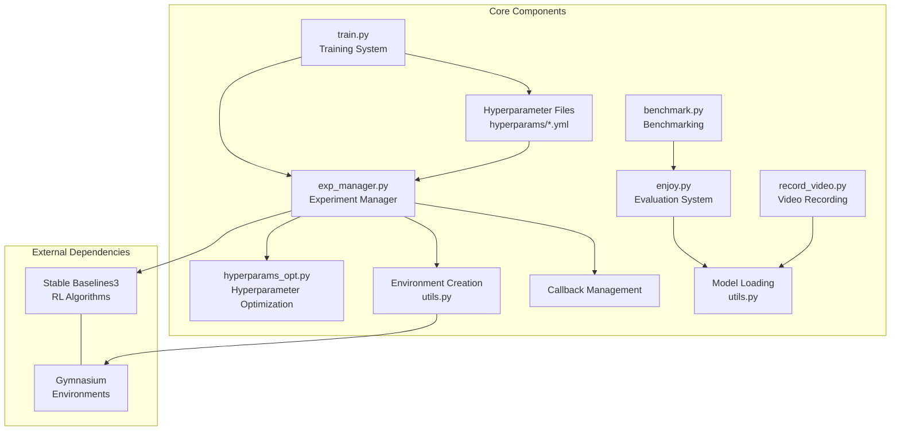
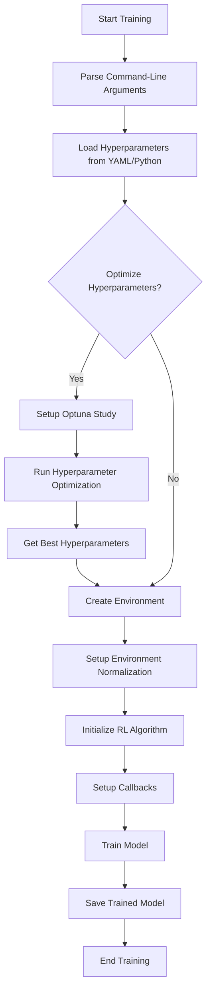
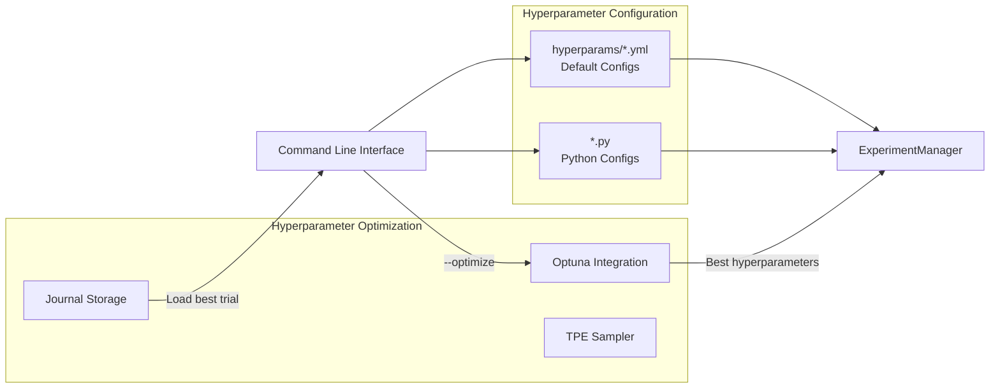
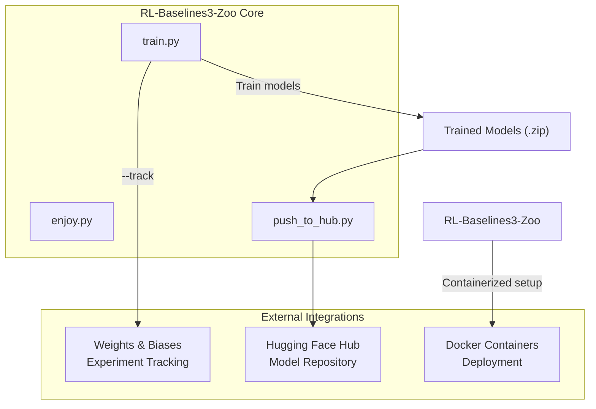
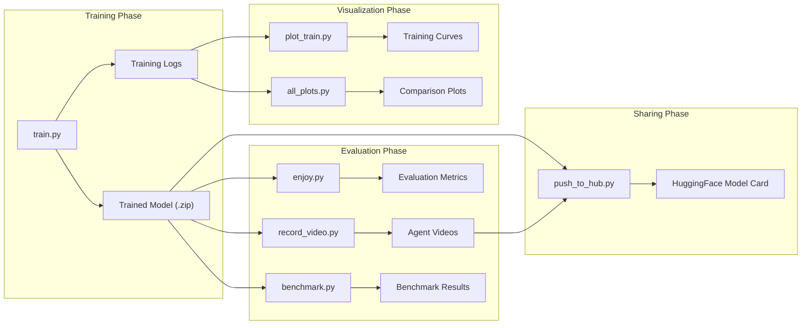

<!-- source: DeepWiki mcp.deepwiki.com · repo DLR-RM/rl-baselines3-zoo · page 1 Introduction to RL-Baselines3-Zoo · fetched 2026-10-14 -->

# Introduction to RL-Baselines3-Zoo

<details>
<summary>Relevant source files</summary>

The following files were used as context for generating this wiki page:

- [CHANGELOG.md](CHANGELOG.md)
- [README.md](README.md)
- [rl_zoo3/version.txt](rl_zoo3/version.txt)

</details>


## Purpose and Scope

RL-Baselines3-Zoo is a training framework for Reinforcement Learning (RL) that builds upon [Stable Baselines3](https://github.com/DLR-RM/stable-baselines3). It provides a comprehensive set of tools for training, evaluating, and benchmarking RL agents across a wide range of environments. This document introduces the core concepts, architecture, and workflow of the RL-Baselines3-Zoo framework.

This page focuses on the high-level overview of the framework. For specific details on installation, see [Getting Started](#2), or [Training System](#3) for information about the training process.

Sources: [README.md:8-16]()

## Overview

RL-Baselines3-Zoo serves several key purposes:

1. Providing a simple interface to train and evaluate RL agents
2. Benchmarking different RL algorithms
3. Offering tuned hyperparameters for various environments and algorithms
4. Facilitating experimentation with trained agents

The framework includes a collection of pre-configured hyperparameters and pre-trained agents for common environments, allowing researchers and practitioners to quickly get started with state-of-the-art RL algorithms.

Sources: [README.md:19-28]()

## System Architecture

### Core Components

RL-Baselines3-Zoo is built around a modular architecture that separates different aspects of the RL workflow. The core components are:



This diagram shows the main components of RL-Baselines3-Zoo and how they interact. The central element is the `ExperimentManager` class from `exp_manager.py`, which coordinates environment creation, model initialization, and training configuration.

Sources: [README.md:12-16](), [CHANGELOG.md:21-26]()

### Component Roles

| Component | File | Description |
|-----------|------|-------------|
| Training System | `train.py` | Main entry point for training RL agents; processes command line arguments and manages training workflow |
| Experiment Manager | `exp_manager.py` | Handles environment creation, algorithm setup, and training configuration |
| Hyperparameter Files | `hyperparams/*.yml` | YAML files containing default hyperparameters for each algorithm and environment |
| Hyperparameter Optimization | `hyperparams_opt.py` | Implements Optuna-based hyperparameter optimization |
| Evaluation System | `enjoy.py` | Allows running and visualizing trained agents |
| Video Recording | `record_video.py` | Records videos of trained agents |
| Benchmarking | `benchmark.py` | Benchmarks RL algorithms on various environments |

Sources: [README.md:12-16](), [CHANGELOG.md:21-26]()

## Training Workflow

The training process in RL-Baselines3-Zoo follows a structured workflow:



This diagram illustrates the typical workflow when training an agent with RL-Baselines3-Zoo. The process begins with parsing command-line arguments and loading hyperparameters, followed by either direct training or hyperparameter optimization, and finally saving the trained model.

Sources: [README.md:62-74](), [CHANGELOG.md:3-19]()

## Supported Algorithms and Environments

RL-Baselines3-Zoo supports a wide range of RL algorithms and environment types:

### Reinforcement Learning Algorithms

```mermaid
graph TD
    subgraph "RL Algorithms"
        PPO["PPO<br>Proximal Policy Optimization"]
        A2C["A2C<br>Advantage Actor-Critic"]
        SAC["SAC<br>Soft Actor-Critic"]
        TD3["TD3<br>Twin Delayed DDPG"]
        DDPG["DDPG<br>Deep Deterministic Policy Gradient"]
        DQN["DQN<br>Deep Q-Network"]
        TQC["TQC<br>Truncated Quantile Critics"]
        TRPO["TRPO<br>Trust Region Policy Optimization"]
        ARS["ARS<br>Augmented Random Search"]
        RecurrentPPO["RecurrentPPO<br>(LSTM-based PPO)"]
        CrossQ["CrossQ<br>Cross-Entropy Q-Learning"]
    end
    
    subgraph "Environment Types"
        Atari["Atari Games"]
        Classic["Classic Control"]
        Box2D["Box2D Environments"]
        PyBullet["PyBullet Environments"]
        MuJoCo["MuJoCo Environments"]
        Robotics["Robotics Environments"]
        MiniGrid["MiniGrid Environments"]
    end
    
    RL-Zoo["RL-Baselines3-Zoo"] --> "RL Algorithms"
    RL-Zoo --> "Environment Types"
```

The framework provides ready-to-use implementations and hyperparameters for all these algorithms across various environment types, making it easy to benchmark and compare different approaches.

Sources: [README.md:118-251](), [CHANGELOG.md:58-64]()

## Hyperparameter Management

Hyperparameter management is a core feature of RL-Baselines3-Zoo. The framework provides:

1. **Default Hyperparameters**: YAML files in the `hyperparams/` directory with pre-tuned parameters for each algorithm and environment.
2. **Hyperparameter Optimization**: Optuna-based optimization to find optimal hyperparameters.
3. **Python Configuration**: Support for both YAML and Python configuration files for flexibility.



Recent versions have added improved hyperparameter optimization with Optuna Journal storage, allowing users to easily load and use tuned hyperparameters via the `--trial-id` argument.

Sources: [README.md:102-104](), [CHANGELOG.md:3-19](), [CHANGELOG.md:196-205]()

## Integration with External Tools

RL-Baselines3-Zoo integrates with several external tools for experiment tracking, model sharing, and deployment:



### Experiment Tracking with Weights & Biases

The framework supports tracking experiments via Weights & Biases, which can be activated using the `--track` flag. This allows you to monitor training progress, compare different runs, and analyze results.

### Model Sharing with Hugging Face Hub

Trained models can be shared on the Hugging Face Hub using the `push_to_hub.py` script, making it easy to distribute and reuse models across the community.

Sources: [README.md:79-81](), [CHANGELOG.md:316-325](), [CHANGELOG.md:292-296]()

## System Data Flow

The following diagram illustrates how data flows through the system during a typical RL workflow:



This diagram shows the complete data flow in RL-Baselines3-Zoo, from training to evaluation, visualization, and sharing. The trained model is the central artifact that connects the different phases of the workflow.

Sources: [README.md:87-99](), [CHANGELOG.md:292-296]()

## Recent Features and Updates

RL-Baselines3-Zoo is actively maintained and regularly updated with new features. Recent additions include:

- Support for Gymnasium v1.1
- Special vectorized environment support (Brax, IsaacSim)
- Command line logging
- Python config files instead of only YAML
- RecurrentPPO (LSTM-based PPO) support
- CrossQ algorithm support
- Hugging Face Hub integration for model sharing
- Weights & Biases integration for experiment tracking

Sources: [CHANGELOG.md:21-36](), [CHANGELOG.md:58-64](), [CHANGELOG.md:196-205](), [CHANGELOG.md:292-296](), [CHANGELOG.md:316-325]()

## Summary

RL-Baselines3-Zoo provides a comprehensive framework for training, evaluating, and benchmarking reinforcement learning agents. It extends Stable Baselines3 with additional tools for hyperparameter optimization, visualization, and integration with external services. The modular architecture and extensive documentation make it accessible for both researchers and practitioners in the field of reinforcement learning.

---

