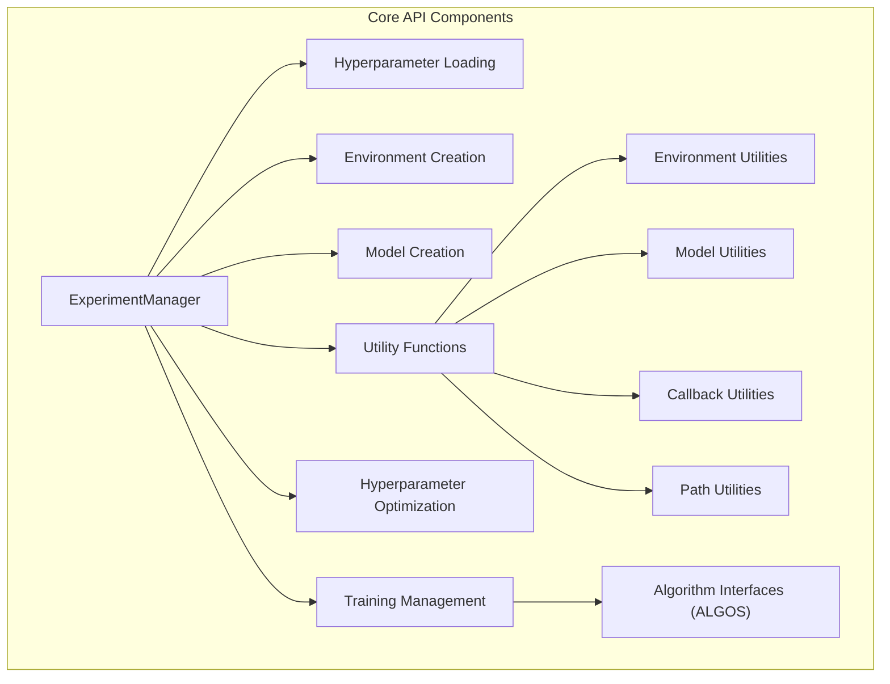
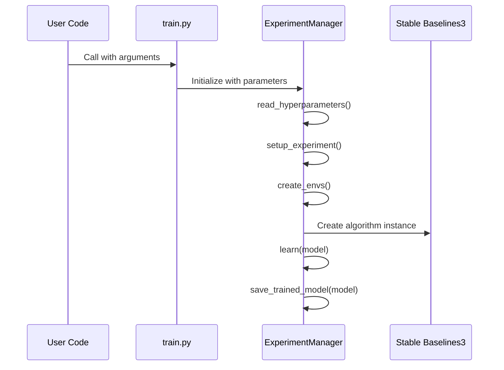
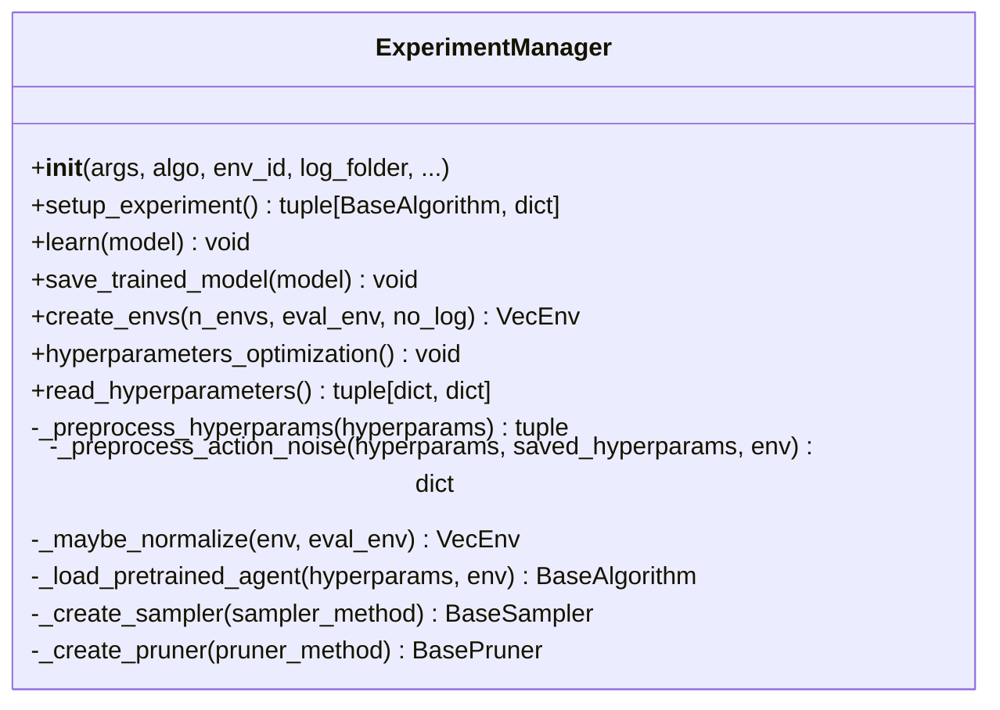
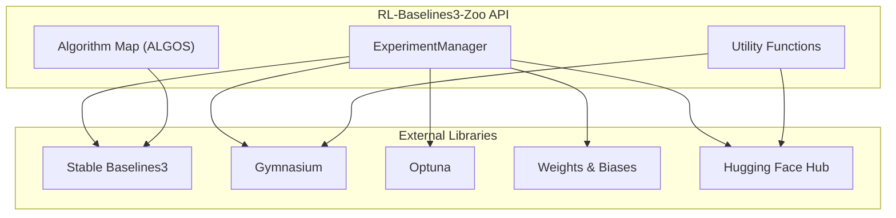

<!-- source: DeepWiki mcp.deepwiki.com · repo DLR-RM/rl-baselines3-zoo · page 10 API Reference · fetched 2026-10-14 -->

# API Reference

<details>
<summary>Relevant source files</summary>

The following files were used as context for generating this wiki page:

- [rl_zoo3/exp_manager.py](rl_zoo3/exp_manager.py)
- [rl_zoo3/utils.py](rl_zoo3/utils.py)

</details>


This API Reference provides detailed documentation of the core components, classes, and functions in the RL-Baselines3-Zoo framework. It covers the main programming interfaces that developers can use to integrate, extend, or customize the framework's functionality. For usage examples and tutorials, see the [Getting Started](#2) section.

## Core Components Overview

RL-Baselines3-Zoo consists of several key components that provide a comprehensive API for managing reinforcement learning experiments.

### Component Architecture



Sources: [rl_zoo3/exp_manager.py:56-973](), [rl_zoo3/utils.py:26-40]()

### Workflow Integration



Sources: [rl_zoo3/exp_manager.py:193-231](), [rl_zoo3/exp_manager.py:233-270](), [rl_zoo3/exp_manager.py:271-290]()

## ExperimentManager Class

The `ExperimentManager` class is the central component managing the entire lifecycle of reinforcement learning experiments.

### Class Definition



Sources: [rl_zoo3/exp_manager.py:56-64]()

### Constructor

The `ExperimentManager` constructor initializes an experiment with extensive configuration options:

```python
def __init__(
    self,
    args: argparse.Namespace,
    algo: str,                     # Algorithm name (e.g., "ppo", "sac")
    env_id: str,                   # Environment ID (e.g., "CartPole-v1")
    log_folder: str,               # Directory for saving logs
    tensorboard_log: str = "",     # Tensorboard log directory
    n_timesteps: int = 0,          # Number of training timesteps
    eval_freq: int = 10000,        # Evaluation frequency
    n_eval_episodes: int = 5,      # Number of evaluation episodes
    save_freq: int = -1,           # Model saving frequency
    hyperparams: Optional[dict[str, Any]] = None,  # Custom hyperparameters
    env_kwargs: Optional[dict[str, Any]] = None,   # Environment kwargs
    eval_env_kwargs: Optional[dict[str, Any]] = None,  # Evaluation env kwargs
    trained_agent: str = "",       # Path to pretrained agent
    optimize_hyperparameters: bool = False,  # Whether to optimize hyperparams
    # ... and many more parameters for hyperparameter optimization, logging, etc.
)
```

Sources: [rl_zoo3/exp_manager.py:67-107]()

### Key Methods

#### setup_experiment()

Sets up the experiment by reading hyperparameters, creating environments, and initializing the RL model.

```python
def setup_experiment(self) -> Optional[tuple[BaseAlgorithm, dict[str, Any]]]
```

Returns the initialized model and saved hyperparameters, or None when doing hyperparameter optimization.

Sources: [rl_zoo3/exp_manager.py:193-231]()

#### learn(model)

Trains the provided reinforcement learning model.

```python
def learn(self, model: BaseAlgorithm) -> None
```

Handles training with callbacks, interruption, and resource cleanup.

Sources: [rl_zoo3/exp_manager.py:233-270]()

#### create_envs(n_envs, eval_env, no_log)

Creates vectorized environments for training or evaluation.

```python
def create_envs(self, n_envs: int, eval_env: bool = False, no_log: bool = False) -> VecEnv
```

Applies appropriate wrappers, normalization, and preprocessing based on configuration.

Sources: [rl_zoo3/exp_manager.py:637-714]()

#### hyperparameters_optimization()

Performs hyperparameter optimization using Optuna.

```python
def hyperparameters_optimization(self) -> None
```

Sets up and runs an Optuna study to find optimal hyperparameters.

Sources: [rl_zoo3/exp_manager.py:863-972]()

#### read_hyperparameters()

Reads hyperparameters from YAML files or Python modules.

```python
def read_hyperparameters(self) -> tuple[dict[str, Any], dict[str, Any]]
```

Returns both the raw hyperparameters and saved hyperparameters.

Sources: [rl_zoo3/exp_manager.py:316-355]()

## Utility Functions

The framework provides utility functions for working with environments, models, and hyperparameters.

### Environment Utilities

#### get_wrapper_class()

```python
def get_wrapper_class(hyperparams: dict[str, Any], key: str = "env_wrapper") -> Optional[Callable[[gym.Env], gym.Env]]
```

Gets environment wrapper classes specified in hyperparameters. Supports both single wrappers and lists of wrappers with kwargs.

Sources: [rl_zoo3/utils.py:48-124]()

#### create_test_env()

```python
def create_test_env(
    env_id: str,
    n_envs: int = 1,
    stats_path: Optional[str] = None,
    seed: int = 0,
    log_dir: Optional[str] = None,
    should_render: bool = True,
    hyperparams: Optional[dict[str, Any]] = None,
    env_kwargs: Optional[dict[str, Any]] = None,
    vec_env_cls: Optional[type[VecEnv]] = None,
    vec_env_kwargs: Optional[dict[str, Any]] = None,
) -> VecEnv
```

Creates environments for testing trained agents, with proper wrapping and normalization.

Sources: [rl_zoo3/utils.py:202-292]()

### Model Utilities

#### get_trained_models()

```python
def get_trained_models(log_folder: str) -> dict[str, tuple[str, str]]
```

Scans a log folder and returns information about trained models.

Sources: [rl_zoo3/utils.py:316-334]()

#### get_hf_trained_models()

```python
def get_hf_trained_models(organization: str = "sb3", check_filename: bool = False) -> dict[str, tuple[str, str]]
```

Retrieves models available on the Hugging Face Hub.

Sources: [rl_zoo3/utils.py:337-377]()

### Hyperparameter Utilities

#### get_saved_hyperparams()

```python
def get_saved_hyperparams(
    stats_path: str,
    norm_reward: bool = False,
    test_mode: bool = False,
) -> tuple[dict[str, Any], Optional[str]]
```

Retrieves saved hyperparameters from a path.

Sources: [rl_zoo3/utils.py:398-437]()

#### linear_schedule()

```python
def linear_schedule(initial_value: Union[float, str]) -> Callable[[float], float]
```

Creates a linear learning rate schedule that decreases from initial value to 0.

Sources: [rl_zoo3/utils.py:295-313]()

### Callback Utilities

#### get_callback_list()

```python
def get_callback_list(hyperparams: dict[str, Any]) -> list[BaseCallback]
```

Creates a list of callback objects from hyperparameters.

Sources: [rl_zoo3/utils.py:147-199]()

#### get_class_by_name()

```python
def get_class_by_name(name: str) -> type
```

Imports and returns a class given its fully qualified name.

Sources: [rl_zoo3/utils.py:127-144]()

### Path Utilities

#### get_model_path()

```python
def get_model_path(
    exp_id: int,
    folder: str,
    algo: str,
    env_name: EnvironmentName,
    load_best: bool = False,
    load_checkpoint: Optional[str] = None,
    load_last_checkpoint: bool = False,
) -> tuple[str, str, str]
```

Constructs the path to a model file based on experiment parameters.

Sources: [rl_zoo3/utils.py:462-511]()

#### get_latest_run_id()

```python
def get_latest_run_id(log_path: str, env_name: EnvironmentName) -> int
```

Returns the latest run number for a given environment and log path.

Sources: [rl_zoo3/utils.py:380-395]()

## Algorithm Interfaces

The `ALGOS` dictionary maps algorithm names to their respective classes:

```python
ALGOS: dict[str, type[BaseAlgorithm]] = {
    "a2c": A2C,
    "ddpg": DDPG,
    "dqn": DQN,
    "ppo": PPO,
    "sac": SAC,
    "td3": TD3,
    # SB3 Contrib algorithms
    "ars": ARS,
    "crossq": CrossQ,
    "qrdqn": QRDQN,
    "tqc": TQC,
    "trpo": TRPO,
    "ppo_lstm": RecurrentPPO,
}
```

This dictionary is used throughout the framework to create algorithm instances based on string identifiers.

Sources: [rl_zoo3/utils.py:26-40]()

## Hyperparameter Management

### StoreDict Action

```python
class StoreDict(argparse.Action):
    def __init__(self, option_strings, dest, nargs=None, **kwargs)
    def __call__(self, parser, namespace, values, option_string=None)
```

Custom argparse action for storing dictionaries from command-line arguments.

Example:
```
--env-kwargs "render_mode:human" "max_episode_steps:1000"
```

Sources: [rl_zoo3/utils.py:440-459]()

## System Integration Diagram



Sources: [rl_zoo3/exp_manager.py:13-25](), [rl_zoo3/utils.py:8-24]()

## Common API Usage Patterns

### Training a Model

```python
from rl_zoo3.exp_manager import ExperimentManager

# Initialize ExperimentManager
exp_manager = ExperimentManager(
    args=args,
    algo="ppo",
    env_id="CartPole-v1",
    log_folder="logs",
    tensorboard_log="tensorboard_logs",
    n_timesteps=100000,
    verbose=1
)

# Setup experiment
model, _ = exp_manager.setup_experiment()

# Train model
exp_manager.learn(model)

# Save trained model
exp_manager.save_trained_model(model)
```

### Hyperparameter Optimization

```python
from rl_zoo3.exp_manager import ExperimentManager

# Initialize ExperimentManager with optimization enabled
exp_manager = ExperimentManager(
    args=args,
    algo="ppo",
    env_id="CartPole-v1",
    log_folder="logs",
    optimize_hyperparameters=True,
    n_trials=10,
    sampler="tpe",
    pruner="median",
    n_evaluations=5,
    n_timesteps=100000
)

# This will return None when doing hyperparameter optimization
model, _ = exp_manager.setup_experiment()

# Run hyperparameter optimization
exp_manager.hyperparameters_optimization()
```