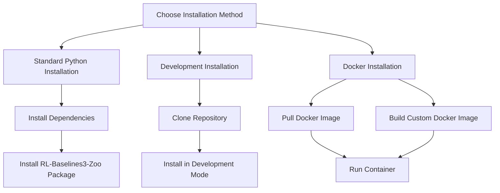
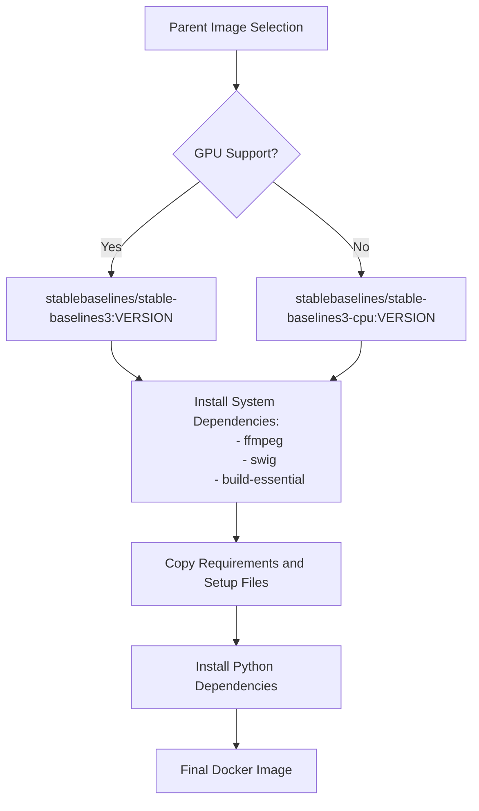
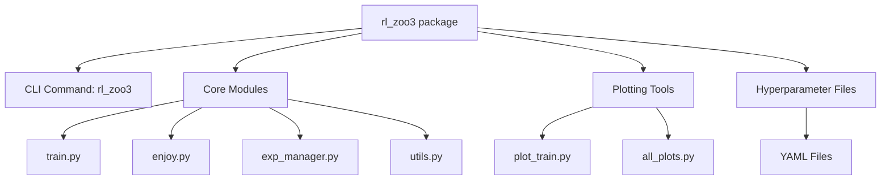

<!-- source: DeepWiki mcp.deepwiki.com · repo DLR-RM/rl-baselines3-zoo · page 2.1 Installation Guide · fetched 2026-10-14 -->

# Installation Guide

<details>
<summary>Relevant source files</summary>

The following files were used as context for generating this wiki page:

- [docker/Dockerfile](docker/Dockerfile)
- [requirements.txt](requirements.txt)
- [scripts/build_docker.sh](scripts/build_docker.sh)
- [setup.py](setup.py)

</details>


This page provides detailed instructions for installing RL-Baselines3-Zoo on different platforms and environments. The guide covers standard Python installation methods as well as Docker-based deployment. For instructions on using Docker containers with this framework, see [Docker Deployment](#2.2).

## Prerequisites

Before installing RL-Baselines3-Zoo, ensure your system meets the following requirements:

- Python 3.9 or newer (supports up to Python 3.12)
- pip or conda package manager
- Git (for cloning the repository)

Optional but recommended:
- CUDA-compatible GPU for training (not required but greatly improves performance)
- ffmpeg (for video recording capabilities)

## Installation Workflow



Sources: [setup.py](), [docker/Dockerfile](), [requirements.txt]()

## Standard Python Installation

### 1. Using pip (Recommended)

The simplest way to install RL-Baselines3-Zoo is using pip:

```bash
pip install rl_zoo3
```

This installs the core package with basic dependencies. For additional functionality, install optional components:

```bash
# For plotting tools
pip install "rl_zoo3[plots]"

# For all components including testing tools
pip install "rl_zoo3[plots,tests]"
```

Sources: [setup.py:36-59]()

### 2. Installation from Source

For the latest version or to make modifications:

```bash
# Clone the repository
git clone https://github.com/DLR-RM/rl-baselines3-zoo.git
cd rl-baselines3-zoo

# Install the package in development mode
pip install -e ".[plots,tests]"
```

Sources: [setup.py:17-28]()

## Dependencies Overview

RL-Baselines3-Zoo relies on several key dependencies:

```mermaid
graph TD
    subgraph "Core Dependencies"
        A["sb3_contrib ≥2.6.0,<3.0"] --> SB3["stable-baselines3"]
        B["gymnasium ≥0.29.1,<1.2.0"]
        C["huggingface_sb3 ≥3.0,<4.0"]
        D["optuna ≥3.0"]
        E["pyyaml ≥5.1"]
        F["tqdm & rich"]
    end
    
    subgraph "Optional Dependencies"
        G["seaborn & plotly"] --> PLOTS["Plotting Tools"]
        H["rliable ~1.2.0"] --> PLOTS
        I["scipy ~1.10"] --> PLOTS
        J["wandb"] --> TRACKING["Experiment Tracking"]
        K["moviepy ≥1.0.0"] --> VIDEO["Video Recording"]
    end
    
    subgraph "Environment Dependencies"
        L["box2d-py ==2.3.8"]
        M["pybullet_envs_gymnasium ≥0.6.0"]
        N["mujoco ≥2.3,<4"] 
        O["highway-env ≥1.10.1,<1.11.0"]
    end
    
    RL["RL-Baselines3-Zoo"] --> "Core Dependencies"
    RL --> "Optional Dependencies"
    RL --> "Environment Dependencies"
```

Sources: [setup.py:17-34](), [requirements.txt:1-14]()

## Environment-Specific Installations

### MuJoCo Environments

To use MuJoCo environments:

```bash
pip install "rl_zoo3[tests]"  # Includes mujoco package
```

### PyBullet Environments

For physics-based robot simulations:

```bash
pip install pybullet_envs_gymnasium>=0.6.0
```

### Box2D Environments

For 2D physics simulations:

```bash
pip install box2d-py==2.3.8
```

Sources: [requirements.txt:3-4](), [setup.py:29-34]()

## Docker Installation

RL-Baselines3-Zoo provides Docker support for containerized usage, which ensures consistent environments across different systems.

### Option 1: Pull Pre-built Image

```bash
# CPU version
docker pull stablebaselines/rl-baselines3-zoo-cpu:latest

# GPU version
docker pull stablebaselines/rl-baselines3-zoo:latest
```

### Option 2: Build Custom Image

```bash
git clone https://github.com/DLR-RM/rl-baselines3-zoo.git
cd rl-baselines3-zoo

# CPU version
USE_GPU=False ./scripts/build_docker.sh

# GPU version
USE_GPU=True ./scripts/build_docker.sh
```

### Running Docker Container

```bash
# CPU version
docker run -it --rm stablebaselines/rl-baselines3-zoo-cpu:latest

# GPU version (requires nvidia-docker)
docker run -it --rm --gpus all stablebaselines/rl-baselines3-zoo:latest
```

Sources: [docker/Dockerfile:1-36](), [scripts/build_docker.sh:1-21]()

## Docker Build Process



Sources: [docker/Dockerfile:1-36](), [scripts/build_docker.sh:1-21]()

## Installation Verification

To verify the installation, run a simple test that imports the package and checks the version:

```bash
python -c "import rl_zoo3; print(f'RL-Baselines3-Zoo version: {rl_zoo3.__version__}')"
```

You can also check that the command-line interface is properly installed:

```bash
rl_zoo3 --help
```

## Common Installation Issues

| Issue | Potential Solutions |
|-------|---------------------|
| Missing CUDA support | Ensure you have compatible GPU drivers and CUDA installed |
| Box2D compilation errors | Install system dependencies: `sudo apt install swig build-essential` |
| MuJoCo import errors | Ensure mujoco package is properly installed |
| Dependency conflicts | Use a virtual environment to isolate the installation |
| Permission errors | Use `pip install --user` or create a virtual environment |

## Package Structure

The installation places the following components in your Python environment:



Sources: [setup.py:36-45]()

## Next Steps

After installation, you're ready to:

1. Train your first agent (see [Training System](#3) for details)
2. Explore hyperparameter configurations (see [Hyperparameter Management](#4))
3. Evaluate pre-trained agents (see [Evaluation and Benchmarking](#5))

---

