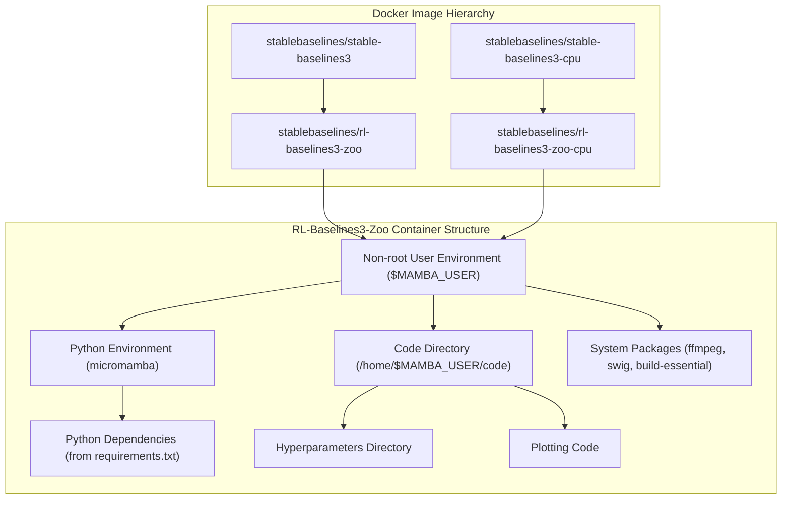
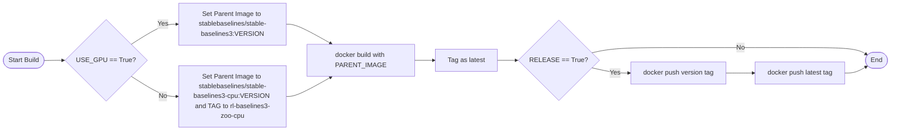

<!-- source: DeepWiki mcp.deepwiki.com · repo DLR-RM/rl-baselines3-zoo · page 2.2 Docker Deployment · fetched 2026-10-14 -->

# Docker Deployment

<details>
<summary>Relevant source files</summary>

The following files were used as context for generating this wiki page:

- [docker/Dockerfile](docker/Dockerfile)
- [requirements.txt](requirements.txt)
- [scripts/build_docker.sh](scripts/build_docker.sh)

</details>


This page provides instructions for deploying and using RL-Baselines3-Zoo with Docker containers. Docker offers a consistent environment that includes all necessary dependencies, making it easier to run reinforcement learning experiments across different systems. For standard installation without Docker, see [Installation Guide](#2.1).

## Docker Image Architecture

The RL-Baselines3-Zoo Docker images extend the Stable Baselines3 Docker images, providing a pre-configured environment with all required dependencies installed.

### Docker Image Structure Diagram



Sources: [docker/Dockerfile](), [scripts/build_docker.sh]()

## Building Docker Images

The repository provides a script (`scripts/build_docker.sh`) to build Docker images with either CPU or GPU support.

### Docker Build Process



Sources: [scripts/build_docker.sh]()

### Building a CPU Image

To build a CPU-only Docker image:

```bash
USE_GPU=False ./scripts/build_docker.sh
```

This creates images tagged as `stablebaselines/rl-baselines3-zoo-cpu:version` and `stablebaselines/rl-baselines3-zoo-cpu:latest`.

### Building a GPU Image

To build a GPU-enabled Docker image:

```bash
USE_GPU=True ./scripts/build_docker.sh
```

This creates images tagged as `stablebaselines/rl-baselines3-zoo:version` and `stablebaselines/rl-baselines3-zoo:latest`.

### Publishing to Docker Hub

To build and push images to Docker Hub:

```bash
USE_GPU=True RELEASE=True ./scripts/build_docker.sh
```

Note: This requires Docker Hub credentials and appropriate permissions.

Sources: [scripts/build_docker.sh:8-21]()

## Docker Image Contents

The Docker image contains the following components:

| Component | Description |
|-----------|-------------|
| Base Image | `stablebaselines/stable-baselines3` or `stablebaselines/stable-baselines3-cpu` |
| System Packages | ffmpeg, swig, build-essential (for building Box2D) |
| Python Environment | Managed via micromamba |
| Code Directory | `/home/$MAMBA_USER/code` |
| RL-Baselines3-Zoo | Installed at `/home/$MAMBA_USER/code/rl_zoo3` in editable mode |
| Hyperparameters | Located at `/home/$MAMBA_USER/code/rl_zoo3/hyperparams/` |
| Plotting Code | Located at `/home/$MAMBA_USER/code/rl_zoo3/rl_zoo3/plots/` |

Sources: [docker/Dockerfile:1-36]()

## Python Dependencies

The Docker image includes all dependencies specified in `requirements.txt`:

| Category | Key Dependencies |
|----------|------------------|
| Core Libraries | gym==0.26.2, stable-baselines3[extra,tests,docs]>=2.6.0,<3.0 |
| Environments | box2d-py==2.3.8, pybullet_envs_gymnasium>=0.6.0 |
| Optimization | optunahub>=0.2.0, plotly |
| Visualization | wandb, moviepy>=1.0.0 |

Sources: [requirements.txt:1-15](), [docker/Dockerfile:27-34]()

## Running the Docker Container

### Basic Usage

To run the container with an interactive shell:

```bash
# CPU version
docker run -it --rm stablebaselines/rl-baselines3-zoo-cpu:latest

# GPU version (requires NVIDIA Container Toolkit)
docker run -it --rm --gpus all stablebaselines/rl-baselines3-zoo:latest
```

Inside the container, the RL-Baselines3-Zoo code is installed as an editable package at `/home/$MAMBA_USER/code/rl_zoo3`. The Python environment is automatically activated via micromamba.

Sources: [docker/Dockerfile:36]()

### Training an Agent

To train an agent using the container with persistent storage for logs:

```bash
docker run -it --rm \
  --gpus all \  # Remove for CPU version
  -v $(pwd)/logs:/home/$MAMBA_USER/logs \
  stablebaselines/rl-baselines3-zoo:latest \
  bash -c "cd /home/$MAMBA_USER/code/rl_zoo3 && python train.py --algo ppo --env CartPole-v1 -f /home/$MAMBA_USER/logs/"
```

This example mounts a local `logs` directory to store training results outside the container.

### Container Environment Details

The Docker container uses:
- A non-root user (`$MAMBA_USER`) for better security
- Micromamba for Python environment management
- An editable installation of RL-Baselines3-Zoo for easier modification
- Pre-copied hyperparameter configurations located in the container

## Customizing the Docker Image

If you need to customize the Docker image, you can:

1. Modify the Dockerfile: [docker/Dockerfile]()
2. Add additional requirements to `requirements.txt`
3. Rebuild the image using the build script

## Troubleshooting

### Common Issues

| Issue | Solution |
|-------|----------|
| GPU not detected | Ensure NVIDIA drivers and NVIDIA Container Toolkit (nvidia-docker2) are installed |
| Permission errors | Check volume mount permissions or run container with appropriate user mapping |
| Missing dependencies | The container includes all dependencies from requirements.txt; check if you need to rebuild with custom dependencies |

### Checking GPU Support

To verify GPU support inside the container:

```bash
docker run --rm --gpus all stablebaselines/rl-baselines3-zoo:latest nvidia-smi
```

If working correctly, this should display your GPU information.

---

