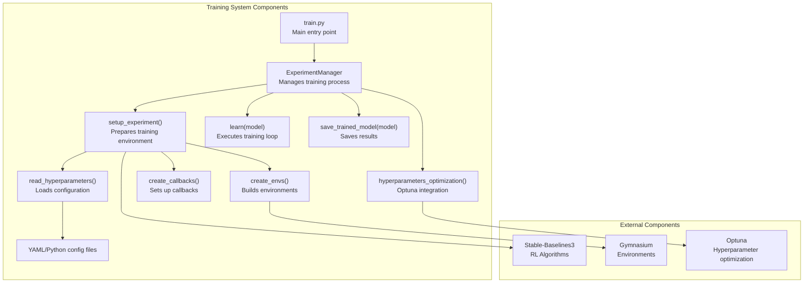
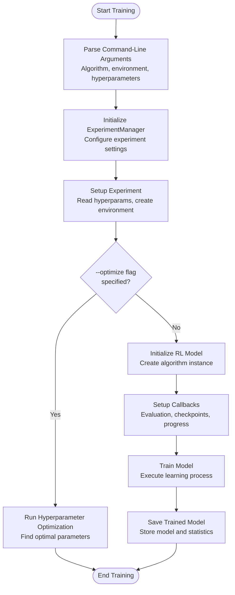
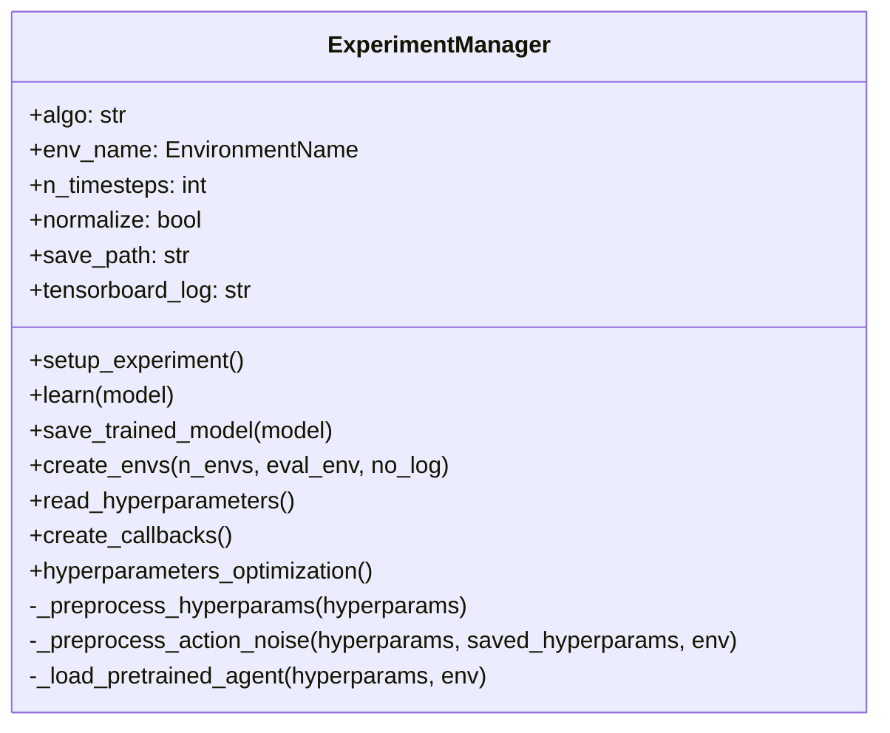
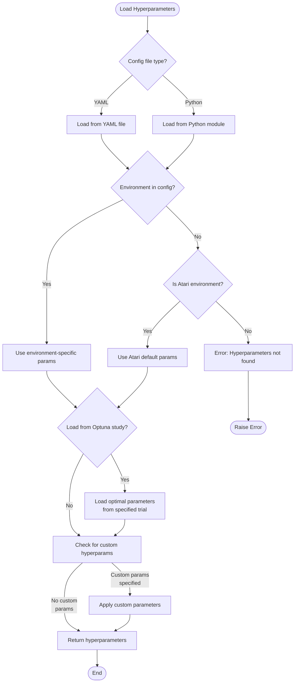
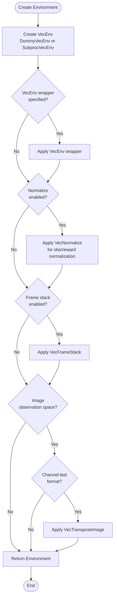
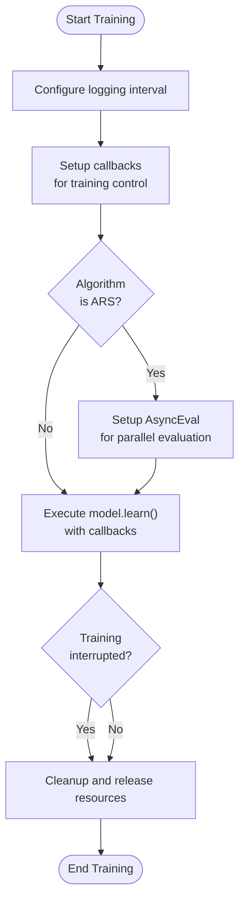
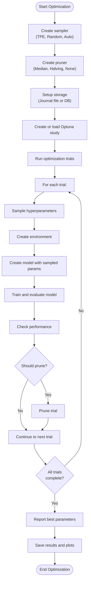
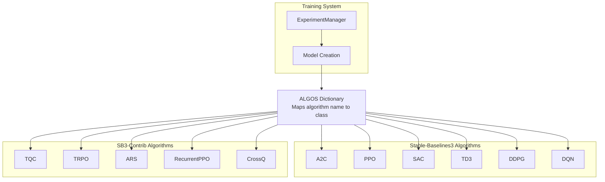
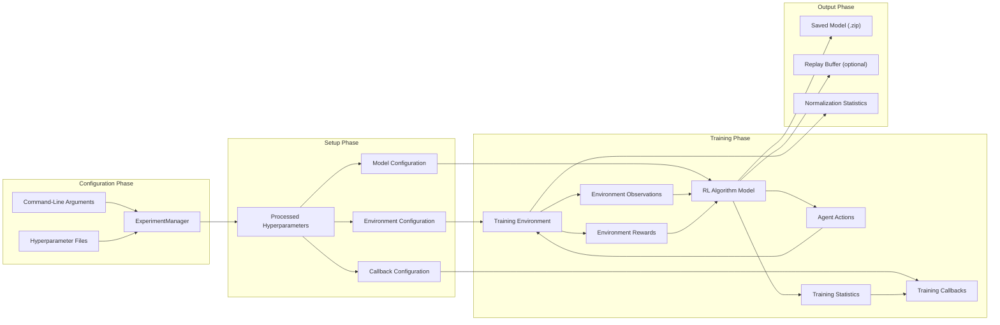

<!-- source: DeepWiki mcp.deepwiki.com · repo DLR-RM/rl-baselines3-zoo · page 3 Training System · fetched 2026-10-14 -->

# Training System

<details>
<summary>Relevant source files</summary>

The following files were used as context for generating this wiki page:

- [CHANGELOG.md](CHANGELOG.md)
- [rl_zoo3/exp_manager.py](rl_zoo3/exp_manager.py)
- [rl_zoo3/train.py](rl_zoo3/train.py)
- [train.py](train.py)

</details>


The Training System in RL-Baselines3-Zoo is responsible for configuring and executing reinforcement learning experiments. It handles environment creation, algorithm initialization, hyperparameter management, training, evaluation, and model saving. This page explains the system architecture and workflow for training reinforcement learning agents.

For information about command-line options, see [Command Line Interface](#3.1). For details on experiment management, see [Experiment Management](#3.2). For callback system information, see [Callbacks System](#3.3).

## System Architecture

The training system is built around the ExperimentManager class, which orchestrates the entire training process. The following diagram shows the high-level architecture:



Sources: [rl_zoo3/exp_manager.py:56-193](), [rl_zoo3/train.py:20-266]()

## Training Workflow

The training workflow consists of several sequential steps, from parsing command-line arguments to saving the trained model:



Sources: [rl_zoo3/train.py:20-286](), [rl_zoo3/exp_manager.py:193-232](), [rl_zoo3/exp_manager.py:233-270]()

## ExperimentManager Class

The `ExperimentManager` class serves as the central component of the training system:



Sources: [rl_zoo3/exp_manager.py:56-193]()

### Key Methods

1. **setup_experiment()**: Prepares the training environment by reading hyperparameters, creating environments, and initializing the model.

2. **learn(model)**: Executes the training loop with the specified model and callbacks.

3. **save_trained_model(model)**: Saves the trained model, replay buffer (optional), and environment normalization statistics.

4. **create_envs()**: Creates vectorized environments for training or evaluation.

5. **read_hyperparameters()**: Loads hyperparameters from YAML or Python configuration files.

6. **create_callbacks()**: Sets up callbacks for evaluation, checkpointing, and progress tracking.

7. **hyperparameters_optimization()**: Runs hyperparameter optimization using Optuna.

Sources: [rl_zoo3/exp_manager.py:193-232](), [rl_zoo3/exp_manager.py:233-270](), [rl_zoo3/exp_manager.py:271-290](), [rl_zoo3/exp_manager.py:637-713](), [rl_zoo3/exp_manager.py:316-355](), [rl_zoo3/exp_manager.py:537-572](), [rl_zoo3/exp_manager.py:863-972]()

## Configuration and Hyperparameter Management

Hyperparameters are managed through a hierarchical system:

| Configuration Source | Priority | Description |
|----------------------|----------|-------------|
| Default YAML/Python files | Lowest | Base hyperparameters for each algorithm/environment combination |
| Optuna study results | Medium | Hyperparameters loaded from previous optimization trials |
| Command-line overrides | Highest | Parameters specified via `--hyperparams` option |

The hyperparameter loading process:



Sources: [rl_zoo3/exp_manager.py:316-355](), [rl_zoo3/exp_manager.py:357-373]()

## Environment Creation

The training system creates environments through a sophisticated process that handles various environment types and wrappers:



Sources: [rl_zoo3/exp_manager.py:637-713]()

## Training Execution

The `learn()` method handles the actual training execution:



Sources: [rl_zoo3/exp_manager.py:233-270]()

## Hyperparameter Optimization

When enabled, the training system performs hyperparameter optimization using Optuna:



Sources: [rl_zoo3/exp_manager.py:863-972](), [rl_zoo3/exp_manager.py:772-861]()

## Environment Handling and Wrappers

The training system supports various environment types and wrappers:

| Environment Type | Detection Method | Special Handling |
|------------------|------------------|------------------|
| Atari            | Entry point check | Frame skipping, episodic life, etc. |
| MiniGrid         | Entry point check | Non-deterministic evaluation |
| PyBullet         | Entry point check | Specific wrappers |
| Robotics/GoalEnv | Entry point check | Success rate logging |
| Panda Gym        | Entry point check | Robotics interface |
| Generic          | Default          | Standard processing |

Sources: [rl_zoo3/exp_manager.py:574-598](), [rl_zoo3/exp_manager.py:637-713]()

## Integration with Stable-Baselines3

The training system integrates with Stable-Baselines3 algorithms through the `ALGOS` dictionary:



Sources: [rl_zoo3/train.py:20-266](), [rl_zoo3/exp_manager.py:193-232]()

## Callback System

The training system uses a flexible callback system to monitor and control training:

| Callback | Purpose |
|----------|---------|
| `ProgressBarCallback` | Displays training progress (when `--progress` is specified) |
| `CheckpointCallback` | Saves model checkpoints at specified frequency |
| `EvalCallback` | Evaluates model performance during training |
| `SaveVecNormalizeCallback` | Saves normalization statistics when a new best model is found |
| `TrialEvalCallback` | Used during hyperparameter optimization to evaluate trials |

Sources: [rl_zoo3/exp_manager.py:537-572]()

## Data Flow

The following diagram illustrates the data flow through the training system:



Sources: [rl_zoo3/train.py:20-286](), [rl_zoo3/exp_manager.py:193-232](), [rl_zoo3/exp_manager.py:233-270](), [rl_zoo3/exp_manager.py:271-290]()

## Using the Training System

The training system can be used in two primary ways:

1. **Command-line interface**: Run `python train.py` with appropriate arguments to train an agent.

2. **Python API**: Import and use the `ExperimentManager` directly in your code.

Example command to train a PPO agent on CartPole:

```bash
python train.py --algo ppo --env CartPole-v1 -n 50000 --eval-freq 10000
```

Example command for hyperparameter optimization:

```bash
python train.py --algo ppo --env CartPole-v1 -n 50000 --optimize-hyperparameters --n-trials 100 
```

Sources: [rl_zoo3/train.py:20-286]()

## Conclusion

The Training System in RL-Baselines3-Zoo provides a flexible and powerful framework for training reinforcement learning agents. It handles the complexity of environment creation, model initialization, hyperparameter management, and training execution, allowing users to focus on experimenting with different algorithms and environments.

---

