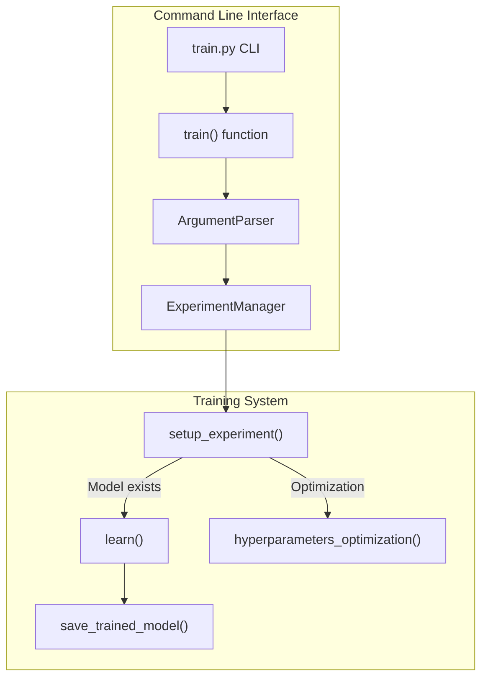
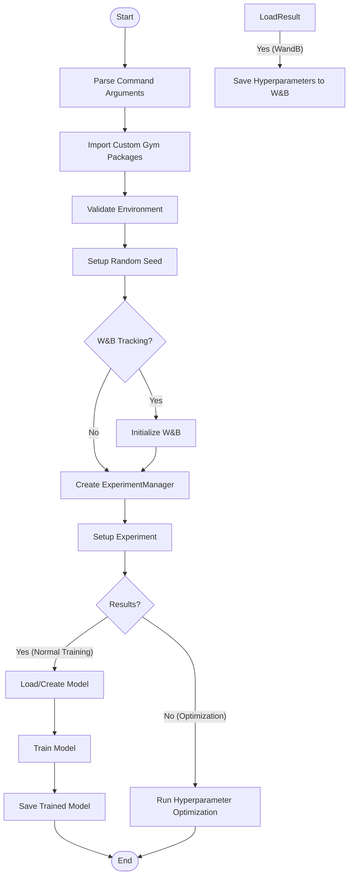
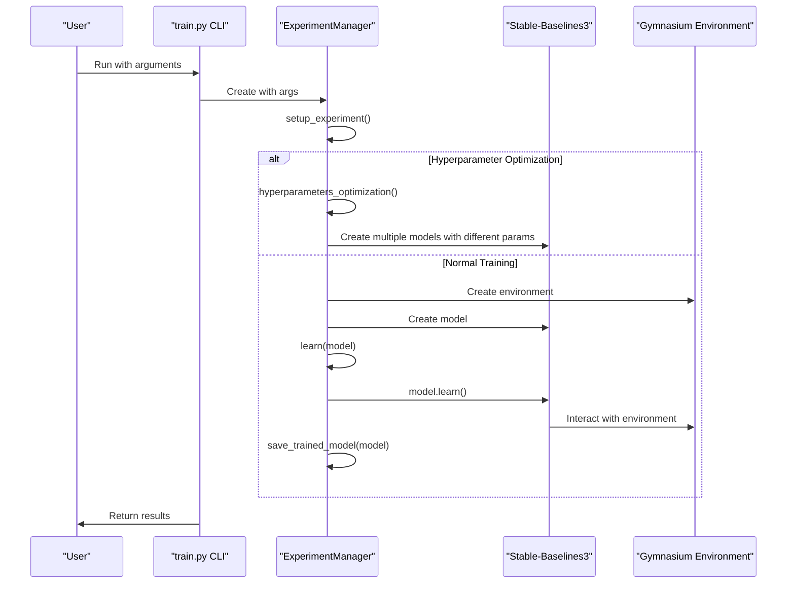
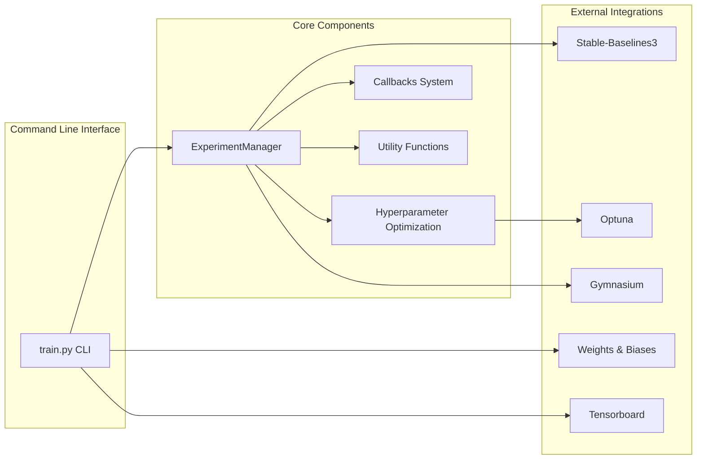
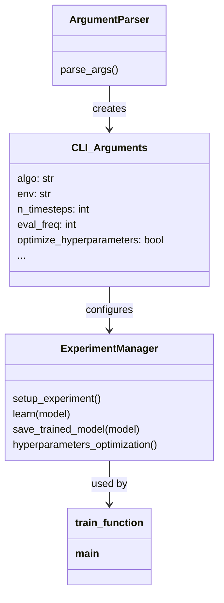

<!-- source: DeepWiki mcp.deepwiki.com · repo DLR-RM/rl-baselines3-zoo · page 3.1 Command Line Interface · fetched 2026-10-14 -->

# Command Line Interface

<details>
<summary>Relevant source files</summary>

The following files were used as context for generating this wiki page:

- [README.md](README.md)
- [rl_zoo3/train.py](rl_zoo3/train.py)
- [train.py](train.py)

</details>


The Command Line Interface (CLI) of RL-Baselines3-Zoo provides a comprehensive set of tools for training, evaluating, and optimizing reinforcement learning agents. This document covers the command-line arguments, usage patterns, and workflow for the CLI, focusing particularly on the training interface. For information about evaluation of trained agents, see [Evaluating Trained Agents](#5.1).

## Overview

RL-Baselines3-Zoo's CLI is primarily centered around the `train.py` script, which serves as the main entry point for training reinforcement learning agents. The CLI allows users to:

- Train agents with different algorithms on various environments
- Configure training parameters and hyperparameters
- Optimize hyperparameters using Optuna
- Track experiments with Weights & Biases
- Evaluate agent performance during training
- Save and load trained models



Sources: [rl_zoo3/train.py:20-286](), [train.py:1-5]()

## CLI Entry Points

There are two ways to use the RL-Baselines3-Zoo CLI:

1. **Direct script execution**: `python train.py [options]`
2. **Module execution**: `python -m rl_zoo3.train [options]` or `rl_zoo3 train [options]`

The second approach allows you to run the commands from any directory after installing the package.

Sources: [README.md:50-50]()

## Basic Usage

The most basic command to train an agent requires specifying an algorithm and an environment:

```bash
python train.py --algo ppo --env CartPole-v1
```

This will train a PPO agent on the CartPole-v1 environment using default hyperparameters defined in the corresponding YAML file.

Sources: [README.md:67-69](), [rl_zoo3/train.py:21-23]()

## Command Line Arguments

The CLI provides a wide range of arguments that can be grouped into the following categories:

### Core Training Arguments

```mermaid
classDiagram
    class "Core Training Arguments" {
        --algo: Algorithm name
        --env: Environment ID
        --n-timesteps: Total timesteps
        --trained-agent: Path to pretrained agent
        --seed: Random seed
        --num-threads: PyTorch threads
        --device: Computing device
    }
```

| Argument | Description | Default |
|----------|-------------|---------|
| `--algo` | RL algorithm to use (e.g., ppo, a2c, sac) | `ppo` |
| `--env` | Environment ID (e.g., CartPole-v1) | `CartPole-v1` |
| `--n-timesteps` | Number of training timesteps | Value from hyperparameters file |
| `--trained-agent` | Path to a pretrained agent to continue training | `""` (empty) |
| `--seed` | Random generator seed | Random value if negative |
| `--num-threads` | Number of threads for PyTorch | `-1` (default) |
| `--device` | PyTorch device (cpu, cuda, auto) | `auto` |

Sources: [rl_zoo3/train.py:22-24](), [rl_zoo3/train.py:33-34](), [rl_zoo3/train.py:61-63]()

### Evaluation Arguments

```mermaid
classDiagram
    class "Evaluation Arguments" {
        --eval-freq: Evaluation frequency
        --eval-episodes: Episodes per evaluation
        --n-eval-envs: Num of eval environments
        --save-freq: Model saving frequency
    }
```

| Argument | Description | Default |
|----------|-------------|---------|
| `--eval-freq` | Evaluate the agent every n steps | `25000` |
| `--eval-episodes` | Number of episodes for evaluation | `5` |
| `--n-eval-envs` | Number of environments for evaluation | `1` |
| `--save-freq` | Save the model every n steps | `-1` (no saving) |
| `--save-replay-buffer` | Save the replay buffer too | `False` |

Sources: [rl_zoo3/train.py:41-56](), [rl_zoo3/train.py:57-59]()

### Hyperparameter Optimization Arguments

```mermaid
classDiagram
    class "Optimization Arguments" {
        --optimize-hyperparameters: Enable optimization
        --n-trials: Number of trials
        --max-total-trials: Max pruned trials
        --n-jobs: Parallel jobs
        --sampler: Sampling method
        --pruner: Pruning method
        --n-startup-trials: Initial trials
        --n-evaluations: Evals per trial
    }
```

| Argument | Description | Default |
|----------|-------------|---------|
| `--optimize-hyperparameters` | Run hyperparameter search | `False` |
| `--n-trials` | Number of trials for optimization | `500` |
| `--max-total-trials` | Max number of pruned trials | `None` |
| `--n-jobs` | Number of parallel jobs | `1` |
| `--sampler` | Sampler to use (random, tpe, auto) | `tpe` |
| `--pruner` | Pruner to use (halving, median, none) | `median` |
| `--n-startup-trials` | Trials before using sampler | `10` |
| `--n-evaluations` | Evaluations per trial | `None` |
| `--storage` | Database storage for distributed optimization | `None` |
| `--study-name` | Study name for distributed optimization | `None` |
| `--trial-id` | Trial ID for Optuna storage | `None` |
| `--no-optim-plots` | Disable optimization plots | `False` |

Sources: [rl_zoo3/train.py:78-112]()

### Logging and Tracking Arguments

```mermaid
classDiagram
    class "Logging Arguments" {
        --tensorboard-log: TB log directory
        --log-folder: Log folder path
        --log-interval: Log display frequency
        --verbose: Verbosity level
        --track: Enable W&B tracking
        --wandb-project-name: W&B project
        --wandb-entity: W&B team/entity
        --wandb-tags: W&B tags
        --progress: Show progress bar
    }
```

| Argument | Description | Default |
|----------|-------------|---------|
| `--tensorboard-log` | Tensorboard log directory | `""` (empty) |
| `--log-folder` | Log folder path | `logs` |
| `--log-interval` | Override log interval | `-1` (no change) |
| `--verbose` | Verbosity level (0: none, 1: info) | `1` |
| `--track` | Track with Weights & Biases | `False` |
| `--wandb-project-name` | W&B project name | `sb3` |
| `--wandb-entity` | W&B team/entity | `None` |
| `--wandb-tags` | Tags for W&B run | `[]` (empty) |
| `--progress` | Display progress bar | `False` |
| `--uuid` | Ensure run has unique ID | `False` |

Sources: [rl_zoo3/train.py:24-25](), [rl_zoo3/train.py:35-40](), [rl_zoo3/train.py:60-61](), [rl_zoo3/train.py:112-112](), [rl_zoo3/train.py:147-164]()

### Environment and Configuration Arguments

```mermaid
classDiagram
    class "Environment Arguments" {
        --vec-env: Vector env type
        --env-kwargs: Env constructor args
        --eval-env-kwargs: Eval env args
        --gym-packages: External gym packages
        --hyperparams: Override hyperparams
        --conf-file: Custom config file
    }
```

| Argument | Description | Default |
|----------|-------------|---------|
| `--vec-env` | VecEnv type (dummy, subproc) | `dummy` |
| `--env-kwargs` | Keyword arguments for env constructor | `None` |
| `--eval-env-kwargs` | Keyword arguments for eval env | `None` |
| `--gym-packages` | Additional Gym environment packages | `[]` (empty) |
| `--hyperparams` | Overwrite hyperparameters | `None` |
| `--conf-file` | Custom YAML file or python package | `None` |
| `--truncate-last-trajectory` | Truncate last trajectory when using HER | `True` |

Sources: [rl_zoo3/train.py:26-32](), [rl_zoo3/train.py:62-62](), [rl_zoo3/train.py:113-145]()

## Command Processing Flow

The following diagram shows how the command-line arguments are processed and how they flow through the training system:



Sources: [rl_zoo3/train.py:166-283]()

## Experiment Setup Process

When you run a training command, the CLI sets up the experiment in the following way:



Sources: [rl_zoo3/train.py:227-282]()

## Examples

### Basic Training

Train a PPO agent on CartPole-v1 for the default number of timesteps:

```bash
python train.py --algo ppo --env CartPole-v1
```

### Customizing Training

Train a SAC agent on HalfCheetahBulletEnv-v0 with evaluation every 10000 steps:

```bash
python train.py --algo sac --env HalfCheetahBulletEnv-v0 --eval-freq 10000 --eval-episodes 10 --n-eval-envs 1
```

Sources: [README.md:72-74]()

### Hyperparameter Optimization

Run hyperparameter optimization for PPO on LunarLander-v2:

```bash
python train.py --algo ppo --env LunarLander-v2 --optimize-hyperparameters --n-trials 100 --n-jobs 2
```

### Using Weights & Biases

Train with Weights & Biases tracking:

```bash
python train.py --algo sac --env Hopper-v2 --track --wandb-project-name my_project --wandb-entity my_team
```

## Advanced Usage

### Providing Custom Hyperparameters

Override specific hyperparameters:

```bash
python train.py --algo ppo --env CartPole-v1 --hyperparams learning_rate:0.001 n_steps:1024
```

### Using Custom Configuration File

Load hyperparameters from a custom file:

```bash
python train.py --algo ppo --env CartPole-v1 --conf-file my_hyperparams.yml
```

### Interactive Session Usage

For using the CLI in an interactive Python session (e.g., Jupyter notebook):

```python
import sys
from rl_zoo3.train import train

sys.argv = ["python", "--algo", "ppo", "--env", "MountainCar-v0"]
train()
```

Sources: [README.md:264-271]()

## Integration with Other Components



Sources: [rl_zoo3/train.py:16-17](), [rl_zoo3/train.py:205-225](), [rl_zoo3/train.py:227-265]()

## CLI Argument Relationship to Code Structure



Sources: [rl_zoo3/train.py:20-265]()

## Conclusion

The RL-Baselines3-Zoo CLI provides a flexible and powerful interface for training, evaluating, and optimizing reinforcement learning agents. By understanding the available command-line arguments and how they interact with the underlying components, users can effectively utilize the framework for a wide range of reinforcement learning tasks.

For further information on evaluating trained agents, see [Evaluating Trained Agents](#5.1), and for more details on hyperparameter optimization, see [Hyperparameter Optimization](#4.2).

---

