<!-- source: DeepWiki mcp.deepwiki.com · repo DLR-RM/rl-baselines3-zoo · page 3.2 Experiment Management · fetched 2026-10-14 -->

# Experiment Management

Relevant source files

The following files were used as context for generating this wiki page:

- [CHANGELOG.md](CHANGELOG.md)
- [rl_zoo3/exp_manager.py](rl_zoo3/exp_manager.py)
- [rl_zoo3/utils.py](rl_zoo3/utils.py)

## Purpose and Scope

The Experiment Management system in RL-Baselines3-Zoo handles the entire lifecycle of reinforcement learning experiments, from hyperparameter configuration to model training and evaluation. This component serves as the core orchestrator that connects various parts of the framework, ensuring a standardized workflow for running RL experiments.

For training execution via the command line interface, see [Command Line Interface](#3.1). For hyperparameter configuration specifics, see [Hyperparameter Management](#4).

## Architecture Overview

The `ExperimentManager` class serves as the central component for managing RL experiments. It handles environment creation, hyperparameter processing, model initialization, training, and result saving.

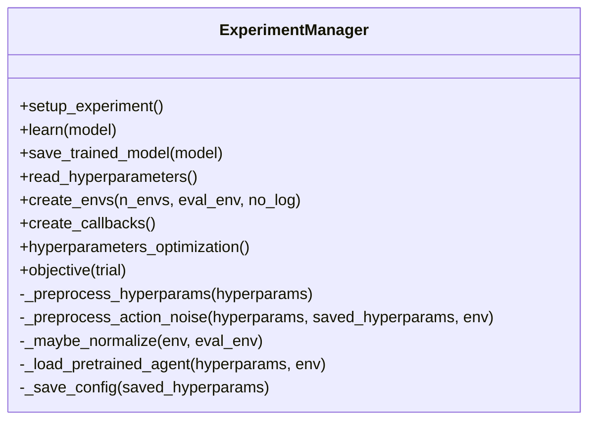

Sources: [rl_zoo3/exp_manager.py:56-973]()

## Experiment Manager Initialization

The `ExperimentManager` initialization accepts numerous parameters that configure the experiment, including:

- Algorithm name (`algo`) and environment ID (`env_id`)
- Logging configuration (`log_folder`, `tensorboard_log`)
- Training parameters (`n_timesteps`, `eval_freq`, `n_eval_episodes`, `save_freq`)
- Custom hyperparameters, environment arguments
- Hyperparameter optimization settings
- Device configuration, verbosity controls, and more

Sources: [rl_zoo3/exp_manager.py:67-191]()

## Experiment Workflow

### Setup Phase

The experiment workflow begins with the `setup_experiment()` method, which:

1. Reads hyperparameters from configuration files
2. Preprocesses these hyperparameters
3. Creates the environment
4. Initializes the RL model
5. Saves the configuration

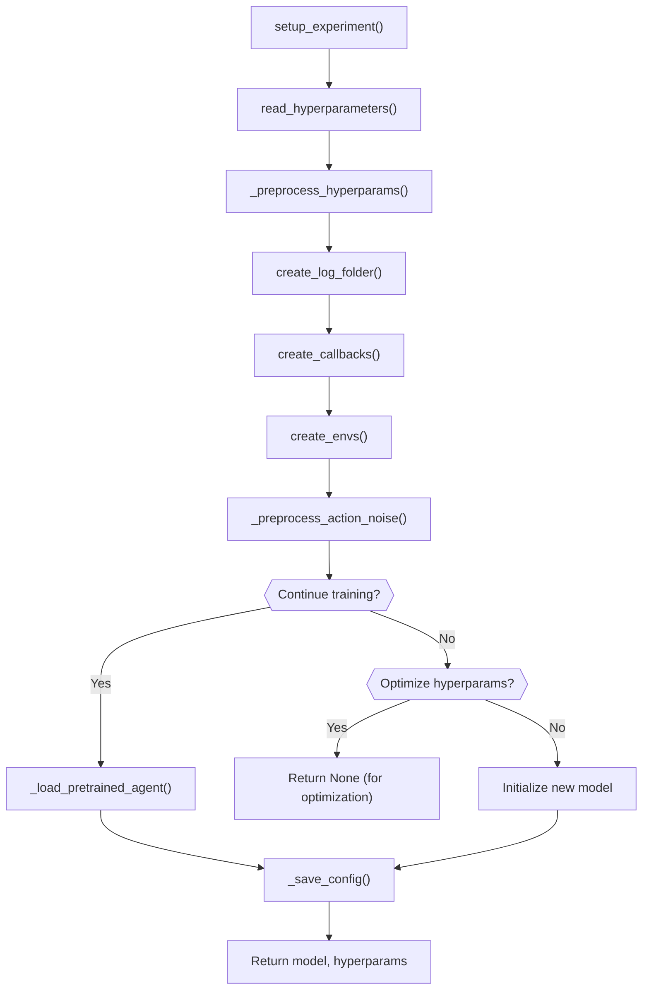

Sources: [rl_zoo3/exp_manager.py:193-231]()

### Training Phase

The `learn()` method handles the training process by:

1. Setting up keyword arguments for logging
2. Adding callbacks for monitoring and logging
3. Handling special cases (e.g., for ARS algorithm)
4. Calling the model's `learn()` method
5. Cleaning up resources after training

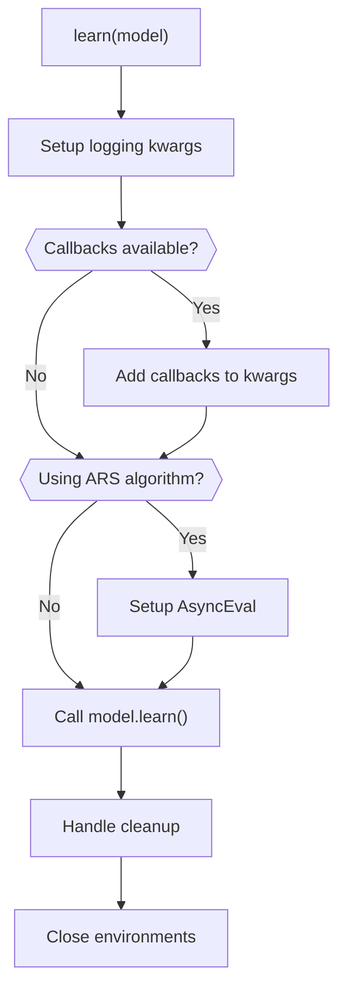

Sources: [rl_zoo3/exp_manager.py:233-270]()

## Hyperparameter Management

The `read_hyperparameters()` method loads hyperparameters from configuration files and processes them. It supports:

- YAML configuration files (`.yml`, `.yaml`)
- Python script files (`.py`)
- Python modules (imported directly)
- Loading from Optuna studies
- Custom hyperparameters passed at initialization

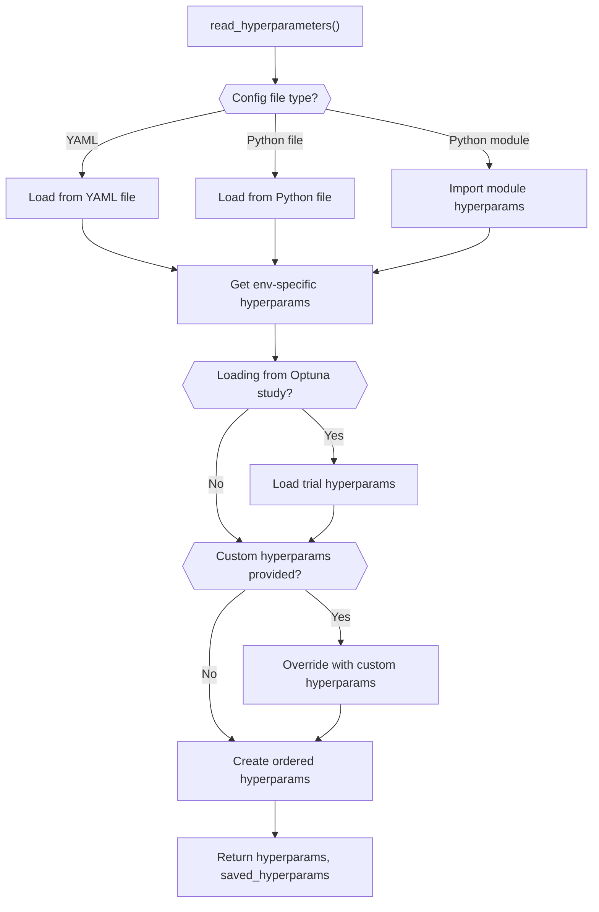

Sources: [rl_zoo3/exp_manager.py:316-355]()

## Environment Creation

The `create_envs()` method handles environment creation with appropriate wrappers and configurations:

1. Sets up logging directory
2. Handles special environment types (e.g., robotics environments)
3. Creates vectorized environments
4. Applies environment wrappers
5. Sets up normalization if needed
6. Configures frame stacking and image transposition as needed

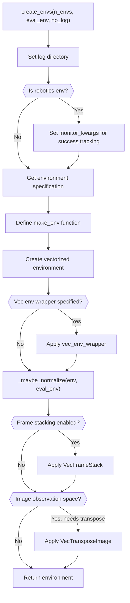

Sources: [rl_zoo3/exp_manager.py:637-714]()

## Callback System Integration

The `create_callbacks()` method sets up callbacks for monitoring training progress, saving checkpoints, and evaluating models:

1. Adds a progress bar callback if requested
2. Sets up model checkpointing based on save frequency
3. Creates an evaluation environment and callback if evaluation is enabled
4. Configures a VecNormalize callback to save normalization statistics

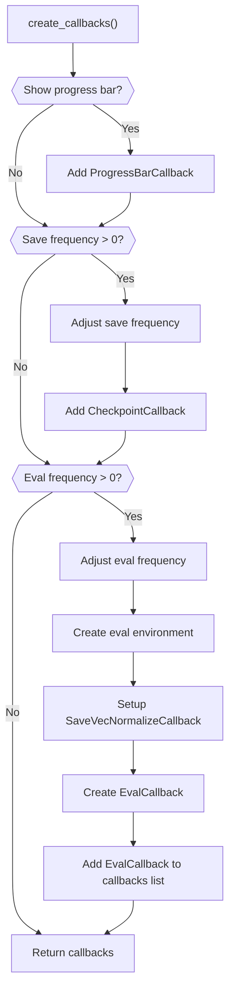

Sources: [rl_zoo3/exp_manager.py:537-572]()

## Hyperparameter Optimization

The `ExperimentManager` integrates with Optuna for hyperparameter optimization. This consists of two main components:

1. The `hyperparameters_optimization()` method, which sets up and executes the optimization process
2. The `objective()` method, which serves as the optimization objective function

### Optimization Workflow

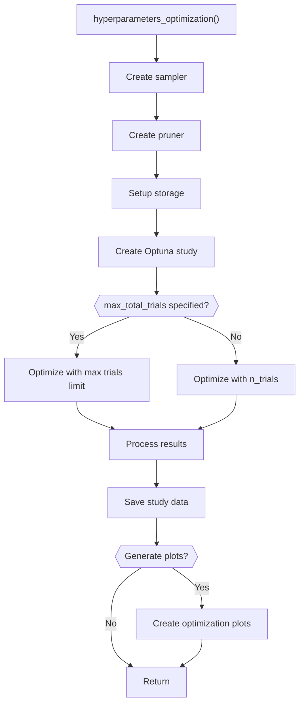

### Objective Function

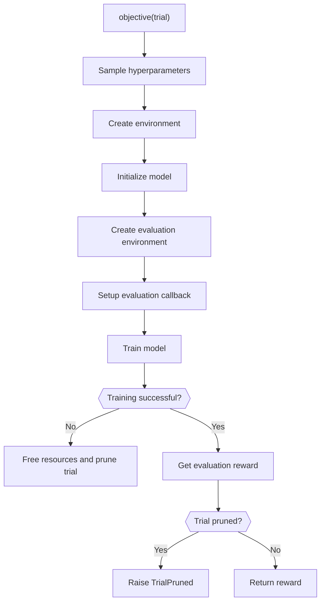

Sources: [rl_zoo3/exp_manager.py:746-973]()

## Model Loading and Saving

The `ExperimentManager` handles loading pretrained models and saving trained models:

### Loading Pretrained Models

The `_load_pretrained_agent()` method:
1. Loads a model from a specified path
2. Loads the replay buffer if available
3. Applies the model to the current environment

### Saving Trained Models

The `save_trained_model()` method:
1. Saves the model to a zip file
2. Optionally saves the replay buffer
3. Saves VecNormalize statistics if normalization is used

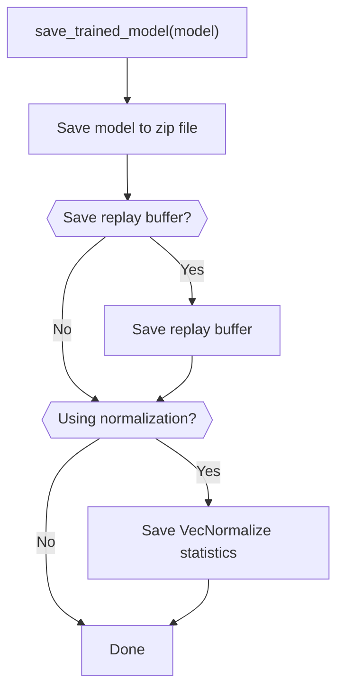

Sources: [rl_zoo3/exp_manager.py:271-290](), [rl_zoo3/exp_manager.py:716-744]()

## Experiment Manager in the Training Pipeline

The `ExperimentManager` connects with the rest of the RL-Baselines3-Zoo framework to provide a complete training pipeline:

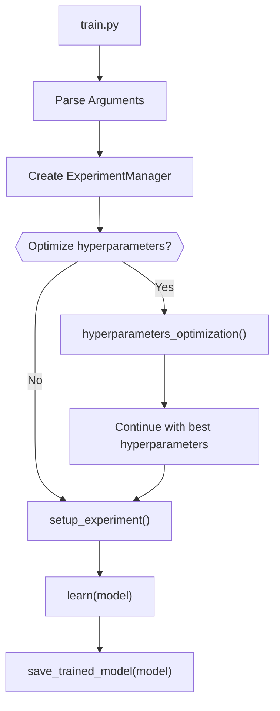

Sources: [rl_zoo3/exp_manager.py:56-973](), [rl_zoo3/utils.py:126-144]()

## Integration with ALGOS Dictionary

The `ExperimentManager` uses the `ALGOS` dictionary from `utils.py` to map algorithm names to algorithm classes:

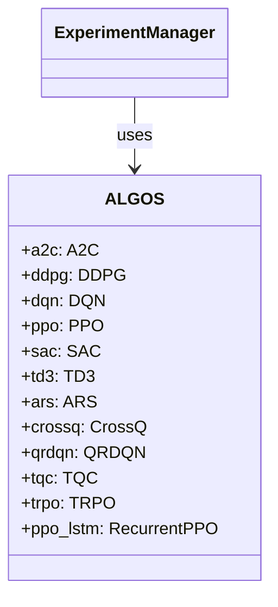

Sources: [rl_zoo3/utils.py:26-40]()

## Conclusion

The Experiment Management system in RL-Baselines3-Zoo serves as the central orchestrator for reinforcement learning experiments. It provides a standardized way to configure, run, and evaluate RL agents, with support for hyperparameter optimization, environment customization, and comprehensive monitoring.

By handling the complexities of experiment setup and execution, the `ExperimentManager` allows users to focus on the core aspects of RL research while maintaining flexibility and extensibility.

---

