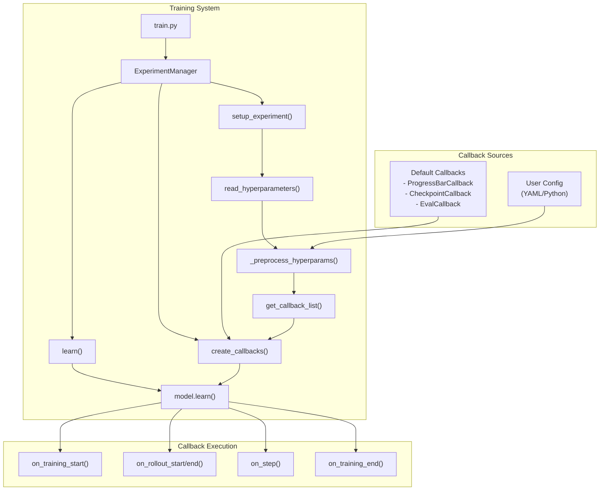
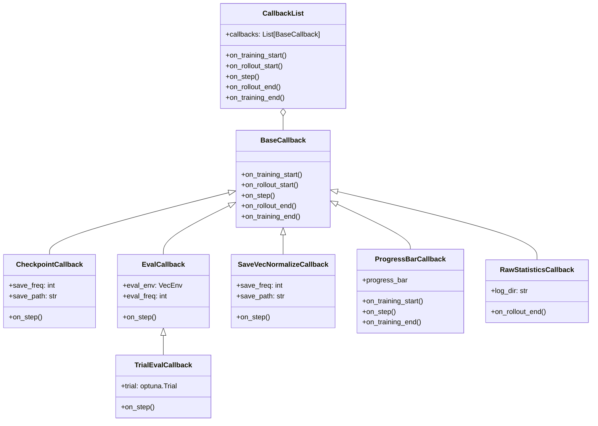
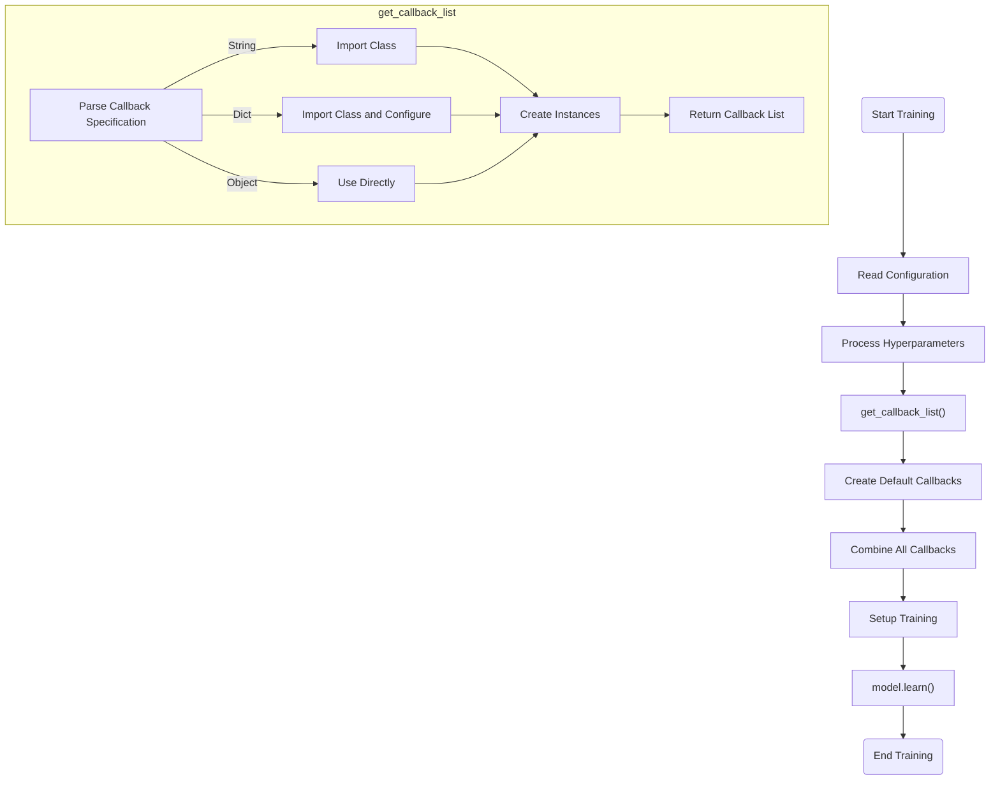

<!-- source: DeepWiki mcp.deepwiki.com · repo DLR-RM/rl-baselines3-zoo · page 3.3 Callbacks System · fetched 2026-10-14 -->

# Callbacks System

<details>
<summary>Relevant source files</summary>

The following files were used as context for generating this wiki page:

- [CHANGELOG.md](CHANGELOG.md)
- [rl_zoo3/exp_manager.py](rl_zoo3/exp_manager.py)
- [tests/test_callbacks.py](tests/test_callbacks.py)
- [tests/test_wrappers.py](tests/test_wrappers.py)

</details>


The callbacks system in RL-Baselines3-Zoo provides a mechanism to monitor, control, and extend the training process of reinforcement learning agents. This page explains how callbacks are integrated, managed, and used within the training framework to customize behavior without modifying core algorithms.

For information about the overall experiment management system, see [Experiment Management](#3.2).

## Callback System Overview

Callbacks in RL-Baselines3-Zoo are event handlers that can be triggered at specific points during the training process. They leverage Stable-Baselines3's callback architecture to enable users to:

- Monitor training metrics
- Save model checkpoints at regular intervals
- Perform periodic evaluations
- Implement early stopping conditions
- Log custom statistics
- Visualize training progress
- Control the training process adaptively

Callbacks are processed by the `ExperimentManager` which collects, initializes, and passes them to the learning algorithm.



Sources: [rl_zoo3/exp_manager.py:489-572]()

## Callback Integration

The `ExperimentManager` integrates callbacks into the training process in two main ways:

1. **User-specified callbacks** - defined in hyperparameter files or command line arguments
2. **Built-in callbacks** - automatically created based on training configuration

These callbacks are combined into a single list and passed to the learning algorithm.



Sources: [rl_zoo3/exp_manager.py:30-31](), [rl_zoo3/exp_manager.py:51-52]()

## Built-in Callbacks

The `ExperimentManager` automatically creates several callbacks based on the training configuration:

### ProgressBarCallback

Shows a progress bar during training when the `--show-progress` flag is used.

### CheckpointCallback

Saves model checkpoints at regular intervals specified by `save_freq`.

```python
# Created when save_freq > 0
self.callbacks.append(
    CheckpointCallback(
        save_freq=self.save_freq,
        save_path=self.save_path,
        name_prefix="rl_model",
        verbose=1,
    )
)
```

### EvalCallback

Periodically evaluates the agent's performance on a separate evaluation environment, specified by `eval_freq` and `n_eval_episodes`.

```python
# Created when eval_freq > 0 and not optimizing hyperparameters
save_vec_normalize = SaveVecNormalizeCallback(save_freq=1, save_path=self.params_path)
eval_callback = EvalCallback(
    self.create_envs(self.n_eval_envs, eval_env=True),
    callback_on_new_best=save_vec_normalize,
    best_model_save_path=self.save_path,
    n_eval_episodes=self.n_eval_episodes,
    log_path=self.save_path,
    eval_freq=self.eval_freq,
    deterministic=self.deterministic_eval,
)
```

Sources: [rl_zoo3/exp_manager.py:537-572]()

## Custom Callbacks in RL-Baselines3-Zoo

RL-Baselines3-Zoo provides several custom callbacks beyond those in Stable-Baselines3:

### SaveVecNormalizeCallback

Saves the normalization parameters (mean, standard deviation) of `VecNormalize` wrapped environments whenever a new best model is found.

### TrialEvalCallback

Used during hyperparameter optimization to evaluate models and report performance to Optuna.

### RawStatisticsCallback

Records raw episode statistics for more detailed analysis.

Sources: [tests/test_callbacks.py:14-20]()

## Specifying Callbacks in Configuration

Callbacks can be specified in several ways:

### 1. YAML Configuration

```yaml
# Example callback specification in a YAML file
callback:
  - "stable_baselines3.common.callbacks.CheckpointCallback"
  - "rl_zoo3.callbacks.RawStatisticsCallback"
```

### 2. Python Configuration

```python
# Example callback specification in a Python file
hyperparams = {
    "CartPole-v1": {
        "callback": [
            "rl_zoo3.callbacks.RawStatisticsCallback",
            {"stable_baselines3.common.callbacks.StopTrainingOnMaxEpisodes": {"max_episodes": 10}}
        ]
    }
}
```

### 3. Command Line Parameters

```bash
python train.py --algo ppo --env CartPole-v1 -params callback:"'rl_zoo3.callbacks.RawStatisticsCallback'"
```

Sources: [tests/test_callbacks.py:16-18](), [tests/test_callbacks.py:23-43]()

## Callback Processing Workflow

The `ExperimentManager` processes callbacks in the following way:



Sources: [rl_zoo3/exp_manager.py:489-494](), [rl_zoo3/exp_manager.py:233-263]()

## Callback Formats

RL-Baselines3-Zoo supports several formats for specifying callbacks:

| Format | Example | Description |
|--------|---------|-------------|
| String | `"rl_zoo3.callbacks.RawStatisticsCallback"` | Simple string with the import path to the callback class |
| Dictionary | `{"stable_baselines3.common.callbacks.StopTrainingOnMaxEpisodes": {"max_episodes": 10}}` | Dictionary with class path as key and configuration as value |
| Object | `sb3.common.callbacks.StopTrainingOnMaxEpisodes(10)` | Direct Python object (only with Python configuration) |
| List | `[cb1, cb2, cb3]` | List of any of the above formats |

The `get_callback_list` function processes these formats and returns a list of instantiated callback objects:

```python
# Simplified version of the callback parsing logic
def get_callback_list(hyperparams):
    callbacks = []
    if "callback" in hyperparams.keys():
        callback_param = hyperparams["callback"]
        
        # Handle different formats
        if isinstance(callback_param, list):
            for callback_item in callback_param:
                # Process each item in the list
                callbacks.append(process_callback(callback_item))
        else:
            # Process single item
            callbacks.append(process_callback(callback_param))
            
    return callbacks
```

Sources: [tests/test_callbacks.py:23-43]()

## Example Use Cases

Below are some common use cases for callbacks in RL-Baselines3-Zoo:

### Logging Custom Metrics

```yaml
callback: "rl_zoo3.callbacks.RawStatisticsCallback"
```

### Early Stopping

```python
# Stop training after 100 episodes
hyperparams = {
    "CartPole-v1": {
        "callback": {"stable_baselines3.common.callbacks.StopTrainingOnMaxEpisodes": {"max_episodes": 100}}
    }
}
```

### Model Checkpointing

This is automatically set up when `save_freq > 0` but can also be explicitly specified:

```yaml
callback: 
  - {"stable_baselines3.common.callbacks.CheckpointCallback": {"save_freq": 10000, "save_path": "./logs/"}}
```

### Combining Multiple Callbacks

```yaml
callback:
  - "rl_zoo3.callbacks.RawStatisticsCallback"
  - {"stable_baselines3.common.callbacks.StopTrainingOnMaxEpisodes": {"max_episodes": 100}}
  - {"stable_baselines3.common.callbacks.CheckpointCallback": {"save_freq": 10000, "save_path": "./logs/"}}
```

## Creating Custom Callbacks

To create a custom callback, you need to extend the `BaseCallback` class from Stable-Baselines3:

```python
from stable_baselines3.common.callbacks import BaseCallback

class MyCustomCallback(BaseCallback):
    def __init__(self, verbose=0):
        super().__init__(verbose)
        
    def _on_training_start(self):
        # Called at the start of training
        pass
        
    def _on_step(self):
        # Called at each training step
        return True  # Return True to continue training
        
    def _on_training_end(self):
        # Called at the end of training
        pass
```

You can then use your custom callback by specifying its import path in the configuration:

```yaml
callback: "path.to.my_module.MyCustomCallback"
```

## RL-Baselines3-Zoo Callback Directory Structure

The organization of callback-related code in the repository:

```
rl-baselines3-zoo/
├── rl_zoo3/
│   ├── callbacks.py          # Custom callbacks implementation
│   ├── exp_manager.py        # Integration of callbacks into training
│   └── utils.py              # get_callback_list function
├── tests/
│   └── test_callbacks.py     # Tests for callbacks functionality
```

Sources: [rl_zoo3/exp_manager.py:30-31](), [rl_zoo3/exp_manager.py:51-52]()

## Summary

The callbacks system in RL-Baselines3-Zoo provides a flexible mechanism for extending and customizing the training process. By leveraging Stable-Baselines3's event-based architecture, callbacks can be used to monitor, visualize, control, and analyze various aspects of reinforcement learning training.

Key features of the callbacks system include:
- Integration with the ExperimentManager
- Multiple specification formats (strings, dictionaries, objects, lists)
- Built-in and custom callbacks
- Automatic creation of common callbacks
- Easy extension for custom use cases

This system allows researchers and practitioners to implement complex training procedures while maintaining clean separation between the core algorithms and experiment-specific logic.

---

