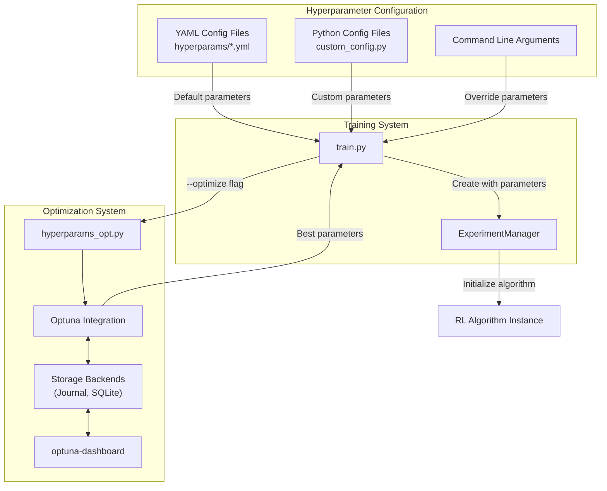
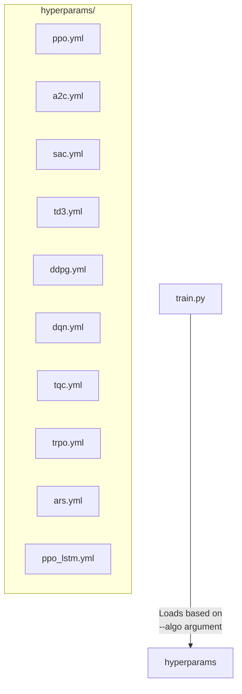
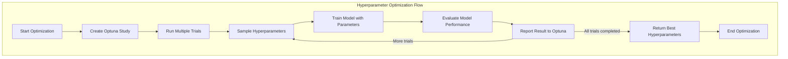

<!-- source: DeepWiki mcp.deepwiki.com · repo DLR-RM/rl-baselines3-zoo · page 4 Hyperparameter Management · fetched 2026-10-14 -->

# Hyperparameter Management

<details>
<summary>Relevant source files</summary>

The following files were used as context for generating this wiki page:

- [CHANGELOG.md](CHANGELOG.md)
- [hyperparams/a2c.yml](hyperparams/a2c.yml)
- [hyperparams/ars.yml](hyperparams/ars.yml)
- [hyperparams/ddpg.yml](hyperparams/ddpg.yml)
- [hyperparams/ppo.yml](hyperparams/ppo.yml)
- [hyperparams/ppo_lstm.yml](hyperparams/ppo_lstm.yml)
- [hyperparams/sac.yml](hyperparams/sac.yml)
- [hyperparams/td3.yml](hyperparams/td3.yml)
- [hyperparams/tqc.yml](hyperparams/tqc.yml)
- [hyperparams/trpo.yml](hyperparams/trpo.yml)

</details>


This document explains how hyperparameters are configured, managed, and optimized in RL-Baselines3-Zoo. Hyperparameters play a critical role in reinforcement learning, determining algorithm behavior and ultimately affecting training performance and convergence.

For specific details about algorithm-specific hyperparameters, see [Algorithm Hyperparameters](#4.1). For in-depth information about automated hyperparameter tuning, see [Hyperparameter Optimization](#4.2).

## Overview of Hyperparameter System

RL-Baselines3-Zoo uses a flexible hyperparameter management system that allows users to define, customize, and optimize hyperparameters for different algorithms and environments.

### Hyperparameter System Architecture



Sources: hyperparams/sac.yml, hyperparams/ppo.yml, CHANGELOG.md

The hyperparameter system consists of several key components:
1. **Configuration Files** - YAML or Python files containing default hyperparameters for each algorithm
2. **Command Line Interface** - Allows overriding specific hyperparameters at runtime 
3. **Optimization System** - Uses Optuna to find optimal hyperparameters
4. **Experiment Manager** - Applies the hyperparameters to initialize the reinforcement learning algorithm

## Configuration Files

### Structure and Organization

Configuration files are stored in the `hyperparams/` directory, with one file per algorithm:



Sources: hyperparams/sac.yml, hyperparams/ppo.yml, hyperparams/a2c.yml, hyperparams/tqc.yml, hyperparams/trpo.yml, hyperparams/ppo_lstm.yml, hyperparams/ddpg.yml, hyperparams/td3.yml, hyperparams/ars.yml

### YAML Configuration Format

Each YAML file contains environment-specific hyperparameter settings. Here's an example structure from `hyperparams/sac.yml`:

```yaml
# Default settings for the SAC algorithm on the Pendulum environment
Pendulum-v1:
  n_timesteps: 20000
  policy: 'MlpPolicy'
  learning_rate: !!float 1e-3

# Settings for a more complex environment
LunarLanderContinuous-v3:
  n_timesteps: !!float 5e5
  policy: 'MlpPolicy'
  batch_size: 256
  learning_rate: lin_7.3e-4  # Linear schedule starting at 7.3e-4
  buffer_size: 1000000
  ent_coef: 'auto'
  gamma: 0.99
  tau: 0.01
  train_freq: 1
  gradient_steps: 1
  learning_starts: 10000
  policy_kwargs: "dict(net_arch=[400, 300])"
```

Sources: hyperparams/sac.yml

### Reusing Configurations with YAML Anchors

To avoid repetition, YAML anchors and aliases are used to share common configurations:

```yaml
# Define common parameters for PyBullet environments
HalfCheetahBulletEnv-v0: &pybullet-defaults
  n_timesteps: !!float 1e6
  policy: 'MlpPolicy'
  learning_rate: !!float 7.3e-4
  buffer_size: 300000
  batch_size: 256
  ent_coef: 'auto'
  gamma: 0.98
  tau: 0.02
  train_freq: 8
  gradient_steps: 8
  learning_starts: 10000
  use_sde: True
  policy_kwargs: "dict(log_std_init=-3, net_arch=[400, 300])"

# Reuse the pybullet-defaults for other environments
AntBulletEnv-v0:
  <<: *pybullet-defaults

HopperBulletEnv-v0:
  <<: *pybullet-defaults
  learning_rate: lin_7.3e-4  # Override specific parameters
```

Sources: hyperparams/sac.yml, hyperparams/ppo.yml, hyperparams/tqc.yml

### Python Configuration Format

Since version 1.6.2, Python configuration files are also supported:

```python
# Example Python config (custom_config.py)
config = {
    "CartPole-v1": {
        "n_timesteps": 50000,
        "policy": "MlpPolicy",
        "learning_rate": 1e-3,
        # Other parameters
    }
}
```

Python configuration files offer more flexibility than YAML files, allowing for:
- Dynamic parameter computation
- Direct Python object references for callbacks and wrappers
- Complex logic for parameter selection

Sources: CHANGELOG.md

## Customizing Hyperparameters

There are three main ways to customize hyperparameters:

### 1. Command Line Arguments

Most common hyperparameters can be overridden directly from the command line:

```bash
python train.py --algo ppo --env CartPole-v1 --learning-rate 1e-4 --batch-size 64
```

### 2. Custom Configuration Files

Create custom YAML or Python configuration files with your preferred hyperparameters:

```bash
python train.py --algo ppo --env CartPole-v1 --conf-file custom_hyperparams.yml
```

### 3. Algorithm-Specific Parameters

Some parameters are specific to certain algorithms and environments. For example:

- `use_sde` (Stochastic Differential Equations exploration) - Available for some algorithms like PPO and SAC
- `n_critics` - Specific to algorithms like TQC
- Environment wrappers - Can be specified for specific environments

## Hyperparameter Optimization

RL-Baselines3-Zoo integrates with Optuna for automated hyperparameter optimization. This allows systematically finding effective hyperparameters for specific algorithm-environment combinations.

### Optimization Process



Sources: CHANGELOG.md

### Using Hyperparameter Optimization

To optimize hyperparameters, use the `--optimize` flag with the training script:

```bash
python train.py --algo ppo --env Pendulum-v1 -n 40000 --study-name demo --storage logs/demo.log --sampler tpe --n-evaluations 2 --optimize --no-optim-plots
```

Key optimization parameters:
- `--study-name`: Name of the Optuna study
- `--storage`: Storage backend for Optuna results
- `--sampler`: Sampling algorithm (tpe, random, grid)
- `--n-evaluations`: Number of evaluation episodes
- `--n-trials`: Number of trials (default: 500)

Sources: CHANGELOG.md

### Recent Improvements (v2.6.0+)

Since version 2.6.0, the hyperparameter optimization system has been refactored with the following enhancements:

1. Support for Optuna's Journal storage backend (recommended default)
2. Ability to load tuned hyperparameters via the new `--trial-id` argument

Example workflow:
```bash
# Run optimization
python train.py --algo ppo --env Pendulum-v1 -n 40000 --study-name demo --storage logs/demo.log --sampler tpe --n-evaluations 2 --optimize --no-optim-plots

# Visualize results
optuna-dashboard logs/demo.log

# Train with optimized hyperparameters from trial 21
python train.py --algo ppo --env Pendulum-v1 --study-name demo --storage logs/demo.log --trial-id 21
```

Sources: CHANGELOG.md

## Common Hyperparameters

This table shows the most common hyperparameters across different algorithms:

| Parameter | Description | Applicable Algorithms |
|-----------|-------------|----------------------|
| `n_timesteps` | Total timesteps for training | All |
| `policy` | Policy network type (e.g., 'MlpPolicy') | All |
| `learning_rate` | Learning rate or schedule | All |
| `batch_size` | Batch size for updates | All |
| `gamma` | Discount factor | All |
| `n_steps` | Rollout length | On-policy (PPO, A2C, TRPO) |
| `n_epochs` | Number of epochs per update | PPO, TRPO |
| `ent_coef` | Entropy coefficient | PPO, A2C, SAC |
| `buffer_size` | Replay buffer size | Off-policy (SAC, TD3, DQN) |
| `train_freq` | Update frequency | Off-policy |
| `gradient_steps` | Gradient steps per update | Off-policy |
| `learning_starts` | Timesteps before learning starts | Off-policy |
| `use_sde` | Use stochastic differential equations | PPO, SAC |
| `policy_kwargs` | Arguments for policy network | All |

Sources: hyperparams/sac.yml, hyperparams/ppo.yml, hyperparams/a2c.yml, hyperparams/td3.yml, hyperparams/ddpg.yml

## Special Parameter Types

RL-Baselines3-Zoo supports several special parameter formats:

1. **Linear schedules**: Values in the format `lin_X` create a linear schedule starting at value X and decreasing to 0 by the end of training.

2. **Python dictionaries**: Defined as strings, e.g., `"dict(net_arch=[400, 300])"`, which are evaluated to create Python objects.

3. **Auto entropy coefficient**: For algorithms like SAC, setting `ent_coef: 'auto'` enables automatic entropy tuning.

4. **Normalization parameters**: Specified with `normalize: true` or with detailed settings `normalize: "{'norm_obs': True, 'norm_reward': False}"`.

Sources: hyperparams/sac.yml, hyperparams/ppo.yml, hyperparams/a2c.yml

## Best Practices

1. **Start with defaults**: The default hyperparameters in RL-Baselines3-Zoo are well-tuned for many environments.

2. **Environment-specific tuning**: Some environments require specific hyperparameter settings to achieve good performance.

3. **Algorithm selection**: Different algorithms work better for different types of environments:
   - On-policy algorithms (PPO, A2C) often work better for discrete action spaces
   - Off-policy algorithms (SAC, TD3) often excel in continuous action spaces

4. **Hyperparameter optimization**: When fine-tuning performance, use hyperparameter optimization to find the best settings.

5. **Save and share configurations**: Save your hyperparameter configurations to ensure reproducibility.

---

