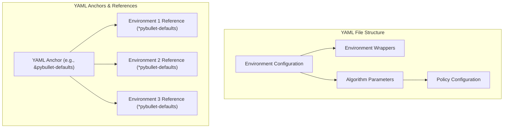
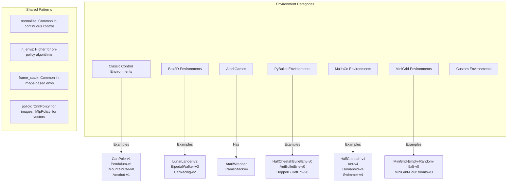
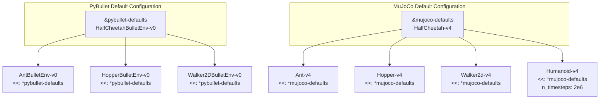
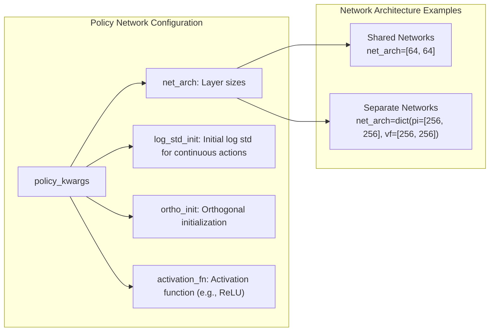

<!-- source: DeepWiki mcp.deepwiki.com · repo DLR-RM/rl-baselines3-zoo · page 4.1 Algorithm Hyperparameters · fetched 2026-10-14 -->

# Algorithm Hyperparameters

<details>
<summary>Relevant source files</summary>

The following files were used as context for generating this wiki page:

- [hyperparams/a2c.yml](hyperparams/a2c.yml)
- [hyperparams/ars.yml](hyperparams/ars.yml)
- [hyperparams/ddpg.yml](hyperparams/ddpg.yml)
- [hyperparams/ppo.yml](hyperparams/ppo.yml)
- [hyperparams/ppo_lstm.yml](hyperparams/ppo_lstm.yml)
- [hyperparams/sac.yml](hyperparams/sac.yml)
- [hyperparams/td3.yml](hyperparams/td3.yml)
- [hyperparams/tqc.yml](hyperparams/tqc.yml)
- [hyperparams/trpo.yml](hyperparams/trpo.yml)

</details>


This page documents the hyperparameter configurations for reinforcement learning algorithms in RL-Baselines3-Zoo. The repository includes carefully tuned hyperparameter sets for various algorithm-environment combinations, which are critical for achieving good performance in reinforcement learning tasks.

For information about hyperparameter optimization techniques, see [Hyperparameter Optimization](#4.2).

## Hyperparameter Organization

Hyperparameters in RL-Baselines3-Zoo are organized in YAML files within the `hyperparams` directory. Each file corresponds to a specific algorithm and contains hyperparameter configurations for multiple environments.

### File Structure

The main hyperparameter files include:

| Algorithm File | Description |
|----------------|-------------|
| `hyperparams/ppo.yml` | Proximal Policy Optimization hyperparameters |
| `hyperparams/a2c.yml` | Advantage Actor-Critic hyperparameters |
| `hyperparams/sac.yml` | Soft Actor-Critic hyperparameters |
| `hyperparams/td3.yml` | Twin Delayed DDPG hyperparameters |
| `hyperparams/ddpg.yml` | Deep Deterministic Policy Gradient hyperparameters |
| `hyperparams/tqc.yml` | Truncated Quantile Critics hyperparameters |
| `hyperparams/trpo.yml` | Trust Region Policy Optimization hyperparameters |
| `hyperparams/ars.yml` | Augmented Random Search hyperparameters |
| `hyperparams/ppo_lstm.yml` | PPO with LSTM policy hyperparameters |

Sources: [hyperparams/ppo.yml](), [hyperparams/a2c.yml](), [hyperparams/sac.yml](), [hyperparams/td3.yml](), [hyperparams/ddpg.yml](), [hyperparams/tqc.yml](), [hyperparams/trpo.yml](), [hyperparams/ars.yml](), [hyperparams/ppo_lstm.yml]()

### Hyperparameter File Structure Diagram

```mermaid
flowchart TD
    subgraph "Hyperparameter Files"
        ppo["hyperparams/ppo.yml"]
        a2c["hyperparams/a2c.yml"]
        sac["hyperparams/sac.yml"]
        td3["hyperparams/td3.yml"]
        ddpg["hyperparams/ddpg.yml"]
        tqc["hyperparams/tqc.yml"]
        trpo["hyperparams/trpo.yml"]
        ars["hyperparams/ars.yml"]
        ppo_lstm["hyperparams/ppo_lstm.yml"]
    end

    subgraph "Algorithm Implementation"
        SB3["Stable-Baselines3 Algorithms"]
    end

    subgraph "Training System"
        train["train.py"]
        exp_manager["ExperimentManager"]
    end

    "Hyperparameter Files" --> train
    train --> exp_manager
    exp_manager --> SB3
```

Sources: [hyperparams/ppo.yml](), [hyperparams/sac.yml]()

## Hyperparameter Structure

Each hyperparameter file contains environment-specific configurations organized by environment name. Environments are categorized into several types, including:

- Classic control environments (CartPole, Pendulum)
- Box2D environments (LunarLander, BipedalWalker)
- Atari games
- PyBullet environments
- MuJoCo environments
- Custom environments

### YAML Structure

The hyperparameter files use YAML anchors (`&`) and references (`*`) to share common configurations across similar environments, reducing duplication and maintaining consistency.



Sources: [hyperparams/ppo.yml:137-158](), [hyperparams/sac.yml:73-94]()

## Common Hyperparameters

While specific hyperparameters vary by algorithm, several common parameters appear across most algorithms:

| Parameter | Description |
|-----------|-------------|
| `n_timesteps` | Total number of training timesteps |
| `policy` | Policy network architecture (e.g., 'MlpPolicy', 'CnnPolicy') |
| `learning_rate` | Learning rate or schedule |
| `n_envs` | Number of parallel environments |
| `batch_size` | Batch size for training |
| `gamma` | Discount factor |
| `buffer_size` | Replay buffer size (for off-policy algorithms) |
| `train_freq` | Training frequency |
| `gradient_steps` | Number of gradient steps per update |
| `policy_kwargs` | Dictionary of policy network configuration |

Sources: [hyperparams/ppo.yml](), [hyperparams/sac.yml](), [hyperparams/a2c.yml]()

### Parameter Types

```mermaid
flowchart TD
    subgraph "Hyperparameter Categories"
        algo_general["Algorithm General Parameters"]
        policy_specific["Policy Specific Parameters"]
        env_specific["Environment Specific Parameters"]
        optimization["Optimization Parameters"]
    end
    
    subgraph "Algorithm General"
        gamma["gamma: Discount factor"]
        n_timesteps["n_timesteps: Training duration"]
    end
    
    subgraph "Policy Specific"
        policy_type["policy: Network type"]
        policy_kwargs["policy_kwargs: Network architecture"]
        use_sde["use_sde: State-dependent exploration"]
    end
    
    subgraph "Environment Specific"
        normalize["normalize: Observation/reward normalization"]
        env_wrapper["env_wrapper: Environment wrappers"]
        frame_stack["frame_stack: Frame stacking"]
    end
    
    subgraph "Optimization"
        lr["learning_rate: Learning rate"]
        batch_size["batch_size: Batch size"]
        buffer_size["buffer_size: Replay buffer size"]
    end
    
    algo_general --> gamma
    algo_general --> n_timesteps
    policy_specific --> policy_type
    policy_specific --> policy_kwargs
    policy_specific --> use_sde
    env_specific --> normalize
    env_specific --> env_wrapper
    env_specific --> frame_stack
    optimization --> lr
    optimization --> batch_size
    optimization --> buffer_size
```



Sources: [hyperparams/ppo.yml](), [hyperparams/sac.yml](), [hyperparams/a2c.yml](), [hyperparams/td3.yml]()

## Algorithm-Specific Hyperparameters

Each reinforcement learning algorithm has specific hyperparameters that are unique to its approach. Below, we detail the key hyperparameters for major algorithms.

### PPO (Proximal Policy Optimization)

PPO is an on-policy algorithm that uses clipped surrogate objectives.

| Parameter | Description |
|-----------|-------------|
| `n_steps` | Number of steps to run per environment per update |
| `batch_size` | Minibatch size for optimization |
| `n_epochs` | Number of epochs when optimizing the surrogate loss |
| `clip_range` | Clipping parameter for the surrogate objective |
| `ent_coef` | Entropy coefficient for exploration |
| `gae_lambda` | Factor for trade-off of bias vs variance for GAE |
| `max_grad_norm` | Maximum norm for gradient clipping |
| `vf_coef` | Value function coefficient for loss calculation |

Example configuration for CartPole-v1:
```yaml
CartPole-v1:
  n_envs: 8
  n_timesteps: !!float 1e5
  policy: 'MlpPolicy'
  n_steps: 32
  batch_size: 256
  gae_lambda: 0.8
  gamma: 0.98
  n_epochs: 20
  ent_coef: 0.0
  learning_rate: lin_0.001
  clip_range: lin_0.2
```

Sources: [hyperparams/ppo.yml:32-43]()

### SAC (Soft Actor-Critic)

SAC is an off-policy algorithm that maximizes both expected return and entropy.

| Parameter | Description |
|-----------|-------------|
| `buffer_size` | Size of the replay buffer |
| `batch_size` | Minibatch size for optimization |
| `ent_coef` | Entropy coefficient ('auto' for automatic tuning) |
| `tau` | Soft update coefficient |
| `learning_starts` | Number of steps before learning starts |
| `train_freq` | Update frequency |
| `gradient_steps` | Gradient steps per update |
| `use_sde` | State-dependent exploration |

Example configuration for BipedalWalker-v3:
```yaml
BipedalWalker-v3:
  n_timesteps: !!float 5e5
  policy: 'MlpPolicy'
  learning_rate: !!float 7.3e-4
  buffer_size: 300000
  batch_size: 256
  ent_coef: 'auto'
  gamma: 0.98
  tau: 0.02
  train_freq: 64
  gradient_steps: 64
  learning_starts: 10000
  use_sde: True
  policy_kwargs: "dict(log_std_init=-3, net_arch=[400, 300])"
```

Sources: [hyperparams/sac.yml:41-54]()

### TD3 (Twin Delayed DDPG)

TD3 is an off-policy algorithm that addresses function approximation errors by using dual critics.

| Parameter | Description |
|-----------|-------------|
| `buffer_size` | Size of the replay buffer |
| `learning_starts` | Number of steps before learning starts |
| `noise_type` | Type of exploration noise |
| `noise_std` | Standard deviation of exploration noise |
| `train_freq` | Update frequency |
| `gradient_steps` | Gradient steps per update |

Example configuration for HalfCheetahBulletEnv-v0:
```yaml
HalfCheetahBulletEnv-v0:
  n_timesteps: !!float 1e6
  policy: 'MlpPolicy'
  gamma: 0.98
  buffer_size: 200000
  learning_starts: 10000
  noise_type: 'normal'
  noise_std: 0.1
  gradient_steps: 1
  train_freq: 1
  batch_size: 256
  learning_rate: !!float 7e-4
  policy_kwargs: "dict(net_arch=[400, 300])"
```

Sources: [hyperparams/td3.yml:67-79]()

### A2C (Advantage Actor-Critic)

A2C is an on-policy algorithm that uses multiple workers to collect experiences.

| Parameter | Description |
|-----------|-------------|
| `n_steps` | Number of steps per update |
| `ent_coef` | Entropy coefficient |
| `vf_coef` | Value function coefficient |
| `use_rms_prop` | Whether to use RMSProp optimizer |
| `normalize_advantage` | Whether to normalize advantages |
| `use_sde` | State-dependent exploration |
| `gae_lambda` | GAE lambda parameter |

Example configuration for Pendulum-v1:
```yaml
Pendulum-v1:
  normalize: True
  n_envs: 8
  n_timesteps: !!float 1e6
  policy: 'MlpPolicy'
  ent_coef: 0.0
  max_grad_norm: 0.5
  n_steps: 8
  gae_lambda: 0.9
  vf_coef: 0.4
  gamma: 0.9
  use_rms_prop: True
  normalize_advantage: False
  learning_rate: lin_7e-4
  use_sde: True
  policy_kwargs: "dict(log_std_init=-2, ortho_init=False)"
```

Sources: [hyperparams/a2c.yml:46-61]()

### TRPO (Trust Region Policy Optimization)

TRPO is an on-policy algorithm that uses a trust region constraint for policy updates.

| Parameter | Description |
|-----------|-------------|
| `n_steps` | Number of steps to run per environment per update |
| `batch_size` | Batch size for optimization |
| `cg_damping` | Conjugate gradient damping |
| `cg_max_steps` | Maximum number of CG iterations |
| `target_kl` | Target KL divergence |
| `sub_sampling_factor` | Subsampling factor for policy updates |
| `n_critic_updates` | Number of critic updates per iteration |

Example configuration for HalfCheetahBulletEnv-v0:
```yaml
HalfCheetahBulletEnv-v0:
  normalize: true
  n_envs: 2
  n_timesteps: !!float 2e6
  policy: 'MlpPolicy'
  batch_size: 128
  n_steps: 1024
  gamma: 0.99
  gae_lambda: 0.95
  sub_sampling_factor: 1
  cg_max_steps: 25
  cg_damping: 0.1
  n_critic_updates: 20
  learning_rate: !!float 1e-3
```

Sources: [hyperparams/trpo.yml:75-88]()

### ARS (Augmented Random Search)

ARS is a simple random search method for training linear policies.

| Parameter | Description |
|-----------|-------------|
| `n_delta` | Number of random perturbations |
| `n_top` | Number of top-performing perturbed policies |
| `delta_std` | Standard deviation of perturbations |
| `zero_policy` | Whether to start from a zero policy |
| `alive_bonus_offset` | Offset for alive bonus in reward |

Example configuration for Hopper-v4:
```yaml
Hopper-v4:
  n_envs: 1
  policy: 'LinearPolicy'
  n_timesteps: !!float 7e6
  learning_rate: !!float 0.01
  delta_std: !!float 0.025
  n_delta: 8
  n_top: 4
  alive_bonus_offset: -1
  normalize: "dict(norm_obs=True, norm_reward=False)"
```

Sources: [hyperparams/ars.yml:122-131]()

## Environment Types and Patterns

Environments in RL-Baselines3-Zoo are categorized into several types, with each type sharing common hyperparameter patterns.



Sources: [hyperparams/ppo.yml](), [hyperparams/sac.yml](), [hyperparams/a2c.yml]()

### Environment Grouping with YAML Anchors

The hyperparameter files use YAML anchors to define default configurations for environment groups:



Sources: [hyperparams/ppo.yml:137-158](), [hyperparams/sac.yml:73-94](), [hyperparams/a2c.yml:130-147]()

## Policy Network Configurations

Policy network architectures are configured through the `policy_kwargs` parameter, which allows customization of network depth, width, activation functions, and other properties.



Example policy configurations:

```yaml
# Basic MLP network
policy_kwargs: "dict(net_arch=[64, 64])"

# Separate policy and value networks
policy_kwargs: "dict(
  log_std_init=-2,
  ortho_init=False,
  activation_fn=nn.ReLU,
  net_arch=dict(pi=[256, 256], vf=[256, 256])
)"

# LSTM policy configuration
policy_kwargs: "dict(
  ortho_init=False,
  activation_fn=nn.ReLU,
  lstm_hidden_size=64,
  enable_critic_lstm=True,
  net_arch=dict(pi=[64], vf=[64])
)"
```

Sources: [hyperparams/ppo.yml:432-436](), [hyperparams/ppo_lstm.yml:35-41]()

## Learning Rate Schedules

Learning rates can be constant or scheduled using various schemes:

| Pattern | Description | Example |
|---------|-------------|---------|
| `!!float 1e-3` | Constant learning rate | `learning_rate: !!float 1e-3` |
| `lin_X` | Linear schedule from X to 0 | `learning_rate: lin_7.3e-4` |
| Custom schedule | Defined in code | - |

Sources: [hyperparams/ppo.yml:42](), [hyperparams/sac.yml:29]()

## Customizing Hyperparameters

Hyperparameters can be customized in several ways:

1. Modifying existing YAML files
2. Creating new environment configurations in existing files
3. Overriding parameters via command line when launching training

Example command line override:
```bash
python train.py --algo ppo --env CartPole-v1 --learning-rate 0.0005 --n-timesteps 100000
```

## Common Hyperparameter Patterns

Based on the analysis of the hyperparameter files, some common patterns emerge:

1. **On-policy algorithms** (PPO, A2C, TRPO):
   - Often use multiple parallel environments (`n_envs` > 1)
   - Shorter trajectory segments (`n_steps` parameter)
   - No replay buffer

2. **Off-policy algorithms** (SAC, TD3, DDPG):
   - Often use fewer parallel environments
   - Rely on replay buffers (`buffer_size` parameter)
   - Specify gradient steps and training frequency

3. **State-dependent exploration** (`use_sde: True`):
   - Common in continuous control tasks
   - Often paired with a sampling frequency (`sde_sample_freq`)

4. **Network architectures**:
   - Continuous control often uses larger networks ([400, 300] is common)
   - Classic control often uses smaller networks ([64, 64] is common)

Sources: [hyperparams/ppo.yml](), [hyperparams/sac.yml](), [hyperparams/a2c.yml](), [hyperparams/td3.yml]()

## Tuning Status

Many environment configurations in the hyperparameter files are marked with comments indicating their tuning status:

| Status | Meaning |
|--------|---------|
| `# Tuned` | Hyperparameters have been optimized for performance |
| `# Almost tuned` | Hyperparameters are close to optimal but may be improved |
| `# To be tuned` | Hyperparameters are initial guesses that need optimization |

Sources: [hyperparams/sac.yml:1](), [hyperparams/ppo.yml:16](), [hyperparams/td3.yml:1]()

## Conclusion

The algorithm hyperparameters in RL-Baselines3-Zoo provide carefully tuned configurations for various algorithm-environment combinations. Understanding these hyperparameters is crucial for achieving good performance in reinforcement learning tasks and for customizing the training process to meet specific requirements.

For information on how to optimize hyperparameters automatically, see [Hyperparameter Optimization](#4.2).

---

