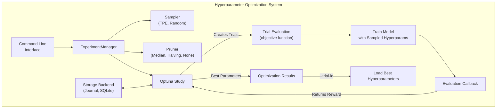
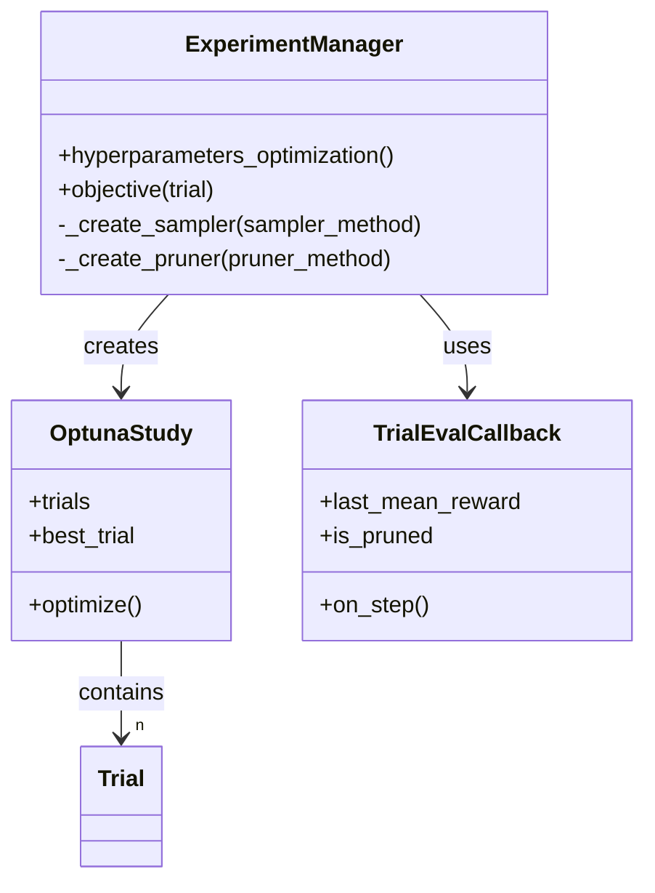
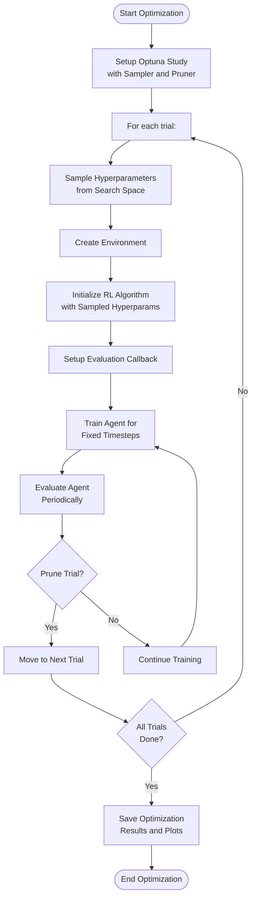
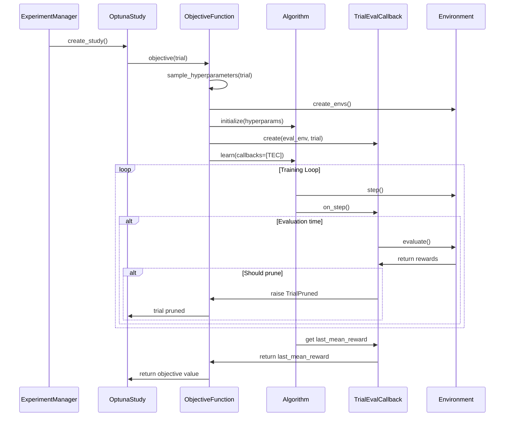

<!-- source: DeepWiki mcp.deepwiki.com · repo DLR-RM/rl-baselines3-zoo · page 4.2 Hyperparameter Optimization · fetched 2026-10-14 -->

# Hyperparameter Optimization

<details>
<summary>Relevant source files</summary>

The following files were used as context for generating this wiki page:

- [CHANGELOG.md](CHANGELOG.md)
- [rl_zoo3/exp_manager.py](rl_zoo3/exp_manager.py)

</details>


This page documents the hyperparameter optimization system in RL-Baselines3-Zoo, which allows users to automatically find optimal hyperparameters for reinforcement learning algorithms. The system integrates Optuna, a hyperparameter optimization framework, to efficiently search through hyperparameter spaces and identify configurations that maximize agent performance.

For information about specific algorithm hyperparameters, see [Algorithm Hyperparameters](#4.1).

## Overview

The hyperparameter optimization system allows users to:

1. Automatically search for optimal hyperparameters for any supported algorithm and environment
2. Save and visualize optimization results
3. Load optimized hyperparameters for training models
4. Distribute optimization across multiple workers
5. Use different sampling strategies and pruning techniques



Sources: [rl_zoo3/exp_manager.py:772-972]()

## Key Components

### Optuna Integration

RL-Baselines3-Zoo uses Optuna to manage hyperparameter optimization. Optuna provides a framework for:

1. Sampling hyperparameters from defined search spaces
2. Pruning unpromising trials early to save compute resources
3. Storing and visualizing optimization results
4. Distributed optimization



Sources: [rl_zoo3/exp_manager.py:863-972]()

### Samplers and Pruners

The system supports different sampling strategies to explore the hyperparameter space:

| Sampler | Description |
|---------|-------------|
| TPE (default) | Tree-structured Parzen Estimator, builds probabilistic models of good hyperparameters |
| Random | Simple random sampling from the hyperparameter space |

And pruning techniques to terminate unpromising trials early:

| Pruner | Description |
|--------|-------------|
| Median | Terminates trials if their performance is below the median of previous trials |
| Successive Halving | Allocates more resources to promising trials |
| None | No pruning is performed |

Sources: [rl_zoo3/exp_manager.py:746-770]()

### Hyperparameter Search Spaces

Each algorithm has a predefined search space for its hyperparameters. These are defined in the `hyperparams_opt.py` file and used by the `HYPERPARAMS_SAMPLER` dictionary to sample hyperparameters for each trial.

Key hyperparameters that are typically optimized include:

- Learning rate
- Network architecture
- Batch size
- Discount factor (gamma)
- Policy-specific parameters (e.g., entropy coefficient for PPO)

## Using Hyperparameter Optimization

### Command Line Interface

To optimize hyperparameters, use the `--optimize` flag with the `train.py` script:

```bash
python train.py --algo ppo --env Pendulum-v1 -n 40000 --optimize
```

Additional options for controlling the optimization process:

| Argument | Description |
|----------|-------------|
| `--study-name` | Name of the study for storage |
| `--storage` | Storage URL or path for optimization results |
| `--n-trials` | Number of trials to run |
| `--n-jobs` | Number of parallel jobs |
| `--sampler` | Sampling strategy (tpe, random) |
| `--pruner` | Pruning strategy (median, halving, none) |
| `--n-evaluations` | Number of evaluations during training |
| `--n-startup-trials` | Number of trials before pruning |
| `--n-eval-episodes` | Number of episodes for evaluation |
| `--trial-id` | Load hyperparameters from a specific trial |

Sources: [CHANGELOG.md:5-19]()

### Storage Options

Recent updates added support for Optuna's Journal storage backend, which is now the recommended default:

```bash
python train.py --algo ppo --env Pendulum-v1 -n 40000 --study-name demo --storage logs/demo.log --sampler tpe --n-evaluations 2 --optimize
```

You can then visualize the optimization process live using `optuna-dashboard`:

```bash
optuna-dashboard logs/demo.log
```

Sources: [CHANGELOG.md:7-14]()

### Loading Optimized Hyperparameters

After optimization, you can load the best hyperparameters using the `--trial-id` argument:

```bash
python train.py --algo ppo --env Pendulum-v1 --study-name demo --storage logs/demo.log --trial-id 21
```

This will train a model using the hyperparameters from trial 21, which might be the best performing trial.

Sources: [CHANGELOG.md:16-19](), [rl_zoo3/exp_manager.py:357-373]()

## How It Works

### Optimization Workflow



Sources: [rl_zoo3/exp_manager.py:863-972]()

### Trial Evaluation

Each trial in the optimization process:

1. Samples hyperparameters using the specified sampler
2. Creates a training environment
3. Initializes the RL algorithm with the sampled hyperparameters
4. Trains the agent for a specified number of timesteps
5. Periodically evaluates the agent's performance
6. Returns the final evaluation score as the objective value

The `TrialEvalCallback` is used to periodically evaluate the agent and determine if the trial should be pruned.



Sources: [rl_zoo3/exp_manager.py:772-861]()

### Result Visualization

After optimization, the system:

1. Saves the trials dataframe as a CSV file
2. Saves the complete Optuna study as a pickle file
3. Generates optimization history and parameter importance plots

These results can be found in the log folder under `{log_folder}/{algo}/report_{env_name}_{n_trials}...`

## Examples and Best Practices

### Example 1: Basic Optimization

```bash
python train.py --algo ppo --env CartPole-v1 -n 100000 --optimize --n-trials 10
```

### Example 2: Distributed Optimization

```bash
# Worker 1
python train.py --algo sac --env HalfCheetah-v4 -n 1000000 --study-name sac_halfcheetah --storage sqlite:///sac_halfcheetah.db --optimize --n-trials 5 --n-jobs 1 --max-total-trials 20

# Worker 2 (on another machine)
python train.py --algo sac --env HalfCheetah-v4 -n 1000000 --study-name sac_halfcheetah --storage sqlite:///sac_halfcheetah.db --optimize --n-trials 5 --n-jobs 1 --max-total-trials 20
```

### Example 3: Using Journal Storage

```bash
# Optimize
python train.py --algo td3 --env Hopper-v4 -n 1000000 --study-name td3_hopper --storage logs/td3_hopper.log --optimize --n-trials 10

# Visualize
optuna-dashboard logs/td3_hopper.log

# Load best trial
python train.py --algo td3 --env Hopper-v4 -n 1000000 --study-name td3_hopper --storage logs/td3_hopper.log --trial-id 5
```

### Best Practices

1. **Start with a small number of trials** to ensure your configuration works
2. **Set an appropriate number of evaluations** (1 per 100k steps is recommended)
3. **Use the TPE sampler** for most cases as it tends to perform better than random sampling
4. **Enable pruning** to save computational resources for promising trials
5. **Use Journal storage** for better tracking and visualization
6. **Set a reasonable time budget** for your optimization

Sources: [CHANGELOG.md:5-19](), [rl_zoo3/exp_manager.py:863-972]()

---

