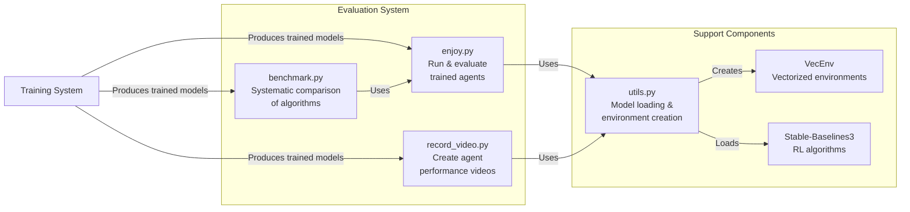
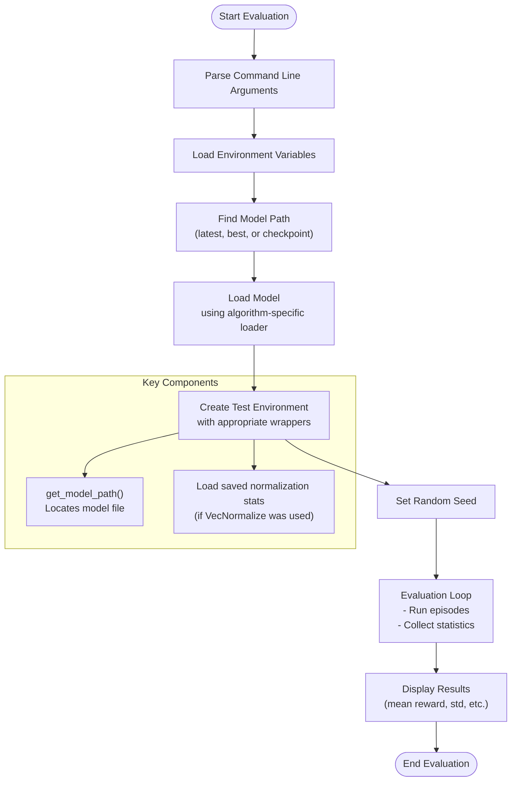
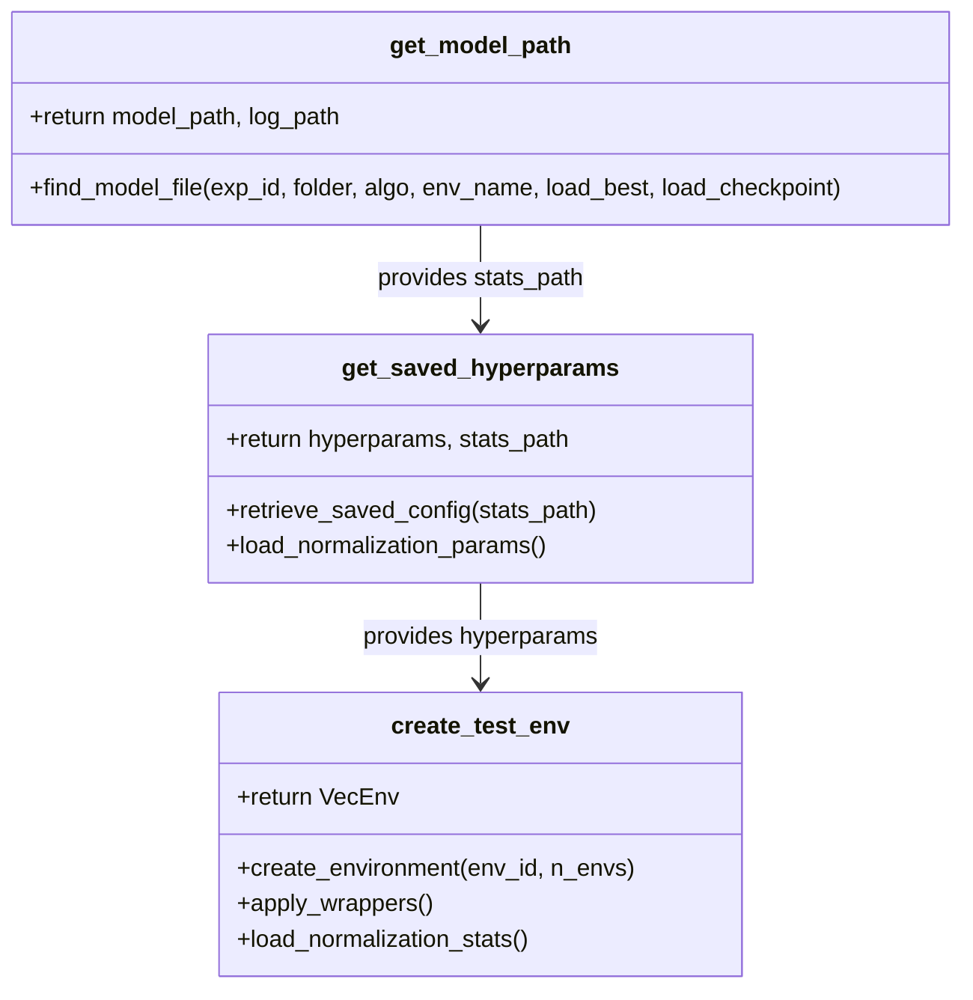
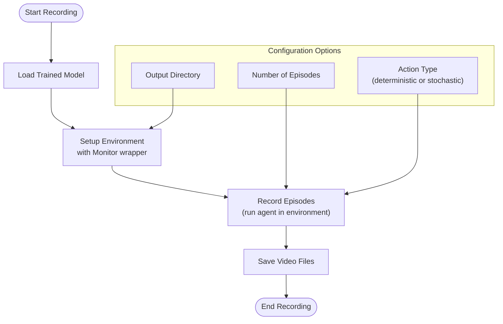
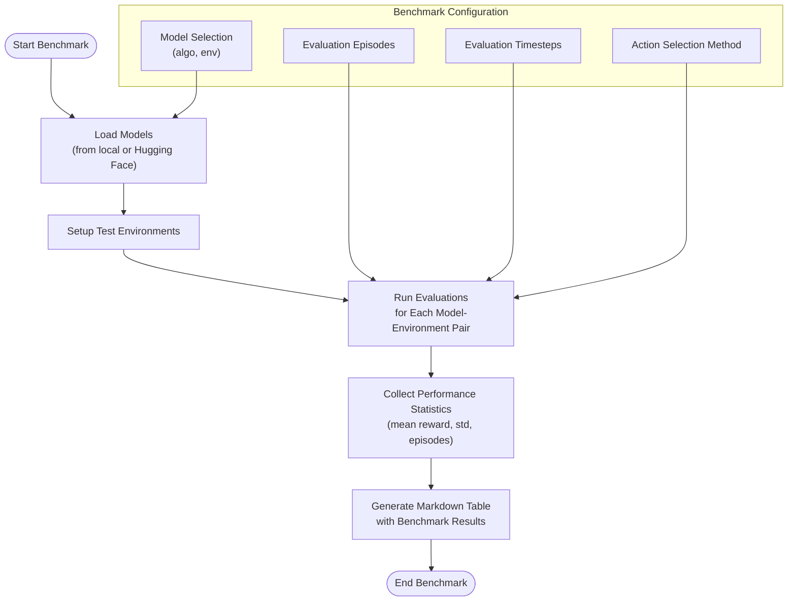
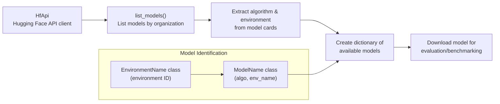

<!-- source: DeepWiki mcp.deepwiki.com · repo DLR-RM/rl-baselines3-zoo · page 5 Evaluation and Benchmarking · fetched 2026-10-14 -->

# Evaluation and Benchmarking

<details>
<summary>Relevant source files</summary>

The following files were used as context for generating this wiki page:

- [CHANGELOG.md](CHANGELOG.md)
- [benchmark.md](benchmark.md)
- [enjoy.py](enjoy.py)
- [logs/benchmark/benchmark.md](logs/benchmark/benchmark.md)
- [rl_zoo3/utils.py](rl_zoo3/utils.py)

</details>


This page documents the tools and processes for evaluating trained reinforcement learning agents, recording performance videos, and benchmarking different algorithms in RL-Baselines3-Zoo. These tools help assess model performance, visualize agent behavior, and compare the effectiveness of different algorithms across environments.

## Overview of Evaluation Tools

RL-Baselines3-Zoo provides several specialized tools for evaluation:

1. **Agent Evaluation** - Running trained agents with `enjoy.py` to test performance
2. **Video Recording** - Creating videos of agent behavior with `record_video.py`
3. **Benchmarking** - Systematically comparing algorithm performance with `benchmark.py`

These tools work together to provide a comprehensive evaluation framework:



Sources: [enjoy.py:1-5](), [rl_zoo3/utils.py:201-292]()

## Evaluating Trained Agents

Trained agents can be evaluated using the `enjoy.py` script, which loads saved models and runs them in test environments.

### Evaluation Workflow



Sources: [enjoy.py:1-5](), [rl_zoo3/utils.py:462-511]()

### Command Line Options

The `enjoy.py` script provides several command line options for evaluation:

| Option | Description |
|--------|-------------|
| `--algo` | RL algorithm to use (e.g., ppo, sac, td3) |
| `--env` | Environment ID to evaluate on |
| `--folder` | Log folder path containing trained models |
| `--exp-id` | Experiment ID (default: 0 for latest) |
| `--load-best` | Load best model instead of last model |
| `--load-checkpoint` | Load checkpoint instead of last model |
| `--num-threads` | Number of threads for PyTorch |
| `--n-envs` | Number of parallel environments |
| `--deterministic` | Use deterministic actions |
| `--stochastic` | Use stochastic actions |
| `--seed` | Random seed |
| `--no-render` | Do not render the environment |

### Basic Usage

To evaluate a trained PPO model on CartPole:

```bash
python -m rl_zoo3.enjoy --algo ppo --env CartPole-v1
```

To load the best model from a specific experiment:

```bash
python -m rl_zoo3.enjoy --algo sac --env HalfCheetah-v3 --load-best --exp-id 1
```

Sources: [enjoy.py:1-5](), [rl_zoo3/utils.py:462-511]()

## Model Loading System

The model loading process is handled by utility functions in `utils.py`:



When evaluating models, the system:
1. Locates the model file based on parameters (latest, best, checkpoint)
2. Retrieves saved hyperparameters from the model folder
3. Creates a test environment with appropriate wrappers
4. Loads normalization statistics if applicable
5. Runs the model in the environment for evaluation

Sources: [rl_zoo3/utils.py:398-437](), [rl_zoo3/utils.py:462-511]()

## Recording Videos

The `record_video.py` script extends the evaluation functionality to record videos of agent performance.

### Video Recording Process



The recording process leverages Gym's built-in Monitor wrapper to capture frames during evaluation and compile them into videos.

Sources: [rl_zoo3/utils.py:201-292]()

## Benchmarking System

The `benchmark.py` script provides functionality for systematically evaluating multiple models across different environments.

### Benchmarking Process



Sources: [benchmark.md:1-222]()

### Benchmark Results Format

The benchmark results are presented in a markdown table with the following columns:

| Column | Description |
|--------|-------------|
| algo | RL algorithm used |
| env_id | Environment ID |
| mean_reward | Average reward across evaluation episodes |
| std_reward | Standard deviation of rewards |
| n_timesteps | Number of timesteps used for training |
| eval_timesteps | Number of timesteps used for evaluation |
| eval_episodes | Number of evaluation episodes |

Example snippet from benchmark results:

```
|algo|env_id|mean_reward|std_reward|n_timesteps|eval_timesteps|eval_episodes|
|----|------|-----------|----------|-----------|--------------|-------------|
|ppo |CartPole-v1|500.000|0.000|100k|150000|300|
|sac |HalfCheetah-v3|9535.451|100.470|1M|150000|150|
|dqn |PongNoFrameskip-v4|20.602|0.613|10M|598998|88|
```

Sources: [benchmark.md:1-222](), [logs/benchmark/benchmark.md:20-222]()

## Integration with Hugging Face Hub

RL-Baselines3-Zoo integrates with the Hugging Face Hub to download pre-trained models for evaluation and benchmarking.



The function `get_hf_trained_models()` in `utils.py` retrieves available models from the Hugging Face Hub, which can then be used for evaluation or benchmarking.

Sources: [rl_zoo3/utils.py:337-377]()

## Benchmark Analysis and Interpretation

The benchmark results provide valuable insights into the performance of different RL algorithms across various environments.

### Key Performance Indicators

When analyzing benchmark results, consider:

1. **Mean Reward**: Higher mean reward indicates better performance
2. **Standard Deviation**: Lower standard deviation indicates more consistent performance
3. **Sample Efficiency**: Compare rewards against training timesteps
4. **Environment Compatibility**: Some algorithms perform better on specific environment types

### Sample Efficiency Analysis

For example, when comparing algorithms on the Swimmer-v3 environment:

| Algorithm | Mean Reward | Std Reward | Training Timesteps |
|-----------|-------------|------------|-------------------|
| A2C | 200.627 | 2.544 | 1M |
| PPO | 281.561 | 9.671 | 1M |
| SAC | 345.568 | 3.084 | 1M |
| TD3 | 359.127 | 1.244 | 1M |
| ARS | 355.267 | 12.796 | 2M |
| TRPO | 365.663 | 2.087 | 1M |
| TQC | 339.423 | 1.486 | 1M |

This shows that TRPO achieves the highest mean reward with relatively low variance, while TD3 and SAC also perform very well on this environment.

Sources: [benchmark.md:1-222](), [logs/benchmark/benchmark.md:20-222]()

## Best Practices for Evaluation

When evaluating and benchmarking RL agents, consider these best practices:

1. **Use Deterministic Policy** for most environments (except Atari games, which benefit from stochasticity)
2. **Evaluate Over Multiple Episodes** to get reliable statistics
3. **Use Consistent Evaluation Parameters** when comparing algorithms
4. **Consider Environment Variability** - some environments have high variance in outcomes
5. **Normalize Results** when comparing across different environments

## Related Pages

For additional information on related topics:
- For detailed information on training agents, see [Training System](#3)
- For hyperparameter management, see [Hyperparameter Management](#4)
- For detailed instructions on evaluating trained agents, see [Evaluating Trained Agents](#5.1)
- For information on recording videos, see [Recording Videos](#5.2)
- For additional details on benchmarking, see [Benchmarking](#5.3)

Sources: [benchmark.md:1-222](), [logs/benchmark/benchmark.md:1-19]()

---

