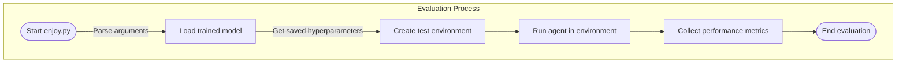
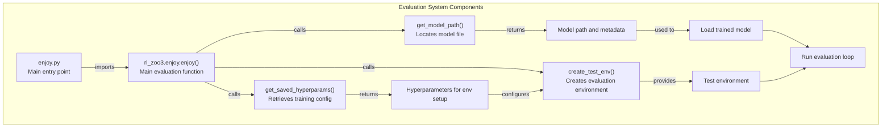
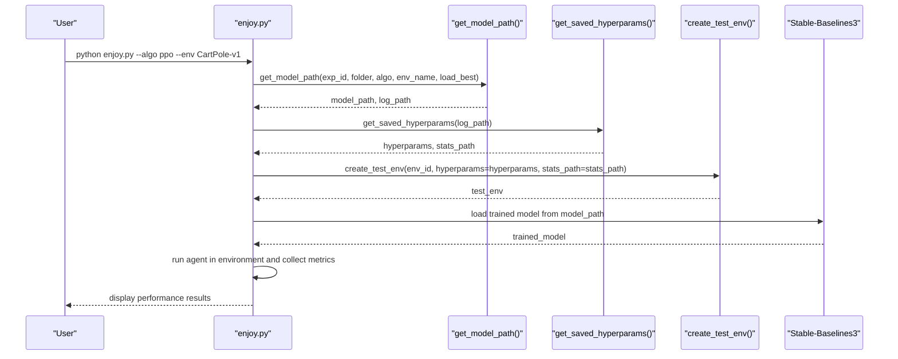
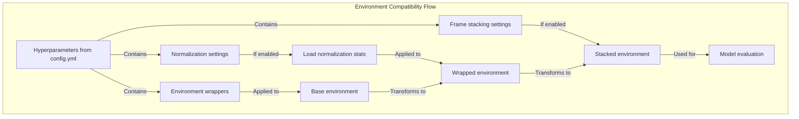

<!-- source: DeepWiki mcp.deepwiki.com · repo DLR-RM/rl-baselines3-zoo · page 5.1 Evaluating Trained Agents · fetched 2026-10-14 -->

# Evaluating Trained Agents

<details>
<summary>Relevant source files</summary>

The following files were used as context for generating this wiki page:

- [enjoy.py](enjoy.py)
- [rl_zoo3/utils.py](rl_zoo3/utils.py)

</details>


This page explains how to use the evaluation system in RL-Baselines3-Zoo to assess the performance of trained reinforcement learning agents. The evaluation system allows users to load previously trained models and run them in test environments to observe their behavior and measure their performance. For information about recording videos of agent performance, see [Recording Videos](#5.2), and for benchmarking multiple agents, see [Benchmarking](#5.3).

## Overview of the Evaluation Process

The evaluation system in RL-Baselines3-Zoo is implemented through the `enjoy.py` script, which serves as a simple entry point to the main `enjoy()` function. This system allows users to load trained models, configure test environments, and observe agent behavior.



Sources: [enjoy.py:1-5]()

## Command-Line Interface

The evaluation system is primarily accessed through the `enjoy.py` script, which supports various command-line arguments to customize the evaluation process.

Common options include:
- Specifying the algorithm and environment
- Loading the best model instead of the latest one
- Setting the number of evaluation episodes
- Controlling environment rendering
- Customizing environment parameters

Example usage:
```bash
python enjoy.py --algo ppo --env CartPole-v1 --folder logs/ --exp-id 0 --n-timesteps 1000
```

## Key Components of the Evaluation System

The evaluation system consists of several components that work together to load and run trained agents in test environments.



Sources: [rl_zoo3/utils.py:462-511](), [rl_zoo3/utils.py:398-437](), [rl_zoo3/utils.py:202-292]()

### Model Path Resolution

The system uses the `get_model_path()` function to locate the trained model file based on the specified algorithm, environment, and experiment ID. It supports loading:

- The latest model (`*.zip`)
- The best model (`best_model.zip`)
- A specific checkpoint (`rl_model_*_steps.zip`)
- The latest checkpoint

```
Name prefix format:
- Final model: final-model-{algorithm}-{environment}
- Best model: best-model-{algorithm}-{environment}  
- Checkpoint: checkpoint-{steps}-{algorithm}-{environment}
```

Sources: [rl_zoo3/utils.py:462-511]()

### Hyperparameter Retrieval

The `get_saved_hyperparams()` function retrieves the hyperparameters used during training from:

1. The `config.yml` file in the model's directory
2. Normalization statistics files (if normalization was used)

These hyperparameters ensure that the test environment is configured identically to the training environment.

Sources: [rl_zoo3/utils.py:398-437]()

### Test Environment Creation

The `create_test_env()` function creates a test environment for evaluating the trained agent. It applies the same wrappers and preprocessing steps that were used during training:

```mermaid
flowchart LR
    subgraph "Test Environment Creation"
        start([Start]) --> load_hyperparam["Load hyperparameters"]
        load_hyperparam --> get_wrapper["Get environment wrappers"]
        get_wrapper --> create_vec_env["Create vectorized environment"]
        create_vec_env --> load_stats{"Load normalization stats?"}
        
        load_stats -->|"Yes"| vec_normalize["Apply VecNormalize"]
        load_stats -->|"No"| frame_stack
        
        vec_normalize --> frame_stack{"Apply frame stacking?"}
        
        frame_stack -->|"Yes"| stack["Apply VecFrameStack"]
        frame_stack -->|"No"| finalize
        
        stack --> finalize["Return finalized environment"]
        finalize --> end([End])
    end
```

Sources: [rl_zoo3/utils.py:202-292]()

## Model Loading and Algorithms

The system supports loading models from various reinforcement learning algorithms implemented in Stable-Baselines3 and SB3-Contrib. The `ALGOS` dictionary in `utils.py` maps algorithm names to their implementation classes:

| Algorithm | Description | Class |
|-----------|-------------|-------|
| a2c | Advantage Actor-Critic | A2C |
| ddpg | Deep Deterministic Policy Gradient | DDPG |
| dqn | Deep Q-Network | DQN |
| ppo | Proximal Policy Optimization | PPO |
| sac | Soft Actor-Critic | SAC |
| td3 | Twin Delayed DDPG | TD3 |
| ars | Augmented Random Search | ARS |
| crossq | CrossQ | CrossQ |
| qrdqn | Quantile Regression DQN | QRDQN |
| tqc | Truncated Quantile Critics | TQC |
| trpo | Trust Region Policy Optimization | TRPO |
| ppo_lstm | Recurrent PPO | RecurrentPPO |

Sources: [rl_zoo3/utils.py:26-40]()

## Workflow for Evaluating a Trained Agent

Here's a step-by-step breakdown of the evaluation process:



Sources: [enjoy.py:1-5](), [rl_zoo3/utils.py:462-511](), [rl_zoo3/utils.py:398-437](), [rl_zoo3/utils.py:202-292]()

## Common Use Cases

### 1. Evaluating the Latest Model

To evaluate the latest trained model for a specific algorithm and environment:

```bash
python enjoy.py --algo ppo --env CartPole-v1
```

### 2. Evaluating the Best Model

To evaluate the best model saved during training (based on the evaluation callback):

```bash
python enjoy.py --algo ppo --env CartPole-v1 --load-best
```

### 3. Evaluating a Specific Checkpoint

To evaluate a model at a specific timestep during training:

```bash
python enjoy.py --algo ppo --env CartPole-v1 --load-checkpoint 100000
```

### 4. Deterministic Evaluation

For algorithms with stochastic policies, you can run deterministic evaluation:

```bash
python enjoy.py --algo sac --env HalfCheetah-v4 --deterministic
```

## Environment Compatibility and Wrappers

The evaluation system ensures compatibility between training and evaluation environments by:

1. Using the same environment wrappers defined in hyperparameters
2. Loading saved normalization statistics
3. Applying the same frame stacking if it was used during training

The environment configuration flow is:



Sources: [rl_zoo3/utils.py:202-292](), [rl_zoo3/utils.py:48-124]()

## Conclusion

The evaluation system in RL-Baselines3-Zoo provides a flexible way to assess trained reinforcement learning agents in their environments. By maintaining consistency between training and evaluation configurations, it ensures that performance metrics accurately reflect the agent's capabilities.

To extend the evaluation with video recording or systematic benchmarking, refer to the [Recording Videos](#5.2) and [Benchmarking](#5.3) pages.

---

