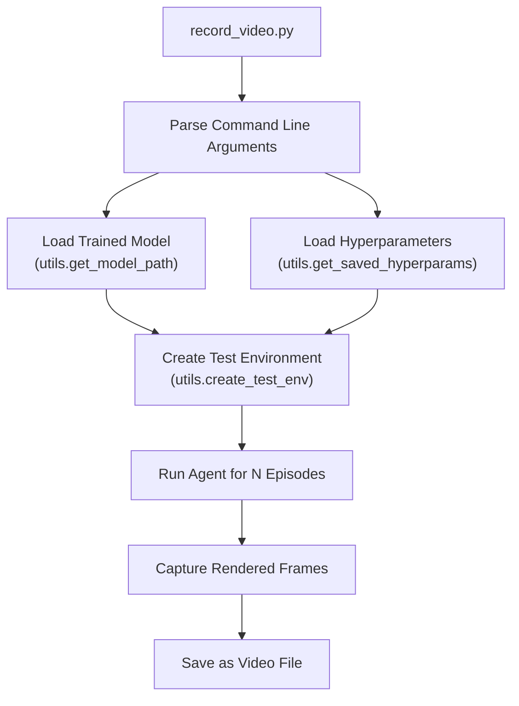
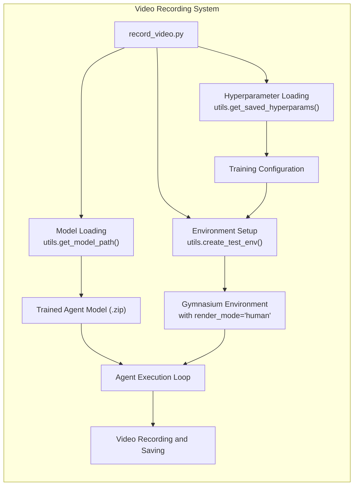
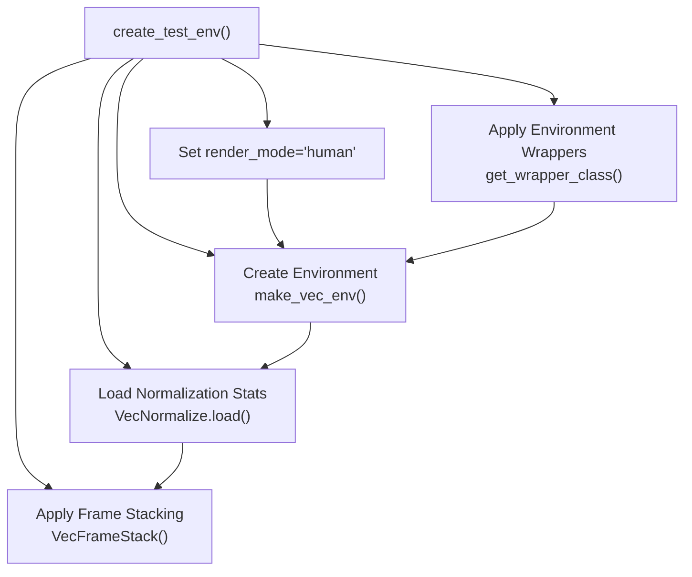

<!-- source: DeepWiki mcp.deepwiki.com · repo DLR-RM/rl-baselines3-zoo · page 5.2 Recording Videos · fetched 2026-10-14 -->

# Recording Videos

<details>
<summary>Relevant source files</summary>

The following files were used as context for generating this wiki page:

- [rl_zoo3/utils.py](rl_zoo3/utils.py)

</details>


This document explains how to record videos of trained reinforcement learning agents using the RL-Baselines3-Zoo framework. For information about evaluating agent performance without recording, see [Evaluating Trained Agents](#5.1).

## Purpose and Overview

The video recording functionality allows users to:
- Visually demonstrate agent behavior in environments
- Create shareable media for presentations or publications
- Qualitatively assess trained policies
- Generate content for model cards on Hugging Face Hub

RL-Baselines3-Zoo provides a dedicated script, `record_video.py`, which utilizes utility functions from the framework to load trained models, configure environments with rendering enabled, and save the resulting videos.

## Video Recording Process

The following diagram illustrates the high-level process of recording videos:



Sources: [rl_zoo3/utils.py:462-511](), [rl_zoo3/utils.py:398-437](), [rl_zoo3/utils.py:202-292]()

## Basic Usage

To record videos of a trained agent, use the following command structure:

```
python -m rl_zoo3.record_video --algo ALGORITHM --env ENVIRONMENT --folder LOGS_FOLDER
```

Example:
```
python -m rl_zoo3.record_video --algo ppo --env CartPole-v1 --folder logs/
```

## Command Line Arguments

The following table lists the main command-line arguments for video recording:

| Argument | Description | Default |
|----------|-------------|---------|
| `--algo` | RL algorithm (e.g., ppo, sac, dqn) | Required |
| `--env` | Environment name (e.g., CartPole-v1) | Required |
| `--folder` | Path to logs folder with trained models | Required |
| `--exp-id` | Experiment ID | 0 (latest) |
| `--n-episodes` | Number of episodes to record | 5 |
| `--deterministic` | Use deterministic actions | True |
| `--stochastic` | Use stochastic actions | False |
| `--load-best` | Load the best model instead of final | False |
| `--load-checkpoint` | Load specific checkpoint number | None |
| `--load-last-checkpoint` | Load the latest checkpoint | False |

## Key Components

The following diagram shows the key components and their interactions in the video recording system:



Sources: [rl_zoo3/utils.py:202-292](), [rl_zoo3/utils.py:462-511]()

### Model Loading

The `get_model_path` function locates trained models based on the provided parameters:

```python
name_prefix, model_path, log_path = get_model_path(
    exp_id=exp_id,
    folder=folder,
    algo=algo,
    env_name=env_name,
    load_best=load_best,
    load_checkpoint=load_checkpoint,
    load_last_checkpoint=load_last_checkpoint
)
```

This function supports four model loading options:
1. Latest trained model (default)
2. Best performing model (`--load-best`)
3. Specific checkpoint (`--load-checkpoint NUMBER`)
4. Latest checkpoint (`--load-last-checkpoint`)

Sources: [rl_zoo3/utils.py:462-511]()

### Environment Creation

The `create_test_env` function sets up the environment for video recording:



Key parameters for video recording:
- `should_render=True`: Enables rendering for video capture
- `stats_path`: Path to normalization statistics (if used during training)
- `hyperparams`: Contains settings for frame stacking, normalization, etc.

Sources: [rl_zoo3/utils.py:202-292]()

## Advanced Features

### Environment Preprocessing

The video recording system applies the same preprocessing that was used during training:

1. **Normalization**: If the agent was trained with normalized observations or rewards, the same normalization is applied during recording. This is done by loading the saved `vecnormalize.pkl` file:

```python
if hyperparams["normalize"]:
    env = VecNormalize.load(path_, env)
    env.training = False
    env.norm_reward = False
```

2. **Frame Stacking**: If frame stacking was used during training, the same number of frames are stacked during recording:

```python
n_stack = hyperparams.get("frame_stack", 0)
if n_stack > 0:
    env = VecFrameStack(env, n_stack)
```

3. **Custom Wrappers**: Any custom environment wrappers used during training are applied during recording using the `get_wrapper_class` function.

Sources: [rl_zoo3/utils.py:202-292](), [rl_zoo3/utils.py:48-124]()

### Deterministic vs. Stochastic Policy

By default, videos are recorded using deterministic actions (the agent always takes the action with highest probability). For algorithms with stochastic policies (e.g., SAC, PPO), you can use the `--stochastic` flag to see non-deterministic behavior:

```
python -m rl_zoo3.record_video --algo sac --env BipedalWalker-v3 --folder logs/ --stochastic
```

### Integration with Hugging Face Hub

Recorded videos can be uploaded to the Hugging Face Hub along with trained models using the `push_to_hub.py` script. This creates model cards that include both the trained model and demonstration videos.

## Troubleshooting

Common issues and their solutions:

| Issue | Solution |
|-------|----------|
| Missing video encoding dependencies | Install ffmpeg (`apt-get install ffmpeg`) |
| Environment rendering issues | Check environment documentation for specific rendering requirements |
| Memory issues with large environments | Reduce the number of episodes or use a smaller environment |
| Normalization errors | Ensure the correct `stats_path` is provided to access normalization statistics |
| Model loading failures | Verify the correct experiment ID, algorithm name, and environment name |

For information about quantitatively evaluating agent performance, see [Benchmarking](#5.3).

Sources: [rl_zoo3/utils.py:202-292]()

---

