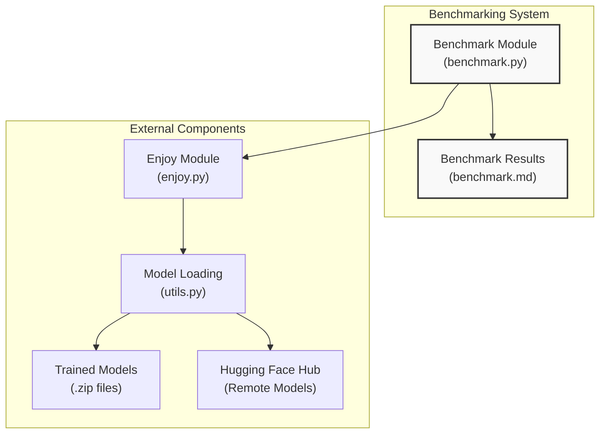
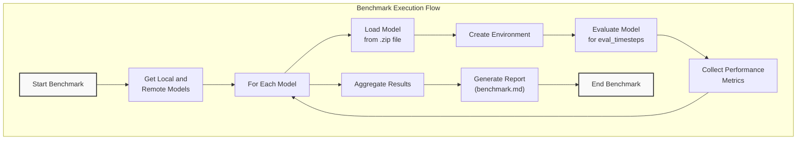
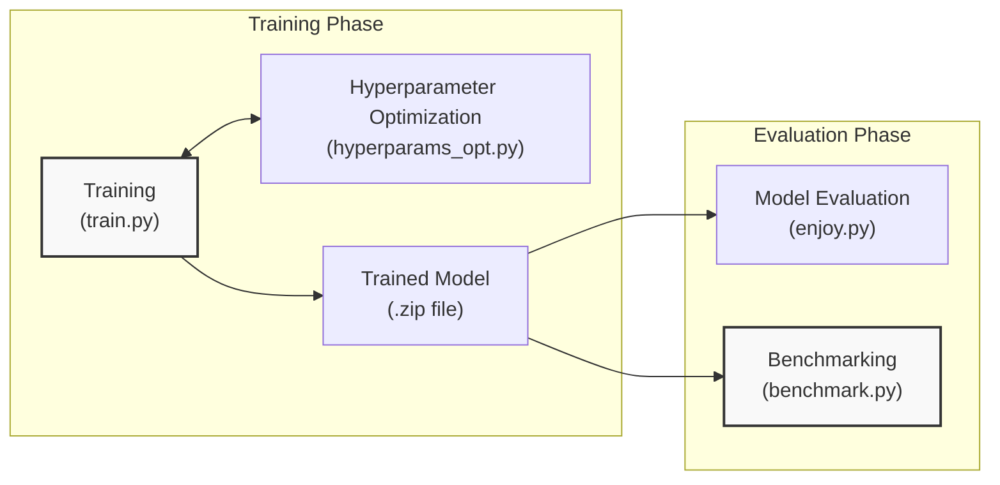

<!-- source: DeepWiki mcp.deepwiki.com · repo DLR-RM/rl-baselines3-zoo · page 5.3 Benchmarking · fetched 2026-10-14 -->

# Benchmarking

<details>
<summary>Relevant source files</summary>

The following files were used as context for generating this wiki page:

- [CHANGELOG.md](CHANGELOG.md)
- [benchmark.md](benchmark.md)
- [logs/benchmark/benchmark.md](logs/benchmark/benchmark.md)
- [rl_zoo3/hyperparams_opt.py](rl_zoo3/hyperparams_opt.py)
- [tests/test_enjoy.py](tests/test_enjoy.py)
- [tests/test_hyperparams_opt.py](tests/test_hyperparams_opt.py)
- [tests/test_train.py](tests/test_train.py)

</details>


The Benchmarking system in RL-Baselines3-Zoo provides a standardized way to evaluate and compare the performance of trained reinforcement learning agents across different algorithms and environments. This page documents how to use the benchmarking functionality, interpret results, and understand the underlying architecture. For information about evaluating individual trained agents, see [Evaluating Trained Agents](#5.1).

## Overview

The benchmarking system runs trained agents for a specified number of timesteps and collects performance metrics such as mean episode reward and standard deviation. These metrics provide a quantitative basis for comparing different algorithms or hyperparameter configurations.



Sources: tests/test_enjoy.py, benchmark.md

## Architecture

The benchmarking system is built on top of the existing evaluation infrastructure in RL-Baselines3-Zoo. It systematically evaluates multiple trained agents and aggregates their performance metrics.



Sources: tests/test_enjoy.py

## Running Benchmarks

To run the benchmarking system, use the following command:

```bash
python -m rl_zoo3.benchmark [options]
```

Common options include:

| Option | Description |
|--------|-------------|
| `-n`, `--n-timesteps` | Number of timesteps to use for evaluation |
| `--benchmark-dir` | Directory to save benchmark results |
| `--test-mode` | Run benchmark in test mode (evaluates fewer models) |
| `--no-hub` | Disable downloading models from Hugging Face Hub |
| `--deterministic` | Use deterministic actions during evaluation (default except for Atari) |
| `--stochastic` | Use stochastic actions during evaluation (default for Atari) |

Sources: tests/test_enjoy.py

## Benchmark Results Format

The benchmark results are saved in a markdown file (`benchmark.md`) with the following format:

| Column | Description |
|--------|-------------|
| algo | RL algorithm used (e.g., PPO, A2C, SAC) |
| env_id | Environment ID (e.g., CartPole-v1, Hopper-v3) |
| mean_reward | Average episode reward across evaluations |
| std_reward | Standard deviation of episode rewards |
| n_timesteps | Number of timesteps the agent was trained for |
| eval_timesteps | Total number of timesteps used for evaluation |
| eval_episodes | Number of episodes completed during evaluation |

Results are sorted by algorithm and environment, making it easy to compare performance across different settings.

Sources: benchmark.md, logs/benchmark/benchmark.md

## Example Results

Here's a small sample of benchmark results to illustrate the format:

| algo | env_id | mean_reward | std_reward | n_timesteps | eval_timesteps | eval_episodes |
|------|--------|-------------|------------|-------------|----------------|---------------|
| ppo  | CartPole-v1 | 500.000 | 0.000 | 100k | 150000 | 300 |
| a2c  | CartPole-v1 | 500.000 | 0.000 | 500k | 150000 | 300 |
| dqn  | CartPole-v1 | 500.000 | 0.000 | 50k  | 150000 | 300 |
| ppo  | Hopper-v3   | 2410.435 | 10.026 | 1M | 150000 | 150 |
| sac  | Hopper-v3   | 2325.547 | 1129.676 | 1M | 149841 | 236 |
| td3  | Hopper-v3   | 3606.390 | 4.027 | 1M | 150000 | 150 |

The complete benchmark table includes results for all supported algorithms across all environments where trained models are available.

Sources: benchmark.md

## Integration with Tests

The benchmarking system is integrated with the testing framework to verify its functionality. The test runs a simplified version of the benchmark with the `--test-mode` flag:

```python
def test_benchmark(tmp_path):
    cmd = f"python -m rl_zoo3.benchmark -n {N_STEPS} --benchmark-dir {tmp_path} --test-mode --no-hub"
    return_code = subprocess.call(shlex.split(cmd))
    _assert_eq(return_code, 0)
```

This ensures that the benchmarking system works correctly but runs with minimal resource requirements.

Sources: tests/test_enjoy.py

## Using Benchmark Results

Benchmark results serve several purposes:

1. **Algorithm Comparison**: Compare the performance of different algorithms on the same environment
2. **Hyperparameter Validation**: Verify that hyperparameter changes lead to performance improvements
3. **Regression Testing**: Ensure that changes to the codebase don't negatively impact performance
4. **Documentation**: Provide empirical evidence of algorithm performance for users

The benchmark results can be viewed directly in the markdown file or processed further for visualization and analysis.

Sources: benchmark.md

## Hugging Face Hub Integration

The benchmarking system integrates with Hugging Face Hub to access pre-trained models. Each model on the Hub includes:

1. The trained model file
2. A model card with hyperparameters
3. Videos of the agent's performance
4. Benchmark results

For example, to view models for the PPO algorithm:
```bash
https://huggingface.co/sb3/ppo
```

This integration makes it easy to reproduce benchmark results and use pre-trained models.

Sources: benchmark.md

## Interpreting Benchmark Results

When interpreting benchmark results, consider the following:

1. **Mean reward**: Higher values generally indicate better performance
2. **Standard deviation**: Lower values indicate more consistent performance
3. **Training timesteps**: More timesteps usually lead to better performance, but with diminishing returns
4. **Number of episodes**: More episodes provide more reliable metrics

Note that benchmark results represent performance on a single run and may not reflect the algorithm's general performance or its applicability to new tasks.

Sources: benchmark.md

## Relationship to Hyperparameter Optimization

The benchmarking system complements the hyperparameter optimization system in RL-Baselines3-Zoo. While hyperparameter optimization focuses on finding the best parameters during training, benchmarking evaluates the final performance of trained agents.



Sources: tests/test_hyperparams_opt.py, rl_zoo3/hyperparams_opt.py

## Best Practices

When using the benchmarking system, follow these best practices:

1. **Sufficient evaluation timesteps**: Use at least 100,000 timesteps for reliable results
2. **Deterministic policy**: Enable deterministic actions for continuous control tasks unless testing robustness
3. **Multiple runs**: Consider running benchmarks multiple times to account for variability
4. **Consistent environments**: Use the same environment versions when comparing algorithms
5. **Resource planning**: Benchmarking many models can be computationally intensive

Following these practices will help ensure reliable and useful benchmark results.

Sources: benchmark.md

## Limitations

The benchmarking system has several limitations to be aware of:

1. Results represent single runs and may not reflect general algorithm performance
2. Performance is specific to the environment and hyperparameters used
3. The system doesn't account for training stability or sample efficiency
4. Metrics are limited to episode rewards and don't capture other aspects of performance

These limitations should be considered when using benchmark results to make decisions about algorithm selection or implementation.

Sources: benchmark.md

---

