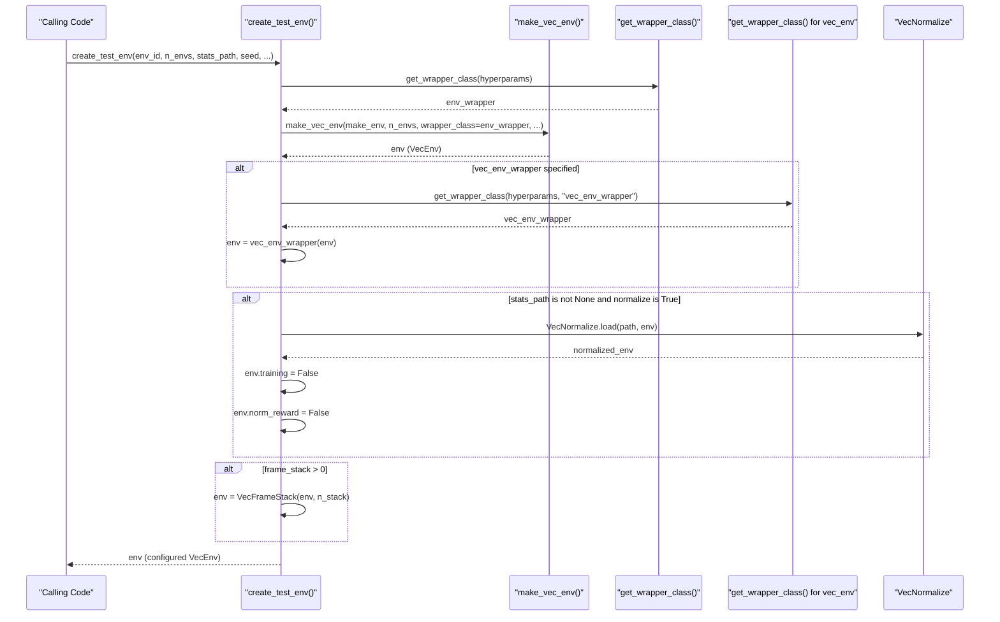
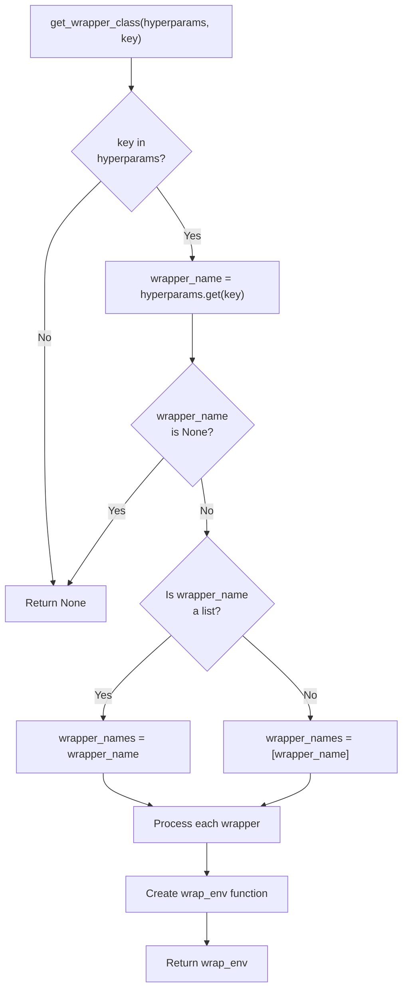
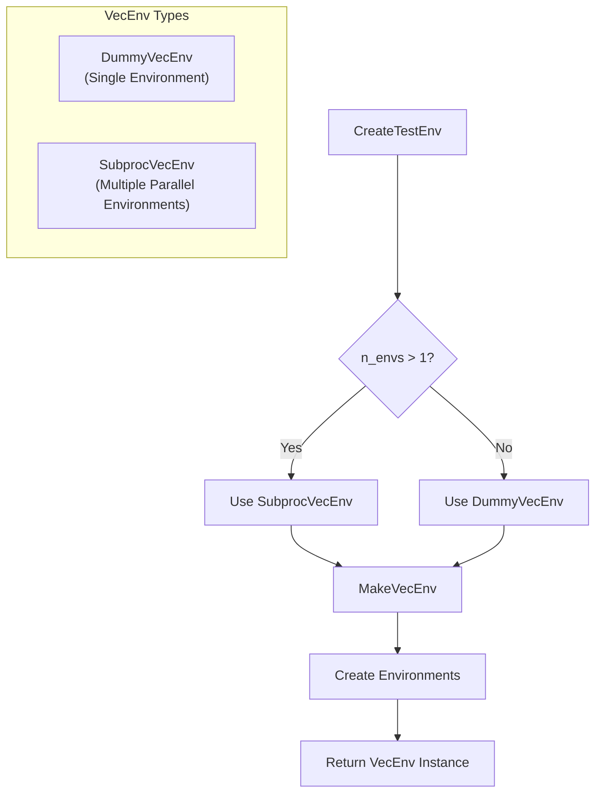
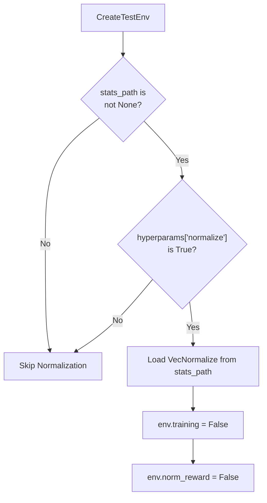

<!-- source: DeepWiki mcp.deepwiki.com · repo DLR-RM/rl-baselines3-zoo · page 6 Environment Integration · fetched 2026-10-14 -->

# Environment Integration

<details>
<summary>Relevant source files</summary>

The following files were used as context for generating this wiki page:

- [.github/ISSUE_TEMPLATE/bug_report.yml](.github/ISSUE_TEMPLATE/bug_report.yml)
- [.github/ISSUE_TEMPLATE/documentation.yml](.github/ISSUE_TEMPLATE/documentation.yml)
- [.github/ISSUE_TEMPLATE/question.yml](.github/ISSUE_TEMPLATE/question.yml)
- [CHANGELOG.md](CHANGELOG.md)
- [docs/Makefile](docs/Makefile)
- [rl_zoo3/utils.py](rl_zoo3/utils.py)
- [rl_zoo3/wrappers.py](rl_zoo3/wrappers.py)

</details>


This page describes how RL-Baselines3-Zoo integrates with various reinforcement learning environments and allows for customization of environment behavior through wrappers. For information on specific hyperparameters for environments, see [Hyperparameter Management](#4) and for evaluation of trained agents in environments, see [Evaluation and Benchmarking](#5).

## Overview of Environment Integration

RL-Baselines3-Zoo supports a wide range of reinforcement learning environments through Gymnasium (formerly Gym) and provides mechanisms to customize environment behavior through wrappers and configuration options.

```mermaid
flowchart LR
    subgraph "Environment Integration System"
        EnvCreation["Environment Creation"]
        EnvWrappers["Environment Wrappers"]
        VecEnvs["Vectorized Environments"]
        NormWrapper["Normalization Wrapper"]
    end
    
    subgraph "Environment Types"
        Atari["Atari Games"]
        Classic["Classic Control"]
        Box2D["Box2D Environments"]
        PyBullet["PyBullet Environments"]
        MuJoCo["MuJoCo Environments"]
        Robotics["Robotics Environments"]
        MiniGrid["MiniGrid Environments"]
    end
    
    EnvCreation --> "Environment Types"
    EnvWrappers --> EnvCreation
    VecEnvs --> EnvCreation
    NormWrapper --> VecEnvs
    
    ExpManager["ExperimentManager"] --> EnvCreation
    
    Train["Training System"] --> ExpManager
    Hyperparameters["Hyperparameter Files"] --> EnvCreation
```

Sources: [rl_zoo3/utils.py:202-292](), [rl_zoo3/wrappers.py:1-326]()

## Environment Creation Process

The environment creation process in RL-Baselines3-Zoo is handled primarily by the `create_test_env` function in `utils.py`. This function creates and configures environments based on various parameters.



Sources: [rl_zoo3/utils.py:202-292]()

## Supported Environment Types

RL-Baselines3-Zoo supports a wide range of environment types through Gymnasium (formerly Gym):

| Environment Type | Description | Examples |
|------------------|-------------|----------|
| Atari Games | Classic Atari arcade games | Pong, Breakout, Space Invaders |
| Classic Control | Simple control tasks | CartPole, Acrobot, Pendulum |
| Box2D | 2D physics environments | LunarLander, BipedalWalker, CarRacing |
| PyBullet | 3D physics simulation environments | HalfCheetah, Ant, Humanoid |
| MuJoCo | MuJoCo physics simulator environments | Swimmer, Hopper, Walker2d |
| Robotics | Robotic manipulation tasks | FetchReach, FetchPush, HandManipulate |
| MiniGrid | Grid-world environments | MiniGrid-Empty, MiniGrid-DoorKey |

Sources: [rl_zoo3/utils.py:248-254]()

## Environment Wrappers

Environment wrappers are a key mechanism for customizing environment behavior. RL-Baselines3-Zoo includes several wrappers in the `wrappers.py` file:

| Wrapper | Purpose |
|---------|---------|
| `TruncatedOnSuccessWrapper` | Resets on success and offsets rewards; useful for goal environments |
| `ActionNoiseWrapper` | Adds Gaussian noise to actions to test robustness of control |
| `ActionSmoothingWrapper` | Smooths actions using exponential moving average |
| `DelayedRewardWrapper` | Delays rewards by a specified number of steps |
| `HistoryWrapper` | Stacks past observations and actions to provide history to the agent |
| `HistoryWrapperObsDict` | Similar to `HistoryWrapper` but for dictionary observations |
| `FrameSkip` | Returns only every n-th frame (frameskipping) |
| `MaskVelocityWrapper` | Masks velocity terms in observations to make the MDP partially observable |

Sources: [rl_zoo3/wrappers.py:11-326]()

### Specifying Wrappers in Hyperparameters

Wrappers can be specified in hyperparameter files using the `env_wrapper` key:

```yaml
# Single wrapper
env_wrapper: gym_minigrid.wrappers.FlatObsWrapper

# Multiple wrappers
env_wrapper:
  - rl_zoo3.wrappers.FrameSkip
  - rl_zoo3.wrappers.DelayedRewardWrapper:
      delay: 5
```

The `get_wrapper_class` function in `utils.py` handles parsing these specifications and creating wrapper functions:



Sources: [rl_zoo3/utils.py:48-124]()

## Vectorized Environments

RL-Baselines3-Zoo supports vectorized environments through Stable Baselines3's VecEnv classes. Vectorized environments allow running multiple environments in parallel, which can significantly speed up training.



The decision between `DummyVecEnv` and `SubprocVecEnv` is made based on the `n_envs` parameter:

```python
# From create_test_env in utils.py
if vec_env_cls is None:
    vec_env_cls = SubprocVecEnv if n_envs > 1 else DummyVecEnv
```

Sources: [rl_zoo3/utils.py:239-240]()

### Vectorized Environment Wrappers

In addition to regular environment wrappers, RL-Baselines3-Zoo also supports wrappers for vectorized environments through the `vec_env_wrapper` key in hyperparameters:

```yaml
vec_env_wrapper: stable_baselines3.common.vec_env.VecFrameStack
```

These wrappers are processed similarly to regular environment wrappers but are applied to the vectorized environment after it has been created.

Sources: [rl_zoo3/utils.py:267-271]()

## Environment Normalization

RL-Baselines3-Zoo supports environment normalization through the `VecNormalize` class from Stable Baselines3. Normalization helps stabilize training by normalizing observations and rewards.



When loading a saved model for evaluation, normalization statistics can be loaded from a file to ensure consistent normalization between training and testing:

```python
# From create_test_env in utils.py
if stats_path is not None:
    if hyperparams["normalize"]:
        print("Loading running average")
        print(f"with params: {hyperparams['normalize_kwargs']}")
        path_ = os.path.join(stats_path, "vecnormalize.pkl")
        if os.path.exists(path_):
            env = VecNormalize.load(path_, env)
            # Deactivate training and reward normalization
            env.training = False
            env.norm_reward = False
```

Sources: [rl_zoo3/utils.py:275-286]()

## Special Environments and Dict Observations

RL-Baselines3-Zoo includes special support for:

1. Environments with dictionary observations through the `flatten_dict_observations` function
2. Special vectorized environments like Brax and IsaacSim through VecEnv class overriding

```python
def flatten_dict_observations(env: gym.Env) -> gym.Env:
    assert isinstance(env.observation_space, spaces.Dict)
    return gym.wrappers.FlattenObservation(env)
```

Recent updates have added support for overriding the `VecEnv` class used to instantiate environments in the `ExperimentManager`, which enables support for special vectorized environments like Brax and IsaacSim.

Sources: [rl_zoo3/utils.py:43-45](), [CHANGELOG.md:24]()

## Customizing Environments

There are several ways to customize environments in RL-Baselines3-Zoo:

1. **Environment Wrappers**: Modify environment behavior using wrappers specified in hyperparameters.
2. **Environment Arguments**: Pass additional arguments to environment constructors using `env_kwargs`.
3. **VecEnv Customization**: Override the VecEnv class and provide custom VecEnv kwargs.
4. **Normalization Settings**: Configure normalization parameters.
5. **Frame Stacking**: Enable frame stacking for observations.

Example of customization through command line arguments:

```bash
python train.py --algo ppo --env CartPole-v1 --env-kwargs render_mode=rgb_array
```

Example of customization through hyperparameter files:

```yaml
CartPole-v1:
  env_wrapper:
    - rl_zoo3.wrappers.MaskVelocityWrapper
  normalize: true
  n_envs: 8
  frame_stack: 4
```

Sources: [rl_zoo3/utils.py:202-292]()

## Environment Integration in the Training Workflow

Environment integration is a key part of the training workflow in RL-Baselines3-Zoo:

```mermaid
flowchart TD
    subgraph "Training Workflow"
        ParseArgs["Parse Command Line Arguments"]
        LoadHyperparams["Load Hyperparameters"]
        InitExpManager["Initialize ExperimentManager"]
        CreateEnv["Create Environment"]
        InitAlgo["Initialize Algorithm"]
        Train["Train Algorithm"]
        SaveModel["Save Model"]
        SaveStats["Save Normalization Statistics"]
    end
    
    ParseArgs --> LoadHyperparams
    LoadHyperparams --> InitExpManager
    InitExpManager --> CreateEnv
    CreateEnv --> InitAlgo
    InitAlgo --> Train
    Train --> SaveModel
    Train --> SaveStats
    
    subgraph "Environment Integration"
        Direction LR
        CreateTestEnv["create_test_env()"]
        ApplyWrappers["Apply Environment Wrappers"]
        CreateVecEnv["Create Vectorized Environment"]
        ApplyVecWrappers["Apply VecEnv Wrappers"]
        SetupNormalization["Setup Normalization"]
        SetupFrameStack["Setup Frame Stacking"]
    end
    
    CreateEnv --> CreateTestEnv
    CreateTestEnv --> ApplyWrappers
    ApplyWrappers --> CreateVecEnv
    CreateVecEnv --> ApplyVecWrappers
    ApplyVecWrappers --> SetupNormalization
    SetupNormalization --> SetupFrameStack
```

The `ExperimentManager` class is responsible for creating environments during training. It uses the `create_test_env` function to create environments for both training and evaluation.

Sources: [rl_zoo3/utils.py:202-292]()

## Recent Environment Support Updates

RL-Baselines3-Zoo has seen several updates to its environment support:

1. **Gymnasium Support**: Added support for Gymnasium v1.0 and v1.1, which is the successor to Gym.
2. **Special Vectorized Environments**: Added support for special vectorized environments like Brax and IsaacSim.
3. **Python Object Wrappers**: Added support for specifying callbacks and environment wrappers as Python objects in Python config files (instead of strings).
4. **Environment Version Updates**: Updated several environment IDs to match newer versions (e.g., `LunarLander-v2` to `LunarLander-v3`, `CarRacing-v1` to `CarRacing-v2`).
5. **MuJoCo Environments**: Upgraded MuJoCo environment hyperparameters to v4.

Sources: [CHANGELOG.md:1-188]()

## Conclusion

RL-Baselines3-Zoo provides a flexible and powerful system for integrating with various reinforcement learning environments. It supports a wide range of environment types, provides numerous customization options through wrappers and configuration parameters, and includes mechanisms for environment normalization and vectorization. This makes it suitable for a wide range of reinforcement learning tasks and research scenarios.

---

