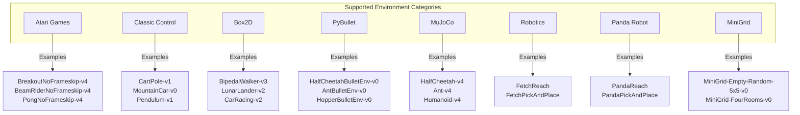
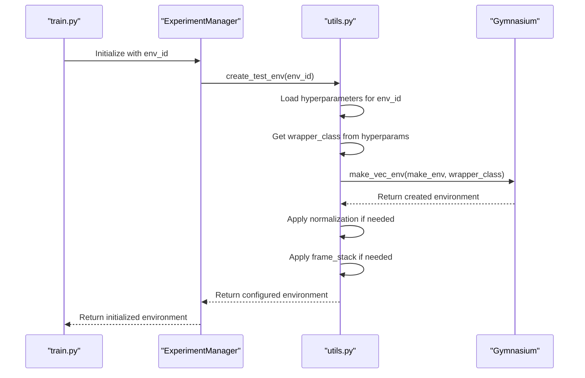
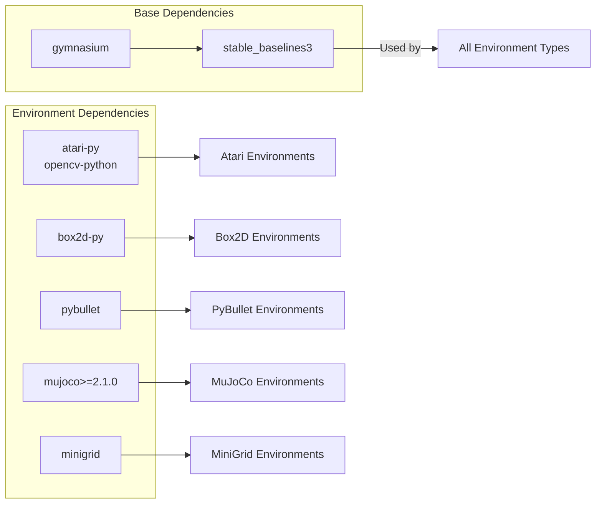
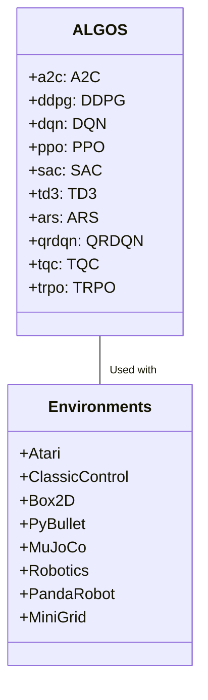

<!-- source: DeepWiki mcp.deepwiki.com · repo DLR-RM/rl-baselines3-zoo · page 6.1 Supported Environments · fetched 2026-10-14 -->

# Supported Environments

<details>
<summary>Relevant source files</summary>

The following files were used as context for generating this wiki page:

- [README.md](README.md)
- [hyperparams/a2c.yml](hyperparams/a2c.yml)
- [hyperparams/ppo.yml](hyperparams/ppo.yml)
- [rl_zoo3/utils.py](rl_zoo3/utils.py)

</details>


This document provides a comprehensive overview of the environments supported by RL-Baselines3-Zoo and how they are configured. RL-Baselines3-Zoo supports a wide range of environments for reinforcement learning experimentation, from classic control problems to more complex robotic simulations. For information about environment wrappers and customization, see [Environment Wrappers](#6.2).

## Environment Categories

RL-Baselines3-Zoo supports multiple categories of environments, each with different characteristics and challenges. The framework leverages the Gymnasium (formerly Gym) interface for consistent environment interaction.

### Environment Category Overview



Sources: [README.md:118-252]()

## Environment Configuration

Environments in RL-Baselines3-Zoo are configured through hyperparameter YAML files organized by algorithm. Each environment has a specific set of hyperparameters optimized for training with a particular algorithm.

### Hyperparameter Structure

The hyperparameter files are organized as follows:
- Each algorithm has its own YAML file (e.g., `ppo.yml`, `a2c.yml`)
- Within these files, environments are listed with their specific configurations
- Environment configurations can inherit from default configurations using YAML anchors and references

Example from `ppo.yml` for `CartPole-v1`:

```yaml
CartPole-v1:
  n_envs: 8
  n_timesteps: !!float 1e5
  policy: 'MlpPolicy'
  n_steps: 32
  batch_size: 256
  gae_lambda: 0.8
  gamma: 0.98
  n_epochs: 20
  ent_coef: 0.0
  learning_rate: lin_0.001
  clip_range: lin_0.2
```

Sources: [hyperparams/ppo.yml:32-43](), [hyperparams/a2c.yml:16-21]()

### Environment Initialization Process



Sources: [rl_zoo3/utils.py:202-292]()

## Environment-Algorithm Compatibility

Not all algorithms work with all environment types. The compatibility depends on factors such as:
- Whether the environment has discrete or continuous action spaces
- Whether the environment has discrete or continuous observation spaces
- The complexity of the task

### Algorithm-Environment Compatibility Matrix

| Environment Type | A2C | PPO | DQN | SAC | TD3 | DDPG | TQC | TRPO | ARS | QR-DQN |
|-----------------|-----|-----|-----|-----|-----|------|-----|------|-----|--------|
| Atari Games | ✓ | ✓ | ✓ | ✗ | ✗ | ✗ | ✗ | ✗ | ✗ | ✓ |
| Classic Control | ✓ | ✓ | ✓ | ✓* | ✓* | ✓* | ✓* | ✓ | ✓ | ✓ |
| Box2D | ✓ | ✓ | ✓* | ✓* | ✓* | ✓* | ✓* | ✓* | ✓* | ✓* |
| PyBullet | ✓ | ✓ | ✗ | ✓ | ✓ | ✓ | ✓ | ✓ | ✓* | ✗ |
| MuJoCo | ✓ | ✓ | ✗ | ✓ | ✓ | ✓* | ✓ | ✓ | ✓* | ✗ |
| Robotics | ✗ | ✗ | ✗ | ✗ | ✗ | ✗ | ✓** | ✗ | ✗ | ✗ |
| Panda Robot | ✗ | ✗ | ✗ | ✗ | ✗ | ✗ | ✓** | ✗ | ✗ | ✗ |
| MiniGrid | ✓* | ✓ | ✓* | ✗ | ✗ | ✗ | ✗ | ✓* | ✗ | ✓* |

✓: Fully supported
✓*: Partially supported (some environments in this category)
✓**: Requires HER (Hindsight Experience Replay)
✗: Not supported

Sources: [README.md:118-252]()

## Environment Requirements and Dependencies

Different environment categories have different dependencies:



Sources: [README.md:30-31](), [README.md:172-176](), [README.md:239-243]()

## Environment Configuration System

The environment configuration system in RL-Baselines3-Zoo is designed to be flexible and extensible, allowing for both standard environments and customized wrappers.

### Environment Creation and Wrapping Flow

```mermaid
flowchart TD
    subgraph "Environment Creation Process"
        LoadHyperparams["Load Hyperparameters\nfrom YAML"] --> CheckWrapper["Check for env_wrapper\nin hyperparams"]
        CheckWrapper --> |"wrapper specified"| GetWrapperClass["Get wrapper class\nvia get_wrapper_class()"]
        CheckWrapper --> |"no wrapper"| SkipWrapper["Skip wrapper step"]
        GetWrapperClass --> CreateEnv["Create environment\nvia make_vec_env()"]
        SkipWrapper --> CreateEnv
        CreateEnv --> CheckVecWrapper["Check for vec_env_wrapper\nin hyperparams"]
        CheckVecWrapper --> |"wrapper specified"| ApplyVecWrapper["Apply vector env wrapper"]
        CheckVecWrapper --> |"no wrapper"| SkipVecWrapper["Skip vec wrapper step"]
        ApplyVecWrapper --> CheckNormalize["Check for normalization\nin hyperparams"]
        SkipVecWrapper --> CheckNormalize
        CheckNormalize --> |"normalize=true"| ApplyNormalize["Apply VecNormalize wrapper"]
        CheckNormalize --> |"normalize=false"| SkipNormalize["Skip normalization"]
        ApplyNormalize --> CheckFrameStack["Check for frame_stack\nin hyperparams"]
        SkipNormalize --> CheckFrameStack
        CheckFrameStack --> |"frame_stack>0"| ApplyFrameStack["Apply VecFrameStack wrapper"]
        CheckFrameStack --> |"no frame_stack"| FinalEnv["Return Final Environment"]
        ApplyFrameStack --> FinalEnv
    end
```



Sources: [rl_zoo3/utils.py:202-292](), [rl_zoo3/utils.py:48-124]()

## Specialized Environment Configurations

Different environment types often require specialized configurations:

### Atari Environments

Atari environments typically use:
- Frame stacking (usually 4 frames)
- Image preprocessing via `AtariWrapper`
- CNN policies instead of MLP policies
- Multiple parallel environments (n_envs > 1)

Example from `ppo.yml`:
```yaml
atari:
  env_wrapper:
    - stable_baselines3.common.atari_wrappers.AtariWrapper
  frame_stack: 4
  policy: 'CnnPolicy'
  n_envs: 8
  n_steps: 128
  n_epochs: 4
  batch_size: 256
  n_timesteps: !!float 1e7
  learning_rate: lin_2.5e-4
  clip_range: lin_0.1
  vf_coef: 0.5
  ent_coef: 0.01
```

Sources: [hyperparams/ppo.yml:1-14](), [hyperparams/a2c.yml:1-14]()

### MuJoCo and PyBullet Environments

These physics-based environments typically use:
- Observation normalization
- MLP policies
- Multiple parallel environments
- Different hyperparameters for different locomotion tasks

Example from `ppo.yml` for PyBullet:
```yaml
HalfCheetahBulletEnv-v0: &pybullet-defaults
  normalize: true
  n_envs: 16
  n_timesteps: !!float 2e6
  policy: 'MlpPolicy'
  batch_size: 128
  n_steps: 512
  gamma: 0.99
  gae_lambda: 0.9
  n_epochs: 20
  ent_coef: 0.0
  sde_sample_freq: 4
  max_grad_norm: 0.5
  vf_coef: 0.5
  learning_rate: !!float 3e-5
  use_sde: True
  clip_range: 0.4
  policy_kwargs: "dict(log_std_init=-2,
                       ortho_init=False,
                       activation_fn=nn.ReLU,
                       net_arch=dict(pi=[256, 256], vf=[256, 256])
                       )"
```

Sources: [hyperparams/ppo.yml:137-158](), [hyperparams/a2c.yml:130-147]()

### MiniGrid Environments

MiniGrid environments use:
- Flat observation wrappers
- Observation normalization
- Multiple environments run in parallel
- Specific network architectures

Example from `ppo.yml`:
```yaml
MiniGrid-Empty-Random-5x5-v0: &minigrid-defaults
  env_wrapper: minigrid.wrappers.FlatObsWrapper
  normalize: true
  n_envs: 8
  n_timesteps: !!float 1e5
  policy: 'MlpPolicy'
  n_steps: 128
  batch_size: 64
  gae_lambda: 0.95
  gamma: 0.99
  n_epochs: 10
  ent_coef: 0.0
  learning_rate: 2.5e-4
  clip_range: 0.2
```

Sources: [hyperparams/ppo.yml:289-302]()

## Environment Registry and Algorithms

The framework uses a mapping of algorithms to their implementations to ensure proper integration with environments:



Sources: [rl_zoo3/utils.py:26-40]()

## Available Environment Count

In total, RL-Baselines3-Zoo supports over 200 trained agent configurations across different environment types and algorithms. The full list of trained agents can be found in the repository's benchmark documentation.

| Environment Category | Approximate Count |
|---------------------|-------------------|
| Atari Games | 10+ environments × 4 algorithms |
| Classic Control | 5 environments × 5-8 algorithms |
| Box2D | 5 environments × 4-8 algorithms |
| PyBullet | 10+ environments × 5-7 algorithms |
| MuJoCo | 6+ environments × 5-7 algorithms |
| Robotics | 4 environments × 1 algorithm (HER+TQC) |
| Panda Robot | 5 environments × 1 algorithm (HER+TQC) |
| MiniGrid | 22 environment groups × 1-5 algorithms |

Sources: [README.md:110-112](), [README.md:118-252]()

---

