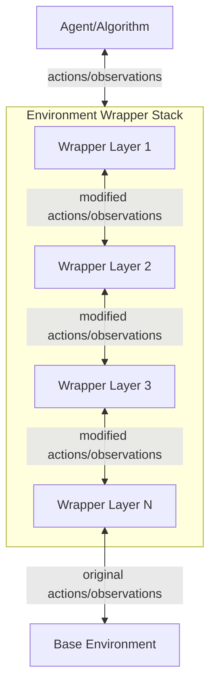
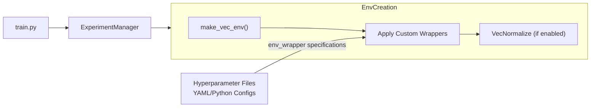
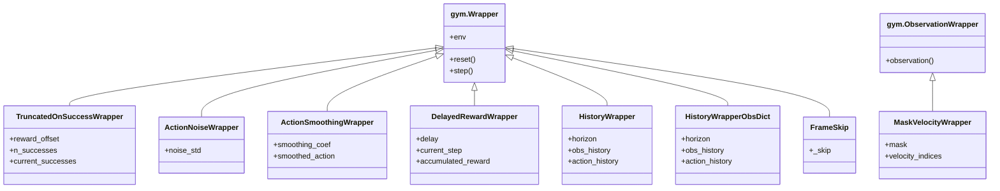

<!-- source: DeepWiki mcp.deepwiki.com · repo DLR-RM/rl-baselines3-zoo · page 6.2 Environment Wrappers · fetched 2026-10-14 -->

# Environment Wrappers

<details>
<summary>Relevant source files</summary>

The following files were used as context for generating this wiki page:

- [.github/ISSUE_TEMPLATE/bug_report.yml](.github/ISSUE_TEMPLATE/bug_report.yml)
- [.github/ISSUE_TEMPLATE/documentation.yml](.github/ISSUE_TEMPLATE/documentation.yml)
- [.github/ISSUE_TEMPLATE/question.yml](.github/ISSUE_TEMPLATE/question.yml)
- [CHANGELOG.md](CHANGELOG.md)
- [docs/Makefile](docs/Makefile)
- [rl_zoo3/wrappers.py](rl_zoo3/wrappers.py)

</details>


Environment wrappers are an essential component in the RL-Baselines3-Zoo framework that modify or enhance the behavior of reinforcement learning environments. They provide a way to implement common preprocessing steps, add noise for robustness testing, modify rewards, or change the observability properties of environments without modifying the original environment code.

This page documents the available environment wrappers in RL-Baselines3-Zoo, how they work, and how to use them in your training workflows. For information about the supported environment types, see [Supported Environments](#6.1).

## Architecture Overview

Environment wrappers in RL-Baselines3-Zoo follow the standard Gymnasium wrapper pattern, where each wrapper is a class that inherits from `gym.Wrapper` or one of its subclasses. When applied to an environment, the wrapper intercepts and potentially modifies the interactions between the agent and the environment.



Sources: [rl_zoo3/wrappers.py:1-326]()

The wrappers are applied in a stack, where each wrapper can modify the actions going to the environment or the observations, rewards, and termination signals coming from the environment. This allows for compositional modifications to environment behavior.

## Wrapper Integration in RL-Baselines3-Zoo

In the RL-Baselines3-Zoo framework, environment wrappers are integrated into the experiment management system and can be specified through configuration files.



Sources: [rl_zoo3/wrappers.py:1-326]()

## Available Wrappers

RL-Baselines3-Zoo provides several built-in wrappers for common use cases:

### TruncatedOnSuccessWrapper

This wrapper is designed for goal-based environments. It resets the environment upon successful completion of the task and can apply a reward offset.

```python
TruncatedOnSuccessWrapper(env, reward_offset=0.0, n_successes=1)
```

Parameters:
- `env`: The environment to wrap
- `reward_offset`: Additional reward to add after each step
- `n_successes`: Number of consecutive successes needed before truncating the episode

Sources: [rl_zoo3/wrappers.py:11-42]()

### ActionNoiseWrapper

Adds Gaussian noise to the actions to test the robustness of controllers.

```python
ActionNoiseWrapper(env, noise_std=0.1)
```

Parameters:
- `env`: The environment to wrap
- `noise_std`: Standard deviation of the Gaussian noise to add to actions

Sources: [rl_zoo3/wrappers.py:44-61]()

### ActionSmoothingWrapper

Smooths actions over time using an exponential moving average.

```python
ActionSmoothingWrapper(env, smoothing_coef=0.0)
```

Parameters:
- `env`: The environment to wrap
- `smoothing_coef`: Smoothing coefficient (0 for no smoothing, 1 for extreme smoothing)

Sources: [rl_zoo3/wrappers.py:64-91]()

### DelayedRewardWrapper

Delays rewards by a specified number of steps, making tasks harder but more realistic.

```python
DelayedRewardWrapper(env, delay=10)
```

Parameters:
- `env`: The environment to wrap
- `delay`: Number of steps to delay rewards

Sources: [rl_zoo3/wrappers.py:94-126]()

### HistoryWrapper and HistoryWrapperObsDict

These wrappers stack past observations and actions to give an agent access to history, which can be crucial for environments that are not fully observable.

```python
HistoryWrapper(env, horizon=2)
HistoryWrapperObsDict(env, horizon=2)  # For dict observations
```

Parameters:
- `env`: The environment to wrap
- `horizon`: Number of past steps to include in the history

Sources: [rl_zoo3/wrappers.py:129-259]()

### FrameSkip

Performs frame skipping, a common technique in Atari environments where the agent only receives every n-th frame.

```python
FrameSkip(env, skip=4)
```

Parameters:
- `env`: The environment to wrap
- `skip`: Number of frames to skip

Sources: [rl_zoo3/wrappers.py:262-290]()

### MaskVelocityWrapper

Masks velocity terms in observations to make environments partially observable, which can be useful for testing the generalization capabilities of agents.

```python
MaskVelocityWrapper(env)
```

Parameters:
- `env`: The environment to wrap

This wrapper supports specific environments including CartPole-v1, MountainCar-v0, Pendulum-v1, and LunarLander variants.

Sources: [rl_zoo3/wrappers.py:292-325]()

### TimeFeatureWrapper

While not defined in the codebase itself, TimeFeatureWrapper is imported from sb3_contrib for backward compatibility. It adds a time feature to the observations which can help with time-dependent policies.

## Wrapper Hierarchy

The following diagram illustrates the inheritance hierarchy of the environment wrappers:



Sources: [rl_zoo3/wrappers.py:1-326]()

## Using Environment Wrappers

There are multiple ways to use environment wrappers in RL-Baselines3-Zoo:

### 1. Specifying Wrappers in Configuration Files

You can specify environment wrappers in the YAML or Python configuration files:

```yaml
# Example in YAML config
env_wrapper:
  - utils.wrappers:DelayedRewardWrapper:
      delay: 5
  - utils.wrappers:FrameSkip:
      skip: 4
```

Or in Python configuration files (added in release 2.5.0):

```python
# Example in Python config
env_wrapper = [
    (DelayedRewardWrapper, {"delay": 5}),
    (FrameSkip, {"skip": 4})
]
```

### 2. Using Wrappers with VecEnvs

For vectorized environments, you can use the `vec_env_wrapper` parameter:

```yaml
vec_env_wrapper:
  - stable_baselines3.common.vec_env:VecNormalize:
      norm_obs: true
      norm_reward: true
```

### 3. Using Wrappers Programmatically

You can also apply wrappers programmatically when creating environments:

```python
from gymnasium import make
from rl_zoo3.wrappers import FrameSkip, ActionNoiseWrapper

env = make("CartPole-v1")
env = FrameSkip(env, skip=4)
env = ActionNoiseWrapper(env, noise_std=0.1)
```

## Common Use Cases

Here are some common use cases for the different wrappers:

| Wrapper | Use Case |
|---------|----------|
| TruncatedOnSuccessWrapper | Goal-based environments where early success should end the episode |
| ActionNoiseWrapper | Testing policy robustness against action noise |
| ActionSmoothingWrapper | Enforcing smooth actions for physical control tasks |
| DelayedRewardWrapper | Making tasks more challenging with delayed rewards |
| HistoryWrapper | Dealing with POMDPs by providing action and observation history |
| FrameSkip | Speeding up training on environments with high frame rates |
| MaskVelocityWrapper | Testing policy generalization by hiding velocity information |

## Creating Custom Wrappers

You can create custom wrappers by extending the `gym.Wrapper` class or one of its subclasses:

1. Create a new Python file with your wrapper class.
2. Extend `gym.Wrapper` or an appropriate subclass.
3. Override the necessary methods (`reset`, `step`, etc.).
4. Specify your wrapper in the configuration file with the path to your module.

```yaml
env_wrapper:
  - path.to.your.module:YourCustomWrapper:
      param1: value1
      param2: value2
```

## Conclusion

Environment wrappers are a powerful tool for modifying environment behavior and implementing common preprocessing techniques. RL-Baselines3-Zoo provides a flexible framework for using both built-in and custom wrappers to enhance your reinforcement learning experiments.

By properly using environment wrappers, you can:
- Test the robustness of your policies
- Deal with partially observable environments
- Modify rewards to shape learning
- Implement common preprocessing techniques
- Create custom environment modifications without changing the underlying environment code

For more information on how to integrate these wrappers into your training workflows, see [Training System](#3) and [Experiment Management](#3.2).

---

