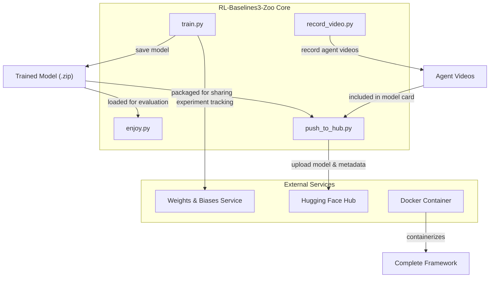
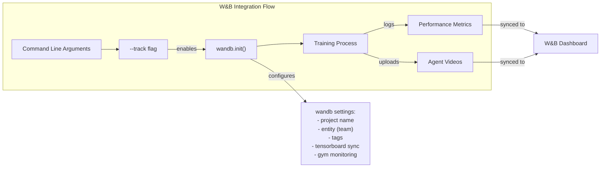
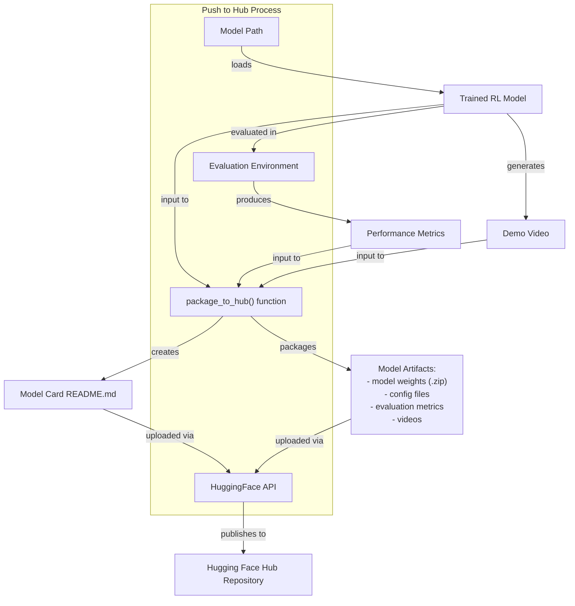
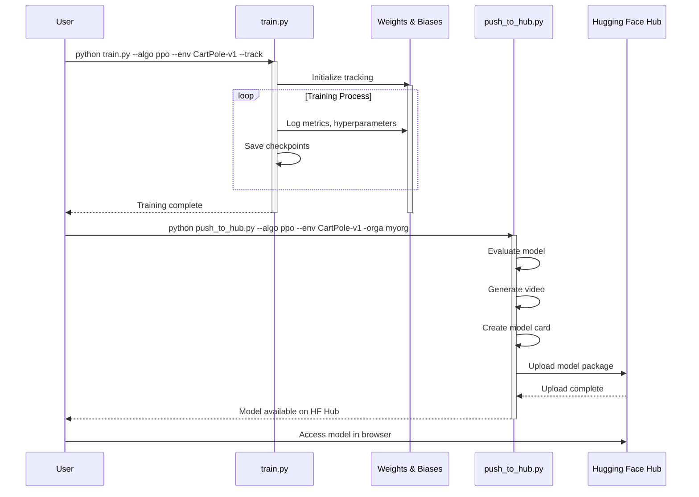
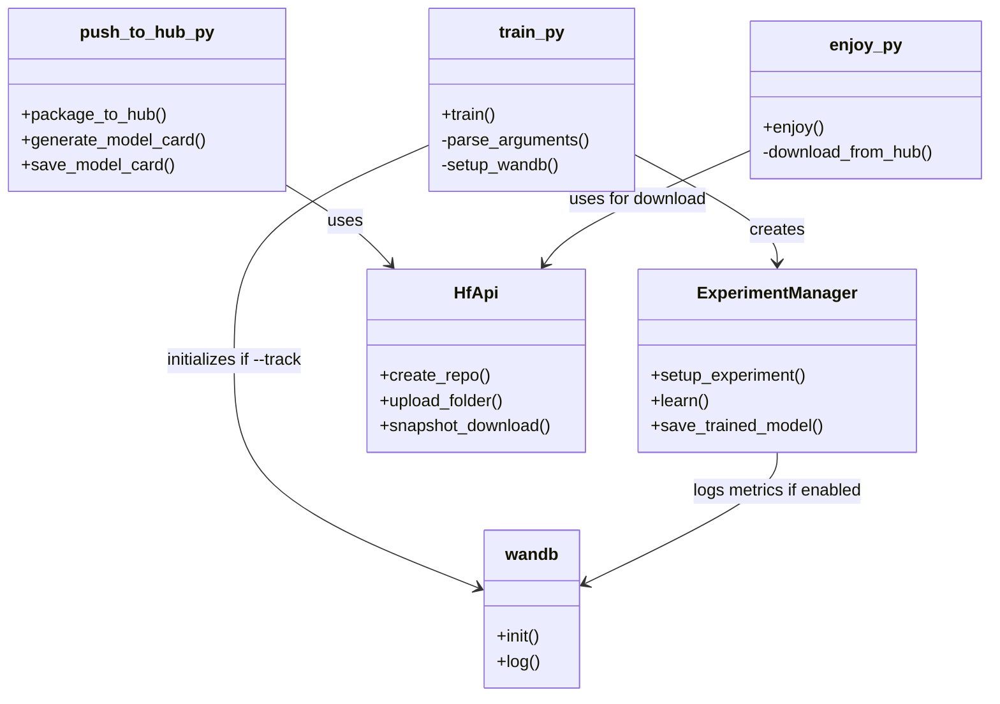

<!-- source: DeepWiki mcp.deepwiki.com · repo DLR-RM/rl-baselines3-zoo · page 7 External Integrations · fetched 2026-10-14 -->

# External Integrations

Relevant source files

The following files were used as context for generating this wiki page:

- [CHANGELOG.md](CHANGELOG.md)
- [rl_zoo3/enjoy.py](rl_zoo3/enjoy.py)
- [rl_zoo3/push_to_hub.py](rl_zoo3/push_to_hub.py)
- [rl_zoo3/record_video.py](rl_zoo3/record_video.py)
- [rl_zoo3/train.py](rl_zoo3/train.py)

This page documents the external integrations available in RL-Baselines3-Zoo, focusing on how the framework connects with third-party services and tools to enhance training, tracking, sharing, and deployment capabilities. For information about environment integration, see [Environment Integration](#6).

## Overview

RL-Baselines3-Zoo provides several key integrations with external services that extend its functionality:

1. **Weights & Biases Integration**: For experiment tracking, visualization, and collaboration
2. **Hugging Face Hub Integration**: For sharing and discovering trained models
3. **Docker Support**: For containerized deployment and reproducible environments

The following diagram illustrates how these external integrations fit into the overall architecture:

Sources: [rl_zoo3/train.py:147-164](), [rl_zoo3/push_to_hub.py:128-278](), [rl_zoo3/enjoy.py:97-122]()

## Weights & Biases Integration

Weights & Biases (W&B) is integrated for experiment tracking, allowing users to monitor training progress, compare runs, and visualize results.

### Configuration and Usage

W&B integration is activated using the `--track` flag when training models. Additional customization options include project name, team name, and custom tags.

Sources: [rl_zoo3/train.py:205-225]()

### Key W&B Features

The integration provides the following capabilities:

- **Automatic TensorBoard Sync**: Syncs all SB3's TensorBoard metrics to W&B
- **Environment Monitoring**: Automatically uploads videos of agents during training
- **Experiment Configuration**: Stores all command-line arguments and hyperparameters
- **Version Tagging**: Adds the SB3 version as a tag to facilitate filtering
- **Code Saving**: Optionally saves the code for reproducibility

### Command Line Parameters

| Parameter | Description | Default |
|-----------|-------------|---------|
| `--track` | Enable W&B tracking | False |
| `--wandb-project-name` | W&B project name | "sb3" |
| `--wandb-entity` | W&B team/organization | None |
| `--tags` / `--wandb-tags` | Custom tags for the run | [] |

Sources: [rl_zoo3/train.py:147-164]()

## Hugging Face Hub Integration

The Hugging Face Hub integration allows users to share trained models with the community and download pre-trained models.

### Pushing Models to the Hub

The `push_to_hub.py` script handles packaging and uploading trained models to the Hugging Face Hub. The process includes:

1. Evaluating the model's performance
2. Generating a demonstration video
3. Creating a comprehensive model card
4. Uploading all artifacts to the Hub

Sources: [rl_zoo3/push_to_hub.py:128-278](), [rl_zoo3/push_to_hub.py:30-45]()

### Loading Models from the Hub

The framework can automatically download pre-trained models from the Hugging Face Hub using the `enjoy.py` script. If a requested model isn't found locally, the system attempts to fetch it from the Hub.

### Model Cards

Model cards are automatically generated with:

- Algorithm and environment information
- Performance metrics (mean reward and standard deviation)
- Usage instructions for the RL Zoo
- Hyperparameters used for training
- Environment configuration

### Command Line Parameters for Push to Hub

| Parameter | Description | Required |
|-----------|-------------|----------|
| `--env` | Environment ID | Yes |
| `--algo` | RL Algorithm | Yes |
| `-f` / `--folder` | Log folder | Yes |
| `-orga` / `--organization` | Hugging Face organization | Yes |
| `-name` / `--repo-name` | Repository name (default: algo-env) | No |
| `-n` / `--n-timesteps` | Number of timesteps for video | No |
| `-m` / `--commit-message` | Commit message | No |

Sources: [rl_zoo3/push_to_hub.py:282-320]()

## Example Workflow

The following diagram shows a typical workflow combining both W&B tracking and Hugging Face sharing:

Sources: [rl_zoo3/train.py:205-225](), [rl_zoo3/push_to_hub.py:265-275]()

## Code Integration Points

This diagram shows the specific code entities that handle external integrations:

Sources: [rl_zoo3/train.py:205-225](), [rl_zoo3/push_to_hub.py:128-278](), [rl_zoo3/enjoy.py:97-122]()

## Docker Support

While not extensively documented in the provided code files, RL-Baselines3-Zoo includes Docker support for containerized deployment. Docker containers provide a consistent and reproducible environment for training and evaluating RL agents across different systems.

The Docker integration is referenced in the CHANGELOG.md, where updates to the Docker image are mentioned:
- "Updated docker image, removed support for X server" [CHANGELOG.md:106]()
- "Updated Dockerfile" [CHANGELOG.md:51]()

Docker support allows users to run the entire framework in an isolated environment with all dependencies pre-installed, ensuring consistency across different computing environments.

Sources: [CHANGELOG.md:51](), [CHANGELOG.md:106]()

---

