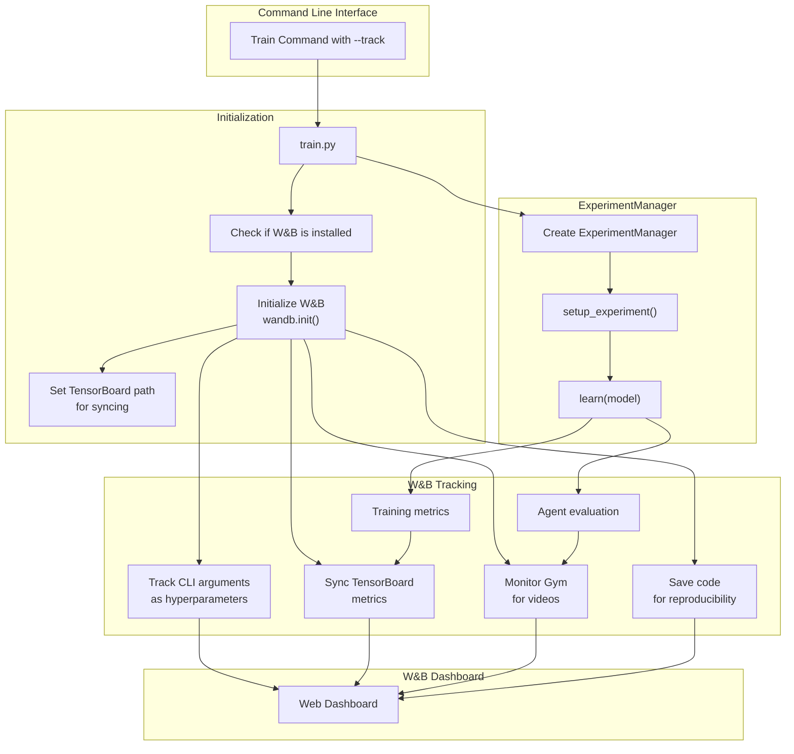
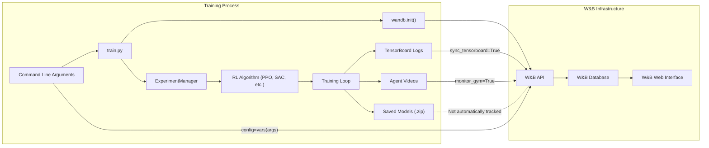

<!-- source: DeepWiki mcp.deepwiki.com · repo DLR-RM/rl-baselines3-zoo · page 7.1 Experiment Tracking with W&B · fetched 2026-10-14 -->

# Experiment Tracking with W&B

<details>
<summary>Relevant source files</summary>

The following files were used as context for generating this wiki page:

- [CHANGELOG.md](CHANGELOG.md)
- [README.md](README.md)
- [rl_zoo3/train.py](rl_zoo3/train.py)

</details>


## Purpose and Scope

This document explains how to use Weights & Biases (W&B) for experiment tracking in RL-Baselines3-Zoo. It covers enabling W&B integration, configuring experiment tracking, understanding what data gets tracked, and how to interpret the results in the W&B dashboard. For information about sharing trained models with external services, see [Sharing Models with Hugging Face](#7.2).

## What is Weights & Biases?

Weights & Biases is a platform for tracking, visualizing, and comparing machine learning experiments. In reinforcement learning, where parameter tuning and environment variations can lead to vastly different results, W&B provides a centralized location to monitor:

- Training metrics (rewards, losses, etc.)
- Agent performance (via video recordings)
- Hyperparameters 
- Resource utilization

## Enabling W&B Tracking

### Installation

First, ensure W&B is installed in your environment:

```bash
pip install wandb
```

### Basic Usage

To track an experiment with W&B, add the `--track` flag to your training command:

```bash
python train.py --algo ppo --env CartPole-v1 --track
```

This will:
1. Create a W&B run with a unique name
2. Track all metrics, hyperparameters, and videos
3. Create a TensorBoard log directory that syncs with W&B

Sources: [rl_zoo3/train.py:147-153](), [rl_zoo3/train.py:205-225]()

### Configuration Options

The following command-line options control W&B tracking:

| Option | Description | Default |
|--------|-------------|---------|
| `--track` | Enable W&B tracking | `False` |
| `--wandb-project-name` | Project name in W&B | `"sb3"` |
| `--wandb-entity` | Team or username in W&B | `None` (your default account) |
| `--wandb-tags` | Custom tags for the run | `[]` |

For example, to track an experiment under a specific project and add custom tags:

```bash
python train.py --algo sac --env HalfCheetah-v4 --track --wandb-project-name "halfcheetah-experiments" --wandb-tags tuned production
```

Sources: [rl_zoo3/train.py:147-164]()

## W&B Integration Architecture

### Integration Workflow

The following diagram illustrates how W&B integrates with the RL-Baselines3-Zoo training workflow:



Sources: [rl_zoo3/train.py:205-225](), [rl_zoo3/train.py:227-265]()

### Data Flow Architecture



Sources: [rl_zoo3/train.py:205-225]()

## Tracked Information

W&B automatically tracks the following information:

### Hyperparameters

All command-line arguments are tracked as hyperparameters, including:
- Algorithm selection (`--algo`)
- Environment ID (`--env`)
- Training parameters (timesteps, learning rate, etc.)
- Custom hyperparameters passed with `--hyperparams`

Additionally, the version of Stable-Baselines3 is automatically added as a tag.

### Metrics

Through TensorBoard synchronization, W&B captures:
- Episode rewards
- Episode lengths
- Learning rates
- Losses (policy loss, value loss, etc.)
- Explanations (e.g., entropy)
- Resource usage (CPU, memory)

### Videos

When `monitor_gym=True` is set (the default), W&B captures:
- Videos of the agent during evaluation
- Environment renderings

### Code

When `save_code=True` is set (the default), W&B saves:
- A snapshot of the code being executed
- Diff from the last commit (if using git)

Sources: [rl_zoo3/train.py:205-225](), [CHANGELOG.md:315-325]()

## Using the W&B Dashboard

After starting a training run with `--track`, the terminal will display a link to the W&B dashboard where you can monitor your experiment in real-time.

### Key Dashboard Features

1. **Run Overview**: Summary of the experiment with metrics, hyperparameters, and system usage
2. **Charts**: Customizable visualizations of training metrics
3. **Videos**: Recordings of agent performance
4. **System**: Resource utilization graphs
5. **Logs**: Console output from the training process

### Comparing Experiments

One of the most valuable features of W&B is the ability to compare multiple runs:

1. Select multiple runs in the project
2. Click "Compare"
3. Create custom charts comparing key metrics
4. Filter by tags, algorithms, environments, or other parameters

This is particularly useful when:
- Tuning hyperparameters
- Comparing different algorithms on the same environment
- Analyzing the effect of environment variations
- Tracking progress across multiple seeds

Sources: [README.md:80-81]()

## Advanced Usage

### Using Tags for Organization

Tags help organize and filter experiments. You can add tags with the `--wandb-tags` option:

```bash
python train.py --algo ppo --env CartPole-v1 --track --wandb-tags baseline v1 cartpole
```

Common tag strategies include:
- Algorithm variant (`baseline`, `tuned`)
- Environment type (`atari`, `mujoco`)
- Status (`production`, `experiment`)
- Feature flags (`with_curiosity`, `recurrent`)

### Custom Metrics with RawStatisticsCallback

The `RawStatisticsCallback` can be used to log additional metrics not captured by default:

```bash
python train.py --algo ppo --env CartPole-v1 --track --callback "callbacks.RawStatisticsCallback:100"
```

This callback logs raw episode statistics every 100 episodes, providing more granular data than standard metrics.

Sources: [CHANGELOG.md:323-325]()

### Team Projects

For collaborative work, specify a team (entity) when tracking:

```bash
python train.py --algo ppo --env CartPole-v1 --track --wandb-entity "my-team" --wandb-project-name "shared-project"
```

This organizes all team experiments in a central location.

## Best Practices

1. **Always track experiments**: Use `--track` for all significant experiments to maintain a complete history

2. **Use consistent project names**: Maintain a coherent naming scheme for projects to facilitate comparisons

3. **Add descriptive tags**: Tags help filter experiments when you have many runs

4. **Combine with hyperparameter optimization**: When using `--optimize-hyperparameters`, W&B can help visualize the optimization process

5. **Link to saved models**: After pushing models to Hugging Face Hub, add the model link to W&B for easy reference

## Conclusion

W&B integration in RL-Baselines3-Zoo provides a powerful way to track, visualize, and compare reinforcement learning experiments. By enabling the `--track` flag, you gain access to a comprehensive dashboard that helps identify optimal hyperparameters, diagnose training issues, and showcase agent performance.

For more information about other external integrations, see [Sharing Models with Hugging Face](#7.2).

Sources: [CHANGELOG.md:315-325](), [README.md:80-81](), [rl_zoo3/train.py:147-164](), [rl_zoo3/train.py:205-225]()

---

