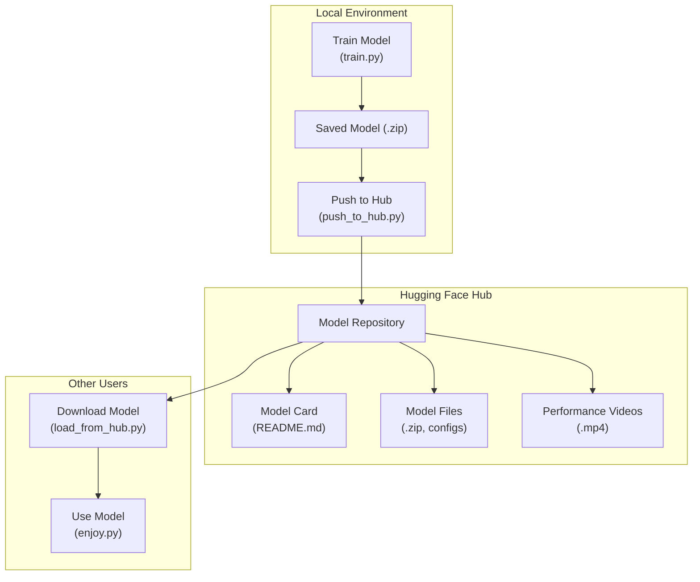
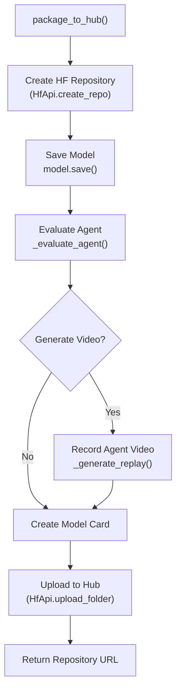
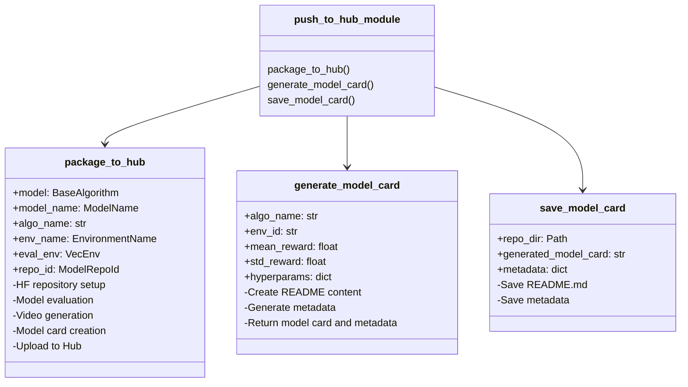
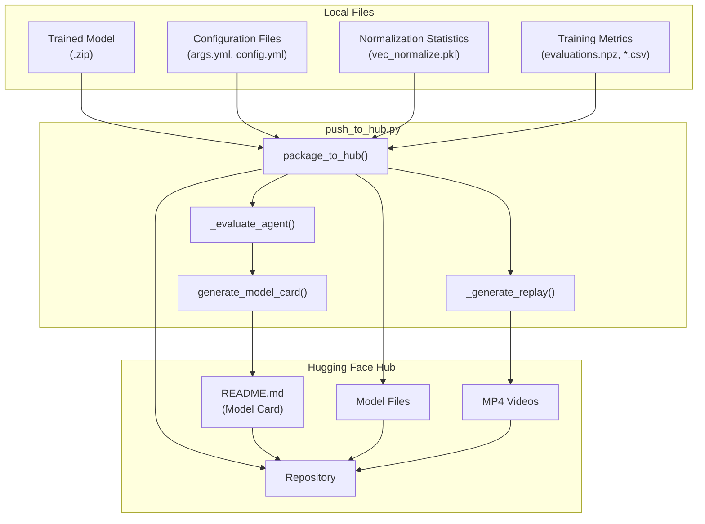

<!-- source: DeepWiki mcp.deepwiki.com · repo DLR-RM/rl-baselines3-zoo · page 7.2 Sharing Models with Hugging Face · fetched 2026-10-14 -->

# Sharing Models with Hugging Face

<details>
<summary>Relevant source files</summary>

The following files were used as context for generating this wiki page:

- [CHANGELOG.md](CHANGELOG.md)
- [README.md](README.md)
- [rl_zoo3/enjoy.py](rl_zoo3/enjoy.py)
- [rl_zoo3/push_to_hub.py](rl_zoo3/push_to_hub.py)
- [rl_zoo3/record_video.py](rl_zoo3/record_video.py)

</details>


## Purpose and Scope

This page explains how to share trained reinforcement learning models from RL-Baselines3-Zoo with the Hugging Face Hub. The Hugging Face integration allows you to publish, share, and discover reinforcement learning models trained with Stable Baselines3. For information about training models, see [Training System](#3) and for evaluating models locally, see [Evaluating Trained Agents](#5.1).

## Overview

RL-Baselines3-Zoo provides a streamlined process for uploading trained models to the Hugging Face Hub. This integration enables:

1. Publishing trained RL models with metadata and documentation
2. Automatic generation of model cards with performance metrics
3. Sharing videos of agent performance
4. Easy downloading and reuse of models by others



Sources: [rl_zoo3/push_to_hub.py](), [README.md:79-82]()

## Command-Line Interface

The primary way to share models is through the `push_to_hub.py` script, which can be called directly or through the RL Zoo CLI.

```bash
# Direct command
python -m rl_zoo3.push_to_hub --algo ppo --env CartPole-v1 -f logs/ -orga your-organization

# Using the RL Zoo CLI
rl_zoo3 push_to_hub --algo ppo --env CartPole-v1 -f logs/ -orga your-organization
```

### Key Arguments

| Argument | Description | Required |
|----------|-------------|----------|
| `--algo` | RL algorithm used (e.g., ppo, sac) | Yes |
| `--env` | Environment ID | Yes |
| `-f, --folder` | Log folder containing saved models | Yes |
| `-orga, --organization` | Hugging Face Hub organization | Yes |
| `-name, --repo-name` | Repository name (default: algo-env) | No |
| `-n, --n-timesteps` | Number of timesteps for video recording | No |
| `--deterministic` | Use deterministic actions | No |
| `--no-render` | Do not render environment (disables video generation) | No |

Sources: [rl_zoo3/push_to_hub.py:282-319]()

## Push to Hub Process

The core functionality for sharing models is implemented in the `package_to_hub` function. This function handles the entire process from model evaluation to uploading to the Hugging Face Hub.



Sources: [rl_zoo3/push_to_hub.py:128-278]()

### Key Components

1. **Repository Creation**: Uses the Hugging Face API to create or update a repository
2. **Model Preparation**: Saves the model and related files
3. **Evaluation**: Tests the model to generate performance metrics
4. **Video Generation**: Optionally records videos of the agent's performance
5. **Model Card Generation**: Creates documentation with metadata and instructions
6. **Upload**: Pushes all files to the Hugging Face Hub

Sources: [rl_zoo3/push_to_hub.py:128-278]()

## Model Card Generation

When uploading a model, a detailed model card (README.md) is automatically generated. This includes:

1. Model and environment information
2. Performance metrics (mean reward and standard deviation)
3. Usage instructions
4. Hyperparameters used for training
5. Environment arguments (if applicable)

The model card generation is handled by the `generate_model_card` function, which creates the content and associated metadata.

Sources: [rl_zoo3/push_to_hub.py:46-126]()

## Code Structure

The push to hub functionality is organized across several key functions:



Sources: [rl_zoo3/push_to_hub.py:28-126](), [rl_zoo3/push_to_hub.py:128-278]()

## Usage Example

Here's a complete example of training a model and sharing it on Hugging Face Hub:

1. **Train a model**:
   ```bash
   python -m rl_zoo3.train --algo ppo --env CartPole-v1 -f logs/
   ```

2. **Push the model to Hugging Face Hub**:
   ```bash
   python -m rl_zoo3.push_to_hub --algo ppo --env CartPole-v1 -f logs/ -orga your-organization
   ```

3. **How others can use your model**:
   ```bash
   # Download the model
   python -m rl_zoo3.load_from_hub --algo ppo --env CartPole-v1 -orga your-organization -f logs/
   
   # Run the model
   python -m rl_zoo3.enjoy --algo ppo --env CartPole-v1 -f logs/
   ```

Sources: [rl_zoo3/push_to_hub.py:90-103](), [README.md:79-82]()

## Behind the Scenes

When you push a model to the Hugging Face Hub, the following happens:

1. The model is saved in the local repository path
2. The VecNormalize wrapper (if used) is saved to preserve normalization statistics
3. Configuration files (args.yml, config.yml) are copied to the repository
4. Training and evaluation metrics are packaged
5. The agent is evaluated to generate performance metrics
6. Videos of the agent's performance are recorded (if not disabled)
7. A model card is generated with usage instructions and metadata
8. All files are uploaded to the Hugging Face Hub

Sources: [rl_zoo3/push_to_hub.py:180-278]()

## Data Flow Between Components



Sources: [rl_zoo3/push_to_hub.py:180-276]()

## Loading Models from Hugging Face

Once models are shared on Hugging Face, they can be downloaded and used by others. The RL Zoo provides functionality to load models from the Hub using the `load_from_hub.py` script.

```bash
python -m rl_zoo3.load_from_hub --algo ppo --env CartPole-v1 -orga organization-name -f logs/
```

After downloading, the model can be used like any locally trained model:

```bash
python -m rl_zoo3.enjoy --algo ppo --env CartPole-v1 -f logs/
```

The model loading process is also integrated into the `enjoy.py` script, which will automatically attempt to download models from the Hugging Face Hub if they are not found locally.

Sources: [rl_zoo3/enjoy.py:95-122]()

## Common Issues and Troubleshooting

1. **Authentication**: Ensure you have the appropriate Hugging Face token set up if pushing to private repositories
2. **Video Generation**: If video generation fails, try using `--no-render` to skip it
3. **Repository Naming**: If you encounter naming conflicts, use the `-name/--repo-name` parameter to specify a custom repository name
4. **Large Files**: Videos and model files are handled via Git LFS, so ensure it's properly configured
5. **File Size Limits**: Be aware that Hugging Face Hub has file size limits for individual files

Sources: [rl_zoo3/push_to_hub.py:204-207]()

## Conclusion

The Hugging Face integration in RL-Baselines3-Zoo provides a simple way to share trained reinforcement learning models, enabling collaboration and reuse within the community. The automated model card generation and performance evaluation helps users understand the capabilities and limitations of shared models.

---

