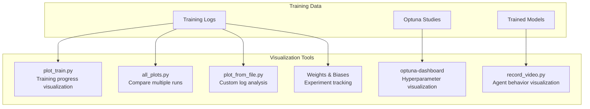
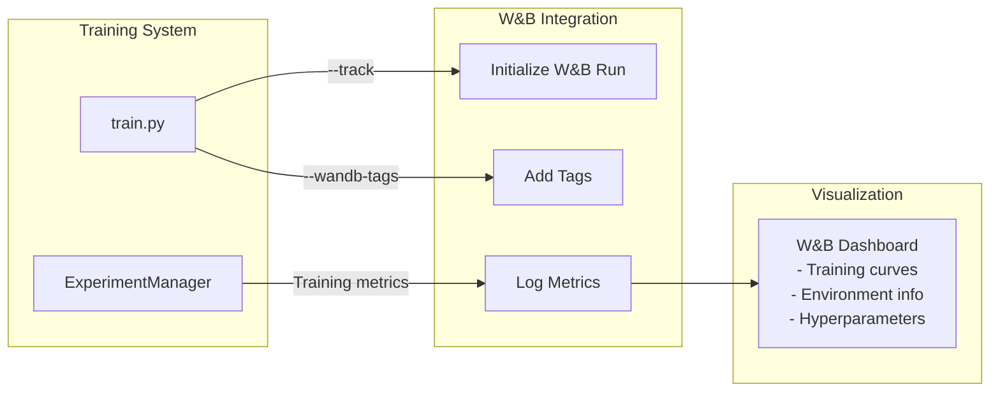
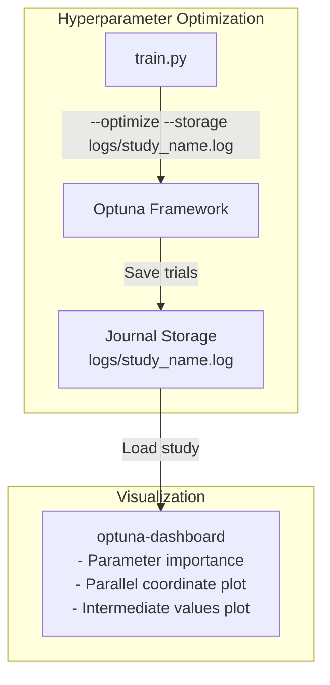
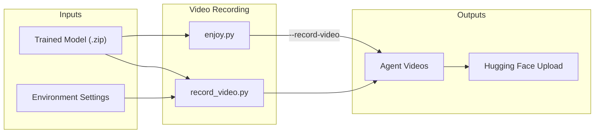
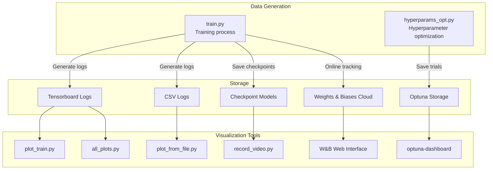

<!-- source: DeepWiki mcp.deepwiki.com · repo DLR-RM/rl-baselines3-zoo · page 8 Visualization and Analysis · fetched 2026-10-14 -->

# Visualization and Analysis

<details>
<summary>Relevant source files</summary>

The following files were used as context for generating this wiki page:

- [CHANGELOG.md](CHANGELOG.md)
- [scripts/all_plots.py](scripts/all_plots.py)
- [scripts/plot_from_file.py](scripts/plot_from_file.py)
- [scripts/plot_train.py](scripts/plot_train.py)

</details>


This page documents the visualization and analysis tools available in RL-Baselines3-Zoo for monitoring training, comparing performance across algorithms, and analyzing results. The zoo provides several dedicated plotting scripts to help users gain insights into agent training and performance. For information about evaluating trained agents, see [Evaluation and Benchmarking](#5).

## Overview of Visualization Tools

RL-Baselines3-Zoo includes a set of tools for visualizing and analyzing reinforcement learning experiments. These tools help users understand training progress, compare different algorithms, and analyze hyperparameter optimization results.



Sources: [scripts/plot_train.py](), [scripts/all_plots.py](), [scripts/plot_from_file.py](), [CHANGELOG.md:3-29]()

## Training Progress Visualization

### Plot Train

The `plot_train.py` script allows you to visualize training progress from saved logs. It plots metrics such as episode rewards, episode lengths, and success rates over time, providing insights into training performance.

Usage:
```
python -m rl_zoo3.plots.plot_train [options] /path/to/logs
```

Key features:
- Plots training metrics from Tensorboard-format logs
- Can compare multiple runs on the same environment
- Supports smoothing of the curves for better readability
- Newer models appear on top of older ones for easier visualization

Sources: [scripts/plot_train.py](), [CHANGELOG.md:214-215]()

### Weights & Biases Integration

RL-Baselines3-Zoo supports experiment tracking via Weights & Biases (W&B), which provides real-time visualization of training metrics and experiment organization.



To enable W&B tracking, use the `--track` flag when running the training script:

```
python train.py --algo ppo --env CartPole-v1 --track
```

You can also add tags to your W&B run using the `--wandb-tags` argument:

```
python train.py --algo ppo --env CartPole-v1 --track --wandb-tags "experiment-1,best-model"
```

Sources: [CHANGELOG.md:322-325]()

## Multi-Run Analysis

### All Plots

The `all_plots.py` script generates comparison plots for multiple training runs, allowing you to compare the performance of different algorithms or hyperparameter configurations on the same environment.

Usage:
```
python -m rl_zoo3.plots.all_plots [options] /path/to/logs
```

Key features:
- Compares performance across multiple runs
- Generates plots with confidence intervals
- Can filter runs by environment, algorithm, or other criteria

Sources: [scripts/all_plots.py]()

### Plot From File

The `plot_from_file.py` script enables custom analysis of training logs by plotting metrics from specific log files.

Usage:
```
python -m rl_zoo3.plots.plot_from_file [options] /path/to/log_file
```

Key features:
- Works with custom log formats
- Allows for more targeted analysis
- Supports various customization options

Sources: [scripts/plot_from_file.py]()

### Rliable for Statistical Analysis

RL-Baselines3-Zoo supports using the `rliable` library for statistical analysis and performance comparison. This provides more rigorous evaluation metrics for comparing RL algorithms.

Key features:
- Generates performance profiles
- Computes statistical metrics like stratified bootstrap confidence intervals
- Creates probability of improvement and score distribution plots

Sources: [CHANGELOG.md:369-370]()

## Hyperparameter Optimization Visualization

### Optuna Dashboard

RL-Baselines3-Zoo uses Optuna for hyperparameter optimization and supports visualization of optimization results via Optuna Dashboard.



To visualize hyperparameter optimization with Optuna Dashboard:

1. Run optimization with the journal storage:
```
python train.py --algo ppo --env Pendulum-v1 --study-name demo --storage logs/demo.log --optimize
```

2. Visualize with Optuna Dashboard:
```
optuna-dashboard logs/demo.log
```

Sources: [CHANGELOG.md:3-19]()

### Loading Optimized Hyperparameters

After optimization, you can load the best hyperparameters and train a model:

```
python train.py --algo ppo --env Pendulum-v1 --study-name demo --storage logs/demo.log --trial-id 21
```

Sources: [CHANGELOG.md:16-19]()

## Agent Behavior Visualization

### Recording Videos

RL-Baselines3-Zoo provides tools for recording videos of trained agents, allowing visual analysis of agent behavior.



To record a video of a trained agent:

```
python -m rl_zoo3.record_video --algo ppo --env CartPole-v1 -f logs/ppo/CartPole-v1_1/best_model
```

You can also record videos during training experiments or when pushing models to Hugging Face Hub.

Sources: [CHANGELOG.md:413-414]()

## Data Flow in Visualization Systems

The following diagram illustrates how data flows through the visualization and analysis systems in RL-Baselines3-Zoo:



Sources: [CHANGELOG.md](), [scripts/plot_train.py](), [scripts/all_plots.py](), [scripts/plot_from_file.py]()

## Best Practices for Visualization

### Comparing Algorithms

When comparing different algorithms or hyperparameter configurations:

1. Use `all_plots.py` to generate comparison plots with confidence intervals
2. Consider using `rliable` for more rigorous statistical comparison
3. Standardize evaluation environments and metrics

### Monitoring Training

For effective training monitoring:

1. Use W&B tracking for real-time visualization by adding the `--track` flag
2. Set appropriate logging frequency with `--log-interval`
3. Save checkpoints regularly with `--save-freq`

### Hyperparameter Analysis

For hyperparameter optimization analysis:

1. Use Optuna Dashboard to visualize parameter importance and correlations
2. Save optimization results with appropriate study names for future reference
3. Use the `--trial-id` parameter to load and evaluate specific configurations

## Conclusion

RL-Baselines3-Zoo provides a comprehensive suite of visualization and analysis tools that help users understand training progress, compare algorithm performance, and analyze results. By leveraging these tools, researchers and practitioners can gain valuable insights into the behavior and performance of reinforcement learning agents.

---

