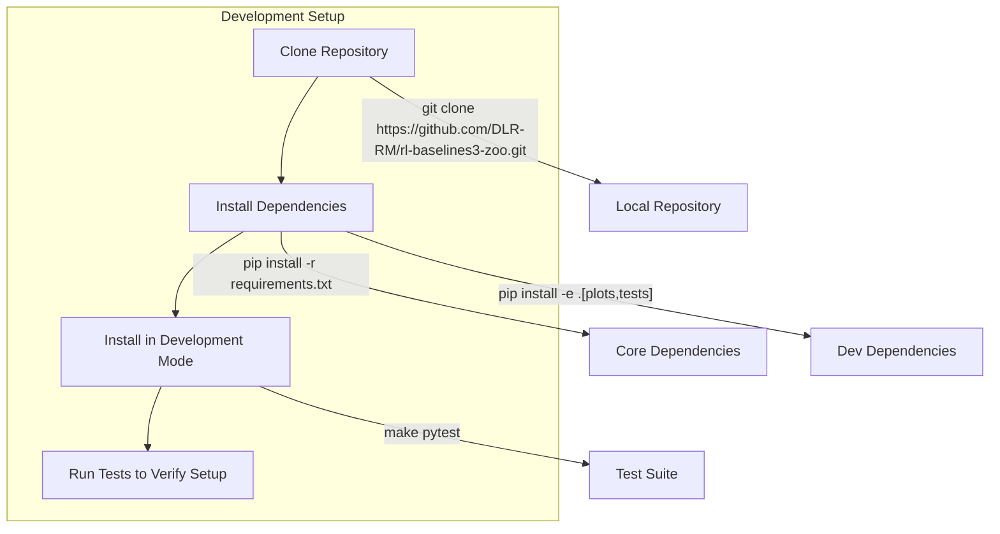
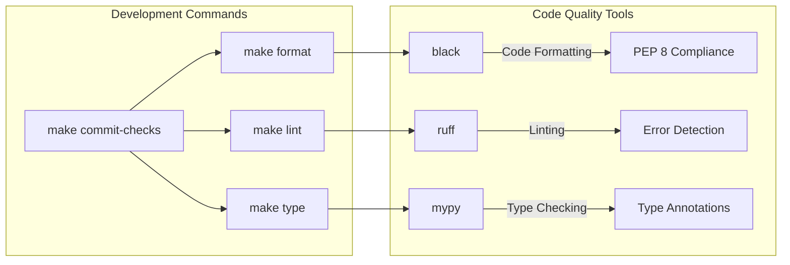
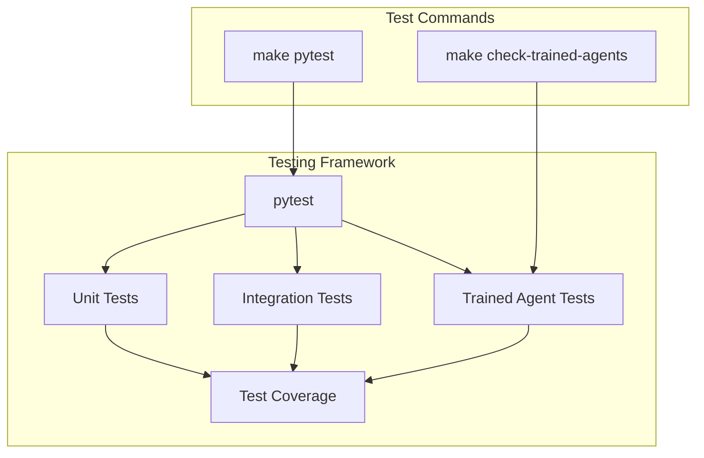
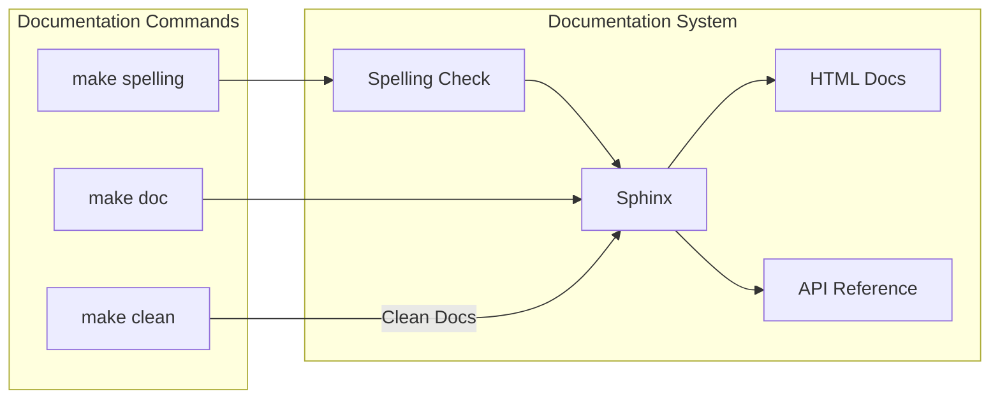
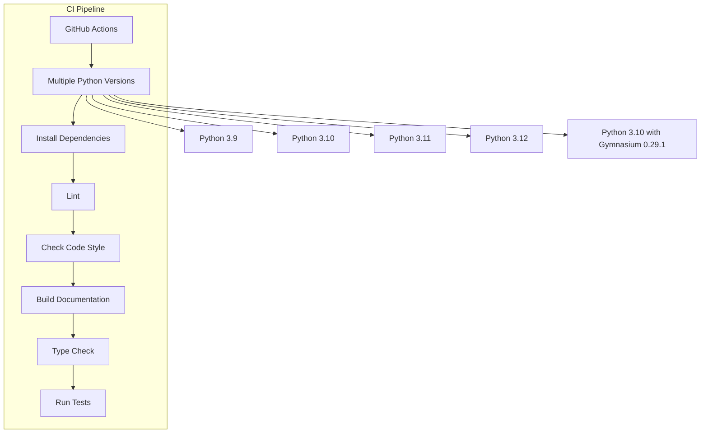
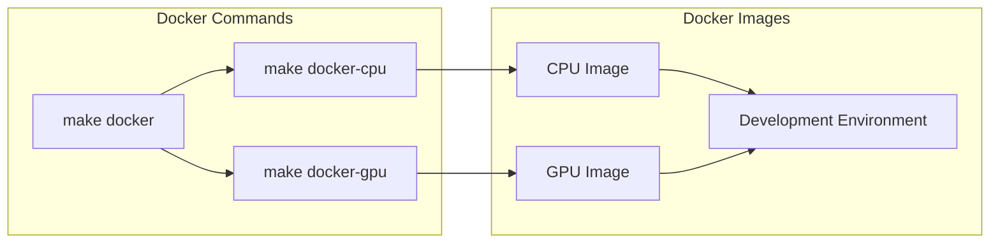
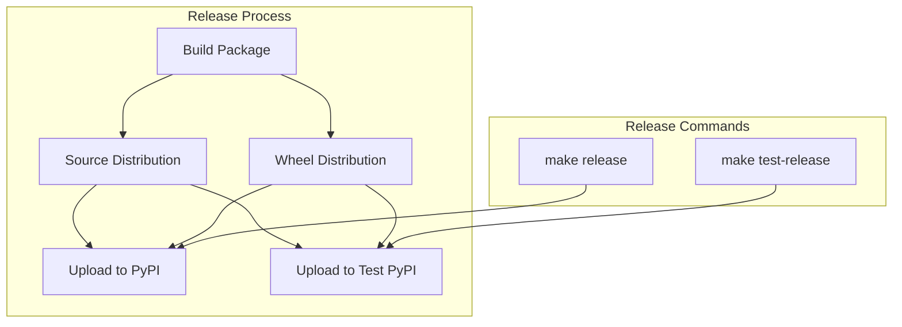
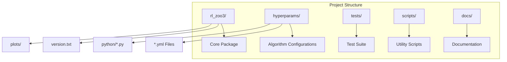
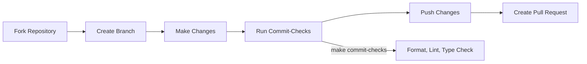

<!-- source: DeepWiki mcp.deepwiki.com · repo DLR-RM/rl-baselines3-zoo · page 9 Development Guide · fetched 2026-10-14 -->

# Development Guide

<details>
<summary>Relevant source files</summary>

The following files were used as context for generating this wiki page:

- [.github/workflows/ci.yml](.github/workflows/ci.yml)
- [Makefile](Makefile)
- [pyproject.toml](pyproject.toml)
- [setup.py](setup.py)

</details>


This guide provides information for developers who want to contribute to the RL-Baselines3-Zoo project. It covers the development environment setup, code quality standards, testing procedures, and contribution workflow.

For information about using the framework for training agents, see [Training System](#3), and for evaluating trained agents, see [Evaluation and Benchmarking](#5).

## Development Environment Setup

Setting up a development environment for RL-Baselines3-Zoo requires Python 3.9 or newer.



### Installation for Development

1. Clone the repository and change to the project directory
2. Install the package in development mode with test and plotting dependencies:

```bash
pip install -r requirements.txt
pip install -e .[plots,tests]
```

Sources: [setup.py:17-34](), [Makefile:4-5]()

## Code Style and Quality Standards

RL-Baselines3-Zoo uses several tools to maintain code quality and consistency:



### Code Formatting

The project uses Black for code formatting with a line length of 127 characters:

```bash
make format    # Format code
make check-codestyle    # Check code style without modifying files
```

### Linting

Linting is performed using ruff:

```bash
make lint    # Run linter
```

### Type Checking

The project uses mypy for static type checking:

```bash
make type    # Run type checker
```

Sources: [Makefile:11-36](), [pyproject.toml:1-31]()

## Testing Framework

RL-Baselines3-Zoo has a comprehensive testing suite to ensure functionality and prevent regressions.



### Running Tests

To run the test suite:

```bash
make pytest    # Run all tests
make check-trained-agents    # Test all trained agents (slow)
```

The `run_tests.sh` script is used to execute the tests with proper environment variables and coverage reporting.

### Test Coverage

Test coverage is tracked using the coverage tool, with configuration in pyproject.toml that excludes certain files from coverage reporting.

Sources: [Makefile:4-9](), [pyproject.toml:49-61]()

## Documentation

Documentation is built using Sphinx and is an essential part of the project.



### Building Documentation

To build the documentation:

```bash
make doc    # Build HTML documentation
make spelling    # Check documentation spelling
make clean    # Clean documentation build files
```

Sources: [Makefile:37-44]()

## Continuous Integration

The project uses GitHub Actions for continuous integration to ensure code quality and compatibility.



The CI workflow:
1. Runs on push to master and pull requests
2. Tests on multiple Python versions (3.9, 3.10, 3.11, 3.12)
3. Tests with different Gymnasium versions
4. Performs linting, code style checks, documentation building, type checking, and testing

Sources: [.github/workflows/ci.yml:1-74]()

## Docker Development

For containerized development, Docker images are provided:



### Building Docker Images

To build Docker images:

```bash
make docker-cpu    # Build CPU Docker image
make docker-gpu    # Build GPU Docker image
make docker        # Build both images
```

Sources: [Makefile:46-52]()

## Package Release Process

The project provides commands for building and releasing packages:



### Creating Releases

To create a package release:

```bash
make release        # Build and upload to PyPI
make test-release   # Build and upload to Test PyPI
```

Sources: [Makefile:54-66]()

## Project Organization

The project is structured as follows:



### Key Files and Directories

- `rl_zoo3/`: The main package directory
- `hyperparams/`: YAML configuration files for algorithms
- `tests/`: Test suite
- `scripts/`: Utility scripts for development and testing
- `docs/`: Documentation source files

Sources: [setup.py:9-10](), [setup.py:36-45]()

## Contributing Workflow

When contributing to RL-Baselines3-Zoo, follow this workflow:



### Before Submitting a Pull Request

1. Ensure code passes all checks:
   ```bash
   make commit-checks   # Runs format, lint, and type checks
   make pytest          # Runs tests
   ```
2. Update documentation if necessary
3. Add tests for new functionality
4. Follow the code style guidelines

Sources: [Makefile:35]()

## Dependencies Management

Dependencies are managed in several files:

1. Core dependencies in `setup.py`
2. Additional dependencies for plots and tests
3. Development dependencies in `requirements.txt`

The project uses specific versions of dependencies to ensure compatibility:

- Stable Baselines3 Contributors (sb3_contrib): >=2.6.0,<3.0
- Gymnasium: >=0.29.1,<1.2.0
- Python: >=3.9

Sources: [setup.py:17-34](), [.github/workflows/ci.yml:39-57]()

---

