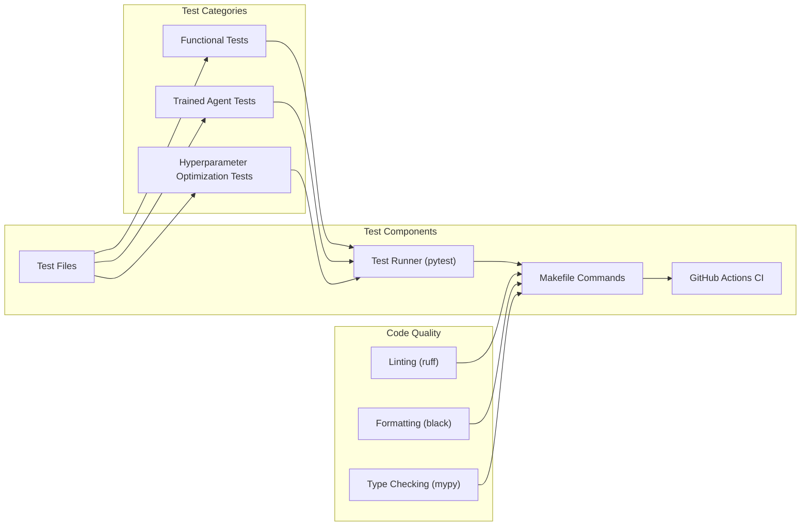
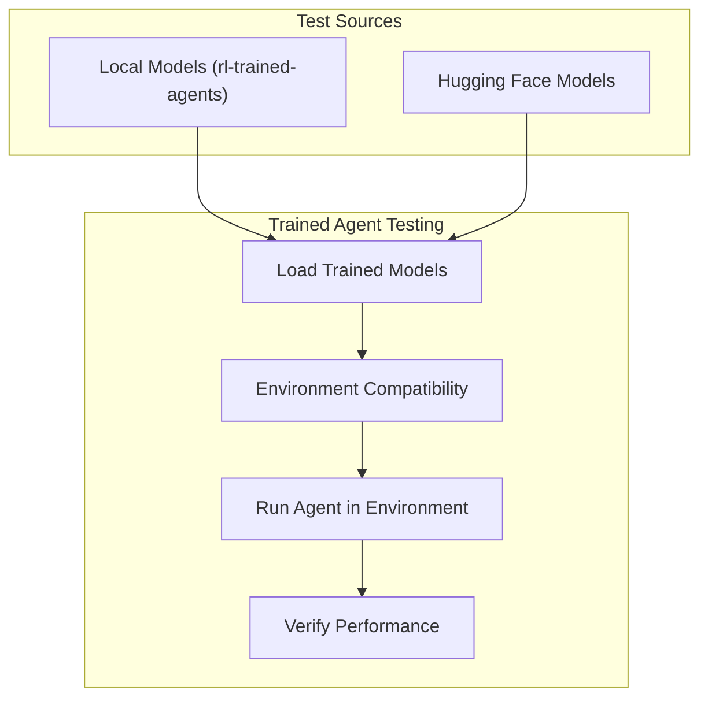
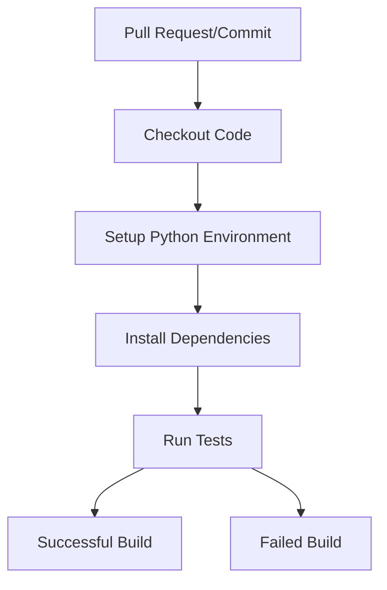
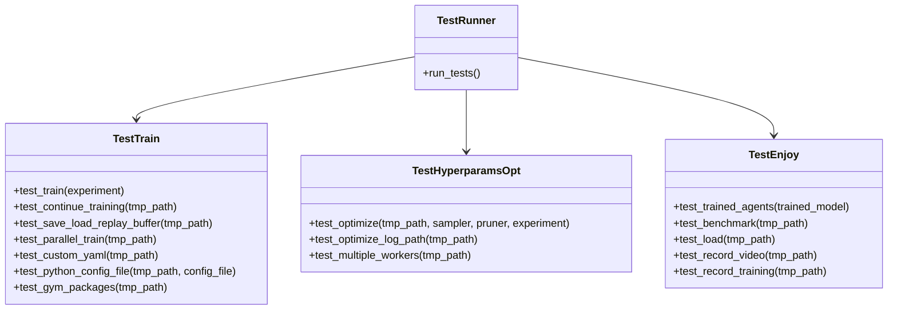
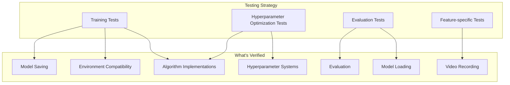

<!-- source: DeepWiki mcp.deepwiki.com · repo DLR-RM/rl-baselines3-zoo · page 9.1 Testing Framework · fetched 2026-10-14 -->

# Testing Framework

<details>
<summary>Relevant source files</summary>

The following files were used as context for generating this wiki page:

- [.github/workflows/trained_agents.yml](.github/workflows/trained_agents.yml)
- [Makefile](Makefile)
- [pyproject.toml](pyproject.toml)
- [rl_zoo3/hyperparams_opt.py](rl_zoo3/hyperparams_opt.py)
- [tests/test_enjoy.py](tests/test_enjoy.py)
- [tests/test_hyperparams_opt.py](tests/test_hyperparams_opt.py)
- [tests/test_train.py](tests/test_train.py)

</details>


This page documents the testing system of RL-Baselines3-Zoo, explaining how tests are organized, executed, and configured. The testing framework ensures the reliability and correctness of the codebase through a combination of unit tests, functional tests, and continuous integration. For information about the documentation system, see [Documentation System](#9.2).

## Testing Architecture Overview

The testing framework in RL-Baselines3-Zoo consists of several key components:

1. **Test Files**: Python files in the `tests/` directory that contain test functions
2. **Test Runner**: pytest for test discovery and execution
3. **Makefile Commands**: Simplified commands to run different test configurations
4. **GitHub Actions**: CI pipeline for automated testing on each commit and pull request
5. **Code Quality Tools**: Code formatting, linting, and type checking



Sources: [Makefile:1-25](), [.github/workflows/trained_agents.yml:1-66](), [tests/test_train.py:1-122](), [tests/test_hyperparams_opt.py:1-134](), [tests/test_enjoy.py:1-135]()

## Test Categories

The testing framework includes several categories of tests that validate different aspects of the codebase:

### Functional Tests

These tests verify the core functionality of the training, evaluation, and hyperparameter optimization systems.

| Test File | Purpose |
|-----------|---------|
| `test_train.py` | Tests the training system with different algorithms and environments |
| `test_enjoy.py` | Tests the evaluation system and model loading |
| `test_hyperparams_opt.py` | Tests hyperparameter optimization with different samplers and pruners |

### Trained Agent Verification Tests

These tests check that pre-trained agents can be loaded and perform as expected in their environments, ensuring backwards compatibility.



Sources: [tests/test_enjoy.py:20-60](), [.github/workflows/trained_agents.yml:63-65]()

### CI Pipeline

The continuous integration system automatically runs tests on each pull request and commit to the master branch.



Sources: [.github/workflows/trained_agents.yml:1-66]()

## Test Runner Configuration

The test runner (pytest) is configured through the `pyproject.toml` file:

```toml
[tool.pytest.ini_options]
# Deterministic ordering for tests; useful for pytest-xdist.
env = [
    "PYTHONHASHSEED=0"
]

filterwarnings = [
    # Tensorboard warnings
    "ignore::DeprecationWarning:tensorboard",
    # Gym warnings
    "ignore::UserWarning:gym",
]
markers = [
    "slow: marks tests as slow (deselect with '-m \"not slow\"')"
]
```

Sources: [pyproject.toml:33-47]()

## Running Tests

The Makefile provides several commands to run different types of tests:

### Basic Test Commands

| Command | Description |
|---------|-------------|
| `make pytest` | Run all tests |
| `make check-trained-agents` | Check all trained agents (slow) |
| `make mypy` | Run type checker |
| `make lint` | Run linter to check code style |
| `make format` | Format code with black and ruff |
| `make check-codestyle` | Check code style without formatting |
| `make commit-checks` | Run format, type checking, and linting |

Sources: [Makefile:1-35]()

### Test Implementation Details

The test files contain parameterized tests that run against different algorithms and environments:



Sources: [tests/test_train.py:30-121](), [tests/test_hyperparams_opt.py:40-133](), [tests/test_enjoy.py:26-134]()

## Continuous Integration

The project uses GitHub Actions for continuous integration, running tests on multiple Python versions and Gymnasium versions to ensure compatibility.

### CI Configuration

The CI workflow is defined in `.github/workflows/trained_agents.yml`:

```yaml
name: Check-Trained-Agents

on:
  push:
    branches: [master]
  pull_request:
    branches: [master]

jobs:
  build:
    runs-on: ubuntu-latest
    strategy:
      matrix:
        python-version: ["3.9", "3.10", "3.11", "3.12"]
        include:
          # Default version
          - gymnasium-version: "1.0.0"
          # Add a new config to test gym<1.0
          - python-version: "3.10"
            gymnasium-version: "0.29.1"
```

The CI process runs the following steps:
1. Checkout the code repository
2. Set up Python environment
3. Install dependencies
4. Install specific Gymnasium version
5. Run the trained agent tests

Sources: [.github/workflows/trained_agents.yml:1-66]()

## Code Quality Tools

The project uses several tools to maintain code quality:

### Type Checking

The project uses mypy for static type checking:

```bash
make mypy
```

Type checking configuration:

```toml
[tool.mypy]
ignore_missing_imports = true
follow_imports = "silent"
show_error_codes = true
exclude = """(?x)(
    tests/dummy_env/*$
  )"""
```

Sources: [Makefile:11-14](), [pyproject.toml:25-31]()

### Code Formatting and Linting

The project uses:
- black for code formatting
- ruff for linting

Configuration for these tools is in `pyproject.toml`.

Sources: [Makefile:16-33](), [pyproject.toml:1-24]()

### Coverage Reporting

Test coverage configuration is defined in `pyproject.toml`:

```toml
[tool.coverage.run]
disable_warnings = ["couldnt-parse"]
branch = false
omit = [
    "tests/*",
    "setup.py",
    "rl_zoo3/plots/*",
    "rl_zoo3/push_to_hub.py",
    "scripts/*",
]

[tool.coverage.report]
exclude_lines = [ "pragma: no cover", "raise NotImplementedError()", "if typing.TYPE_CHECKING:"]
```

Sources: [pyproject.toml:49-61]()

## Test Implementation Strategy

The testing strategy focuses on verifying that:

1. Training works with different algorithms and environments
2. Hyperparameter optimization functions correctly
3. Pre-trained agents can be loaded and evaluated
4. Model saving and loading works correctly
5. Various features like video recording function as expected



Sources: [tests/test_train.py:1-122](), [tests/test_hyperparams_opt.py:1-134](), [tests/test_enjoy.py:1-135]()

## Test Script Details

The test script `run_tests.sh` is executed by the `make pytest` command and handles running the tests with proper settings:

```bash
./scripts/run_tests.sh
```

This script likely runs pytest with coverage reporting and handles environment variables needed for testing.

Sources: [Makefile:4-5]()

---

