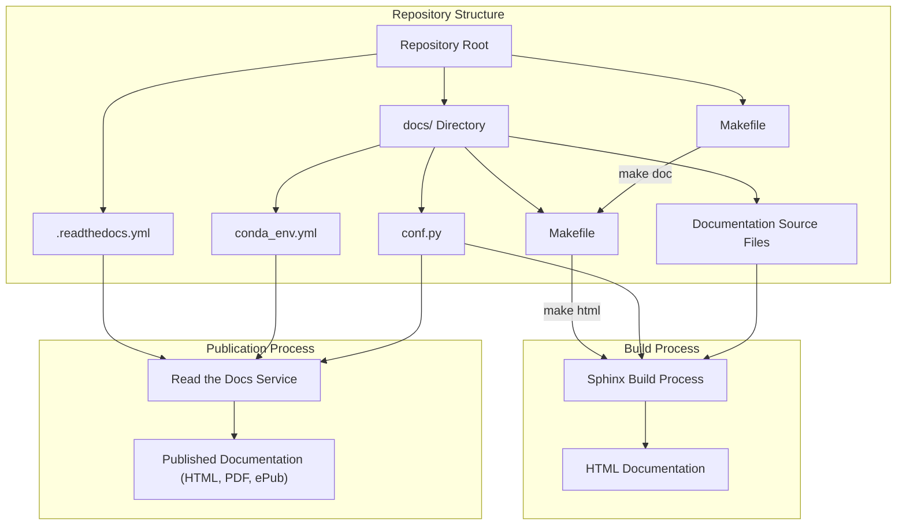
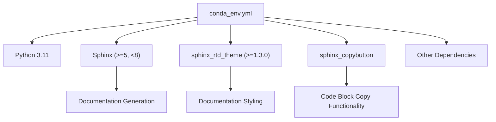
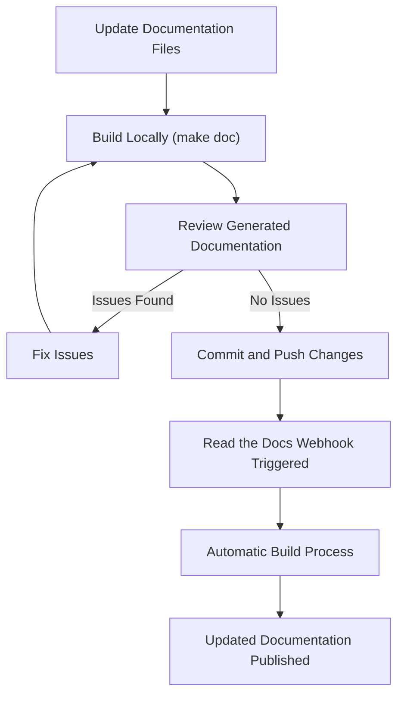

<!-- source: DeepWiki mcp.deepwiki.com · repo DLR-RM/rl-baselines3-zoo · page 9.2 Documentation System · fetched 2026-10-14 -->

# Documentation System

<details>
<summary>Relevant source files</summary>

The following files were used as context for generating this wiki page:

- [.readthedocs.yml](.readthedocs.yml)
- [Makefile](Makefile)
- [docs/conda_env.yml](docs/conda_env.yml)
- [pyproject.toml](pyproject.toml)
- [setup.py](setup.py)

</details>


This page describes the documentation system used by RL-Baselines3-Zoo, including how documentation is structured, built, and published. For information about testing the codebase, see [Testing Framework](#9.1).

## Purpose and Overview

The RL-Baselines3-Zoo documentation system provides comprehensive information about the framework's installation, usage, API, and implementation details. It uses Sphinx for documentation generation and is hosted on Read the Docs to ensure accessibility and up-to-date content for users and contributors.

## Documentation Architecture

The documentation system consists of several interconnected components:



Sources: [Makefile:37-44](), [.readthedocs.yml:1-21]()

## Build System

Documentation building is managed through a two-level Makefile structure:

1. The root `Makefile` in the repository contains high-level documentation targets:

| Target | Description | Command |
|--------|-------------|---------|
| `doc` | Build HTML documentation | `cd docs && make html` |
| `spelling` | Check documentation spelling | `cd docs && make spelling` |
| `clean` | Clean documentation build files | `cd docs && make clean` |

2. An internal `Makefile` within the `docs/` directory contains Sphinx-specific build commands.

Running `make doc` from the repository root will build the documentation and generate HTML files.

Sources: [Makefile:37-44]()

## Documentation Environment

The documentation build environment is defined in `docs/conda_env.yml`, specifying all dependencies needed to build the documentation:



Sources: [docs/conda_env.yml:1-27]()

## Read the Docs Integration

RL-Baselines3-Zoo uses Read the Docs for automatically building and hosting documentation. The configuration is defined in `.readthedocs.yml`:

| Configuration | Value |
|---------------|-------|
| Sphinx configuration file | `docs/conf.py` |
| Documentation formats | All (HTML, PDF, ePub) |
| Environment | Conda environment from `docs/conda_env.yml` |
| Build OS | Ubuntu 24.04 |
| Python distribution | mambaforge-23.11 |

This configuration ensures that documentation is automatically rebuilt whenever changes are pushed to the repository.

Sources: [.readthedocs.yml:1-21]()

## Documentation Workflow

The typical workflow for updating documentation in RL-Baselines3-Zoo:



Sources: [Makefile:37-44](), [.readthedocs.yml:1-21]()

## Documentation in Project Information

The documentation URL is specified in `setup.py` as one of the project URLs:

```python
project_urls={
    "Documentation": "https://rl-baselines3-zoo.readthedocs.io/en/master/",
    # Other URLs...
}
```

This makes it easy for users to find the documentation from the project's PyPI page.

Sources: [setup.py:61-68]()

## Documentation Maintenance Guidelines

To maintain the documentation:

1. Build documentation locally with `make doc` before committing changes
2. Check for spelling errors with `make spelling`
3. Ensure all key components and features are documented
4. Keep API references up-to-date with code changes
5. Update tutorials and examples as the codebase evolves

Following these guidelines helps ensure that the documentation remains accurate, comprehensive, and useful for all users of RL-Baselines3-Zoo.

Sources: [Makefile:37-44]()

## Documentation and Package Distribution

The documentation URL is built into the package metadata in `setup.py`, making it accessible to users who install the package. The long description in `setup.py` also contains a brief overview and a link to the GitHub repository, providing users with immediate access to more information.

Sources: [setup.py:12-16](), [setup.py:61-68]()

---

